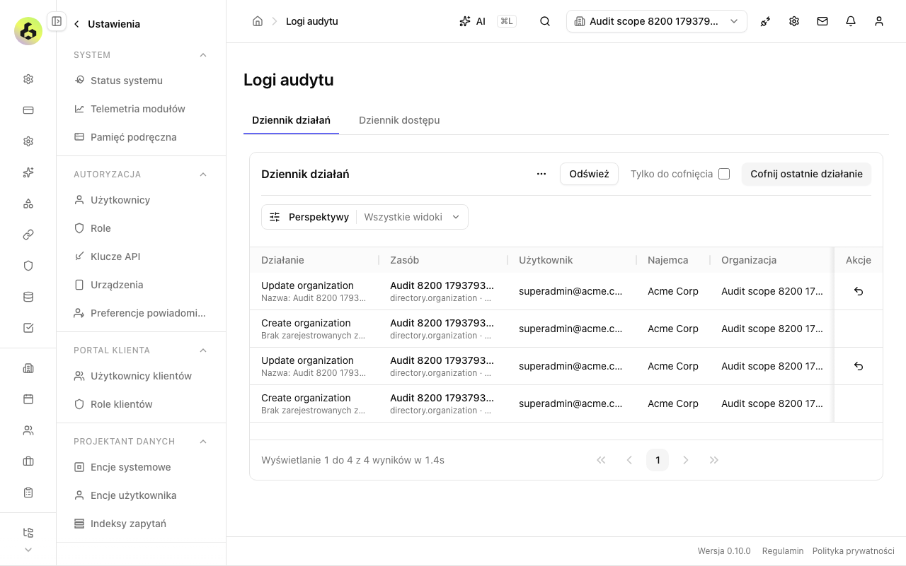

# Issue 8200 review and verification

Implementation: `7b4ff44607` on `cez/f90a1051`; baseline `e5774a707321fe14867a19663bc486d7a001492d`.
Spec-only PR: https://github.com/open-mercato/open-mercato/pull/8673 (`82a1b58b00`).

## Verdict
Blocked for publication by the incomplete full workspace unit gate; live integration has passed. Independent static review approved after one correction: label parent changes generically outside directory organizations. A separate read-only review of the integration test also approved fixture scoping, actual API shapes, historical row identity, undo/redo readback and cleanup. Final independent review also found no new static/security/UI concerns after inspecting the live screenshot and evidence. It noted that seconds/status are outside the screenshot’s horizontal view and are proved by the integration assertions. None of these static verdicts is a merge approval; publication remains blocked until the full gate passes.

## Scope and compatibility
Production changes are limited to audit_logs presentation, its helper and five locale files. No API, schema, write contract, authorization, encryption, dependency, shared DataTable, generated registry or other module source changes. Recognized primitive previews are bounded; unknown/complex/ciphertext values receive only a count. The existing scoped/decrypted response remains the data boundary. API permissions, undo/redo eligibility, request bodies and callbacks are preserved.

Reviewed against root/core/UI/backend guidance, BACKWARD_COMPATIBILITY.md, the issue-specific spec, repository review/security checklists, om-code-review and the existing snapshot readback lesson. No new client root, provider, heavy dependency or network request. Scoped DS lint passes.

## Evidence
- `yarn install --immutable`: passed with pre-existing peer warnings.
- Baseline `yarn build:packages`: passed, 42 cached tasks.
- Initial focused unit invocation: `yarn workspace @open-mercato/core test --runInBand --runTestsByPath src/modules/audit_logs/lib/__tests__/rowPresentation.test.ts src/modules/audit_logs/components/__tests__/AuditLogsActions.rowClick.test.tsx`: 2 suites, 23 tests passed.
- Final `yarn workspace @open-mercato/core test --runInBand src/modules/audit_logs`: 16 suites, 210 tests passed (159.616s). This includes scoped route/security regressions and real DataTable interactions.
- Baseline regression: extract the exact baseline `AuditLogsActions.tsx` with `git show e5774a707321fe14867a19663bc486d7a001492d:packages/core/src/modules/audit_logs/components/AuditLogsActions.tsx`; redirect only the component import through a temporary Jest config while retaining the real DataTable; run `yarn jest --config <private-task-tmp>/baseline-jest.cjs --runInBand --runTestsByPath <worktree>/packages/core/src/modules/audit_logs/components/__tests__/AuditLogsActions.rowClick.test.tsx --testNamePattern 'identifies records'`. Expected failure: cannot find `Organization B`; 1 failed, 5 skipped. Original attempt with the baseline fixture outside the repository could not resolve React; moving the temporary fixture under ignored issue-specific evidence fixed resolution before the meaningful failure.
- `node --require ./scripts/typescript-js-require-hook.cjs node_modules/eslint/bin/eslint.js --config eslint.ds.config.mjs packages/core/src/modules/audit_logs/components/AuditLogsActions.tsx`: passed.
- `git diff --check`: passed.
- `yarn playwright test --config=.ai/qa/tests/playwright.config.ts --list TC-AUD-8200-row-identification`: no output before 300-second limit; discovery timed out. No scenario execution is claimed.

## Runtime constraints
The advertised parent runtime descriptors were dated October 12 and `lsof -nP -iTCP:5001 -sTCP:LISTEN` found no listener. No other task's database or environment was used. Parent subsequently authorized native fully isolated disposable initialization and serialized runtime slots. After both existing sibling builds ended and our app build passed, the slot was granted and the native managed issue-specific integration run started with a 7200-second outer bound. `yarn test:integration:ephemeral TC-AUD-8200-row-identification --no-reuse-env --screenshots --verbose` passed with exit 0 in 1988.5s. Playwright recorded 1 expected pass, 0 skipped, 0 flaky, retry 0; the scenario took 19.831s (report total 765.080s including discovery). The native runner initialized the new disposable database in 421s, built packages in 75s, generated in 25s, rebuilt packages in 1s, built the app in 638s, and passed readiness in 20s. Discovery remained CPU-active for over 12 minutes; a read-only sample showed regex compilation/array filtering. No runner edits, assertion changes or test timeout changes were made.

The test created its own organization scope and two records, read exact audit log IDs, verified Polish row identity/status/seconds and sticky keyboard actions, checked undo/redo effects on both records, and cleaned up fixtures. The screenshot was visually inspected at 1280×800: the actions stay at the visible right edge; record names and summaries use bounded text. Long fixture names are truncated with their full titles available. API assertions proved only the intended record changed.

Native teardown completed. The app port was closed; owned launcher, Playwright, app and worker PIDs were absent; the ephemeral descriptor and both owned containers were absent. The runtime slot was released to the parent immediately. Runtime logs included query-index scope errors from directory fixture events outside this change; no unrelated source was repaired. The shutdown log's server exit 143 followed native SIGTERM cleanup; the integration command and Playwright report both passed.

## Environment and artifacts
Runner: local. Cezar's inherited macOS TMPDIR exceeded Unix socket path limits, causing the first spec commit hook's tsx startup to fail with EINVAL. Hooks passed without bypass after shortening the path. Subsequent commands use a private directory created by `mktemp -d /private/tmp/cz-XXXXXX` and pass all three of TMPDIR, TMP and TEMP per command. Parent verification should do the same. Raw logs remain local in `.ai/qa/artifacts/issue-8200/`; they are intentionally not committed.

## Configured gate
First six commands passed: `yarn build:packages` (133.3s), `yarn generate` (69.9s), `yarn build:packages` (167.6s), `yarn i18n:check-sync` (13.5s), `yarn i18n:check-usage` (1991.1s), `yarn typecheck` (42 workspaces, 254.7s).

`yarn test` timed out with exit 124 after 2401.2 seconds, with 19 of 49 Turbo tasks complete (4 cached). It reported two unresolved failures in unchanged files: customer EntityTagsDialog “hides Load more once a labels page comes back short” expected the button absent but it remained visible; design_system/gallery/color-playground “keeps the last valid colors on invalid input and resets the complete configuration” exceeded its existing 30-second test timeout (suite 310.292s). No baseline failure or flake classification is claimed. Host load was 87 at observation. Known owned test processes exited after timeout cleanup. Parent reports sibling #8204 reran the unchanged EntityTagsDialog suite alone with `yarn workspace @open-mercato/core test --runInBand src/modules/customers/components/detail/__tests__/EntityTagsDialog.test.tsx`: 15 tests passed in 94.63s. This is shared diagnostic evidence, not this branch’s full gate or baseline proof. Our bounded native-package diagnostic `yarn workspace @open-mercato/core test --runInBand src/modules/design_system/gallery/__tests__/color-playground.test.tsx` passed 1 suite / 13 tests (Jest 124.755s, command 176.2s) after the heavyweight runs ended. Neither diagnostic changed source, configuration or assertion timeouts. The original full-run failures are therefore not reproduced in isolation, but the full-run timeout still leaves the required gate incomplete. `yarn build:app` passed in 1513.0s (production compilation, TypeScript, page collection/optimization). Dynamic filesystem tracing warnings originated in unchanged queue code. All configured commands were attempted; the full test timeout remains a failed gate. Results are recorded locally in `.ai/qa/artifacts/issue-8200/gate-results.json`; the gate has not passed.
