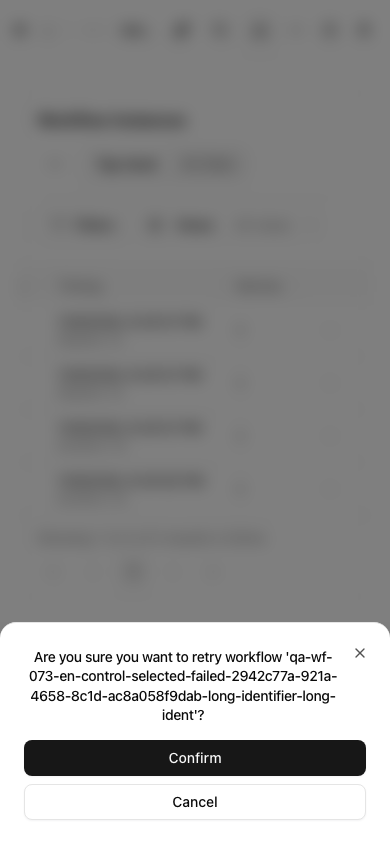
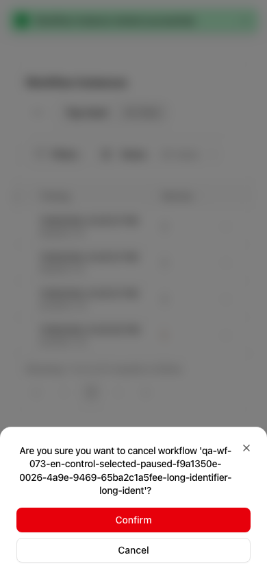
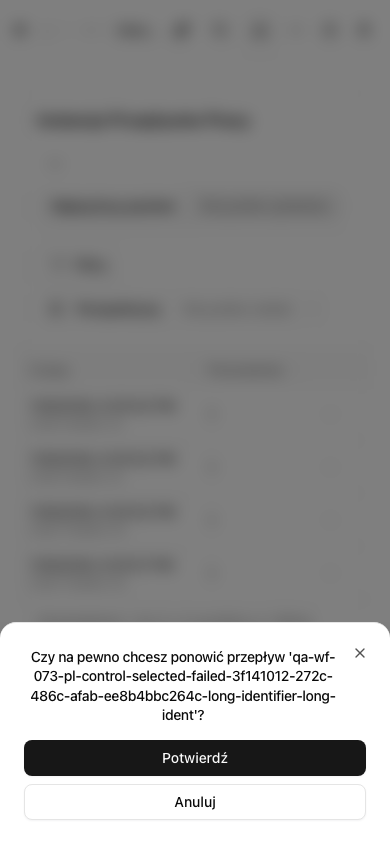
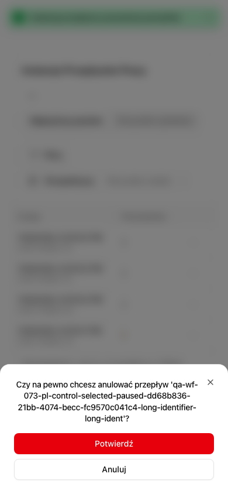

## 📸 UI QA evidence — PARTIAL

**Verdict: PARTIAL.** All requested browser scenarios passed (4/4, 28.0s), but validation used the authorized temporary #8805 overlay and does not prove an unmodified exact-head green gate. No QA approval is applied.

**Target:** PR #8836, `fix/issue-8825-confirmation-browser-fbc0d1bc` @ `b9f50c678a00494f14282c2cb2cdb88cf03b81ac`.
**Executed:** managed `yarn mercato test:integration TC-WF-073`, `http://127.0.0.1:5001`, admin, Playwright Chromium. Browser-tested workflow test source SHA-256: `de26296e6a0c5b43dc831d329f781953fb1933b83809c2d53cc88ca870b96487`. Latest base sync after browser execution only changed customers files. Warranty overlay is restored and absent from the PR.

| # / Priority | Route/action | Expected | Observed | Result |
|---|---|---|---|---|
| 1 / P1 | /backend/instances: Create own FAILED/PAUSED fixtures and controls | Own API-created definitions and executor-started instances | Four fixtures per case; all four cases passed | PASS |
| 2 / P1 | /backend/instances: EN Retry/Cancel titles | Exact selected workflow identifier, no raw interpolation token | Both exact titles passed | PASS / [image](https://raw.githubusercontent.com/open-mercato/open-mercato/qa-evidence-pr-8836-workflows-fbc0d1bc/pr-8836/en-retry-390px.png) |
| 3 / P1 | /backend/instances: PL Retry/Cancel titles | Exact selected workflow identifier, no raw interpolation token | Both exact localized titles passed | PASS / [image](https://raw.githubusercontent.com/open-mercato/open-mercato/qa-evidence-pr-8836-workflows-fbc0d1bc/pr-8836/pl-cancel-390px.png) |
| 4 / P1 | /backend/instances: Cancel button and Escape | No action POST; every fixture API record unchanged | Full-record equality and zero requests passed | PASS |
| 5 / P1 | /backend/instances: Control+Enter | One request to selected instance; controls unchanged | Both actions passed in both locales | PASS |
| 6 / P1 | /backend/instances: Meta+Enter | One request to selected instance; controls unchanged | Both actions passed in both locales | PASS |
| 7 / P1 | /backend/instances: 390×844 with 100-character identifiers | Title and both actions fit within viewport without element overflow | Bounds assertions passed; four screenshots visually inspected | PASS / [image](https://raw.githubusercontent.com/open-mercato/open-mercato/qa-evidence-pr-8836-workflows-fbc0d1bc/pr-8836/pl-retry-390px.png) |
| 8 / P1 | /backend/instances: Finally cleanup | Cancel own instances and delete own execution records/definitions | All cases completed teardown successfully; managed environment stopped | PASS |

### Screenshots

### Not exercised / blockers

Other locales, permissions and empty/error states were not exercised; no new permissions were introduced. The unmodified branch still depends on #8805. The broad unit gate failed the create-app OMH-057 context budget. Native GitHub self-review was refused, so findings are recorded as a comment, not a native approval. The managed environment was stopped after execution; no reusable environment remains.

The successful runner unsets DOTENV_CONFIG_OVERRIDE and uses generated disposable signing material. Earlier attempts with the literal false string overwrote managed settings; possible database-isolation impact was disclosed to the parent and was not independently verified. No secret values or environment files are included in this evidence.
