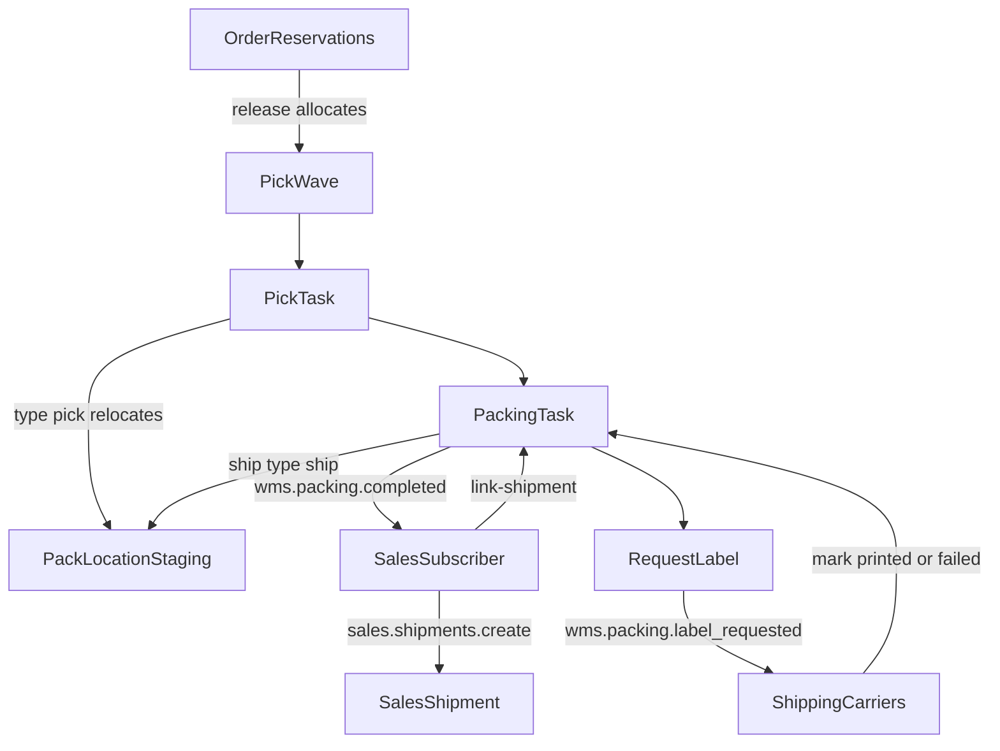

# WMS Phase 3 Specification — Picking and Packing

| Field | Value |
|-------|-------|
| **Status** | Ready for implementation |
| **Author** | Cursor Agent |
| **Created** | 2026-04-15 |
| **Related** | 2026-04-15-wms-roadmap, 2026-04-15-wms-phase-1-core-inventory, 2026-04-15-wms-phase-2-inbound-putaway, Issue #388 |

## TLDR

**Key Points:**

- Phase 3 is outbound execution for one warehouse: a pick wave groups reserved sales-order demand, pick tasks move that stock onto a single pack location, packing verifies it, and a separate ship command is the only on-hand decrement.
- Sales owns the shipment document. WMS emits `wms.packing.completed` and does not call `sales.shipments.create`. A sales subscriber creates or reuses the shipment and writes the id back.
- Carrier labels are a later command, `request-label`. Failure changes `label_status` only. It does not undo packing or shipping.
- There is no `shipping` module and no wave strategy enum. Batch, zone, and route optimization are out of this phase.

**Scope:**

- `Warehouse.pack_location_id`, `PickWave`, `PickTask`, `PackingTask`, `PackingTaskLine`
- Release, assign, start, confirm, short, cancel, pack, ship, and label-request commands
- Sales shipment link and a soft-optional `shipping_carriers` label subscriber

**Out of scope:**

- Movement type `pack` (the enum value stays unused)
- Carton entities, pack-quantity variance, automatic re-waves
- `shipping.shipment.created` / `shipping.shipment.dispatched` (those events do not exist)
- Re-emitting `wms.putaway.completed`

## Overview

Phase 3 turns reserved stock into picked, packed, and shipped goods. Warehouse leads release orders that already have an active reservation. Pickers move the allocated quantity from the storage bin to the warehouse pack location. Packers confirm that quantity. A ship command then removes it from on-hand and fulfills that portion of the reservation.

The physical ledger and the sales shipment are different steps. Packing tells sales that goods are ready. Shipping tells the ledger that goods have left. Labels are a third step owned by `shipping_carriers`.

> **Market reference:** One pack location and order-grouped tasks match a small-warehouse flow (single staging lane, no zone routing). Wave/batch/zone optimizers from Odoo-style WMS are deferred until the ledger transitions below are in production.

## Problem Statement

After phases 1 and 2:

1. Sales confirmation can reserve stock, and allocate can move `quantity_reserved` to `quantity_allocated`, but nothing creates warehouse work from those reservations.
2. `InventoryMovement.type` already contains `pick` and `ship`, and nothing defines which command writes which type.
3. `sales` already owns shipment records (`sales.shipment.created` / `updated` / `deleted`). `shipping_carriers` already owns label purchase (`shipping_carriers.shipment.created` and status events). There is no `shipping` module and no `shipping.shipment.dispatched`.
4. Staging and dock locations are already non-reservable (`isReservableLocationType`). Outbound needs a destination that cannot be sold again while it waits to leave.

## Resolved Decisions

| Decision | Choice |
|----------|--------|
| When on-hand falls | Only `ship`. Confirm and short relocate stock onto the pack location. |
| Who opens work | A supervisor releases a wave from active order reservations. A sales shipment does not allocate stock and does not create tasks. |
| Who creates the sales shipment | The sales module, in a subscriber on `wms.packing.completed`. WMS only stores the returned id. |
| Short remainder | Picked quantity follows the pick move. Unpicked quantity goes back to `quantity_reserved` on the source bin. No new task is created. |
| Wave shape | Named group of tasks for selected orders of one warehouse. No `single` / `batch` / `zone` / `wave` strategy. |
| Labels | `POST .../request-label` after packing. Retryable. Does not roll back pack or ship. |

## Proposed Solution

### Ledger

Balances stay phase-1 buckets: `quantity_available = quantity_on_hand - quantity_reserved - quantity_allocated`. Reserved and allocated are disjoint. Total on-hand is unchanged by a pick.

| Step | Source on-hand | Pack on-hand | Source reserved | Source allocated | Pack allocated | Reservation |
|------|----------------|--------------|-----------------|------------------|----------------|-------------|
| Release | unchanged | unchanged | −task qty | +task qty | unchanged | bucket state `allocated` |
| Confirm | −qty | +qty | unchanged | −qty | +qty | bucket location becomes the pack location; state stays `allocated` |
| Short, picked part | −picked | +picked | unchanged | −picked | +picked | picked bucket moves to the pack location |
| Short, remainder | unchanged | unchanged | +remainder | −remainder | unchanged | remainder bucket stays on the source; state `reserved` |
| Cancel open task | unchanged | unchanged | +qty | −qty | unchanged | bucket state `reserved` |
| Ship | unchanged | −qty | unchanged | unchanged | −qty | `quantity` falls by the shipped qty; `fulfilled` at 0 |

`received_at` on the pick movement is copied from the source bucket's receipt timestamp (phase 1 rotation rule). Ship writes `type = ship` with `location_from_id` = pack location and `location_to_id` null. Pick writes `type = pick`. Neither command writes `type = pack`.

Both movements use `reference_type = so`, `reference_id` = sales order id, and metadata `pickTaskId` or `packingTaskId`.

### Pack location

`Warehouse` gains nullable `pack_location_id`. The location must be an active `staging` location in the same warehouse. Staging is already excluded from sales reservation, so picked goods cannot be reserved onto a second order. The allocated quantity moves with the stock, so the pack bucket's available quantity stays zero even if a caller skips the location-type check.

Release, confirm, short, and ship fail with `409 pack_location_missing` when it is unset, inactive, or not type `staging`.

ASN receive rejects this location as `target_staging_location_id` with `409 pack_location_not_inbound`. Inbound staging and outbound packing do not share a bin.

### Work model

One pick task per still-reserved reservation bucket. Reservations are `source_type = order` and `source_id = sales order id`. Transfer and manual reservations are ignored. Release does not invent quantity for order lines that were never reserved.

One packing task per `(wave, sales order)`, created inside the transaction that makes every pick task of that wave for that order terminal (`done`, `short`, or `cancelled`) when the sum of `quantity_picked` on those picks is positive. The decision is made only after the wave lock below, re-reading every pick of that wave for that order. Lines point only at those picks. An open pick on another wave does not delay this packing task, and this packing task does not include that pick. No carton, no JSON snapshot. Confirm, short, and cancel undo soft-delete that task while it is still `open` or `in_progress`, so a mis-confirmed or mis-cancelled last pick can be corrected before anybody completes packing.

### Design Decisions

| Decision | Rationale |
|----------|-----------|
| Ship is the only issue | Confirm and `shipping` dispatch cannot both decrement on-hand |
| WMS emits, sales creates the shipment | Matches module isolation: the consumer owns the glue; WMS does not import sales entities |
| Existing sales shipment is a link, not a second wave | Stops the old hybrid trigger from allocating the same reservation twice |
| Short returns quantity to reserved | The order keeps its claim; a supervisor releases again on purpose |
| One packing task per wave and order | The later wave packs only the picks it released. The first wave packs and ships its own picks while that later wave is still open |
| No strategy enum | The data model has no zone split and no sortation step |
| Label command is outside the pack transaction | A carrier error must not roll back picked or packed stock |
| `wms.packing.completed` is not undoable | Sales raises fulfilled quantity when it creates the shipment. Undoing complete would leave that shipment in place |
| Tasks are not CRUD-created | A second writer would bypass allocation |

### Alternatives Rejected

| Alternative | Why rejected |
|-------------|--------------|
| Decrement on-hand at confirm | Pack-location stock would vanish before it leaves; cycle count of the pack lane would be wrong |
| Pick and pack as status-only, one movement at ship | The ledger would not record which bin was emptied |
| Listen to `shipping.shipment.created` and also create a shipment at pack | The module does not exist; two triggers double-allocate |
| WMS calls `sales.shipments.create` inside complete | Hard WMS → sales dependency in the packing transaction |
| Auto-create a new pick task on short | Hides the shortage inside the same wave and can loop |
| Keep `batch` and `zone` without algorithms | An enum that does not change task generation |

## User Stories

- **Supervisor** releases selected orders in one warehouse into a wave and can cancel that wave until someone starts a pick.
- **Picker** confirms the full task or shorts it. A short leaves the missing quantity reserved while the order is active and releases it after cancellation.
- **Packer** starts and completes packing for one order. Completion does not change balances.
- **Sales** sees a shipment created from the pack event, and order detail shows `_wms.fulfillmentSummary`.
- **Shipper** runs ship only after the sales shipment id is linked. That is the stock issue.
- **Label clerk** requests a carrier label after packing. A failed label stays retryable.

## Architecture



### Commands

Public and system command ids:

| Command | Who |
|---------|-----|
| `wms.pick-waves.release` | `wms.manage_pick_waves` |
| `wms.pick-waves.cancel` | `wms.manage_pick_waves` |
| `wms.pick-tasks.assign` | `wms.manage_pick_waves` |
| `wms.pick-tasks.start` | assignee with `wms.execute_picks`, or `wms.manage_pick_waves` |
| `wms.pick-tasks.confirm` | same as start |
| `wms.pick-tasks.short` | same as start |
| `wms.pick-tasks.cancel` | `wms.manage_pick_waves` |
| `wms.packing-tasks.start` | `wms.manage_packing` |
| `wms.packing-tasks.complete` | `wms.manage_packing` |
| `wms.packing-tasks.ship` | `wms.manage_packing` |
| `wms.packing-tasks.request-label` | `wms.print_labels` |
| `wms.packing-tasks.link-shipment` | system (`auth: null`), sales subscriber only |
| `wms.packing-tasks.mark-label-printed` | system, `shipping_carriers` subscriber only |
| `wms.packing-tasks.mark-label-failed` | system, `shipping_carriers` subscriber only |

Draft wave create/update/delete stay on the wave CRUD commands. There is no public `createPackingTask` and no `handoffPackedShipment`.

`wms.inventory.allocate` gains an optional `buckets` filter: `{ balanceId, quantity }[]`. Omitted, it keeps today's behavior and allocates every still-reserved bucket. Release uses the filter so a reservation that is already partly on the pack location is not allocated twice. This argument is additive.

### Events emitted

| Event | When | Payload |
|-------|------|---------|
| `wms.pick_wave.released` | release commits | `pickWaveId`, `warehouseId`, `pickTaskIds`, `tenantId`, `organizationId` |
| `wms.pick_wave.completed` | wave status becomes `completed` | `pickWaveId`, `warehouseId`, `pickTaskCount`, `shippedPackingTaskCount`, `tenantId`, `organizationId` |
| `wms.pick_wave.cancelled` | wave cancelled | `pickWaveId`, `warehouseId`, `tenantId`, `organizationId` |
| `wms.pick_task.created` | each task inserted at release | `pickTaskId`, `pickWaveId`, `reservationId`, `salesOrderId`, `quantity`, `tenantId`, `organizationId` |
| `wms.pick_task.started` | start | `pickTaskId`, `assignedTo`, `tenantId`, `organizationId` |
| `wms.pick_task.completed` | confirm | `pickTaskId`, `movementId`, `quantity`, `tenantId`, `organizationId` |
| `wms.pick_task.shorted` | short | `pickTaskId`, `quantityPicked`, `quantityShort`, `tenantId`, `organizationId` |
| `wms.pick_task.cancelled` | cancel | `pickTaskId`, `tenantId`, `organizationId` |
| `wms.packing.created` | this wave's picks for the order became terminal with picked qty > 0 | `packingTaskId`, `pickWaveId`, `salesOrderId`, `tenantId`, `organizationId` |
| `wms.packing.completed` | complete | `packingTaskId`, `pickWaveId`, `warehouseId`, `salesOrderId`, `packLocationId`, `lines[]`, `tenantId`, `organizationId` |
| `wms.packing.shipped` | ship | `packingTaskId`, `salesShipmentId`, `salesOrderId`, `movementIds`, `tenantId`, `organizationId` |
| `wms.packing.label_requested` | request-label | `packingTaskId`, `labelRequestId`, `salesOrderId`, `salesShipmentId`, `warehouseId`, `tenantId`, `organizationId` |

`lines[]` on `wms.packing.completed` is `{ packingTaskLineId, pickTaskId, catalogVariantId, lotId, serialNumber, quantity }`. Quantity is the packed string, equal to `quantity_picked`.

Do not emit `wms.shipment.ready_for_label`, `wms.shipment.handed_off`, or a second `wms.putaway.completed`.

### Events consumed

WMS does not subscribe to sales shipment CRUD and does not subscribe to carrier events.

| Subscriber owner | Event | Behavior |
|------------------|-------|----------|
| `sales` | `wms.packing.completed` | Create or reuse one sales shipment. Call `wms.packing-tasks.link-shipment`. |
| `shipping_carriers` | `wms.packing.label_requested` | Purchase a label. Call `mark-label-printed` or `mark-label-failed`. |

Both subscribers are soft-optional. Each resolves the peer command in `try/catch` and no-ops when the peer module is absent. WMS never imports sales or `shipping_carriers` entities.

The already-seeded toggle `wms_integration_shipping_shipments` (default `true`) gates **emission** of `wms.packing.label_requested`. It does not allocate stock. The roadmap id `wms_integration_shipping_shipment_lifecycle` is not introduced. Update the seeded toggle's description to this meaning; no subscriber behavior has shipped under the old description.

Sales shipment creation is not behind that toggle.

### Status machines

**Pick wave:** `draft → released → in_progress → completed`, or `→ cancelled`.

- `released` after release.
- `in_progress` when any pick is `in_progress` or any packing task exists.
- `completed` when no pick is `open` or `in_progress` and every packing task is `shipped`. A wave whose picks are all `short` with picked quantity 0 has no packing task and still completes.
- `cancelled` when every pick is `cancelled` and no packing task exists. A wave of only cancellations is `cancelled`, not `completed`.

Each command recomputes the wave status from these rules before commit.

**Pick task:** `open → in_progress → done | short`. `open → cancelled`. Undo is the only transition back to `open`, and only while this wave's packing task for the order is absent or still `open` or `in_progress`.

**Packing task:** `open → in_progress → done → shipped`. `label_status` is orthogonal: `none → requested → printed`, or `requested → failed → requested`.

**Reservation metadata:** bucket state is `reserved` or `allocated`. Reservation-level `allocationState` is `reserved` when every live bucket is reserved, `allocated` when every live bucket is allocated, and `partial` when mixed. `partial` is additive metadata. `reservation.status` stays `active` until `quantity` reaches 0, then `fulfilled`.

### Undo

| Command | Undo |
|---------|------|
| Release | Allowed only while every created pick task is still `open`. Deallocate those buckets back to reserved and cancel the tasks. |
| Assign, start | Restore the previous assignee and status. |
| Confirm, short | Allowed when this wave has no packing task for that order, or that packing task is still `open` or `in_progress`. The pick returns to `open` and `quantity_picked` returns to 0. A compensating `pick` movement returns on-hand and allocated quantity to the source bucket. A short that picked 0 wrote no movement, so its undo does not write one either. The same transaction increments `movement_attempt`. When a packing task exists, it soft-deletes that task and its lines, because this wave's picks for the order are no longer all terminal. A later confirm or short that makes those picks terminal again creates a new packing task. When the reserved check below passes, short undo re-allocates the remainder that was returned to reserved. Rejected with `409 pick_undo_blocked` when that packing task is `done` or `shipped`, or when that reserved check fails. Another wave's packing task does not block this undo. |
| Cancel pick | Allowed when this wave has no packing task for that order, or that packing task is still `open` or `in_progress`. When the reserved check below passes, re-allocates that bucket and restores the pick to `open`. `quantity_picked` is already 0. When a packing task exists, the same transaction soft-deletes it and its lines. Rejected with `409 pick_undo_blocked` when that packing task is `done` or `shipped`, or when the reserved check fails. |
| Complete packing | Not undoable. Completing emits `wms.packing.completed`. Sales may already have created a shipment and raised fulfilled quantities. A mistake after complete is a forward correction, not an undo. |
| Ship | Not undoable. A return is phase 5. |
| Request-label | Not undoable. Retry is a new request from `failed`. |
| Link-shipment, mark-label-* | Not undoable. Replay of the same id is success. |

Completed picks are not deleted. Confirm and short undo write a compensating movement when the original command wrote one, and do not update or soft-delete the historical movement row.

Short undo checks the remainder only after the wave, reservation, and balance locks, and before any compensating movement, status change, `movement_attempt` increment, or packing soft-delete. The remainder is `quantity_requested - quantity_picked`. That quantity must still be `reserved` on the source balance of this reservation. Release onto another wave allocates it, and a confirm on that wave moves it to the pack location, so either one fails the check. The undo then returns `409 pick_undo_blocked` and leaves the pick, the packing task, the balances, and `movement_attempt` as they were.

Cancel undo checks the cancelled quantity under those same locks, before any status change or packing soft-delete. That quantity must still be `reserved` on the source balance of this reservation. A later wave that allocated or confirmed it fails the check. The undo then returns `409 pick_undo_blocked` and leaves the pick, the packing task, and the balances as they were.

Pick undo cannot race a label request. `request-label` requires packing status `done` or `shipped`, and confirm, short, and cancel undo are rejected in those statuses. No sales shipment exists yet either: `wms.packing.completed` is emitted only by complete.

### Concurrency

Every wave, pick, and packing command takes `PESSIMISTIC_WRITE` on the parent wave first, then on the child task, then on reservations in id order, then on balances in id order. The wave is the common lock for the picks on that wave. Confirm, short, and cancel undo check the cancellation stamp under the reservation lock and return `409 pick_undo_blocked` before any writes if it is set. Short undo, after those locks and before any write, re-reads the source balance and requires the full remainder to still be reserved there. Cancel undo does the same for the cancelled quantity. Short re-reads `order_cancelled_at` under the reservation lock before it writes the remainder. The order-cancel subscriber takes the same lock order, waves by id first. Two confirms of different variants on the same wave hold different task and balance rows, so task-local locks do not serialize them. After the wave lock, the command re-reads every pick of this wave for the order it is deciding, and that wave's packing task for the order.

That re-read is what creates the packing task. The confirm, short, or cancel that finds every pick of this wave for that order already terminal inserts exactly one task when the sum of `quantity_picked` is positive. Lines point only at those picks. The other command waiting on the same wave sees that task and does not insert a second one.

A second wave for the same order locks a different wave row. Releasing a short remainder onto that wave does not wait for the first wave. Each wave inserts its own packing task when its own picks are terminal. The partial unique index on `(organization_id, pick_wave_id, sales_order_id)` keeps one live packing task per wave and order.

Complete and confirm, short, or cancel undo take the same wave lock. One commits first. If undo commits while packing is still `open` or `in_progress`, it soft-deletes that packing task and complete then finds nothing to finish, so `wms.packing.completed` is not emitted. If complete commits first, undo sees `done` and returns `409 pick_undo_blocked`.

Optimistic lock stays on `updated_at` as well: the wave for release and cancel-wave, the pick task for pick actions, the packing task for pack, ship, and label. HTTP list and detail return `updatedAt`. The version check does not replace the wave lock.

Idempotency keys. Movement keys are unique among non-deleted movements:

- release: client `idempotencyKey` when present, otherwise one shot per wave (a released wave rejects a second release with `409 wave_already_released`)
- confirm: `pick-confirm:{pickTaskId}:{movementAttempt}`
- short: `pick-short:{pickTaskId}:{quantityPicked}:{movementAttempt}`
- ship: `ship:{packingTaskId}:{packingTaskLineId}`
- request-label: `label:{packingTaskId}:{labelRequestId}` (replay of that request, no second event)

A command that promises a replay reads the stored key before the status gate. A matching key returns the original result and writes nothing. The status gate runs only when no stored result exists. A committed wave release therefore returns the original `pickTaskIds` for the same key, and a committed confirm or short returns the original `movementId`, even though the row is no longer `draft`, `open`, or `in_progress`. A second wave release without that key is still `409 wave_already_released`.

`movement_attempt` starts at 1. A retry of confirm or a positive short in the same attempt reuses the key and returns the existing movement without a second stock move. A committed confirm or short undo increments `movement_attempt`, so the next confirm or the same short quantity inserts a new movement. The previous movement row stays. For a zero short, normalize the quantity to zero and persist the attempt and committed response on the pick task in the same transaction as the status and ledger writes. Replay reads that record under the task lock and returns the original response with a null movement ID. Undo advances the attempt, so the previous response cannot replay. Ship keys do not need an attempt. A label retry from `failed` stores a new `label_request_id`, and the label key includes that id.

A partial unique index on `(organization_id, reservation_id, source_balance_id)` where `status in ('open','in_progress')` and `deleted_at is null` blocks two live tasks for the same bucket. `done` and `short` rows stay, so they do not block a later wave for a remainder that returned to reserved.

## Data Models

Global columns on every entity: `id`, `created_at`, `updated_at`, `deleted_at`, `tenant_id`, `organization_id`, `metadata`.

### Warehouse (additive)

- `pack_location_id`: UUID nullable. Same-warehouse location, type `staging`, active when release runs.

### PickWave

- `warehouse_id`: UUID
- `name`: string
- `status`: `draft | released | in_progress | completed | cancelled`
- `priority`: integer, default 0, display sort only

Indexes:

- `(organization_id, warehouse_id, status, priority)`

No `strategy`. No `reference_snapshot`. Order ids live on the tasks created at release.

### PickTask

- `pick_wave_id`: UUID
- `warehouse_id`: UUID
- `reservation_id`: UUID
- `source_balance_id`: UUID
- `sales_order_id`: UUID
- `catalog_variant_id`: UUID
- `source_location_id`: UUID
- `pack_location_id`: UUID
- `lot_id`: UUID nullable
- `serial_number`: string nullable
- `quantity_requested`: numeric
- `quantity_picked`: numeric, default 0
- `zero_short_result`: nullable JSON containing the successful attempt and response. Written only by short.
- `movement_attempt`: integer, default 1
- `status`: `open | in_progress | done | short | cancelled`
- `assigned_to`: UUID nullable

Indexes:

- partial unique `(organization_id, reservation_id, source_balance_id)` for live tasks, as above
- `(organization_id, pick_wave_id, status)`
- `(organization_id, assigned_to, status)`
- `(organization_id, sales_order_id, status)`

No `sales_order_line_id`. Phase 1 reservations are per variant per order, not per line.

### PackingTask

- `pick_wave_id`: UUID
- `warehouse_id`: UUID
- `sales_order_id`: UUID
- `sales_shipment_id`: UUID nullable
- `pack_location_id`: UUID
- `status`: `open | in_progress | done | shipped`
- `label_status`: `none | requested | printed | failed`
- `label_request_id`: UUID nullable. Set only by `request-label`. Public updates do not accept or clear it.

Indexes:

- partial unique `(organization_id, pick_wave_id, sales_order_id)` where `deleted_at is null`
- partial unique `(organization_id, sales_shipment_id)` where `deleted_at is null` and `sales_shipment_id is not null`
- `(organization_id, warehouse_id, status)`
- `(organization_id, sales_order_id, status)`

### PackingTaskLine

Sub-resource of `PackingTask`. No own CRUD. The parent task's optimistic lock covers line writes.

- `packing_task_id`: UUID
- `pick_task_id`: UUID
- `catalog_variant_id`: UUID
- `lot_id`: UUID nullable
- `serial_number`: string nullable
- `quantity_picked`: numeric
- `quantity_packed`: numeric, default 0

`quantity_packed` is 0 until complete, then equal to `quantity_picked`. Phase 3 does not accept a smaller packed quantity.

## API Contracts

Routes export `openApi`. Custom writes run the mutation-guard registry (`update` for actions) and the command. Clients use `apiCall` / `useGuardedMutation`. Lists use `makeCrudRoute` with `indexer: { entityType }`, default `pageSize` 25, reject above 100.

Zod validators live in `data/validators.ts`. Quantities are decimal strings.

### Waves

Collection: `GET|POST /api/wms/pick-waves`. Member: `GET|PUT|DELETE /api/wms/pick-waves/:id`.

- POST creates `draft` only. Body: `warehouseId`, `name`, `priority?`. Status other than `draft` is `422 invalid_wave_status`.
- PUT while `draft` may change `name` and `priority` only. Any other status is `409 wave_not_draft`.
- DELETE only a `draft` with zero tasks. Otherwise `409 wave_delete_requires_draft`.

#### `POST /api/wms/pick-waves/:id/release`

ACL: `wms.manage_pick_waves`.

```json
{ "orderIds": ["uuid"], "idempotencyKey": "optional" }
```

`warehouseId` is the wave's warehouse, not the body.

Behavior, one transaction:

1. Lock the wave. When `idempotencyKey` matches the committed release of this wave, return the original `pickTaskIds` and write nothing.
2. Status must be `draft`. Otherwise `409 wave_already_released`.
3. Resolve `pack_location_id` or `409 pack_location_missing`.
4. For every order id, load `active` reservations with `source_type = order`, `source_id = order`, this warehouse, and at least one bucket in state `reserved`. If any order has none, roll back with `422 order_not_reserved` and body `orderIds` of the misses.
5. Lock candidate reservations by id and re-read their status, reserved buckets, and `order_cancelled_at`. Count only active, unstamped reservations with reserved buckets. If an order no longer qualifies, roll back with the same `422 order_not_reserved` response. Allocate and insert picks before releasing those locks.
6. Wave status `released`. Emit `wms.pick_wave.released` and one `wms.pick_task.created` per task.

Response: `{ "ok": true, "pickTaskIds": ["uuid"] }`.

A second release on a non-draft wave is `409 wave_already_released`. Same idempotency key after success returns the original `pickTaskIds` and does not allocate again.

#### `POST /api/wms/pick-waves/:id/cancel`

ACL: `wms.manage_pick_waves`.

Allowed from `draft` (no ledger effect) or from `released` / `in_progress` only when every pick task is `open` and no packing task exists. Otherwise `409 wave_cancel_blocked`. Cancelling deallocates live tasks back to reserved, marks them `cancelled`, and marks the wave `cancelled`.

### Pick tasks

`GET /api/wms/pick-tasks` and `GET /api/wms/pick-tasks/:id` only. No POST, PUT, or DELETE. Task rows are history; cancel is the command above for `open` tasks.

#### `POST /api/wms/pick-tasks/:id/assign`

ACL: `wms.manage_pick_waves`. Body: `{ "assignedTo": "uuid" }`. Task must be `open`. Response: `{ "ok": true }`.

#### `POST /api/wms/pick-tasks/:id/start`

HTTP features: `wms.execute_picks` or `wms.manage_pick_waves`. The command allows `manage_pick_waves` for any task, or `execute_picks` when `assigned_to` is the actor. Unassigned task: `409 pick_not_assigned`. Status must be `open`. Sets `in_progress`.

#### `POST /api/wms/pick-tasks/:id/confirm`

Same ACL rule as start. Body:

```json
{ "locationCode": "optional", "lotNumber": "optional", "idempotencyKey": "optional" }
```

The body has no quantity and no alternate location. Confirm always picks `quantity_requested`. A partial quantity is the short endpoint (`422 confirm_requires_full_quantity` if a client sends `quantityPicked`).

Optional `locationCode` / `lotNumber` are resolved with the phase 2 scan helpers and must match the task's source location and lot. Mismatch: `409 location_mismatch` or `409 lot_mismatch`.

A stored confirm key for this `movement_attempt` is returned before the status check. Otherwise status must be `open` or `in_progress`. Writes the pick movement and balance move from the ledger table. Sets `quantity_picked = quantity_requested`, status `done`. May create this wave's packing task for the order in the same transaction. Idempotent replay returns the original `movementId`.

Response: `{ "ok": true, "movementId": "uuid", "status": "done" }`.

#### `POST /api/wms/pick-tasks/:id/short`

Same ACL and scan rules as confirm.

```json
{ "quantityPicked": "2", "reason": "stock_missing", "locationCode": "optional", "lotNumber": "optional" }
```

`quantityPicked` is required, `0 <= quantityPicked < quantity_requested`. Zero is allowed. Otherwise `422 short_quantity_out_of_range`. A stored short key for this `movement_attempt` and quantity is returned before the status check. Otherwise status must be `open` or `in_progress`. Status becomes `short`. When `order_cancelled_at` is null, the remainder returns to reserved on the source bucket. When it is set, the remainder is released in the same transaction: it leaves `quantity_allocated`, it does not become `quantity_reserved`, and `reservation.quantity` falls by that amount. On-hand does not change. The column is read only after the reservation lock. No new pick task. May create this wave's packing task for the order in the same transaction. Response: `{ "ok": true, "status": "short", "shortQuantity": "3", "movementId": "uuid or null when picked is 0" }`.

#### `POST /api/wms/pick-tasks/:id/cancel`

ACL: `wms.manage_pick_waves`. Status must be `open`. `in_progress` is `409 pick_cancel_requires_open` (confirm or short instead). Deallocates the task quantity back to reserved. May create this wave's packing task for the order when this cancel makes every pick of this wave for the order terminal and the picked quantity is positive.

### Packing tasks

`GET /api/wms/packing-tasks` and `GET /api/wms/packing-tasks/:id` only. No POST, PUT, or DELETE.

Detail includes lines. `salesShipmentId`, `labelStatus`, and `labelRequestId` are on the task.

#### `POST /api/wms/packing-tasks/:id/start`

ACL: `wms.manage_packing`. Status `open` → `in_progress`.

#### `POST /api/wms/packing-tasks/:id/complete`

ACL: `wms.manage_packing`. Status must be `in_progress`. Sets every line `quantity_packed = quantity_picked`. No packed-quantity body. Status `done`. Emits `wms.packing.completed`. Does not move stock and does not create a sales shipment.

Response: `{ "ok": true, "status": "done" }`.

#### `POST /api/wms/packing-tasks/:id/ship`

ACL: `wms.manage_packing`. Status must be `done`. `sales_shipment_id` required, else `409 shipment_link_missing`. `label_status` is ignored.

For each line, write one `ship` movement and decrement pack-location on-hand and allocated by `quantity_packed`. Reduce the reservation quantity. Fulfill the reservation at zero. Status `shipped`. Emit `wms.packing.shipped`. This is the only on-hand reduction in the phase. Ship does not read the sales shipment. Sales rejects delete and item changes once `wms_packing_task_id` is set, so a committed ship cannot race a fulfillment reversal.

Response: `{ "ok": true, "status": "shipped", "movementIds": ["uuid"] }`.

#### `POST /api/wms/packing-tasks/:id/request-label`

ACL: `wms.print_labels`. Status must be `done` or `shipped`, and `sales_shipment_id` must be set (`409 shipment_link_missing`).

When `wms_integration_shipping_shipments` is off: `409 label_integration_disabled` and `label_status` stays unchanged.

From `none` or `failed`: store a new `label_request_id`, set `requested`, and emit `wms.packing.label_requested` once with that id. From `requested` or `printed`: replay of the stored id, no second event and no new id. Response: `{ "ok": true, "labelStatus": "requested", "labelRequestId": "uuid" }`.

System commands, no public route:

- `link-shipment` body `{ "salesShipmentId": "uuid" }`. Sets the id when null. Same id is success. A different id, or a shipment id already stored on another non-deleted packing task, is `409 shipment_already_linked` and writes nothing.
- `mark-label-printed` body `{ "labelRequestId": "uuid" }`. Locks the wave and the packing task, then re-reads `label_status` and `label_request_id`. The same id from `requested` sets `printed`. The same id from `printed` is success. A different id, or any other status, writes nothing.
- `mark-label-failed` body `{ "labelRequestId": "uuid" }`. Locks the wave and the packing task, then re-reads `label_status` and `label_request_id`. The same id from `requested` sets `failed`. It does not change packing status or balances. The same id from `failed` is success and writes nothing. A different id, or any other status, writes nothing.

### Error catalog

| Status | Code | When |
|--------|------|------|
| 409 | `pack_location_missing` | Warehouse has no active staging pack location |
| 409 | `pack_location_not_inbound` | ASN receive targets the pack location |
| 409 | `wave_not_draft` | PUT on a non-draft wave |
| 409 | `wave_delete_requires_draft` | DELETE on a non-draft wave or a draft that already has tasks |
| 409 | `wave_already_released` | Second release |
| 409 | `wave_cancel_blocked` | A pick has started or a packing task exists |
| 422 | `order_not_reserved` | A selected order has no reserved bucket in this warehouse |
| 422 | `invalid_wave_status` | Create/update tried to set a non-draft status |
| 409 | `pick_not_assigned` | Start/confirm/short without assignee, unless the actor has `wms.manage_pick_waves` |
| 409 | `location_mismatch` / `lot_mismatch` | Scan does not match the task |
| 422 | `confirm_requires_full_quantity` | Confirm payload includes a partial quantity |
| 422 | `short_quantity_out_of_range` | Short quantity is negative or covers the full task |
| 409 | `pick_cancel_requires_open` | Cancel after start |
| 409 | `pick_undo_blocked` | Confirm, short, or cancel undo after this wave's packing task for the order is `done` or `shipped`, or short or cancel undo when that quantity is no longer reserved in full on the source balance. Complete has no undo |
| 409 | `shipment_link_missing` | Ship or label before sales links a shipment |
| 409 | `shipment_already_linked` | Link command got a different shipment id, or the shipment id is already stored on another live packing task |
| 409 | `release_blocked_by_wave` | `wms.inventory.release` while a non-cancelled pick task exists for the reservation |
| 409 | `label_integration_disabled` | Label toggle off |
| 409 | optimistic-lock conflict | Stale `updatedAt`, platform 409 body |

Insufficient stock on the source bucket during confirm/short is `409 insufficient_stock`. The command locks the balance first so two waves cannot take the same reserved quantity.

## Cross-Module Contracts

### Sales

Sales owns shipment records and shipment status dictionaries. WMS does not read or write shipment status. Dictionary values are tenant-defined and are not a WMS contract.

`SalesShipment` gains nullable `wms_packing_task_id` (UUID, no relation to the packing task). Partial unique `(organization_id, wms_packing_task_id)` where `deleted_at is null` and the column is not null. Public `sales.shipments.create` and `sales.shipments.update` do not accept or write this column. Replacing `metadata`, including a body that contains `wmsPackingTaskId`, leaves the column as it was. Ownership is only this column.

System command `sales.shipments.create-for-packing` has no public route and is called only by this subscriber. It validates items, locks the order, and updates fulfilled quantities the same way as `sales.shipments.create`. In that same transaction it sets `wms_packing_task_id`. When a non-deleted shipment already has this packing task id, it returns that shipment and does not insert and does not change fulfilled quantities.

System command `sales.shipments.claim-for-packing` has no public route and is called only by this subscriber, before `link-shipment`, when a hand-created shipment is reused. It locks the shipment row. When `wms_packing_task_id` is already this packing task id, the call is success and the version is not checked. A different packing task id returns `409 shipment_already_linked` and writes nothing. When the column is null, the shipment's own `updatedAt` must still equal the version the subscriber read while matching. That version is the shipment row, not the order. A newer `updatedAt` returns the platform optimistic-lock 409 and writes nothing. An equal version sets the column. Items, metadata, and fulfilled quantities stay unchanged. A missing or deleted shipment is not claimed.

`sales.shipments.delete`, and `sales.shipments.update` when the submitted items differ in order line or quantity from the stored items, lock the shipment row and re-read `wms_packing_task_id` before writing. A set column returns `409 shipment_claimed` and writes nothing, so fulfilled quantities stay. Notes, metadata, tracking, and dictionary status still save when items are omitted or match the stored lines and quantities. The column stays. This guard holds after ship. A return is phase 5.

Each `wms.packing.completed` is one packing task. A second wave of the same order emits a second event whose lines are only that wave's picks. The sales subscriber:

1. If this `packingTaskId` is already linked, call `link-shipment` with the same id and stop.
2. Load every non-deleted sales shipment for the order. If one has `wms_packing_task_id` equal to this packing task id, call `link-shipment` with that shipment and stop. The column was written by `create-for-packing` or `claim-for-packing`, so a later public metadata update does not free the shipment for another packing task. Do not create a second shipment and do not add its quantity to fulfilled totals again.
3. Shipment status is a tenant dictionary, so it is not a filter. Drop any shipment whose id is already stored on another non-deleted packing task. Drop any shipment whose `wms_packing_task_id` belongs to a different packing task, including one that is not linked yet.
4. A candidate matches when its items, mapped through order lines, equal the packed variant quantities, and the packed quantity still fits each line once that candidate's own items are excluded from the shipped totals (`excludeShipmentId` in the sales shipment command).
5. Exactly one match: call `sales.shipments.claim-for-packing` with the shipment `updatedAt` from this read, then `link-shipment`. Do not create a second shipment and do not add its quantity to fulfilled totals again. Claim sets `wms_packing_task_id` when it was null and the version still matches. A crash after claim and before link is recovered by step 2.
6. No match: split the packed variant quantity across the order's product lines for that variant, in stable line id order. Remaining quantity is line quantity minus shipped totals of every non-deleted shipment, with nothing excluded. When the packed quantity fits, call `sales.shipments.create-for-packing` with the order's current optimistic-lock version and this packing task id, then `link-shipment`. The command returns the existing non-deleted shipment for that packing task id or inserts one. A returned shipment does not change fulfilled quantities. When the packed quantity does not fit, create nothing and leave `sales_shipment_id` null. Set the packing task `metadata.linkBlockReason` to `quantity_exceeds_remaining`. An optimistic-lock 409 from create-for-packing reruns this algorithm from step 1 and is not a `quantity_exceeds_remaining`.
7. More than one match: create nothing and link nothing. Set the packing task `metadata.linkBlockReason` to `ambiguous_shipment`.

If `claim-for-packing` or `link-shipment` returns `409 shipment_already_linked` because that shipment belongs to another packing task, the subscriber drops that shipment and runs this algorithm again. A missing shipment on claim does the same. It does not create a replacement for it in the same pass. An optimistic-lock 409 from claim reruns this algorithm from step 1 and does not drop the shipment. The new pass matches the current items.

Ship stays `409 shipment_link_missing` until `sales_shipment_id` is set. The link command idempotency key is the packing task id. The partial unique index on `sales_shipment_id` rejects a second live packing task for the same shipment.

WMS enricher on `sales.order` (opt-in, `cacheableOnListHit: false`) adds:

```json
{
  "_wms": {
    "fulfillmentSummary": {
      "waveStatus": "in_progress",
      "pickedQuantity": "3",
      "packedQuantity": "2",
      "shippedQuantity": "0"
    }
  }
}
```

Sums are across non-cancelled tasks for that order. The enricher does not change sales fields.

#### Order cancel

`sales.order.cancelled` still releases a reservation that has no non-cancelled pick task. That path is today's `wms.inventory.release`: `allocationState = allocated` decrements `quantity_allocated`, and every other state decrements `quantity_reserved`. An allocated reservation with no pick task releases this way.

A direct `wms.inventory.release` while any non-cancelled pick task exists returns `409 release_blocked_by_wave` and writes nothing. `allocationState = partial` is not itself a reason for that 409.

The subscriber does not call that blind release when a non-cancelled pick task exists. It locks the affected waves by id, then their pick tasks, then reservations by id, then balances by id, and re-reads. Discover candidate wave IDs before taking locks. With the scoped order reservations locked, re-query their non-cancelled picks. If a pick belongs to a wave outside the locked set, roll back before writes and retry discovery in a fresh transaction. Never acquire a new wave lock while holding a reservation lock. Once stable, set `InventoryReservation.order_cancelled_at` if unset on each reservation for the order, including those without picks. Release checks the stamp under the same reservation lock. Public reserve, allocate, and release do not accept or clear that column.

- Cancel every `open` pick task for the order. Deallocate that bucket back to `reserved` and set the task `cancelled`. Emit `wms.pick_task.cancelled` for each. Leave `in_progress`, `done`, and `short` tasks as they are.
- Release every bucket that is then `reserved` and not on an `open` or `in_progress` task. Decrement `quantity_reserved`, drop the bucket, and reduce `reservation.quantity` by that amount. Do not change on-hand or `quantity_allocated`.
- When no allocated bucket remains and `reservation.quantity` is 0, the reservation status becomes `released`. Otherwise it stays `active`.
- For each affected wave and order, run the same terminal transition as confirm, short, and cancel. When every pick of that wave for the order is terminal and the sum of `quantity_picked` is positive, insert one packing task and its picked-only lines and emit `wms.packing.created` once. A replay sees that task and does not insert a second one.
- Recompute wave status from the rules above.

Picked stock stays on the pack location until ship. A short remainder that is still reserved is released and is not available to a later wave. An in-progress pick stays allocated so the picker can finish. Confirm of that pick moves the full quantity to the pack location. Short of that pick, including a zero short, moves the picked quantity as usual and releases the remainder in the same transaction. A zero short writes no movement. When the short leaves no allocated quantity, the reservation becomes `released` and that pick adds no packing line. Complete and ship of the picked quantity stay allowed. Sales order status is not a WMS contract.

Short reads `order_cancelled_at` only after the wave, reservation, and balance locks, and before any movement or status change. A short that commits first leaves the remainder reserved, and the cancel subscriber then releases it. A cancel that commits first sets the column, and the short then releases the remainder itself. Both orders end with the picked quantity allocated on the pack location and the remainder available. Short undo still requires that remainder to be reserved, so after either order it returns `409 pick_undo_blocked` and writes nothing.

### Shipping carriers

`shipping_carriers` owns label purchase and tracking. Its subscriber handles `wms.packing.label_requested`, calls the existing carrier create-shipment flow with `orderId = salesOrderId`, then passes that event's `labelRequestId`:

- success → `wms.packing-tasks.mark-label-printed`
- failure → `wms.packing-tasks.mark-label-failed`

Pass `label:{packingTaskId}:{labelRequestId}` as the existing shipping service's `idempotencyKey`. Persist and reuse the selected provider and normalized request input for the attempt so repeated deliveries use the same scoped claim and fingerprint. Before calling the carrier, atomically claim execution of the current request in durable subscriber state keyed by tenant, organization, task and request ID. Only the claim owner can initiate the purchase or record its outcome. Duplicate deliveries observe the claim and do not start a second call, even after the shipping service releases its own claim on failure. Do not expire an unresolved execution claim into a new purchase. A completed claim returns the stored shipment. An in-flight conflict leaves the request in `requested` while the owner resolves it. Call mark-failed only when the service or carrier confirms no purchase. For ambiguous outcomes, such as a timeout or a crash after purchase, keep the attempt `requested` and report it for reconciliation against the carrier before allowing another purchase. A failed label leaves pick, pack, and ship state unchanged.

WMS does not store tracking numbers. Those stay on the carrier shipment.

### Catalog

Variant id plus the phase 1 profile (`track_lot`, `track_serial`) only. No catalog schema change. A serial task quantity is 1. Short of a serial is `quantityPicked = 0`.

### Inbound

ASN receive learns the pack-location rejection above. Putaway completion is unchanged and is not re-emitted here.

## ACL

| Feature | Routes | Default role |
|---------|--------|----------------|
| `wms.manage_pick_waves` | wave CRUD, release, cancel wave, assign, cancel pick, and any pick action | `supervisor`, `admin` |
| `wms.execute_picks` | start, confirm, short on a task assigned to the actor | `operator`, `supervisor`, `admin` |
| `wms.manage_packing` | packing start, complete, ship | `operator`, `supervisor`, `admin` |
| `wms.print_labels` | request-label | `supervisor`, `admin` |

`wms.view` remains the read grant for the new pages. Add the four features to `acl.ts` and `setup.ts` `defaultRoleFeatures`. Existing tenants get them through `yarn mercato auth sync-role-acls`.

Route `metadata` declares `requireFeatures` per method. The command repeats the assignee check for pick actions. Wildcard `wms.*` satisfies every feature.

## Internationalization

Key families:

- `wms.pickWaves.*`
- `wms.pickTasks.*`
- `wms.packingTasks.*`
- `wms.fulfillment.*`
- `wms.errors.packLocationMissing`
- `wms.errors.orderNotReserved`
- `wms.errors.shortQuantity`
- `wms.errors.shipmentLinkMissing`
- `wms.errors.labelRequestFailed`
- `wms.widgets.sales.fulfillmentSummary.*`

User-facing API errors go through these keys. Internal throws use an `[internal]` prefix.

## UI

Pages:

- `/backend/wms/pick-waves` — `DataTable` plus draft create. Release is a guarded action, not a CRUD status field.
- `/backend/wms/picking` — queue of pick tasks: assignee, source location, order, age. Confirm and short are row actions.
- `/backend/wms/packing` — one row per packing task: order, packed state, shipment link, label status. Start, complete, ship, and request-label are separate actions.

Warehouse edit gains a pack-location select limited to active `staging` locations of that warehouse. The field uses the existing warehouse `CrudForm`.

Lists and forms use `DataTable`, `CrudForm`, `apiCall`, and `useGuardedMutation`. No new app-shell provider. Dialogs keep Cmd/Ctrl+Enter and Escape.

Short tasks use the warning status token, not a hardcoded color. Sales order detail reads `_wms.fulfillmentSummary` from the enricher; it does not embed a WMS page.

Cache: command success invalidates the wave, task, balance, and reservation tags for the tenant and organization. The sales enricher stays `cacheableOnListHit: false` because it reads WMS rows.

## Migration and Compatibility

- New tables and `warehouses.pack_location_id` are additive. Phase 1 and phase 2 URLs stay as they are.
- `InventoryMovement.type` values `pick` and `ship` start being written. `pack` remains unused.
- `allocate` accepts an optional `buckets` array. Callers that omit it keep today's full-reservation allocate.
- `wms_integration_shipping_shipments` keeps its identifier and default `true`. Only its description changes, to the label-emission kill switch.
- Do not add `wms_integration_shipping_shipment_lifecycle`.
- No change to sales shipment status dictionaries.

## Implementation Plan

### Story 1: Pack location and wave release

1. Add `pack_location_id` to warehouse validators, CRUD, and the warehouse form.
2. Reject that location in ASN receive.
3. Add wave and pick-task entities, list/detail, draft CRUD, and `release` / `cancel`.
4. Extend `allocate` with the optional bucket filter. Release allocates only `reserved` buckets and inserts one task each.

### Story 2: Confirm and short

1. Assign, start, confirm, and short with the ledger table, locks, and idempotency keys.
2. Scan codes must match the task source.
3. Create the packing task and lines in the same transaction as the confirm, short, or cancel that finishes this wave's picks for the order. Order cancel uses that same transition. Lines reference only those picks. A short whose reservation has `order_cancelled_at` set releases the remainder instead of returning it to reserved.

### Story 3: Pack, sales link, and ship

1. Packing list/detail, start, and complete. Complete emits `wms.packing.completed` and does not move stock.
2. Sales subscriber creates a shipment through `sales.shipments.create-for-packing`, or claims a hand-created one through `sales.shipments.claim-for-packing`, then calls `link-shipment`. Public metadata edits do not clear `wms_packing_task_id`. Delete and item changes after claim return `409 shipment_claimed`.
3. Ship writes `type = ship` and fulfills the reservation portion. It refuses a missing link.

### Story 4: Labels and sales projection

1. `request-label` plus the toggle check.
2. `shipping_carriers` subscriber calls mark-printed or mark-failed with the event's `labelRequestId`.
3. `_wms.fulfillmentSummary` on sales order detail.
4. Picking and packing queues, including the short warning state.

### Testing Strategy

| ID | Type | Scenario | Assertions |
|----|------|----------|------------|
| WMS-P3-INT-01 | API | Release two reserved orders | one task per reserved bucket, buckets `allocated`, wave `released`, a second release without the same key is `409`, the same key after success returns the original `pickTaskIds` |
| WMS-P3-INT-02 | API | Release an order with no reservation | `422 order_not_reserved`, no tasks, no allocation change |
| WMS-P3-INT-03 | API | Confirm a pick | on-hand moves to the pack location, total on-hand unchanged, allocated moves with it, task `done`, a retry after success returns the original `movementId` and does not move stock again |
| WMS-P3-INT-04 | API | Short a pick | picked qty relocates, remainder is `reserved` on the source, no new task |
| WMS-P3-INT-05 | API | Complete packing | status `done`, balances unchanged, event payload has lines |
| WMS-P3-INT-06 | API | Sales subscriber links a shipment | one `sales` shipment, `salesShipmentId` set, second delivery of the event does not create another |
| WMS-P3-INT-07 | API | Ship | pack on-hand and allocated fall, reservation fulfilled for that qty, `type = ship` |
| WMS-P3-INT-08 | API | Ship without a link | `409 shipment_link_missing`, balances unchanged |
| WMS-P3-INT-09 | API | Label request fails | packing stays `done`, `label_status = failed`, stock unchanged, retry emits one more request |
| WMS-P3-INT-10 | API | Sales order enricher | `_wms.fulfillmentSummary` only, sales columns unchanged |
| WMS-P3-INT-11 | API | Missing feature | release, confirm, ship, and request-label rejected, no writes |
| WMS-P3-INT-12 | UI | Pick then pack then ship | status moves, short shows the warning state, ship blocked until the link exists |
| WMS-P3-INT-13 | API | Undo the confirm that created an `open` packing task, then confirm again | compensating movement keeps the first movement row, `movement_attempt` increments, the second confirm inserts a new movement id and restores pack-location balances, a new packing task is created |
| WMS-P3-INT-14 | API | Short, undo, short the same quantity | second short inserts a new movement; the first short movement row remains |
| WMS-P3-INT-15 | API | Undo confirm after packing is `done` | `409 pick_undo_blocked`, balances unchanged, complete is not undoable, a linked sales shipment stays |
| WMS-P3-INT-16 | API | Order already has one non-deleted shipment for the packed quantity | subscriber claims that shipment, fulfilled quantity is not increased again, `wms_packing_task_id` becomes this packing task, a second packing task cannot store the same `sales_shipment_id` |
| WMS-P3-INT-17 | API | Two concurrent confirms of the last two picks of one order on the same wave | exactly one live packing task, both picks `done` |
| WMS-P3-INT-18 | API | Complete racing confirm undo on the same wave | one winner: either packing is soft-deleted and `wms.packing.completed` is not emitted, or complete wins and undo returns `409 pick_undo_blocked` |
| WMS-P3-INT-19 | API | Short a pick, release the remainder on a second wave, then confirm the first wave's last open pick and the second wave's pick concurrently, then undo the first wave's short | two live packing tasks, one per `(wave, order)`; each task's lines are only that wave's picks; both confirms succeed; the short undo returns `409 pick_undo_blocked` and leaves both waves, both packing tasks, and the balances unchanged |
| WMS-P3-INT-20 | API | Cancel the last open pick after another pick on the same wave is `done`, then undo that cancel while packing is `open` | packing task is soft-deleted, the pick returns to `open` and is allocated again, a later confirm creates a new packing task |
| WMS-P3-INT-21 | API | Undo that cancel after packing is `done` | `409 pick_undo_blocked`, packing stays `done`, balances unchanged |
| WMS-P3-INT-22 | API | Two packing tasks for one order pack the same variant and the same quantity. The first subscriber's create-for-packing commits and stops before link. A public shipment update then replaces metadata. The second subscriber runs. The first then replays | `wms_packing_task_id` stays the first packing task, the metadata update does not change fulfilled quantity, the second task does not link the first shipment, replay links the first task to that shipment, each task ends with its own shipment, and fulfilled quantity increases once per created shipment |
| WMS-P3-INT-23 | API | After link, delete the shipment and replace its item quantities, for a shipment created by `create-for-packing` and for a hand-created shipment that was claimed | both deletes and both item changes return `409 shipment_claimed`, fulfilled quantity unchanged, a metadata-only update still saves, then ship decrements pack on-hand once and fulfillment stays |
| WMS-P3-INT-24 | API | Delete racing ship after the shipment is claimed | delete returns `409 shipment_claimed`, ship decrements pack on-hand once, fulfilled quantity unchanged |
| WMS-P3-INT-25 | API | A hand-created shipment matches the pack, then an item edit commits before claim | claim returns an optimistic-lock 409 and does not set `wms_packing_task_id`, the rerun does not link that shipment, ship returns `409 shipment_link_missing`, pack balances unchanged, fulfilled quantity is the edited shipment |
| WMS-P3-INT-26 | API | Cancel a pick, release that quantity on a second wave, confirm it, then undo the cancel | `409 pick_undo_blocked`, the second wave's pick stays `done`, balances unchanged |
| WMS-P3-INT-27 | API | `sales.order.cancelled` while every pick is `open` and no packing task exists | those picks become `cancelled`, the reservation is `released`, on-hand unchanged, reserved quantity back to 0 |
| WMS-P3-INT-28 | API | `sales.order.cancelled` after one pick is `done` and a sibling pick is still `open` | the open pick is `cancelled` and emits `wms.pick_task.cancelled`, its quantity is deallocated and released, one packing task is created for the picked quantity and `wms.packing.created` is emitted once, a replay does not insert a second task, pack on-hand and allocated stay, the reservation stays `active` for the picked quantity, ship of that quantity still decrements pack on-hand once |
| WMS-P3-INT-29 | API | `mark-label-printed` and `mark-label-failed` race for one `labelRequestId`, then a retry from `failed` races a stale failure of the previous id | one status wins for the current id, the other callback for that id writes nothing, in a separate failure-first case the retry stores a new `label_request_id` and emits one event, the stale failure writes nothing, the new id's success sets `printed`, packing status and balances stay |
| WMS-P3-INT-30 | API | Allocate a reservation and release it with no pick task, then release a reservation that has a non-cancelled pick | the first release restores availability and sets the reservation `released`, the second returns `409 release_blocked_by_wave` and writes nothing |
| WMS-P3-INT-31 | API | Short an `in_progress` pick of 5 to 2 before `sales.order.cancelled`, and the same short after `order_cancelled_at` is set | both orders end with 2 allocated on the pack location, 3 available, `reservation.quantity` 2, `order_cancelled_at` set, and one packing task for the 2. Undo of that short returns `409 pick_undo_blocked` |
| WMS-P3-INT-32 | API | Zero short after `order_cancelled_at` is set, and that pick is the only one on the wave | no movement, on-hand unchanged, the reservation is `released`, available quantity is restored, no packing task, replay returns the original null movement ID without another stock or event write |
| WMS-P3-INT-33 | API | Cancellation races release onto a wave outside the initial cancellation scan | If release wins, cancellation retries and cancels the new pick. If cancellation wins, release sees the stamp and returns `422 order_not_reserved`. Availability is restored with no live pick in either case. |
| WMS-P3-INT-34 | API | Concurrent delivery and replay of one label request | One purchase, an in-flight conflict leaves the request pending, a successful replay reuses the shipment, and an ambiguous response cannot trigger a new purchase. |
| WMS-P3-INT-35 | API | Undo a confirmed pick after order cancellation before packing completes | `409 pick_undo_blocked`, packing remains available and stock stays allocated at the pack location. |

Fixtures use phase 1 reservations and a staging pack location. Do not reserve staging stock directly. Carrier failure asserts the packing row and the balances, not a rolled-back transaction.

Unit coverage: bucket split on short, ship quantity against reservation remainder, subscriber line split across two order lines of the same variant, idempotent release and confirm including a replay after the status has already changed, short and cancel undo when the source quantity is no longer reserved, a short remainder released because `order_cancelled_at` is set, shipment-owner replay after a crash before link, including a public metadata update in between, claim rejecting a stale shipment version without dropping it, order cancel leaving allocated pack stock in place and creating one packing task, and a stale label callback ignored after a new `label_request_id`.

## Risks

#### Pick and ship both decrement on-hand

- **Scenario:** Confirm reduces on-hand and ship reduces it again.
- **Severity:** Critical
- **Affected area:** Balances, reservations, sales availability
- **Mitigation:** The ledger table is the only quantity contract. Confirm relocates. Ship is the only decrement. INT-03 and INT-07 lock that in.
- **Residual risk:** A later command could write a second `ship`. Acceptable if ship idempotency keys stay on the packing line.

#### Two shipments for one pack

- **Scenario:** Pack complete creates a shipment and an existing sales shipment is also treated as new demand.
- **Severity:** High
- **Affected area:** Sales shipments, reservations
- **Mitigation:** WMS never creates a shipment and never allocates from a shipment event. The sales subscriber keys off `packingTaskId`. `sales.shipments.create-for-packing` writes that id into `wms_packing_task_id` in the shipment transaction, and a later pass links that shipment instead of inserting another. Public metadata updates do not clear the column.
- **Residual risk:** A shipment created by hand for the same lines can still collide with remaining shippable quantity. The subscriber then skips the link and ship stays blocked. Acceptable because the operator sees `shipment_link_missing`.

#### Claimed shipment deleted or rewritten before ship

- **Scenario:** Sales deletes a linked shipment or replaces its items. Ship then decrements stock while fulfillment was reversed or no longer matches the pack.
- **Severity:** High
- **Affected area:** Sales fulfillment, pack-location balances
- **Mitigation:** `create-for-packing` and `claim-for-packing` set `wms_packing_task_id` under the shipment row lock before `link-shipment`. Delete, and an update that changes lines or quantities, lock that row, re-read the column, and return `409 shipment_claimed`. Ship does not read the sales row. INT-23 and INT-24.
- **Residual risk:** A shipment whose column is still null can be deleted before claim. The subscriber finds nothing to link and ship stays `409 shipment_link_missing`. Acceptable.

#### One order on two waves shares one packing task

- **Scenario:** A short remainder is released on a second wave while the first wave still has an open pick. An order-wide terminal check attaches both waves' picks to one packing task, or the raced confirms create none.
- **Severity:** High
- **Affected area:** Packing tasks, shipments
- **Mitigation:** Terminal detection, packing lines, and pick undo all use the picks of that wave for that order. Each wave locks only itself. INT-19 covers the raced confirms.
- **Residual risk:** The two packing tasks emit two `wms.packing.completed` events. The sales subscriber handles each event from that wave's quantities and skips a shipment owned by or already linked to the other task. Acceptable. INT-22 covers a crash between create and link.

#### Short remainder picked twice

- **Scenario:** Two releases allocate the same bucket.
- **Severity:** Critical
- **Affected area:** Reservations, pick tasks
- **Mitigation:** Release locks reservations and allocates only `reserved` buckets. The partial unique index blocks two live tasks for one source balance.
- **Residual risk:** A manual balance edit outside commands can still desync metadata. Acceptable; phase 1 reconciliation remains the repair tool.

#### Short undo rebuilds quantity another wave already took

- **Scenario:** Wave 1 shorts a pick. Wave 2 confirms the remainder. Undo of the short treats "no open task" as enough and allocates wave 2's quantity again.
- **Severity:** High
- **Affected area:** Reservations, balances, pick tasks
- **Mitigation:** After the reservation and balance locks, and before any write, the full remainder must still be `reserved` on the source balance. Otherwise `409 pick_undo_blocked` and no writes. INT-19.
- **Residual risk:** A balance edit outside commands can still desync the reserved quantity. Acceptable; phase 1 reconciliation remains the repair tool.

#### Cancel undo rebuilds quantity another wave already took

- **Scenario:** A cancelled pick's quantity is confirmed on a later wave. Undo of the cancel treats "not on an open task" as enough and allocates that quantity again.
- **Severity:** High
- **Affected area:** Reservations, balances, pick tasks
- **Mitigation:** After the reservation and balance locks, and before any write, the cancelled quantity must still be `reserved` on the source balance. Otherwise `409 pick_undo_blocked` and no writes. INT-26.
- **Residual risk:** A balance edit outside commands can still desync the reserved quantity. Acceptable; phase 1 reconciliation remains the repair tool.

#### Order cancel strips picked stock

- **Scenario:** `sales.order.cancelled` runs the phase 1 release, which treats `partial` as reserved and subtracts pack-location allocation, while the pick and packing tasks stay live.
- **Severity:** High
- **Affected area:** Reservations, pack-location balances, ship
- **Mitigation:** Release of a reservation with a non-cancelled pick task returns `409 release_blocked_by_wave`. An allocated reservation with no pick task still releases. The cancel subscriber cancels `open` picks, releases only reserved buckets, creates the packing task when the wave's picks are terminal, and leaves picked stock allocated until ship. INT-27, INT-28, and INT-30.
- **Residual risk:** An in-progress pick can still be confirmed after the sales order is cancelled, and ship can still issue that quantity. A later short releases the unpicked remainder, so that remainder cannot be waved. Acceptable. Sales order status is not a WMS stop.

#### Label failure after pack

- **Scenario:** The carrier rejects the label after packing has committed.
- **Severity:** Medium
- **Affected area:** Dispatch paperwork
- **Mitigation:** Request-label commits `requested` and a new `label_request_id` first. The carrier subscriber reports printed or failed for that id. A callback with another id writes nothing. Ship does not read `label_status`. INT-29.
- **Residual risk:** `requested` can sit forever if `shipping_carriers` is disabled. Ship is still allowed. Acceptable.

#### Inbound stock lands on the pack location

- **Scenario:** ASN receive uses the pack lane as staging, and pickers mix inbound with outbound.
- **Severity:** High
- **Affected area:** Receiving, pack location
- **Mitigation:** ASN receive returns `409 pack_location_not_inbound`.
- **Residual risk:** A location can be retargeted after stock is already there. Acceptable if warehouse edit warns when the selected location has on-hand. That warning is part of the warehouse form in story 1.

## Final Compliance Report — 2026-11-11

### AGENTS.md files reviewed

- `AGENTS.md`
- `.ai/specs/AGENTS.md`
- `packages/core/AGENTS.md`
- `packages/core/src/modules/sales/AGENTS.md`

### Compliance matrix

| Rule source | Rule | Status | Notes |
|-------------|------|--------|-------|
| root AGENTS.md | No direct ORM relations across modules | Compliant | Sales and carrier links are UUID columns |
| root AGENTS.md | Command pattern and optimistic lock | Compliant | Actions are commands; parents carry `updated_at` |
| root AGENTS.md | Tenant `organization_id` scope | Compliant | Every new table and query |
| packages/core AGENTS.md | Optional peer owns the glue | Compliant | Sales and `shipping_carriers` subscribe; both `try/catch` |
| packages/core AGENTS.md | `openApi`, mutation guards, `makeCrudRoute` indexer | Compliant | Stated on the API section |
| sales AGENTS.md | Sales owns shipments | Compliant | WMS stores an id and a projection |

### Internal consistency

| Check | Status | Notes |
|-------|--------|-------|
| One on-hand decrement | Pass | Ship only |
| One shipment creator | Pass | Sales subscriber |
| Tasks vs CRUD | Pass | No task POST/PUT/DELETE |
| Strategies | Pass | Removed |
| Events vs roadmap names | Pass | Roadmap updated in the same change |
| Cache | Pass | Tag invalidation plus enricher `cacheableOnListHit: false` |
| Encryption | N/A | No personal data columns |

### Verdict

Ready for implementation. Code is not shipped with this revision.

## Changelog

### 2026-11-21 (rev 15)

- Serialize wave release with order cancellation, block undo after cancellation, persist zero-short replay results, and reuse the carrier shipment idempotency claim for each label attempt.

### 2026-11-21 (rev 14)

- `409 release_blocked_by_wave` applies only when the reservation has a non-cancelled pick task. An allocated reservation with no pick task still releases by decrementing `quantity_allocated`.
- `sales.order.cancelled` sets `order_cancelled_at` and, when cancelling the last open pick leaves picked quantity, creates that wave's packing task once. A later short releases the unpicked remainder instead of returning it to reserved. Both orders end on the same ledger.
- Each `wms.packing.label_requested` stores a new `label_request_id`. Printed and failed callbacks apply only when that id is still current.
- Replay of release, confirm, and short reads the stored idempotency key before the status gate.

### 2026-11-19 (rev 13)

- `claim-for-packing` compares the shipment row's `updatedAt` with the version from matching. A newer version returns an optimistic-lock 409, writes nothing, and the subscriber matches again without dropping the shipment.
- Cancel undo requires the cancelled quantity to still be `reserved` on the source balance under the reservation and balance locks. Otherwise `409 pick_undo_blocked`.
- `sales.order.cancelled` releases only reserved buckets that are not on a live pick. Allocated and picked stock stays until ship. A blind release of that reservation returns `409 release_blocked_by_wave`.
- Label printed and failed re-read `label_status` after the packing-task lock. A callback that no longer sees `requested` writes nothing.

### 2026-11-19 (rev 12)

- A reused shipment is claimed through `sales.shipments.claim-for-packing` before `link-shipment`, which sets `wms_packing_task_id`. Delete and an update that changes lines or quantities then return `409 shipment_claimed` and leave fulfilled quantities in place. The guard holds after ship.

### 2026-11-19 (rev 11)

- Shipment ownership is `SalesShipment.wms_packing_task_id`, written only by `sales.shipments.create-for-packing`. Public create and update do not set or clear it, so a metadata edit between create and link leaves the owner in place.

### 2026-11-19 (rev 10)

- Short undo requires the full remainder to still be `reserved` on the source balance, checked under the reservation and balance locks before any write. A moved or consumed remainder returns `409 pick_undo_blocked` and changes nothing.
- `sales.shipments.create` stores `metadata.wmsPackingTaskId` in the shipment transaction. Replay links that shipment, and another packing task cannot claim it before the link.

### 2026-11-18 (rev 9)

- A packing task is created when the picks of that wave for that order are terminal. Lines point only at those picks. A later wave for a short remainder gets its own packing task.
- Confirm, short, and cancel undo soft-delete this wave's packing task while it is `open` or `in_progress`, and return `409 pick_undo_blocked` once it is `done` or `shipped`.

### 2026-11-13 (rev 8)

- Pick and packing commands lock the parent wave before their own task, then re-read child rows. Concurrent final confirms create one packing task. Complete and pick undo cannot both commit.

### 2026-11-13 (rev 7)

- Complete is not undoable. `wms.packing.completed` is the boundary, so pick undo never deletes a packing task that sales or a carrier may already have consumed.
- Confirm and short idempotency keys include `movement_attempt`, which increments on committed undo. Historical movement rows stay.
- The sales subscriber selects an existing shipment before the remaining-quantity check and excludes that shipment's own items. One live packing task per `sales_shipment_id`.

### 2026-11-12 (rev 6)

- Confirm/short undo stays available while the auto-created packing task is `open` or `in_progress`, and that undo soft-deletes the packing task. After `done`, undo complete first.
- Renamed packing events from `wms.pack_task.*` to `wms.packing.*`, matching `wms.putaway.*` for `PutawayTask`.

### 2026-11-11 (rev 5)

- Collapsed outbound into one ledger: release allocates, pick relocates to a warehouse pack location, ship is the only on-hand issue
- Removed the `shipping` module trigger, wave strategies, carton id, pack JSON snapshot, and public task CRUD
- Sales subscriber creates or links the shipment from `wms.packing.completed`; label request is a separate retryable command
- Bound each route to an ACL feature and defined short remainder, idempotency, undo, and delete rules

### 2026-04-15 (rev 4)

- Clarified hybrid phase-3 sequencing: shipment state may exist upstream via `shipping.shipment.created` or be created/updated at packing boundary through sales/shipping-owned commands
- Separated module boundaries explicitly: `shipping` owns shipment lifecycle, `shipping_carriers` owns labels/tracking/carrier execution

### 2026-04-15 (rev 3)

- Added explicit global entity columns note for phase-3 models to match roadmap guarantees
- Expanded CRUD API section into explicit `collection` vs `member` routes

### 2026-04-15 (rev 2)

- Added consumed events: `shipping.shipment.created`, `shipping.shipment.dispatched`
- Added `wms.pick_wave.completed` event (was missing, only `released` existed)
- Added ACL features: `wms.manage_pick_waves`, `wms.execute_picks`, `wms.manage_packing`, `wms.print_labels`

### 2026-04-15

- Initial phase-3 specification for WMS picking and packing

### Review — 2026-11-11

- **Reviewer**: Agent
- **Security**: Passed — features are per route; system link/label commands are not public HTTP
- **Performance**: Passed — release is one transaction per wave; no per-line round trip specified
- **Cache**: Passed — enricher does not opt into list-hit caching
- **Commands**: Passed — every status change has a command and an undo rule
- **Risks**: Passed — double issue, double shipment, and label rollback are covered
- **Verdict**: Approved for implementation

### Review — 2026-04-15

- **Reviewer**: Agent
- **Verdict**: Superseded by the 2026-11-11 review. The rev 4 hybrid shipment trigger is withdrawn.
