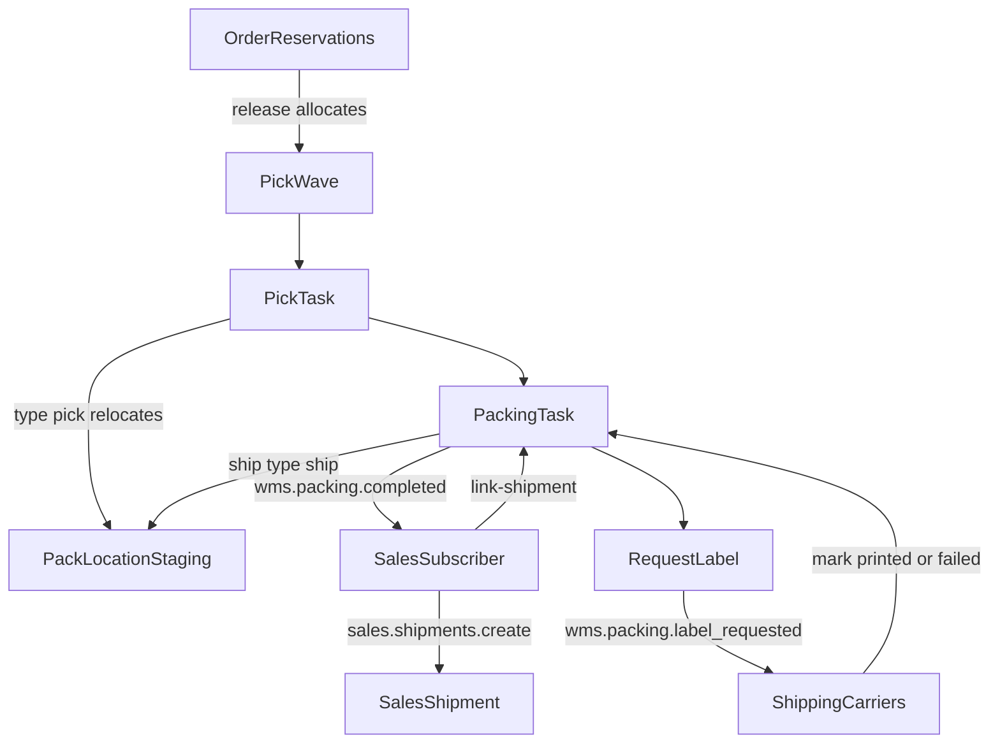

# WMS Phase 3 Specification — Picking and Packing

| Field | Value |
|-------|-------|
| **Status** | Ready for implementation |
| **Author** | Cursor Agent |
| **Created** | 2026-04-15 |
| **Related** | 2026-04-15-wms-roadmap, 2026-04-15-wms-phase-1-core-inventory, 2026-04-15-wms-phase-2-inbound-putaway, Issue #388 |

## TLDR

**Key Points:**

- Phase 3 is outbound execution for one warehouse: a pick wave groups reserved sales-order demand, pick tasks move that stock onto a single pack location, packing verifies it, and a separate ship command is the only on-hand decrement.
- Sales owns the shipment document. WMS emits `wms.packing.completed` and does not call `sales.shipments.create`. A sales subscriber creates or reuses the shipment and writes the id back.
- Carrier labels are a later command, `request-label`. Failure changes `label_status` only. It does not undo packing or shipping.
- There is no `shipping` module and no wave strategy enum. Batch, zone, and route optimization are out of this phase.

**Scope:**

- `Warehouse.pack_location_id`, `PickWave`, `PickTask`, `PackingTask`, `PackingTaskLine`
- Release, assign, start, confirm, short, cancel, pack, ship, and label-request commands
- Sales shipment link and a soft-optional `shipping_carriers` label subscriber

**Out of scope:**

- Movement type `pack` (the enum value stays unused)
- Carton entities, pack-quantity variance, automatic re-waves
- `shipping.shipment.created` / `shipping.shipment.dispatched` (those events do not exist)
- Re-emitting `wms.putaway.completed`

## Overview

Phase 3 turns reserved stock into picked, packed, and shipped goods. Warehouse leads release orders that already have an active reservation. Pickers move the allocated quantity from the storage bin to the warehouse pack location. Packers confirm that quantity. A ship command then removes it from on-hand and fulfills that portion of the reservation.

The physical ledger and the sales shipment are different steps. Packing tells sales that goods are ready. Shipping tells the ledger that goods have left. Labels are a third step owned by `shipping_carriers`.

> **Market reference:** One pack location and order-grouped tasks match a small-warehouse flow (single staging lane, no zone routing). Wave/batch/zone optimizers from Odoo-style WMS are deferred until the ledger transitions below are in production.

## Problem Statement

After phases 1 and 2:

1. Sales confirmation can reserve stock, and allocate can move `quantity_reserved` to `quantity_allocated`, but nothing creates warehouse work from those reservations.
2. `InventoryMovement.type` already contains `pick` and `ship`, and nothing defines which command writes which type.
3. `sales` already owns shipment records (`sales.shipment.created` / `updated` / `deleted`). `shipping_carriers` already owns label purchase (`shipping_carriers.shipment.created` and status events). There is no `shipping` module and no `shipping.shipment.dispatched`.
4. Staging and dock locations are already non-reservable (`isReservableLocationType`). Outbound needs a destination that cannot be sold again while it waits to leave.

## Resolved Decisions

| Decision | Choice |
|----------|--------|
| When on-hand falls | Only `ship`. Confirm and short relocate stock onto the pack location. |
| Who opens work | A supervisor releases a wave from active order reservations. A sales shipment does not allocate stock and does not create tasks. |
| Who creates the sales shipment | The sales module, in a subscriber on `wms.packing.completed`. WMS only stores the returned id. |
| Short remainder | Picked quantity follows the pick move. Unpicked quantity goes back to `quantity_reserved` on the source bin. No new task is created. |
| Wave shape | Named group of tasks for selected orders of one warehouse. No `single` / `batch` / `zone` / `wave` strategy. |
| Labels | `POST .../request-label` after packing. Retryable. Does not roll back pack or ship. |

## Proposed Solution

### Ledger

Balances stay phase-1 buckets: `quantity_available = quantity_on_hand - quantity_reserved - quantity_allocated`. Reserved and allocated are disjoint. Total on-hand is unchanged by a pick.

| Step | Source on-hand | Pack on-hand | Source reserved | Source allocated | Pack allocated | Reservation |
|------|----------------|--------------|-----------------|------------------|----------------|-------------|
| Release | unchanged | unchanged | −task qty | +task qty | unchanged | bucket state `allocated` |
| Confirm | −qty | +qty | unchanged | −qty | +qty | bucket location becomes the pack location; state stays `allocated` |
| Short, picked part | −picked | +picked | unchanged | −picked | +picked | picked bucket moves to the pack location |
| Short, remainder | unchanged | unchanged | +remainder | −remainder | unchanged | remainder bucket stays on the source; state `reserved` |
| Cancel open task | unchanged | unchanged | +qty | −qty | unchanged | bucket state `reserved` |
| Ship | unchanged | −qty | unchanged | unchanged | −qty | `quantity` falls by the shipped qty; `fulfilled` at 0 |

`received_at` on the pick movement is copied from the source bucket's receipt timestamp (phase 1 rotation rule). Ship writes `type = ship` with `location_from_id` = pack location and `location_to_id` null. Pick writes `type = pick`. Neither command writes `type = pack`.

Both movements use `reference_type = so`, `reference_id` = sales order id, and metadata `pickTaskId` or `packingTaskId`.

### Pack location

`Warehouse` gains nullable `pack_location_id`. The location must be an active `staging` location in the same warehouse. Staging is already excluded from sales reservation, so picked goods cannot be reserved onto a second order. The allocated quantity moves with the stock, so the pack bucket's available quantity stays zero even if a caller skips the location-type check.

Release, confirm, short, and ship fail with `409 pack_location_missing` when it is unset, inactive, or not type `staging`.

ASN receive rejects this location as `target_staging_location_id` with `409 pack_location_not_inbound`. Inbound staging and outbound packing do not share a bin.

### Work model

One pick task per still-reserved reservation bucket. Reservations are `source_type = order` and `source_id = sales order id`. Transfer and manual reservations are ignored. Release does not invent quantity for order lines that were never reserved.

One packing task per `(wave, sales order)`, created inside the transaction that makes every pick task for that order terminal (`done`, `short`, or `cancelled`) when the sum of `quantity_picked` is positive. Lines point at those pick tasks. No carton, no JSON snapshot. Confirm/short undo soft-deletes that task while it is still `open` or `in_progress`, so a mis-confirmed last pick can be corrected before anybody completes packing.

### Design Decisions

| Decision | Rationale |
|----------|-----------|
| Ship is the only issue | Confirm and `shipping` dispatch cannot both decrement on-hand |
| WMS emits, sales creates the shipment | Matches module isolation: the consumer owns the glue; WMS does not import sales entities |
| Existing sales shipment is a link, not a second wave | Stops the old hybrid trigger from allocating the same reservation twice |
| Short returns quantity to reserved | The order keeps its claim; a supervisor releases again on purpose |
| No strategy enum | The data model has no zone split and no sortation step |
| Label command is outside the pack transaction | A carrier error must not roll back picked or packed stock |
| `wms.packing.completed` is not undoable | Sales raises fulfilled quantity when it creates the shipment. Undoing complete would leave that shipment in place |
| Tasks are not CRUD-created | A second writer would bypass allocation |

### Alternatives Rejected

| Alternative | Why rejected |
|-------------|--------------|
| Decrement on-hand at confirm | Pack-location stock would vanish before it leaves; cycle count of the pack lane would be wrong |
| Pick and pack as status-only, one movement at ship | The ledger would not record which bin was emptied |
| Listen to `shipping.shipment.created` and also create a shipment at pack | The module does not exist; two triggers double-allocate |
| WMS calls `sales.shipments.create` inside complete | Hard WMS → sales dependency in the packing transaction |
| Auto-create a new pick task on short | Hides the shortage inside the same wave and can loop |
| Keep `batch` and `zone` without algorithms | An enum that does not change task generation |

## User Stories

- **Supervisor** releases selected orders in one warehouse into a wave and can cancel that wave until someone starts a pick.
- **Picker** confirms the full task or shorts it. A short leaves the missing quantity reserved on the source bin.
- **Packer** starts and completes packing for one order. Completion does not change balances.
- **Sales** sees a shipment created from the pack event, and order detail shows `_wms.fulfillmentSummary`.
- **Shipper** runs ship only after the sales shipment id is linked. That is the stock issue.
- **Label clerk** requests a carrier label after packing. A failed label stays retryable.

## Architecture



### Commands

Public and system command ids:

| Command | Who |
|---------|-----|
| `wms.pick-waves.release` | `wms.manage_pick_waves` |
| `wms.pick-waves.cancel` | `wms.manage_pick_waves` |
| `wms.pick-tasks.assign` | `wms.manage_pick_waves` |
| `wms.pick-tasks.start` | assignee with `wms.execute_picks`, or `wms.manage_pick_waves` |
| `wms.pick-tasks.confirm` | same as start |
| `wms.pick-tasks.short` | same as start |
| `wms.pick-tasks.cancel` | `wms.manage_pick_waves` |
| `wms.packing-tasks.start` | `wms.manage_packing` |
| `wms.packing-tasks.complete` | `wms.manage_packing` |
| `wms.packing-tasks.ship` | `wms.manage_packing` |
| `wms.packing-tasks.request-label` | `wms.print_labels` |
| `wms.packing-tasks.link-shipment` | system (`auth: null`), sales subscriber only |
| `wms.packing-tasks.mark-label-printed` | system, `shipping_carriers` subscriber only |
| `wms.packing-tasks.mark-label-failed` | system, `shipping_carriers` subscriber only |

Draft wave create/update/delete stay on the wave CRUD commands. There is no public `createPackingTask` and no `handoffPackedShipment`.

`wms.inventory.allocate` gains an optional `buckets` filter: `{ balanceId, quantity }[]`. Omitted, it keeps today's behavior and allocates every still-reserved bucket. Release uses the filter so a reservation that is already partly on the pack location is not allocated twice. This argument is additive.

### Events emitted

| Event | When | Payload |
|-------|------|---------|
| `wms.pick_wave.released` | release commits | `pickWaveId`, `warehouseId`, `pickTaskIds`, `tenantId`, `organizationId` |
| `wms.pick_wave.completed` | wave status becomes `completed` | `pickWaveId`, `warehouseId`, `pickTaskCount`, `shippedPackingTaskCount`, `tenantId`, `organizationId` |
| `wms.pick_wave.cancelled` | wave cancelled | `pickWaveId`, `warehouseId`, `tenantId`, `organizationId` |
| `wms.pick_task.created` | each task inserted at release | `pickTaskId`, `pickWaveId`, `reservationId`, `salesOrderId`, `quantity`, `tenantId`, `organizationId` |
| `wms.pick_task.started` | start | `pickTaskId`, `assignedTo`, `tenantId`, `organizationId` |
| `wms.pick_task.completed` | confirm | `pickTaskId`, `movementId`, `quantity`, `tenantId`, `organizationId` |
| `wms.pick_task.shorted` | short | `pickTaskId`, `quantityPicked`, `quantityShort`, `tenantId`, `organizationId` |
| `wms.pick_task.cancelled` | cancel | `pickTaskId`, `tenantId`, `organizationId` |
| `wms.packing.created` | order's picks became terminal with picked qty > 0 | `packingTaskId`, `pickWaveId`, `salesOrderId`, `tenantId`, `organizationId` |
| `wms.packing.completed` | complete | `packingTaskId`, `pickWaveId`, `warehouseId`, `salesOrderId`, `packLocationId`, `lines[]`, `tenantId`, `organizationId` |
| `wms.packing.shipped` | ship | `packingTaskId`, `salesShipmentId`, `salesOrderId`, `movementIds`, `tenantId`, `organizationId` |
| `wms.packing.label_requested` | request-label | `packingTaskId`, `salesOrderId`, `salesShipmentId`, `warehouseId`, `tenantId`, `organizationId` |

`lines[]` on `wms.packing.completed` is `{ packingTaskLineId, pickTaskId, catalogVariantId, lotId, serialNumber, quantity }`. Quantity is the packed string, equal to `quantity_picked`.

Do not emit `wms.shipment.ready_for_label`, `wms.shipment.handed_off`, or a second `wms.putaway.completed`.

### Events consumed

WMS does not subscribe to sales shipment CRUD and does not subscribe to carrier events.

| Subscriber owner | Event | Behavior |
|------------------|-------|----------|
| `sales` | `wms.packing.completed` | Create or reuse one sales shipment. Call `wms.packing-tasks.link-shipment`. |
| `shipping_carriers` | `wms.packing.label_requested` | Purchase a label. Call `mark-label-printed` or `mark-label-failed`. |

Both subscribers are soft-optional. Each resolves the peer command in `try/catch` and no-ops when the peer module is absent. WMS never imports sales or `shipping_carriers` entities.

The already-seeded toggle `wms_integration_shipping_shipments` (default `true`) gates **emission** of `wms.packing.label_requested`. It does not allocate stock. The roadmap id `wms_integration_shipping_shipment_lifecycle` is not introduced. Update the seeded toggle's description to this meaning; no subscriber behavior has shipped under the old description.

Sales shipment creation is not behind that toggle.

### Status machines

**Pick wave:** `draft → released → in_progress → completed`, or `→ cancelled`.

- `released` after release.
- `in_progress` when any pick is `in_progress` or any packing task exists.
- `completed` when no pick is `open` or `in_progress` and every packing task is `shipped`. A wave whose picks are all `short` with picked quantity 0 has no packing task and still completes.
- `cancelled` when every pick is `cancelled` and no packing task exists. A wave of only cancellations is `cancelled`, not `completed`.

Each command recomputes the wave status from these rules before commit.

**Pick task:** `open → in_progress → done | short`. `open → cancelled`. No transitions out of `done`, `short`, or `cancelled`.

**Packing task:** `open → in_progress → done → shipped`. `label_status` is orthogonal: `none → requested → printed`, or `requested → failed → requested`.

**Reservation metadata:** bucket state is `reserved` or `allocated`. Reservation-level `allocationState` is `reserved` when every live bucket is reserved, `allocated` when every live bucket is allocated, and `partial` when mixed. `partial` is additive metadata. `reservation.status` stays `active` until `quantity` reaches 0, then `fulfilled`.

### Undo

| Command | Undo |
|---------|------|
| Release | Allowed only while every created pick task is still `open`. Deallocate those buckets back to reserved and cancel the tasks. |
| Assign, start | Restore the previous assignee and status. |
| Confirm, short | Allowed when that order has no packing task, or the packing task is still `open` or `in_progress`. Compensating `pick` movement returns on-hand and allocated quantity to the source bucket. The same transaction soft-deletes the packing task and its lines, because the order is no longer terminal, and increments `movement_attempt`. A later confirm that makes the order terminal again creates a new packing task. Short undo also re-allocates the remainder that was returned to reserved, and only if that remainder is not already on another `open` or `in_progress` task. Rejected with `409 pick_undo_blocked` when the packing task is `done` or `shipped`. |
| Cancel pick | Allowed only if that bucket is still `reserved` and not on another open task. |
| Complete packing | Not undoable. Completing emits `wms.packing.completed`. Sales may already have created a shipment and raised fulfilled quantities. A mistake after complete is a forward correction, not an undo. |
| Ship | Not undoable. A return is phase 5. |
| Request-label | Not undoable. Retry is a new request from `failed`. |
| Link-shipment, mark-label-* | Not undoable. Replay of the same id is success. |

Completed picks are not deleted. Undo writes a compensating movement and does not update or soft-delete the historical movement row.

Pick undo cannot race a label request. `request-label` requires packing status `done` or `shipped`, and confirm/short undo is rejected in those statuses. No sales shipment exists yet either: `wms.packing.completed` is emitted only by complete.

### Concurrency

Action commands take `PESSIMISTIC_WRITE` on the parent wave or task, then on reservations in id order, then on balances in id order. They re-read status under those locks.

Optimistic lock uses the platform command guard on the parent `updated_at` (wave for release/cancel-wave, pick task for pick actions, packing task for pack/ship/label). HTTP list and detail return `updatedAt`.

Idempotency keys, unique among non-deleted movements:

- release: client `idempotencyKey` when present, otherwise one shot per wave (a released wave rejects a second release with `409 wave_already_released`)
- confirm: `pick-confirm:{pickTaskId}:{movementAttempt}`
- short: `pick-short:{pickTaskId}:{quantityPicked}:{movementAttempt}`
- ship: `ship:{packingTaskId}:{packingTaskLineId}`
- request-label: `label:{packingTaskId}` while status is `requested` or `printed` (replay, no second event)

`movement_attempt` starts at 1. A retry of confirm or short in the same attempt reuses the key and returns the existing movement without a second stock move. A committed undo increments `movement_attempt`, so the next confirm or the same short quantity inserts a new movement. The previous movement row stays. Ship and label keys do not need an attempt: a new packing task has new ids, and those commands are not undoable.

A partial unique index on `(organization_id, reservation_id, source_balance_id)` where `status in ('open','in_progress')` and `deleted_at is null` blocks two live tasks for the same bucket. `done` and `short` rows stay, so they do not block a later wave for a remainder that returned to reserved.

## Data Models

Global columns on every entity: `id`, `created_at`, `updated_at`, `deleted_at`, `tenant_id`, `organization_id`, `metadata`.

### Warehouse (additive)

- `pack_location_id`: UUID nullable. Same-warehouse location, type `staging`, active when release runs.

### PickWave

- `warehouse_id`: UUID
- `name`: string
- `status`: `draft | released | in_progress | completed | cancelled`
- `priority`: integer, default 0, display sort only

Indexes:

- `(organization_id, warehouse_id, status, priority)`

No `strategy`. No `reference_snapshot`. Order ids live on the tasks created at release.

### PickTask

- `pick_wave_id`: UUID
- `warehouse_id`: UUID
- `reservation_id`: UUID
- `source_balance_id`: UUID
- `sales_order_id`: UUID
- `catalog_variant_id`: UUID
- `source_location_id`: UUID
- `pack_location_id`: UUID
- `lot_id`: UUID nullable
- `serial_number`: string nullable
- `quantity_requested`: numeric
- `quantity_picked`: numeric, default 0
- `movement_attempt`: integer, default 1
- `status`: `open | in_progress | done | short | cancelled`
- `assigned_to`: UUID nullable

Indexes:

- partial unique `(organization_id, reservation_id, source_balance_id)` for live tasks, as above
- `(organization_id, pick_wave_id, status)`
- `(organization_id, assigned_to, status)`
- `(organization_id, sales_order_id, status)`

No `sales_order_line_id`. Phase 1 reservations are per variant per order, not per line.

### PackingTask

- `pick_wave_id`: UUID
- `warehouse_id`: UUID
- `sales_order_id`: UUID
- `sales_shipment_id`: UUID nullable
- `pack_location_id`: UUID
- `status`: `open | in_progress | done | shipped`
- `label_status`: `none | requested | printed | failed`

Indexes:

- partial unique `(organization_id, pick_wave_id, sales_order_id)` where `deleted_at is null`
- partial unique `(organization_id, sales_shipment_id)` where `deleted_at is null` and `sales_shipment_id is not null`
- `(organization_id, warehouse_id, status)`
- `(organization_id, sales_order_id, status)`

### PackingTaskLine

Sub-resource of `PackingTask`. No own CRUD. The parent task's optimistic lock covers line writes.

- `packing_task_id`: UUID
- `pick_task_id`: UUID
- `catalog_variant_id`: UUID
- `lot_id`: UUID nullable
- `serial_number`: string nullable
- `quantity_picked`: numeric
- `quantity_packed`: numeric, default 0

`quantity_packed` is 0 until complete, then equal to `quantity_picked`. Phase 3 does not accept a smaller packed quantity.

## API Contracts

Routes export `openApi`. Custom writes run the mutation-guard registry (`update` for actions) and the command. Clients use `apiCall` / `useGuardedMutation`. Lists use `makeCrudRoute` with `indexer: { entityType }`, default `pageSize` 25, reject above 100.

Zod validators live in `data/validators.ts`. Quantities are decimal strings.

### Waves

Collection: `GET|POST /api/wms/pick-waves`. Member: `GET|PUT|DELETE /api/wms/pick-waves/:id`.

- POST creates `draft` only. Body: `warehouseId`, `name`, `priority?`. Status other than `draft` is `422 invalid_wave_status`.
- PUT while `draft` may change `name` and `priority` only. Any other status is `409 wave_not_draft`.
- DELETE only a `draft` with zero tasks. Otherwise `409 wave_delete_requires_draft`.

#### `POST /api/wms/pick-waves/:id/release`

ACL: `wms.manage_pick_waves`.

```json
{ "orderIds": ["uuid"], "idempotencyKey": "optional" }
```

`warehouseId` is the wave's warehouse, not the body.

Behavior, one transaction:

1. Lock the wave. Status must be `draft`.
2. Resolve `pack_location_id` or `409 pack_location_missing`.
3. For every order id, load `active` reservations with `source_type = order`, `source_id = order`, this warehouse, and at least one bucket in state `reserved`. If any order has none, roll back with `422 order_not_reserved` and body `orderIds` of the misses.
4. Allocate those reserved buckets (optional `buckets` filter). Insert one `open` pick task per bucket.
5. Wave status `released`. Emit `wms.pick_wave.released` and one `wms.pick_task.created` per task.

Response: `{ "ok": true, "pickTaskIds": ["uuid"] }`.

A second release on a non-draft wave is `409 wave_already_released`. Same idempotency key after success returns the original `pickTaskIds` and does not allocate again.

#### `POST /api/wms/pick-waves/:id/cancel`

ACL: `wms.manage_pick_waves`.

Allowed from `draft` (no ledger effect) or from `released` / `in_progress` only when every pick task is `open` and no packing task exists. Otherwise `409 wave_cancel_blocked`. Cancelling deallocates live tasks back to reserved, marks them `cancelled`, and marks the wave `cancelled`.

### Pick tasks

`GET /api/wms/pick-tasks` and `GET /api/wms/pick-tasks/:id` only. No POST, PUT, or DELETE. Task rows are history; cancel is the command above for `open` tasks.

#### `POST /api/wms/pick-tasks/:id/assign`

ACL: `wms.manage_pick_waves`. Body: `{ "assignedTo": "uuid" }`. Task must be `open`. Response: `{ "ok": true }`.

#### `POST /api/wms/pick-tasks/:id/start`

HTTP features: `wms.execute_picks` or `wms.manage_pick_waves`. The command allows `manage_pick_waves` for any task, or `execute_picks` when `assigned_to` is the actor. Unassigned task: `409 pick_not_assigned`. Status must be `open`. Sets `in_progress`.

#### `POST /api/wms/pick-tasks/:id/confirm`

Same ACL rule as start. Body:

```json
{ "locationCode": "optional", "lotNumber": "optional", "idempotencyKey": "optional" }
```

The body has no quantity and no alternate location. Confirm always picks `quantity_requested`. A partial quantity is the short endpoint (`422 confirm_requires_full_quantity` if a client sends `quantityPicked`).

Optional `locationCode` / `lotNumber` are resolved with the phase 2 scan helpers and must match the task's source location and lot. Mismatch: `409 location_mismatch` or `409 lot_mismatch`.

Status must be `open` or `in_progress`. Writes the pick movement and balance move from the ledger table. Sets `quantity_picked = quantity_requested`, status `done`. May create the order's packing task in the same transaction. Idempotent replay returns the original `movementId`.

Response: `{ "ok": true, "movementId": "uuid", "status": "done" }`.

#### `POST /api/wms/pick-tasks/:id/short`

Same ACL and scan rules as confirm.

```json
{ "quantityPicked": "2", "reason": "stock_missing", "locationCode": "optional", "lotNumber": "optional" }
```

`quantityPicked` is required, `0 <= quantityPicked < quantity_requested`. Zero is allowed. Otherwise `422 short_quantity_out_of_range`. Status becomes `short`. Remainder returns to reserved on the source bucket. No new pick task. Response: `{ "ok": true, "status": "short", "shortQuantity": "3", "movementId": "uuid or null when picked is 0" }`.

#### `POST /api/wms/pick-tasks/:id/cancel`

ACL: `wms.manage_pick_waves`. Status must be `open`. `in_progress` is `409 pick_cancel_requires_open` (confirm or short instead). Deallocates the task quantity back to reserved.

### Packing tasks

`GET /api/wms/packing-tasks` and `GET /api/wms/packing-tasks/:id` only. No POST, PUT, or DELETE.

Detail includes lines. `salesShipmentId` and `labelStatus` are on the task.

#### `POST /api/wms/packing-tasks/:id/start`

ACL: `wms.manage_packing`. Status `open` → `in_progress`.

#### `POST /api/wms/packing-tasks/:id/complete`

ACL: `wms.manage_packing`. Status must be `in_progress`. Sets every line `quantity_packed = quantity_picked`. No packed-quantity body. Status `done`. Emits `wms.packing.completed`. Does not move stock and does not create a sales shipment.

Response: `{ "ok": true, "status": "done" }`.

#### `POST /api/wms/packing-tasks/:id/ship`

ACL: `wms.manage_packing`. Status must be `done`. `sales_shipment_id` required, else `409 shipment_link_missing`. `label_status` is ignored.

For each line, write one `ship` movement and decrement pack-location on-hand and allocated by `quantity_packed`. Reduce the reservation quantity. Fulfill the reservation at zero. Status `shipped`. Emit `wms.packing.shipped`. This is the only on-hand reduction in the phase.

Response: `{ "ok": true, "status": "shipped", "movementIds": ["uuid"] }`.

#### `POST /api/wms/packing-tasks/:id/request-label`

ACL: `wms.print_labels`. Status must be `done` or `shipped`, and `sales_shipment_id` must be set (`409 shipment_link_missing`).

When `wms_integration_shipping_shipments` is off: `409 label_integration_disabled` and `label_status` stays unchanged.

From `none` or `failed`: set `requested`, emit `wms.packing.label_requested` once. From `requested` or `printed`: replay, no second event. Response: `{ "ok": true, "labelStatus": "requested" }`.

System commands, no public route:

- `link-shipment` body `{ "salesShipmentId": "uuid" }`. Sets the id when null. Same id is success. A different id is `409 shipment_already_linked`.
- `mark-label-printed` from `requested` sets `printed`. Replay from `printed` is success.
- `mark-label-failed` from `requested` sets `failed`. Does not change packing status or balances.

### Error catalog

| Status | Code | When |
|--------|------|------|
| 409 | `pack_location_missing` | Warehouse has no active staging pack location |
| 409 | `pack_location_not_inbound` | ASN receive targets the pack location |
| 409 | `wave_not_draft` | PUT on a non-draft wave |
| 409 | `wave_delete_requires_draft` | DELETE on a non-draft wave or a draft that already has tasks |
| 409 | `wave_already_released` | Second release |
| 409 | `wave_cancel_blocked` | A pick has started or a packing task exists |
| 422 | `order_not_reserved` | A selected order has no reserved bucket in this warehouse |
| 422 | `invalid_wave_status` | Create/update tried to set a non-draft status |
| 409 | `pick_not_assigned` | Start/confirm/short without assignee, unless the actor has `wms.manage_pick_waves` |
| 409 | `location_mismatch` / `lot_mismatch` | Scan does not match the task |
| 422 | `confirm_requires_full_quantity` | Confirm payload includes a partial quantity |
| 422 | `short_quantity_out_of_range` | Short quantity is negative or covers the full task |
| 409 | `pick_cancel_requires_open` | Cancel after start |
| 409 | `pick_undo_blocked` | Confirm/short undo after packing is `done` or `shipped`. Complete has no undo |
| 409 | `shipment_link_missing` | Ship or label before sales links a shipment |
| 409 | `shipment_already_linked` | Link command got a different shipment id |
| 409 | `label_integration_disabled` | Label toggle off |
| 409 | optimistic-lock conflict | Stale `updatedAt`, platform 409 body |

Insufficient stock on the source bucket during confirm/short is `409 insufficient_stock`. The command locks the balance first so two waves cannot take the same reserved quantity.

## Cross-Module Contracts

### Sales

Sales owns shipment records and shipment status dictionaries. WMS does not read or write shipment status. Dictionary values are tenant-defined and are not a WMS contract.

On `wms.packing.completed` the sales subscriber:

1. If this `packingTaskId` is already linked, call `link-shipment` with the same id and stop.
2. Load every non-deleted sales shipment for the order. Shipment status is a tenant dictionary, so it is not a filter. Drop any shipment whose id is already stored on another non-deleted packing task.
3. A candidate matches when its items, mapped through order lines, equal the packed variant quantities, and the packed quantity still fits each line once that candidate's own items are excluded from the shipped totals (`excludeShipmentId` in the sales shipment command).
4. Exactly one match: call `link-shipment` with that id. Do not create a second shipment and do not add its quantity to fulfilled totals again.
5. No match: split the packed variant quantity across the order's product lines for that variant, in stable line id order. Remaining quantity is line quantity minus shipped totals of every non-deleted shipment, with nothing excluded. When the packed quantity fits, call `sales.shipments.create` with the order's current optimistic-lock version, then `link-shipment`. When it does not fit, create nothing and leave `sales_shipment_id` null. Set `metadata.linkBlockReason` to `quantity_exceeds_remaining`.
6. More than one match: create nothing and link nothing. Set `metadata.linkBlockReason` to `ambiguous_shipment`.

Ship stays `409 shipment_link_missing` until `sales_shipment_id` is set. The link command idempotency key is the packing task id. The partial unique index on `sales_shipment_id` rejects a second live packing task for the same shipment.

WMS enricher on `sales.order` (opt-in, `cacheableOnListHit: false`) adds:

```json
{
  "_wms": {
    "fulfillmentSummary": {
      "waveStatus": "in_progress",
      "pickedQuantity": "3",
      "packedQuantity": "2",
      "shippedQuantity": "0"
    }
  }
}
```

Sums are across non-cancelled tasks for that order. The enricher does not change sales fields.

### Shipping carriers

`shipping_carriers` owns label purchase and tracking. Its subscriber handles `wms.packing.label_requested`, calls the existing carrier create-shipment flow with `orderId = salesOrderId`, then:

- success → `wms.packing-tasks.mark-label-printed`
- failure → `wms.packing-tasks.mark-label-failed`

The subscriber catches carrier errors. It must not throw back into the WMS request transaction, because that transaction already committed `label_status = requested`. A failed label does not change pick, pack, or ship state.

WMS does not store tracking numbers. Those stay on the carrier shipment.

### Catalog

Variant id plus the phase 1 profile (`track_lot`, `track_serial`) only. No catalog schema change. A serial task quantity is 1. Short of a serial is `quantityPicked = 0`.

### Inbound

ASN receive learns the pack-location rejection above. Putaway completion is unchanged and is not re-emitted here.

## ACL

| Feature | Routes | Default role |
|---------|--------|----------------|
| `wms.manage_pick_waves` | wave CRUD, release, cancel wave, assign, cancel pick, and any pick action | `supervisor`, `admin` |
| `wms.execute_picks` | start, confirm, short on a task assigned to the actor | `operator`, `supervisor`, `admin` |
| `wms.manage_packing` | packing start, complete, ship | `operator`, `supervisor`, `admin` |
| `wms.print_labels` | request-label | `supervisor`, `admin` |

`wms.view` remains the read grant for the new pages. Add the four features to `acl.ts` and `setup.ts` `defaultRoleFeatures`. Existing tenants get them through `yarn mercato auth sync-role-acls`.

Route `metadata` declares `requireFeatures` per method. The command repeats the assignee check for pick actions. Wildcard `wms.*` satisfies every feature.

## Internationalization

Key families:

- `wms.pickWaves.*`
- `wms.pickTasks.*`
- `wms.packingTasks.*`
- `wms.fulfillment.*`
- `wms.errors.packLocationMissing`
- `wms.errors.orderNotReserved`
- `wms.errors.shortQuantity`
- `wms.errors.shipmentLinkMissing`
- `wms.errors.labelRequestFailed`
- `wms.widgets.sales.fulfillmentSummary.*`

User-facing API errors go through these keys. Internal throws use an `[internal]` prefix.

## UI

Pages:

- `/backend/wms/pick-waves` — `DataTable` plus draft create. Release is a guarded action, not a CRUD status field.
- `/backend/wms/picking` — queue of pick tasks: assignee, source location, order, age. Confirm and short are row actions.
- `/backend/wms/packing` — one row per packing task: order, packed state, shipment link, label status. Start, complete, ship, and request-label are separate actions.

Warehouse edit gains a pack-location select limited to active `staging` locations of that warehouse. The field uses the existing warehouse `CrudForm`.

Lists and forms use `DataTable`, `CrudForm`, `apiCall`, and `useGuardedMutation`. No new app-shell provider. Dialogs keep Cmd/Ctrl+Enter and Escape.

Short tasks use the warning status token, not a hardcoded color. Sales order detail reads `_wms.fulfillmentSummary` from the enricher; it does not embed a WMS page.

Cache: command success invalidates the wave, task, balance, and reservation tags for the tenant and organization. The sales enricher stays `cacheableOnListHit: false` because it reads WMS rows.

## Migration and Compatibility

- New tables and `warehouses.pack_location_id` are additive. Phase 1 and phase 2 URLs stay as they are.
- `InventoryMovement.type` values `pick` and `ship` start being written. `pack` remains unused.
- `allocate` accepts an optional `buckets` array. Callers that omit it keep today's full-reservation allocate.
- `wms_integration_shipping_shipments` keeps its identifier and default `true`. Only its description changes, to the label-emission kill switch.
- Do not add `wms_integration_shipping_shipment_lifecycle`.
- No change to sales shipment status dictionaries.

## Implementation Plan

### Story 1: Pack location and wave release

1. Add `pack_location_id` to warehouse validators, CRUD, and the warehouse form.
2. Reject that location in ASN receive.
3. Add wave and pick-task entities, list/detail, draft CRUD, and `release` / `cancel`.
4. Extend `allocate` with the optional bucket filter. Release allocates only `reserved` buckets and inserts one task each.

### Story 2: Confirm and short

1. Assign, start, confirm, and short with the ledger table, locks, and idempotency keys.
2. Scan codes must match the task source.
3. Create the packing task and lines in the same transaction as the pick that finishes the order.

### Story 3: Pack, sales link, and ship

1. Packing list/detail, start, and complete. Complete emits `wms.packing.completed` and does not move stock.
2. Sales subscriber creates or reuses a shipment and calls `link-shipment`.
3. Ship writes `type = ship` and fulfills the reservation portion. It refuses a missing link.

### Story 4: Labels and sales projection

1. `request-label` plus the toggle check.
2. `shipping_carriers` subscriber calls mark-printed or mark-failed.
3. `_wms.fulfillmentSummary` on sales order detail.
4. Picking and packing queues, including the short warning state.

### Testing Strategy

| ID | Type | Scenario | Assertions |
|----|------|----------|------------|
| WMS-P3-INT-01 | API | Release two reserved orders | one task per reserved bucket, buckets `allocated`, wave `released`, second release `409` |
| WMS-P3-INT-02 | API | Release an order with no reservation | `422 order_not_reserved`, no tasks, no allocation change |
| WMS-P3-INT-03 | API | Confirm a pick | on-hand moves to the pack location, total on-hand unchanged, allocated moves with it, task `done` |
| WMS-P3-INT-04 | API | Short a pick | picked qty relocates, remainder is `reserved` on the source, no new task |
| WMS-P3-INT-05 | API | Complete packing | status `done`, balances unchanged, event payload has lines |
| WMS-P3-INT-06 | API | Sales subscriber links a shipment | one `sales` shipment, `salesShipmentId` set, second delivery of the event does not create another |
| WMS-P3-INT-07 | API | Ship | pack on-hand and allocated fall, reservation fulfilled for that qty, `type = ship` |
| WMS-P3-INT-08 | API | Ship without a link | `409 shipment_link_missing`, balances unchanged |
| WMS-P3-INT-09 | API | Label request fails | packing stays `done`, `label_status = failed`, stock unchanged, retry emits one more request |
| WMS-P3-INT-10 | API | Sales order enricher | `_wms.fulfillmentSummary` only, sales columns unchanged |
| WMS-P3-INT-11 | API | Missing feature | release, confirm, ship, and request-label rejected, no writes |
| WMS-P3-INT-12 | UI | Pick then pack then ship | status moves, short shows the warning state, ship blocked until the link exists |
| WMS-P3-INT-13 | API | Undo the confirm that created an `open` packing task, then confirm again | compensating movement keeps the first movement row, `movement_attempt` increments, the second confirm inserts a new movement id and restores pack-location balances, a new packing task is created |
| WMS-P3-INT-14 | API | Short, undo, short the same quantity | second short inserts a new movement; the first short movement row remains |
| WMS-P3-INT-15 | API | Undo confirm after packing is `done` | `409 pick_undo_blocked`, balances unchanged, complete is not undoable, a linked sales shipment stays |
| WMS-P3-INT-16 | API | Order already has one non-deleted shipment for the packed quantity | subscriber links that shipment, fulfilled quantity is not increased again, a second packing task cannot store the same `sales_shipment_id` |

Fixtures use phase 1 reservations and a staging pack location. Do not reserve staging stock directly. Carrier failure asserts the packing row and the balances, not a rolled-back transaction.

Unit coverage: bucket split on short, ship quantity against reservation remainder, subscriber line split across two order lines of the same variant, idempotent release and confirm.

## Risks

#### Pick and ship both decrement on-hand

- **Scenario:** Confirm reduces on-hand and ship reduces it again.
- **Severity:** Critical
- **Affected area:** Balances, reservations, sales availability
- **Mitigation:** The ledger table is the only quantity contract. Confirm relocates. Ship is the only decrement. INT-03 and INT-07 lock that in.
- **Residual risk:** A later command could write a second `ship`. Acceptable if ship idempotency keys stay on the packing line.

#### Two shipments for one pack

- **Scenario:** Pack complete creates a shipment and an existing sales shipment is also treated as new demand.
- **Severity:** High
- **Affected area:** Sales shipments, reservations
- **Mitigation:** WMS never creates a shipment and never allocates from a shipment event. The sales subscriber keys off `packingTaskId` and links an existing open shipment instead of inserting a second one.
- **Residual risk:** A shipment created by hand for the same lines can still collide with remaining shippable quantity. The subscriber then skips the link and ship stays blocked. Acceptable because the operator sees `shipment_link_missing`.

#### Short remainder picked twice

- **Scenario:** Two releases allocate the same bucket.
- **Severity:** Critical
- **Affected area:** Reservations, pick tasks
- **Mitigation:** Release locks reservations and allocates only `reserved` buckets. The partial unique index blocks two live tasks for one source balance.
- **Residual risk:** A manual balance edit outside commands can still desync metadata. Acceptable; phase 1 reconciliation remains the repair tool.

#### Label failure after pack

- **Scenario:** The carrier rejects the label after packing has committed.
- **Severity:** Medium
- **Affected area:** Dispatch paperwork
- **Mitigation:** Request-label commits `requested` first. The carrier subscriber reports printed or failed on a later command. Ship does not read `label_status`.
- **Residual risk:** `requested` can sit forever if `shipping_carriers` is disabled. Ship is still allowed. Acceptable.

#### Inbound stock lands on the pack location

- **Scenario:** ASN receive uses the pack lane as staging, and pickers mix inbound with outbound.
- **Severity:** High
- **Affected area:** Receiving, pack location
- **Mitigation:** ASN receive returns `409 pack_location_not_inbound`.
- **Residual risk:** A location can be retargeted after stock is already there. Acceptable if warehouse edit warns when the selected location has on-hand. That warning is part of the warehouse form in story 1.

## Final Compliance Report — 2026-11-11

### AGENTS.md files reviewed

- `AGENTS.md`
- `.ai/specs/AGENTS.md`
- `packages/core/AGENTS.md`
- `packages/core/src/modules/sales/AGENTS.md`

### Compliance matrix

| Rule source | Rule | Status | Notes |
|-------------|------|--------|-------|
| root AGENTS.md | No direct ORM relations across modules | Compliant | Sales and carrier links are UUID columns |
| root AGENTS.md | Command pattern and optimistic lock | Compliant | Actions are commands; parents carry `updated_at` |
| root AGENTS.md | Tenant `organization_id` scope | Compliant | Every new table and query |
| packages/core AGENTS.md | Optional peer owns the glue | Compliant | Sales and `shipping_carriers` subscribe; both `try/catch` |
| packages/core AGENTS.md | `openApi`, mutation guards, `makeCrudRoute` indexer | Compliant | Stated on the API section |
| sales AGENTS.md | Sales owns shipments | Compliant | WMS stores an id and a projection |

### Internal consistency

| Check | Status | Notes |
|-------|--------|-------|
| One on-hand decrement | Pass | Ship only |
| One shipment creator | Pass | Sales subscriber |
| Tasks vs CRUD | Pass | No task POST/PUT/DELETE |
| Strategies | Pass | Removed |
| Events vs roadmap names | Pass | Roadmap updated in the same change |
| Cache | Pass | Tag invalidation plus enricher `cacheableOnListHit: false` |
| Encryption | N/A | No personal data columns |

### Verdict

Ready for implementation. Code is not shipped with this revision.

## Changelog

### 2026-11-13 (rev 7)

- Complete is not undoable. `wms.packing.completed` is the boundary, so pick undo never deletes a packing task that sales or a carrier may already have consumed.
- Confirm and short idempotency keys include `movement_attempt`, which increments on committed undo. Historical movement rows stay.
- The sales subscriber selects an existing shipment before the remaining-quantity check and excludes that shipment's own items. One live packing task per `sales_shipment_id`.

### 2026-11-12 (rev 6)

- Confirm/short undo stays available while the auto-created packing task is `open` or `in_progress`, and that undo soft-deletes the packing task. After `done`, undo complete first.
- Renamed packing events from `wms.pack_task.*` to `wms.packing.*`, matching `wms.putaway.*` for `PutawayTask`.

### 2026-11-11 (rev 5)

- Collapsed outbound into one ledger: release allocates, pick relocates to a warehouse pack location, ship is the only on-hand issue
- Removed the `shipping` module trigger, wave strategies, carton id, pack JSON snapshot, and public task CRUD
- Sales subscriber creates or links the shipment from `wms.packing.completed`; label request is a separate retryable command
- Bound each route to an ACL feature and defined short remainder, idempotency, undo, and delete rules

### 2026-04-15 (rev 4)

- Clarified hybrid phase-3 sequencing: shipment state may exist upstream via `shipping.shipment.created` or be created/updated at packing boundary through sales/shipping-owned commands
- Separated module boundaries explicitly: `shipping` owns shipment lifecycle, `shipping_carriers` owns labels/tracking/carrier execution

### 2026-04-15 (rev 3)

- Added explicit global entity columns note for phase-3 models to match roadmap guarantees
- Expanded CRUD API section into explicit `collection` vs `member` routes

### 2026-04-15 (rev 2)

- Added consumed events: `shipping.shipment.created`, `shipping.shipment.dispatched`
- Added `wms.pick_wave.completed` event (was missing, only `released` existed)
- Added ACL features: `wms.manage_pick_waves`, `wms.execute_picks`, `wms.manage_packing`, `wms.print_labels`

### 2026-04-15

- Initial phase-3 specification for WMS picking and packing

### Review — 2026-11-11

- **Reviewer**: Agent
- **Security**: Passed — features are per route; system link/label commands are not public HTTP
- **Performance**: Passed — release is one transaction per wave; no per-line round trip specified
- **Cache**: Passed — enricher does not opt into list-hit caching
- **Commands**: Passed — every status change has a command and an undo rule
- **Risks**: Passed — double issue, double shipment, and label rollback are covered
- **Verdict**: Approved for implementation

### Review — 2026-04-15

- **Reviewer**: Agent
- **Verdict**: Superseded by the 2026-11-11 review. The rev 4 hybrid shipment trigger is withdrawn.
