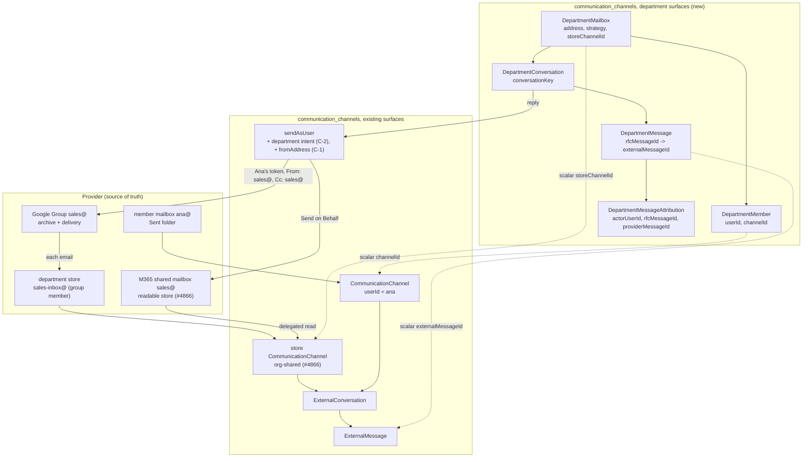
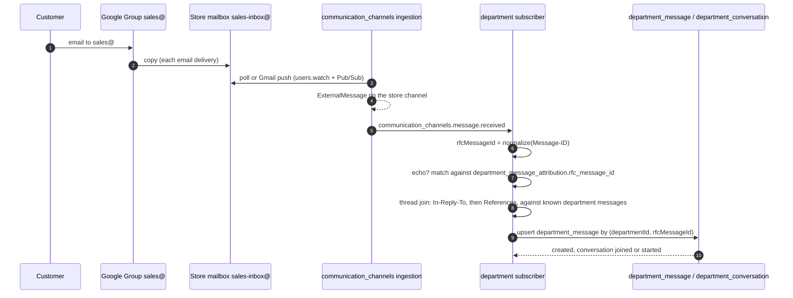
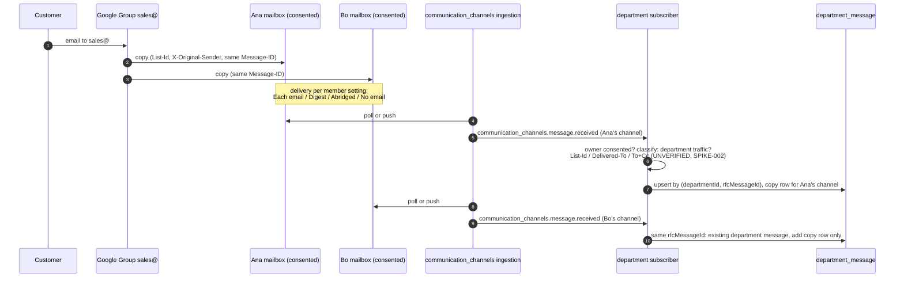
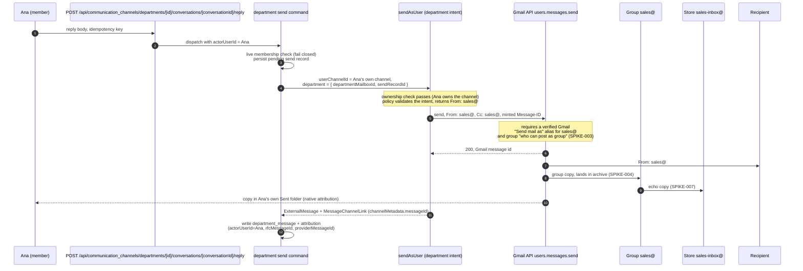
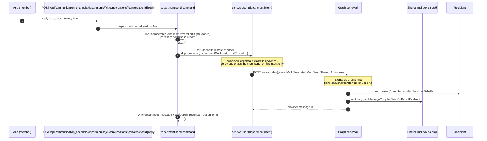

# Department Mailboxes on Provider-Owned Addresses

**Date**: 2026-09-20
**Status**: Draft
**Issue**: [#6292](https://github.com/open-mercato/open-mercato/issues/6292)

> Spec-only proposal. Revision 2 adopts the read/send split proposed in review as the default (Q-001): every department reads one dedicated department store, and every reply is sent through the acting member's own channel. Fan-out over member mailboxes is kept as an explicitly degraded Google fallback. Choices a maintainer may still overturn are marked inline as `[ASSUMPTION Q-00x]`; sections that still depend on an open answer are marked `Draft, pending Q-00x`. Do not set `Ready for implementation` until every blocking row in **Open questions** is resolved.

## TLDR

Businesses run shared addresses such as `sales@`, `abuse@` and `security@`, and they want two things at once: every message stays in Gmail, Microsoft 365 or the IMAP server so the business can walk away from Open Mercato without losing mail, and every outbound reply is attributable to the employee who actually wrote it rather than to an anonymous service account.

Today `communication_channels` gives each employee a strictly private mailbox. `CommunicationChannel.userId` is set for Gmail and IMAP, `assertCanAccessChannel` in `lib/access-control.ts` treats an owned channel as owner-only with no admin bypass, and `sendAsUser` in `lib/send-as-user.ts` refuses any send through a channel the actor does not own (`You can only send through channels you own`). Nothing in the hub represents "this address belongs to this group of people".

This spec adds a department mailbox aggregate to `packages/core/src/modules/communication_channels`: the department, its membership, its conversation and message projection, and per-message actor attribution. Reading and sending are split. A department reads one **department store**, a mailbox that holds department mail and nothing else (a receive-only Workspace mailbox that is a member of the Google Group, a Microsoft 365 shared mailbox, or an IMAP mailbox with ACL). A member replies through their **own** connected channel with the department address as the visible `From`, so attribution never depends on a shared send credential. Two seams on the hub make this possible: optional `fromAddress`/`fromName` on the adapter inputs (C-1), and an explicit department intent on `sendAsUser` that is the only way to reach the act-on-behalf policy (C-2). Callers that pass no intent, which is every caller that exists today, keep the byte-identical current behavior.

Provider behavior stays in the provider packages: `packages/channel-gmail`, `packages/channel-imap`, and the Microsoft 365 channel package introduced by [#5898](https://github.com/open-mercato/open-mercato/issues/5898). The provider remains the only authoritative store; Open Mercato holds a projection that can be deleted without losing mail. The department store connection is the org-shared mailbox proposed in [#4866](https://github.com/open-mercato/open-mercato/issues/4866), which is a dependency and is not re-specified here.

## Problem Statement

A business with a `sales@` address has three bad options today.

A real user account for `sales@` that people log into and send from means a shared password or a shared OAuth grant. Nobody knows who wrote a reply. The recipient sees `sales@` and, at best, a footer naming a person that no system can verify. Offboarding means rotating a credential several people hold.

A service account with domain-wide delegation removes the shared password but not the attribution problem, and Google requires the impersonated `sub` to be a user, never a group (developers.google.com/identity/protocols/oauth2/service-account), so a group address cannot be impersonated at all.

A Google Group with a Collaborative Inbox keeps the archive, keeps membership in one place, and delivers to members' own mailboxes, but no public API reads the group archive. The Groups Migration API is insert-only (`archive.insert`); Groups Settings, Cloud Identity and the Directory API manage metadata and membership only; Vault is eDiscovery and its fit here is UNVERIFIED. The archive that makes the group attractive is exactly the part an integration cannot read.

Meanwhile the hub already has everything except the department concept: per-user channels with encrypted per-user credentials, inbound normalization, threading, sent-folder deduplication, dead lettering, push registration, and thread-level reassignment through `ExternalConversation.assignedUserId`, `ChannelThreadMapping.assignedUserId` and `PUT /api/communication_channels/threads/[threadId]/assign`. What it lacks is any notion of a mailbox several employees legitimately share, and the code says so: `assertCanAccessChannel` grants no admin bypass on an owned channel, and the Gmail adapter derives the outbound sender from the connected account (`fromAddress: userCredentials.email ?? 'me'` in the Gmail adapter's `sendMessage`).

Thread reassignment does not close the gap. `assignedUserId` is triage: it changes who follows up, not who a message is sent as, and it records nothing about the author of an outbound reply. `staff` teams have no address and no link to a channel, so no existing aggregate represents the pairing this feature needs. The owner-controlled sharing added in [#5756](https://github.com/open-mercato/open-mercato/pull/5756) (`communication_channels.share_own_channel`, `CommunicationChannel.visibility`) lets an owner expose the CRM email of their own mailbox to teammates; it has no department, no address, no membership and no send path, so it is a precedent for owner consent rather than a solution.

## Overview and Success Measures

- **Primary outcome:** an employee replies to a department thread from inside Open Mercato, the recipient sees the department address as the sender, the message is present in the provider's own storage without Open Mercato, and Open Mercato can name the employee who sent it. Target: 100 percent of outbound department messages carry a resolved `actorUserId`, the RFC 5322 `Message-ID` and a provider message id.
- **Leading indicators:** department membership resolved from the provider for every configured department; every inbound department message represented by exactly one department message regardless of how many copies the hub ingested; zero outbound sends accepted for a non-member; zero department-intent sends from any caller other than the department send command.
- **Baseline:** zero. No department concept exists. A shared address is today either a personal channel owned by one employee or an unattributable service account.

### Market / product reference

Four comparable open-source products already model "shared address, several actors, one visible sender". The shape is consistent across all of them.

| Product | Mailbox object | Membership object | Outbound attribution field | From seen by customer | Inbound source | Dedupe key |
|---|---|---|---|---|---|---|
| Odoo 18 | `mail.alias` on `crm.team.alias_id` | `crm.team` membership | `mail.message.author_id` | record's alias via `_notify_get_reply_to` | fetchmail IMAP/POP or MTA pipe | References / In-Reply-To |
| EspoCRM | `InboundEmail` group account, `smtpIsShared` | team assignment | `Email.sentBy` | the shared group address | IMAP poll | `messageId` |
| Chatwoot | `Channel::Email` on an `Inbox` | `InboxMember` / `Team` | `Message.sender` | `Agent (Business) <support@...>` | IMAP, OAuth or forward | `source_id` (Message-ID) |
| Zammad | `Group.email_address_id` | agent-to-group membership | `created_by_id` | the group's address | IMAP, SMTP, Graph, Google | `message_id_md5` |

Adopted from them: the shared address decoupled from a per-message attribution field pointing at the acting human, a customer-visible `From` that stays the department address, one readable inbound source per department, and dedupe on the `Message-ID`. Rejected: making Open Mercato the working copy of the mailbox. The differentiator here is that the provider stays authoritative and the Open Mercato record is a projection that can be deleted. Microsoft's Send on Behalf semantics are adopted directly, because Graph already models exactly this split: `sender` is the real user, `from` is the mailbox.

## Goals

- **REQ-001** An administrator can define a department mailbox (address, provider, persistence strategy, department store) and Open Mercato resolves its member list from the provider.
- **REQ-002** Inbound mail addressed to a department appears exactly once, as one department message inside one department conversation, regardless of how many copies the hub ingested.
- **REQ-003** A member of a department can send a reply whose visible sender is the department address, through their own authenticated provider session, without any shared send credential.
- **REQ-004** Every outbound department message durably records the acting user, the channel used, the department, the RFC 5322 `Message-ID` and the provider message id.
- **REQ-005** A non-member, and a member whose provider membership was revoked, cannot read or send for that department, and no member can read mail outside the department's traffic through a department surface.
- **REQ-006** Deleting the Open Mercato installation loses no mail: every inbound and outbound department message remains retrievable from the provider by the provider's own tools.
- **REQ-007** The same department model works for at least two provider classes (Google Workspace and Microsoft 365) and admits a third (generic IMAP with RFC 4314 ACL) without changing the hub.
- **REQ-008** Every contract surface this touches is either an additive change that passes `BACKWARD_COMPATIBILITY.md`, or a new surface. No behavior changes for an installation that configures no department, and no behavior changes for any existing `sendAsUser` caller in an installation that does.
- **REQ-009** Existing personal-channel behavior is unchanged for any user who is not a member of any department.
- **REQ-010** Every provider behavior this design depends on but has not been observed is proven by a spike with a pass/fail oracle before the phase that relies on it ships.

## Non-goals

- Replacing or duplicating the `inbox_ops` AI proposal and action extraction. Department conversations remain backed by ordinary `ExternalConversation` rows, so `inbox_ops` keeps working over them unchanged.
- SLA timers, queues, round-robin assignment, canned responses, or any routing engine. Triage reuses the existing `communication_channels.conversation.reassign` command and nothing more.
- A general mail client. The only new surfaces are a department list, a department conversation list, a department conversation detail with reply, and the department settings form.
- Reading a Google Group archive. There is no public API for it (developers.google.com/workspace/admin/groups-migration/v1/guides/overview).
- Re-specifying the org-shared mailbox connection and ingestion path. That is [#4866](https://github.com/open-mercato/open-mercato/issues/4866) and this spec depends on it.
- Migrating historical department mail that predates the department store joining the group, or the first member channel connection under the fallback.
- A shared send credential. The department store is connected once and read; it is never an identity anyone sends as, except where a provider natively records the real sender (Microsoft Send on Behalf, see the Microsoft path).
- Activating the reserved `communication_channels.admin` oversight feature. See C-5.

## Proposed Solution

`packages/core/src/modules/communication_channels` gains one aggregate, `DepartmentMailbox`, linked to a department store channel and to the member users who act for it. The department is a projection layer. It owns no message bodies: it points at the `ExternalConversation` and `ExternalMessage` rows the hub already creates, and adds the department dimension, a message-level identity keyed on the RFC 5322 `Message-ID`, and the actor record the hub does not have.

The department belongs in the hub rather than in a separate package because it is the hub that owns channels, conversations, messages and the send path, and because the authorization seam this needs sits inside `sendAsUser`. Provider-specific behavior stays out of the hub: membership resolution and the department send path are adapter capabilities implemented in `packages/channel-gmail`, `packages/channel-imap`, and the Microsoft 365 package from [#5898](https://github.com/open-mercato/open-mercato/issues/5898), registered through the existing channel adapter registry.

### Read and send are split

The objection to a dedicated mailbox per department is that it reintroduces a shared identity. That objection applies to sending, where a shared account means nobody knows who wrote a reply. It does not apply to reading: a mailbox that only receives is not an identity anyone acts as, nobody logs into it, and Open Mercato connects it once over OAuth, which is exactly the org-level credential [#4866](https://github.com/open-mercato/open-mercato/issues/4866) introduces anyway.

So a department reads one store and sends through its members:

- **Read:** the department store. On Google it is a receive-only Workspace mailbox (`sales-inbox@acme.com`) added to the `sales@` group as a member with "each email" delivery; no MX change and no posting rights are needed. On Microsoft 365 it is the shared mailbox or the M365 group mailbox. On IMAP it is the department mailbox the members hold RFC 4314 ACL rights on. The store holds department mail and nothing else, so nobody reads a colleague's personal mailbox and no header heuristic decides where one person's privacy ends.
- **Send:** the acting member's own channel, with `From` set to the department address. On Google the member holds a verified "Send mail as" alias for the group address and the group is kept in `Cc` so the store, the archive and the other members receive the outbound copy. On Microsoft the send is Send on Behalf through the shared mailbox, which the provider attributes natively.

`[ASSUMPTION Q-001]` This is the default for every provider. It costs one Workspace licence per Google department, and the store sees mail only from the day it joins the group, which matches the existing non-goal on historical mail.

### Persistence strategy

A department still declares a **persistence strategy**, because one installation may refuse the licence cost.

- **`shared-mailbox`** (default, every provider) The department reads its store through the org-shared mailbox channel from [#4866](https://github.com/open-mercato/open-mercato/issues/4866). One copy of each message exists in the store, so there is nothing to collapse beyond the outbound echo (see Events). Google and Microsoft converge on this one ingestion path.
- **`fan-out`** (Google only, explicitly degraded fallback) There is no store; the group's mail lives in the members' personal mailboxes, and the hub ingests a copy from every member channel. The copies are collapsed by the RFC 5322 `Message-ID`, a classifier decides which mail in a member's mailbox is department traffic, and members read department traffic that arrived in a colleague's personal mailbox. Each of those is a cost, which is why this strategy needs owner consent per contributing mailbox (C-5), cannot be the default, and ships last. Whether it ships at all is the residual part of Q-001.

The fallback guarantee holds under both strategies. Under `shared-mailbox` the provider store is the department's mailbox, plus every member's Sent folder for outbound mail. Under `fan-out` it is the group archive plus every member's own mailbox and Sent folder, which is exactly where a business owner would look if Open Mercato disappeared.

### Membership and attribution

Membership is resolved from the provider, not typed by an administrator. Google exposes a member's own groups to that member: Cloud Identity `groups/-/memberships:searchDirectGroups` under scope `https://www.googleapis.com/auth/cloud-identity.groups.readonly`. That is the deliberate choice over Admin SDK `groups.list`, which is admin-gated and would require the administrator credential the design is trying to avoid. `searchTransitiveGroups` is available only on Enterprise Standard, Enterprise Plus and Cloud Identity Premium, so nested groups are out of scope for the first release. The department store itself is a member of the group and is excluded from the member roster by address. Microsoft exposes the same through `GET /me/memberOf` under delegated `GroupMember.Read.All`. Generic IMAP exposes nothing, so that provider class falls back to an explicit member list.

Attribution is recorded locally in every case, because no provider guarantees it. Under Microsoft Send on Behalf the provider records it too, and the recipient sees it. On Google the recipient sees only the department address, but the acting employee's own Sent folder holds the message natively, which is a provider-side attribution record an auditor can find without Open Mercato.

### Design decisions and alternatives

| Decision | Rationale | Alternative considered | Why rejected or deferred |
|---|---|---|---|
| Read from one department store, send through the acting member's own channel | Attribution needs per-member sending; reading does not need an identity. One store means one copy, no classifier, no reading out of a colleague's mailbox | Fan-out over member mailboxes as the Google default | Multiplies copies, needs a header classifier that is UNVERIFIED, and makes members read each other's personal mailboxes. Kept as a degraded fallback, pending Q-001 |
| The department is a projection over existing `ExternalConversation` and `ExternalMessage` rows | Keeps the provider authoritative, keeps `inbox_ops` working, avoids duplicating the hub's threading and dead lettering | A department-owned copy of message bodies | Duplicates the store, breaks the delete-and-lose-nothing guarantee, forks threading |
| The department lives in `communication_channels`, not a new package | The hub owns channels, conversations and the send path, and the authorization seam is inside `sendAsUser` | A standalone `departments` package depending on the hub | A package cannot reach inside the send path without the same seam, so it would add a dependency and solve nothing |
| The store is read-only from the department's point of view on Google and IMAP | No shared send credential exists, so no anonymous send is possible | Sending through the store account | Reintroduces the shared identity this feature exists to remove |
| Two persistence strategies on one aggregate | One installation may refuse the store licence; the fallback has to be expressible without special cases in the hub | One strategy only | Forces every Google installation to buy a licence, or forks the model later |
| Membership read from the provider with the member's own token | Fail-closed authorization sourced from the system the business already administers, with no admin credential | An administrator-maintained member list in Open Mercato | Drifts silently, and drift here is an authorization hole |
| Message identity on the normalized RFC 5322 `Message-ID` | It is the one identifier every copy of a message shares across mailboxes, the hub already persists it for outbound mail, and it is what all four reference products use | Dedupe on subject plus timestamp, or on the Gmail thread id | Subject heuristics collapse unrelated threads; Gmail ids are per-mailbox and differ between copies |
| Outbound `From` override as an optional field on the adapter input | An optional field on an exported interface is non-breaking under `BACKWARD_COMPATIBILITY.md` section 2 | A department command calling the Gmail client directly and bypassing `sendAsUser` | Bypasses the hub's guards, persistence and events, and forks the outbound path |
| Act-on-behalf reachable only through an explicit department intent on `sendAsUser`, bound to a pending send record | One send path, one guard; existing callers cannot reach the policy even when it is registered | A policy consulted whenever the ownership check fails | Widens every existing consumer of `sendAsUser` the moment a policy is registered (see C-2) |
| `communication_channels.conversation.reassign` reused for triage | The command, event and route already do exactly this | A department-owned assignment field | Duplicates an existing contract for no gain |

## Domain vocabulary and business rules

| Term or invariant | Precise meaning or rule | Source of truth | Failure behavior |
|---|---|---|---|
| Department mailbox | A named department address (`sales@acme.com`) with one provider, one persistence strategy, one membership source and, under `shared-mailbox`, one store | `communication_channels:department_mailbox` | a department with no resolvable members is readable by administrators only and cannot send |
| Department store | The one mailbox a `shared-mailbox` department reads: a receive-only Workspace mailbox in the group, an M365 shared or group mailbox, or an IMAP ACL mailbox. Connected through the org-shared mailbox channel of #4866 | `department_mailbox.store_channel_id` | a department whose store channel is disconnected or requires reauth reads nothing new and says so; sends still work |
| Persistence strategy | Exactly one of `shared-mailbox` or `fan-out`; `fan-out` only for the Google provider; immutable after creation | `department_mailbox.persistence_strategy` | a change request is rejected; create a new department instead |
| Membership source | Exactly one of `provider` or `manual`; `manual` is valid only when the provider exposes no membership API | `department_mailbox.membership_source` | `provider` with no adapter capability fails validation at create time |
| Member | A user with a connected, active `CommunicationChannel` on the department's provider whose provider identity is in the department's resolved member set. The store's own address is never a member | `department_member` joined to `communication_channels` | a user who is one but not the other is not a member and cannot act |
| Department traffic | Under `shared-mailbox`: every message in the store. Under `fan-out`: a message in a consenting member's mailbox that the classifier attributed to the department, with the matched signal recorded | `department_message` | under `fan-out`, a message the classifier cannot attribute is never shown on a department surface |
| Department message | Exactly one row per `(department, normalized Message-ID)`, however many copies the hub ingested (store copy, outbound echo, member copies under `fan-out`) | `department_message` unique index | a second copy links to the existing row and is never rendered twice |
| Normalized `Message-ID` | The RFC 5322 `Message-ID`, angle brackets stripped (the hub's existing convention for `MessageChannelLink.channelMetadata.messageId`), lowercased | the provider message headers; for outbound mail, the id the hub minted and persisted at send time | a message with no usable `Message-ID` is recorded as an unclassified candidate, never silently merged |
| Department conversation | One row per department thread. A new message joins the conversation of the first already-known department message named in its `In-Reply-To`, then its `References` from newest to oldest; if none is known, it starts a new conversation | `department_conversation` | a thread whose root was never ingested starts at the earliest message the department did see; it is not merged later by guesswork |
| Conversation key | The normalized `Message-ID` of the message that started the department conversation, which is the earliest message the department saw in that thread and not necessarily the thread root | `department_conversation.conversation_key` | unique per department; collisions are impossible because a known `Message-ID` joins rather than starts |
| Outbound echo | A copy of a department reply that the group delivers back into the store (and, under `fan-out`, into member mailboxes) | `department_message_attribution.rfc_message_id` | recognised on ingestion and linked to the outbound department message as a copy; never shown as new or unread inbound |
| Actor | The authenticated user who composed an outbound department message; never inferred from the mailbox | `department_message_attribution.actor_user_id` | a send with no derivable actor is refused before any provider call |
| Membership drift | The resolved provider member set no longer contains a user recorded as a member | the scheduled membership refresh | `[ASSUMPTION Q-005]` fail closed: reads and sends are refused from the moment the refresh records the removal |
| Fallback guarantee | Every department message is retrievable from the provider with Open Mercato deleted | the provider | a strategy that cannot satisfy this is not a valid strategy |

## Users, permissions, and scope

| Actor | Allowed outcomes | Scope rule | Required feature IDs |
|---|---|---|---|
| Administrator | create, edit, deactivate a department; bind its store; trigger a membership refresh; view the member roster | organization | `communication_channels.departments.manage` |
| Department member | list and read that department's conversations; send a reply as the department; reassign a thread | organization, narrowed to departments they are a member of | `communication_channels.departments.view`, `.send`, plus existing `communication_channels.assign` |
| Non-member staff | nothing; a department they do not belong to is not listed, its API reads return 403, and its store channel is not readable or sendable through any generic hub surface (C-5) | organization | none |
| Auditor | read the membership refresh record and the attribution record; never read a message body they are not a member for | organization | `communication_channels.departments.audit` |

`tenantId` and `organizationId` are derived from the authenticated session, never from a request payload. No operation here uses system scope, and every handler fails closed when an organization cannot be derived.

`[ASSUMPTION Q-009]` Every department table is organization-owned, consistent with `CommunicationChannel` and the rest of the module. Stated limitation: a Google Group is a domain-level object and can span several organizations in one tenant; such a group is modelled as one department per organization, each with its own store and its own resolved members from that organization's channels, and one store channel cannot be bound to departments in two organizations. A tenant-wide department is out of scope for this revision.

Authorization is two gates, both of which must pass, in this order: the declarative `requireFeatures` gate on the route, then a record-level membership check that the acting user is a current member of the named department. The feature gate alone is never sufficient, because `.send` is a capability, not a grant over a specific department.

## Reuse and ownership map

| Capability | Reuse, extend or add | Where | Integration seam | Why |
|---|---|---|---|---|
| Mailbox connection, OAuth, encrypted per-user credentials | reuse unchanged | `communication_channels`, `channel-gmail`, `channel-imap` | scalar `channel_id` plus snapshot | The hub already owns this and owns it correctly |
| Org-shared mailbox connection and ingestion | reuse, dependency | [#4866](https://github.com/open-mercato/open-mercato/issues/4866) | the `credentialsRef` mailbox object | The department store is built on it and does not duplicate it |
| Inbound normalization, threading, sent-folder dedup, dead lettering | reuse unchanged | `communication_channels` (`ingest-inbound-message`, `lib/thread-matcher.ts`) | subscriber on `communication_channels.message.received` | The department layer reacts after ingestion rather than forking it |
| Outbound RFC 5322 `Message-ID` | reuse unchanged | `deliver-outbound-message` persists it on `MessageChannelLink.channelMetadata.messageId`; the Gmail adapter mints it and returns it as `externalMessageId` | read by scalar link id after the send | The join key for the outbound echo already exists; no extra provider call is needed |
| Message and conversation storage | reuse unchanged | `communication_channels:external_conversation`, `:external_message` | scalar ids | No second copy of a message body anywhere |
| Thread assignment and triage | reuse unchanged | `communication_channels.conversation.reassign`, `PUT /api/communication_channels/threads/[threadId]/assign` | command dispatch | An existing contract that already does exactly this |
| AI triage over department mail | reuse unchanged, optional | `inbox_ops` | none; it reads the same `ExternalConversation` rows | An explicit non-goal, and it must degrade cleanly when the module is disabled |
| Department aggregate, membership, message identity, attribution | new | `communication_channels` | its own entities, commands, routes and pages | The hub owns channels and the send path |
| Provider membership resolution and department send | new adapter capabilities | `channel-gmail`, `channel-imap`, the Microsoft 365 package | optional capability declarations on the channel adapter contract | Provider-specific behavior must not sit in the hub |
| Outbound `From` override | additive optional fields | `communication_channels/lib/adapter.ts`, honored in the provider packages | `SendMessageInput`, `ConvertOutboundInput` | Category 2, optional fields may be added freely |
| Act-on-behalf authorization | additive seam reachable only through an explicit department intent | `communication_channels/lib/send-as-user.ts` | optional `SendAsUserInput.department` plus a registered policy | Category 3; existing callers cannot reach it |

### Contract surface changes and their classification

| # | Change | Surface | Classification |
|---|---|---|---|
| C-1 | Optional `fromAddress?: string` and `fromName?: string` on `SendMessageInput` and `ConvertOutboundInput` (`packages/core/src/modules/communication_channels/lib/adapter.ts`), honored by the Gmail adapter in place of `fromAddress: userCredentials.email ?? 'me'` in `sendMessage` and `fromAddress: 'me'` in `convertOutbound` (`packages/channel-gmail/src/modules/channel_gmail/lib/adapter.ts`), and by the IMAP adapter in place of `from: credentials.fromAddress` (`packages/channel-imap/src/modules/channel_imap/lib/adapter.ts`). The hub sets them only from a validated department intent (C-2); no existing path sets them | Type definitions, category 2 (STABLE) | ADDITIVE, non-breaking. Optional fields on an exported interface; every existing caller compiles and behaves identically because an absent value keeps the current derivation. Neither input is enumerated in `BACKWARD_COMPATIBILITY.md` section 2 today, so Phase 2 adds both there, following the `RefreshCredentialsInput` and `OAuthClientConfig` entries for this hub |
| C-2 | Optional `department?: { departmentMailboxId: string; sendRecordId: string }` on `SendAsUserInput`. When it is absent, `sendAsUser` runs exactly as today: the ownership check, the 403 `You can only send through channels you own`, and no `From` override, whether or not a department policy is registered. When it is present, `sendAsUser` resolves the registered department policy and refuses with that same 403 if none is registered. The policy re-checks live membership, requires `sendRecordId` to name a pending department send record created by `communication_channels.department.send_message` for the same actor and department, returns the `From` to stamp (C-1), and, only for a `shared-mailbox` department whose provider sends through the store (Microsoft Send on Behalf, IMAP ACL), authorizes a send through that department's store channel | Function signature and behavior, category 3 (STABLE) | ADDITIVE for every existing caller. The relaxation exists only behind an input no existing caller sets. Existing consumers, all pinned by TEST-016 to TEST-019 with a policy registered: `POST /api/communication_channels/send-as-user` (`communication_channels.manage`, caller-supplied `userChannelId`, the zod `bodySchema` strips unknown keys, so a `department` key in the request never reaches the facade); `POST /api/customers/people/[id]/emails` (`customers.email.compose`, builds the facade input field by field); `POST /api/messages` with `senderChannelId` through `delegateComposeToSender` in `messages/lib/composeSenderDelegation.ts` (`messages.compose`, builds the input field by field); and any module resolving `communicationChannelsSendAsUser` from DI (`communication_channels/di.ts`), which cannot use the intent without a pending send record the department command alone creates. None of the three routes gains the field |
| C-3 | Adding `https://www.googleapis.com/auth/cloud-identity.groups.readonly` to the Gmail scope set (`GMAIL_DEFAULT_SCOPES` in `packages/channel-gmail/src/modules/channel_gmail/lib/credentials.ts`) | Behavior, not a frozen surface. `parseScopes` in the same file already lets an installation override `scopes` on its integration credentials | No default change proposed: changing the shipped default forces re-consent for every existing Gmail channel in every installation. The supported path is the per-installation `scopes` override `[ASSUMPTION Q-006]` |
| C-4 | New entities, routes, commands, events, ACL features and pages | New surfaces | Nothing existing is touched. Event IDs and ACL feature IDs are FROZEN once released (`BACKWARD_COMPATIBILITY.md` sections 5 and 10), route URLs are STABLE (section 7), and the new tables are additive (section 8) |
| C-5 | Department read path. Rule: a department message is readable by the current members of its department, and by nobody else through a department surface, regardless of which channel the underlying copy belongs to. Under `shared-mailbox` the underlying channel is the department store, and the rule **narrows** the hub's existing treatment of an unowned channel (`assertCanAccessChannel` and `channelOwnerScopeWhere` admit any feature-gated caller to a `userId IS NULL` channel; the outbound bridge in `subscribers/outbound-bridge.ts` accepts any sender into such a channel's threads): a channel bound as a department store is excluded from every generic hub read and from the outbound bridge, and is reachable only through the department surfaces and the department send command. Under `fan-out` the underlying channel is a colleague's personal mailbox, and the rule **relaxes** the owner-only invariant of `assertCanAccessChannel` and the sender-or-recipient scope of `applyMessageParticipantScope` (`messages/lib/participantScope.ts`) for classified department traffic only, and only for a mailbox whose owner consented through an owner-only command (the construction `communication_channels.channel.set_visibility` uses). Neither branch consults or activates `communication_channels.admin`: that feature stays inert, reserved for the audited v2 oversight capability in `acl.ts`, which reads a mailbox as a whole. A department grant is per message and per department, never per mailbox, and holding `communication_channels.admin` grants no department access | Behavior of an authorization rule (category 3, STABLE) plus new surfaces | Under `shared-mailbox`: a narrowing, applied only to channels a department binds, so no existing channel changes. Under `fan-out`: a deliberate, consent-gated relaxation of the personal-mailbox privacy rule, scoped to classified department traffic; listed in UPGRADE_NOTES with the fan-out phase. TEST-020 and TEST-021 pin both branches |

C-2 is now additive for every caller that exists, because the only way to reach the policy is an input none of them sets. C-5 is the one change that relaxes an existing rule, and only under the fallback strategy, behind owner consent.

## Architecture and data flow

```text
department store (receive-only, member of the group) or M365 shared mailbox
  -> store CommunicationChannel (org-shared, #4866; bound to the department)
  -> communication_channels ingestion (existing)
  -> communication_channels.message.received (existing event)
  -> department subscriber: resolve Message-ID, echo check, thread join
  -> department_message + department_conversation (new, point at external rows by id)
  -> department UI -> send command -> sendAsUser (department intent, + fromAddress)
                                   -> member's own channel -> provider
                                   -> department_message_attribution (new)
```



Takeaway: every solid arrow inside the hub box exists today and is untouched. Everything new is the dotted scalar references from the department rows into existing rows, plus the two marked seams on `sendAsUser`. The store is read and never sent as on Google; replies leave through the member's own channel. Configure no department and the hub behaves exactly as it does now; delete the whole system and the provider box still holds every message.

- **Boundaries:** the department surfaces own the aggregate, membership, message identity and attribution, and nothing else. They own no message body and no credential. They bind a store channel but do not own its connection, which stays with #4866. That boundary is what keeps the fallback guarantee true and keeps the writes transactionally small: they never need to be consistent with a provider call, only to record one that already happened.
- **Extension points:** the department layer reacts to `communication_channels.message.received` through a persistent idempotent subscriber, reads existing rows by scalar id, and adds its own pages under the module's `backend/` tree. Provider differences are reached only through declared adapter capabilities.
- **Alternative considered:** no aggregate at all, extending `CommunicationChannel` with a `departmentId` field. Rejected because a department has its own lifecycle, membership and audit, and because its store and its members' channels are different channels.
- **Compatibility:** a user who belongs to no department observes no behavior change anywhere. Every existing `sendAsUser` caller keeps the byte-identical 403 on a non-owned channel, policy registered or not. Existing Gmail channels keep their current scopes.

### Inbound ingestion, department store



Takeaway: under the default strategy the store holds one copy, so the subscriber does no classification and no cross-mailbox collapsing. The only duplicate it handles is the outbound echo, which it recognises by a `Message-ID` the hub minted and persisted when the reply was sent.

### Fallback: fan-out ingestion, Google

`Draft, pending Q-001 (residual).` Applies only to a `fan-out` department.



Takeaway: the hub ingests N copies because N mailboxes really received them. The department layer collapses them at the message level, so a 3-message thread with 2 member copies renders 3 messages, and it reads only from mailboxes whose owners consented. The classifier is the weak link in both directions: a false negative hides department mail, a false positive discloses a member's personal mail to the department (see Risks).

### Reply on behalf of a department, Google path



Takeaway: the recipient sees only `sales@`, so provider-side attribution on Google is indirect: the message sits in Ana's own Sent folder, which an auditor can find without Open Mercato. The echo the group delivers into the store carries the `Message-ID` the hub minted, and the hub already persists that id on the outbound `MessageChannelLink`, so the subscriber recognises it without a second provider call. Three provider behaviors this depends on are unproven and gate the phase: whether `users.messages.send` accepts a group address as a verified `sendAs` alias and keeps the minted `Message-ID`, whether the outbound copy reaches the group archive only when the group is an explicit recipient, and whether the store receives that copy.

### Reply on behalf of a department, Microsoft path



Takeaway: Microsoft implements the requirement natively. Send on Behalf keeps `sender` as the real employee and `from` as the mailbox, so the attribution is visible to the recipient and durable in the provider without any Open Mercato record. Send As collapses the two and loses that, so Send on Behalf is the default and Send As is an explicit opt-out. This is the one path where C-2 authorizes a send through a channel the actor does not own, and it does so only for a department intent bound to a pending send record.

### Provider strategy decision table

| Provider class | Strategy | Read path | Send path | Actor recorded by provider | Membership source | Change notifications | Confidence |
|---|---|---|---|---|---|---|---|
| Google Workspace, group plus receive-only store mailbox (default) | `shared-mailbox` | the store mailbox via the org-shared channel of #4866 | member token, `From` = group alias, group in `Cc` | no; only indirectly via the member's own Sent folder | Cloud Identity `searchDirectGroups`, scope `cloud-identity.groups.readonly` | yes, `users.watch` plus Pub/Sub on the store channel | medium; SPIKE-003/004/007 |
| Google Workspace, group without a store (fallback) | `fan-out` | consenting member mailboxes via their Gmail channels; the group archive is not readable by any public API | as above | no | as above | yes, per member channel | low; SPIKE-002/003/004 |
| Microsoft 365, shared mailbox | `shared-mailbox` | `GET /users/{shared}/messages`, delegated `Mail.Read.Shared` plus Exchange Full Access | `Mail.Send.Shared` plus Send on Behalf | yes, `sender` vs `from` | `GET /me/memberOf`, delegated `GroupMember.Read.All` | no; `*.Shared` permissions do not support change-notification subscriptions, so this needs an application permission or polling (Q-004) | high |
| Microsoft 365, M365 group mailbox | `shared-mailbox` | `/groups/{id}/conversations` and `/threads`, delegated `Group-Conversation.Read.All` | as above | yes | `/me/memberOf` | no, same limitation | medium |
| Generic IMAP with RFC 4314 ACL or a Dovecot master user | `shared-mailbox` | the department mailbox through the org-shared channel | SMTP with `From` = the department address through the member's own IMAP channel | no | none; `manual` membership | no; IMAP IDLE or polling only | medium |
| Google IMAP | not supported | Google IMAP has no ACL delegation (UNVERIFIED) | n/a | n/a | n/a | n/a | not attempted |

Takeaway: with the read/send split, Google and Microsoft share one ingestion path and differ only on the send side, where Microsoft records the actor and Google does not. `persistence_strategy` survives only to express the Google fallback.

## User journeys

### J-001, an administrator creates a department

1. An administrator with `communication_channels.departments.manage` opens `/backend/communication-channels/departments` and creates one: display name, address `sales@acme.com`, provider `gmail`, strategy `shared-mailbox`, membership source `provider`, and the store channel `sales-inbox@acme.com` already connected as an org-shared mailbox (#4866).
2. The system validates that the address is well formed, that the chosen strategy is one the selected adapter declares support for, and that the store channel is an org-shared channel in the same organization not bound to another department.
3. A membership refresh runs immediately. For each active Gmail channel in the organization, the adapter calls Cloud Identity `searchDirectGroups` with that member's own token and records whether `sales@acme.com` is in the result. The store's own address is excluded.
4. Members whose channel lacks the `cloud-identity.groups.readonly` scope are listed as `unresolved` with an explicit reauthorize action, not silently omitted and not treated as members.
5. If no member resolves, the department is created but marked `no-members`, is visible to administrators only, and refuses every send.

### J-002, department mail arrives and is read once

1. A customer emails `sales@acme.com`. Google delivers a copy to the store and, according to their own delivery settings, to members' personal mailboxes.
2. The store copy is ingested by the hub through the store channel and raises `communication_channels.message.received`. Copies in personal mailboxes stay personal mail and are not department traffic under this strategy.
3. The department subscriber creates one department message and joins or starts its conversation.
4. Every current member sees one conversation with one copy of each message, and `inbox_ops` sees the underlying `ExternalConversation` rows exactly as it does today.
5. A copy whose `Message-ID` is missing or unparseable is not merged and not dropped: it is recorded as an unclassified department candidate with the reason, and surfaces in an administrator-visible list.

### J-003, an employee replies as the department

1. Ana opens the conversation and writes a reply. The compose header states plainly that the message will be sent as `sales@acme.com` and recorded as sent by Ana.
2. The send is authorized twice: the `.send` feature, then a live membership check against the current resolved member set, inside the command.
3. The message goes out through Ana's own channel with `From: sales@acme.com` and the group in `Cc`, and a copy lands in Ana's Sent folder.
4. The attribution row is written after the provider call succeeds and the `ExternalMessage` is persisted, never before. When the group's echo reaches the store, it is linked to the same department message and is not shown as unread.
5. If the provider rejects the `From` override, the user sees a specific failure naming the missing verified alias and the message is not silently re-sent from Ana's own address. Falling back to the personal address would be a data-integrity failure, not graceful degradation.

### J-004, membership is revoked

1. An administrator removes Bo from the provider group.
2. The scheduled membership refresh detects that Bo is no longer in the resolved set and marks the membership `revoked`.
3. `[ASSUMPTION Q-005]` From that moment Bo's department reads and sends are refused, and the UI explains that department access follows the provider group. A grace period for reads is a possible later relaxation, not the default.
4. Mail the group delivered to Bo's own mailbox stays there, because it was delivered to Bo. Open Mercato does not and cannot delete it.

## UI and interaction contracts

The surfaces below are provider-neutral and the same for both strategies. The closest references are the existing `communication_channels` channel list and channel detail pages; implementation should follow them rather than inventing a second visual language for the same module.

Cross-record references follow the reference display rule. The member roster shows user display names from a scoped option source, never raw user ids. The store picker on the department form is a selection control over the organization's unbound org-shared channels. The department picker on the conversation list is a selection control over the acting user's own departments, not a free-text field. Raw ids appear only in API payloads.

| Surface / route | Purpose and primary actions | Data source / mutations | Closest reference | Components | Required states | Requirement IDs |
|---|---|---|---|---|---|---|
| `/backend/communication-channels/departments` | list departments, create, edit, deactivate, refresh membership | `GET/POST/PUT /api/communication_channels/departments`, `POST .../departments/[id]/refresh-membership` | channels list page | `Page`, `PageBody`, `DataTable`, row actions | loading, empty, error, conflict, success, permission denied | REQ-001 |
| `/backend/communication-channels/departments/[id]` | department detail: settings form, store binding, and the member roster with per-member scope status | `GET /api/communication_channels/departments/[id]`, `PUT` same | channel detail page | `Page`, `CrudForm`, `DataTable` for the roster | loading, empty roster, error, conflict, success, permission denied, unresolved-member warning, store disconnected | REQ-001, REQ-005 |
| `/backend/communication-channels/departments/[id]/conversations` | the department conversation list, filter by assignee and status | `GET /api/communication_channels/departments/[id]/conversations` | `inbox_ops` backend pages | `Page`, `PageBody`, `DataTable` | loading, empty, error, permission denied | REQ-002 |
| `/backend/communication-channels/departments/[id]/conversations/[conversationId]` | read the thread, reply as the department, reassign | `GET`, `POST .../reply`, existing `PUT /api/communication_channels/threads/[threadId]/assign` | `inbox_ops` conversation detail | `Page`, `PageBody`, form primitives, shared record-conflict UI | loading, empty, error, conflict, send failure with the provider reason, permission denied, membership revoked | REQ-003, REQ-004 |

### UI architecture

| Role | Navigation groups in order | Injected widgets | Login-to-primary-task flow |
|---|---|---|---|
| Administrator | Settings, Communication, Department mailboxes | none in phase 1 | login, Department mailboxes, create: two clicks |
| Department member | Communication, Departments | an optional "unread in my departments" widget, deferred | login, Departments, conversation, reply: three clicks |
| Non-member | no department entry is rendered | none | not applicable |

| Surface or widget | Empty state guidance and action | Responsive behavior | Keyboard and focus behavior |
|---|---|---|---|
| Department list | "No departments yet. A department maps a shared address such as sales@ to the employees who answer it." plus the create action | the table collapses to stacked cards at narrow width | the create action is first in tab order; row actions are reachable without a pointer |
| Member roster | "No members resolved from the provider yet" plus a refresh action and, per unresolved member, a reauthorize link | the roster stacks under the settings form | refresh is a button, not an icon-only control, and announces its result |
| Conversation list | "Nothing has arrived for this department yet" | list view at narrow width | arrow-key row navigation, Enter opens |
| Conversation detail reply | compose is always visible with the sender line stated in text | compose docks to the bottom at narrow width | Escape cancels with a confirm when the draft is dirty; the send control is never the only focusable element |

### Department conversation detail

```text
┌────────────────────────────────────────────────────────────┐
│ Re: pricing question                        [Reassign ▾]   │
│ sales@acme.com · assigned to Ana K. · 4 messages           │
├────────────────────────────────────────────────────────────┤
│ customer@example.com          2026-09-18 14:02             │
│   Hi, could you quote 200 units?                           │
│                                                            │
│ sales@acme.com (sent by Ana K.)   2026-09-18 15:10         │
│   Certainly, attached.                                     │
├────────────────────────────────────────────────────────────┤
│ Sending as sales@acme.com, recorded as Ana K.              │
│ [ reply body                                          ]    │
│                                   [Discard]  [Send]        │
└────────────────────────────────────────────────────────────┘
```

- **Behavior:** the thread renders one entry per department message, never per copy. The sender line is text, not a tooltip, because the attribution promise is the feature. Reassign dispatches the existing reassign command and surfaces its 409 through the shared record-conflict UI. A send failure keeps the draft and shows the provider's reason; it never silently retries from the member's personal address. Destructive actions confirm.
- **Accessibility:** the message list is a list with per-message headings so a screen reader can move by message, and the sender attribution is part of the message heading rather than decoration. Send state is announced. Focus returns to the compose field after a failed send and to the thread head after a successful one.
- **Localization:** all strings under the module's existing i18n namespace. The sender line interpolates the department address and the actor display name as two dynamic values, never concatenated fragments.
- **Design system:** semantic tokens only, verified in light and dark mode. No hard-coded status colors for delivery state; reuse the existing message status treatment.

## Data models

All six entities live in `packages/core/src/modules/communication_channels/data/entities.ts` alongside `CommunicationChannel`, `ExternalConversation`, `ExternalMessage`, `MessageChannelLink` and `ChannelThreadMapping`. Every one is organization-owned `[ASSUMPTION Q-009]`, uses a UUID primary key, and references other modules' rows by scalar id with a display snapshot.

### `DepartmentMailbox` (`department_mailboxes`)

| Field | Type and nullability | Scope or index | Sensitive | Lifecycle and validation |
|---|---|---|---|---|
| `id` | UUID, required | primary key | no | immutable |
| `tenant_id` / `organization_id` | UUID, required | composite index `(tenant_id, organization_id, is_active)` | no | trusted context only |
| `display_name` | text, required | none | no | 1 to 120 characters |
| `address` | text, required | unique `(tenant_id, organization_id, address)` where `deleted_at IS NULL` | no | lowercased, valid address, immutable after create |
| `provider_key` | text, required | index with address | no | must match a registered channel adapter declaring department support |
| `persistence_strategy` | text, required | none | no | `shared-mailbox` or `fan-out`; `fan-out` only for `gmail`; immutable after create |
| `membership_source` | text, required | none | no | `provider` or `manual`; `provider` requires adapter support |
| `provider_group_id` | text, nullable | none | no | the provider's own group or mailbox identifier when it differs from the address |
| `store_channel_id` | UUID, nullable | unique where `deleted_at IS NULL` | no | required for `shared-mailbox`, null for `fan-out`; an org-shared channel from [#4866](https://github.com/open-mercato/open-mercato/issues/4866) in the same organization; one store binds to at most one department |
| `store_address` | text, nullable | none | no | the store mailbox address, excluded from membership resolution |
| `last_membership_sync_at` | timestamp, nullable | none | no | set by the refresh job |
| `membership_sync_error` | text, nullable | none | no | a classified message only, never a token or a raw provider body |
| `is_active` | boolean, required | in the composite index | no | deactivation stops sends and hides the department from members |
| `updated_at` | timestamp, required | optimistic-lock version | no | returned as `updatedAt` from list and detail |
| `created_at` / `deleted_at` | timestamps | soft delete | no | soft delete only |

### `DepartmentMember` (`department_members`)

| Field | Type and nullability | Scope or index | Sensitive | Lifecycle and validation |
|---|---|---|---|---|
| `id` | UUID, required | primary key | no | immutable |
| `tenant_id` / `organization_id` | UUID, required | composite scope index | no | trusted context only |
| `department_mailbox_id` | UUID, required | index, and unique with `user_id` | no | scalar id |
| `user_id` | UUID, required | unique `(department_mailbox_id, user_id)` where `deleted_at IS NULL` | no | scalar `auth:user` id |
| `user_display_name` | text, required | none | no | snapshot for durable historical display |
| `channel_id` | UUID, nullable | index | no | the member's own `communication_channel` id, used for sending; null means the user is in the group but has no connected channel |
| `provider_member_id` | text, nullable | none | no | the provider's own membership identifier where one exists |
| `membership_state` | text, required | index with department | no | `active`, `unresolved`, `revoked` |
| `copy_consent_at` | timestamp, nullable | none | no | `fan-out` only: set and cleared by the channel owner alone through an owner-only command; null means this member's mailbox contributes no copies |
| `resolved_at` / `revoked_at` | timestamps, nullable | none | no | written only by the refresh job |
| `updated_at` / `created_at` / `deleted_at` | timestamps | optimistic lock, soft delete | no | append and tombstone; a revoked row is retained for audit |

### `DepartmentConversation` (`department_conversations`)

| Field | Type and nullability | Scope or index | Sensitive | Lifecycle and validation |
|---|---|---|---|---|
| `id` | UUID, required | primary key | no | immutable |
| `tenant_id` / `organization_id` | UUID, required | composite scope index | no | trusted context only |
| `department_mailbox_id` | UUID, required | index | no | scalar id |
| `conversation_key` | text, required | unique `(department_mailbox_id, conversation_key)` | no | the normalized `Message-ID` of the message that started the conversation (see Domain vocabulary); immutable |
| `primary_external_conversation_id` | UUID, required | index | no | scalar `external_conversations.id` used for reassignment and `inbox_ops`. Under `shared-mailbox` it is the store channel's conversation. Under `fan-out` it is the copy from the earliest-linked consenting member channel that is still connected; on `communication_channels.channel.disconnected` or a consent withdrawal it is re-pointed to the next such copy by `created_at`, and when none remains Q-008 applies |
| `subject_snapshot` | text, nullable | none | yes, encrypted | carries customer content; added to `defaultEncryptionMaps` in the module's `encryption.ts` and read through `findWithDecryption`. Lists sort on `last_message_at`, and there is no server-side subject search in this revision, so nothing needs it in plaintext |
| `classification_reason` | text, required | none | no | `store` under `shared-mailbox`; the matched signal under `fan-out`, for auditing SPIKE-002 |
| `last_message_at` | timestamp, nullable | index with department | no | denormalized for list sorting |
| `updated_at` / `created_at` | timestamps | optimistic lock | no | no soft delete; deleting a department cascades by command, not by a database cascade |

### `DepartmentMessage` (`department_messages`)

One row per logical message in a department, whatever number of copies exists. This is the row the conversation detail renders.

| Field | Type and nullability | Scope or index | Sensitive | Lifecycle and validation |
|---|---|---|---|---|
| `id` | UUID, required | primary key | no | immutable |
| `tenant_id` / `organization_id` | UUID, required | composite scope index | no | trusted context only |
| `department_mailbox_id` | UUID, required | unique with `rfc_message_id` | no | scalar id |
| `department_conversation_id` | UUID, required | index with `occurred_at` | no | scalar id |
| `rfc_message_id` | text, required | unique `(department_mailbox_id, rfc_message_id)` | no | the normalized `Message-ID`; the uniqueness constraint is the dedupe mechanism, not application logic |
| `direction` | text, required | none | no | `inbound` or `outbound`; an outbound row is created by the send command, and its echo never flips it |
| `external_message_id` | UUID, required | index | no | the representative `external_messages.id` to render: the store copy, the sender's outbound row for an outbound message, or under `fan-out` the copy chosen by the same rule as `primary_external_conversation_id`, re-pointed with it |
| `occurred_at` | timestamp, required | in the index above | no | ordering inside the conversation |
| `created_at` | timestamp, required | none | no | append only |

### `DepartmentConversationCopy` (`department_conversation_copies`)

`fan-out` only. One row per member mailbox copy of the same department message, which keeps N-way fan-out auditable instead of invisible.

| Field | Type and nullability | Scope or index | Sensitive | Lifecycle and validation |
|---|---|---|---|---|
| `id` | UUID, required | primary key | no | immutable |
| `tenant_id` / `organization_id` | UUID, required | composite scope index | no | trusted context only |
| `department_message_id` | UUID, required | unique with `channel_id` | no | scalar id |
| `channel_id` | UUID, required | unique `(department_message_id, channel_id)` | no | which consenting member's mailbox this copy came from |
| `external_message_id` | UUID, required | index | no | scalar id |
| `created_at` | timestamp, required | none | no | append only |

### `DepartmentMessageAttribution` (`department_message_attributions`)

| Field | Type and nullability | Scope or index | Sensitive | Lifecycle and validation |
|---|---|---|---|---|
| `id` | UUID, required | primary key | no | immutable |
| `tenant_id` / `organization_id` | UUID, required | composite scope index | no | trusted context only |
| `department_mailbox_id` | UUID, required | index | no | scalar id |
| `department_message_id` | UUID, required | unique | no | scalar id |
| `external_message_id` | UUID, required | unique | no | scalar `external_messages.id` of the outbound row the hub persisted |
| `actor_user_id` | UUID, required | index | no | never nullable; a send with no actor is refused before the provider call |
| `actor_display_name` | text, required | none | no | snapshot |
| `channel_id` | UUID, required | none | no | the channel the send went through: the member's own channel, or the store channel on the Microsoft path |
| `from_address_used` | text, required | none | no | what the provider was actually asked to put in `From` |
| `rfc_message_id` | text, required | unique `(department_mailbox_id, rfc_message_id)` | no | the normalized `Message-ID` the hub persisted on the outbound `MessageChannelLink.channelMetadata.messageId`; the echo join key |
| `provider_message_id` | text, nullable | index | no | the provider's own id (Gmail message id from the send response metadata, Graph message id), the join key back to the source of truth |
| `provider_records_actor` | boolean, required | none | no | true for Microsoft Send on Behalf, false for Google; keeps the audit honest about where the record lives |
| `created_at` | timestamp, required | append only | no | immutable; attribution is never edited |

All six tables are new, so the schema change is additive under `BACKWARD_COMPATIBILITY.md` section 8 and no existing table or column is touched.

## API, command, and error contracts

Every route lives under `packages/core/src/modules/communication_channels/api/**/route.ts` with per-method `metadata` and an `openApi` export. The department CRUD routes use the shared CRUD factory. Reply and refresh are custom guarded command routes, because they perform an external call and cannot be expressed as CRUD.

| Method | Path | Auth and feature gate | Input | Success response and event | Errors and concurrency | Requirement IDs |
|---|---|---|---|---|---|---|
| `GET` | `/api/communication_channels/departments` | auth + `.departments.view` | paging, `isActive` filter | `{ items, totalCount }`, each item with `updatedAt` | 400, 401, 403 | REQ-001 |
| `POST` | `/api/communication_channels/departments` | auth + `.departments.manage` | name, address, providerKey, persistenceStrategy, membershipSource, storeChannelId | 201 + `communication_channels.department.created` | 400 invalid strategy for the provider or missing store, 403, 409 duplicate address or store already bound | REQ-001 |
| `PUT` | `/api/communication_channels/departments/[id]` | auth + `.departments.manage` | name, isActive, providerGroupId | 200 + `communication_channels.department.updated` | 400, 403, 409 optimistic lock | REQ-001 |
| `DELETE` | `/api/communication_channels/departments/[id]` | auth + `.departments.manage` | id | 200 + `communication_channels.department.deleted` | 403, 409 | REQ-001 |
| `POST` | `/api/communication_channels/departments/[id]/refresh-membership` | auth + `.departments.manage` | id | 202, enqueues the refresh job, returns a progress handle | 403, 409 refresh already running | REQ-001, REQ-005 |
| `GET` | `/api/communication_channels/departments/[id]/conversations` | auth + `.departments.view` + membership | paging, `assignedUserId` | `{ items, totalCount }` | 403 not a member | REQ-002 |
| `GET` | `/api/communication_channels/departments/[id]/conversations/[conversationId]` | auth + `.departments.view` + membership | id | the conversation and its department messages in `occurred_at` order, each rendered from its representative `external_message_id`; copies are not listed | 403, 404 | REQ-002, REQ-005 |
| `POST` | `/api/communication_channels/departments/[id]/conversations/[conversationId]/reply` | auth + `.departments.send` + live membership | body, bodyFormat, optional attachments, idempotency key | 201 + `communication_channels.department_message.sent`, plus the existing `communication_channels.message.sent` | 403 not a member or membership revoked, 409 duplicate idempotency key, 422 the provider rejected the `From` override, with its reason, 502 provider unavailable | REQ-003, REQ-004 |

Commands, in `packages/core/src/modules/communication_channels/commands/`:

| Command ID | Purpose | Notes |
|---|---|---|
| `communication_channels.department.create` / `.update` / `.delete` | department lifecycle | ordinary CRUD commands behind the factory |
| `communication_channels.department.refresh_membership` | resolve membership from the provider for one department | idempotent; a rerun produces the same member set and no duplicate rows |
| `communication_channels.department.ingest_message` | attach an ingested copy to a department message, joining or starting its conversation | idempotent on `(department_mailbox_id, rfc_message_id)` and, under `fan-out`, on `(department_message_id, channel_id)`; the unique indexes are the arbiter |
| `communication_channels.department.set_copy_consent` | `fan-out` only: the channel owner grants or withdraws their mailbox's contribution | owner-only by construction, like `communication_channels.channel.set_visibility`: it accepts no owner field and refuses a channel whose `userId` is not the caller |
| `communication_channels.department.send_message` | the outbound path | persists the pending send record, calls `sendAsUser` with the department intent, writes the department message and attribution only after the `ExternalMessage` is persisted |

Scope is derived from the authenticated context in every handler. The membership check is a record-level check performed inside the command, not only in the route, so a future caller reaching the command another way cannot skip it. The pending send record doubles as the durable idempotency key tied to the local draft: it is persisted before the provider call and marked complete only after the provider returns an id, so a retry after a timeout cannot send twice, and it is the token `sendAsUser` requires before honoring a department intent (C-2).

Public-contract implications: every route, command and event id above is new, so nothing existing is broken. Once released, the event IDs and ACL feature IDs are FROZEN (`BACKWARD_COMPATIBILITY.md` sections 5 and 10) and the route URLs are STABLE (section 7). Command IDs are not a category of their own in `BACKWARD_COMPATIBILITY.md`; this spec treats them as STABLE because other modules can dispatch them. The optional `SendAsUserInput.department` field is a category 2 addition to an exported type and a category 3 behavior change confined to callers that set it (C-2).

## Events, jobs, and cross-module flows

| Trigger | Producer | Consumer | Side effect | Retry, idempotency, audit |
|---|---|---|---|---|
| `communication_channels.message.received` on a store channel | ingestion | the department subscriber | normalize the `Message-ID`; if it matches a `department_message_attribution.rfc_message_id` of this department, link the copy to that outbound department message and stop (echo suppression: no new message, no unread state, no `inbox_ops` re-trigger from the department layer); otherwise create or join the department message and conversation | idempotent on the unique indexes; safely retried; a message with no usable `Message-ID` is recorded with its reason, never dropped |
| `communication_channels.message.received` on a consenting member channel (`fan-out`) | ingestion | the department subscriber | the same echo check, then classification, then the same upsert plus a copy row | as above; a message the classifier rejects is not recorded against the department at all |
| `communication_channels.department.created` | this feature | the membership refresh job | an immediate first membership resolution | enqueued, idempotent |
| `communication_channels.department_membership.drifted` | the refresh job | notifications | notify administrators that a member was revoked; reads and sends are already refused `[ASSUMPTION Q-005]` | emitted once per revoked member per refresh |
| `communication_channels.department_message.sent` | the send command | audit and any subscriber | attribution is durably recorded | emitted only after the provider id and the RFC `Message-ID` exist |
| `communication_channels.channel.disconnected` | the hub | this feature | for a member channel: null the member's `channel_id` and set the membership `unresolved`; for a store channel: mark the department store disconnected; under `fan-out`: re-point `primary_external_conversation_id` and `external_message_id` away from that channel | a department whose store is disconnected reads nothing new and says so; Q-008 covers a `fan-out` thread whose last copy is gone |
| `communication_channels.channel.requires_reauth` | the hub | this feature | surface the reauthorize action on the member roster or the store binding | no automatic scope escalation |

Echo suppression on the sender's own channel already exists: the sent-folder dedup in `ingest-inbound-message` skips an inbound copy whose `Message-ID` matches an outbound `MessageChannelLink` on the same channel. That check is per channel, so it does not cover the store or other members' mailboxes, which is why the department subscriber carries its own check keyed on `department_message_attribution.rfc_message_id`.

Scheduled work: one membership refresh per department on a cadence (default hourly, configurable), run through the module's existing queue with bounded concurrency and no overlapping runs per department. Gmail push renewal is already owned by the hub (`users.watch` plus Pub/Sub, renewed within seven days) and this feature adds nothing to it. Google quotas of roughly 6,000 units per minute per user per project apply per mailbox; under `shared-mailbox` the store is the one hot mailbox per department, under `fan-out` the load spreads across members.

Optional-module behavior: `inbox_ops` is not required. If it is disabled, department conversations lose AI proposals and nothing else. This feature never resolves an `inbox_ops` service without a guarded lookup and a defined degraded result.

## Security, privacy, and compliance

- **Authorization:** two gates, always in this order, and the second is inside the command: the declarative feature check, then a live membership check against the current resolved member set. Never a role-name check. `.departments.send` grants the capability to send as some department, never as a specific one.
- **Act-on-behalf scope (C-2):** the department policy is reachable only through `SendAsUserInput.department`, which no existing route accepts and which the policy honors only with a pending send record created by the department send command for the same actor and department. `POST /api/communication_channels/send-as-user`, `POST /api/customers/people/[id]/emails` and `POST /api/messages` with `senderChannelId` keep returning the existing 403 for a non-owned channel with a policy registered, and none of them can set a `From` override. This follows `.ai/lessons/shared-security-default-changes-require-a-complete.md`: every production consumer is enumerated in C-2 and pinned by a test.
- **Read path (C-5):** a department grant is per department message, never per mailbox. A store channel bound to a department is removed from every generic hub surface that would otherwise admit any feature-gated caller to an unowned channel, including the outbound bridge, so `communication_channels.view` or `messages.compose` alone cannot read or send through it. Under `fan-out`, a member reads a colleague's mailbox copy only when that colleague consented and the classifier attributed the message to the department. `communication_channels.admin` stays inert and grants nothing here.
- **Tenant isolation:** every read and write filters on the derived `tenant_id` and `organization_id`. A missing organization is a refusal, never an unrestricted read. A department conversation is reachable only through its department, so a leaked conversation id alone grants nothing.
- **Sensitive data:** message bodies stay in `external_messages` and `messages.message` under the hub's existing handling; this feature adds no second copy. `subject_snapshot` is the one field here carrying customer content and is encrypted through the module's `encryption.ts` maps; lists sort on `last_message_at` and no server-side subject search is offered, so no read path needs it in plaintext. `rfc_message_id` stays plaintext because ingestion looks it up by value, the same reason `MessageChannelLink.channel_metadata` stays plaintext today. Credentials are never touched: the department layer reads channels by id and lets the hub resolve credentials. No token, no raw provider body and no message content appears in a log field.
- **Scope escalation risk:** adding `cloud-identity.groups.readonly` widens what an Open Mercato OAuth grant can read about a user's organization. That is an escalation, and it is why C-3 uses the per-installation `scopes` override rather than changing `GMAIL_DEFAULT_SCOPES`. `[ASSUMPTION Q-006]` Existing channels keep their current scopes, and a member who has not re-consented is `unresolved`, not `active`.
- **Actor header:** `[ASSUMPTION Q-002]` no custom header naming the actor is added to outbound mail. Such a header would disclose internal staffing to the recipient and to anyone they forward to, and the attribution promise is kept by the local record and, on Microsoft, by Send on Behalf.
- **Abuse and failure modes:** sending as a department is an impersonation primitive, so the membership check must fail closed on every error path including a provider timeout during refresh. Replay is bounded by the pending send record. Enumerating department ids yields nothing without membership. The `Message-ID` is attacker-influenceable, since a sender controls it: a forged inbound message could reuse a known id to attach itself to an existing department message, or reuse an outbound id to pose as an echo. A match therefore also requires the same department and a plausible relationship (same store or consenting channel, and for an echo a `From` equal to the department address and a provider thread consistent with the outbound send); a mismatch is dead-lettered rather than merged.
- **Deletion asymmetry:** deleting a department deletes the projection and nothing in the provider. That is intended, and the UI must say so, because an administrator who expects deletion to remove mail from the provider would be wrong.

## Integration coverage

Spikes are listed first because they gate the phases that depend on them. Each has a binary oracle.

| Test ID | Level | Setup | Actions | Assertions | Requirement IDs |
|---|---|---|---|---|---|
| SPIKE-001 | provider spike | a Workspace tenant, one user connected with `cloud-identity.groups.readonly` | call `groups/-/memberships:searchDirectGroups` with the member's own token | PASS if the response lists the user's groups including a test group, on a non-Enterprise tier, with no admin credential. FAIL if it requires admin or a premium tier | REQ-001, REQ-007 |
| SPIKE-002 | provider spike, `fan-out` only | a test Google Group with two member mailboxes | send one mail to the group, fetch the raw copy from each mailbox via `users.messages.get?format=raw` | PASS if both copies carry the same RFC 5322 `Message-ID` and at least one stable identifying header (`List-Id` preferred) naming the group. FAIL if `Message-ID` differs per copy, which invalidates the fallback | REQ-002 |
| SPIKE-003 | provider spike | a member mailbox with a Gmail "Send mail as" alias for the group address, group posting permission set | `users.messages.send` with `From: sales@test-domain` and a client-minted `Message-ID` | PASS if the API returns 200, the recipient's received headers show `From: sales@test-domain`, and the received `Message-ID` equals the minted one. FAIL on 400, on a silent rewrite to the member address, on a rewritten `Message-ID`, or if a group address cannot be verified as a `sendAs` alias at all | REQ-003, REQ-004 |
| SPIKE-004 | provider spike | the SPIKE-003 setup | send once with the group in `Cc`, once with the group absent | PASS if the group archive contains the copy in the first case; record the second case either way, since "archive only when addressed" is what the design assumes | REQ-006 |
| SPIKE-005 | provider spike | an M365 tenant, a shared mailbox, a user granted Send on Behalf | `POST /users/{shared}/sendMail` with delegated `Mail.Send.Shared` | PASS if the recipient's headers show `from: shared@`, `sender: user@`, and a sent copy lands per `MessageCopyForSendOnBehalfEnabled` | REQ-003, REQ-004 |
| SPIKE-006 | provider spike | an M365 shared mailbox | attempt a change-notification subscription with a delegated `*.Shared` permission | PASS means it is rejected, confirming the documented limitation and forcing Q-004. FAIL, meaning it works, removes Q-004 entirely | REQ-007 |
| SPIKE-007 | provider spike | a Workspace user `sales-inbox@` added to the test group as a member with "each email" delivery, no posting rights | send a mail to the group from outside; then send a SPIKE-003 reply with the group in `Cc` | PASS if the store receives both, the reply with the minted `Message-ID` unchanged. FAIL if the group suppresses delivery to the store or rewrites the id | REQ-002, REQ-006 |
| TEST-001 | integration | a `shared-mailbox` department, one store copy of one inbound message | run the ingestion subscriber | exactly one department message, one department conversation, `classification_reason = store` | REQ-002 |
| TEST-002 | integration | as TEST-001, then replay the event | rerun the subscriber | no new rows, no error | REQ-002 |
| TEST-003 | security | two tenants each with a department at the same address | tenant A reads tenant B's department and conversation by id | 403 or 404, with no field of B's data in the response body | REQ-005 |
| TEST-004 | security | a user with `.departments.send` who is not a member | POST a reply to that department | 403, no provider call attempted, no attribution row | REQ-005 |
| TEST-005 | security | a member whose membership was set to `revoked` by a refresh | GET the conversation list, POST a reply | 403 for both, and the reason names membership rather than a generic denial | REQ-005 |
| TEST-006 | integration | a member, a mocked provider accepting the `From` override | POST a reply | 201, `ExternalMessage` persisted by the hub, exactly one department message and one attribution row with `actor_user_id`, `rfc_message_id` equal to the outbound link's `channelMetadata.messageId`, and a `provider_message_id` | REQ-003, REQ-004 |
| TEST-007 | integration | a mocked provider rejecting the `From` override | POST a reply | 422 carrying the provider reason, nothing sent from the member's personal address, no attribution row, the draft preserved | REQ-003 |
| TEST-008 | integration | a mocked provider that times out after accepting | POST the same reply twice with one idempotency key | at most one provider send recorded, one attribution row | REQ-004 |
| TEST-009 | integration | `sendAsUser` with no act-on-behalf policy registered | send through a channel the actor does not own, once without and once with a `department` intent | the byte-identical existing 403 `You can only send through channels you own` in both cases | REQ-008, REQ-009 |
| TEST-010 | integration | a store message with no parseable `Message-ID` | run the subscriber | no department message created, a recorded unclassified candidate with its reason, no exception escaping the subscriber | REQ-002 |
| TEST-011 | integration | a forged inbound message reusing a known `Message-ID` from a different thread, and one reusing an outbound `rfc_message_id` with a foreign `From` | run the subscriber | neither is merged or treated as an echo; both dead-lettered with a mismatch reason | REQ-002, REQ-005 |
| TEST-012 | integration | a user in no department, an existing personal Gmail channel | the full existing personal send and receive flow | unchanged behavior, unchanged response shapes | REQ-009 |
| TEST-013 | integration | a department whose adapter declares no membership capability, with `membership_source: provider`; and a `shared-mailbox` department with no store | create each | rejected at validation with a specific message | REQ-001, REQ-007 |
| TEST-014 | UI | a department with conversations, a member session | load the list and detail, exercise loading, empty, error, conflict and keyboard paths in light and dark at narrow width | every state renders from semantic tokens, the sender line is present as text, reassign conflicts surface through the shared conflict UI | REQ-003 |
| TEST-015 | integration | the Microsoft `shared-mailbox` strategy against a mocked Graph | send a reply | the request targets `/users/{shared}/sendMail`, and the attribution row records `provider_records_actor: true` | REQ-007 |
| TEST-016 | security | a department policy registered, user A with `communication_channels.manage`, user B's personal channel | `POST /api/communication_channels/send-as-user` with B's `userChannelId`, once plain and once with a `department` key in the body | 403 `You can only send through channels you own` both times, no `From` override reaches the adapter, no delivery job enqueued | REQ-008 |
| TEST-017 | security | a department policy registered, user A with `customers.email.compose`, user B's personal channel, a CRM person | `POST /api/customers/people/[id]/emails` with B's `userChannelId` | 403, no message anchored to the person, no delivery job | REQ-008 |
| TEST-018 | security | a department policy registered, user A with `messages.compose`, user B's personal channel | `POST /api/messages` with `senderChannelId` = B's channel and an external recipient | 403 on the sender field, no delivery job | REQ-008 |
| TEST-019 | security | a department policy registered, a DI caller | call `communicationChannelsSendAsUser` with a `department` intent naming a department the actor belongs to but no pending send record, then with a record of another actor | 403 both times, no provider call | REQ-005, REQ-008 |
| TEST-020 | security | a `shared-mailbox` department with a bound store, a user with `communication_channels.view` and `messages.compose` who is not a member | read the store channel and its conversations through every generic hub route, and compose a reply into a store thread through `POST /api/messages` | no store row in any generic listing, 403 or masked 404 on detail, the outbound bridge enqueues nothing | REQ-005 |
| TEST-021 | security | a `fan-out` department, member Bo with a consenting mailbox that holds one department message and one personal message from the same sender; a non-consenting member Cy holding a department message | Ana reads the department conversations | Ana sees the department message once; she never sees Bo's personal message, and nothing from Cy's mailbox | REQ-005 |
| TEST-022 | integration | a 3-message thread with 2 member copies each (`fan-out`), and the same thread through the store plus one outbound echo (`shared-mailbox`) | GET the conversation detail | 3 messages rendered in both cases, each exactly once | REQ-002 |
| TEST-023 | integration | a department reply sent through a mocked provider, then its echo delivered into the store | run the subscriber on the echo | no new department message, no unread state, the echo linked to the outbound department message | REQ-002, REQ-004 |
| TEST-024 | integration | a `fan-out` conversation whose primary copy's channel disconnects while another consenting copy exists | emit `communication_channels.channel.disconnected` | `primary_external_conversation_id` and each affected `external_message_id` re-point to the remaining copy; the detail still renders every message | REQ-002 |

## Implementation phases

`[ASSUMPTION Q-003]` Google first on the `shared-mailbox` strategy, then Microsoft, because with the read/send split both providers share the ingestion path and the request names Google. Each phase is intended to be one reviewable pull request.

### Phase 0, prove the provider behaviors

- **Depends on:** nothing.
- **Outcome:** every UNVERIFIED provider claim this design depends on is confirmed or replaced, in writing, before any code depends on it.
- **Why this order:** the Google send path rests on SPIKE-003, SPIKE-004 and SPIKE-007, and building it before they pass risks discarding the send design. The value delivered is a go or no-go on the Google strategy.
- **Deliverables:** SPIKE-001, SPIKE-003 to SPIKE-007 executed against a real Workspace tenant and a real M365 tenant, each with its recorded result; this document updated with the outcomes; Q-004 answerable from evidence. SPIKE-002 runs only if Phase 5 is approved.
- **Slices:** the Google spikes and the Microsoft spikes are independent and may run in parallel. No production code.
- **Requirements closed:** REQ-010
- **Tests:** SPIKE-001, SPIKE-003 to SPIKE-007
- **Exit gate:** every spike has a recorded PASS or FAIL with the observed evidence, and a SPIKE-003 or SPIKE-007 FAIL has forced an explicit strategy decision rather than a workaround.

### Phase 1, department aggregate, membership, and a read-only projection

- **Depends on:** the Phase 0 exit gate, specifically SPIKE-001 for membership and SPIKE-007 for the store, and [#4866](https://github.com/open-mercato/open-mercato/issues/4866) landing for the store channel.
- **Outcome:** an administrator creates a department with a bound store, sees a member roster resolved from the provider, and members read one conversation per thread with one entry per message. No sending yet.
- **Why this order:** it is the whole feature minus the part that needs the send seams, so it ships value and de-risks C-1 and C-2 in parallel. C-5 for the store branch lands here, because binding a store is the moment the generic hub surfaces must stop exposing it.
- **Deliverables:** the entities (without `DepartmentConversationCopy`) and their migration, with `subject_snapshot` in `encryption.ts`; the ACL features and their default role grants; the CRUD routes plus `refresh-membership` with OpenAPI; the ingestion subscriber with message-level identity and thread join; the store exclusion from generic hub reads and from the outbound bridge (C-5); the Gmail membership capability in `packages/channel-gmail`; the membership refresh job; the department list, detail, conversation list and read-only conversation detail pages.
- **Slices:** entities and migration; ACL and setup; CRUD routes and OpenAPI; the subscriber; the store exclusion; the membership capability and refresh job; the pages. The pages depend on the routes; the rest are parallel.
- **Requirements closed:** REQ-001, REQ-002, REQ-005 for reads, REQ-007 for the membership half, REQ-009
- **Tests:** TEST-001, TEST-002, TEST-003, TEST-005 for reads, TEST-010, TEST-011 for inbound forgery, TEST-012, TEST-013, TEST-014 for the read surfaces, TEST-020, TEST-022 for the store case
- **Exit gate:** a group message reaching the store produces exactly one department message; a non-member receives 403 on the conversation list and cannot see the store channel anywhere in the hub; the pages render every required state in light and dark at narrow width; a user in no department sees no behavior change anywhere.

### Phase 2, send as a department, Google

- **Depends on:** the Phase 1 exit gate, and SPIKE-003 and SPIKE-004 PASS.
- **Outcome:** a member replies through their own channel and the recipient sees the department address while Open Mercato records the employee.
- **Why this order:** this is the attribution promise, and it is the part that changes contract surfaces, so it must not block the read projection.
- **Deliverables:** C-1, the optional `fromAddress` and `fromName` on the two inputs, honored in `channel-gmail` and `channel-imap`, and both inputs added to `BACKWARD_COMPATIBILITY.md` section 2; C-2, the optional `SendAsUserInput.department` intent and the department policy; `communication_channels.department.send_message` with the pending send record; the reply route with idempotency; the attribution writes; echo suppression in the subscriber; the compose surface and its failure states; the alias precondition surfaced on the member roster; upgrade notes for C-1 and C-2.
- **Slices:** C-1; C-2; the send command and attribution; echo suppression; the reply route; the compose UI.
- **Requirements closed:** REQ-003, REQ-004, REQ-006, REQ-008
- **Tests:** TEST-004, TEST-005, TEST-006, TEST-007, TEST-008, TEST-009, TEST-011 for echo forgery, TEST-014 for the compose surface, TEST-016, TEST-017, TEST-018, TEST-019, TEST-022 for the echo case, TEST-023
- **Exit gate:** a real recipient's headers show the department address; the message is present in the acting member's Sent folder, in the group archive and in the store, and appears once in the department thread; every existing `sendAsUser` consumer still returns the original 403 on a non-owned channel with the policy registered; a rejected `From` override produces 422 and never falls back to the member's own address.

### Phase 3, Microsoft 365

- **Depends on:** the Phase 2 exit gate for the shared send path, SPIKE-005, the Microsoft 365 channel from [#5898](https://github.com/open-mercato/open-mercato/issues/5898), and Q-004 for the notification model.
- **Outcome:** the same department UI works against a Microsoft shared mailbox or M365 group, with provider-recorded attribution.
- **Why this order:** it proves REQ-007, that the hub is provider-neutral, and it is the configuration where the attribution promise is strongest.
- **Deliverables:** membership resolution through `/me/memberOf`; the store read path on #4866; the store send path under the department intent (C-2, store branch); the notification or polling decision from Q-004 implemented; `provider_records_actor` set correctly.
- **Slices:** the membership capability; the read path; the send path; the notification decision.
- **Requirements closed:** REQ-007 in full
- **Tests:** TEST-015, plus TEST-003, TEST-004, TEST-005, TEST-019 and TEST-020 rerun against the Microsoft strategy
- **Exit gate:** a Microsoft department completes the full read and reply journey with `sender` and `from` differing in the recipient's headers, and no Google-specific code path is reachable from it.

### Phase 4, generic IMAP and manual membership

- **Depends on:** the Phase 3 exit gate.
- **Outcome:** a Dovecot-style department mailbox works with an explicit member list.
- **Why this order:** it is the cheapest confirmation that `membership_source: manual` is a real branch rather than an unused field, and it serves self-hosted installations. It carries the least risk of the default-strategy phases.
- **Deliverables:** the manual membership editor on the department detail page; the IMAP department capability using existing `channel_imap` credentials; SMTP `From` set to the department address through C-1.
- **Slices:** the manual roster editor; the IMAP capability.
- **Requirements closed:** none new; it widens REQ-007
- **Tests:** TEST-013 extended for the manual branch, plus a manual-membership variant of TEST-004
- **Exit gate:** an IMAP department completes the read and reply journey, and a manual roster change takes effect on the next request without a refresh run.

### Phase 5, fan-out fallback for Google, optional

`Draft, pending Q-001 (residual).` Built only if maintainers keep the fallback.

- **Depends on:** the Phase 2 exit gate and SPIKE-002 PASS.
- **Outcome:** a Google installation that will not license a store mailbox can still run a department over consenting member mailboxes, with the costs stated in the UI.
- **Why this order:** it is the only branch that relaxes the personal-mailbox privacy rule, so it ships after the default is proven and can be dropped without touching anything else.
- **Deliverables:** `DepartmentConversationCopy` and its migration; `communication_channels.department.set_copy_consent` and its owner-facing control; the classifier with its matched-signal record and both counters (see Risks); copy and primary re-pointing; C-5 fan-out branch in UPGRADE_NOTES.
- **Slices:** consent; classifier and copies; re-pointing.
- **Requirements closed:** none new; it widens REQ-002 and REQ-005
- **Tests:** TEST-021, TEST-022 for the copy case, TEST-024, SPIKE-002
- **Exit gate:** two consenting member mailboxes receiving one group message produce exactly one department message; a non-consenting mailbox contributes nothing; a member never sees a colleague's non-department mail.

## Requirement traceability

| Requirement | Journey or surface | Contracts | Phase | Tests | Acceptance criterion |
|---|---|---|---|---|---|
| REQ-001 | J-001, the department list and detail pages | `DepartmentMailbox`, `DepartmentMember`, departments CRUD, `refresh-membership`, `communication_channels.department.created` | 1 | TEST-013, SPIKE-001 | AC-001 |
| REQ-002 | J-002, the conversation list and detail | `DepartmentConversation`, `DepartmentMessage`, the subscriber on `communication_channels.message.received` | 1, widened in 5 | TEST-001, TEST-002, TEST-010, TEST-011, TEST-022, TEST-023, TEST-024, SPIKE-007 | AC-002 |
| REQ-003 | J-003, the conversation detail | the reply route, `communication_channels.department.send_message`, C-1, C-2 | 2 | TEST-006, TEST-007, TEST-014, SPIKE-003, SPIKE-005 | AC-003 |
| REQ-004 | J-003 | `DepartmentMessageAttribution`, `communication_channels.department_message.sent` | 2 | TEST-006, TEST-008, TEST-023 | AC-004 |
| REQ-005 | J-004, every department route, the store channel | the membership check inside the command, `membership_state`, C-5 | 1 reads, 2 sends, 5 fan-out | TEST-003, TEST-004, TEST-005, TEST-019, TEST-020, TEST-021 | AC-005 |
| REQ-006 | J-003 | the provider store and archive, the member Sent folder, `provider_message_id` | 2 | SPIKE-004, SPIKE-007 | AC-006 |
| REQ-007 | J-001 across providers | adapter capabilities, `persistence_strategy` | 3, widened in 4 | TEST-015, TEST-013, SPIKE-006 | AC-007 |
| REQ-008 | contract level | C-1, C-2, C-3, C-4, C-5 | 2 | TEST-009, TEST-016, TEST-017, TEST-018, TEST-019 | AC-008 |
| REQ-009 | regression level | untouched existing surfaces | 1 | TEST-009, TEST-012 | AC-009 |
| REQ-010 | evidence level | the spike record | 0 | SPIKE-001 to SPIKE-007 | AC-010 |

## Rollout, migration, and rollback

All six tables are new, so the migration is purely additive and touches no existing schema.

Setup: the ACL declaration adds `communication_channels.departments.view`, `.manage`, `.send` and `.audit`. Default role grants give `.manage` and `.audit` to the administrator role and `.view` and `.send` to the roles that already hold `communication_channels.view`, with both the tenant-creation and default-seed paths idempotent. Existing installations run the usual role ACL sync after upgrading. `communication_channels.admin` is not touched.

Rollout order: upgrade, apply the migration, sync role ACLs, connect the store as an org-shared mailbox, create the first department in one organization and confirm the read projection before granting `.send`. `.send` is deliberately the second switch, because sending as a department is the irreversible-looking action from a recipient's point of view.

Compatibility bridge: C-2 is reachable only through the new optional intent, so every existing `sendAsUser` caller behaves byte-identically whether or not a policy is registered. C-3 is a per-installation `scopes` override, so no existing Gmail channel changes until its administrator opts in and its users re-consent. C-5 changes nothing for a channel no department binds.

Observability: structured logs on ingestion decisions with the matched signal, on echo suppression, on membership refresh outcomes with counts rather than identities, and on every send with the department, the actor and the provider id. Unclassified candidates and dead-lettered duplicates are counted; under `fan-out` the classifier also counts accepted messages per contributing mailbox, so a jump in either direction is visible.

Rollback: revoking the ACL features removes every department surface from every user, and the tables remain, which is deliberate, since dropping them would destroy the attribution audit. A store channel stays excluded from generic hub surfaces while a department binds it; unbinding is an explicit administrator action. Nothing in the provider is touched by a rollback, which is the point of the design. The one rollback that is not clean is C-3: a widened OAuth scope stays granted until an administrator revokes it or the users re-consent to a narrower set, so scope widening should be treated as a one-way door within an installation.

## Risks and tradeoffs

| Risk or tradeoff | Impact | Mitigation and detection | Residual risk |
|---|---|---|---|
| The Google store mailbox costs one Workspace licence per department and sees mail only from the day it joins | Installations that will not pay get no default Google path; no history before the join | The `fan-out` fallback exists for them (Phase 5, pending Q-001); historical migration is already a non-goal | A department created late starts empty |
| `users.messages.send` may not accept a group address as a verified `sendAs` alias, or may rewrite the minted `Message-ID` | The Google send path is impossible, or echo suppression loses its key | SPIKE-003 gates Phase 2; a rewritten id falls back to matching the echo on the Gmail thread id within the sender's channel plus `From`, which SPIKE-003 must record | If the alias fails, the most requested configuration is read-only on Google |
| The store may not receive the outbound copy, or the group may suppress delivery to it | The department thread misses its own replies, or misses inbound mail | SPIKE-007; the outbound department message is created by the send command regardless, so the thread stays complete even without the echo | Inbound loss would block the default strategy on Google |
| A bound store channel is an unowned channel, which the hub today exposes to any feature-gated caller | Without C-5 any user with `communication_channels.view` or `messages.compose` could read or reply through the department store | C-5 excludes bound stores from generic hub surfaces and the outbound bridge; TEST-020 | A future generic hub surface that forgets the exclusion reopens the hole, so the exclusion belongs in the shared scope helpers, not per route |
| `fan-out` classifier false negative: Google Group headers are UNVERIFIED and may change | Department mail is silently not recognised, so a department goes quiet without an error | SPIKE-002 before Phase 5; classification records which signal matched; a counter on unclassified candidates alerts on a rise | Google can change header behavior at any time with no contract to hold them to |
| `fan-out` classifier false positive: non-department mail treated as department traffic | A member's personal mail is disclosed to every member of the department, which is a privacy breach under C-5 | Owner consent per mailbox; classification requires the group's identifying header, never a `To`/`Cc` match alone; a per-mailbox counter of accepted messages alerts on a deviation from the store-free baseline; TEST-021 | A forged group header in a personal message can still pass; this is a reason the fallback is opt-in and last |
| The `Message-ID` is attacker-influenceable | A forged message attaches to an existing department message or poses as an echo | A match also requires the same department and a plausible provider relationship; a mismatch is dead-lettered, TEST-011 | A forgery satisfying both checks is still possible; this is inherent to email |
| C-2 adds an act-on-behalf seam to `sendAsUser` | A bug in the department policy becomes an impersonation vulnerability | The seam is reachable only through the department intent plus a pending send record; every existing consumer is pinned with a policy registered (TEST-016 to TEST-019); TEST-009 pins the no-policy path | An installation running departments carries real risk in that policy |
| Scope widening to `cloud-identity.groups.readonly` | Open Mercato can read a user's group memberships across the organization, which is more than mailbox access | A per-installation opt-in rather than a default change; unresolved members are never silently treated as members | Users who consent cannot easily see what was widened |
| Microsoft change notifications need an application permission | Either an app-only Graph credential per tenant, which is the shared-credential pattern this design rejects, or polling with its latency | Q-004 is blocking; SPIKE-006 confirms the limitation | Whichever answer is chosen loses something real |
| `fan-out` multiplies ingestion by member count | N members means N times the polling, quota and stored `ExternalMessage` rows for the same logical message | Push over polling on Gmail; copies are collapsed at the message level; the default strategy avoids it entirely | Storage grows with members under the fallback |
| Membership refresh depends on each member's own token | A member whose token expires drops out of the resolved set and can be mistaken for a revoked member | `unresolved` is a distinct state from `revoked` and never silently blocks; reauthorize is surfaced | A prolonged provider outage degrades a department to read-only |
| The default strategy depends on unlanded work | Phase 1 stalls if [#4866](https://github.com/open-mercato/open-mercato/issues/4866) changes shape or does not land | The dependency is named rather than duplicated; Phase 0 can run meanwhile | A change to the `credentialsRef` mailbox object would force a revision here |
| An installation deletes Open Mercato, as the fallback promise invites | The projection, including the attribution audit, is lost | Attribution is durable in the provider only on Microsoft; on Google it is only the member's Sent folder | On Google the attribution record is the one thing that does not survive the fallback, which users should be told |

## Acceptance criteria

- [ ] **AC-001** An administrator creates a department for `sales@` with a bound store, and the member roster is populated from the provider with no administrator credential and no manually typed member list.
- [ ] **AC-002** A 3-message thread, including one department reply and its echo, renders exactly 3 messages in the department conversation detail, under both strategies, with one department message per `Message-ID`.
- [ ] **AC-003** A member replies and the recipient's raw headers show the department address as the sender, captured as evidence from a real recipient mailbox.
- [ ] **AC-004** Every outbound department message in the test corpus has exactly one attribution row with a non-null `actor_user_id`, an `rfc_message_id` and a `provider_message_id` that resolves in the provider.
- [ ] **AC-005** A user with the send feature but no membership, and a member whose provider membership was revoked, are both refused with a membership-specific reason and with no provider call attempted; a non-member cannot reach the store channel through any hub surface; under `fan-out` no member sees a colleague's non-department mail.
- [ ] **AC-006** With the Open Mercato database dropped, every message from the test corpus is still retrievable through the provider's own interface, demonstrated and recorded.
- [ ] **AC-007** The same pages and the same hub serve a Google department and a Microsoft department, with no provider-specific branch above the adapter capability boundary.
- [ ] **AC-008** With a department policy registered, `POST /api/communication_channels/send-as-user`, `POST /api/customers/people/[id]/emails` and `POST /api/messages` with `senderChannelId` each return the existing 403 for a non-owned channel; with no policy registered `sendAsUser` returns the byte-identical existing 403; no existing behavior changes for an installation that configures no department.
- [ ] **AC-009** A user who belongs to no department observes no change in any existing personal-channel behavior or response shape.
- [ ] **AC-010** Every claim marked UNVERIFIED in this document has a recorded spike result before the phase depending on it ships.
- [ ] Every backend surface uses the canonical shell and components, shared API helpers, semantic tokens, and complete loading, empty, error, conflict, keyboard, accessibility, responsive, light-mode and dark-mode states.
- [ ] Every affected API and UI path has self-contained integration coverage and the configured validation gate passes.

## Final compliance report

`Blocked: three blocking open questions (Q-004, Q-006, Q-008), maintainer confirmation of the Q-001 default, and the Phase 0 spikes not yet run.`

| Check | Status | Evidence |
|---|---|---|
| Contract surfaces classified against `BACKWARD_COMPATIBILITY.md` | pass | C-1 category 2 with the section 2 entry as a Phase 2 deliverable; C-2 category 2 and 3, reachable only through the new intent, every existing consumer enumerated and pinned; C-3 no default change; C-4 new surfaces with sections 5, 7, 8 and 10 named correctly; C-5 the read-path rule, a narrowing for bound stores and a consent-gated relaxation under `fan-out`, reconciled with the inert `communication_channels.admin` |
| Data models, APIs, events, UI, and tests internally consistent | pass | every entity appears in a route or a subscriber, every route has a test, every requirement has a traceability row, one definition of message identity and of conversation key |
| Every journey completes end to end without a catch-all integration phase | pass | J-001 and J-002 close in Phase 1, J-003 in Phase 2, J-004 in Phase 1 for reads and Phase 2 for sends; Phases 3 to 5 widen rather than complete |
| Existing platform capability reused before new code | pass | connection, ingestion, threading, sent-folder dedup, outbound `Message-ID`, storage, credentials and assignment are all reused unchanged; the changed surfaces are the seams C-1, C-2 and the C-5 rule, all classified |
| UI contracts identify references, components, and state coverage | pass | surfaces, references and states are recorded and are the same for both strategies; phase ordering is `[ASSUMPTION Q-003]` |
| Every phase has dependencies, bounded slices, tests, value, and an observable exit gate | pass | Phase 5 is conditional on Q-001 (residual) |
| Provider facts verified | fail | SPIKE-001 and SPIKE-003 to SPIKE-007 remain UNVERIFIED and are Phase 0 spikes; SPIKE-002 is needed only for Phase 5 |

## Open questions

These must be resolved before setting `Status: Ready for implementation`. Rows marked non-blocking carry an `[ASSUMPTION]` the spec is written to; a maintainer answer that differs reopens the sections tagged with that ID.

| ID | Question | Owner | Blocking | Resolution |
|---|---|---|---|---|
| Q-001 | Google persistence. The default is the read/send split proposed in review: a dedicated receive-only store mailbox per department, sending through the acting member's own token. Residual: keep `fan-out` over consenting member mailboxes as a documented, degraded fallback (Phase 5, keeps SPIKE-002, the classifier and C-5's relaxation), or drop it and make the store the only Google strategy? | maintainers | yes, for the default's confirmation; Phase 5 only for the residual | default adopted 2026-10-18 `[ASSUMPTION Q-001]`, pending maintainer confirmation; residual pending |
| Q-002 | A custom actor header on outbound mail, for example `X-Open-Mercato-Actor`: yes or no? The recipient can see it, and so can anyone they forward to. | maintainers | no | no header `[ASSUMPTION Q-002]` |
| Q-003 | Phase ordering: Google first or Microsoft first? With the read/send split both share the ingestion path. | maintainers | no | Google first `[ASSUMPTION Q-003]` |
| Q-004 | Microsoft change notifications need an application permission, because delegated `*.Shared` permissions do not support subscriptions. Is an app-only Graph credential per tenant acceptable, or is polling the only acceptable option? | maintainers and security reviewer | yes, for Phase 3 | pending |
| Q-005 | Membership drift: when provider membership removes an employee, hard-block their department actions immediately, or allow a grace period for reads? | maintainers and security reviewer | no | fail closed for reads and sends `[ASSUMPTION Q-005]` |
| Q-006 | Adding `cloud-identity.groups.readonly` forces re-consent for every already-connected Gmail user. Accept the re-consent prompt for all existing Gmail channels, or gate the wider scope behind a separate opt-in authorization so untouched users keep their current grant? | maintainers | yes | per-installation opt-in proposed `[ASSUMPTION Q-006]`, pending |
| Q-007 | Department conversation visibility: can every current member read all department conversations, including ones that arrived before they joined? | maintainers | no | yes: under `shared-mailbox` every member reads the whole store; under `fan-out` every member reads classified traffic from consenting mailboxes (C-5) |
| Q-008 | Offboarding and retention under `fan-out`: when the only consenting copy of a department thread is disconnected, withdrawn or deleted, does the projection keep the encrypted subject and attribution, or purge it? | maintainers and security reviewer | yes, for Phase 5 | pending |
| Q-009 | Scope: is a `DepartmentMailbox` organization-owned or tenant-wide? | maintainers | no | organization-owned, consistent with the module; a group spanning several organizations is one department per organization, a stated limitation `[ASSUMPTION Q-009]` |

## Changelog

| Date | Change |
|---|---|
| 2026-09-20 | Initial draft, submitted with issue [#6292](https://github.com/open-mercato/open-mercato/issues/6292). |
| 2026-10-18 | Revision 2 after review. Adopted the read/send split as the default (dedicated department store, sending through the member's own channel) and moved `fan-out` to an optional, consent-gated fallback phase. Scoped C-2 to an explicit department intent bound to a pending send record and enumerated every existing `sendAsUser` consumer, including the composer path added by #6258, with tests that pin them with a policy registered. Added C-5 for the department read path, reconciled with the inert `communication_channels.admin` and the unowned-channel rules, and corrected the compliance row. Added `DepartmentMessage` with one definition of message identity and conversation key, echo suppression keyed on the `Message-ID` the hub already persists for outbound mail, primary re-pointing, the false-positive classification risk, an encrypted `subject_snapshot`, renamed two event IDs to the `<module>.<entity>.<past_tense_verb>` convention, fixed the `BACKWARD_COMPATIBILITY.md` section references, and turned Q-002, Q-003, Q-005, Q-007 and Q-009 into tagged assumptions. Re-verified code citations against `develop` and replaced line numbers with symbol names. |
