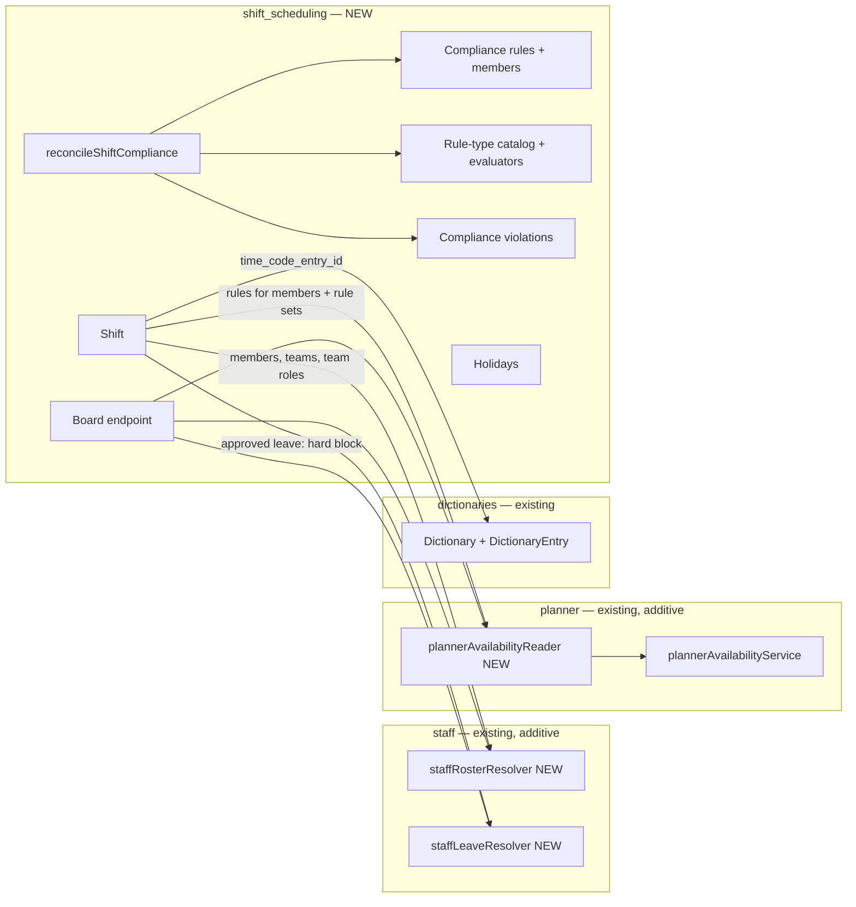

# Schedule Planner

| Field | Value |
|-------|-------|
| **Status** | In progress — Phases 1 and 2 implemented, Phase 3 pending |
| **Created** | 2026-10-05 |
| **Modules** | `shift_scheduling` (new), `staff` (additive public DI resolvers), `planner` (additive DI reader) |
| **Related** | [Staff decouple from core](./implemented/2026-05-08-staff-decouple-from-core.md), [Staff team hierarchy & managers](./2026-10-05-staff-team-hierarchy-and-managers.md) (separate branch, future per-team authorization) |

## 📝 TLDR
Supervisors have no way to plan their employees' upcoming work. Nothing in the platform assigns shifts (assigned or open) to staff members, and nothing checks the result against labor-law constraints. This spec adds a new core module, `shift_scheduling`, displayed to users as **Schedule Planner**, with a multi-employee planning board:
- **Draft freely.** A supervisor can create and edit shifts without compliance checks blocking them.
- **Check on demand.** "Check compliance" runs **configurable compliance rules** (organization default → team → selected employees, most specific wins) and lists the violations, which the supervisor can approve with an audit trail.
- **Publish.** **Publish** is blocked until every violation in the shifts being published is approved.
- **After publishing.** Every further edit is checked immediately and needs an explicit approve/cancel decision.

The module talks to `staff` only through new public DI resolvers, so it respects staff's decoupling contract.

## 📝 Overview
Today:
- `staff` owns teams, members, team roles, leave requests and timesheets.
- `planner` owns availability and unavailability rules.

Neither owns *planned* work. This spec adds:
1. **Shifts.** Team-owned and optionally assigned to an employee. Each has a time window, an optional break and a mandatory time code (from `dictionaries`). Lifecycle is `draft` → `published`. Publishing is one-way: a published shift never returns to draft (it can still be edited, reassigned or deleted).
2. **Hard invariants.** No double booking, no shift on planner unavailability, no shift on approved leave, the assignee must be a member of the shift's team, and every referenced id is tenant-scoped. These can never be overridden.
3. **Configurable compliance rules.** Rule *types* are defined in code (6 in v1). Rule *instances* are user-defined records with type-specific parameters, scoped to the organization default, a team, or a list of employees. Org defaults are seeded.
4. **A three-stage compliance lifecycle:** free drafting with an on-demand check, a gated publish, and immediate per-mutation checks after publish.
5. **Schedule Planner**, the planning board (employees × days), a compliance-rules management page, a holidays page, and a read-only "My schedule" page for employees.

## 📝 Problem Statement
- Nobody owns planned work. Supervisors plan in spreadsheets, with no enforcement of rest/hours rules, no record of who knowingly approved an exception, and no single place an employee can check "what am I working next week".
- Drafting is iterative. Blocking every edit on a compliance check makes drafting unworkable. The check must be available on demand and enforced only when the schedule becomes final, and strictly after that.
- Legal rules differ by jurisdiction, team and individual. Minors, special contracts and team-specific agreements all differ. Rules must be configurable per team and per group of employees, not hard-coded constants.
- There is no "time code" (Regular / Overtime / Holiday / Training …) that a shift, and later a timesheet entry, could carry for pay-rule purposes.

## 📝 Proposed Solution
1. **New core module `shift_scheduling`.** It declares `requires: ['planner']` and **does not** declare `requires: ['staff']`. All staff data goes through two new public staff DI resolvers, resolved with `allowUnregistered: true`. When staff is absent, every route returns `403 staff_module_not_loaded`, the same pattern as planner's `availabilityAccessResolver` consumption.
2. **Hard invariants** (see Architecture) are enforced on every mutation regardless of lifecycle stage:
   - **Availability windows are guidance only.** They are shown on the board.
   - **Only explicit unavailability blocks.** Planner unavailability rules and approved leave block a shift.
   - **Unconfigured employees can be scheduled.** An employee with no availability rules is schedulable.
   - **Pending leave doesn't block.** It is shown as a heads-up.
3. **Compliance rules are configurable records** evaluated by this module's own code. `business_rules` is not used: it ignores `ruleType` filtering, has no stable failure message, cannot evaluate per item, and lets tenants delete statutory checks.
4. **Three-stage lifecycle:**
   - **Drafting.** Free create/update/delete. "Check compliance" reconciles a persisted violations list and drives an attention icon per employee.
   - **Publishing.** Re-checks exactly the published-to-be scope and blocks until every open violation is approved.
   - **Post-publish.** Create, update and reassign of a **published** shift are checked synchronously, and any new violation involving that shift needs an approve/cancel decision before commit.
5. **Time codes** come from a seeded system dictionary. Pay rules key off them in a later phase.
6. **Schedule Planner.** Employees run down the left, with "Unassigned" pinned first. Days run across. A Day / Week / 3-Weeks / Month toggle sets the range. Weekends and holidays are shaded. Availability, planner unavailability and leave appear as bands. Each employee row has a compliance attention icon.

### Alternatives considered
- **Use `business_rules` GUARD rules.** Rejected after verifying the engine:
  - `executeRules` ignores the `ruleType` filter, so every rule on the `entityType` runs and its actions fire (`business_rules/lib/rule-engine.ts:358-363`).
  - Failure messages exist only inside tenant-editable `failureActions`.
  - There are no array quantifiers, so it cannot name the offending shift pair.
  - Field paths are free-typed.
- **Place shifts inside the `staff` module.** Rejected: scheduling is its own domain. It stays a separate module and consumes narrow staff contracts.
- **Relax staff's decoupling and query staff tables directly.** Rejected: it reverses a merged platform decision, `implemented/2026-05-08-staff-decouple-from-core.md`, and would break when staff is extracted.
- **Hard-block outside availability windows.** Rejected: `getMergedAvailabilityWindows` returns no windows for an employee without rules (`planner/lib/availabilityMerge.ts:171-221`), which would make every unconfigured employee unschedulable.
- **A shift-scheduling-owned time-code table.** Rejected: `dictionaries` already provides an admin-managed, system-seedable value list.
- **Compliance only at publish, or on every mutation regardless of stage.** These were the first and second designs. Both were superseded; see the Changelog.

## 📝 Architecture

### Cross-module contracts
**New staff public DI resolvers.** These are a prerequisite, delivered in Phase 1. They are registered in `staff/di.ts` and documented in `staff/AGENTS.md` under "DI services (BC #9 — STABLE)", following the `availabilityAccessResolver` precedent. Every method takes `em` (the caller's `EntityManager`) plus `scope: { tenantId, organizationId }` and **fails closed** on a missing scope.

- `staffRosterResolver`
  - `listTeams({ scope })`, `getTeams({ ids, scope })` → `{ id, name, isActive }[]`
  - `listTeamMembers({ teamId, scope })`, `getMembers({ ids, scope })` → `{ id, teamId, userId, displayName, isActive, availabilityRuleSetId }[]`
  - `searchMembers({ query, scope, limit })` → same shape, for the employee multi-select
  - `resolveMemberByUserId({ userId, scope })` → member or `null`
  - `listTeamRoles({ teamId?, ids?, scope })` → `{ id, teamId, name }[]`
- `staffLeaveResolver`
  - `listLeave({ memberIds, range, statuses, scope })` → `{ id, memberId, startDate, endDate, timezone, status, reasonLabel }[]`

**Rules for consuming them:**
- `shift_scheduling` declares the resolver shapes **structurally** in its own `lib/staffContracts.ts` (the planner precedent) and never imports from `staff/`.
- It resolves the resolvers with `container.resolve(key, { allowUnregistered: true })`. A missing resolver yields `403 { code: 'staff_module_not_loaded' }` plus a one-line warn log.

**New planner DI reader.** `plannerAvailabilityService` only merges the rules it is handed, and no server helper loads a member's rules. Add a **new** key, `plannerAvailabilityReader.getSubjectRules({ em, memberIds, ruleSetIds, scope })`, returning plain rule shapes (`kind`, `rrule`, `exdates`, `timezone`). It has no `range` parameter, because RRULE-based rules can't be range-filtered in SQL; callers expand them with `plannerAvailabilityService`. This new key is used rather than adding a method to the existing `PlannerAvailabilityService` interface, which would break apps that override that DI service.

**Dictionaries.** Seed the system `Dictionary` `shift_scheduling.time_codes` with Regular, Overtime, Holiday, Training and Unpaid. Regular is `isDefault`. The planner seeding precedent applies. Tenants manage entries through the existing dictionary admin UI.

### Hard invariants (every stage, never overridable)
For assigned shifts:
1. **No double booking.** No overlap with another non-deleted shift of the same employee.
2. **No planner unavailability.** No overlap with a planner **unavailability** rule. The source is the member's own unavailability rules plus their rule set's unavailability rules, unioned.
3. **No approved leave.** No overlap with an **approved** leave day, from `staffLeaveResolver`. A leave covers whole calendar days: staff stores them as UTC-midnight dates, so the UTC calendar date is the day. A shift is blocked when any schedule-timezone day it touches (start day, plus the end day for an overnight shift) is a leave day. Pending leave never blocks.
4. **Assignee in team.** The assignee's `teamId` must equal the shift's `team_id`. Cross-team assignment is not allowed in v1.
5. **Active assignee.** A shift can't be newly assigned to an inactive employee. A shift already assigned to someone who later became inactive stays editable.

Invariant checks and the write run in one transaction, holding a per-employee advisory lock (`pg_advisory_xact_lock`). Two concurrent saves therefore can't both pass the overlap check. No Scheduling command is undoable (undo was removed on 2026-10-10 as a product decision); every write is still recorded in the audit log.

For every shift:
- **Tenant-scoped references.** `team_id`, `staff_member_id` and `team_role_id` (resolved through `staffRosterResolver`) and `time_code_entry_id` (which must belong to the `shift_scheduling.time_codes` dictionary) all resolve within the caller's tenant and organization.
- **Valid time window.** `ends_at > starts_at`, and the duration is at most 24h.
- **Valid break.**
  - `break_starts_at`/`break_ends_at` are both null or both set.
  - When set, they fall inside the shift, and their length equals `break_duration_minutes`.
  - The break is shorter than the shift.

Availability windows are **guidance only**. They are gathered as the member's own availability-kind rules if any exist, otherwise the rule set's rules, and drawn as a band on the board.

### Day attribution and timezone
There is no platform-level timezone, and v1 does not add an organization-level setting for it. Every "day", "week", "month", holiday date and leave day is computed in one fixed **schedule timezone, UTC**, and weeks start on **Monday**. Both values live in one constant (`lib/settings.ts`, `SHIFT_SCHEDULING_SETTINGS`) that every consumer reads (board, rotation, invariants, compliance, publish), so a configurable setting can replace it later without touching the call sites. The board, lookups and my-shifts responses return it as `settings: { timezone, weekStartsOn }`. A configurable timezone and week start were removed from scope on 2026-10-10 and are an open question (see Open Questions). A shift belongs to the day of its `starts_at`. A night shift that crosses midnight is shown in its start day's column and counts as a working day only on that day.

### Configurable compliance rules
**Rule types** form an internal code catalog in `lib/compliance/ruleTypes.ts`. Each entry has `{ type, labelKey, paramsSchema (zod), defaultParams, evaluate(facts, params) }`, where `evaluate` returns `{ subjectKey, observedValue, thresholdValue, periodStart, periodEnd, messageKey, messageParams }[]`. Worked time = `ends_at − starts_at − break_duration_minutes`. A public registry so apps can add types is deferred, so no frozen contract is created yet.

Each catalog entry also declares `worseWhen: 'higher' | 'lower'`, the direction in which `observedValue` counts as worse. The engine uses it for re-opening approvals.

Weeks are **schedule weeks**: they start on Monday, in the schedule timezone, and are identified as `<start-date>`, not as ISO weeks.

| Type | Parameters (seeded org default) | Observed value (`worseWhen`) | Violation subject (`subject_key`) |
|---|---|---|---|
| `max_hours_in_period` | `maxHours` (48); `period`: `day` \| `week` \| `month` \| `rolling_days` (`week`); `rollingDays` (required when `rolling_days`); `averagingWeeks` (1 = no averaging; only valid with `week`; EU allows up to 17) | worked hours, or the average (`higher`) | period id: date / org-week start / month / rolling-window end date |
| `max_shift_duration` | `maxHours` (12, gross shift length) | shift hours (`higher`) | shift id |
| `min_rest_between_shifts` | `minRestHours` (11) | rest hours before the shift (`lower`) | id of the later shift of the pair |
| `min_weekly_rest` | `minContinuousRestHours` (35), per schedule week | longest continuous rest touching the week (`lower`): a rest that crosses into the next week counts for both weeks; time before the first or after the last scheduled shift counts only inside the week. Only weeks with a shift are checked. | week start |
| `break_required_after` | `workHoursThreshold` (6), `minBreakMinutes` (30) | break minutes (`lower`) | shift id |
| `max_consecutive_working_days` | `maxDays` (6, at most 366) | consecutive-day count reached (`higher`) | **each working day that exceeds the limit** (its date). This stays stable when a run grows in either direction. |

A shift "involves" a violation when it is in the violation's subject:
- the shift itself
- either shift of a rest pair
- any shift inside the period or week
- any shift on an exceeding day

**Rule instances** are user-defined. Each has a name, a type, params validated by the type's schema, a scope, and an enabled flag. Scopes:
- `organization` — the org default
- `team` — one team
- `employees` — an explicit list of employees, possibly from different teams (e.g. minors)

**Effective rule resolution**, per employee and rule type: **employee-list rule > team rule (member's team) > organization default.**
- A more specific rule **replaces** the less specific one of the same type, so it may tighten or relax.
- A **disabled** rule at a specific level turns that check **off** for the employees it covers. This is an explicit override.
- **Deleting** a rule falls back to the next level.
- Teams without their own rule, including newly created teams, use the defaults.

**Determinism:** at most one **non-deleted** rule per level. At most one org default per type, one team rule per (team, type), and one employee-list rule per (employee, type).
- A **disabled** rule still occupies its slot. That is exactly what makes "disabled = check off" an override.
- The DB indexes are listed under Data Model.
- The write path checks both constraints first and rejects with a readable error naming the conflicting rule:
  - `rule_scope_conflict` for an organization or team slot
  - `rule_member_conflict` for an employee already in another employee-list rule of the same type

**Seeding:**
- **New tenants:** `setup.ts.seedDefaults` idempotently inserts the six org-default rules (one per type, keyed by `scope_type = 'organization'` + `rule_type`). It never overwrites tenant edits.
- **Existing tenants:** an **upgrade action** in `configs/lib/upgrade-actions.ts` runs the same idempotent seeding for every existing tenant/org. One is added in Phase 1 for the time-code dictionary, which is mandatory, so without it existing tenants couldn't create shifts. One is added in Phase 2 for the default rules.

### Compliance engine
There is a single call site, `reconcileShiftCompliance(em, { staffMemberIds, range, scope, factScope })`:
1. Resolve each employee's effective rule per type.
2. Load their shifts for `range` widened by a **context window per employee**: at least 14 days, and as many days as the longest period among the rules that apply to that employee (a rolling window of `rollingDays`, an `averagingWeeks` average plus one week, a calendar month = 31 days, or `maxDays` + 1 for consecutive working days), capped at 400 days. A rule that looks back further than the window could not see the earlier work and would let a violating schedule through. Employees are grouped by window length so each group is one indexed query (`tenant, organization, staff member, starts_at`).
3. Run the evaluators.
4. Reconcile the results into `shift_scheduling_compliance_violations`.

Unassigned shifts are never evaluated.

`factScope` determines which shifts count:
- **Check compliance (`all`):** all non-deleted shifts (draft and published).
- **Publish (`publish`):** already-published shifts plus the shifts being published. Other drafts are excluded.
- **Post-publish mutation (`post_publish`):** published shifts plus the shift being mutated, in its new state.

**Only the `all` scope (Check compliance) may resolve rows.** Publish and post-publish evaluations see a *subset* of shifts. If they resolved rows, they would wrongly resolve violations that the full check found and the supervisor approved. So they only **upsert** what they detect and never resolve anything.

A row is **covered** when it is `approved`, its `approved_rule_version` equals the rule's current `version`, and the newly observed value is not worse (per `worseWhen`) than `approved_observed_value`.

Reconciliation rules, keyed by `(staff_member_id, rule_id, subject_key)`:
- **New detection** → an `open` row.
- **Re-detection of a `resolved` row** → the **same row** is reused, set back to `open`, and its approval fields are **cleared**.
- **Still detected** → bump `last_detected_at`, refresh the observed value, message and rule snapshot.
- **No longer detected by an `all`-scope check** → `resolved`. The approval fields are kept for history.
- **An `approved` row that is no longer covered** (rule edited or re-enabled, employee list changed, or value worse) → back to `open`.
- **An improvement keeps the approval.**
- **When an employee's effective rule changes** (team move, rule added or removed, or a rule **disabled**), the next `all`-scope check resolves the rows under the no-longer-effective rule and creates new rows under the new `rule_id`.

### Compliance lifecycle
| Stage | Trigger | Behaviour |
|---|---|---|
| Drafting | create/update/delete on shifts not meeting the post-publish trigger | No compliance check. Hard invariants only. |
| On demand | "Check compliance" button (any time) | Reconcile the board's scope (`factScope: all`) and return `open` + `approved` rows, grouped New / Already approved. Approving writes approver, time, rule version and observed value. |
| Publish | "Publish" button | Evaluate with `factScope: publish`. A detected violation that **involves a shift being published** and isn't covered blocks the publish (upserted as `open`) → `409 { code: 'shift_scheduling_compliance_approval_required', violations, fingerprint }`. Violations involving only already-published shifts don't block it. The supervisor approves via the approve endpoint (by violation ids), then publishes again. "Approve all & publish" does exactly that. |
| Post-publish | create / update / reassign of a shift that **is published (before or after the mutation)** | Evaluate with `factScope: post_publish` before commit. Only uncovered violations that **involve the mutated shift** count, so pre-existing violations elsewhere (including shifts published before Phase 2 existed) never block an unrelated edit. If any count on the first attempt → `409` (same code, with `violations` and `fingerprint`), and nothing commits. |

**Approval re-submit.**
- The `409` carries a `fingerprint`: a hash of the sorted `(rule_id, subject_key, observed_value)` of exactly the listed violations.
- The client re-submits the same mutation with `acknowledgeViolations: { fingerprint }`.
- The server **re-evaluates** and compares fingerprints.
  - **Match:** it commits and writes **only those listed** violations as `approved` (no other `open` row is touched).
  - **Mismatch** (the data changed in between): a fresh `409`.

**Notes:**
- **Drafting stays free.** A brand-new draft next to a published week is not gated on edit. It is checked against the published shifts when it is itself published, because the publish fact scope includes published shifts.
- **Deletes and unassigns never trigger compliance.** All six rule types are monotonic in worked time, so removing work cannot create a violation. Remaining rows resolve on the next Check compliance.
- **Check order on every mutation:** optimistic lock (`code: 'optimistic_lock_conflict'`) → hard invariants (`422` with field errors) → compliance (`409` with its own code). The compliance code never collides with the lock conflict, which the UI matches on `code`.
- **Fail closed:** an evaluator error blocks the publish or mutation and is reported via `reportError`. It never counts as "no violations".

### Authorization (v1)
Features are tenant-wide (see Risks):

| Feature | Grants | Default roles |
|---|---|---|
| `shift_scheduling.view` | board and rules (read) | admin |
| `shift_scheduling.manage` | shifts, holidays, check and approve compliance | admin |
| `shift_scheduling.publish` | publish | admin |
| `shift_scheduling.rules.manage` | compliance rules | admin |
| `shift_scheduling.costs.view` | schedule cost (employees' hourly rates) on the board | admin |
| `shift_scheduling.my_schedule.view` | own **published** shifts only | employee |

Compliance approval authority is `.manage`.

## 📝 Data Model
All tables carry `tenant_id` and `organization_id`, and every query is scoped by both. There are no ORM relations to other modules, only FK ids.

**`shift_scheduling_shifts`**

| Column | Type | Notes |
|---|---|---|
| `id` | uuid PK | |
| `team_id` | uuid | staff team (via resolver) |
| `staff_member_id` | uuid, nullable | `null` = open/unassigned shift |
| `starts_at` / `ends_at` | timestamptz | `ends_at > starts_at`, ≤ 24h |
| `break_duration_minutes` | int, default 0 | `0` = no break; required > 0 when the form's "has a break" is on |
| `break_starts_at` / `break_ends_at` | timestamptz, nullable | both or neither; inside the shift; equal to the duration |
| `time_code_entry_id` | uuid | dictionary `shift_scheduling.time_codes` |
| `time_code_value` | text | snapshot of the entry value, refreshed on update |
| `team_role_id` | uuid, nullable | staff team role (via resolver) |
| `note` | text, nullable | **encrypted** (`encryption.ts`) |
| `status` | text, default `draft` | `draft` \| `published` |
| `published_at` / `published_by_user_id` | nullable | |
| `created_by_user_id` | uuid, nullable | |
| `created_at` / `updated_at` / `deleted_at` | timestamptz | optimistic locking via `updated_at`; soft delete in every status |

Indexes: `(tenant_id, organization_id, staff_member_id, starts_at)` and `(tenant_id, organization_id, team_id, starts_at)`.

**`shift_scheduling_compliance_rules`**

| Column | Type | Notes |
|---|---|---|
| `id` | uuid PK | |
| `name` | text | |
| `rule_type` | text | catalog type |
| `params` | jsonb | validated by the type's schema on every write |
| `scope_type` | text | `organization` \| `team` \| `employees` |
| `team_id` | uuid, nullable | set only when `scope_type = team` |
| `enabled` | boolean | |
| `version` | int | bumped when `params`, `enabled` or the employee list change |
| `created_by_user_id` | uuid, nullable | |
| `created_at` / `updated_at` / `deleted_at` | timestamptz | |

Partial unique indexes, over non-deleted rows:
- `(tenant_id, organization_id, rule_type)` where `scope_type = 'organization'`
- `(tenant_id, organization_id, team_id, rule_type)` where `scope_type = 'team'`

**`shift_scheduling_compliance_rule_members`** — a junction table, exempt from `updated_at`

| Column | Type | Notes |
|---|---|---|
| `id` | uuid PK | |
| `rule_id` | uuid | |
| `staff_member_id` | uuid | |
| `rule_type` | text | denormalized, for the uniqueness index |

The unique index is `(tenant_id, organization_id, staff_member_id, rule_type)`. Rows are replaced on rule update and hard-deleted when the rule is soft-deleted.

**`shift_scheduling_compliance_violations`** — reconciled, stateful

| Column | Type | Notes |
|---|---|---|
| `id` | uuid PK | |
| `staff_member_id` | uuid | |
| `rule_id` | uuid | rule instance |
| `subject_key` | text | per type, see the catalog |
| `rule_type` / `rule_name` / `rule_params` / `rule_version` | snapshot | as of the latest detection |
| `period_start` / `period_end` | timestamptz | display only |
| `observed_value` / `threshold_value` | numeric | |
| `message_key` / `message_params` | text / jsonb | rendered with i18n |
| `status` | text | `open` \| `approved` \| `resolved` |
| `first_detected_at` / `last_detected_at` | timestamptz | |
| `approved_by_user_id` / `approved_at` / `approved_rule_version` / `approved_observed_value` | nullable | |
| `resolved_at` | timestamptz, nullable | |
| `created_at` / `updated_at` | timestamptz | |

The unique index is `(tenant_id, organization_id, staff_member_id, rule_id, subject_key)`. The employee attention icon shows when that employee has any `open` row.

**`shift_scheduling_holidays`**: `id`, `date` (date), `label`, `created_at`, `updated_at`, `deleted_at`. This is a display aid, not a rule input in v1.

## 📝 API Contracts
Every route exports `openApi` and per-method `metadata`. Custom write routes run the mutation guard. Every route that needs staff data (board, lookups, my-shifts, and shift create/update through the invariants) returns `403 staff_module_not_loaded` when staff is absent. Shift list/delete, holidays and settings don't need staff and keep working.

**Shifts** — `makeCrudRoute` at `/api/shift_scheduling/shifts`, with `indexer: { entityType: 'shift_scheduling:scheduled_shift' }`
- `GET ?teamId&staffMemberId&from&to&status&unassigned`
  - Requires `.view`. Page size is at most 100.
  - Employees with only `.my_schedule.view` use the dedicated `GET /api/shift_scheduling/my-shifts?from&to` (at most 62 days). It returns only the caller's own **published** shifts, resolved through `resolveMemberByUserId`. A separate route keeps the RBAC declarative instead of branching inside the CRUD list.
- `POST` — create. Always starts as `draft`. Hard invariants apply. The post-publish gate applies when triggered.
- `PUT` — update. **Assign, reassign and unassign are a `PUT` of `staff_member_id`**; there is no separate endpoint. Same validation as create. Optimistic-lock header required.
- `DELETE` — soft delete, in every status. No compliance gate.
- **Approval re-submit:** body field `acknowledgeViolations: { fingerprint }`, echoing the fingerprint from the `409`. It's the same confirm-and-resubmit pattern as workflows publish's `acknowledgeBreakingChanges`. Only the fingerprinted violations get approved.
- **Team move:**
  - An employee who moved teams keeps their older shifts under the old `team_id`. Those shifts render on the old team's board in a "Former members" group, and only when they fall in range.
  - The member-in-team invariant is not re-checked on untouched shifts.
  - Any edit of such a shift must satisfy it, so the shift has to be reassigned or unassigned first.

**Board** — `GET /api/shift_scheduling/board?teamId&from&to`
- Requires `.view`.
- The range is at most 31 days.
- One scoped payload, assembled server-side through the resolvers:
  - members
  - shifts (draft and published, with a row cap and a `truncated` flag)
  - approved and pending leave
  - availability and unavailability bands
  - holidays
  - weekend days
  - per-member open-violation flags (`openViolationMemberIds`: open violations whose period overlaps the loaded range)
  - `rates` and `costConversion` for the schedule cost, only when the caller has `.costs.view` (otherwise `null`)
- No staff ACLs are needed, because the resolvers are called server-side.

**Rotation** — `POST /api/shift_scheduling/shifts/rotation`
- Creates repeating shifts in one request. Body: the shift fields (`teamId`, `staffMemberId?`, `timeCodeEntryId`, `teamRoleId?`, `note?`, `breakDurationMinutes?`), local `startTime`/`endTime` and optional `breakStartTime`/`breakEndTime` (HH:mm, schedule timezone; an end at or before the start ends the next day), plus the pattern `startDate`, `endDate` (inclusive, under 366 days), `weekdays` (0 = Sunday … 6), `intervalWeeks` (1–8, counted from the week containing `startDate` using the org week start) and `copies` (1–20; above 1 only for unassigned shifts).
- Requires `.manage`; mutation guard with operation `create`.
- At most 200 shifts per request (`422 shift_rotation_too_many`); a pattern with no matching day returns `422 shift_rotation_empty`.
- The route runs `shift_scheduling.shifts.create` once per shift, so every shift gets the same invariants, audit entry and events. Shifts are independent; there is no series link.
- Days rejected with a `409` (approved leave, unavailability, overlap) are skipped and reported as `skipped: [{ date, code, message }]`. Any other error aborts the request. Response: `{ ok, createdCount, created: [{ id, date }], skipped }`, `201` when at least one shift was created, otherwise `200`.

**Bulk actions** — `POST /api/shift_scheduling/shifts/bulk-delete` and `/bulk-assign`
- Body: `{ shifts: [{ id, updatedAt }] }` (at most 200), where `updatedAt` is the version of each shift the supervisor saw on the board. `bulk-assign` also takes `staffMemberId` (nullable; `null` unassigns, an id assigns or reassigns).
- Requires `.manage`; mutation guard with operation `delete`/`update`, resource id `null`.
- Each shift runs through the regular single-shift delete/update command, so it keeps its own invariants, audit entry and events. Shifts are independent, same as rotations.
- A shift rejected by a `CrudHttpError` (not found, **changed since the board was loaded**, overlap, approved leave, unavailability, inactive/other-team member) is skipped and reported; every other shift in the request still proceeds. An unexpected error aborts the request.
- Response: `{ ok, processedCount, processed: [id], skipped: [{ id, code, message }] }`, always `200`.
- **Stale-data check.** Each entry's `updatedAt` is passed to the shift command as `expectedUpdatedAt` and compared with the stored `updated_at` (the platform's `assertOptimisticLock`). A shift that someone else changed or reassigned after the board was loaded is **not** overwritten or deleted: it is skipped with code `shift_changed` and the rest proceed. Reloading a shift just before the write is not a substitute, because it only reads the current data and cannot tell that it changed since the supervisor looked.
- **Skip messages name the shift.** The board builds each line from the shift it displayed: employee (or "Unassigned"), date, start–end time, and the reason, for example "Marek Kowalski, Wed, Oct 14, 2026, 08:00–16:00: changed by someone else after you loaded the board". It lists up to 5 and then "and N more", and reloads the board so changed shifts show their current state. This applies to every skip reason, including a shift that no longer exists.

**Publish** — `POST /api/shift_scheduling/shifts/publish`
- Body: `{ shiftIds }` (at most 500) or `{ teamId, from, to }`. The range form publishes every `draft` shift of that team whose `starts_at` falls in the range, **including unassigned (open) shifts**. Open shifts are published so they show as open slots, and they carry no compliance.
- Requires `.publish`.
- Publish runs the publish-stage reconciliation first and returns `409` with the compliance code while `open` rows remain in scope.
- Publishing is one-way. There is no unpublish route, and the command is not undoable (an undo would move shifts back to draft). It is still recorded in the audit log.
- It is a single transactional command.

**Compliance**
- `POST /api/shift_scheduling/compliance/check` — body `{ teamId, from, to }` or `{ staffMemberIds, from, to }`. Requires `.manage`. Returns the current `open` + `approved` rows.
- `POST /api/shift_scheduling/compliance/approve` — body `{ violations: [{ id, observedValue }] }`, where `observedValue` is what the supervisor saw. Requires `.manage`. Records the approver, time, rule version and observed value. If any listed violation is no longer `open` or its observed value changed, **nothing is approved** and the response is `409 { code: 'shift_scheduling_violation_changed', violations: [current state of the changed ones], missingViolationIds }`; the dialog shows the employee, date range, rule and new value, and reloads the list.

**Compliance rules** — `makeCrudRoute` at `/api/shift_scheduling/compliance-rules`, with `indexer: { entityType: 'shift_scheduling:compliance_rule' }`
- `GET` requires `.view`. `POST`/`PUT`/`DELETE` require `.rules.manage`.
- The body includes `memberIds` when `scope_type = employees`.
- Validation:
  - params against the type's schema
  - `team_id` and members through the roster resolver
  - the uniqueness rules, with readable `rule_member_conflict` / `rule_scope_conflict` codes

**Holidays** — `makeCrudRoute` at `/api/shift_scheduling/holidays`. Write requires `.manage`. `date` is unique per organization among non-deleted rows.

**Commands** (`registerCommand`, `emitCrudSideEffects` with an indexer; none is undoable):
- `shift_scheduling.shifts.create|update|delete|publish`
- `shift_scheduling.compliance.approve`
- `shift_scheduling.compliance_rules.create|update|delete`

**Events** (`createModuleEvents`, `as const`):
- `shift_scheduling.shift.created|updated|deleted|published`
- `shift_scheduling.compliance_rule.created|updated|deleted`

## 📝 UI/UX
Built following the `om-backend-ui-design` skill and DS rules: semantic tokens only, i18n keys only, and every dialog supports `Cmd/Ctrl+Enter` to submit and `Escape` to cancel.

**Schedule Planner** (`backend/shift_scheduling/page.tsx`)
- **Toolbar:**
  - team picker
  - `SegmentedControl` range toggle: Day / Week / 3 Weeks / Month
  - "Add shift" button
  - distinct **"Publish"** and **"Check compliance"** buttons, never combined. "Publish" ships in Phase 1 as a plain status flip and gains the compliance gate in Phase 2. "Check compliance" ships in Phase 2 and isn't rendered before then.
- **Rows:** employees (`Avatar` + name), with "Unassigned" pinned first. Each row shows an attention icon when the employee has an `open` violation in the loaded period; clicking it opens the violations dialog filtered to that employee. Every Check compliance run refreshes the board, so the icon appears or clears immediately. Inactive members get a badge.
- **Columns:** days. Weekend and holiday columns are shaded with distinct DS tokens. A weekend holiday shows both.
- **Background bands per row:**
  - availability as guidance
  - planner unavailability
  - approved leave (strong; it blocks)
  - pending leave (light; it doesn't block)

  Bands reuse the `ScheduleItem` `kind: 'availability' | 'exception'` presentation and the `getScheduleItemStyle` / `getScheduleStatusTone` helpers.
- **Why a new component:** the existing `ScheduleView`, `ScheduleCalendar` and `ScheduleGrid` are single-subject, so the board is a module-local composition that reuses their types and presentation helpers.

**Shift actions**
- **Add:** click an empty cell; the dialog is pre-filled with the team, the employee (or none, from the Unassigned row) and a default time window for that day. The toolbar "Add shift" opens it empty.
- **Grouped unassigned shifts:** unassigned shifts in the same cell that share every planning attribute (time window, break, time code, team role, note, draft/published) are interchangeable, so the board shows them as one merged card with a "×N" count instead of N stacked cards. Its menu offers "Assign one" (opens the usual member picker for one of them), "Show individually" (expands into normal, fully-interactive shift blocks — editing or deleting precisely one un-merges it from the group) and "Delete all (N)" (bulk-delete, confirmed). In multi-select mode the group's checkbox selects or clears every shift in it, and dragging the collapsed card moves one of them, same as dragging a single shift. An assigned shift is never grouped, even if another shift happens to match it exactly.
- **Multi-select (board):**
  - A toolbar "Select" toggle puts the board into selection mode. Clicking a shift toggles it; the row header checkbox selects or clears every shift currently shown in that row (works the same for an employee row and for the Unassigned row, so "every open shift in view" is one click). Checkboxes stay capped at 200 selections.
  - A selection bar shows the count and: Assign / Reassign… (opens the member picker and calls bulk-assign), Unassign (calls bulk-assign with `null`), Delete (confirmed, calls bulk-delete), Clear selection.
  - Dragging a selected shift onto another row moves the whole selection (shown as a "{count} shifts" drag preview) via bulk-assign; dragging an unselected shift still moves only that one.
  - Skipped shifts (reported by the bulk route) stay selected after the action; shifts that succeeded are cleared from the selection.
- **Repeat and multiple shifts (create only):**
  - "Repeat" reveals weekday toggles (ordered by the org week start), a frequency (every 1–4 weeks) and "Repeat until" (defaults to four weeks after the shift date). It covers both "Mon, Wed, Fri" and "every Tuesday".
  - "Number of shifts" (1–20) appears for unassigned shifts and creates that many identical open shifts per day, with or without repeat.
  - A live summary shows how many shifts will be created and warns above 200.
  - Submitting calls the rotation route. The result flashes the created count, plus a warning listing skipped days with their reasons (up to five, then "and N more").
- **Edit:** click a shift block. The same dialog and the same validators.
- **Dialog** (`CrudForm`):
  - team (required)
  - assignee (optional; "Unassigned" is valid; only members of the selected team are offered)
  - time range (required)
  - "has a break" toggle; when on, the duration is required and a "pin exact time" toggle reveals the break start/end
  - time code (required; defaults to the dictionary's default entry)
  - team role (optional)
  - note (optional)
- **Delete:** from the dialog footer or the block's row actions, confirmed with `ConfirmDialog`.
- **Assign / Reassign / Unassign:** from the block's row actions, as quick actions calling the same `PUT`, or through the dialog.
- **Drag and drop:** drag a shift block onto another row to change only its assignee; the day and times are kept.
  - Unassigned row → employee assigns; employee → employee reassigns; employee → Unassigned row unassigns.
  - The whole row is the drop target and highlights while hovered. Former and inactive members' rows don't accept drops. Dropping on the same row does nothing.
  - The drop calls the same `PUT` (optimistic lock, hard invariants), so leave, overlap and unavailability rejections surface as the usual error flash.
  - Dragging starts after a 4px pointer move, so a click still opens the edit dialog. Keyboard users use the row actions above.
- **Unassigned shifts** render on a yellow background (`badge-yellow-light` / `badge-yellow-border`; the amber warning tokens read as red in dark mode), so open slots stand out from assigned shifts wherever they appear.

**Compliance dialogs**
- **Check compliance:** a list grouped **New** vs **Already approved**. Each row shows the employee, rule name and scope, the message (with observed vs threshold), and the period. Actions: per-row "Approve" and "Approve all new".
- **Publish:** with `requiresApproval`, the same dialog opens framed as blocking ("Resolve before publishing"), with an "Approve all & publish" convenience action. With no open rows, publish completes without a dialog.
- **Post-publish mutation:** an approve/cancel modal listing the violations. Approve re-submits with `acknowledgeViolations: { fingerprint }`.
- **Error routing:** the UI intercepts `shift_scheduling_compliance_approval_required` before `CrudForm` / `useGuardedMutation` turn it into a generic error toast. The structured payload is routed through the save-error channel (lesson: *always propagate structured conflict payloads*).

**Compliance rules page** (`backend/shift_scheduling/compliance-rules/`)
- The `DataTable` lists name, type, scope ("Organization default" / team name / "N employees"), a parameter summary, and enabled.
- The `CrudForm` has name, rule type (the parameter fields render from the type schema with its defaults), scope (organization / team select / searchable employee multi-select), and enabled.
- Disabling or deleting an **organization default** asks for confirmation, because it removes a legal check for everyone without a more specific rule.

**Holidays page** (`backend/shift_scheduling/holidays/`, gated by `.manage`) — `DataTable` + `CrudForm`.

**My schedule** (`backend/shift_scheduling/my-schedule/page.tsx`) — read-only. It shows the caller's published shifts using the existing single-subject `ScheduleView`. Each card shows the time code, start and end time, break and note (through the optional `ScheduleItem.detailLines`), and clicking a card opens a read-only shift-details dialog.

**Schedule cost** (on the board, gated by `.costs.view`) — one total for the loaded range: worked hours (breaks excluded) × hourly rate, draft and published shifts, unassigned shifts excluded. Rates are the employee's `hourly_rate` and `currency_code` custom fields (staff HR fields), read with the shared custom-field helper. The total is shown in the organization's base currency (`currencies` `baseCurrencyService`); rates in other currencies are converted with stored exchange rates (`exchangeRateService`, today's rate or the latest within 30 days, inverse pair as fallback, no provider fetch). Employees without a rate or without a usable exchange rate are left out and counted in the summary.

**Holidays seed** — `setup.ts` `seedDefaults` seeds the 2026 Polish public holidays (14 days) for every new organization; re-seeding skips dates that already have a holiday.

## 📝 Edge Cases & Failure Scenarios
- **Unassigned shift:** no overlap, unavailability, leave or compliance checks until it is assigned.
- **Employee with no availability configured:** schedulable. Availability is guidance only.
- **Pending leave:** shown, never blocks. **Leave approved after a shift already exists:** not auto-resolved; the conflict is visible because both render in the same row. This is a v1 non-goal.
- **Approved leave vs planner unavailability:** approving leave already writes planner unavailability rules (`staff/commands/leave-requests.ts:213-249`, UTC days). Both are checked. The authoritative leave check uses the schedule timezone, so the stricter result wins.
- **Pre-existing planner quirk:** a member's own rules *replace* their rule set in planner's editor (`AvailabilityRulesEditor.tsx:487-488`), and leave approval writes member rules. A leave approval can therefore change the displayed availability guidance. This affects guidance only, not blocking. Flagged to planner and staff owners.
- **Night shift crossing midnight:** attributed to its start day in the schedule timezone.
- **Publishing a subset:** other drafts in the same week don't count toward the publish check. Check compliance does count them.
- **Approval no longer applies:**
  - violation worsened (49h → 52h) → re-opens
  - violation improved → approval stays
  - rule edited or re-enabled, or employee list changed → re-opens
  - effective rule switched (team move, rule added or removed) → old rows resolve, new rows open
- **Concurrent edit between check and publish:** publish re-reconciles, so a stale approval list can't publish unreviewed violations.
- **Approval re-submit after the data changed:** the server re-evaluates. Different violations produce a fresh `409`.
- **Evaluator error:** fail closed and `reportError`. Publish and the post-publish mutation are blocked.
- **Staff module absent:** every route returns `403 staff_module_not_loaded`. **Planner absent:** the module doesn't load (`requires: ['planner']`).
- **Employee in two employee-list rules of the same type:** rejected on write with `rule_member_conflict`.
- **Employee moves team:** their team rules change automatically. An employee-list rule keeps applying.
- **A rule type's params schema changes in a later release:** a migration or an upgrade action must rewrite existing `params`. The rule `version` bump re-opens the affected approvals.
- **Staff member deactivated:** shifts stay. The board shows an inactive badge. No auto-cancellation.

## 📝 Risks & Impact Review

| # | Risk | Severity | Area | Failure scenario | Mitigation | Residual |
|---|---|---|---|---|---|---|
| 1 | New staff and planner DI contracts become STABLE | Medium | staff, planner | A later staff refactor breaks shift_scheduling | Narrow, documented resolvers in `staff/AGENTS.md`; structural types on the consumer side; unit tests on both sides | Changes need the deprecation protocol |
| 2 | Authorization is tenant-wide | Medium | RBAC | A supervisor can manage or publish any team | Documented v1 limitation; per-team scoping comes from the team-hierarchy spec | Accepted for v1 |
| 3 | Approval authority equals `.manage` | Low | RBAC | The person scheduling also approves their own exceptions | The audit trail records the approver; a dedicated approver feature in Phase 3 | Accepted for v1 |
| 4 | Tenants disable or delete statutory defaults | Medium | Compliance | Legal checks silently disappear | Confirmation dialog; rule CRUD is audited via commands; `rules.manage` is admin-only by default | Product decision |
| 5 | Seeded thresholds aren't authoritative for every jurisdiction | Medium | Compliance | Wrong legal limits are assumed | Documented as EU-style starting points; all parameters are editable | Tenant responsibility |
| 6 | Reconciliation cost on large ranges | Low | Performance | Slow check or publish for big teams × month, or for teams with year-long rolling rules (about 400 to 800 small rows per employee) | Per-employee context window (14 days unless a rule needs more, capped at 400); `maxDays` and `rollingDays` capped at 366; one indexed query per window length; per-team scope; board range capped at 31 days; 500-shift publish cap | Monitor |
| 7 | Board payload size | Low | Performance | A month × large team exceeds the row cap | Row cap with a `truncated` flag shown in the UI | A large team may need a narrower range |
| 8 | Leave / planner day-boundary disagreement | Low | Correctness | UTC planner rules vs schedule-timezone leave days | Both checked; the stricter wins | Edge-of-day differences |

## ❓ Open Questions for the Open Mercato Team
Neither question blocks this spec. Both are decisions for the module owners.

**1. What is the intention behind `planner`, and should it be combined with `shift_scheduling`?**
- **What we found:**
  - `planner` ("Worktime / Availabilities — availability schedules, rulesets, and shared planning rules") was created on 2026-01-22 in #386 together with `staff` and `resources`. The original design spec was removed in that commit, so no written rationale is left.
  - Its rules are keyed by `member`, `resource` or `ruleset`, so one availability engine serves employees and resources. It has no `requires`; `staff` and `resources` depend on it.
  - There is no `planner` roadmap or spec. Planned consumers are the calendar-event-types spec (2026-09-28) and the staff package extraction (staff-decouple spec, "Phase 2/3").
- **Our current position:** keep `shift_scheduling` separate and layered on `planner` (it reads `planner` through the new `plannerAvailabilityReader`). Merging would make `planner` depend on `staff` data (teams, employees, leave, rates) while `staff` already requires `planner`. That is the cycle the starter-presets spec asks to break, and `resources` would carry shift and compliance code it doesn't need.
- **To decide:**
  - Was availability placed in `planner` for sharing with `resources`, or for another reason?
  - Is there a roadmap for `planner`?
  - Should scheduling be merged into it, or only grouped with it in the navigation?

**2. Why are some menu items under other modules than the ones they belong to?**
- **Examples in the current menus:**
  - Several modules put their settings under a shared Settings → "Module Configs" group instead of their own group: `attachments` (Storage), `catalog`, `customers` (Pipeline stages), `sales`, `dictionaries`, `entities` (Encryption), `customer_accounts` (Portal Settings).
  - `planner`'s "Availability schedules" is in "Module Configs", while its "Create schedule" page is in "Configuration".
  - Notification preferences are split across "Account", "Auth" and "Module Configs".
  - Time codes are managed in the `dictionaries` admin UI, not under Scheduling.
  - Our own Holidays page started in "Module Configs". It was moved into the Scheduling group on 2026-10-10.
- **To decide:**
  - Is "Module Configs" a deliberate convention for settings, or a leftover from the sidebar reorganization (SPEC-007)?
  - Where should a module's settings live: in its own menu group, or in a shared Settings area?

**3. How should an organization-level timezone and week start work across the application?**
- **Why it is open:** v1 fixes the schedule timezone to UTC and the week start to Monday. A configurable setting was built and then removed on 2026-10-10, because it needs a decision that reaches beyond this module.
- **What we found:** there is no platform-level timezone. Other modules use their own: `planner` rules and `staff` leave requests each store a timezone per record, and several modules hard-code a Monday week start (staff "my work", the customers calendar).
- **To decide:**
  - Should the timezone and week start be one platform-level organization setting that every module reads?
  - If the setting lives in `configs`, how do per-record timezones (`planner`, `staff`) relate to it?

## 📝 Migration & Backward Compatibility
- **Purely additive:**
  - new module, tables, ACL features, events and routes
  - new staff DI keys (`staffRosterResolver`, `staffLeaveResolver`)
  - a new planner DI key (`plannerAvailabilityReader`)
  - two new upgrade actions in `configs` (`shift_scheduling.seed-time-codes`, version 0.9.1, and `shift_scheduling.seed-compliance-defaults`, version 0.9.1); they only apply where `shift_scheduling` is enabled
  - an optional `detailLines` field on the shared `ScheduleItem` (`packages/ui`), rendered by the shared schedule calendar only when set; the planner, resources and design-system gallery consumers don't set it
- **App registration.** `shift_scheduling` is added to `enabledModules` in `apps/mercato/src/modules.ts`. In the create-app template it is listed but commented out (same as `forms`), because enabling it there makes the scaffold ship the module's fact-sheet, which needs an AI-harness evaluation case (`om-refresh-standalone-harness`). Whether it should be enabled by default in new apps is a team decision.
- **`auth` translations.** The six `auth.acl.features.shift_scheduling.*` titles are added to the `auth` locale files (all five languages), so the role editor shows readable permission names.
- **Existing data, no code change.** New role features for admin and employee (new tenants automatically; existing tenants after `yarn mercato auth sync-role-acls`), the `shift_scheduling.time_codes` dictionary, an encryption-map entry for the shift note, and audit-log entries for Scheduling commands.
- **No existing contract surface changes.** Existing DI interfaces are not extended; new keys are added instead.
- **Frozen once shipped:**
  - ACL ids `shift_scheduling.*`
  - event ids `shift_scheduling.shift.*` and `shift_scheduling.compliance_rule.*`
- **Stable once shipped:** routes `/api/shift_scheduling/*`, the new DI keys and their method shapes, and the dictionary key `shift_scheduling.time_codes`.
- The migrations and snapshot ship with the PR. ACL sync for existing tenants: `yarn mercato auth sync-role-acls`.

## 📋 Phasing
**Delivery is three PRs, in order:**
- **(a)** the staff and planner DI contracts: new STABLE surfaces owned by other modules, reviewed on their own
- **(b)** Phase 1
- **(c)** Phase 2

Each PR leaves the app working.

- **Phase 1 — Foundations, shifts and board.**
  - staff resolvers and the planner reader, with tests and AGENTS.md docs
  - the module scaffold
  - the time-code dictionary seed
  - shift CRUD with hard invariants
  - the board endpoint and UI
  - holidays
  - plain one-way publish
  - My schedule

  No compliance UI is rendered. The app is fully usable for planning.
- **Phase 2 — Configurable compliance.**
  - the rule-type catalog and evaluators
  - the compliance-rules CRUD, page and seeded defaults
  - effective-rule resolution (employee > team > org)
  - reconciliation and violations
  - the Check-compliance dialog and attention icon
  - the publish gate and the post-publish gate
- **Phase 3 (future, not in this plan):**
  - portal visibility
  - planned-vs-actual against staff time entries
  - time codes flowing into timesheets (needs a staff surface or an event)
  - a dedicated approver ACL feature
  - a team-role rule scope
  - a public rule-type registry
  - per-team authorization (team-hierarchy spec)
  - co-location with staff when it's extracted
  - employee notifications on publish

## 📋 Implementation Plan

**Phase 1**
1. **staff:** add `lib/rosterResolver.ts` and `lib/leaveResolver.ts`, register `staffRosterResolver` and `staffLeaveResolver` in `di.ts`, and document them in `staff/AGENTS.md`. Unit tests cover scoping (fail closed) and tenant isolation.
2. **planner:** add `plannerAvailabilityReader` (new DI key) with `getSubjectRules`. Unit tests.
3. **Scaffold `shift_scheduling`:**
   - `index.ts` (`requires: ['planner']`), `acl.ts`, `setup.ts` (`defaultRoleFeatures`, seeding the time-code dictionary), `di.ts`, `events.ts`, `encryption.ts`
   - `lib/staffContracts.ts` (structural types plus a `resolveStaff()` helper returning `403` when absent)
  - an upgrade action (`configs/lib/upgrade-actions.ts`) seeding the time-code dictionary for existing tenants
4. **Data:**
   - entities `ShiftSchedulingShift` and `ShiftSchedulingHoliday`
   - validators (time window, break, time code, FK scoping)
   - the migration and snapshot
5. **Schedule calendar:** `lib/settings.ts`, the fixed schedule timezone (UTC) and Monday week start that every consumer reads. (An earlier design had a settings route and page; they were removed on 2026-10-10.)
6. **Commands:** shift create/update/delete with hard invariants (`lib/invariants.ts`: overlap, planner unavailability, approved leave, member-in-team, org-timezone day attribution), using `runCrudCommandWrite`.
7. **Routes:** shift CRUD (including `my_schedule` scoping, published only), holidays CRUD, and the publish command and route (mutation guard, 500 cap, one-way).
8. **Board:** the board endpoint, then the board UI (toolbar, rows, columns, bands, shift dialog, quick assign actions). The holidays UI. The My schedule page.
9. **Integration tests for Phase 1** (see Integration Coverage).

**Phase 2**
10. **Rule types:** `lib/compliance/ruleTypes.ts` and the six evaluators. Unit tests per type and per parameter edge: averaging, rolling, midnight crossing, week start.
11. **Rule entities:** `ShiftSchedulingComplianceRule` and `ShiftSchedulingComplianceRuleMember`, with the partial unique indexes, the migration, and the seeded org defaults (idempotent).
12. **Rule commands and routes:** rule CRUD (params validation, scope validation through the resolvers, conflict codes) and the compliance-rules page.
13. **Engine:** `lib/compliance/resolveEffectiveRules.ts` (employee > team > org; disabled = off; deleted = fall back), then `ShiftSchedulingComplianceViolation` and `lib/compliance/reconcile.ts` (upsert, resolve, re-open on version change or worsening).
14. **Endpoints:** the check and approve endpoints, then the Check-compliance dialog and attention icon on the board.
15. **Publish gate:** upgrade publish to run reconciliation, and add the "Approve all & publish" UI.
16. **Post-publish gate:** wire it into create/update/reassign of published shifts:
    - only violations involving the mutated shift count
    - the fingerprint is returned with the `409`
    - `acknowledgeViolations: { fingerprint }` triggers a re-evaluation, and on a match only the fingerprinted rows become `approved`

    Then add the approve/cancel modal with interception before CrudForm's generic handler.
17. **Upgrade action:** seed the default rules for existing tenants.
18. **Integration tests for Phase 2.**

## 🧪 Integration Coverage
Every test creates its own fixtures through the API and cleans up after itself. Each API path also has a **second-tenant isolation** case.

**API**
- **Shifts:**
  - CRUD
  - unassigned create
  - assign / reassign / unassign
  - break validation (pinned and unpinned)
  - time code required, and an entry from another dictionary rejected
  - member-not-in-team rejection
  - overlap rejection
  - planner-unavailability rejection
  - approved-leave rejection; pending leave allowed
  - an unconfigured employee schedulable
  - a > 24h shift rejected
- **Visibility and dependencies:**
  - `my_schedule` returns published only, own only
  - staff absent → `403 staff_module_not_loaded`
- **Board and publish:**
  - board payload contents, range cap and `truncated` flag
  - publish, including that no unpublish route exists and published shifts stay published
  - rotation: Mon/Wed/Fri over two weeks, overlap days skipped and reported, three open shifts on one day, copies rejected for an assigned shift, the 200 cap (TC-SHIFT-005)
  - bulk actions: bulk-delete and bulk-assign process independent shifts, skip-and-report a conflicting one and continue, 404 on an already-deleted shift, and skip a shift changed after the board was loaded (`shift_changed`) without overwriting or deleting it (TC-SHIFT-006)
  - reassigning a published shift to an employee who would break the rest rule needs approval; moving it away or unassigning it does not (TC-SHIFT-008)
  - approving a violation whose observed value changed is refused with `shift_scheduling_violation_changed` (TC-SHIFT-007)
  - grouping: identical unassigned shifts merge, an assigned shift or any differing attribute keeps shifts separate, chronological placement is preserved (unit-tested)
  - the 500 cap
- **Rules:**
  - CRUD for each scope
  - invalid params rejected per type
  - a second org default of the same type rejected
  - a duplicate team rule rejected
  - an employee in two employee-list rules of the same type → `rule_member_conflict`
  - defaults seeded idempotently, with tenant edits preserved on re-seed
- **Resolution:**
  - a team rule overriding and relaxing the default
  - an employee-list rule overriding the team rule, including for an employee from another team
  - a disabled specific rule turning the check off vs a deleted rule falling back
- **Compliance:**
  - check groups New vs Already approved
  - approve
  - re-open when worsened
  - re-open on a rule edit or a member-list change
  - resolve when fixed
  - publish blocked by an open violation, then succeeding after approval
  - publish ignoring other drafts
  - post-publish create/update/reassign returning a `409` with the code and fingerprint, and committing with `acknowledgeViolations: { fingerprint }`, approving only the listed rows
  - an edit to a published shift not blocked by an unrelated pre-existing violation
  - a new draft next to a published week not gated on edit, only on its own publish
  - publish or post-publish evaluation never resolving a row approved through Check compliance
  - a re-detected `resolved` row re-opening with its approval cleared
  - a disabled rule's rows resolving on the next check
  - consecutive-days approval stable when the run grows earlier
  - the upgrade action seeding the time-code dictionary and default rules for an existing tenant
  - a changed-state re-submit producing a fresh `409`
  - delete and unassign not gated
  - an evaluator error failing closed
  - night-shift day attribution: an overnight shift counts on its start day

**UI**
- **Board:**
  - render (weekend and holiday shading, bands, Unassigned row)
  - add via a cell click (pre-filled)
  - edit via a block click
  - delete with confirmation
  - quick assign / reassign / unassign
  - range toggle
- **Check-compliance:** the dialog and attention icon.
- **Publish:** with and without violations.
- **Post-publish:** the approve/cancel modal, not swallowed as a generic toast.
- **Rules page:** create with each scope, the dynamic parameter fields, and the confirmation on disabling a default.
- **My schedule:** the page.

## ✅ Final Compliance Report

| Check | Status |
|---|---|
| No cross-module ORM relations / no staff entity imports / no `requires:['staff']` | ✅ resolvers only |
| Tenant and organization scoping on every query and FK | ✅ specified |
| Optimistic locking (`updated_at`) on user-editable entities | ✅ shifts, rules, holidays (junction and violations exempt or system-managed) |
| Commands, side effects with an indexer (undo removed by product decision) | ✅ specified |
| Mutation guard on custom write routes | ✅ publish, check, approve |
| `makeCrudRoute` for CRUD; pageSize ≤ 100 | ✅ board uses a dedicated range endpoint |
| Encryption of PII / free text | ✅ `note`; no name snapshot stored |
| zod validation in `data/validators.ts` | ✅ including per-type params schemas |
| ACL features in `setup.ts` `defaultRoleFeatures` | ✅ |
| Events via `createModuleEvents` | ✅ |
| i18n, DS tokens, dialog shortcuts, `ConfirmDialog` | ✅ |
| Integration coverage, including tenant isolation | ✅ |
| Backward compatibility | ✅ additive only |

## 📜 Changelog
- **2026-10-05** — Initial spec. Publish-time compliance via `business_rules`, tenant-wide authorization.
- **2026-10-05** — Team hierarchy split into a separate spec and branch. v1 keeps tenant-wide authorization.
- **2026-10-06** — Added unassigned shifts, optional-timed breaks, mandatory time codes, and the planning-board design. Compliance on every mutation (superseded).
- **2026-10-06** — Three-stage compliance lifecycle: free drafting with on-demand check, gated publish, strict post-publish. Board actions (add, edit, delete, assign) specified. Leave requests integrated.
- **2026-10-06** — Pre-implementation review revision:
  - Staff access moved to new public DI resolvers (decoupling contract).
  - Availability made guidance-only, with explicit unavailability and approved leave blocking.
  - `business_rules` replaced by configurable compliance rules: 6 types; org → team → employee-list precedence.
  - Approvals re-open on worsening or rule change.
  - Org timezone and week start setting added.
  - Dedicated board endpoint.
  - My-schedule shows published only.
  - `cancelled` removed; role is a staff team role; cross-team assignment disallowed.
  - Added a 409 code and the `acknowledgeViolations` re-submit.
  - Spec format completed.
- **2026-10-06** — Consistency review fixes:
  - Only Check compliance resolves rows; publish and post-publish only upsert.
  - The post-publish gate fires only for published shifts and only counts violations involving the mutated shift.
  - Fingerprinted acknowledgement approves exactly the listed violations.
  - Added `worseWhen` per rule type and org weeks instead of ISO weeks.
  - Consecutive-days subject is now each exceeding day.
  - Uniqueness covers disabled rules; `rule_scope_conflict` documented.
  - A re-detected resolved row clears its approval.
  - Upgrade actions seed existing tenants.
  - Publish-range semantics include open shifts.
  - Team-move display defined; rule-delete undo restores members; holiday date unique.
  - Separate holidays and settings pages.
  - Three-PR delivery.
- **2026-10-07** — Phase 1 manual-test feedback: publishing is one-way (unpublish route, command, event and button removed; publish has no undo). Unassigned shifts are shaded yellow. Drag and drop between rows assigns, reassigns and unassigns.
- **2026-10-07** — Grouped unassigned shifts: identical unassigned shifts in the same cell render as one merged card with a count, expandable back into individual shifts.
- **2026-10-07** — Multi-select: the board can select several shifts (one by one, a whole row, or the whole Unassigned row) and bulk delete, assign, reassign or unassign them, including by dragging the selection onto another row. New `POST /api/shift_scheduling/shifts/bulk-delete` and `/bulk-assign`; conflicting shifts are skipped and reported, the rest proceed.
- **2026-10-07** — Rotations: the Add shift dialog can repeat a shift on chosen weekdays every 1–4 weeks until a date, and create several open shifts per day. New `POST /api/shift_scheduling/shifts/rotation`. Created shifts are independent; blocked days are skipped and reported.
- **2026-10-08** — Phase 2 implemented and shipped: the rule-type catalog and reconciliation engine, rule CRUD and management page, `/compliance/check` and `/approve`, the publish and post-publish gates with the fingerprinted acknowledge-and-resubmit flow, and the board's attention icon and compliance dialogs. TC-SHIFT-007 covers the full lifecycle end to end; TC-SHIFT-002's fixtures gained a compliant break now that publish is gated.
- **2026-10-08** — Renamed the user-facing feature to **Schedule Planner** (nav group, page titles, module display name); the module id, ACL features, routes, tables and events stay `shift_scheduling.*` unchanged. Added worked-hours-in-period to each employee row. Starting Phase 2 (configurable compliance).
- **2026-10-10** — Removed the organization timezone and week-start settings (settings page, `GET`/`PUT /api/shift_scheduling/settings`, `shift_scheduling.settings.manage`, translations and the settings integration test). The module now uses a fixed UTC schedule timezone and a Monday week start from one constant (`lib/settings.ts`); the `settings` object stays in the board, lookups and my-shifts responses. Added open question 3 on how such a setting should work across the application.
- **2026-10-11** — Merged `origin/develop` into the spec, contracts, phase-1 and phase-2 branches (no conflicts). Review fixes: explicit sort comparators (`lib/sort.ts`), explicit command-interceptor mapping in the approve and rotation routes, `auth.acl.features.shift_scheduling.*` titles in all locales, sorted locale files. Spec brought in line with the code: undo removed from every command, schedule cost (`.costs.view`, `rates`, `costConversion`), the 2026 Polish holidays seed, My schedule card details, the attention icon's range filter, and the weekly-rest rule semantics.
- **2026-10-12** — Open items closed: the two seeding upgrade actions are now version `0.9.1` (v0.9.0 shipped without the module); Scheduling is not enabled in the create-app template (commented out like `forms`, so no harness evaluation case is needed until a maintainer decides); with "All organizations" selected every Scheduling route now answers `400` "Select a specific organization to use Schedule Planner" instead of the board loading while writes failed.
- **2026-10-12 (review)** — Three review findings fixed. (1) The ±14-day context window is now per employee and as long as the employee's longest rule period (rolling days, N-week averages, months, consecutive days), capped at 400 days; `maxDays` is capped at 366. (2) Bulk assign, bulk delete and approve now check the version the supervisor saw: bulk entries carry `updatedAt` (changed shifts are skipped as `shift_changed`), approve carries `observedValue` (a changed violation refuses the whole request). Skipped shifts are reported with employee, date, time and reason. (3) The reassignment wording is corrected: the new assignee is gated, only moving away or unassigning is exempt; TC-SHIFT-008 covers it.
- **2026-10-10** — Backward-compatibility section completed with every change outside the module: the `configs` upgrade actions, the optional `ScheduleItem.detailLines`, the app and template registration, and the data-level effects. Existing unit suites of staff, planner, configs, resources, the schedule UI and the design-system gallery pass; the existing staff and planner integration suites were not run.
- **2026-10-10** — Added **Open Questions for the Open Mercato Team**: the intention behind `planner` and whether it should be combined with `shift_scheduling`, and why some menu items sit under other modules' groups. Non-blocking; the Scheduling menu group and the Polish 2026 holidays seed shipped the same day.

## Implementation Status

| Phase | Status | Date | Notes |
|-------|--------|------|-------|
| (a) Staff + planner DI contracts | Done | 2026-10-06 | `staffRosterResolver`, `staffLeaveResolver`, `plannerAvailabilityReader`, with unit tests; documented in `staff/AGENTS.md`. Branch `feat/shift-scheduling-contracts`. |
| Phase 1 — Foundations, shifts and board, plus rotations/bulk actions/grouping | Done | 2026-10-08 | Branch `feat/shift-scheduling-phase-1`. Unit tests, typecheck, lint and build pass. Integration specs TC-SHIFT-001…006 pass against a running app (rerun 2026-10-12, after the `develop` merge). |
| Phase 2 — Configurable compliance | Done | 2026-10-08 | Branch `feat/shift-scheduling-phase-2`. Unit tests, typecheck, lint and build pass. All 8 Scheduling integration tests (TC-SHIFT-001…007; TC-SHIFT-003 is now the holidays spec, the settings spec was removed on 2026-10-10) pass against a running app, rerun 2026-10-12 after the `develop` merge. |

### Phase 1 — Detailed Progress
- [x] Module scaffold (`index`, `acl`, `setup`, `events`, `encryption`), app and template registration
- [x] Entities, validators, migration (hand-corrected partial unique index on holiday date)
- [x] Time-code dictionary seed, plus an upgrade action for existing tenants (time codes + encryption map)
- [x] ~~Settings (timezone, week start) through `ModuleConfigService`~~: built, then removed on 2026-10-10. The module uses a fixed UTC timezone and Monday week start (`lib/settings.ts`)
- [x] Shift and holiday commands (undo removed on 2026-10-10); one-way publish (transactional, 500 cap)
- [x] Hard invariants: shape, team, time code, team role, active member in team, overlap under advisory lock, planner unavailability, approved leave
- [x] Routes: shifts and holidays CRUD, publish, board, lookups, my-shifts
- [x] UI: Schedule Planner (yellow unassigned shifts, drag-and-drop assignment, multi-select with bulk delete/assign/unassign, grouped unassigned shifts), shift dialog, quick assign, holidays, my schedule
- [x] Rotations: `POST /api/shift_scheduling/shifts/rotation` (weekdays, every N weeks, multiple open shifts per day; skip-and-report)
- [x] Bulk actions: `POST /api/shift_scheduling/shifts/bulk-delete` and `/bulk-assign` (skip-and-report, independent per shift)
- [x] i18n (en; pl/de/es/ko currently hold English placeholders)
- [x] Integration test execution (TC-SHIFT-001…006, all pass)
- [ ] Translations for pl/de/es/ko

### Phase 2 — Detailed Progress
- [x] Rule-type catalog (`lib/compliance/ruleTypes.ts`): the 6 evaluators as pure functions, unit-tested per type and edge case (averaging, rolling windows, org week start, midnight-crossing shifts)
- [x] `ComplianceRule`/`ComplianceRuleMember` entities, partial unique indexes (hand-corrected, same precedent as the holiday date index), the 6 org defaults seeded on new tenants and idempotently for existing ones via an upgrade action (0.9.1)
- [x] Rule commands and routes: CRUD with proactive `rule_scope_conflict`/`rule_member_conflict` checks plus a DB-unique-violation fallback; the compliance-rules management page (DataTable + dynamic per-type param fields + an employee multi-select)
- [x] `resolveEffectiveRules` (employee-list > team > organization, disabled turns the check off without falling back further) and `reconcileShiftCompliance`, with the reconciliation state machine (`lib/compliance/violationState.ts`) as a pure, independently unit-tested function
- [x] `/compliance/check` (the only route that resolves rows) and `/compliance/approve`
- [x] Publish and post-publish gates (`lib/compliance/gate.ts`), sharing one fingerprint-and-acknowledge mechanic; the publish gate's reconciliation commits on a non-transactional em fork so detections persist even when the mutation is rejected
- [x] Board UI: the per-employee attention icon, Check-compliance dialog (New vs Already approved, per-row and bulk approve), the publish-blocked and post-publish-blocked gate dialogs intercepted before CrudForm's generic error path
- [x] Confirmed live and in TC-SHIFT-007 that the rotation and bulk-assign routes needed no changes — they already treat any `CrudHttpError` from the per-shift command as skip-and-report
- [ ] Translations for pl/de/es/ko (still English placeholders, same as Phase 1)

### Implementation deviations from the earlier text
- Entity ids are `shift_scheduling:scheduled_shift` and `shift_scheduling:shift_holiday` (class names `ScheduledShift`, `ShiftHoliday`).
- Compliance entity class names are `ComplianceRule`, `ComplianceRuleMember`, `ComplianceViolation` (not the literal `ShiftScheduling*` prefix), matching the Phase 1 precedent.
- An `approved` row that reopens because it's no longer covered (rule edited, or the value got worse) keeps its prior `approved_by_user_id`/`approved_at`/`approved_rule_version`/`approved_observed_value` for history — only a re-detected `resolved` row's approval fields are cleared, since that is a fresh occurrence rather than a continuous one.
- My-schedule uses a dedicated `GET /api/shift_scheduling/my-shifts` route.
- Board teams and time codes are loaded through `GET /api/shift_scheduling/lookups`, which also returns the fixed schedule timezone and week start as `settings`.
- Leave days are taken from the UTC calendar date, matching how staff stores and expands leave.
- The post-publish gate only applies to `updateShiftCommand`: a create is always a fresh `draft`, so it never qualifies, and moving work **away from** an employee or unassigning a shift is never gated (monotonic: it can only remove a violation). Reassigning a published shift **to** a new employee is gated for that new assignee, because it adds work to them; the shift is evaluated as pending on the recipient (covered by TC-SHIFT-008).
