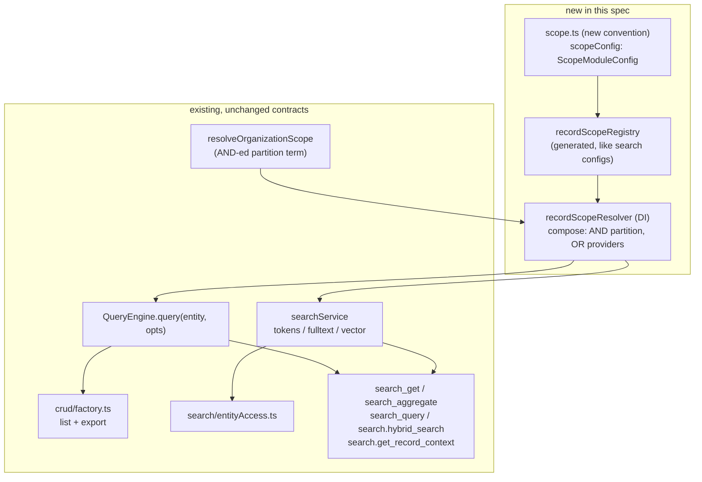

# SPEC — Record Scope Resolver (pluggable per-record read scoping)

**Scope:** OSS
**Status:** Draft
**Tracking issue:** [#5183](https://github.com/open-mercato/open-mercato/issues/5183)
**Related:** [#5167](https://github.com/open-mercato/open-mercato/pull/5167) (per-entity search ACL on the global endpoint — merged; disabled three entities), [#5203](https://github.com/open-mercato/open-mercato/pull/5203) (the same gate on the hybrid endpoint), [#244](https://github.com/open-mercato/open-mercato/issues/244) (RLS for tenant scoping), [`.ai/specs/2026-07-16-custom-entity-record-acl-per-entity.md`](2026-07-16-custom-entity-record-acl-per-entity.md) (per-entity ACL — shipped 0.8.0; explicitly disclaims this problem)
**Companion spec:** *Row-aware search for participant-scoped and polymorphic entities* — the #5183 consumer story. Not this document.
**Related guides:** `packages/shared/AGENTS.md`, `packages/core/src/modules/auth/AGENTS.md`, `BACKWARD_COMPATIBILITY.md`

---

## 📝 TLDR

Open Mercato authorizes reads by **entity type plus tenant/organization scope**. Nothing
answers "which *rows* of this entity may this principal read", and the platform states this
in its own source (`packages/core/src/modules/workflows/lib/task-entity-access.ts:7-9`):

> "**Entity TYPE plus scope. There is no record-level ACL in this platform and this resolver
> does not add one.** The query engine's public interface is `query(entity, opts)` with no ACL
> seam anywhere in it."

This has already cost a shipped feature: #5167 set `enabled: false` on `messages:message`,
`sales:sales_note` and `sales:sales_document_address` in their `search.ts` configs, because
participant-scoped and polymorphic rows cannot be authorized by a static entity feature.
#5183 asks for them back and there is no mechanism to use.

**Future behavior:** modules declare an entity as record-scoped and contribute **scope
providers**; a resolver composes them into **one predicate per request** (partition scope
AND-ed, providers OR-ed), carried on `QueryOptions` so every read path inherits it. An entity
declared scoped that is queried **without** a scope subject raises — omission becomes a loud
error instead of a silent leak. Ships inert: zero entities are declared scoped by this spec,
so no existing behavior changes on merge.

---

## 📝 Overview

**What this spec asks of its reader:** approve a new platform seam — one convention file, one
DI service, one optional `QueryOptions` field — or reject the seam and keep row scoping as a
per-module concern.

**The argument in three sentences.** An entity that needs row-level read scoping today must
choose between being searchable and being correctly scoped, because the only available escape
hatch (`omitAutomaticTenantOrgScope`) disables fulltext, the JSONB index read path and vector
search. That is a contract contradiction inside the platform, not a missing convenience in a
module, so it is the platform's to resolve. The resolution is to make the row predicate travel
the way `organizationIds` already travels — on `QueryOptions`, applied by the engine — because
§3 below proves that anything expressed as a route filter is silently dropped on the
export-full path.

**What this spec does not do.** It ships no organizational structure (no people, position, team
or territory hierarchy), declares no entity scoped, changes no existing signature and adds no
migration. Writes are out of scope. Direct `em.find` call sites stay out of reach. The first
behavior change in the product happens in the companion #5183 spec, which consumes this seam.

---

## 📝 Problem Statement

### 1. The granularity ceiling is entity-type, and the most recent adjacent work re-affirmed it

Route-level `requireFeatures` plus `assertEntityAclForRequest` answer "may this principal read
this *kind* of thing". The shipped per-entity ACL work (issue #3857, CLOSED COMPLETED
2026-08-13, in 0.8.0 as `custom_entities.access_restricted`) stops at the same granularity.
Its Out of Scope section, verbatim
(`.ai/specs/2026-07-16-custom-entity-record-acl-per-entity.md:350`):

> "- **Per-record / ownership-level ACL** (row-level security). Not addressed."

### 2. The existing escape hatch trades away the search path — the contradiction #5183 sits on

`QueryOptions.omitAutomaticTenantOrgScope` (`packages/shared/src/lib/query/types.ts:104-116`)
is today's only way to express non-standard scoping. Its own doc comment states the cost:

> "Callers MUST encode full visibility in `filters` (for example with `$or` of scoped branches)
> and MUST fail closed when the authenticated principal lacks a resolvable tenant/org,
> otherwise queries return cross-tenant rows."

> "When this flag is set, the hybrid query engine delegates to the basic engine. … the
> `search_tokens` fulltext filtering, the JSONB index read path, and the vector-search branch
> are BYPASSED."

Three defects in one option: scoping becomes each caller's duty, the failure mode is
**cross-tenant rows**, and using it **disables fulltext, the JSONB index and vector search** —
precisely the capabilities #5183 needs. **An entity that needs row scoping today must choose
between being searchable and being correctly scoped.** That is a contract contradiction, not a
missing convenience, and it is the core reason this belongs in the platform.

### 3. `buildFilters` — the place an author would naturally put scoping — is discarded on export

`packages/shared/src/lib/crud/factory.ts:1878-1884`:

```ts
const baseFilters = exportFullRequested
  ? ({} as Where<any>)
  : (opts.list.buildFilters ? await opts.list.buildFilters(validated as any, ctx) : ({} as Where<any>))
const filters = exportFullRequested
  ? baseFilters
  : mergeAdvancedFilters(baseFilters as Record<string, unknown>, validated as Record<string, unknown>) as Where<any>
const mergedFilters = exportFullRequested ? filters : mergeIdFilter(filters, parsedIds, { idsParamProvided })
```

When `exportScope=full`, `baseFilters` is `{}`: the route's own `buildFilters` is skipped
entirely, along with advanced filters and the id filter. **Any row scoping a module author put
in `buildFilters` silently vanishes on the export-full path.** The same `exportFullRequested`
branch repeats on the fallback path (`factory.ts:2181-2187`), so the defect is not confined to
one code path. What survives is `organizationIds`, because it travels on `QueryOptions` rather
than inside `filters`.

This decides the architecture: a record-scope predicate MUST travel the same way
`organizationIds` does, and MUST NOT be expressed as a route filter.

### 4. The failure class is well attested outside this project

"The predicate was applied on the list path and not on one other path." Verified instances:
Atlassian `API-410` — *"Exporting issues using the Excel option does not respect user's
permissions"* — created 09/Apr/2021, still **Unresolved** as observed 2026-10-06; and
CVE-2026-45718 (Budibase, published 27.05.2026), where *"the row action trigger endpoint fails
to validate that the user-supplied rowId is within the scope of the view's row filters"*.
Hence the requirement "one predicate per request, shared by list, export and search" rather
than "remember to filter".

---

## 📝 Proposed Solution

A module declares, in a new `scope.ts` convention file, which of its entities are record-scoped
and which providers supply the scope. A DI service composes the providers' predicates; the
query engine applies the composition and **refuses** a query against a declared-scoped entity
that carries no subject.

### Composition rule

The shape the domain has converged on. Odoo's ORM applies record rules to every query and
combines them as — verbatim, `odoo/addons/base/models/ir_rule.py` —

> "local rules are OR-ed together, the entire group succeeds or fails, while global rules get
> AND-ed and can each fail"

which maps onto this platform as:

```
visible = tenant_scope ∧ organization_scope ∧ ( term₁ ∨ term₂ ∨ … )
```

Partition scope is unchanged: `resolveOrganizationScope` and the `directory` organization tree
remain the AND-ed term. Every provider contributes one or more OR-ed **terms** — a base-column
predicate, or a correlated `EXISTS` over a table the declaring module owns (the participant rule
below needs the second kind). A feature-gated broad grant ("back office reads everything") is a
provider contribution of `{ kind: 'unrestricted' }`, which short-circuits the provider group to
true, so "sees everything" never has to be expressed as a hierarchy root expanded into an `IN`
list and stays uniform with the other providers.

### Alternatives considered and why they lost

| Alternative | Why rejected |
|---|---|
| **Scope in the CRUD factory only** | Misses global search, the `search_get` / `search_aggregate` AI tools, and every direct `em.find` call site. §3 shows the factory's own export branch already drops route-level filters. |
| **Provider returns a list of allowed ids** | Mirrors `resolveOrganizationScope` (`filterIds: Array.from(filterSet)`), so it is the familiar shape — but it puts an `IN (…)` ceiling on every scoped entity and forces the resolver to materialize membership it does not need. A provider may still *offer* ids; the contract compiles them to `{ field: { $in: ids } }`. |
| **Postgres RLS** (as in #244) | Enforces in the engine and cannot be forgotten, which is attractive, but #244 targets `tenant_id` and would require the session-variable plumbing for every principal attribute a provider might use. Orthogonal; this spec does not block it and can later compile predicates into policies. |
| **Relationship-based authz service** (Zanzibar-style: OpenFGA, SpiceDB) | The load-bearing operation here is a sorted, paginated list. OpenFGA's own guidance caps the "list objects a user can access" approach at roughly a thousand objects and warns that *"a partial list from the API is not enough, because you won't be able to sort using it"*, and that `ListObjects` performance *"varies drastically depending on the model complexity, number of tuples, and the relations it needs to evaluate"*. Wrong tool for list endpoints. |
| **Per-entity ACL only** (what shipped) | Already shipped and explicitly disclaims row granularity (§1). |

### Decisions taken at the design gate

Reads only (writes are a named follow-up); the seam lives at engine level with the CRUD factory
delegating to it; providers return declarative `Where` fragments; declaration is opt-in but
fail-closed once declared; **no concrete organizational structure ships here** — no people,
position, team or territory hierarchy. Those are provider specs with their own data models.

---

## 📝 Architecture



**Takeaway:** the new runtime dependencies are `QueryEngine` → `recordScopeResolver` and, in
Phase 3, `searchService` → `recordScopeResolver`. Every read path that already goes through the
engine, and every search path that already goes through `searchService`, inherits scoping without
being asked to remember it; no call site assembles its own predicate. `resolveOrganizationScope`
keeps its current contract and becomes one AND-ed input rather than being replaced. Phase 3 must
touch `searchService` explicitly because the search routes and the `search_query`,
`search.hybrid_search` and `search.get_record_context` tools read their hits from it, not from
`QueryEngine` (see the Phase 3 mechanism below).

---

## 📝 Data Model

**This spec adds no entity and no migration.** A provider may scope on columns that already exist
on the target entity (an owner or sender column) and may add a correlated `EXISTS` term over a
table its own module already owns (the participant rule below reads `message_recipients`). A term
never reaches into another module's table, and it is a SQL predicate, not an ORM relationship. The
reference provider is registered by a fixture module used only by tests. Provider specs that need
their own tables (a position hierarchy, a team membership table) carry those migrations themselves.

The `messages` motivation in §TLDR is expressible because the entity has `sender_user_id`
(`packages/core/src/modules/messages/data/entities.ts`) and a separate `message_recipients` table:
"sender OR a non-deleted recipient" is one base-column predicate OR-ed with one correlated
`EXISTS`. That is the shape §1 shows; a `where`-only contribution could not express it.

---

## 📝 API Contracts

### 1. New convention file `scope.ts` (additive — BC §1 permits new convention files)

```ts
// packages/core/src/modules/<module>/scope.ts
export const scopeConfig: ScopeModuleConfig = {
  entities: [
    { entityId: 'messages:message', mode: 'required' },
  ],
  providers: [
    {
      id: 'messages.participant',
      entities: ['messages:message'],
      resolve: async (ctx: RecordScopeContext): Promise<RecordScopeContribution | null> => {
        if (ctx.subject.kind !== 'principal' || !ctx.subject.userId) return null
        // null = this provider grants nothing for this subject (not a denial).
        // Terms within one contribution are OR-ed; every provider's terms join the
        // same OR-group, so this reads "sender OR non-deleted recipient".
        return {
          kind: 'terms',
          anyOf: [
            { kind: 'predicate', where: { sender_user_id: ctx.subject.userId } },
            {
              kind: 'exists',
              exists: {
                table: 'message_recipients',
                localColumn: 'id',
                remoteColumn: 'message_id',
                where: { recipient_user_id: ctx.subject.userId, deleted_at: null },
              },
            },
          ],
        }
      },
    },
    {
      id: 'messages.backoffice',
      entities: ['messages:message'],
      resolve: async (ctx) =>
        ctx.subject.kind === 'principal' && ctx.subject.grantedFeatures.includes('messages.view_all')
          ? { kind: 'unrestricted' }
          : null,
    },
  ],
}
```

The `messages:message` example is corrected against the real schema: the table has no
`participant_user_id` column (`packages/core/src/modules/messages/data/entities.ts`); the
participant rule is the sender column plus a correlated `EXISTS` on `message_recipients`
(`packages/core/src/modules/messages/lib/participantScope.ts`). The customers email-visibility
predicate (`packages/core/src/modules/customers/lib/visibilityFilter.ts`) follows the same shape —
owner equality plus a share/participant table — and is the second consumer the contract has to be
able to express.

- `mode: 'required'` — the entity is record-scoped; a query without a subject raises.
- `mode: 'advisory'` — scope is applied when a subject is present, otherwise the query runs
  unscoped. Provided for incremental adoption of an entity that is already read by callers
  that cannot yet supply a subject; **must not** be used for newly sensitive data.
- Provider ids follow the `<module>.<name>` shape and are **FROZEN once released**, same as
  ACL feature ids (BC §10), because roles and tenant config will reference them.

### 2. Resolver service, DI name `recordScopeResolver` (additive — BC §9)

The `*Resolver` suffix follows the existing `availabilityAccessResolver` precedent
(`packages/core/src/modules/planner/api/access.ts:48`); access resolution is named `*Resolver`
in this codebase while general services are `*Service` (`organizationScopeService`,
`organizationHierarchyService`). Types and implementation live in
`packages/shared/src/security/`, next to `featurePolicy.ts` and `aclDependencies.ts`, rather than
in a new top-level directory.

```ts
type RecordScopeSubject =
  | {
      kind: 'principal'
      userId: string | null
      tenantId: string | null
      grantedFeatures: readonly string[]
      isSuperAdmin?: boolean
    }
  | {
      /** Internal read path that must see every row of the partition (indexer, reindex, export worker). */
      kind: 'system'
      reason: string
      tenantId: string | null
      organizationId?: string | null
    }

type RecordScopeContext = {
  entityId: string
  subject: RecordScopeSubject
}

type RecordScopeExists = {
  table: string           // a table the declaring module owns
  localColumn: string     // column on the scoped entity
  remoteColumn: string    // column on `table`, compared to localColumn
  where?: Where           // extra predicates on the correlated row
}

type RecordScopeTerm =
  | { kind: 'predicate'; where: Where }
  | { kind: 'exists'; exists: RecordScopeExists }

type RecordScopeContribution =
  | { kind: 'unrestricted' }               // broad grant: the provider group is true
  | { kind: 'terms'; anyOf: RecordScopeTerm[] } // OR-ed terms contributed by this provider

type RecordScopeDecision =
  | { kind: 'unrestricted' }                       // super admin, system subject, or a broad grant
  | { kind: 'predicate'; anyOf: RecordScopeTerm[] } // flattened OR of all contributing providers
  | { kind: 'deny'; reason: RecordScopeDenyReason } // declared scoped, nothing contributed

type RecordScopeDenyReason =
  | 'no-subject'            // required entity, no subject supplied
  | 'no-providers'          // declared scoped, module registered none
  | 'no-contribution'       // providers ran, none granted anything

resolveRecordScope(entityId: string, subject: RecordScopeSubject, opts?: {
  onDeny?: (entityId: string, reason: RecordScopeDenyReason) => void
}): Promise<RecordScopeDecision>
```

A `system` subject resolves to `unrestricted` before any provider runs and is written to the
audit log with its `reason` once per call. Request paths must derive a `principal` subject from the
authenticated context (`ctx.auth`) and may not construct a `system` subject; only server-internal
workers (search indexer, reindex, export) do. A broad grant is not a new decision kind — it is a
provider contribution that turns the provider group true, so it still ANDs with the partition.

`onDeny` deliberately mirrors `SearchEntityDenyReason` / `onDeny` in
`packages/shared/src/lib/search/entityAccess.ts:19-33`, whose rationale applies verbatim here:

> "Exists so a silent drop is diagnosable: results disappearing because a module forgot to
> declare `aclFeatures` looks identical, from the palette, to results that simply did not match."

### 3. `QueryOptions` addition (additive optional field on a STABLE type — BC §2)

```ts
/**
 * Subject whose record scope applies to this read. Required for entities a module
 * declared `mode: 'required'` in `scope.ts`; such a query raises without it.
 * Request paths pass a `principal` subject derived from `ctx.auth`; internal
 * workers pass a `system` subject with a reason. Omitting it on an undeclared
 * entity preserves today's behavior exactly.
 */
recordScopeSubject?: RecordScopeSubject
```

The engine resolves and applies the predicate itself. Callers never pass a predicate, so a
caller cannot weaken one, and request-path code cannot fabricate a `system` subject.

### 4. Application rules (the part that makes this non-bypassable)

1. The composed predicate is applied as the engine's **own top-level SQL term** — never merged into
   the caller's `Where` tree. Each read path applies the scope terms as their own `WHERE`
   predicates / correlated `EXISTS` expressions beside the caller's filters, after that path has
   normalized them (the basic/join path uses `normalizeFilters`,
   `packages/shared/src/lib/query/join-utils.ts`). This is deliberate. `normalizeFilters` collapses an unsatisfiable
   caller conjunction to `[]` ("no constraint") and drops empty `$or` disjuncts, so composing
   `{ $and: [scope, caller] }` into one tree would let a caller filter of `{ $or: [] }` erase the
   scope and let a broad `{}` grant narrow the result instead of widening it. Applied as its own
   term, the scope always survives normalization and can only narrow what the caller asked for.
2. Client-supplied filter fields can never inject a combinator:
   `packages/shared/src/lib/query/advanced-filter.ts` already drops `$`-prefixed field names
   (*"A condition field must name a column, never a Where combinator"*), and this spec adds a
   test asserting that property for the scope term specifically.
3. **Scope MUST NOT be expressed in `ListConfig.buildFilters`** — §3 proves it is discarded
   when `exportScope=full`. The factory passes `recordScopeSubject` instead, on both the list
   and the export branch, and on the fallback path.
4. `omitAutomaticTenantOrgScope` and a `required` record-scoped entity are mutually exclusive;
   combining them raises. Otherwise the escape hatch would silently re-open the hole.
5. A `system` subject is accepted only from internal callers, resolves to `unrestricted` inside
   the partition, and is audit-logged with its `reason`. A request-path handler passes a
   `principal` subject; `system` is how the search indexer, reindex and export workers keep working
   when an entity becomes `required`.
6. The CRUD list cache is bypassed for `required` record-scoped entities until their providers
   declare invalidation tags. Cache entries are tagged only by the listed entity's collection and
   record tags (`packages/shared/src/lib/crud/factory.ts`), so a membership change cannot
   invalidate a cached scoped list and a removed member would keep seeing the rows. Bypassing the
   cache until a provider declares its own tags is the fail-closed default.

---

## 📝 Edge Cases & Failure Scenarios

| Situation | Behavior | Visible result |
|---|---|---|
| Required entity, no `recordScopeSubject` | Resolver returns `deny: 'no-subject'`; engine raises | 500 with a named error, loudly, in dev and CI — never an unscoped result set |
| Declared scoped, module registered no provider | `deny: 'no-providers'`, `onDeny` fires | Empty result, diagnosable. Fails closed, per #5167 precedent |
| Providers all return `null` | `deny: 'no-contribution'` | Empty result — the correct answer for a principal with no grant |
| A provider throws | Treated as no contribution; error logged with provider id; **never** skipped silently as "unrestricted" | Empty result, not a leak |
| Super admin | `unrestricted` before any provider runs | Unchanged from today |
| Internal worker (indexer, reindex, export) | Caller passes a `system` subject with a reason; `unrestricted` inside the partition, reason logged | Indexing keeps working when an entity becomes `required`; every use is auditable |
| Caller filter `{ $or: [] }` (unsatisfiable) | Scope is its own term, so the empty caller branch stays "no constraint" for the caller only | Scoped result stays scoped; the caller's empty branch cannot widen it |
| Broad grant plus another provider | `unrestricted` short-circuits the provider group to true | The union of both providers is returned, not narrowed to the other provider |
| CRUD list read of a `required` entity | List cache bypassed until providers declare invalidation tags | A removed member stops seeing cached rows immediately |
| Export `exportScope=full` | Subject travels on `QueryOptions`, unaffected by the `baseFilters = {}` branch | Export and list return the same row set — asserted by test |
| Search (global/hybrid routes and the search tools) | `searchService` receives the subject and applies the same OR-terms to the SQL strategies; vector over-fetch is bounded (Phase 3) | Searchable **and** scoped — the contradiction in §2 is resolved |
| Undeclared entity | Resolver not consulted | Byte-identical behavior to today |

---

## 📝 Risks & Impact Review

**Contract surfaces touched** (all additive): BC §1 new convention file `scope.ts` — permitted
("New convention files may be added"); BC §2 `QueryOptions` gains one optional field; BC §9 one
new DI service name; BC §10-style freeze adopted voluntarily for provider ids. No existing
signature changes, no schema change, no event change.

**Blast radius on merge: zero.** Phase 1 declares no entity scoped, so `resolveRecordScope` is
never consulted. The first behavior change happens when a module adds `scope.ts` — in the
companion #5183 spec, not here.

| # | Failure scenario | Severity | Affected area | Mitigation | Residual risk |
|---|---|---|---|---|---|
| 1 | `QueryEngine` gains a registry dependency and regresses hot read paths. `QueryEngine` is deliberately a one-method interface. | Medium | Every read in the product | Resolution is behind a lazily-resolved DI lookup and short-circuits to today's path when the registry has no declaration for the entity. A benchmark step asserts no measurable regression on undeclared entities. | Low — the short circuit is a map lookup on an entity id |
| 2 | `mode: 'advisory'` is an escape hatch and gets used for newly sensitive data. | Medium | Any entity adopting the seam | Review rule: `advisory` requires a comment naming the callers that cannot yet pass a subject, plus a follow-up issue. If that proves insufficient, drop `advisory` and force `required`. | Medium — enforced by review, not by the type system |
| 3 | Raising on a missing subject breaks a caller that is hard to reach (a CLI job, a worker, a seed). | Medium | Background and CLI read paths | Phase ordering: the enforcement point lands before any entity is declared, so these are found by test, not by production. The `system` subject covers the indexer, reindex and export workers. | Low |
| 4 | Direct ORM reads bypass the query engine and therefore bypass this. Non-test `packages/` source has about 1,680 `em.find` / `em.findOne` occurrences across 537 files and about 1,940 `findWithDecryption` / `findOneWithDecryption` occurrences (2026-11-15); both bypass the engine, and `findWithDecryption` is the read helper `AGENTS.md` requires. | High (scope limitation, not a regression) | Direct-ORM reads | Out of scope and stated so. The honest claim is "every read that goes through the query engine", not "every read". A follow-up issue inventories the call sites that read a scoped entity, `findWithDecryption` included. | High, and unchanged from today — no read becomes less safe than it is now |
| 5 | The search routes and three of the five search tools read hits from `searchService`, not `QueryEngine`, so engine-level enforcement alone leaves them bypassing the scope. | High | Global/hybrid search, `search_query`, `search.hybrid_search`, `search.get_record_context` | Phase 3 makes `searchService` accept the subject and apply the same terms to its token/fulltext SQL strategies before pagination, and lists every consumer. The vector strategy pre-filters where the index allows it and over-fetches a bounded multiple otherwise. | Medium — the post-filter path has a documented candidate cap |
| 6 | Cached CRUD lists keep serving revoked rows. | Medium | Any tenant whose scoped entity enables list caching | Bypass the list cache for `required` entities (application rule 6) until a provider declares invalidation tags. | Low |

---

## 📋 Phasing

- **Phase 1 — contract and resolver, inert.** Shippable alone; no behavior change anywhere.
- **Phase 2 — enforcement in the engine and the CRUD factory, plus the system subject and the
  cache bypass, proven on a fixture entity.**
- **Phase 3 — the remaining read paths: `searchService` (global and hybrid routes, plus three search
  tools) and the two engine-backed tools.**

Then, separately, the companion spec re-enables the three #5183 entities using Phase 1-3.

## 📋 Implementation Plan

### Phase 1 — contract and resolver (inert)

1. Add types `ScopeModuleConfig`, `RecordScopeProvider`, `RecordScopeContext`,
   `RecordScopeContribution`, `RecordScopeTerm`, `RecordScopeExists`, `RecordScopeSubject`
   (principal | system), `RecordScopeDecision`, `RecordScopeDenyReason` in
   `packages/shared/src/security/recordScope.ts`. *Test:* type-level only; `yarn typecheck` passes.
2. Add `scope.ts` to module discovery and code generation, alongside how `search.ts` configs are
   collected. *Test:* a fixture module's `scopeConfig` appears in the generated registry; a module
   without `scope.ts` is unaffected.
3. Implement `resolveRecordScope` composition in `packages/shared/src/security/recordScopeResolver.ts`:
   system and super-admin short circuits, provider fan-out, flattening of `terms.anyOf` into one OR
   list, `unrestricted` short-circuit, the three deny reasons, `onDeny`, and the audit log for a
   `system` subject. *Test:* unit matrix over {principal no subject, no providers, no contribution,
   one provider, many providers, broad grant plus another provider, super admin, system subject,
   provider throws} asserting decision kind and reason.
4. Register `recordScopeResolver` in DI. *Test:* container resolves it; `yarn test` green.
   *App state:* working, nothing consults it yet.

### Phase 2 — enforcement

5. Add optional `recordScopeSubject` to `QueryOptions` with the doc comment from §3.
   *Test:* existing engine tests unchanged and green (proves additivity).
6. Apply the decision in the query engine as its **own top-level SQL term**, after caller filters
   are normalized: base predicates and correlated `EXISTS` terms beside the normalized filters,
   `deny` → empty result, `no-subject` on a `required` entity → raise, mutual exclusion with
   `omitAutomaticTenantOrgScope`, `system` → `unrestricted`. *Test:* a fixture entity declared
   `required` returns only permitted rows; a caller filter of `{ $or: [] }` does not widen the
   result; a broad grant plus another provider returns the union, not the intersection; a
   `$`-prefixed client filter field cannot inject a combinator; querying it without a subject
   raises.
7. Pass `recordScopeSubject` from `crud/factory.ts` on the list branch, the export branch **and**
   the fallback branch (`factory.ts:1878`, `factory.ts:2181`), and bypass the list cache for a
   `required` entity while no provider declares invalidation tags.
   *Test:* the regression this spec exists to prevent — for a fixture entity, assert
   `GET ?exportScope=full` and the list endpoint return the same id set for a scoped principal.
   This test fails if anyone later moves scoping into `buildFilters`. A second test changes a
   provider-backed membership and asserts the next list read reflects it under
   `ENABLE_CRUD_API_CACHE=true`.
8. Ship the reference provider (sender-or-recipient) in a fixture module only. *Test:* integration
   test creating same-organization permitted and denied rows, asserting denied ids never leave the
   API on list, export or by direct id fetch. Include the correlated `EXISTS` term in the matrix.
9. Route every internal read worker (search indexer, reindex, export) through a `system` subject
   with a named reason, and mint principal subjects only through a helper that takes `ctx.auth`.
   *Test:* indexing a `required` entity completes and logs one reason per call; the request-path
   helper has no parameter that produces a `system` subject (unit test on the helper).

### Phase 3 — remaining read paths

The search paths do not go through `QueryEngine`: the global and hybrid routes read hits from
`searchService`, as do the `search_query`, `search.hybrid_search` and `search.get_record_context`
tools. Only `search_get` and `search_aggregate` call `queryEngine.query`. The Phase 3 mechanism:

- `searchService.search(query, options)` accepts `recordScopeSubject`.
- For the token/fulltext SQL strategies, the resolver's flattened OR-terms compile into correlated
  `EXISTS` predicates against the entity's base table joined on `entity_indexes.entity_id` and are
  applied **before** `LIMIT`/`OFFSET`, so scoping cannot leave pagination holes.
- The vector strategy applies the same predicate as a pre-filter where the index stores the
  filterable columns; where it does not, it over-fetches a bounded multiple of the requested limit
  and post-filters, and the cap is documented in the strategy.
- Hit hydration from `entity_indexes` keeps the same predicate rather than trusting the hit list.
- The four `searchService` consumers named above, plus `search_get` / `search_aggregate` through
  the engine, are listed in step 10; nothing else in the search surface is assumed covered.

10. Pass the subject from the global and hybrid search routes and extend `entityAccess.ts` so an
    entity may be gated by `aclFeatures` **and** row scope. *Test:* a scoped fixture entity returns
    only permitted rows in both routes, including on page 2; `onDeny` fires with the right reason
    when a module misconfigures.
11. Pass the subject from every search tool: `search_query`, `search.hybrid_search` and
    `search.get_record_context` via `searchService`, and `search_get` / `search_aggregate` via the
    engine. *Test:* each tool returns no row a direct API call would refuse, for the same principal.
12. Document the seam in `packages/shared/AGENTS.md` and add the BC entries. File the follow-up
    issue inventorying direct-ORM reads of scoped entities (risk #4), `findWithDecryption` included.
    *Test:* full validation gate green.

---

## 📝 Research — what the leaders do that this spec deliberately skips

- **Odoo** composes record rules in the ORM for every query (`_apply_ir_rules`) with the
  global-AND / group-OR rule quoted above. This spec copies the composition and the enforcement
  point. What it skips: Odoo rules are **stored rows** editable by admins at runtime
  (`ir.rule` records with `domain_force` evaluated via `safe_eval`). Code-declared providers are
  chosen instead because runtime-editable predicates mean evaluating stored expressions, which is
  a materially larger security surface than this problem needs.
- **Salesforce** materializes sharing into per-object share tables and recalculates on change —
  buying O(1) reads at the cost of write amplification and long recalculation jobs. Skipped: no
  materialization in this spec. A provider may materialize internally if it wants that trade.
- **Dataverse** ships hierarchy security as *"an extension to the existing security models that
  use business units, security roles, sharing, and teams"* — composable layers over a partition
  axis, which is exactly the AND/OR split here. It also caps effective reach (*"Keep the effective
  hierarchy security to 50 users or less under a manager or position"*), which is why the broad
  grant is a first-class provider rather than a hierarchy root expanded into ids.
- **OpenFGA / SpiceDB** express hierarchy as relation rewrites evaluated per check. Skipped, with
  the reason in the alternatives table: sorted, paginated lists are the operation here.

**What nobody does:** temporal scope ("who was this record's owner in March"). None of Odoo,
ERPNext, Dataverse, OpenFGA or SpiceDB models validity periods in the access layer. A provider
that needs it carries it; the seam is deliberately time-agnostic so that it can.

---

## 📝 Final Compliance Report

| Requirement | Status |
|---|---|
| Every code citation re-verified against `main` at 2026-11-15 (post base-merge) | ✅ Sources confirmed present and line references refreshed where files drifted (`normalizeFilters` `join-utils.ts:148`, `partitionFilters` `:251`, `applyJoinFilters` `:300`, indexer `search-indexer.ts`, search routes, AI tools, CRUD cache tags) |
| No cross-tenant exposure introduced | ✅ Partition scope (`resolveOrganizationScope`) stays the AND-ed term and is not replaced |
| No direct ORM relationship between modules | ✅ Terms are base-column predicates or correlated `EXISTS` over tables the declaring module owns — SQL predicates, not ORM relationships |
| Scope cannot be erased by caller filters | ✅ The scope is applied as its own SQL term after `normalizeFilters`, not merged into the caller's `Where` (application rule 1); tested with `{ $or: [] }` and a broad grant |
| Search paths covered | ✅ Phase 3 lists the `searchService` consumers (global and hybrid routes; `search_query`, `search.hybrid_search`, `search.get_record_context`) and the engine-backed `search_get` / `search_aggregate`, with the SQL push-down and vector over-fetch mechanism (risk #5) |
| Internal trusted reads covered | ✅ `system` subject with a logged reason; indexer, reindex and export workers named (risk #3) |
| Cached lists cannot serve revoked rows | ✅ List cache bypassed for `required` entities until providers declare invalidation tags (application rule 6, risk #6) |
| No generated file edited by hand | ✅ `recordScopeRegistry` is produced by `yarn generate`, matching how `search.ts` configs are collected |
| No user-facing string hard-coded | ✅ Deny reasons are internal enum values; the raise message is prefixed `[internal]` |
| `BACKWARD_COMPATIBILITY.md` honored | ✅ Additive only: BC §1 new convention file, §2 optional field on a STABLE type, §9 new DI name. Provider ids take a voluntary §10-style freeze |
| Behavior change on merge | ✅ None — zero entities declared scoped; the resolver is never consulted |
| Integration coverage listed for every affected path | ✅ Steps 6, 7, 8, 9, 10, 11 each name the assertion. The load-bearing one is step 7: list and `exportScope=full` must return the same id set |
| Writes addressed | ⚠️ Deliberately out of scope; named as a follow-up spec |
| Direct ORM reads addressed | ⚠️ Deliberately out of scope (risk #4, ~1,680 `em.find*` and ~1,940 `findWithDecryption*` occurrences in non-test `packages/` source); a follow-up issue inventories them in step 12 |

**Open question for the reviewer:** keep `mode: 'advisory'` (risk #2) or force every declaration
to `required` and make incremental adoption the adopting module's problem? This spec ships
`advisory` with a review rule; dropping it is a one-line narrowing of the contract and is easier
to do now than after a module depends on it. The `system` subject now covers the internal workers
that motivated most of `advisory`, so what remains is only a legacy product caller that cannot yet
supply a principal — a narrower case than when this spec was first drafted.

## 📝 Changelog

| Date | Change |
|---|---|
| 2026-10-06 | Initial spec. Design only — no implementation in this change. |
| 2026-11-15 | Revision addressing the 2026-10-22 review: the scope is applied as its own SQL term after `normalizeFilters` (caller filters can no longer erase or narrow it); `RecordScopeContribution` now carries OR-ed base predicates and correlated `EXISTS` terms so the participant rule is expressible; `RecordScopeSubject` gains a logged `system` variant for the indexer/reindex/export workers; Phase 3 defines the `searchService` mechanism and lists every search consumer; the CRUD list cache is bypassed for `required` entities until providers declare invalidation tags; risk #4 counts corrected. |
