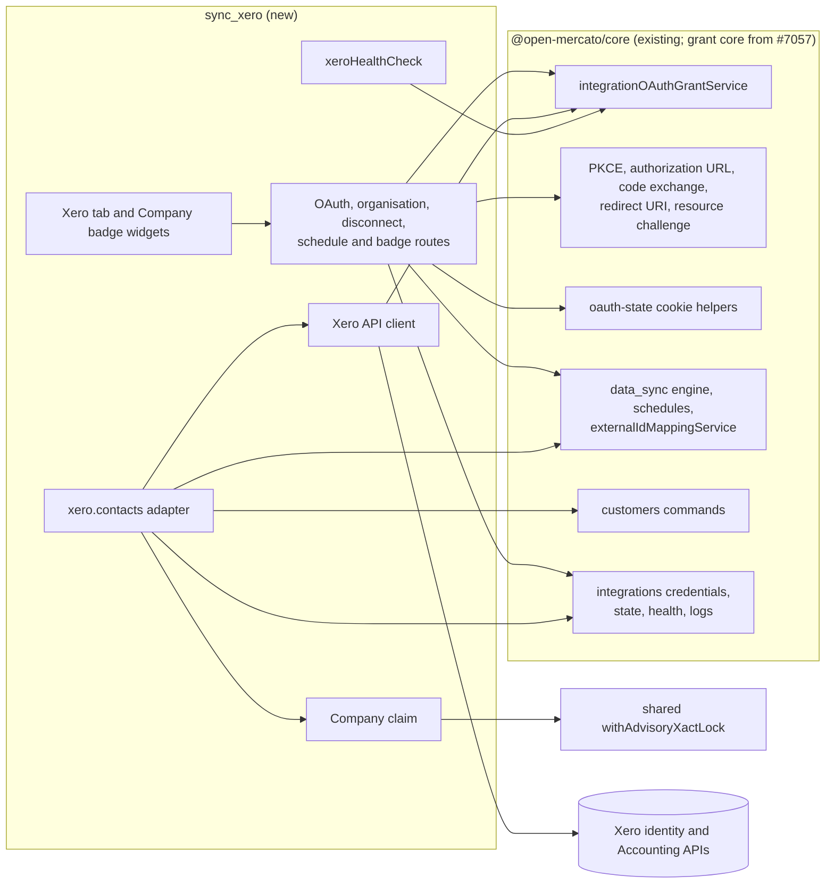
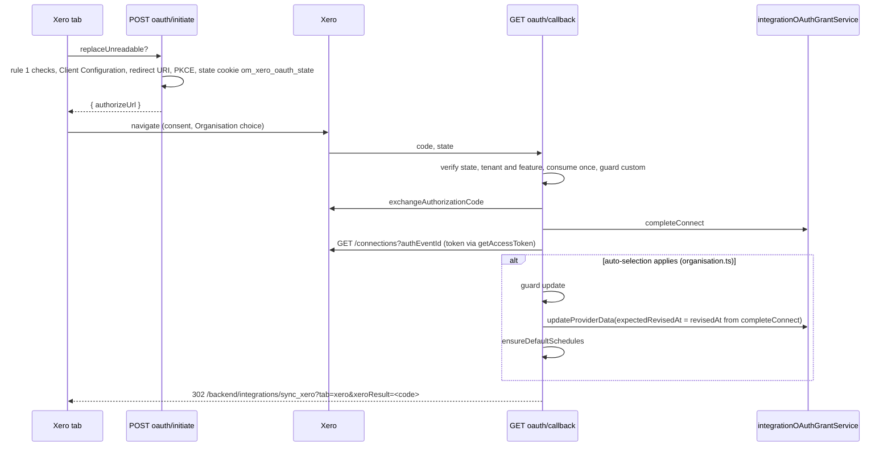

# Xero Integration — Phase 1: Connect and Contacts

**Status:** Ready for review.
**Parent:** [App Spec: Xero Integration](2026-09-26-app-spec-xero-integration.md) § 7 Phase 1. The App Spec owns the business rules (matching, field ownership, field mapping, archive and merge handling, failure handling); this spec owns the technical design and the commit plan, and cites the App Spec instead of restating it. When the two disagree, the App Spec wins and this spec is corrected.
**Depends on:** the OAuth2 grant lifecycle core, Phase 1 ([feature spec](2026-10-01-oauth2-grant-lifecycle-core.md), PR #7057, merged on 2026-10-21). This package uses only its public surface (`BACKWARD_COMPATIBILITY.md` → "OAuth2 Grant Lifecycle Core"); it imports no export marked `@internal`. The `search` change of App Spec § 10 #31 (issue #7872, PR #7874), which keeps encrypted custom fields out of search build contexts, merges before this phase's PR; its regression tests cover the App Spec's Phase 1 criterion on the Company search text.
**Branching:** one implementation PR (#7337), one commit per step on `main`. It served as the core's Q7 consumer gate before #7057 merged.

## TLDR

**Key Points:**
- Proposed: a new provider package `@open-mercato/sync-xero` (module `sync_xero`, integration id `sync_xero`, `providerKey: 'xero'`). An OM admin would connect one Xero Organisation per OM organization through the grant core, and Xero Contacts would sync every hour into OM Companies without duplicates. A revoked or expired Xero grant would show on the integration page, and Disconnect would end OM's access at Xero.
- Today: OM has no Xero provider, so tenants re-key Xero customers by hand or through the CSV importer, and the grant core has no consumer to prove its public surface.

**Scope:** App Spec § 7 Phase 1, split into two implementation phases of one PR:
- Phase A — Connect and grant handling (11 commits): the descriptor, the initiate and callback routes, the Xero tab with the Organisation picker, Disconnect, the Xero API client, the test seam, a read-only `xero.contacts` adapter, the health check and quiet run ends, and the default schedules.
- Phase B — Contacts into Companies (6 commits): Company matching and the Company claim, the field mapping with compare-before-write, the archive, GDPR, supplier-only and merge rules, Xero-owned addresses, and the Company badge.

**Out of scope (App Spec Phase 2):** invoices and everything built for them (the invoice mutation guard, the Company "Xero invoices" tab, the invoice self-heal and its batched Contact fetch, `GET /Contacts?IDs=…&includeArchived=true`), the weekly full pass with its toggle, "Run full resync now", and the quota deferral. The invoice-specific notes from the App Spec's final review (supplied totals on list responses, a negative `TotalTax`, the `xero_company_id` required flag, the net-from-gross derivation) belong to the Phase 2 feature spec.

**Concerns:**
- The package depends on the grant core's public surface only; a later change to it follows the core's compatibility rules.
- The Xero facts that needed a developer login were verified on 2026-10-13 against the Demo Company (Step 0). Two of them tighten the design: the daily limit of a new app is 1,000 calls per Organisation, and a revoke ends every grant of the same Xero user for the app.
- The requested scopes cannot be narrowed after tenants consent, so Step 0 settles them before any tenant connects.

## Overview

`sync_xero` is the grant core's first consumer (core App Spec § 7, Phase 2). It owns what the core leaves to providers until the core's Phase 3: the initiate and callback routes, the Connect UI and the External Account picker, which here chooses a Xero Organisation. It writes no PKCE, token, refresh, lock, erase or revocation code (App Spec § 0.2.1). Contacts import as OM Companies under the rules of App Spec § 6.1, § 6.1b, § 6.2, § 6.2a (Company and address tables), § 6.4 and § 6.5, through the `customers` commands.

> **Market reference.** Studied: Airbyte `source-xero`, Singer `tap-xero`, Fivetran's Xero connector, HubSpot's Xero data sync, and the Odoo and ERPNext Xero connectors.
> - **Adopted:**
>   - an `UpdatedDateUTC` keyset with idempotent re-reads at the boundary (every connector does this);
>   - 429 handling split by `X-Rate-Limit-Problem`: wait out a minute limit, stop on the daily one, as `tap-xero` does;
>   - writing the rotated refresh token before using the new access token (the core does this under its Grant Lock);
>   - linking by `(Organisation, ContactID)`, with tax and company numbers only as first-sync candidates and never a merge on name;
>   - a periodic full sweep for changes the cursor misses (Fivetran re-reads contacts daily; here it is the App Spec's weekly full pass, Phase 2).
> - **Rejected:**
>   - Airbyte's client-credentials-only auth, which covers one Organisation on a paid Xero plan;
>   - HubSpot's per-field conflict settings, because import-only with Xero-owned fields needs none;
>   - webhooks in Phase 1, which need a public HTTPS endpoint and Xero's intent-to-receive handshake (the API client keeps fetches by id possible for later);
>   - a `GET /Organisation` health probe, because the core requires a network-free health check (core R10).
>
> **What the others miss:** none of them handles merged contacts (`MergedToContactID`), and Airbyte and `tap-xero` skip archived contacts by default. App Spec § 6.1 and § 6.4 cover both.

## Problem Statement

- Tenants who keep their customers in Xero re-key them into OM's CRM, or export CSV files for the generic importer; the copies drift, and repeated imports create duplicates (App Spec § 1.1, § 6.1b).
- The grant core (#7057) needed a first consumer to pass against it (core Q7); this package is that consumer and its first in-tree user.
- Invoices (Phase 2) attach to Companies, so a duplicate-free Contact → Company mapping must exist first.

## Proposed Solution

A workspace package `packages/sync-xero`, laid out and wired like `packages/sync-akeneo`, enabled in `apps/mercato` and the create-app template the same way. Without `defaultState.isEnabled` the integration stays off until an admin configures and enables it (core rule 9).

### Design Decisions

| Decision | Rationale |
|---|---|
| Request all three App Spec scopes (`offline_access accounting.contacts.read accounting.invoices.read`) in Phase 1 | A scope added later needs a Reconnect in every organization; scopes cannot be removed without a revoke (App Spec § 0.1). The core reports a scope Xero did not grant as `oauth.scope_drift` |
| Initiate is `POST` and answers `{ authorizeUrl }`; the tab navigates | The Gmail initiate route's precedent (`communication_channels/api/post/oauth/[provider]/initiate`); a `GET` that sets a state cookie could be triggered cross-site |
| Callback path `GET /api/sync_xero/oauth/callback` | The module route convention (`api/get/oauth/callback/route.ts`). Every tenant registers this URL in its Xero app, so it is an external contract that never moves without a bridge (core R2) |
| The adapter preloads per run and per page instead of looking up per Contact | A Xero page holds up to 1,000 Contacts; mapping rows, mapped Companies, their custom fields and their Xero-owned addresses load in a fixed number of queries per page (§ Performance) |
| The marker, tax-number and name indexes load lazily, on the first unmapped Contact of a run | An incremental run whose Contacts are all mapped never reads the organization's marker values, tax numbers or Company names |
| `xero_tax_number` is an encrypted custom field | A Xero Contact can be a sole trader or a consumer, whose tax number is personal data (`TaxNumberType` includes `SSN`). Custom-field encryption is declared per field and decrypted by the shared helpers; the index decrypts the values it reads, which it must read in full anyway (App Spec § 0.2.7). The Company search source would put the decrypted value into its search text, so the `search` change of App Spec § 10 #31 (issue #7872), which keeps encrypted custom fields out of every search build context, merges before this phase's PR |
| Custom-field definitions are ensured at runtime, on every Organisation save and at the start of each run, with no `ce.ts` | `sync_akeneo`'s precedent (`ensureCustomFieldDefinitions(em, sets, { organizationId, tenantId })`, `catalog-importer.ts:1433`). No package declares `ce.ts` fields on another module's entity, and `ce.ts` definitions reach a tenant only through `mercato entities install` or a lazy install. The entity id is the literal `customers:customer_company_profile`, the value App Spec § 10 #5 names, because a package cannot import the app's generated ids |
| Invoice endpoints and the batched Contact fetch (`GET /Contacts?IDs=…&includeArchived=true`) ship with Phase 2 | Only the invoices adapter and its self-heal use them; App Spec § 4 counted them in the API client commit. The commit count is unchanged |
| Default schedules ship in Phase A | They are the grant's keep-alive (App Spec § 10 #13), and Phase A's grant-handling tests run scheduled runs |
| The rate limiter paces by Xero's quota headers; it keeps no local counters | App Spec § 6.6 asks for a small rate limiter that reads the quota from headers, because local counts miss restarts, parallel runs and other clients of the same app. Each run issues one request at a time, so pacing on `X-MinLimit-Remaining`, plus 429 handling by `X-Rate-Limit-Problem`, covers Xero's per-minute and daily limits |
| A failed run is a run `failed` by `data_sync`, resumed by the next run from its committed cursor | `data_sync` has no retryable/terminal distinction: any error thrown inside the stream finalizes the run `failed` without a queue retry (`sync-engine.ts:829-858`), and Retry or the next scheduled run resumes from the committed cursor. Where the App Spec says "fails as retryable", this is the mechanism |

### Alternatives Considered

| Alternative | Why Rejected |
|---|---|
| Two PRs (Phase A merges first) | A Connect-only release delivers no data, and its default schedules would walk Xero every hour for nothing, spending the daily quota. It would also need a release gate. Decided by the author on 2026-10-13 |
| A `GET` initiate route that redirects | See Design Decisions |
| A per-Contact `lookupLocalId` | 1,000 queries per page; preloading reads the organization's `sync_xero` Company mappings once per run |
| `bulkImport` suppression (`skipEvents`, `skipReindex`) on the first sync | App Spec § 7 Phase 1 requires Company events, audit and indexing exactly as for a manual change |

## User Stories

App Spec § 5 defines the stories. US-2.1 (eight commits in the App Spec's scoring) is split three ways so each story stays reviewable:

| Story | Phase | Steps |
|---|---|---|
| US-1.1 Connect, Organisation choice, Reconnect | A | A1, A3, A4 |
| US-1.2 Disconnect | A | A5 |
| WF5 grant-state handling (health, quiet run ends, the stop within about one second) | A | A10 |
| US-4.1 Default schedules | A | A11 |
| US-2.1a Contacts sync: matching, Company claim, field mapping, compare-before-write | A, B | A8, A9, B1–B3 |
| US-2.1b Xero-owned addresses | B | B5 |
| US-2.1c Archived, GDPR, supplier-only and merged Contacts; orphan report | B | B4 |
| US-2.2 Xero badge | B | B6 |
| US-2.3 OM-only fields untouched | B | B3 (invariant) |
| US-0.1 Demo Company evaluation | A | A1 (README) |

## Architecture



The package calls the platform only through DI services, commands, shared helpers and widget spots; nothing in `core`, `customers` or `data_sync` changes.

### Package layout

```text
packages/sync-xero/
  package.json  build.mjs  jest.config.cjs  tsconfig.json  README.md
  src/index.ts
  src/modules/sync_xero/
    index.ts  integration.ts  di.ts
    lib/
      constants.ts         ids, endpoints, scopes, callback result codes
      descriptor.ts        createXeroDescriptor(endpoints)
      endpoints.ts         resolveXeroEndpoints({ scope, credentialsService }): real endpoints or the seam's
      owner.ts             buildXeroGrantOwner(scope)
      provider-data.ts     zod schema of the grant's providerData
      external-ids.ts      external-id formats, buildExternalUrl
      api-client.ts        token use, retries, rate limits, quota headers
      errors.ts            XeroApiError codes
      connections.ts       GET /connections, authEventId from the access token
      client-config.ts     reads the Client Configuration
      state-cookie.ts      the om_xero_oauth_state cookie
      route-auth.ts        core route contract rule 1 checks
      route-errors.ts      { error, code } bodies with translated messages
      route-grant.ts       the grant, descriptor and interactive client of a route
      connection-status.ts the tab's grant view and refreshExpiresInDays
      organisation.ts      auto-selection rule, previous Organisations, counts
      disconnect-steps.ts  the follow-up steps after a Disconnect
      schedules.ts         ensureDefaultSchedules
      keyset.ts            keyset page walk with boundary de-duplication
      cursor.ts            zod cursor schema, parse and serialize
      dates.ts             *String and /Date(...)/ parsing
      run-guard.ts         grant presence check, run origin, run failures
      health.ts            xeroHealthCheck
      field-definitions.ts ensureXeroFieldDefinitions
      contacts/
        adapter.ts  company-writer.ts  contact.ts  preload.ts  indexes.ts
        claim.ts  rules.ts  mapping.ts  compare.ts  addresses.ts  orphans.ts
      testing/
        fakeXeroApi.ts  seam.ts  seam-control.ts
    api/
      openapi.ts                       shared tag, error schema and rule 1 errors
      post/oauth/initiate/route.ts     get/oauth/callback/route.ts
      get/connection/route.ts          get/organisations/route.ts
      put/organisation/route.ts        post/disconnect/route.ts
      post/schedules/route.ts          get/companies/[id]/route.ts
      post/test-fakes/route.ts
    widgets/
      injection-table.ts
      injection/xero-tab/        widget.ts, widget.client.tsx, leaf components and hooks
      injection/company-badge/   widget.ts, widget.client.tsx
    i18n/  en.json pl.json de.json es.json ko.json
    __tests__/   (Jest)
    __integration__/   TC-XERO-*.spec.ts, helpers/xeroTestFakes.ts
```

`index.ts` declares `requires: ['integrations', 'data_sync', 'customers', 'entities']`. The `scheduler` module stays optional: without it, `saveSchedule` throws "Scheduler module is not available", and the tab shows that schedules cannot be created (§ Default schedules). `di.ts` calls `registerDataSyncAdapter(xeroContactsAdapter)` and registers `xeroHealthCheck` with `asValue`, as every provider does (`channel_gmail`, `gateway_tpay`). The health service resolves checks from the root container (`createHealthService(container, …)` in `integrations/di.ts`), so `check()` opens its own `createRequestContainer()` and resolves `integrationOAuthGrantService` there, never a root-scoped `em`. There is no `acl.ts`, no `setup.ts` and no `ce.ts`:
- features are reused (App Spec § 1.4, Access control);
- there is no env preset (App Spec § 10 #18);
- custom-field definitions are ensured at runtime (§ Design Decisions).

### Descriptor and grant owner

```ts
// lib/descriptor.ts — endpoints come from resolveXeroEndpoints (real constants, or the test seam's loopback fakes)
createXeroDescriptor(endpoints): OAuthProviderDescriptor = {
  integrationId: 'sync_xero',
  authorizationEndpoint: endpoints.authorize,   // https://login.xero.com/identity/connect/authorize
  tokenEndpoint: endpoints.token,               // https://identity.xero.com/connect/token
  revocationEndpoint: endpoints.revoke,         // https://identity.xero.com/connect/revocation
  clientAuthMethod: 'client_secret_basic',
  pkce: 'S256',                                 // accepted with client_secret_basic (Step 0 (c))
  defaultScopes: ['offline_access', 'accounting.contacts.read', 'accounting.invoices.read'],
  defaultAccessTokenTtlSec: 1800,
}
buildXeroGrantOwner({ tenantId, organizationId }) = { integrationId: 'sync_xero', tenantId, organizationId, userId: null }
```

The core runs no provider code on Disconnect; its revoke is the cleanup (App Spec § 10 #4). `refreshSkewMs` keeps the core default (120 s).

### Connect flow



**Initiate.**
1. Run the rule 1 checks (`lib/route-auth.ts`, in the core contract's order) and resolve the Client Configuration (`integrationCredentialsService.resolve('sync_xero', scope)`).
2. Build the redirect URI with `resolveOAuthRedirectUri(req, '/api/sync_xero/oauth/callback')`, then create the PKCE pair.
3. Call `createOAuthState({ userId, tenantId, organizationId, providerKey: 'xero', extra: { codeVerifier, replaceUnreadable } })`. The cookie `om_xero_oauth_state` is HttpOnly, `secure` in production, `SameSite=Lax`, `path=/` and lasts the state TTL (5 minutes).
4. Answer `buildAuthorizationUrl(descriptor, { clientId, redirectUri, state, codeChallenge })`.

**Callback.** Follows the docs page's callback steps and rules 2–4 and 10 (core docs `integrations-oauth-grants.mdx` § Callback).
1. Verify the state with `expectedUserId`, `expectedProviderKey: 'xero'` and `expectedState`.
2. Check that the state's tenant is the session's tenant, and that the user still holds `integrations.credentials.manage` in the state's organization.
3. Call `consumeOAuthStateOnce` with the request container's `cache`, and parse `extra` strictly with zod.
4. Take the Grant Owner from the state.
5. Run `runRouteMutationGuards` (`resourceKind: 'integrations.oauth_grant'`, operation `custom`, which the helper maps to `update`), exchange the code, and call `completeConnect` with `actorUserId`.
6. Attempt the automatic Organisation save. A failure there never undoes the connect; it leaves the grant Account pending for the tab.
7. Clear the cookie and redirect to the fixed tab URL `/backend/integrations/sync_xero?tab=xero`, never to a value read from the state, with `xeroResult` set to one code:
   - `connected` or `account_pending`;
   - `connect_cancelled` (Xero returned `error=access_denied`);
   - `connect_state_invalid` (also for a state without an `organizationId`);
   - `client_misconfigured`, `connect_exchange_failed`, `connect_persist_failed`, `connect_grant_unreadable`;
   - `oauth_base_url_not_configured`, `connect_origin_rejected`, `organization_scope_required`;
   - `guard_blocked`;
   - `connect_failed`, the default for any other code, including a Xero `error` other than `access_denied`. The core's failure unions are additive-only, so the mapping has a default branch.

Xero's error body is never echoed.

**Automatic Organisation save** (`lib/organisation.ts`, App Spec WF1):
- **Budget:** the callback runs inside the browser redirect, so its `/connections` call gets one attempt and a 5 s timeout. Any failure leaves the grant Account pending for the tab.
- **Listing:** list the `ORGANISATION` connection records of the consent round. The round is `GET /connections?authEventId=<id>`, where `<id>` is the `authentication_event_id` claim, read by decoding the access token's JWT payload without verifying it. It is never logged or stored. Use the unfiltered list when the claim is missing or the filtered list is empty. A Reconnect over an Organisation that is still connected keeps the existing connection record, and its `authEventId` may stay the original one, so the filtered list may be empty (Step 0 (d)).
- **Auto-save:** only with exactly one record, and only when it is the previous Organisation (`previousProviderData.xeroOrganisationId`) or, on a first connect, when the organization holds no `sync_xero` mapping row and no `sync_xero` cursor.
- **Otherwise:** the tab asks for a choice.
- **Saving:** runs `runRouteMutationGuards` with `update`, then `updateProviderData(descriptor, owner, { xeroOrganisationId, xeroConnectionId, xeroOrganisationName }, { expectedRevisedAt, actorUserId })`, then `ensureXeroFieldDefinitions` (Phase B) and `ensureDefaultSchedules`. The values pass the `providerData` schema before the write: `xeroOrganisationId` and `xeroConnectionId` are GUIDs (`z.guid()`: any 8-4-4-4-12 hex form, so an id Xero issues is never refused over its version or variant bits).

### Organisation save and change

`PUT /api/sync_xero/organisation` serves the picker; it runs the following steps in order and stops at the first that answers.
1. Re-read the unfiltered connection records, under the interactive budget (§ Xero API client), and refuse an id that is not an `ORGANISATION` record of this grant (422 `xero.organisation_not_authorised`).
2. Determine the previous Organisations: the grant's current `providerData`, else `previousProviderData`, else every distinct Organisation named by the organization's `sync_xero` mapping prefixes (App Spec § 10 #15) or by its `sync_xero` cursors. A cursor counts because it is sync history too (core rule 11): after a read-only run it may be the only trace of an Organisation. After an earlier confirmed switch, mappings carry several prefixes, and the confirmation lists each with its count.
3. When the choice differs from the previous one:
   - When any previous Organisation holds a `sales.invoice` mapping under its prefix, refuse with 409 `xero.organisation_switch_blocked` and the counts (App Spec § 10 #20). Phase 1 writes no such mapping; the check ships here because the picker is built here.
   - Otherwise, without `confirmChange: true`, answer 409 `xero.organisation_change_confirmation_required` naming the chosen Organisation and each previous one with its `customers.company` mapping count (App Spec § 10 #2, core rule 11). When the previous Organisation comes only from mapping prefixes or cursors, its name is unknown and the dialog says the account cannot be verified.
4. Call `updateProviderData` with the Grant Revision from the optimistic-lock header (rule 7; a stale revision returns the core's 409).
5. Call `ensureXeroFieldDefinitions` (Phase B) and `ensureDefaultSchedules`. Cursors are not touched: they carry their Organisation (App Spec § 6.5).

**Tax numbers before the first sync.** The definitions exist from the first Organisation save, so an admin can fill in `xero_tax_number` on existing Companies before any run writes. The setup guide says how:
1. Connect while the integration is still disabled; the scheduled worker skips a disabled integration (App Spec § 0.2.8).
2. Fill in the tax numbers.
3. Enable the integration.

This keeps App Spec § 6.1's defence against duplicates of Companies entered by hand (§ 10 #7).

### Xero API client

`createXeroApiClient({ grantService, descriptor, owner, endpoints, signal, budget })` exposes `getToken()`, `listConnections({ authEventId? })` and `listContacts({ xeroOrganisationId, modifiedSince, page })` (Phase 2 adds invoices and the batched Contact fetch). `budget` is `run` (the retry pipeline below) or `interactive`. Each response comes back with its quota headers and `Date` header. Phase 1 reads `Date`; Phase 2's quota deferral reads `X-DayLimit-Remaining`.

Every request goes through one pipeline:

1. `getAccessToken(descriptor, owner)`, called outside any transaction the caller holds. `providerData` from the result is returned to the adapter with the response, so it can detect an Organisation change.
2. A bounded fetch with a 30 s timeout, the caller's `signal` and `redirect: 'manual'`, sending:
   - `Authorization: Bearer`;
   - `Accept: application/json`;
   - `xero-tenant-id` on Accounting calls;
   - `If-Modified-Since` when given.

   Endpoints are code constants or the seam's loopback fakes, so no SSRF guard applies (core R1).
3. Response handling:

   | Response | Handling |
   |---|---|
   | 2xx | Parse the JSON; report the quota headers (`X-DayLimit-Remaining`, `X-MinLimit-Remaining`, `X-AppMinLimit-Remaining`) and the `Date` header |
   | 2xx with `X-MinLimit-Remaining: 0` | The next request waits until the minute window resets: 60 s, or the `Retry-After` of the response when present. This is the client's rate limiter (App Spec § 6.6), paced by Xero's headers rather than local counting |
   | 401 or 403 | Rewrite Xero's `insufficent_scope` token to `insufficient_scope` in `WWW-Authenticate`, then call `classifyResourceChallenge`. `scope_insufficient` → `XeroApiError('scope_insufficient')`. Otherwise a 401 retries once with `getAccessToken({ rejectedAccessToken })`; a second 401 → `unauthorized`. A 403 on an Accounting call → `GET /connections`: when the selected `tenantId` is gone → `organisation_not_authorised`, else `forbidden` |
   | 429 | `X-Rate-Limit-Problem: minute` or `appminute` → wait `Retry-After` (capped at 60 s, at most 5 times); `day` (or no header with a `Retry-After` above 60 s) → `daily_limit`, no retry |
   | 5xx, network error, timeout | Exponential backoff (1 s, 2 s, 4 s) up to 3 retries, then `transient` |

4. A failed `getAccessToken` throws the core's `OAuthGrantError` unchanged; the adapter branches on its `code`.

The client never logs a token, a request body or a response body. Concurrency per Xero Organisation stays below Xero's 5 in practice: each run issues one request at a time, at most one run per entity type runs per organization, and the tab's routes issue single calls.

**Interactive budget.** Calls made inside an admin's request get one attempt and a 5 s timeout, with no 429 wait and no 5xx backoff, and a failure answers at once:
- the callback's `/connections`, where a failure leaves Account pending;
- `GET organisations`;
- `PUT organisation`'s re-read.

Only runs use the retry pipeline above.

### Keyset walk and cursor

`lib/keyset.ts` implements App Spec § 6.7, "Keyset paging". Its request shape:
- `GET /Contacts?page=1&pageSize=1000&includeArchived=true` with `If-Modified-Since` set to the last record's `UpdatedDateUTC` minus one second. The first page of a full pass sends none; the first page of an incremental run sends the cursor's `modifiedSince` minus one second.
- No `order` parameter: the default order is `UpdatedDateUTC` ascending, with ties broken by `ContactID` in SQL Server `uniqueidentifier` order, and it is stable across pages (Step 0 (m)). The walk de-duplicates by `ContactID` and `UpdatedDateUTC`, so it does not depend on the tie order.
- `If-Modified-Since` is sent as `yyyy-MM-ddTHH:mm:ssZ`. Xero accepts that and the HTTP-date form alike, and the filter includes records from the same second (Step 0 (o)).
- Contact rows carry `UpdatedDateUTC` only in the .NET form `/Date(<ms>+0000)/`, with no `*String` variant, so `dates.ts` parses that form for Contacts (Step 0).

How the walk advances:
- Records already processed within the boundary window are dropped by `ContactID` and `UpdatedDateUTC`. A Contact edited during the walk comes back with a later `UpdatedDateUTC` and is processed again.
- `page=2…` is requested only while a whole page stays inside the window (an overfull second).
- The walk ends on a page shorter than `pageSize`, or when the page count reached `pagination.pageCount`.

The cursor (`lib/cursor.ts`, JSON, versioned, no secret or personal data):

```ts
const xeroCursorSchema = z.object({
  v: z.literal(1),
  xeroOrganisationId: z.string().min(1),
  modifiedSince: z.string().datetime().nullable(),          // incremental keyset (last record's UpdatedDateUTC)
  lastFullAt: z.string().datetime().nullable(),
  fullPassStartedAt: z.string().datetime().nullable(),      // set only while a full pass is in progress
  fullPassModifiedSince: z.string().datetime().nullable(),  // the pass's keyset
  fullPassChunk: z.object({ from: z.string(), to: z.string() }).nullable().optional(), // invoices, Phase 2
  lastFullCalls: z.number().int().nonnegative().nullable(),
})
```

Rules (App Spec § 6.5, § 6.7):
- An unparsable cursor, or one with another `xeroOrganisationId`, counts as no cursor.
- A run without a usable cursor (`fullSync`, first sync, Organisation switch) is a full pass. It sets `fullPassStartedAt` from the `Date` header of its first response.
- A cursor carrying `fullPassStartedAt` resumes its pass from `fullPassModifiedSince`.
- A drained full pass commits `lastFullAt = modifiedSince = fullPassStartedAt`, clears the pass fields and records `lastFullCalls`: the Xero calls of the run that drained the pass. A resumed pass does not carry a running count, since the schema has no field for one. Phase 2's quota deferral reads it as an estimate.
- Phase 1 starts no weekly pass. Full passes come from walks without a usable cursor and from manual runs with "Run as full sync", which `data_sync` offers because the adapter keeps both start controls.
- **Known limitation:** Phase 1 re-attempts nothing on its own. A `failed` item is retried only when Xero changes that Contact again or on a full pass, and the `xero.company_orphaned` report runs only at the end of a drained full pass, so both come back with the first sync or a manual "Run as full sync" (App Spec § 7).

### `xero.contacts` adapter

`DataSyncAdapter` members:
- `providerKey: 'xero'`, `direction: 'import'`, `supportedEntities: ['xero.contacts']` (Phase 2 adds `xero.invoices`);
- `operationalTelemetry: false`, `runMode` unset (generic runs);
- `getMapping` returns a fixed `DataMapping` (`matchStrategy: 'externalId'`, no fields), because the mapping is code (App Spec § 10 #3);
- `describeProgressJob` names the run "Xero contacts".

`streamImport` per run:
1. Resolve services from `createRequestContainer()`, as `sync_excel` does. Build the descriptor and the client from `resolveXeroEndpoints({ scope, credentialsService })`; when the seam marks the organization but its fakes are not running, throw `xero.test_fakes_unavailable` (§ Test seam).
2. Read the run origin. `dataSyncRunService.getRun(input.runId, scope)` loads the run; only `triggeredBy === 'scheduler'` counts as scheduled, and a missing run counts as scheduled (App Spec § 6.5).
3. Call `ensureXeroFieldDefinitions` (Phase B).
4. Make an explicit first token call (`client.getToken()`) before any page request and handle its grant failures (§ Grant-state handling). The Organisation is `providerData.xeroOrganisationId`, which the page requests need for `xero-tenant-id`. Parse the cursor against it.
5. Preload the run index: every `sync_xero` `customers.company` mapping row of the organization, one `findWithDecryption` on `SyncExternalIdMapping`, kept as `externalId → CustomerEntity id` (Phase B). Every won claim adds its pair to the run index and removes the Company from the marker and tax indexes. A Contact that the keyset walk reads again later in the same run, after an edit in Xero, is then a mapped Contact and gets an update, not a second Company.
6. Walk pages. Per page:
   - honour `signal` above the `yield`;
   - preload the page (below);
   - process each Contact in Xero's order;
   - yield one batch per `batchSize` Contacts with the keyset cursor of its last Contact.
7. On a drained full pass, write the orphan report (Phase B), then yield the final batch with `hasMore: false` and the pass-completion cursor.

A9 ships steps 1, 4 and 6 and the pass-completion cursor of step 7, with every Contact reported as `skip` and no write. A10 adds step 2 with the grant handling, and Phase B adds the writes, the field definitions and the orphan report.

**Page preload** (Phase B, `contacts/preload.ts`), a fixed number of queries per page:
- the mapped `CustomerEntity` rows and their `CustomerCompanyProfile` rows, via `findWithDecryption` with `$in`;
- the profiles' custom-field values (`loadCustomFieldValues`, given only record ids already scoped to the organization);
- the page's `customers.address` mapping rows and the `CustomerAddress` rows they name.

**Per Contact** (Phase B):
1. **Grant presence** (A10, so it already stops the read-only loop): `readGrantStatus` before the item's write. A non-null result is reused for at most one second and `null` never is (`lib/run-guard.ts`). `null` → quiet end.
2. **Classify** (`contacts/rules.ts` for the merge, supplier-only, archive and GDPR rules, B4; App Spec § 6.4, § 6.1 merges, § 10 #23 (c)):
   - mapped, and its Company is gone from the page preload → refused, `xero.company_deleted_in_om` (adapter, B3);
   - non-empty `MergedToContactID` and mapped → merge mark;
   - GDPR-redacted and mapped → status flip only (`archived`, `isActive=false`), with no other value and no address;
   - unmapped and supplier-only, archived or GDPR-redacted → `skip`;
   - otherwise an update or a first-sync match.

   The classification runs before the mapping, so a GDPR-redacted Contact whose name Xero blanked still flips its Company's status.
3. **Match an unmapped Contact** (App Spec § 6.1):
   - the marker index (`xero_contact_id`);
   - then the tax-number index: normalized `TaxNumber`, then `CompanyNumber`, among Companies without a `sync_xero` mapping. More than one candidate → an item warning naming every candidate (`xero.company_match_ambiguous`), and the oldest is used (§ 6.1b option B);
   - a fallback match logs `xero.company_matched_by_tax_number` (info), naming the Company;
   - otherwise `customers.companies.create` with the marker in `customFields`. When the name index (§ Indexes) holds the Contact's normalized `Name`, the item logs `xero.company_duplicate_risk` naming the existing Companies.
4. **Company claim** for a first mapping (§ Company claim). After a lost claim with a winner, use the winner's Company and delete a Company this item created; a winner deleted in OM refuses the item with `xero.company_deleted_in_om`. After a lost claim without a winner (the candidate is mapped to another Contact), return to step 3 without that candidate, whether it came from the marker or the fallback.
5. **Map and compare** (`contacts/mapping.ts`, `contacts/compare.ts`; App Spec § 6.2a Company table, rules 1–4, and § 6.2 rule 3).
   - The pure mapper returns the Xero-owned values (`displayName`, `legalName`, `primaryEmail`, `primaryPhone`, `websiteUrl`, `status` / `isActive`, custom fields `xero_tax_number`, `xero_contact_id`, `xero_merged_into`) and the warnings.
   - Each value is checked with the field's own validator from `customers/data/validators.ts` and truncated to its limit (`displayName` and `legalName` 200).
   - The update input holds only keys whose value differs, so an OM-only field is never present. With no difference the item is `skip` and no command runs.
6. **Write** through `commandBus.execute('customers.companies.create' | 'customers.companies.update', { input, ctx })`.
   - The context is the system-actor context `sync_excel` builds (`sync_excel/lib/adapters/customers.ts:374-387`): `{ container, auth: null, organizationScope: { selectedId, filterIds: [organizationId], allowedIds: [organizationId], tenantId }, selectedOrganizationId, organizationIds: [organizationId] }`.
   - It adds `syncOrigin: 'sync_xero'`. The company and address commands ignore it today, but commands that forward it tag their side effects.
   - No `bulkImport` suppression, so events, audit, indexing and webhooks run as for a manual edit.
7. **Addresses** (Phase B, § Xero-owned addresses). An item whose Company is unchanged but whose address changed reports `update`.
8. **Report** an `ImportItem` with `externalId` = `<xeroOrganisationId>:<ContactID>` and a `data` holding only ids and codes: `localId`, `errorCode`, `errorMessage`, and `sourceIdentifier` (the same value as `externalId`).
   - `data` never holds a name, email, phone, address or tax number: the engine logs a failed item's whole `data`.
   - A validator rejection of a required field (`Name` blank) is `failed` with `xero.contact_invalid`, and so is a customers command that rejects the input (400, 422 or a validation error). A 404 from the update of a mapped Company (deleted after the page preload) is the refused item `xero.company_deleted_in_om`. Any other error, 403 and 409 included, fails the run, which resumes from the committed cursor.

`contacts/company-writer.ts` holds these steps: the adapter calls its `preparePage` once per page and its `write` once per Contact.

**Refused items and warnings** are the adapter's own `integrationLogService.write` rows. Each has level `warn`, except the `info` fallback-match note. Each carries a stable `xero.*` code and a fixed English message per code (a constant that names no person or company), and "naming" a Contact or Company in a warning means its ids only. The row also holds the run id, the `sourceIdentifier` and the OM record id, and never personal data (App Spec § 6.5). A refused item is reported to the engine as `skip`.

### Company claim

`contacts/claim.ts` implements App Spec § 6.1 "Company claim":

```ts
claimCompanyMapping({ em, scope, xeroOrganisationId, contactId, candidateEntityId, allowDeletedTarget }):
  Promise<{ outcome: 'won' } | { outcome: 'lost'; winnerEntityId: string; winnerDeleted: boolean } | { outcome: 'lost'; winnerEntityId: null }>
// withAdvisoryXactLock(em, `sync_xero_claim:${scope.organizationId}`, fn, { maxConcurrentHolders: 4 })
```

1. Inside the lock, bind `createExternalIdMappingService(txEm)` to the lock transaction.
2. Re-read the Contact's mapping. One that already names the candidate counts as won. One naming another existing Company is lost, with that Company as the winner. One naming a deleted Company counts as free only with `allowDeletedTarget`, which is Phase 2's self-heal.
3. Re-read the candidate's mapping. A candidate already mapped to another Contact is lost with no winner.
4. Store the mapping on `txEm`.

The callback does milliseconds of DB work: no Xero call, no command and no fork (the lock helper's contract). `AdvisoryLockUnavailableError` (the 15 s deadline, or a transient DB error) fails the run with `xero.claim_lock_unavailable`; the next run resumes from the committed cursor, and its marker index finds the Company this run created.

After a lost claim, the item deletes a Company it created in this item through `customers.companies.delete`. A refusal (422 `COMPANY_HAS_DEPENDENTS`) leaves the Company unmapped and logs `xero.company_claim_cleanup_refused`. This handling is the adapter's (B3); `claim.ts` only returns the outcome. In Phase 1 `data_sync` refuses a second `xero.contacts` run, so a claim loses only to a stale marker or to two runs started in the same instant (§ Risks, overlap race). The invoices self-heal of Phase 2 is the concurrent writer the claim exists for.

### Indexes

`contacts/indexes.ts` builds both indexes once per run, on the first unmapped Contact:
- **Reading the values:** read the organization's `CustomFieldValue` rows for `entityId 'customers:customer_company_profile'` with field key `xero_contact_id` or `xero_tax_number`, and `deletedAt: null`. Decrypt them with `decryptCustomFieldValue` where the definition is encrypted.
- **Resolving to Companies:** resolve the profile record ids to their `CustomerEntity` ids, keeping only Companies that are not deleted.
- **Marker index:** `<xeroOrganisationId>:<ContactID>` → entity id, for Companies without a `sync_xero` mapping only (App Spec § 6.1 step 1).
- **Tax index:** normalized value (whitespace stripped, uppercase) → entity ids, oldest first, unmapped Companies only. A Company leaves the index as soon as it is claimed. A claimed-by map (normalized value → the `ContactID` that claimed it) lets a second Contact with the same number log `xero.tax_number_shared` naming both Contacts.
- **Name index:** the organization's Companies (`kind: 'company'`, not deleted), read in chunks of 500 with `findWithDecryption`, because `displayName` is encrypted. It keeps only the normalized name (lowercase, punctuation stripped, whitespace collapsed) → entity ids, and serves only the duplicate-risk warning, never a match (App Spec § 6.1).

All three indexes are per run, so the per-page query count stays fixed.

### Xero-owned addresses

`contacts/addresses.ts` implements App Spec § 6.2a "Addresses" from the `xero.contacts` run only. For each of `POBOX` and `STREET` that has an address line:
1. Read the mapped `CustomerAddress` (mapping `<xeroOrganisationId>:<ContactID>:<AddressType>`).
2. When that row exists and still belongs to the Company, update it through `customers.addresses.update` only for columns that differ. A blank Xero value is left out of the update input, never sent as `''` or `null`, so it clears nothing (App Spec § 6.2a rule 1).
3. Otherwise create a row through `customers.addresses.create` (`entityId` = the `CustomerEntity` id, `isPrimary: false`, `purpose` `billing` or `office`) and store the mapping.

`Country` converts to an ISO 3166-1 alpha-2 code when it equals a code or an English name of `ISO_COUNTRIES` (`@open-mercato/shared/lib/location/countries`, `{ code, name }`), compared case-insensitively. Otherwise it is kept as written, with `xero.address_country_unrecognised`. A postal code over 30 characters is left out; lines are truncated to 300 characters, and city and region to 150.

### Merge mark and orphan report

- **Merge mark:** a mapped Contact with a non-empty `MergedToContactID` writes only `xero_merged_into` = the surviving `ContactID`, through `customers.companies.update` when it differs. It logs the refused item `xero.contact_merged`, naming both OM Companies when the survivor is mapped (App Spec § 6.1, § 10 #22 (b)).
- **Orphan report:** after a drained full pass, `contacts/orphans.ts` rebuilds the marker index. It logs `xero.company_orphaned` for each marked Company whose marker's Contact maps to another Company or to none, skipping Companies created within the last minute. It runs before the final batch's `yield`, never deletes a Company, and a failure of the report is reported without failing the run.

### Grant-state handling and quiet ends

The adapter maps each condition to a run outcome:

| Condition | Where | Outcome |
|---|---|---|
| `not_connected` (no grant) | any token call; `readGrantStatus` `null` before an item | quiet end: one `warn` `xero.run_stopped_not_connected`, return without yielding the partial batch |
| `grant_invalidated` | any token call | quiet end, `xero.run_stopped_invalidated` |
| Account pending (`providerData` empty) | the first token call or any later one | scheduled: quiet end, `xero.account_pending`. Manual: throw `xero.account_pending` (run `failed`, naming the cause) |
| Organisation changed mid-run | any token call | throw `xero.organisation_changed` |
| `transient` without a usable token | any token call | throw `xero.transient` |
| `platform_unavailable` | any token call | throw `xero.platform_unavailable` |
| `transient` (5xx, network or timeout after the retries) | an API response | throw `xero.transient` |
| `unauthorized` (a second 401 after `rejectedAccessToken`) | an API response | throw `xero.unauthorized` ("Reconnect") |
| `forbidden` (a 403 while the Organisation is still connected) | an API response | throw `xero.forbidden` ("check the Xero user's access to the Organisation") |
| any other 4xx | an API response | throw `xero.request_rejected` (status code only, no body) |
| `client_misconfigured` (including a changed Client ID) | any token call | throw `xero.client_misconfigured` ("check the Client ID and Secret") |
| `scope_insufficient` | an API response | throw `xero.scope_insufficient` ("Reconnect") |
| `organisation_not_authorised` | an API response | throw `xero.organisation_not_authorised` ("Reconnect and select it") |
| `daily_limit` | an API response | quiet end, `xero.daily_limit_reached`; the next run resumes from the committed cursor |
| Claim lock unavailable | the claim | throw `xero.claim_lock_unavailable` |

How the outcomes work:
- **Quiet end:** the adapter writes its one `warn` row with `payload: { entityType, origin }` and returns, so the engine finalizes the run `completed` and no `data_sync.run.failed` fires. A failure to write that row is reported and never fails the run. Because `operationalTelemetry` is off, the health badge does not change. Items written earlier stay, and the committed cursor never passes an unyielded item.
- **Throws:** the adapter throws `XeroRunFailure`, whose message is `<xero.* code>: <fixed sentence naming the fix>`; `xero.request_rejected` appends `(HTTP <status>)`. The engine writes it as the run's single `data_sync.run_failed` row and reports it, and the adapter adds no row of its own. No message carries personal data, a token or a Xero response body. The run is finalized `failed`, and the next run or Retry resumes from the committed cursor.

### Health check

`xeroHealthCheck` is `{ check(credentials, scope) }`:
0. When the seam marks the organization but its fakes are not running, return `{ status: 'unhealthy', details: { code: 'xero.test_fakes_unavailable' } }` (the check catches that error from `resolveXeroEndpoints`).
1. Open a request container (`createRequestContainer()`) and resolve `integrationOAuthGrantService` from it. Then `inspection = inspectGrant(createXeroDescriptor(await resolveXeroEndpoints({ scope, credentialsService })), owner)`.
2. `health = mapInspectionToHealth(inspection)`.
3. Only when `health.details.code` is `oauth.connected` and the grant has no External Account, the result becomes `{ status: 'degraded', details: { code: 'xero.account_pending' } }`. Every unhealthy or degraded code of the core mapping wins over Account pending.

The check makes no network call (core R10), and `details` never carries a token.

### Default schedules

`ensureDefaultSchedules({ scheduleService, container, scope, guard })` works through each entity type in the adapter's `supportedEntities`. `guard` is the calling route's request and auth context:
1. Call `getByKey('sync_xero', entityType, 'import', scope)`.
2. When none exists, run `runRouteMutationGuards` with `resourceKind: 'data_sync.schedule'` and operation `create`, the kind and operation of `data_sync`'s own schedule route (`data_sync/api/schedules/route.ts:85-116`). A block is reported as `xero.schedule_create_failed`. Otherwise call `saveSchedule({ integrationId: 'sync_xero', entityType, direction: 'import', scheduleType: 'interval', scheduleValue: '1h', timezone: 'UTC', fullSync: false, isEnabled: true }, scope, container)`.

3. After a successful save, call the guard's `runAfterSuccess()`.

Saving the Organisation (the `organisation` route and the callback's automatic selection) creates the default schedules for a caller who holds `integrations.credentials.manage` even without `data_sync.configure`: the schedules are the grant's keep-alive (App Spec § 10 #13), the values are fixed, an existing schedule is never touched, and the `data_sync.schedule` mutation guard still runs. Only the tab's "Create default schedule" and `POST schedules` require `data_sync.configure`.

An existing schedule is never changed. A failure or a block per entity type is logged as `xero.schedule_create_failed`, returned to the caller and never undoes the Organisation save (App Spec § 6.7, US-4.1). When Phase 2 adds `xero.invoices`, a `xero.contacts` run that finds this Contacts default unchanged (`interval`, `1h`, incremental, enabled) moves it to its cron form and creates the Invoices default, once per organization (App Spec § 6.7); where an admin changed or deleted the Contacts default, the tab shows the Invoices schedule as missing, with "Create default schedule".

The check and the create are not atomic, and `sync_schedules` has no unique index on its key. Two Organisation saves of one organization in the same instant can therefore both create a schedule. `data_sync`'s own schedule route has the same check-then-act; `getByKey` and the tab show one of the rows, and `data_sync` refuses an overlapping run of the same entity type.

### Test seam

App Spec § 4.5 "Test seam", made concrete.

**Fake Xero API** (`lib/testing/fakeXeroApi.ts`, imports no `@playwright/test`):
- `startFakeXeroApi({ isTokenValid, dailyLimit?, now? })` serves on `127.0.0.1:0`:
  - `GET /connections`, with and without `authEventId`;
  - `GET /api.xro/2.0/Contacts` with `page`, `pageSize`, `includeArchived` and `If-Modified-Since`.
- It accepts the access tokens its `isTokenValid` callback accepts: the seam passes the core fake's `issuedTokens()`, and Jest passes the grant double's current tokens. It returns the quota headers and the `Date` header.
- It offers `seed({ organisations, contacts })`, `inject({ status, retryAfter, rateLimitProblem, wwwAuthenticate, delayMs, times })`, `requests()`, `reset()` and `close()`.
- The core fake issues opaque access tokens with no claims, so seam runs always take the unfiltered `/connections` fallback. The claim-filtered path is covered by `connections.ts` Jest tests against a stub server with a crafted JWT.

**Endpoint resolution** (`lib/endpoints.ts`, `lib/testing/seam.ts`):
- The fakes of an organization live on `globalThis.__omSyncXeroTestFakes__`, a `Map` from organization id to both fakes.
- **The seam mark:** `start` generates the Client Configuration with the Client ID `om_test_seam_<random hex>` and passes the same `clientId` to `startFakeAuthorizationServer`. The prefix survives the credentials form's saves, and real Xero Client IDs never carry it.
- **Resolution:** `resolveXeroEndpoints({ scope, credentialsService })` is async and reads the Client Configuration.
  - With `OM_ENABLE_TEST_OAUTH_GRANTS` on and the organization in the Map, it returns the fakes' endpoints.
  - With the flag on, a marked Client ID and no running fakes (a queue worker, a restarted server), it throws `xero.test_fakes_unavailable`, so no descriptor or client is built.
  - Everything else gets Xero's endpoints.

**Test-only route** `POST /api/sync_xero/test-fakes`:
- Gating and access: the flag off → 404 before any fake is imported; `integrations.credentials.manage`; the rule 1 checks; guards with `custom`.
- Actions, validated as a zod discriminated union on `action`:
  - `start`: both fakes, plus a generated Client Configuration with the mark. It answers `{ started, clientId, authorizationEndpoint }`, never the secret. On fakes that are already running it clears their data and keeps the client. An organization *belongs to the seam* when its Client ID carries the mark or it is in the in-process Map. `start` answers 409 `real_xero_state` for an organization that does not belong to the seam yet holds `sync_xero` state: a grant, a mapping, a cursor or a non-blank Client ID. A blank Client ID counts as not configured.
  - `seed`: fake Xero data, plus `customers.company` mappings in an organization `start` prepared.
  - `inject`, `authorize` (calls `issueAuthorizationCode`), `counters`. These and `seed` answer 409 `not_started` while the organization has no running fakes.
  - `reset`: refused with 409 `not_seam_organization` for an organization that does not belong to the seam. It erases only the seam's rows, through public service calls except where noted, and works whether or not the fakes are still running:
    - the grant: `disconnect(descriptor, owner, { force: true, expectedRevisedAt: null })` with a reset descriptor that has no `revocationEndpoint`. The core revokes whenever it captured a readable grant, so a descriptor without one gives the outcome `unsupported`. It never sends the seam's secrets to an endpoint. When the fakes are gone, the reset descriptor uses the fake authorization server's last endpoints or loopback placeholders;
    - the schedules: `dataSyncScheduleService.deleteSchedule`;
    - the mappings: `externalIdMappingService.deleteExternalIdMappings`;
    - the cursors: a direct delete of the organization's `sync_xero` `SyncCursor` rows (there is no service method), followed by `dataSyncRunService.resetResumePosition`, as `data_sync/AGENTS.md` prescribes;
    - the Client Configuration: saved empty.

    Then it stops the fakes. The three custom-field definitions stay: they are organization configuration that holds no test data, identical in every connected organization and ensured idempotently. Each spec deletes the Companies it creates.
- No response carries a token.
- The Xero tab shows a notice while the seam is active for the organization.

**Playwright helper** (`__integration__/helpers/xeroTestFakes.ts`):
- `isXeroTestFakesAvailable`, `startXeroFakes`, `seedXeroFakes`, `authorizeXero` and `resetXeroFakes`.
- A 404 skips the spec, and throws when the Playwright process has the flag on.
- Playwright intercepts the browser's navigation to the fake authorize URL and completes it through `authorize`.

### Performance

| Operation | Database work | Xero calls | Bound |
|---|---|---|---|
| Run start | 1 query: the organization's `sync_xero` `customers.company` mappings, held as a `Map` | 0 | Memory grows with mapped Companies (an id pair each) |
| Each page (≤ 1,000 Contacts) | About 5 preload queries (mapped Companies, profiles, custom-field values, address mappings, addresses), independent of the page size | 1 | B3 asserts that the count stays constant |
| Each unchanged Contact | None beyond the preload; at most one `readGrantStatus` per second | 0 | — |
| Each changed or new Contact | 1–3 commands (Company, up to two addresses); a first mapping adds one claim transaction (two reads and one write) | 0 | Commands only on a real difference |
| Lazy indexes, first unmapped Contact of a run | Marker and tax values: one custom-field query plus profile-to-Company resolution in chunks of 500. Names: Companies in chunks of 500, decrypted | 0 | Grows with the organization's Companies, for example 10,000 Companies ≈ 40 chunked reads and 10,000 decryptions. Only runs that meet a new Contact pay it, and memory holds normalized strings and ids |
| Full pass | As per page | `ceil(Contacts ÷ 1,000)` | Commands only for changed records (App Spec § 6.7 cost table) |

### Commands & Events

- **Commands called:** `customers.companies.create`, `.update` and `.delete` (`.delete` only for a Company whose claim this item lost); `customers.addresses.create` and `.update`. Each is undoable through the audit log like any command; an undone adapter write is re-applied by the next sync that returns the Contact.
- **Commands and events defined:** none. The grant core logs its own `integrations.oauth_*` entries; this package adds `xero.*` log codes only (§ Data Models).

## Data Models

No new table, column or migration, so there is no data-model graph. `sync_xero` owns these records on existing entities.

**Custom fields** on `customers:customer_company_profile`, ensured per organization by `ensureXeroFieldDefinitions`: `ensureCustomFieldDefinitions` from the `entities` module, then `invalidateDefinitionsCache` for that entity whenever a definition was created or updated, as `sync_akeneo` does. This way the Companies form shows `xero_tax_number` right after the first Organisation save:

| Key | Kind | Options | Written by |
|---|---|---|---|
| `xero_contact_id` | text | `formEditable: false`, `filterable: false`, `listVisible: false` | the adapter, on every Company it creates or matches |
| `xero_tax_number` | text | `encrypted: true`, `formEditable: true` (an admin may fill it before the first sync, App Spec § 6.1), `filterable: false` | the adapter (Xero-owned) |
| `xero_merged_into` | text | `filterable: true`, `formEditable: false` | the adapter, on the Company of a merged-away Contact |

Labels are plain strings, because field definitions take no i18n keys.

**Mapping rows** (`SyncExternalIdMapping`, `integrationId 'sync_xero'`):

| `internalEntityType` | `externalId` | `internalEntityId` |
|---|---|---|
| `customers.company` | `<xeroOrganisationId>:<ContactID>` | `CustomerEntity` id |
| `customers.address` | `<xeroOrganisationId>:<ContactID>:<POBOX\|STREET>` | `CustomerAddress` id |

**Client Configuration** (`integration.ts`, `credentials.fields`): `clientId` (text, required) and `clientSecret` (secret, required). Their labels and help text are plain English strings, because the integrations page renders credential labels as given, as it does for `sync_akeneo`. Phase 2 adds `weeklyFullResync`.

**Grant `providerData`** (`lib/provider-data.ts`, written only by `updateProviderData`):

```ts
const xeroProviderDataSchema = z.object({
  xeroOrganisationId: z.guid(),
  xeroConnectionId: z.guid(),
  xeroOrganisationName: z.string().min(1).max(255),
})
```

**Cursor:** § Keyset walk and cursor.

**Log codes** (`integrationLogService`, `integrationId 'sync_xero'`; no personal data or tokens in the payload):

| Code | Level | When |
|---|---|---|
| `xero.run_stopped_not_connected`, `xero.run_stopped_invalidated` | warn | quiet ends |
| `xero.account_pending` | warn | scheduled quiet end |
| `xero.daily_limit_reached` | warn | quiet end on Xero's daily limit |
| `xero.organisation_changed`, `xero.organisation_not_authorised`, `xero.client_misconfigured`, `xero.scope_insufficient`, `xero.unauthorized`, `xero.forbidden`, `xero.request_rejected`, `xero.account_pending` (manual run), `xero.claim_lock_unavailable`, `xero.test_fakes_unavailable`, `xero.transient`, `xero.platform_unavailable` | — | run failures: the code that opens the run's failure message, in the engine's `data_sync.run_failed` row |
| `xero.company_matched_by_tax_number` | info | a first-sync fallback match |
| `xero.contact_invalid` | — | failed item (`data.errorCode`, logged by the engine) |
| `xero.company_deleted_in_om`, `xero.contact_merged` | warn | refused items |
| `xero.company_match_ambiguous`, `xero.company_duplicate_risk`, `xero.tax_number_shared`, `xero.value_left_out`, `xero.value_truncated`, `xero.address_country_unrecognised` | warn | item warnings |
| `xero.company_claim_cleanup_refused`, `xero.company_orphaned` | warn | claim residuals (App Spec § 6.1) |
| `xero.schedule_create_failed` | warn | `ensureDefaultSchedules` failure |

## API Contracts

All routes follow these conventions:
- Each exports `metadata` with per-method `requireAuth` and `requireFeatures`, and an `openApi` object.
- Inputs are validated with zod.
- Scope comes from `resolveActiveOrganizationId(auth)`, with `organizationScopeRequiredResponse()` (400) when it is null. The badge route is the exception: it reads a record by id, so it uses `resolveOrganizationScopeForRequest` (below).
- No response carries a token, a Client Secret or a raw Xero error body.

"Rule 1" means the core contract's order of checks:
1. 403 for a super admin acting in another tenant;
2. 403 for an explicitly empty organization scope;
3. resolve the active organization;
4. 403 without `integrations.credentials.manage` in it.

| Method and path | Features | Request | Response | Errors |
|---|---|---|---|---|
| `POST /api/sync_xero/oauth/initiate` | `integrations.credentials.manage` + rule 1 | `{ replaceUnreadable?: boolean }` | `{ authorizeUrl: string }`; sets the state cookie | 409 `xero.not_configured`; 409 `oauth_base_url_not_configured`; 409 `connect_origin_rejected`; 500 `missing_secret` (no state key, § Configuration) |
| `GET /api/sync_xero/oauth/callback` | `requireAuth`; the feature re-checked in the state's organization | query `code`, `state`, `error?` | 302 to `/backend/integrations/sync_xero?tab=xero` with `xeroResult` (§ Connect flow); clears the cookie | every failure is a `xeroResult` code, never a 5xx page |
| `GET /api/sync_xero/connection` | `integrations.view` | — | `{ redirectUri, baseUrlMissing, configured, canManage, canConfigureSchedules, seamActive, grant: { status, connectionState, unavailableReason, organisation: { id, name } \| null, previousOrganisation \| null, revisedAt \| null, refreshedAt, obtainedAt, refreshExpiresInDays \| null, clientChanged, missingScopes, lastDisconnect }, schedules: [{ entityType, exists, isEnabled, fullSync, scheduleValue }] }` | — |
| `GET /api/sync_xero/organisations?scope=consent\|all` | `integrations.credentials.manage` + rule 1 | `scope`, default `consent` | `{ organisations: [{ xeroOrganisationId, xeroConnectionId, name }], filtered: boolean, selected: string \| null, previous: [{ xeroOrganisationId, name \| null, companyCount, invoiceCount }] }` | 409 `not_connected`; 409 `xero.client_misconfigured` when Xero rejects the Client ID or Secret (fixed on the Credentials tab, never by a reconnect); 409 `xero.account_unavailable` when the grant can no longer be used; 503 `transient` or `platform_unavailable` when no token can be obtained right now; 503 `xero.unavailable` when Xero times out, fails or rate-limits within the interactive budget |
| `PUT /api/sync_xero/organisation` | `integrations.credentials.manage` + rule 1; guard `update` | `{ xeroOrganisationId: guid, confirmChange?: boolean }`; header `x-om-ext-optimistic-lock-expected-updated-at` = `revisedAt` | `{ organisation, revisedAt, schedules }` | 409 core conflict body; 409 `xero.organisation_change_confirmation_required` `{ next, previous: [{ xeroOrganisationId, name \| null, companyCount }] }`; 409 `xero.organisation_switch_blocked` `{ previous: [{ xeroOrganisationId, name \| null, invoiceCount }] }`; 422 `xero.organisation_not_authorised`; 409 `not_connected` and 503 `transient` (from `updateProviderData`); on a token failure, as `GET organisations`: 409 `xero.client_misconfigured` or `xero.account_unavailable`, 503 `transient` or `platform_unavailable`; 503 `xero.unavailable` (interactive budget) |
| `POST /api/sync_xero/disconnect` | `integrations.credentials.manage` + rule 1; guard `delete` | `{ force?: boolean, removeClientCredentials?: boolean }`; revision header | `{ erased, revocation, failureReason, steps: { healthCheck, disable, removeClientCredentials } }`, each step `ok` / `failed` / `skipped` | 409 core conflict body; 409 `disconnect_tokens_unreadable` (the tab offers "Disconnect anyway"); 503 `transient` |
| `POST /api/sync_xero/schedules` | `data_sync.configure` + `integrations.view`; the `data_sync.schedule` `create` guard runs per missing schedule inside `ensureDefaultSchedules` | — | `{ schedules }` (as in `connection`) | 503 `xero.schedule_create_failed` |
| `GET /api/sync_xero/companies/[id]` | `customers.companies.view` | path `id` = `CustomerEntity` id | `{ link: { externalUrl, linkedSince } \| null }` | 400 `invalid_request` (id not a UUID) or `organization_scope_required` (session without a tenant); 404 `not_found` when the Company is outside the caller's scope |
| `POST /api/sync_xero/test-fakes` | flag on; `integrations.credentials.manage` + rule 1; guard `custom` | `{ action: 'start' \| 'seed' \| 'inject' \| 'authorize' \| 'counters' \| 'reset', ... }` | per action (§ Test seam) | 404 with the flag off; 409 `real_xero_state`, `not_seam_organization` or `not_started` (§ Test seam) |

**Disconnect order** (App Spec US-1.2 failure table). The route runs:
1. `disconnect(descriptor, owner, { expectedRevisedAt, force, actorUserId })`;
2. one `integrationHealthService.runHealthCheck('sync_xero', scope)`;
3. `integrationStateService.upsert('sync_xero', { isEnabled: false }, scope)`. The integrations state route requires `integrations.manage`, so this step runs only when the admin holds it as well, and reports `skipped` otherwise (`failed` when the permission check itself fails); after a `skipped` step the tab warns that the integration stays enabled. Runs still end quietly without a grant;
4. when asked, `integrationCredentialsService.save('sync_xero', { ...current, clientId: '', clientSecret: '' }, scope)`. `save` replaces the whole row, so the route merges the current values, which keeps Phase 2's `weeklyFullResync` (App Spec US-1.2).

Steps 3 and 4 change the integration's state and credentials, so they run behind one `runRouteMutationGuards` call with `resourceKind: 'integrations.integration'` and operation `update`, as the platform's state and credentials routes do. A block reports both steps `failed`. A failure in steps 2–4 is reported in `steps` and never undoes the erase.

**`refreshExpiresInDays`** = 60 − whole days since `refreshedAt ?? obtainedAt` (from `inspectGrant`), not floored at 0; `null` without a grant. It is OM's estimate of Xero's 60-day idle expiry (App Spec § 10 #13), and the tab's keep-alive warnings show it.

**Badge route scope.** The route resolves `resolveOrganizationScopeForRequest({ container, auth, request })` (lesson `custom-routes-resolve-org-scope-via-the-directory-helper`).
- It loads the Company with `tenantId`, `deletedAt: null` and, when `filterIds` is an array, `organizationId: { $in: filterIds }`. A Company outside that scope is a 404.
- It then reads the mapping in that Company's organization, so "All organizations" never hides a badge.

**Query scoping.** Every hand-written lookup in this package puts `tenantId`, `organizationId` and `deletedAt: null` in its `where`, because the decryption helpers' scope argument filters nothing (lesson `decryption-scope-argument-is-not-a-where-filter`). This covers the badge, the page preload and the indexes.

**Error bodies.** Every route error is `{ error: <translated message>, code }`, with the extra fields the table names. Codes from the grant core keep the core's names (`not_connected`, `transient`, `disconnect_tokens_unreadable`, `connect_*`, `missing_secret`); this package's own codes are `xero.*`. Besides the table, the JSON routes answer:
- 401 `unauthorized`, 403 `forbidden` and 400 `organization_scope_required` from the scope and rule 1 checks;
- 400 `invalid_request` for a body or query that fails its zod schema;
- 409 `xero.test_fakes_unavailable` when a route resolves endpoints for a seam-marked organization whose fakes are not running (§ Test seam). The callback maps that case to `connect_failed`.

The test-fakes route keeps the plain English bodies of the core's test-only route.

**Callback without a session.** It gets the platform's 401 from `requireAuth`, like the Gmail callback; the tab's Connect always starts from a signed-in page.

**Company link** (`buildExternalUrl` and the badge route): `https://go.xero.com/Contacts/View/<ContactID>`. `buildExternalUrl` takes the `ContactID` segment of any `sync_xero` external id, so both `<org>:<ContactID>` and an address mapping's `<org>:<ContactID>:<TYPE>` resolve to the contact; the platform's `_integrations` enricher calls it for every mapping (`integrations/data/enrichers.ts:29`). Xero opens it in the viewer's active Organisation (Step 0 (n)). `linkedSince` is the mapping row's `lastSyncedAt`, which only a Company claim sets (App Spec US-2.2).

## Internationalization (i18n)

Flat keys under `sync_xero.*` in `i18n/{en,pl,de,es,ko}.json`, following `sync_akeneo`:
- `sync_xero.tab.*`: states, empty states, actions, the redirect URI and the seam notice;
- `sync_xero.picker.*` and `sync_xero.disconnect.*`: dialogs;
- `sync_xero.result.*`: one key per `xeroResult` code;
- `sync_xero.errors.*`: route error codes;
- `sync_xero.badge.*`.

Credential field labels and custom-field labels are plain strings, because the platform renders both without translation.

Server-side messages use `resolveTranslations()`. Internal throws are prefixed `[internal]`.

## UI/UX

**Xero tab** (`widgets/injection/xero-tab`):
- **Slot:** `{ widgetId: 'sync_xero.injection.xero-tab', kind: 'tab', groupId: 'xero', groupLabel: 'sync_xero.tab.title' }` at `integrations.detail:sync_xero`. `integration.ts` declares `detailPage: { widgetSpotId, connectTabId: 'xero' }`; a unit test asserts that `groupId` equals `connectTabId`, without which the core banner drops its link.
- **Data:** `GET /api/sync_xero/connection`, refreshed after every action and after a `xeroResult` redirect. The result shows as a `flash()` toast and the parameter is removed from the URL.
- **States** (App Spec § 3.5 Empty States, Phase 1 rows):
  - no Client Configuration;
  - configured, not connected — Connect is disabled with "Set APP_URL before connecting" while `baseUrlMissing`;
  - Account pending — the picker;
  - Connected — the Organisation name, "Change Organisation", Reconnect, the schedule list and the keep-alive warnings showing days left;
  - `invalidated` — Reconnect;
  - `unavailable` — "Disconnect anyway" (a forced Disconnect) and, when the reason is `unreadable`, "Replace unreadable connection", each behind a confirm dialog (core rule 10);
  - disabled integration — a paused warning;
  - a `xero.*` schedule with `fullSync` on — a warning.

  Disconnect is offered in every state with a grant except `unavailable`, which has its own actions above. "Create default schedule" is disabled for a viewer without `data_sync.configure` (`canConfigureSchedules`).
- **Organisation picker:** `RadioField` over the Organisations, pre-selecting the previous Organisation. From Account pending it lists the consent round's Organisations (`scope=consent`); "Change Organisation" lists every Organisation of the grant (`scope=all`). The confirmation dialogs carry the 409 bodies (change confirmation, switch blocked).
- **Disconnect dialog:** loads `organisations?scope=all`, lists the other Organisations it finds, and warns that Disconnect ends this Xero user's access through this Xero app for every OM organization connected that way (App Spec § 10 #14, Step 0 (g)). It has a `CheckboxField` for "Also remove the Client ID and Secret". After disconnecting it shows the revocation outcome (a confirmed revoke, a failed one telling the admin to remove the app in Xero, or none for a forced or `invalidated` disconnect).
- **Primitives:** `Alert`, `Button`, `IconButton` (copy, with `aria-label`), `StatusBadge`, `Dialog` (every dialog submits on `Cmd/Ctrl+Enter` and cancels on `Escape`), `LoadingMessage` and `ErrorMessage`.
- **Writes:** wrapped in `useGuardedMutation(...).runMutation(...)` with `retryLastMutation` from the injection context and `buildOptimisticLockHeader(revisedAt)`. The routes return the core's 409 conflict body unchanged, `useGuardedMutation` passes it to `surfaceRecordConflict`, and the open dialog then closes and the tab reloads.
- **Tokens:** semantic status tokens only, no arbitrary sizes, lucide icons.

**Company badge** (`widgets/injection/company-badge`, slot `detail:customers.company:status-badges`, widget feature `customers.companies.view`):
- reads `GET /api/sync_xero/companies/[id]` with `context.companyId`;
- renders a `Badge` reading "Xero · linked since {date}" with an external-link `IconButton` (`aria-label`);
- renders nothing without a link or on any error (App Spec US-2.2).

### Frontend Architecture Contract

| Surface | Server root | Client islands | Data owner | Notes |
|---|---|---|---|---|
| `/backend/integrations/sync_xero` (existing page) | existing | `xero-tab/widget.client.tsx` and its leaves (`ConnectionStatePanel`, `OrganisationPicker`, `DisconnectDialog`, `ScheduleStatus`, `RedirectUriField`) | `GET /api/sync_xero/connection` | No page or layout change |
| `/backend/customers/companies-v2/[id]` (existing page) | existing | `company-badge/widget.client.tsx` | `GET /api/sync_xero/companies/[id]` | No page change |

| `"use client"` file | Reason | Heavy deps? | Alternative rejected |
|---|---|---|---|
| `xero-tab/widget.client.tsx` + leaves | stateful picker and dialogs, mutation hooks, `window.location` navigation to Xero | no | a server-rendered tab cannot hold dialog state or run guarded mutations |
| `company-badge/widget.client.tsx` | the widget spot renders client widgets; one `apiCall` | no | a server enricher cannot reach the Company page (App Spec § 0.2.10) |

**Budgets:**
- no new page-root `"use client"`;
- no client file over 300 lines — the tab is split into the leaves above;
- no heavy browser library;
- no provider or bootstrap registry touched;
- Playwright TC-XERO-001 and TC-XERO-003 load both routes and exercise their interactions, and `yarn check:client-boundaries` stays clean.

## Configuration

- `APP_URL`: the redirect URI's base. It must be `https` in production, or `http://localhost` for local testing; Xero rejects `127.0.0.1` (App Spec § 0.1).
- `CACHE_STRATEGY=redis` for single-use state across replicas (core rule 3).
- `OM_HUB_OAUTH_STATE_KEY` or `KMS_MASTER_KEY`: `createOAuthState` fails closed in production without one of them (`communication_channels/lib/oauth-state.ts:132-154`), and initiate then answers 500. The README lists it with `APP_URL`.
- `OM_ENABLE_TEST_OAUTH_GRANTS`: the core's flag, reused for the seam. It is set only in the CLI test harness and the CI runner env, never in `.env.example`.
- No new env variable for deployments. The CLI's integration-test env builders (`packages/cli/src/lib/testing/integration.ts`, both builders, next to `OM_ENABLE_TEST_OAUTH_GRANTS`) get a throwaway `OM_HUB_OAUTH_STATE_KEY` in A7 (`om-ephemeral-integration-oauth-state-key`, unless the environment sets one), since the test app runs with `NODE_ENV=production`.

## Migration & Compatibility

- **Existing contract surfaces:** none changes.
- **New surfaces, additive:**
  - the integration id `sync_xero`;
  - the API routes above, except the test-only `POST /api/sync_xero/test-fakes`;
  - the DI name `xeroHealthCheck`;
  - the widget ids and spot usage;
  - the custom-field keys;
  - the external-id formats (App Spec § 10 #15);
  - the cursor format (versioned `v: 1`);
  - the `providerData` keys;
  - the log codes.
- **Not contracts:** the test-fakes route and its actions, the `om_test_seam_` Client ID prefix, the in-process fakes and their global registry; they exist only while `OM_ENABLE_TEST_OAUTH_GRANTS` is on. The package README lists the stable surfaces for npm readers.
- **Hardest to change:** the callback URL, which every tenant registers in Xero, and the external-id format, which only a data migration could change.
- **Schema:** no migration and no backfill. Custom-field definitions install idempotently per run.
- **Wiring:** follows `sync-akeneo` for the app and `gateway_tpay` for the template:
  - `apps/mercato/package.json` and `src/modules.ts`;
  - the create-app template's `package.json.template` installs the package, and its `src/modules.ts` lists `sync_xero` commented out (a `TEMPLATE_COMMENTED_MODULES` entry in `scripts/template-sync.ts`), as for `gateway_tpay`. Enabling it in the template would ship a module fact-sheet that needs a standalone-harness case, a maintainer call made through `om-refresh-standalone-harness`;
  - `scripts/template-sync.ts`, the three `Dockerfile` `COPY` lines and `scripts/package-peer-deps-allowlist.json`.

  `.github/workflows/package-previews.yml` is not changed; `gateway-tpay` is not in that list either.
- **Rollback:** remove the package and its wiring. Rows this package wrote stay as plain custom-field values, mappings and logs, and Companies stay editable.

## Implementation Plan

Each step is one commit that builds, passes its tests and leaves the app working. Every step runs `yarn generate` (no tracked changes), `yarn workspace @open-mercato/sync-xero test`, `typecheck` and `lint`. The phase gates run the full validation list of `.ai/agentic.config.json`.

### Step 0: Xero sandbox checks (no commit)

Done on 2026-10-13 with a Web app registered for testing and the Demo Company (Global), through Xero's API directly, with two consents by one Xero user. App Spec § 10 #11 (h), (i), (k) and (l) concern invoices and move to Phase 2's first step.

**Results:**

| Check | Result |
|---|---|
| (a), (b) scopes | `offline_access accounting.contacts.read accounting.invoices.read` granted. `GET /connections`, `GET /Contacts` and `GET /Invoices` answer 200 |
| (c) PKCE | `code_challenge` (S256) with `client_secret_basic` accepted; `pkce: 'S256'` stays |
| (d) `/connections` | `/connections` and `/Connections` both answer; the client uses `/connections`. The access token is a JWT carrying `authentication_event_id`, and the filter by it works. A consent over an Organisation that is already connected keeps the existing connection record; on 2026-10-13 its `authEventId` stayed the original one (filtered list empty), on 2026-10-14 it moved to the new consent's. The unfiltered fallback covers both. A short-lived consent ("Allow access for 30 minutes", offered when `offline_access` is not requested) by the same Xero user for the app takes over that shared record and removes it when it expires, for every grant of that user and app: the grants still refresh, `/connections` is empty and Accounting calls answer 403, so runs fail with `xero.organisation_not_authorised` until an admin reconnects (observed 2026-10-14; a Reconnect restored it). A consent asking for fewer scopes still returns every scope granted before, `offline_access` and a refresh token included |
| (e) a removed connection | `DELETE /connections/{id}` answers 204. Afterwards, Accounting calls answer 403 with `Detail: AuthenticationUnsuccessful` and no `WWW-Authenticate` header, `/connections` is empty, and a second `DELETE` of the same id answers 403, not 404. The grant itself stays alive: a refresh still succeeds and returns a token with no connections. The client's 403 branch maps this to `organisation_not_authorised`, with the grant `active` (App Spec WF5 edge case 4) |
| Insufficient scope | A call outside the granted scopes (`/Organisation`, `/Accounts`, `/Payments`, `/BankTransactions`, `/Items`) answers 401, `Detail: AuthorizationUnsuccessful`, with `WWW-Authenticate: insufficient_scope`. That is the correct spelling, as a bare token, which the core's `classifyResourceChallenge` matches unchanged. The client still rewrites the `insufficent_scope` spelling that Xero's FAQ documents |
| (f) `pageSize` | 1,000 is the maximum: 5,000 is clamped to 1,000 in `pagination.pageSize` |
| (g) revoke reach | Revoking one grant's refresh token (200, empty body) also ended the other grant of the same Xero user for the app: both refresh tokens answered `invalid_grant` ("Refresh token not found"), and the shared connection disappeared within seconds. The Disconnect warning stays, worded for this reach |
| (j) archived and merged | A paged walk with `includeArchived=true` returns archived Contacts and merged-away ones, which are `ARCHIVED` and carry `MergedToContactID`. Without the flag they are absent. `IDs=` without `includeArchived=true` returns only active Contacts; with it (paged, 100 a page) archived and merged-away Contacts come back carrying `MergedToContactID`, so Phase 2's self-heal batches with `IDs=…&includeArchived=true` (checked 2026-10-14). A merge bumps `UpdatedDateUTC` of the merged-away Contacts, not of the survivor, so an incremental walk sees it. GDPR-redacted Contacts were not exercised |
| (m) order | `UpdatedDateUTC` ascending; ties by `ContactID` in SQL Server `uniqueidentifier` order; stable across pages; an explicit `order=UpdatedDateUTC ASC` gives the same order |
| (n) deep link | `https://go.xero.com/Contacts/View/<ContactID>` opens the Contact in the viewer's active Organisation |
| (o) `If-Modified-Since` | ISO 8601 with or without `Z`, with or without milliseconds, and the HTTP-date all filter alike; inclusive at the second |
| Limits | A new app shows `X-DayLimit-Remaining: 999` after its first call (1,000 a day per Organisation), `X-MinLimit-Remaining: 59` and `X-AppMinLimit-Remaining: 9995`. Xero lists it with "5 max connections" |
| Tokens | Access tokens last 1,800 s; every consent returns a refresh token |

**Cannot be exercised in a sandbox:** GDPR-redacted Contacts. Only Xero sets `GDPRREQUEST`, at the subscriber's request to Xero support, and neither the UI nor the API can produce it. The § 6.4 rule (status flip only) is covered in Jest against the fake Xero API.

### Phase A — Connect and grant handling

The draft PR opens after A11. The OAuth part is A1, A3, A4, A5 and A10 — five commits, the core's bound for a first consumer.

| Step | Commit | Tests |
|---|---|---|
| A1 | Package scaffold and wiring (§ Migration & Compatibility); the template keeps the module commented out, so no harness case is added. The design-system coverage tests already discover every `packages/*/src`; `integration.ts` (fields, `detailPage`, `buildExternalUrl`; `healthCheck` arrives with A10); `lib/constants.ts`, `descriptor.ts`, `owner.ts`, `provider-data.ts`; `endpoints.ts` with `resolveXeroEndpoints({ scope, credentialsService })` returning Xero's endpoints (A6 adds the seam branch); i18n skeleton; README and `apps/docs/docs/user-guide/xero.mdx` with the setup steps and the Demo Company guidance (US-0.1) | `buildAuthorizationUrl(descriptor, …)` accepts the descriptor (the core validates it) and carries the three scopes; `resolveXeroEndpoints` returns Xero's constants; the integration id does not end in the reserved `__oauth_grant` suffix |
| A2 | `lib/api-client.ts`, `connections.ts`: the request pipeline, 401 retry, scope-challenge normalization, 429 by `X-Rate-Limit-Problem`, minute pacing, 5xx backoff, timeouts, the interactive budget, quota headers, `authentication_event_id` decoding; `__tests__/support/fakeGrantService.ts` (§ Test doubles) | Jest with the grant double and a stub HTTP server: each branch of the response table, including `OAuthGrantError` from `getAccessToken` |
| A3 | `route-auth.ts`; `POST oauth/initiate`, `GET oauth/callback`; `organisation.ts` (auto-selection) | Jest for core rules 1–6 and 10, with the code exchange against the core's fake authorization server (`rotation: 'strict'`, `strictGraceMs` 30 min, 1800 s tokens) and the grant double: cross-tenant, empty scope, missing feature, replayed and expired state, tenant mismatch, guard block, `client_misconfigured`, `connect_exchange_failed`, `replaceUnreadable` only from the state, each auto-selection case |
| A4 | Xero tab (states, redirect URI copy, Connect and Reconnect, unavailable actions, picker); `GET connection`, `GET organisations`, `PUT organisation` (rules 7, 8, 11; App Spec § 10 #2, #20) | Jest for the routes: `GET connection` (each grant state, no token in the body), `GET organisations` (the consent filter, the unfiltered fallback, `not_connected`, each token failure: `xero.client_misconfigured`, `transient`, `platform_unavailable`, `xero.account_unavailable`), `PUT organisation` (stale revision 409, confirmation 409 with several previous Organisations, switch block, unknown Organisation 422); the `groupId === connectTabId` assertion |
| A5 | `POST disconnect` and the dialog (other Organisations, credential removal, forced path, step reporting) | Jest: each US-1.2 failure row; `invalidated` erased without a revoke |
| A6 | Test seam 1: `fakeXeroApi.ts`, `seam.ts`, and the seam branch of `endpoints.ts` (no fallback for a marked organization) | Jest: the fake's paging and token checks; the endpoint resolution matrix (flag, Map, mark) |
| A7 | Test seam 2: `POST test-fakes`, the Playwright helper, the tab's seam notice, the throwaway `OM_HUB_OAUTH_STATE_KEY` in the CLI's integration-test env; TC-XERO-001, TC-XERO-002 and TC-XERO-005 | Playwright (below); Jest for `start`'s 409, `reset`'s refusal of an unmarked organization, and `reset` with the fakes gone |
| A8 | `keyset.ts`, `cursor.ts`, `dates.ts`; `listContacts` | Jest: boundary de-duplication, an overfull second, an edit during the walk, a short final page, cursor parsing and identity |
| A9 | `xero.contacts` adapter, read-only: registration, `getMapping`, the explicit first token call, the walk with `skip` items, cursor commits, full-pass fields, `signal` | Jest with the fake Xero API and the grant double: an incremental run, a full pass committing `lastFullAt`, a resumed pass, cancellation, and a run that outlives its access token. In that case the double rotates the token mid-run and the fake Xero API rejects the old one, so the adapter must ask before each request and retry once with `rejectedAccessToken` |
| A10 | `run-guard.ts`, `health.ts`, `xeroHealthCheck` in `di.ts` and `healthCheck` in `integration.ts`: run origin (step 2), grant failures at every token call, quiet ends, the per-item grant presence check (≤ 1 s reuse) in the read-only loop, Organisation change, `operationalTelemetry` off (WF5) | Jest: each row of the grant-state table; a scheduled run after a Disconnect fires no `data_sync.run.failed`; the one-second stop; health mapping (an unhealthy core code wins over `xero.account_pending`; the seam's `xero.test_fakes_unavailable`); thrown messages and log payloads free of personal data and tokens |
| A11 | `schedules.ts` in both Organisation-save paths; the tab's schedule status and keep-alive warnings; `POST schedules`; TC-XERO-004 and TC-XERO-001's schedule assertion | Jest: one schedule per key after repeated saves, an existing schedule untouched, a scheduler failure or a `data_sync.schedule` guard block reported as `xero.schedule_create_failed` with the Organisation still saved; Playwright |

**Phase A gate:** the full validation list, plus Playwright TC-XERO-001, 002, 004 and 005.

Before Phase B lands, the read-only adapter commits real cursors, including `lastFullAt`. Anyone testing the draft between the phases runs "Run as full sync" once after Phase B, so that existing Contacts are written.

### Phase B — Contacts into Companies

| Step | Commit | Tests |
|---|---|---|
| B1 | `field-definitions.ts` (three fields, also called from both Organisation-save paths), `contacts/indexes.ts` | Jest: idempotent definitions; marker, tax and name indexes (normalization, unmapped only, ambiguity, claimed-by, encrypted values decrypted) |
| B2 | `contacts/claim.ts` | Jest with `withAdvisoryXactLock` mocked to run the callback on a fake transaction and the mapping service bound to it (§ Test doubles): won, already won, lost with a winner, lost without one, lock unavailable |
| B3 | US-2.1a writes: `preload.ts`, `mapping.ts`, `compare.ts`, the match order, the commands with the system context, `company_deleted_in_om`, the fallback-match, duplicate-risk and shared-number logs, the item `data` without personal data | Jest: § 6.2a Company rows (phone formatting and Italy's trunk zero, website scheme, truncation, invalid values left out); no command for an unchanged Contact; an update input never holding an OM-only key; a Contact read twice in one run is updated, and nothing is created; a lost claim deletes the Company the item created, and a 422 refusal logs `xero.company_claim_cleanup_refused`; a Contact whose Company was deleted in OM is refused; the query count per page |
| B4 | US-2.1c: `rules.ts` (archived, GDPR, supplier-only, merge mark), `orphans.ts` | Jest: each § 6.4 row; merge wins over archive; orphan report skips Companies younger than a minute |
| B5 | US-2.1b: `addresses.ts` | Jest: create and map, update only on difference, a moved row re-created, a user row untouched, `isPrimary` never set, country conversion |
| B6 | Company badge: `GET companies/[id]`, the widget; TC-XERO-003 | Jest for the route (scope, no mapping); Playwright |

**Phase B gate:** the full validation list, every TC-XERO spec, and a timed QA against the Xero Demo Company: connect, choose the Organisation, run a Contacts sync, and check that the Companies appear. Time-to-first-sync must be ≤ 5 minutes, excluding Xero's screens (App Spec § 7 Phase 1). The result is recorded in this spec's changelog. The PR left draft after #7057 merged.

### Test doubles

The real grant service and the advisory lock need Postgres; the core's real-Postgres suites cover them, and Playwright covers the app's real services. sync-xero's Jest suites use these doubles:
- **`__tests__/support/fakeGrantService.ts`:** a stateful double of `IntegrationOAuthGrantService`. It controls tokens, expiry and rotation; it holds `providerData`; and it answers `readGrantStatus` and `inspectGrant`. It throws the core's public `OAuthGrantError` with any code on demand. It builds no token request, so the package contains no `grant_type=refresh_token` construction (App Spec § 7 Phase 1).
- **The core's fake authorization server:** for the real `exchangeAuthorizationCode` in the route tests.
- **The fake Xero API:** with an `isTokenValid` callback over the double's tokens.
- **A mocked `withAdvisoryXactLock`:** runs the callback on a fake transaction, for the claim (B2).

Real-Postgres coverage of the claim under concurrency arrives with Phase 2, together with its concurrent writer (the invoices self-heal).

### Integration coverage

Every new API path and key UI path, in module `__integration__/` specs that create their own fixtures through the API and clean up. `__integration__/meta.ts` declares `dependsOnModules` (`integrations`, `data_sync`, `customers`, `sync_xero`), so a standalone app that installs the package with the module off does not discover them:

| Spec | Covers |
|---|---|
| TC-XERO-001 | A consent round with two Organisations → picker → save → Connected → Disconnect, warning naming the other Organisation → Not connected. A11 adds the assertion that the save created the `xero.contacts` schedule. Paths: initiate, callback, `organisations`, `PUT organisation`, `connection`, `disconnect`, the tab |
| TC-XERO-002 | A single-Organisation consent auto-selects; a Reconnect re-selects the previous Organisation; a consent with no Organisation leaves Account pending; a change of Organisation asks for confirmation |
| TC-XERO-003 | A seeded mapping shows the badge to a user holding `customers.companies.view` without `integrations.view`; no badge without a mapping (`companies/[id]`, the badge widget) |
| TC-XERO-004 | "Also remove the Client ID and Secret" leaves the tab "not configured"; a deleted schedule shows the warning, and "Create default schedule" restores it (`schedules`) |
| TC-XERO-005 | The test-fakes route refuses `start` with 409 for an organization holding real `sync_xero` state; the spec skips itself when the organization already holds a real Client ID, which it would otherwise overwrite |

Runs and adapters are covered in Jest only: runs execute on queue workers outside the web process that holds the fakes (App Spec § 4.5).

### File Manifest

| File | Action | Purpose |
|---|---|---|
| `packages/sync-xero/**` | Create | The package (§ Package layout) |
| `apps/mercato/package.json`, `apps/mercato/src/modules.ts` | Modify | Enable the module |
| `packages/create-app/template/package.json.template`, `packages/create-app/template/src/modules.ts` | Modify | Install the package in standalone apps; the module entry stays commented out |
| `scripts/template-sync.ts`, `scripts/package-peer-deps-allowlist.json`, `Dockerfile` | Modify | Package bookkeeping |
| `apps/docs/docs/user-guide/xero.mdx`, `apps/docs/sidebars.ts` | Create, modify | Setup guide (like `akeneo-pim.mdx`) |
| `packages/cli/src/lib/testing/integration.ts` | Modify | Throwaway `OM_HUB_OAUTH_STATE_KEY` for the test app (A7) |
| `yarn.lock` | Modify | Workspace entry |

## Risks & Impact Review

### Data Integrity Failures
- **A crash between writes:** a crash between a Company create and its claim, or between an address create and its mapping, leaves the residuals of App Spec § 6.1 and § 6.2a. The marker and the orphan report bound them.
- **Atomicity:** each command is atomic on its own; the claim is atomic in its lock transaction. The adapter never spans a transaction across a Xero call.
- **Overlap race:** `data_sync`'s overlap refusal is check-then-act and mappings have no unique index (App Spec § 0.2.7). Two `xero.contacts` runs started in the same instant could both create a Xero-owned address row; the second row then counts as the user's, a residual like § 6.2a's crash case. Companies are protected by the claim.
- **Default schedule race:** two Organisation saves of one organization in the same instant can create two schedules for one key (§ Default schedules), as `data_sync`'s own schedule route can.
- **`linkedSince`:** `storeExternalIdMapping` sets `lastSyncedAt` on every store, so the badge's date is the link date only while the claim is the sole writer of Company mappings. Phase 2's self-heal also stores through the claim, so the constraint holds; the Phase 2 spec must keep it.

### Cascading Failures & Side Effects
- **First sync volume:** a first sync emits one create event, audit entry, index update and webhook per Company, by design (App Spec § 7 Phase 1 domain criteria). Compare-before-write keeps later runs quiet.
- **Xero unavailable:** that run fails or ends quietly, and nothing else in OM depends on it.

### Tenant & Data Isolation Risks
- **Scope:** every route resolves the organization through rule 1, the Grant Owner comes from the verified state, and every read and write is scoped by `organizationId` and `tenantId`.
- **Claim key:** the claim lock is keyed by organization.
- **Seam fakes:** the fakes' registry is keyed by organization.

### Migration & Deployment Risks
- **Schema:** no schema change.
- **Package removal:** removing the package leaves inert rows.

### Operational Risks
- **Detection:** a dead grant shows on the integration page through the core banner and the health check. A failed run shows in Data Sync with a `xero.*` row.
- **Logs:** the log rows are bounded per run — one per refused item or warning.

### Risk Register

#### Scopes requested before Xero confirms them
- **Scenario**: Xero does not assign `accounting.invoices.read` to the app, or the `.read` scopes do not cover the calls; tenants who consented would need a revoke and re-consent.
- **Severity**: High
- **Affected area**: every connected organization
- **Mitigation**: Step 0 (a), (b) run before the first commit; the fallback is recorded before any tenant connects.
- **Residual risk**: Xero changes its scope policy later; the core's `oauth.scope_drift` health code shows a missing scope.

#### The callback URL is an external contract
- **Scenario**: the route moves (for example to the core's Phase 3 generic route) and every tenant's Xero app still redirects to the old URL.
- **Severity**: Medium
- **Affected area**: Connect and Reconnect
- **Mitigation**: the path is fixed in this spec; a move keeps a bridge route (core R2).
- **Residual risk**: none while the path is kept.

#### Duplicate Companies from interrupted or concurrent writes
- **Scenario**: a crash after a Company commits but before its marker or claim; a tax number shared by two Contacts.
- **Severity**: Medium
- **Affected area**: Companies list, Phase 2 invoice links
- **Mitigation**: the marker, the claim, the unmapped-only fallback, the duplicate-risk and ambiguity warnings, and the orphan report (App Spec § 6.1).
- **Residual risk**: App Spec § 6.1 residuals (1) and (2), visible in run logs.

#### Tax numbers in the Company search text
- **Scenario**: the Company search source appends every Company-profile custom field, decrypted, to its search text, and with vector search on, that text goes to the embedding provider.
- **Severity**: High
- **Affected area**: every imported `xero_tax_number`, wherever vector search is on
- **Mitigation**: the `search` change of App Spec § 10 #31 (issue #7872) has `SearchIndexer` drop custom fields whose definition is `encrypted` from every build context and merges before this phase's PR; `sync_xero` cannot opt its field out, since a field definition has no search flag.
- **Residual risk**: a Company reindex removes values indexed before that change. When a source's `buildSource` throws, the vector strategy embeds the record's fields instead, which keep custom fields for the hashed token index (App Spec § 10 #31); the customers sources catch their own hydration errors.

#### Personal data in logs or run data
- **Scenario**: a Contact's name, email or tax number reaches `integration_logs` through an item's `data` or a warning payload.
- **Severity**: High
- **Affected area**: logs shown to operators
- **Mitigation**: item `data` and log payloads carry only ids and codes (§ `xero.contacts` adapter, step 8); B3 has a test asserting it; `xero_tax_number` is encrypted at rest.
- **Residual risk**: a future warning added carelessly; reviewers check payloads against this rule.

#### Xero's daily limit on small plans
- **Scenario**: a new Xero app has 1,000 calls a day per Organisation and at most 5 connections (observed in Step 0; Xero's Starter tier). A large first sync stops at the cap.
- **Severity**: Medium
- **Affected area**: time to a complete first sync
- **Mitigation**: the quota comes from response headers, never from constants; a daily cap ends the run quietly and the next run resumes from the committed cursor. At 1,000 Contacts per call a cap is reached only by Organisations with very many contacts.
- **Residual risk**: a first sync spans several days for very large Organisations.

#### The test seam flag copied to production
- **Scenario**: `OM_ENABLE_TEST_OAUTH_GRANTS` is set in production.
- **Severity**: High
- **Affected area**: an organization's Xero grant and Client Configuration
- **Mitigation**: `start` refuses any organization with `sync_xero` state of its own (409); `reset` erases only the seam's rows; a marked organization never falls back to Xero; the tab shows the seam notice (App Spec § 4.5).
- **Residual risk**: an organization with no `sync_xero` state can start fakes; it is visible on its tab.

#### The seam depends on a non-contract core flag
- **Scenario**: the core renames or removes `OM_ENABLE_TEST_OAUTH_GRANTS`, which its `BACKWARD_COMPATIBILITY.md` section lists under "Not contracts".
- **Severity**: Low
- **Affected area**: the test seam and the Playwright specs, never production
- **Mitigation**: the flag is read in one place (`lib/testing/seam.ts`). The Playwright helper throws when the route answers 404 while the Playwright process has the flag on, so a rename fails CI loudly instead of skipping the specs.
- **Residual risk**: one line to change with the core.

#### Custom-field definitions missing for an existing tenant
- **Scenario**: a tenant created before the package was enabled has no `xero_*` definitions, so values would be stored without the `encrypted` and `filterable` options.
- **Severity**: Medium
- **Affected area**: tax-number encryption, the merged-into filter
- **Mitigation**: `ensureXeroFieldDefinitions` runs at the start of every run, before the first write.
- **Residual risk**: none.

#### False edit conflicts for users editing a synced Company
- **Scenario**: a sync updates a Company while a user edits it; `customers.companies.update` advances `updatedAt`, so the user's save gets a 409.
- **Severity**: Low
- **Affected area**: Company edit form
- **Mitigation**: compare-before-write updates only on a real Xero change (App Spec § 6.2 rule 3).
- **Residual risk**: a real Xero change during an edit conflicts, which is correct.

#### Revoking one grant ends the other grants of the same Xero user
- **Scenario**: one Xero user connects several OM organizations through one Xero app (core Q8). Step 0 (g) showed that revoking one grant's refresh token also ended the user's other grant for the app and removed the shared connection.
- **Severity**: Medium
- **Affected area**: other organizations' syncs: their grants become `invalidated` at their next refresh
- **Mitigation**: the Disconnect dialog lists every Organisation from the unfiltered `/connections` list and warns that Disconnect ends this Xero user's access for every OM organization connected through the same Xero app. The setup docs recommend one Xero app per OM organization (App Spec § 10 #14).
- **Residual risk**: an admin confirms the warning.

#### Core paths outside the documented surface
- **Scenario**: two imports use core paths that `BACKWARD_COMPATIBILITY.md` does not list: the type of `data_sync/lib/sync-schedule-service` and `entities/api/definitions.cache`. A core refactor could move them without the deprecation protocol.
- **Severity**: Low
- **Affected area**: default schedules (type only) and the custom-field definitions cache
- **Mitigation**: the package's typecheck and tests fail on such a move, in the same PR that makes it.
- **Residual risk**: a follow-up change here, or a request to the core to publish these paths.

## Final Compliance Report — 2026-10-13

### AGENTS.md Files Reviewed
- `AGENTS.md` (root)
- `packages/core/AGENTS.md`
- `packages/core/src/modules/integrations/AGENTS.md`
- `packages/core/src/modules/data_sync/AGENTS.md`
- `packages/core/src/modules/customers/AGENTS.md`
- `packages/ui/AGENTS.md`, `packages/ui/src/backend/AGENTS.md`
- `packages/create-app/AGENTS.md`
- `.ai/qa/AGENTS.md`
- `.ai/specs/AGENTS.md`
- `.ai/ds-rules.md`, `.ai/ui-components.md`

### Compliance Matrix

| Rule Source | Rule | Status | Notes |
|---|---|---|---|
| root AGENTS.md | Provider in its own workspace package, not in `packages/core` | Compliant | `packages/sync-xero` |
| root AGENTS.md | No direct ORM relationships between modules | Compliant | FK ids in mappings and custom fields only |
| root AGENTS.md | Filter by `organization_id`; no cross-tenant data | Compliant | Rule 1 order, scoped reads, organization-keyed lock and seam |
| root AGENTS.md | Zod validation for inputs | Compliant | Every route body and query; cursor, `providerData` and state `extra` |
| root AGENTS.md | Never hard-code user-facing strings | Compliant | i18n keys; custom-field labels are plain strings, which the platform requires |
| root AGENTS.md | Never commit credentials or tokens | Compliant | Step 0 keeps the Client ID and Secret in a local `.env`; no token in logs, cursors, `data` or responses |
| root AGENTS.md | Ask before changing CI or release automation | Compliant | No CI or release file changes; `package-previews.yml` is untouched |
| root AGENTS.md (Design System) | Semantic tokens, no arbitrary sizes | Compliant | § UI/UX |
| packages/core/AGENTS.md | Export `openApi` from every route | Compliant | All routes |
| packages/core/AGENTS.md | Custom write routes run mutation guards | Compliant | Callback `custom`, organisation `update`, disconnect `delete`, schedules `create`, test-fakes `custom` |
| packages/core/AGENTS.md | Domain writes through commands | Compliant | `customers` commands; mappings through `externalIdMappingService` |
| packages/core/AGENTS.md → Encryption | Sensitive fields encrypted, reads decrypted | Compliant | `xero_tax_number` encrypted; Company fields follow `customers`' maps; mapping reads use `findWithDecryption` |
| packages/core/AGENTS.md | Cross-module coupling through sanctioned mechanisms | Compliant | Commands, DI services, widget spots; `requires` lists hard dependencies only |
| integrations/AGENTS.md | Health check registered in DI by the provider | Compliant | `xeroHealthCheck` in `sync_xero/di.ts` |
| integrations/AGENTS.md | Secret fields use `secret` | Compliant | `clientSecret` |
| integrations/AGENTS.md, data_sync/AGENTS.md | Env preconfiguration when credentials are deployment-managed | N/A | Tenant-managed credentials (App Spec § 10 #18) |
| data_sync/AGENTS.md | Resolve the organization with `resolveActiveOrganizationId`; 400 when null | Compliant | Every route except the badge route, which reads a record by id and uses `resolveOrganizationScopeForRequest` (lesson `custom-routes-resolve-org-scope-via-the-directory-helper`) |
| data_sync/AGENTS.md | Use the queue; never sync inline | Compliant | Runs only through `data_sync` schedules and run starts |
| data_sync/AGENTS.md | No secrets or personal data in cursors or run parameters | Compliant | Cursor holds ids and instants |
| data_sync/AGENTS.md | Honour `signal` above the `yield`; stable `data.errorCode` | Compliant | § `xero.contacts` adapter |
| core grant docs | Route contract rules 1–11 | Compliant | § Connect flow, § Organisation save, § API Contracts |
| packages/ui/AGENTS.md | `apiCall`, `useGuardedMutation` with `retryLastMutation`, dialogs with `Cmd/Ctrl+Enter` and `Escape` | Compliant | § UI/UX |
| create-app/AGENTS.md | Mirror app wiring into the template | Compliant | Step A1: the template installs the package and lists the module commented out, as for `gateway_tpay` |
| .ai/qa/AGENTS.md | Integration specs in module `__integration__`, self-contained | Compliant | TC-XERO-001–005 |

### Internal Consistency Check

| Check | Status | Notes |
|---|---|---|
| Data models match API contracts | Pass | `providerData`, schedules and mapping counts appear in the route responses |
| API contracts match UI/UX section | Pass | Every tab action has a route; every route error has a dialog or message |
| Risks cover all write operations | Pass | Grant writes (core), Company and address commands, claim, schedules, seam |
| Commands defined for all mutations | Pass | No new command; every domain write uses an existing one |
| Cache strategy covers all read APIs | Pass | No cache: tab and badge reads are single-row, per request |

### Non-Compliant Items

None.

### Verdict

Fully compliant: approved for implementation once the core's public surface is signed off (core Q3).

## Implementation Status

| Phase | Status | Date | Notes |
|-------|--------|------|-------|
| Step 0 — Xero sandbox checks | Done | 2026-10-13 | Results in § Step 0 |
| Phase A — Connect and grant handling | Done | 2026-10-13 | A1–A11, one commit each. Gate: the full validation list, and Playwright TC-XERO-001, 002, 004 and 005 with the core's TC-INT-OAUTH specs |
| Phase B — Contacts into Companies | Done | 2026-10-13 | B1–B6, one commit each. Gate: the full validation list, Playwright TC-XERO-001 to 005 with the core's TC-INT-OAUTH specs, and the timed Demo Company QA (changelog) |

## Changelog

### 2026-10-23
- The `search` change of App Spec § 10 #31 (issue #7872; no encrypted custom fields in search build contexts) merges before this phase's PR; recorded as a risk.
- When Phase 2 adds `xero.invoices`, only an unchanged Contacts default is upgraded, once (§ Default schedules).

### 2026-10-21
- #7057 merged; #7337 is its 17 commits on `main` (develop was retired into main on 2026-10-21).
- Saving the Organisation creates the default schedules without `data_sync.configure`, as the grant's keep-alive; the `data_sync.schedule` guard still applies (§ Default schedules).
- The test-fakes route and the seam's fakes are not contracts (Migration & Compatibility); TC-XERO-005 skips an organization with a real Client ID.
- The two core paths outside the documented surface are recorded as a risk.

### 2026-10-13
- Feature spec for App Spec § 7 Phase 1: one spec and one implementation PR stacked on PR #7057. Phase A (Connect and grant handling) has 11 commits, then Phase B (Contacts into Companies) has 6. The Xero sandbox checks run as implementation Step 0, with documented fallbacks.
- Technical decisions:
  - all three scopes are requested in Phase 1;
  - initiate is `POST`, and the callback path is fixed as an external contract;
  - the adapter preloads per run and per page, with lazy marker, tax-number and name indexes;
  - `xero_tax_number` is encrypted;
  - custom-field definitions are ensured at runtime, on every Organisation save and every run, instead of through `ce.ts`;
  - the health check is registered as a value and opens its own request container;
  - invoice endpoints and fetches by id move to Phase 2, and default schedules to Phase A;
  - run failures map onto `data_sync`'s single failed state;
  - the seam mark is a Client ID prefix;
  - default schedules go through the `data_sync.schedule` guard;
  - calls inside an admin's request get one attempt and a 5 s timeout;
  - route errors use `{ error, code }`.
- US-2.1 split into US-2.1a, b and c.
- Step 0 done against the Demo Company. Scopes, PKCE, `/connections`, `pageSize` 1,000, ordering, `If-Modified-Since` and merge signals are as designed. The daily limit of a new app is 1,000 calls per Organisation, and a revoke ends every grant of the same Xero user for the app, so the Disconnect warning covers that reach.
- Xero's Starter tier (1,000 calls a day per Organisation) recorded as a risk; the quota is read from headers.
- Phase A implemented. Details settled in the code:
  - the create-app template installs the package with the module commented out, as for `gateway_tpay`, so there is no harness case and no `package-previews.yml` change;
  - cursors count as sync history when the previous Organisations are determined;
  - the keyset walk de-duplicates by `ContactID` and `UpdatedDateUTC`;
  - the Disconnect follow-up steps run behind the `integrations.integration` update guard;
  - `GET connection` returns `canConfigureSchedules`;
  - the route error codes, the run failure message format and the test-fakes action results are as listed above.
- Phase B implemented. Details settled in the code:
  - the per-Contact steps live in `contacts/company-writer.ts`, and the Contact schema in `contacts/contact.ts`;
  - the classification runs before the mapping, and a mapped GDPR-redacted Contact only flips the status;
  - the claim reports a winner deleted in OM, which refuses the item;
  - a customers command that rejects the input fails the item; any other error fails the run;
  - the orphan report never fails the run, and the badge route answers `not_found` outside the caller's scope.
- Timed Demo Company QA on 2026-10-13, against Xero's Demo Company (Global) from a local app on an empty database:
  - Connect from the tab selected the Organisation automatically and created the hourly `xero.contacts` schedule; the integration starts disabled, and the tab showed the paused warning until it was enabled;
  - the first manual run read 51 Contacts in one Xero call and finished in about 8 seconds: 33 Companies created, 18 Contacts skipped, none failed; 9 Xero-owned addresses were created, none primary;
  - time to first sync, Xero's screens excluded: about 1 minute 40 seconds, against the 5-minute target;
  - item warnings: 10 phones left out for lack of a country code, and 2 address countries kept as written;
  - an incremental run then read nothing new, and a full pass skipped all 51 Contacts with no command and no new log row;
  - the Company page showed the badge with its link to the Contact in Xero.

### 2026-10-14
- Aligned with PR #7057's provider surface: the descriptor has no disconnect hook, and the state cookie's `maxAge` comes from the state's own `expiresAt`.
- Token failures in interactive routes: `xero.client_misconfigured` (409), `transient` and `platform_unavailable` (503); only an unusable grant asks for a reconnect. A 404 from a mapped Company's update is the refused `xero.company_deleted_in_om`; 403 and 409 fail the run.
- Phase 1's known limitation: no automatic re-attempt; failed items and the orphan report come back with a full pass only.
- Step 0 (d) and (j) completed from the 2026-10-14 sandbox check; the specs declare their module dependencies in `__integration__/meta.ts`.
- Step 0 (d): a short-lived consent by the same Xero user removes the shared connection when it expires; runs then fail with `xero.organisation_not_authorised` until a Reconnect.
