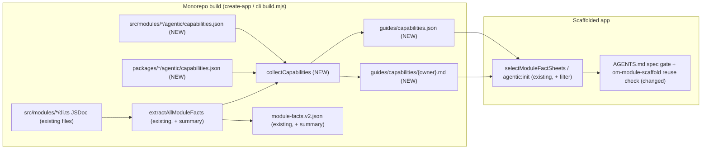
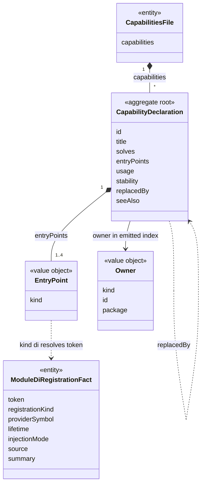
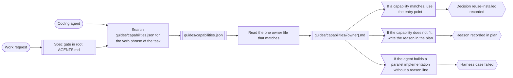
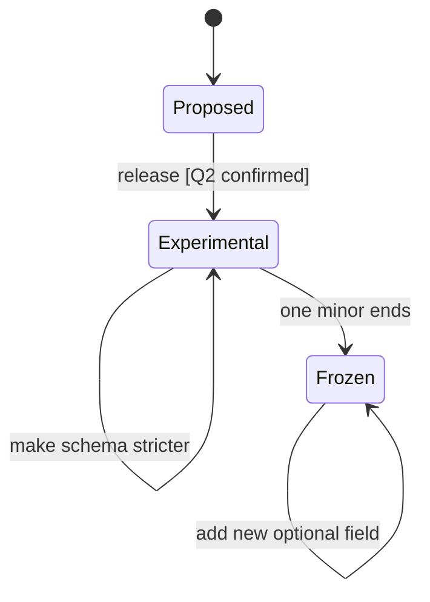

# Standalone capability discovery

> Status: **Draft (design-only spec PR).** Related: `2026-06-27-ts-morph-module-fact-sheets.md`, `2026-07-06-module-facts-auto-discovery.md`, `2026-08-02-module-facts-source-provenance-and-contract-inventory.md`, `2026-08-13-module-fact-sheet-sectioned-reading.md`, `2026-08-01-standalone-harness-knowledge-governance.md`, `2026-07-24-standalone-ai-development-harness.md`.
>
> Writing style: this version uses Simplified Technical English (ASD-STE100) at about 80% conformance. Sentences that stay outside STE protect a decision, a number or an identifier.

## 📝 TLDR

An app that `create-mercato-app` makes contains generated module facts. The facts tell an agent what each module declares: entities, routes and DI tokens. The facts do not tell the agent which problem a service or a helper solves.

Thus, an agent that must "classify a ticket into one of N queues" writes its own OpenRouter call. The agent does not use the planned `decisionModelService`.

This spec proposes future behavior in two phases:

- Phase 1 adds a `summary` to the DI registration facts. The `summary` comes from JSDoc.
- Phase 2 adds a capabilities index. Modules and packages declare the entries, and the build validates them. The output is `guides/capabilities.json` and one `guides/capabilities/<owner>.md` file for each owner. Phase 2 also adds a mandatory reuse check to the standalone harness. The agent does the check before it scaffolds new behavior.

## 📝 Problem Statement

The standalone harness ships Layer-2 facts. The create-app build makes these facts (`packages/create-app/build.mjs:109` → `extractAllModuleFacts` in `packages/cli/src/lib/generators/module-facts.ts`).

`ModuleFacts` (`module-facts.ts:258`) contains only structure. The fact-sheet spec limits it to "only facts extracted from source", 1:1 with the `BACKWARD_COMPATIBILITY.md` surfaces.

This limit causes three gaps:

1. **DI registrations have no meaning.** `ModuleDiRegistrationFact` (`module-facts.ts:240`) has these fields: `token`, `registrationKind`, `providerSymbol`, `lifetime`, `injectionMode`, `source`. The token name is the only hint. Today, only 9 of 60 module `di.ts` files contain a `/**` block. These blocks are file or function headers. No block documents one registration.
2. **The agent cannot see code outside `src/modules/`.** These items make no facts: `@open-mercato/shared/lib/*`, `ai-assistant/src/lib`, the `ui` primitives, and the `queue` and `cache` helpers. The fact-sheet spec deferred "a generated surface for non-module packages" (`2026-06-27-ts-morph-module-fact-sheets.md:198`). The only path to this code is `om-framework-context`. That skill does a bounded search in `node_modules`. The agent must already know the name that it looks for.
3. **No index by intent exists.** Each fact sheet covers one module. The agent must guess the owning module before it can read a sheet.

PR #7464 (`.ai/specs/2026-10-06-ai-decision-model-port.md`) shows the problem. It adds types in `@open-mercato/shared/lib/ai/decision-model.ts` and a `decisionModelService` in `ai-assistant`. That spec names six possible consumers:

- workflows branching
- message routing
- `inbox_ops`
- catalog categorization
- CRM lead scoring
- `business_rules` AI assist

A standalone app can need each of these consumers. With today's facts, no agent in such an app finds the port.

## Resolved assumptions (autonomous defaults)

| # | Question | Applied default | Why | Confirm? |
|---|----------|-----------------|-----|----------|
| Q1 | Do Phase 1 and Phase 2 go into separate specs? | No. One spec has two phases. Each phase can ship alone. The brief asked for this. Q2 does not block Phase 1. The team can implement and merge Phase 1 first. | The two phases serve the same consumer: the reuse check. Phase 1 adds no new contract surface. Phase 2 contains the convention decision. A later split is a file move. | reversible |
| Q2 | Where do modules and packages declare capabilities? | In a new convention file `agentic/capabilities.json`. Only the build reads this file. The file can be at module level (`src/modules/<id>/agentic/capabilities.json`) or at package level (`packages/<pkg>/agentic/capabilities.json`). It is not a field on `ModuleInfo`. | The runtime registry loads the `index.ts` metadata. A `capabilities` field there puts intent text into each app bundle. `packages/<pkg>/agentic/` already contains build-time agent material (`standalone-guide.md`). But the build never ships those package-level guides to apps (`packages/create-app/build.mjs:80-90`). This spec is the first to ship output from that directory. A new convention file becomes FROZEN under `BACKWARD_COMPATIBILITY.md` §1. | ⚠ NEEDS HUMAN CONFIRMATION |
| Q3 | Where does the Phase 1 `summary` come from? | Only from the JSDoc immediately before the registration property in `container.register({...})`. The extractor keeps the first sentence, collapses the whitespace and keeps a maximum of 200 chars. It does not resolve `providerSymbol` across files. | The extractor parses one file at a time with `ts.createSourceFile` and has no Program (`readSourceFile`, `module-facts.ts:328-332`). The property node is available in `extractDiRegistrationFacts` (`module-facts.ts:1386`, property visit at :1408). Resolution across files needs a type checker. That breaks the cost model of the extractor. | reversible |
| Q4 | Does `summary` go into v1 `module-facts.json`? | No. It goes only into the v2 sidecar and the markdown. The v1 projection stays byte-identical. | v1 is the frozen compatibility projection (`BACKWARD_COMPATIBILITY.md` §14). The extractor writes `ownedContracts` with no version check (`module-facts.ts:3152`), and the v1 pass writes it too. Thus, the metadata field needs an explicit `factsContractVersion === 2` gate at `module-facts.ts:2164`. | reversible |
| Q5 | Does the build list non-module exports automatically? | No. A package-level `capabilities.json` contains only selected entries. The build verifies the export for each entry. | The provenance spec has this non-goal: "cataloging private helpers… or arbitrary exports". A selected list replaces the non-module deferral only for these entries. It does not make an export inventory. | reversible |
| Q6 | What enforces the reuse check? | Instructions in the standalone `AGENTS.md.template` and in `om-module-scaffold`. A harness routing case verifies the check. No lint and no CI duplicate detection. | The brief puts lint and CI detection out of scope. The harness case is the current enforcement mechanism for standalone routing. | reversible |
| Q7 | What occurs when a declared entry point does not resolve? | The build fails. The error gives the module id, the capability id and the missing target. | `build.mjs` already has guards that are "refusing to build an empty knowledge layer". This rule uses the same approach. An index that is not current sends agents to removed APIs. | reversible |
| Q8 | `om-spec-writing` is an external skill (pinned in `tiers.json`). Does this spec change it? | No. This spec changes the spec gate in the root template and the local `om-module-scaffold`. A follow-up PR in `open-mercato/skills` adds the same step to the external `om-spec-writing`. | External skills ship from their own repository. | reversible |
| Q9 | Does the index cover third-party modules and app-local modules? | No. It covers only first-party `@open-mercato/*` packages that the monorepo builds. | Standalone discovery skips installs that contain only `.js` files (`module-facts-discovery.ts`, `hasReadableModuleSource`). Coverage of app-local and third-party modules needs extraction in `agentic:init`. That is a separate design. | reversible |

## 📝 Proposed Solution

### Phase 1: DI registration summaries

`extractDiRegistrationFacts` reads the JSDoc immediately before each registration property. It uses `ts.getJSDocCommentsAndTags` or the leading comment ranges of the property node. It stores the first sentence as `summary?: string` on `ModuleDiRegistrationFact`.

The rendered surfaces do not read that type directly. The rich table (`renderDiRegistrationsSection`, `module-facts.ts:2607`) renders `ownedContracts['di-registration'][].metadata`. The extractor makes this metadata at `module-facts.ts:2164-2176`. Thus, the extractor copies the summary into `metadata.summary` at that location, only when `factsContractVersion === 2`.

The table gets a `Summary` column. If no registration in a module has a summary, the table does not show the column. Thus, the current sheets keep their bytes.

Pipe escaping in table cells is new work. Today, `renderSafeScalar` (`module-facts.ts:2582`) does not escape `|`.

```ts
export function register(container: AppContainer) {
  container.register({
    /** Routes a typed decision request to the configured decision model adapter; never throws. */
    decisionModelService: asFunction(createDecisionModelService).singleton(),
  })
}
```

An authoring pass adds JSDoc to the registrations that other modules use most. The pass covers only tokens that other modules or the standalone guides already use. It does not cover each `di.ts`.

### Phase 2: declared capabilities

A module or a package declares the problems that it solves in `agentic/capabilities.json`:

```json
{
  "capabilities": [
    {
      "id": "ai.decision-model",
      "title": "Typed decision with calibrated probabilities",
      "solves": [
        "classify an input into one of N options",
        "score or rank options with probabilities",
        "yes/no decision with a confidence threshold"
      ],
      "entryPoints": [
        { "kind": "di", "token": "decisionModelService" },
        { "kind": "import", "specifier": "@open-mercato/shared/lib/ai/decision-model", "symbols": ["DecisionRequest", "DecisionResult"] }
      ],
      "usage": "soft-optional",
      "stability": "experimental",
      "seeAlso": ["https://github.com/open-mercato/open-mercato/blob/develop/.ai/specs/2026-10-06-ai-decision-model-port.md"]
    }
  ]
}
```

The create-app build and its mirror `packages/cli/build.mjs` do these steps:

1. Collect each file.
2. Validate each file.
3. Resolve each entry point against the facts that the build already extracted.
4. Write the output next to `module-facts.v2.json`.

The output has two parts:

- `guides/capabilities.json`: the machine index. The entries are sorted by `id`. Each entry has its owner (`module` or `package`) and its source path.
- `guides/capabilities/<owner>.md`: one file for each owner module or owner package. The file has one block for each capability, with its `solves` phrases and its entry points. Small files keep each read small. Scaffolding can select these files in the same way that it selects the `modules/<id>/` directories.

Scaffolding uses `selectModuleFactSheets` in `packages/create-app/src/setup/tools/shared.ts` and its mirror in `packages/cli/src/lib/agentic-setup.ts`. Scaffolding copies only the owner files for enabled modules and for packages that the app depends on. Scaffolding also writes a filtered `capabilities.json`. The filter removes each entry whose owner is not selected.

The filter is a plain JSON operation in each setup file. create-app has `@open-mercato/cli` only as a devDependency, so it cannot import the cli renderer at scaffold time. The hashes in the ownership manifest cover the filtered files as the app contains them.

### Alternatives considered

| Alternative | Why the spec does not use it |
|---|---|
| A `capabilities` field on `ModuleInfo` in `index.ts` | `BACKWARD_COMPATIBILITY.md` §2 permits this field. But the metadata object is part of the runtime registry, so intent text goes into each app bundle. Package-level declarations still need a second mechanism. |
| A typed `agentic/capabilities.ts` with a `defineCapabilities` helper from `shared` | This adds a public type and a helper to `shared` for data that only the build uses. The extractor reads literals statically. The zod schema in the collector validates JSON at build time. |
| Make intent from JSDoc only (Phase 1 only) | This covers DI tokens. It does not cover import-path helpers, extension spots or workflow definitions. It gives no index across modules. |
| Embedding or semantic search over `node_modules` when the agent runs | The result is not deterministic and needs a provider. It goes against the facts-first, offline routing of the standalone harness. |

## 📝 Architecture



The extractor stays the single source of resolved facts. The capability collector uses these facts to validate entry points. The collector never parses module code.

**Owning code**

- `packages/cli/src/lib/generators/module-facts.ts`: extraction and rendering of `summary` (Phase 1).
- `packages/cli/src/lib/generators/capabilities.ts` (new): discovery, zod validation, entry-point resolution and deterministic rendering (Phase 2).
- `packages/create-app/build.mjs` and `packages/cli/build.mjs`: call the collector after fact extraction.
- `packages/create-app/src/setup/tools/shared.ts` and `packages/cli/src/lib/agentic-setup.ts`: select `guides/capabilities/<owner>.md`, filter and write `capabilities.json`, and add both to the copy allowlists and the ownership manifests (`agentic-setup.ts:474-483`, `shared.ts:229-237`). The current top-level `guides/*.md` rule does not apply, because the owner files are in a subdirectory.
- `packages/create-app/agentic/shared/AGENTS.md.template` and `packages/create-app/agentic/shared/ai/skills/om-module-scaffold/SKILL.md`: the reuse check.

**Discovery.** The collector finds module-level files next to each module root that `discoverPackageModuleSources` already returns. It finds package-level files at `<pkg.path>/agentic/capabilities.json` for each package from `resolver.discoverPackages()`. `discoverPackageModuleSources` uses the same resolver call. Thus, no `packages/*` path is hard-coded (`.ai/lessons/standalone-scaffolding-and-generators-must-not-assume.md`).

**Entry-point resolution.** All checks use data that the build already has:

| `kind` | The entry point resolves when |
|---|---|
| `di` | `token` is in the `diRegistrations` of the owning module. For a package-level entry, `token` can be in any module of the same package. |
| `import` | `specifier` matches an `exports` entry of the package that the specifier names. This is not always the owning package. The check uses the `types` condition (the first entry when it is an array) with `*` wildcard substitution. The resolved `.ts` source must export each listed symbol. The export can be a local exported declaration, a named re-export, or a symbol in an `export * from` chain of 3 hops or fewer. A specifier that resolves only to `dist` output fails. |
| `spot` | The id is in the extension-surface hosts that `module-extension-facts.ts` collects. |
| `workflow` | The definition id is in the extracted `workflowsConfig.workflows[].workflowId` of a module (`module-extension-facts.ts:1563-1572`). Step types and activity types are registered at runtime (`registerActivityType`). They are not facts, so they are not a valid entry-point kind. |
| `ai-tool` / `ai-agent` | The name is in the `aiTools` / `aiAgents` facts of the owning module. |

## 📝 Data Model

This spec makes no database changes. Two contracts change:

- `ModuleDiRegistrationFact` gets `summary?: string` (v2 only).
- A new `CapabilityDeclaration` schema (zod, in `packages/cli/src/lib/generators/capabilities.ts`):

| Field | Rule |
|---|---|
| `id` | `^[a-z0-9]+(?:[.-][a-z0-9]+)*$`, 3–80 chars, unique across all owners. This is the harness capability-id pattern (`cases.schema.json`). |
| `title` | 1–80 chars. |
| `solves` | 1–6 phrases, each 3–120 chars. Write each phrase as a task, for example "classify an input into one of N options". |
| `entryPoints` | 1–4 entries of the kinds in the resolution table. |
| `usage` | `required-dependency` or `soft-optional`. For `soft-optional`, resolve in try/catch (`core` → Cross-Module Coupling). |
| `stability` | `stable`, `experimental` or `deprecated`. `deprecated` requires `replacedBy` (a capability id). |
| `seeAlso` | Optional. Each value is an `https://github.com/open-mercato/` URL or a path in the staged `agentic/` tree that ships to apps. The build rejects monorepo-only paths (`.ai/specs/…`), because they are dead links in a scaffolded app. |

Each emitted `capabilities.json` entry also has `owner: { kind: 'module' | 'package', id, package }` and `source` (portable path). The output is sorted, has a stable key order and has no timestamps.

## 📝 API Contracts

This spec adds no HTTP surface and no CLI surface. The contracts are the convention file, the two emitted artifacts and the v2 field:

| Surface | `BACKWARD_COMPATIBILITY.md` category | Classification |
|---|---|---|
| `agentic/capabilities.json` convention file (module level and package level) | §1 Auto-Discovery File Conventions | FROZEN after release. Only new optional fields are permitted. |
| `guides/capabilities.json` / `guides/capabilities/<owner>.md` | §14 Generated File Contracts | STABLE. Only additive fields. Ids never change; use `replacedBy` to deprecate. |
| `summary` in `module-facts.v2.json` | §14 | Additive optional field. v1 does not change. |

The release notes mark the surface experimental for one minor. During that minor, the team can make the schema stricter before it freezes.

## 📝 UI/UX

The consumer is a coding agent in a standalone app. It is not an end user. The agent flow changes as follows:

1. A work request gets to the spec gate in the root `AGENTS.md` (`AGENTS.md.template:94`).
2. Before `spec-first` or `om-module-scaffold`, the agent searches `guides/capabilities.json` for the verb phrase of the task. It can also grep `guides/capabilities/`. Then it reads the one owner file that matches.
3. If a capability matches, the agent uses the entry point (decision `reuse-installed`). Alternatively, it writes in the plan why the capability does not fit. If the agent builds a parallel implementation without that line, the harness case fails.

The root template change is one clause on the spec-gate line. The target is 160 bytes or fewer.

The raw `AGENTS.md.template` is 11,112 bytes. But the gate (`STANDALONE_ROOT_TARGET_BYTES`, `packages/create-app/src/setup/tools/shared.ts:74`) measures the generated root. The generated root also contains the injected module-guides index. Thus, measure the real headroom on a generated root before the edit.

`om-module-scaffold` gets the detailed step 0 (search, decide, record) in its `SKILL.md`.

## 📝 Edge Cases & Failure Scenarios

| Scenario | Behavior |
|---|---|
| A declared DI token gets a new name or is removed | The build fails and names the capability and the token. The author updates the declaration or marks it `deprecated` with `replacedBy`. |
| Two owners declare the same `id` | The build fails and lists the two sources. |
| A module that the app disables owns a capability | Scaffolding removes the capability. The agent never sees it. |
| A package-level capability belongs to a package that the app does not depend on | Scaffolding removes the capability. |
| A capability is `soft-optional`, and its provider package is not present at runtime | The index does not cover this case. The `usage` hint tells the agent to resolve in try/catch, as the current coupling rules require. |
| The JSDoc contains markdown, links or prose on many lines | The extractor keeps the first sentence, collapses the whitespace, escapes pipe characters for the table and cuts the text at 200 chars with `…`. |
| The registration value is a spread or a computed key | No summary. The current token behavior does not change. |
| An owner file becomes larger than the 32 KB section threshold | The sectioned-reading rules apply (`###` sub-anchors, contents index). A byte-budget assertion in the generator test fails above an explicit cap for each file. |
| An agent matches a capability that does not fit the task | This is permitted. The reuse check requires a recorded reason. It does not require reuse. |

## 📝 Risks & Impact Review

| Risk | Severity | Affected area | Mitigation | Residual |
|---|---|---|---|---|
| `agentic/capabilities.json` becomes a FROZEN convention (Q2). Third-party authors can start to use it before app-local extraction exists (Q9). | High | `BACKWARD_COMPATIBILITY.md` §1, module authors | Ship it as experimental for one minor. The merge waits for confirmation of Q2. | Medium: after the experimental period, the file name and location cannot change. |
| This spec replaces two earlier non-goals. The fact-sheet spec deferred the non-module package surfaces and excluded prose. | Medium | Facts governance | Authors write the intent phrases; the build does not make them. Non-module entries are selected and resolved. They are never an export inventory. The two earlier specs each get a changelog line that refers to this spec. | Low |
| Changes to emitted guides, the root template, `om-module-scaffold` and rendering are in the `knowledge-contract` class (`2026-08-01-standalone-harness-knowledge-governance.md`). | Medium | Standalone harness release | Each phase does the full workflow of that spec: owner inventory, source-link inventory, fail-before evaluator test, case/matrix/count sync, packed-scaffold check, `harness:validate-knowledge-change`. | Low |
| Intent phrases become different from the behavior. Resolution finds only removed entry points. | Medium | Agent routing quality | Owners update the declaration in the same PR as the behavior change. `om-code-review` gets a checklist line. | Medium: review finds semantic drift. The build does not. |
| Byte budget of the root template (less than 1.1 KB headroom on the raw template, and less on the generated root). | Low | Standalone root instructions | The clause has a cap of 160 bytes. The details are in `om-module-scaffold`. The current budget gate measures the clause. | Low |
| The build fails on an unresolved entry point after an unrelated refactor. | Low | Monorepo build | The error names the capability, the owner and the target. The fix is a one-line edit of the declaration, or `deprecated` + `replacedBy`. | Low |

**Rollback.**

- Phase 1: remove the field. v1 never contained it.
- Phase 2 before release: remove the collector.
- Phase 2 after release: stop the emission. The convention file stays valid, and the build ignores it.

## 📋 Phasing

- **Phase 1: DI summaries.** `summary` in the v2 facts and the markdown, and JSDoc for tokens that other modules use. Phase 1 can ship alone. After Phase 1, agents see the meaning of DI tokens.
- **Phase 2: capabilities index and reuse check.** The convention file, the collector, the emitted artifacts, scaffold filtering, the template and skill change, the harness case and the seed inventory. Phase 2 does not depend on Phase 1.

## 📋 Implementation Plan

### Phase 1: DI registration summaries

1. Add `summary?: string` to `ModuleDiRegistrationFact`. In `extractDiRegistrationFacts`, read the JSDoc immediately before the registration property. Normalize it: first sentence, collapsed whitespace, cap of 200 chars. Copy it into `ownedContracts['di-registration'][].metadata.summary` at `module-facts.ts:2164` only when `factsContractVersion === 2`.
   *Test:* unit tests for these cases: JSDoc present, JSDoc absent, JSDoc on many lines, markdown, spread keys and computed keys. A new test makes sure that `renderModuleFactsJson(legacyFactsByModule)` contains no `summary` key. The current byte budgets in `module-facts.bc-guard.test.ts` stay green.
2. Add the `Summary` column to `renderDiRegistrationsSection`. Do not show the column when no row has a summary. Escape `|` in the cell.
   *Test:* a snapshot of a fixture module with summaries and without summaries. Modules without JSDoc stay byte-identical. A summary that contains a pipe renders as one cell.
3. Add JSDoc for a fixed token list. Commit the list in the generator test. The list contains registrations that other modules use through `resolve`, `tryResolve` or cradle destructuring, and tokens that the standalone guides name.
   *Test:* the generator test makes sure that each listed token has a summary. `yarn build:packages` and the create-app build make updated sheets.
4. Do the knowledge-governance workflow for the rendering change: an owner inventory row, and a release-matrix sync if the counts change.
   *Test:* the `harness:validate-knowledge-change` manifest passes.

### Phase 2: capabilities index

1. Add `capabilities.ts`. It contains the zod schema, the discovery of module-level and package-level `agentic/capabilities.json` (see Discovery), and deterministic JSON and markdown rendering.
   *Test:* a matrix of accepted and rejected schemas. Determinism: two runs give byte-identical output. A duplicate id fails.
2. Implement entry-point resolution for `di`, `import`, `spot`, `workflow`, `ai-tool` and `ai-agent` against the extracted facts and the package `exports`.
   *Test:* one fixture that passes and one fixture that fails for each kind. The error names the capability, the owner and the target. `import` fixtures for these cases: a wildcard export, an array `types` condition, a dist-only `"."` entry (fails), a named re-export and a two-hop `export *` barrel.
3. Connect the collector to `packages/create-app/build.mjs` and `packages/cli/build.mjs` after fact extraction. Write the output into the staged `guides/`.
   *Test:* a build test makes sure that the JSON file and the owner files exist. An empty inventory gives a valid empty index. A byte-budget assertion for each file.
4. In `create-app/src/setup/tools/shared.ts` and `cli/src/lib/agentic-setup.ts`, select the owner files and filter `capabilities.json`. Add both to the copy lists and the ownership manifests.
   *Test:* a scaffold test with a preset that disables a module that owns a capability. The owner file and the JSON entries of that module are not in the app, and the manifest hashes match the written files. An `agentic:init` parity test.
5. Add a small seed inventory (target: 15 or fewer). Use only entry points that exist now: queue worker contract, cache service, event bus and DOM event bridge, search, notifications, progress jobs, workflows code definitions, AI tools and agents, integrations/data_sync adapters, encryption query helpers and optimistic-lock helpers.
   *Test:* the build resolves each entry. The PR that implements the spec of #7464 adds the decision-model port entry. This seed does not contain it.
6. Add the reuse-check clause to `AGENTS.md.template` (160 bytes or fewer). Add step 0 to `om-module-scaffold/SKILL.md`. Mirror the change with `yarn template:sync:fix` where applicable.
   *Test:* `yarn agents:check-budget` and the standalone root-byte gate.
7. Make the case id pattern in `cases.schema.json:18` wider. Today it stops at `OMH-239`, and `OMH-239` is already in use. Then add the routing case `OMH-240` from `om-evolve-harness/references/case-template.md`. In the case, a fresh app gets the request "classify incoming messages into queues". The agent must read `guides/capabilities.json` or the matching owner file. The case requires the decision `reuse-installed` and forbids a direct vendor `fetch`. Update the case counts in README, RELEASE and `release-matrix.json`.
   *Test:* the case fails before step 6 and passes after step 6 (fail-before evaluator rule). The related cases and the safety cases also pass.
8. Add an `om-code-review` checklist line to `.ai/review-checklist.md` (standalone copy and monorepo copy): when the behavior of a declared capability changes, update its declaration. Add a changelog line to the fact-sheet spec and to the provenance spec about the replaced deferral.
   This step is documentation only and has no automated test. It ships in the PR of step 6, so the review covers it.

Integration tests: none, because there is no HTTP surface and no UI surface. The coverage is generator unit tests, build and scaffold tests, and the harness routing case.

**Follow-ups (out of scope):**

- lint or CI duplicate detection in apps
- an "upstream this" suggestion flow from `om-evolve-harness`
- app-local and third-party capabilities through `agentic:init`
- the same reuse step in the external `om-spec-writing` skill

## Final Compliance Report

| Rule source | Check | Status |
|---|---|---|
| `BACKWARD_COMPATIBILITY.md` §1, §2, §14 | The new convention file is additive. `ModuleInfo` does not change. v1 facts stay byte-identical. The new generated artifacts are additive. | Compliant; Q2 waits for confirmation |
| `packages/cli/AGENTS.md` Ask First (auto-discovery conventions, generated file locations) | This spec proposes the convention and the output locations. A maintainer must approve them before implementation. | Waits for approval (Q2) |
| `packages/cli/AGENTS.md` Always (deterministic generator output; keep `agentic-setup.ts` and `build.mjs` in sync) | Sorted output, no timestamps and a determinism test. The two build mirrors and the two copy paths change together (Phase 2 steps 3–4). | Compliant |
| `2026-08-01-standalone-harness-knowledge-governance.md` | Each phase lists the `knowledge-contract` workflow. | Compliant |
| `2026-07-24-standalone-ai-development-harness.md` (root ≤12 KiB, facts-first, fail-before cases) | The clause has a cap of 160 bytes. The capabilities index is a fact artifact. The new routing case fails before the change. | Compliant |
| Root `AGENTS.md` (no direct coupling between modules; soft-optional resolve) | The index only refers to entry points that exist and gives the `usage` hint. It adds no runtime coupling. | Compliant |
| `.ai/specs/AGENTS.md` (integration coverage) | No HTTP path and no UI path. Each step lists generator, build, scaffold or harness tests. | Compliant |

## Graphs

A subagent made these DDD graphs from the text of this spec. Each node and each edge maps to a sentence in this spec (see the trace tables). The architecture flowchart above already shows the build pipeline, so this section has no separate context map.

### Domain model: capability declaration

This diagram shows the capability declaration, its entry points and owner, and the DI registration fact that a `di` entry point resolves against.



<details><summary>Trace</summary>

| Item | Source sentence |
|---|---|
| CapabilitiesFile (`agentic/capabilities.json`) with `capabilities` | "A module or a package declares the problems that it solves in `agentic/capabilities.json`", and the JSON example. |
| CapabilityDeclaration and its attributes | The `CapabilityDeclaration` field table. `replacedBy`: "`deprecated` requires `replacedBy` (a capability id)." |
| EntryPoint with `kind` | "`entryPoints`: 1–4 entries of the kinds in the resolution table." |
| Owner with `kind`, `id`, `package` | "Each emitted `capabilities.json` entry also has `owner: { kind: 'module' \| 'package', id, package }`." |
| ModuleDiRegistrationFact and its attributes | "`ModuleDiRegistrationFact` (`module-facts.ts:240`) has these fields…" and "`ModuleDiRegistrationFact` gets `summary?: string` (v2 only)." |
| EntryPoint to ModuleDiRegistrationFact | "`di`: `token` is in the `diRegistrations` of the owning module." |

</details>

### Process map: reuse check in a standalone app

This diagram shows the reuse check that a coding agent does at the spec gate before it scaffolds new behavior.



<details><summary>Trace</summary>

| Item | Source sentence |
|---|---|
| Work request, spec gate | "A work request gets to the spec gate in the root `AGENTS.md` (`AGENTS.md.template:94`)." |
| Coding agent | "The consumer is a coding agent in a standalone app." |
| Search `guides/capabilities.json` | "Before `spec-first` or `om-module-scaffold`, the agent searches `guides/capabilities.json` for the verb phrase of the task." |
| Read the owner file | "Then it reads the one owner file that matches." |
| Use the entry point, `reuse-installed` | "If a capability matches, the agent uses the entry point (decision `reuse-installed`)." |
| Reason in the plan | "Alternatively, it writes in the plan why the capability does not fit." |
| Harness case failed | "If the agent builds a parallel implementation without that line, the harness case fails." |

</details>

### State diagram: the `agentic/capabilities.json` convention

This diagram shows how the `agentic/capabilities.json` convention goes from a proposal to an experimental surface, and then becomes FROZEN.



<details><summary>Trace</summary>

| Item | Source sentence |
|---|---|
| Proposed | "This spec proposes the convention and the output locations. A maintainer must approve them before implementation." |
| Proposed to Experimental [Q2 confirmed] | "Ship it as experimental for one minor. The merge waits for confirmation of Q2." |
| Make schema stricter | "During that minor, the team can make the schema stricter before it freezes." |
| Experimental to Frozen | "The release notes mark the surface experimental for one minor." |
| Add new optional field | "FROZEN after release. Only new optional fields are permitted." |

</details>

## Kept outside STE

These parts stay outside STE because they protect a decision, an identifier or a record:

- The Q2 rationale cell (Resolved assumptions) keeps long sentences. They protect the ⚠ NEEDS HUMAN CONFIRMATION decision and the `build.mjs:80-90` evidence.
- The `import` row of the entry-point resolution table keeps one long rule. It protects the exact resolution rules (`types` condition, wildcard, 3 hops, `dist` failure).
- The seed inventory list in Phase 2 step 5 keeps the full list of 11 domains in one sentence. It protects the seed scope.
- The Changelog lines from 2026-10-20 stay as written. They are a historical record of #7699.
- The JSON example and the TypeScript example stay unchanged. They are code.

## Changelog

- 2026-10-20: Initial draft (autonomous run, design-only).
- 2026-10-20: Applied fresh-context review: DI summary routed through `ownedContracts` metadata with a v2 gate; `workflow-step` replaced by `workflow`; `import` resolution defined against the specifier's package with wildcard, `types` and re-export rules; per-owner capability files for scaffold filtering; package discovery through `resolver.discoverPackages()`; shipped-only `seeAlso`; harness id-pattern widening; reference corrections.
- 2026-10-21: Experimental STE variant made with `ste-simplify` (about 80% ASD-STE100). The content and the decisions are the same as in #7699. DDD graphs added.
