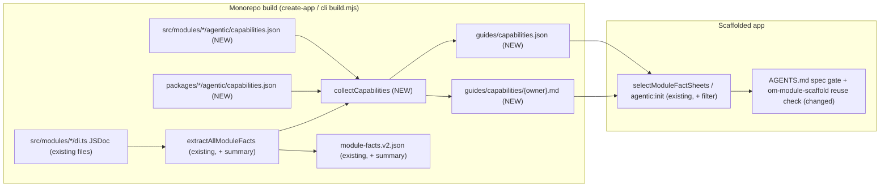
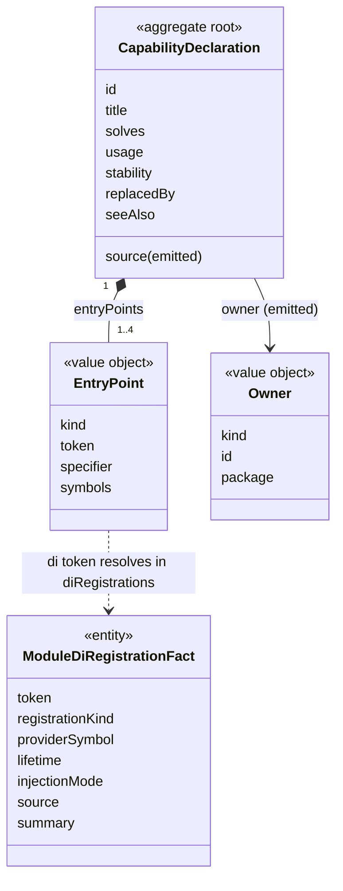
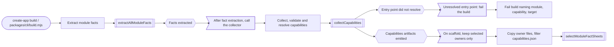

# Standalone capability discovery

> Status: **Draft (design-only spec PR).** Related: `2026-06-27-ts-morph-module-fact-sheets.md`, `2026-07-06-module-facts-auto-discovery.md`, `2026-08-02-module-facts-source-provenance-and-contract-inventory.md`, `2026-08-13-module-fact-sheet-sectioned-reading.md`, `2026-08-01-standalone-harness-knowledge-governance.md`, `2026-07-24-standalone-ai-development-harness.md`.

## 📝 TLDR

An app that `create-mercato-app` scaffolds gives agents generated module facts. The facts list what each module declares (entities, routes, DI tokens). The facts do not tell which problem a service or a helper solves. Thus, when you tell an agent to "classify a ticket into one of N queues", the agent writes its own OpenRouter call. The agent does not use the planned `decisionModelService`.

This spec proposes future behavior:

- Phase 1 adds a JSDoc-derived `summary` to the DI registration facts.
- Phase 2 adds a curated capabilities index that the build validates: `guides/capabilities.json` and one `guides/capabilities/<owner>.md` file for each owner. Modules and packages declare the entries. Phase 2 also adds a mandatory reuse check to the standalone harness. The agent does the check before it scaffolds new behavior.

## 📝 Problem Statement

The standalone harness ships Layer-2 facts. The create-app build makes these facts (`packages/create-app/build.mjs:109` → `extractAllModuleFacts` in `packages/cli/src/lib/generators/module-facts.ts`). `ModuleFacts` (`module-facts.ts:258`) is structural by design. The fact-sheet spec limits it to "only facts extracted from source", 1:1 with the `BACKWARD_COMPATIBILITY.md` surfaces.

This design causes three gaps:

1. **DI registrations carry no meaning.** `ModuleDiRegistrationFact` (`module-facts.ts:240`) has these fields: `token`, `registrationKind`, `providerSymbol`, `lifetime`, `injectionMode`, `source`. The token name is the only hint. Today, only 9 of 60 module `di.ts` files contain a `/**` block. These blocks are file or function headers, not docs for each registration.
2. **Code outside `src/modules/` is invisible.** `@open-mercato/shared/lib/*`, `ai-assistant/src/lib`, `ui` primitives and `queue`/`cache` helpers make no facts. The fact-sheet spec deferred "a generated surface for non-module packages" (`2026-06-27-ts-morph-module-fact-sheets.md:198`). The only route to this code is `om-framework-context`. It is a bounded `node_modules` search, and the agent must already know the name that it looks for.
3. **There is no index by intent.** Each fact sheet is about one module. The agent must guess the owning module before it can read anything.

The motivating case is PR #7464 (`.ai/specs/2026-10-06-ai-decision-model-port.md`). It adds types in `@open-mercato/shared/lib/ai/decision-model.ts` and a `decisionModelService` in `ai-assistant`. That spec lists six candidate consumers: workflows branching, message routing, `inbox_ops`, catalog categorization, CRM lead scoring and `business_rules` AI assist. Each consumer can also occur in a standalone app. No consumer can find the port from the facts of today.

## Resolved assumptions (autonomous defaults)

| # | Question | Applied default | Why | Confirm? |
|---|----------|-----------------|-----|----------|
| Q1 | Do we split Phase 1 and Phase 2 into two specs? | No. Keep one spec with two phases that can ship independently, as the brief requested. Phase 1 is not gated on Q2. You can implement and merge Phase 1 first. | Both phases serve the same consumer (the reuse check). Phase 1 needs no new contract surface. Phase 2 carries the convention decision. A later split is only a file move. | reversible |
| Q2 | Where do modules and packages declare capabilities? | In a build-time-only convention file `agentic/capabilities.json`, at module level (`src/modules/<id>/agentic/capabilities.json`) and at package level (`packages/<pkg>/agentic/capabilities.json`). Not in a field on `ModuleInfo`. | The runtime registry loads the `index.ts` metadata. Thus a `capabilities` field would ship intent prose in every app bundle. `packages/<pkg>/agentic/` already holds build-time agent material (`standalone-guide.md`). The build never ships those package-level guides to apps (`packages/create-app/build.mjs:80-90`). This spec is the first to ship output from that directory. A new convention file becomes FROZEN under `BACKWARD_COMPATIBILITY.md` §1. | ⚠ NEEDS HUMAN CONFIRMATION |
| Q3 | Where does the Phase 1 `summary` come from? | Only from the leading JSDoc on the registration property inside `container.register({...})`. Use the first sentence, collapse the whitespace, and keep 200 chars at most. Do not resolve `providerSymbol` across files. | The extractor uses single-file `ts.createSourceFile` without a Program (`readSourceFile`, `module-facts.ts:328-332`). `extractDiRegistrationFacts` already has the property node (`module-facts.ts:1386`, property visit at :1408). Resolution across files needs a type checker and breaks the cost model of the extractor. | reversible |
| Q4 | Does `summary` go into v1 `module-facts.json`? | No. It goes only into the v2 sidecar and the markdown. The v1 projection stays byte-identical. | v1 is the frozen compatibility projection (`BACKWARD_COMPATIBILITY.md` §14). The code serializes `ownedContracts` without a version check (`module-facts.ts:3152`), and the v1 pass writes it. Thus the metadata field needs an explicit `factsContractVersion === 2` gate at `module-facts.ts:2164`. | reversible |
| Q5 | Do we catalogue non-module exports automatically? | No. Use only curated entries in a package-level `capabilities.json`. Each entry points at an export that the build verifies. | The provenance spec lists "cataloging private helpers… or arbitrary exports" as a non-goal. A curated list replaces the non-module deferral only narrowly. It does not generate an export inventory. | reversible |
| Q6 | What enforces the reuse check? | Instructions (the standalone `AGENTS.md.template` and `om-module-scaffold`). A harness routing case verifies them. No lint or CI duplicate detection. | The brief puts lint/CI detection out of scope. The harness case is the existing enforcement mechanism for standalone routing. | reversible |
| Q7 | What occurs when a declared entry point does not resolve? | The build fails. The error gives the module id, the capability id and the missing target. | The existing "refusing to build an empty knowledge layer" guards in `build.mjs` use the same approach. A stale index would send agents to removed APIs. | reversible |
| Q8 | `om-spec-writing` is an external skill (pinned in `tiers.json`). Do we change it here? | No. This spec changes the spec gate of the root template and the local `om-module-scaffold`. A follow-up PR in `open-mercato/skills` adds a matching step to the external `om-spec-writing`. | External skills ship from their own repository. | reversible |
| Q9 | Do we cover third-party and app-local modules? | No. Only first-party `@open-mercato/*` packages that the monorepo builds. | Standalone discovery skips `.js`-only installs (`module-facts-discovery.ts`, `hasReadableModuleSource`). Coverage of app-local and third-party modules needs `agentic:init` extraction. That is a separate design. | reversible |

## 📝 Proposed Solution

### Phase 1: DI registration summaries

`extractDiRegistrationFacts` reads the leading JSDoc of each registration property. It uses `ts.getJSDocCommentsAndTags` or the leading comment ranges of the property node. It stores the first sentence as `summary?: string` on `ModuleDiRegistrationFact`.

The rendered surfaces do not read that type directly. The rich table (`renderDiRegistrationsSection`, `module-facts.ts:2607`) renders `ownedContracts['di-registration'][].metadata`. The code builds this metadata at `module-facts.ts:2164-2176`. Thus the extractor copies the summary into `metadata.summary` there, only when `factsContractVersion === 2`.

The table gets a `Summary` column. The renderer omits the column when no registration in a module has a summary, so existing sheets keep their bytes. Pipe escaping in table cells is new work: today, `renderSafeScalar` (`module-facts.ts:2582`) does not escape `|`.

```ts
export function register(container: AppContainer) {
  container.register({
    /** Routes a typed decision request to the configured decision model adapter; never throws. */
    decisionModelService: asFunction(createDecisionModelService).singleton(),
  })
}
```

An authoring pass adds JSDoc to the registrations that cross module boundaries most frequently. The pass includes only tokens that other modules or the standalone guides already reference. It does not include every `di.ts`.

### Phase 2: declared capabilities

A module or a package declares the problems that it solves in `agentic/capabilities.json`:

```json
{
  "capabilities": [
    {
      "id": "ai.decision-model",
      "title": "Typed decision with calibrated probabilities",
      "solves": [
        "classify an input into one of N options",
        "score or rank options with probabilities",
        "yes/no decision with a confidence threshold"
      ],
      "entryPoints": [
        { "kind": "di", "token": "decisionModelService" },
        { "kind": "import", "specifier": "@open-mercato/shared/lib/ai/decision-model", "symbols": ["DecisionRequest", "DecisionResult"] }
      ],
      "usage": "soft-optional",
      "stability": "experimental",
      "seeAlso": ["https://github.com/open-mercato/open-mercato/blob/develop/.ai/specs/2026-10-06-ai-decision-model-port.md"]
    }
  ]
}
```

The create-app build (and its mirror `packages/cli/build.mjs`) does these tasks:

1. It collects every file.
2. It validates each file.
3. It resolves every entry point against the facts that it already extracted.
4. It emits two artifacts next to `module-facts.v2.json`.

The two artifacts are:

- `guides/capabilities.json`: the machine index. The build sorts the entries by `id`. Each entry has its owner (`module` or `package`) and its source path.
- `guides/capabilities/<owner>.md`: one file for each owning module or package. Each file has one block for each capability, with its `solves` phrases and entry points. Separate owner files keep each read small. Scaffolding can select them in the same way as it selects `modules/<id>/` directories.

Scaffolding uses `selectModuleFactSheets` in `packages/create-app/src/setup/tools/shared.ts` and its mirror in `packages/cli/src/lib/agentic-setup.ts`. Scaffolding copies only the owner files for enabled modules and for packages that the app depends on. It also writes a filtered `capabilities.json`: it drops the entries whose owner is not selected. Each setup file does this filter as a plain JSON operation. The reason: create-app has `@open-mercato/cli` only as a devDependency, so it cannot import the cli renderer at scaffold time. The hashes of the ownership manifest cover the filtered files as the scaffold writes them into the app.

### Alternatives considered

| Alternative | Why it lost |
|---|---|
| `capabilities` field on `ModuleInfo` in `index.ts` | `BACKWARD_COMPATIBILITY.md` §2 allows it. But the metadata object is part of the runtime registry, so intent prose would ship in every app bundle. Package-level declarations would also need a second mechanism. |
| A typed `agentic/capabilities.ts` with a `defineCapabilities` helper from `shared` | It adds a public type and a helper to `shared` for build-time-only data. The extractor reads literals statically in all cases. The zod schema in the collector validates the JSON at build time. |
| Generate intent from JSDoc alone (Phase 1 only) | It covers DI tokens. It does not cover import-path helpers, extension spots or workflow definitions. It gives no cross-module index. |
| Embedding/semantic search over `node_modules` at agent time | The result is not deterministic, and it needs a provider. It goes against the facts-first, offline routing of the standalone harness. |

## 📝 Architecture



The extractor stays the single source of resolved facts. The capability collector uses these facts to validate entry points. The collector never parses module code itself.

**Owning code**

- `packages/cli/src/lib/generators/module-facts.ts`: `summary` extraction and rendering (Phase 1).
- `packages/cli/src/lib/generators/capabilities.ts` (new): discovery, zod validation, entry-point resolution, deterministic rendering (Phase 2).
- `packages/create-app/build.mjs` and `packages/cli/build.mjs`: call the collector after fact extraction.
- `packages/create-app/src/setup/tools/shared.ts` and `packages/cli/src/lib/agentic-setup.ts`: select `guides/capabilities/<owner>.md`, filter and write `capabilities.json`, and add both to the copy allowlists and the ownership manifests (`agentic-setup.ts:474-483`, `shared.ts:229-237`). The existing top-level `guides/*.md` rule does not apply, because the owner files are in a subdirectory.
- `packages/create-app/agentic/shared/AGENTS.md.template` and `packages/create-app/agentic/shared/ai/skills/om-module-scaffold/SKILL.md`: the reuse check.

**Discovery.** The collector finds module-level files next to each module root that `discoverPackageModuleSources` already returns. It finds package-level files at `<pkg.path>/agentic/capabilities.json` for each package from `resolver.discoverPackages()`. `discoverPackageModuleSources` uses the same resolver call. Thus no `packages/*` path is hard-coded (`.ai/lessons/standalone-scaffolding-and-generators-must-not-assume.md`).

**Entry-point resolution.** All checks use data that the build already holds:

| `kind` | Resolves when |
|---|---|
| `di` | `token` is in the `diRegistrations` of the owning module. For package-level entries, `token` can be in any module of the same package. |
| `import` | `specifier` matches an `exports` entry of the package that the specifier names (not the owning package). The match uses the `types` condition (the first entry when it is an array) with `*` wildcard substitution. The resolved `.ts` source must export each listed symbol: as a local exported declaration, as a named re-export, or through `export * from` re-exports. The check follows `export *` for 3 hops at most. A specifier that resolves only to `dist` output fails. |
| `spot` | The id is in the extension-surface hosts that `module-extension-facts.ts` collects. |
| `workflow` | The definition id is in the extracted `workflowsConfig.workflows[].workflowId` of a module (`module-extension-facts.ts:1563-1572`). The runtime registers step and activity types (`registerActivityType`). They are not facts, so they are not a valid entry-point kind. |
| `ai-tool` / `ai-agent` | The name is in the `aiTools` / `aiAgents` facts of the owning module. |

## 📝 Data Model

There are no database changes. Two contracts change:

- `ModuleDiRegistrationFact` gets `summary?: string` (v2 only).
- A new `CapabilityDeclaration` schema (zod, in `packages/cli/src/lib/generators/capabilities.ts`):

| Field | Rule |
|---|---|
| `id` | `^[a-z0-9]+(?:[.-][a-z0-9]+)*$`, 3–80 chars, unique across all owners. It uses the same pattern as the harness capability ids (`cases.schema.json`). |
| `title` | 1–80 chars. |
| `solves` | 1–6 phrases, each 3–120 chars, written as a task ("classify an input into one of N options"). |
| `entryPoints` | 1–4 entries of the kinds above. |
| `usage` | `required-dependency` or `soft-optional` (resolve in try/catch, per `core` → Cross-Module Coupling). |
| `stability` | `stable`, `experimental` or `deprecated`. `deprecated` requires `replacedBy` (a capability id). |
| `seeAlso` | Optional. Either an `https://github.com/open-mercato/` URL or a path inside the staged `agentic/` tree that ships to apps. The schema rejects monorepo-only paths (`.ai/specs/…`), because they are dead links in a scaffolded app. |

The emitted `capabilities.json` entries add `owner: { kind: 'module' | 'package', id, package }` and `source` (a portable path). The collector sorts the output and uses a stable key order. It contains no timestamps.

## 📝 API Contracts

There is no HTTP or CLI surface. The contracts are the convention file, the two emitted artifacts and the v2 field:

| Surface | `BACKWARD_COMPATIBILITY.md` category | Classification |
|---|---|---|
| `agentic/capabilities.json` convention file (module and package level) | §1 Auto-Discovery File Conventions | FROZEN after the release. Only new optional fields. |
| `guides/capabilities.json` / `guides/capabilities/<owner>.md` | §14 Generated File Contracts | STABLE. Only additive fields. Ids are never renamed (deprecate with `replacedBy`). |
| `summary` in `module-facts.v2.json` | §14 | Additive optional field. v1 does not change. |

The release notes mark the surface as experimental for one minor. During that minor, the schema can still tighten before it freezes.

## 📝 UI/UX

The consumer is a coding agent in a standalone app, not an end user. The changed agent flow:

1. A work request gets to the spec gate of the root `AGENTS.md` (`AGENTS.md.template:94`).
2. Before `spec-first` or `om-module-scaffold`, the agent searches `guides/capabilities.json` (or greps `guides/capabilities/`) for the verb phrase of the task. Then the agent reads the one owner file that matches.
3. If there is a match, the agent uses the entry point (decision `reuse-installed`). Or the agent records in the plan why the capability does not fit. If the agent builds a parallel implementation without that line, the harness case fails.

The change to the root template is one clause on the spec-gate line (target ≤160 bytes). The raw `AGENTS.md.template` has 11,112 bytes. But the gate (`STANDALONE_ROOT_TARGET_BYTES`, `packages/create-app/src/setup/tools/shared.ts:74`) measures the generated root. The generated root also has the injected module-guides index. Thus, measure the real headroom on a generated root before the edit. `om-module-scaffold` gets the detailed step 0 (search, decide, record) in its `SKILL.md`.

## 📝 Edge Cases & Failure Scenarios

| Scenario | Behavior |
|---|---|
| An author renames or removes a declared DI token | The build fails and names the capability and the token. The author updates the declaration or marks it `deprecated` with `replacedBy`. |
| Two owners declare the same `id` | The build fails and lists the two sources. |
| A module that the app disables owns the capability | Scaffolding filters it out. The agent never sees it. |
| A package-level capability whose package is not a dependency of the app | Scaffolding filters it out. |
| The capability is `soft-optional` and its provider package is absent at runtime | The index does not cover this case. The `usage` hint tells the agent to resolve in try/catch, as the existing coupling rules require. |
| The JSDoc has markdown, links or multi-line prose | Only the first sentence. The extractor collapses the whitespace, escapes pipe characters for the table, and truncates at 200 chars with `…`. |
| The registration value is a spread or a computed key | No summary. The current token behavior does not change. |
| An owner file becomes larger than the 32 KB section threshold | The sectioned-reading rules apply (`###` sub-anchors, contents index). A byte-budget assertion in the generator test fails above an explicit cap for each file. |
| An agent matches a capability that does not fit the task | Allowed. The reuse check requires a recorded reason, not reuse. |

## 📝 Risks & Impact Review

| Risk | Severity | Affected area | Mitigation | Residual |
|---|---|---|---|---|
| `agentic/capabilities.json` becomes a FROZEN convention (Q2). Third-party authors can use it before app-local extraction exists (Q9). | High | `BACKWARD_COMPATIBILITY.md` §1, module authors | Ship it marked experimental for one minor. Merge is gated on the confirmation of Q2. | Medium: the file name and location cannot change after the experimental window. |
| The spec replaces two earlier non-goals: the fact-sheet spec deferred non-module package surfaces and excluded prose. | Medium | Facts governance | Authors write the intent phrases; the build does not generate them. The build resolves each curated non-module entry. These entries are never an export inventory. Both earlier specs get a changelog line that points here. | Low |
| Edits to the emitted guides, the root template, `om-module-scaffold` and the rendering are in the `knowledge-contract` class (`2026-08-01-standalone-harness-knowledge-governance.md`). | Medium | Standalone harness release | Each phase runs the full workflow of that spec (owner inventory, source-link inventory, fail-before evaluator test, case/matrix/count sync, packed-scaffold check, `harness:validate-knowledge-change`). | Low |
| Intent phrases drift from behavior. Resolution catches only removed entry points. | Medium | Agent routing quality | Owners update the declarations in the same PR as the behavior changes. Add an `om-code-review` checklist line. | Medium: review catches semantic drift; the build does not. |
| Root template byte budget (less than 1.1 KB headroom on the raw template, and less on the generated root). | Low | Standalone root instructions | The clause has a cap of 160 bytes. The detail is in `om-module-scaffold`. The existing budget gate measures it. | Low |
| The build fails on an unresolved entry point after an unrelated refactor. | Low | Monorepo build | The error names the capability, the owner and the target. The fix is a one-line edit of the declaration, or `deprecated` + `replacedBy`. | Low |

**Rollback.** To revert Phase 1, drop the field. v1 never carried it. To revert Phase 2 before the release, remove the collector. After the release, emission can stop, and the convention file stays valid and ignored.

## 📋 Phasing

- **Phase 1: DI summaries.** `summary` in v2 facts and markdown, and JSDoc backfill for cross-module tokens. Phase 1 ships alone. Agents see the meaning of DI tokens.
- **Phase 2: capabilities index and reuse check.** Convention file, collector, emitted artifacts, scaffold filtering, template and skill change, harness case, seed inventory. Phase 2 does not depend on Phase 1.

## 📋 Implementation Plan

### Phase 1: DI registration summaries

1. Extend `ModuleDiRegistrationFact` with `summary?: string`. In `extractDiRegistrationFacts`, read the leading JSDoc of the registration property. Normalize it: first sentence, collapsed whitespace, 200-char cap. Copy it into `ownedContracts['di-registration'][].metadata.summary` at `module-facts.ts:2164` only when `factsContractVersion === 2`. *Test:* unit tests for JSDoc present, absent, multi-line, markdown, and spread/computed keys. A new test asserts that `renderModuleFactsJson(legacyFactsByModule)` contains no `summary` key. The existing byte budgets in `module-facts.bc-guard.test.ts` stay green.
2. Add the `Summary` column to `renderDiRegistrationsSection`. Omit the column when no row has a summary. Escape `|` in the cell. *Test:* a snapshot of a fixture module with and without summaries; byte identity for modules without JSDoc; a summary that contains a pipe renders as one cell.
3. Backfill JSDoc for a fixed token list. The generator test holds the committed list. It has the registrations that code outside their owning module uses (found through `resolve`, `tryResolve` and cradle destructuring), and the tokens that the standalone guides name. *Test:* the generator test asserts that each listed token has a summary. `yarn build:packages` and the create-app build make updated sheets.
4. Run the knowledge-governance workflow for the rendering change (owner inventory row, release-matrix sync if the counts change). *Test:* the `harness:validate-knowledge-change` manifest passes.

### Phase 2: capabilities index

1. Add `capabilities.ts` with the zod schema, the discovery of module-level and package-level `agentic/capabilities.json` (see Discovery), and deterministic JSON/markdown rendering. *Test:* a schema accept/reject matrix; determinism (two runs are byte-identical); a duplicate-id failure.
2. Implement entry-point resolution for `di`, `import`, `spot`, `workflow`, `ai-tool` and `ai-agent` against the extracted facts and the package `exports`. *Test:* one passing and one failing fixture for each kind. The error names the capability, the owner and the target. `import` fixtures: a wildcard export, an array `types` condition, a dist-only `"."` entry (fails), a named re-export and a two-hop `export *` barrel.
3. Connect the collector to `packages/create-app/build.mjs` and `packages/cli/build.mjs` after fact extraction. Emit the output into the staged `guides/`. *Test:* a build test asserts that the JSON and the owner files exist, and that an empty inventory emits a valid empty index. Add a byte-budget assertion for each file.
4. Select the owner files and filter `capabilities.json` in `create-app/src/setup/tools/shared.ts` and `cli/src/lib/agentic-setup.ts`. Add both to the copy lists and the ownership manifests. *Test:* a scaffold test with a preset that disables a capability-owning module. The test shows that scaffolding removes the owner file and the JSON entries of that module. It also shows that the manifest hashes match the written files. Add an `agentic:init` parity test.
5. Seed the inventory with a small curated set (target ≤15). The entry points of the set must already exist: queue worker contract, cache service, event bus and DOM event bridge, search, notifications, progress jobs, workflows code definitions, AI tools/agents, integrations/data_sync adapters, encryption query helpers, optimistic-lock helpers. *Test:* the build resolves every entry. The PR that implements the spec of #7464 adds the decision-model port entry. This seed does not add it.
6. Add the reuse-check clause to `AGENTS.md.template` (≤160 bytes). Add step 0 to `om-module-scaffold/SKILL.md`. Mirror the change with `yarn template:sync:fix` where applicable. *Test:* `yarn agents:check-budget` and the standalone root-byte gate.
7. Widen the case id pattern in `cases.schema.json:18`. The pattern stops at `OMH-239`, and that id is already used. Then add a routing case `OMH-240` from `om-evolve-harness/references/case-template.md`. In the case, a "classify incoming messages into queues" request in a fresh app must read `guides/capabilities.json` or the matching owner file. The case requires the decision `reuse-installed` and forbids a direct vendor `fetch`. Update the case counts in README, RELEASE and `release-matrix.json`. *Test:* the case fails before step 6 and passes after it (fail-before evaluator rule). Also run the related and safety cases.
8. Add an `om-code-review` checklist line in `.ai/review-checklist.md` (standalone and monorepo copies): a behavior change to a declared capability must update its declaration. Add changelog lines to the fact-sheet and provenance specs about the replaced deferral. This step is documentation only and has no automated test. It ships in the step 6 PR, so the review covers it.

Integration tests: none, because there is no HTTP or UI surface. Generator unit tests, build/scaffold tests and the harness routing case give the coverage.

**Follow-ups (out of scope):** lint/CI duplicate detection in apps; an "upstream this" suggestion flow from `om-evolve-harness`; app-local and third-party capabilities through `agentic:init`; a matching reuse step in the external `om-spec-writing` skill.

## Final Compliance Report

| Rule source | Check | Status |
|---|---|---|
| `BACKWARD_COMPATIBILITY.md` §1, §2, §14 | The new convention file is additive. `ModuleInfo` does not change. v1 facts stay byte-identical. The new generated artifacts are additive. | Compliant; Q2 gated for confirmation |
| `packages/cli/AGENTS.md` Ask First (auto-discovery conventions, generated file locations) | This spec proposes the convention and output locations for maintainer approval before implementation. | Pending approval (Q2) |
| `packages/cli/AGENTS.md` Always (deterministic generator output; keep `agentic-setup.ts` and `build.mjs` in sync) | Sorted output, no timestamps, a determinism test. Both build mirrors and both copy paths change together (Phase 2 steps 3–4). | Compliant |
| `2026-08-01-standalone-harness-knowledge-governance.md` | The spec lists the `knowledge-contract` workflow for each phase. | Compliant |
| `2026-07-24-standalone-ai-development-harness.md` (root ≤12 KiB, facts-first, fail-before cases) | The clause has a cap of 160 bytes. The capabilities index is a fact artifact. The new routing case fails before the change. | Compliant |
| Root `AGENTS.md` (no direct cross-module coupling; soft-optional resolve) | The index points only at existing entry points and carries the `usage` hint. It adds no runtime coupling. | Compliant |
| `.ai/specs/AGENTS.md` (integration coverage) | No HTTP or UI path. Each step lists its generator, build, scaffold and harness tests. | Compliant |

## Graphs

### Domain model diagram

This diagram shows a capability declaration, its entry points, its owner and the DI registration fact that a `di` entry point resolves against.



### Process map: build and scaffold

This diagram shows how the build makes the capabilities index, when the build fails, and how scaffolding filters the index.



## Changelog

- 2026-10-20: Initial draft (autonomous run, design-only).
- 2026-10-20: Applied fresh-context review: DI summary routed through `ownedContracts` metadata with a v2 gate; `workflow-step` replaced by `workflow`; `import` resolution defined against the specifier's package with wildcard, `types` and re-export rules; per-owner capability files for scaffold filtering; package discovery through `resolver.discoverPackages()`; shipped-only `seeAlso`; harness id-pattern widening; reference corrections.
- 2026-10-21: STE rewrite with `ste-simplify`.
