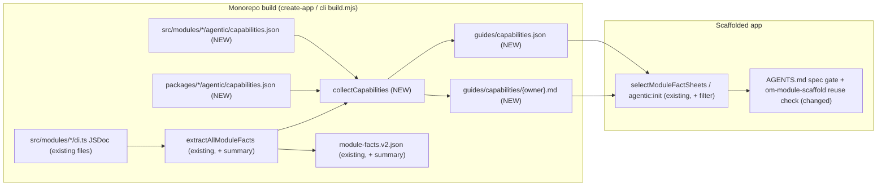

# Standalone capability discovery

> Status: **Draft (design-only spec PR).** Related: `2026-06-27-ts-morph-module-fact-sheets.md`, `2026-07-06-module-facts-auto-discovery.md`, `2026-08-02-module-facts-source-provenance-and-contract-inventory.md`, `2026-08-13-module-fact-sheet-sectioned-reading.md`, `2026-08-01-standalone-harness-knowledge-governance.md`, `2026-07-24-standalone-ai-development-harness.md`.

## 📝 TLDR

Agents in apps scaffolded with `create-mercato-app` get generated module facts that list what each module declares (entities, routes, DI tokens), but nothing says which problem a service or helper solves. As a result, an agent asked to "classify a ticket into one of N queues" writes its own OpenRouter call instead of using the planned `decisionModelService`. Proposed (future behavior): Phase 1 adds a JSDoc-derived `summary` to DI registration facts. Phase 2 adds a curated, build-validated capabilities index (`guides/capabilities.json` plus per-owner `guides/capabilities/<owner>.md`) declared by modules and packages, plus a mandatory reuse check in the standalone harness before an agent scaffolds new behavior.

## 📝 Problem Statement

The standalone harness ships Layer-2 facts produced at create-app build time (`packages/create-app/build.mjs:109` → `extractAllModuleFacts` in `packages/cli/src/lib/generators/module-facts.ts`). `ModuleFacts` (`module-facts.ts:258`) is structural by design: the fact-sheet spec limits it to "only facts extracted from source", 1:1 with `BACKWARD_COMPATIBILITY.md` surfaces.

Three gaps follow from that:

1. **DI registrations carry no meaning.** `ModuleDiRegistrationFact` (`module-facts.ts:240`) has `token`, `registrationKind`, `providerSymbol`, `lifetime`, `injectionMode`, `source`. A token name is the only hint. Only 9 of 60 module `di.ts` files contain any `/**` block today, and those are file or function headers, not per-registration docs.
2. **Code outside `src/modules/` is invisible.** `@open-mercato/shared/lib/*`, `ai-assistant/src/lib`, `ui` primitives, `queue`/`cache` helpers produce no facts. The fact-sheet spec explicitly deferred "a generated surface for non-module packages" (`2026-06-27-ts-morph-module-fact-sheets.md:198`). The only route in is `om-framework-context`, a bounded `node_modules` search that requires the agent to already know the name it is looking for.
3. **There is no index by intent.** Fact sheets are per module. An agent must guess the owning module before it can read anything.

The motivating case is PR #7464 (`.ai/specs/2026-10-06-ai-decision-model-port.md`): types in `@open-mercato/shared/lib/ai/decision-model.ts` and a `decisionModelService` in `ai-assistant`. That spec lists six candidate consumers (workflows branching, message routing, `inbox_ops`, catalog categorization, CRM lead scoring, `business_rules` AI assist). Each is equally plausible in a standalone app, and none of them would discover the port from today's facts.

## Resolved assumptions (autonomous defaults)

| # | Question | Applied default | Why | Confirm? |
|---|----------|-----------------|-----|----------|
| Q1 | Split Phase 1 and Phase 2 into separate specs? | Keep one spec with two independently shippable phases, as the brief requested. Phase 1 is not gated on Q2 and can be implemented and merged first. | Both phases serve the same consumer (the reuse check). Phase 1 needs no new contract surface; Phase 2 carries the convention decision. Splitting later is a file move. | reversible |
| Q2 | Where do capabilities get declared? | A build-time-only convention file `agentic/capabilities.json`, at module level (`src/modules/<id>/agentic/capabilities.json`) and package level (`packages/<pkg>/agentic/capabilities.json`). Not a field on `ModuleInfo`. | `index.ts` metadata is loaded into the runtime registry, so a `capabilities` field would ship intent prose in every app bundle. `packages/<pkg>/agentic/` already holds build-time agent material (`standalone-guide.md`), although those package-level guides are never shipped to apps (`packages/create-app/build.mjs:80-90`); this spec is the first to ship output derived from that directory. A new convention file becomes FROZEN under `BACKWARD_COMPATIBILITY.md` §1. | ⚠ NEEDS HUMAN CONFIRMATION |
| Q3 | Where does the Phase 1 `summary` come from? | The leading JSDoc on the registration property inside `container.register({...})` only. First sentence, whitespace-collapsed, max 200 chars. No cross-file resolution of `providerSymbol`. | The extractor uses single-file `ts.createSourceFile` without a Program (`readSourceFile`, `module-facts.ts:328-332`). The property node is in hand inside `extractDiRegistrationFacts` (`module-facts.ts:1386`, property visit at :1408). Cross-file resolution would add a type checker and break the extractor's cost model. | reversible |
| Q4 | Does `summary` appear in v1 `module-facts.json`? | No. v2 sidecar and markdown only; the v1 projection stays byte-identical. | v1 is the frozen compatibility projection (`BACKWARD_COMPATIBILITY.md` §14). `ownedContracts` is serialized without a version check (`module-facts.ts:3152`) and the v1 pass writes it, so the metadata field needs an explicit `factsContractVersion === 2` gate at `module-facts.ts:2164`. | reversible |
| Q5 | Should non-module exports be catalogued automatically? | No. Only curated entries in a package-level `capabilities.json`, each pointing at an export the build verifies. | The provenance spec lists "cataloging private helpers… or arbitrary exports" as a non-goal. A curated list supersedes the non-module deferral narrowly, without generating an export inventory. | reversible |
| Q6 | How is the reuse check enforced? | Instruction level (standalone `AGENTS.md.template` + `om-module-scaffold`), verified by a harness routing case. No lint or CI duplicate detection. | Lint/CI detection is out of scope per the brief. The harness case is the existing enforcement mechanism for standalone routing. | reversible |
| Q7 | What happens when a declared entry point does not resolve? | The build fails with the module id, capability id and missing target. | Same posture as the existing "refusing to build an empty knowledge layer" guards in `build.mjs`. A stale index would send agents to removed APIs. | reversible |
| Q8 | `om-spec-writing` is an external skill (pinned in `tiers.json`). Change it here? | No. This spec changes the root template's spec gate and the local `om-module-scaffold`. A matching step in the external `om-spec-writing` is a follow-up PR in `open-mercato/skills`. | External skills ship from their own repository. | reversible |
| Q9 | Cover third-party and app-local modules? | No. First-party `@open-mercato/*` packages built in the monorepo only. | Standalone discovery skips `.js`-only installs (`module-facts-discovery.ts`, `hasReadableModuleSource`). App-local and third-party coverage needs `agentic:init` extraction, which is a separate design. | reversible |

## 📝 Proposed Solution

### Phase 1: DI registration summaries

`extractDiRegistrationFacts` reads the leading JSDoc of each registration property (`ts.getJSDocCommentsAndTags` or the leading comment ranges of the property node) and stores the first sentence as `summary?: string` on `ModuleDiRegistrationFact`. The rendered surfaces do not read that type directly: the rich table (`renderDiRegistrationsSection`, `module-facts.ts:2607`) renders `ownedContracts['di-registration'][].metadata`, built at `module-facts.ts:2164-2176`. So the summary is copied into `metadata.summary` there, only when `factsContractVersion === 2`. The table gains a `Summary` column, omitted when no registration in a module has a summary, so existing sheets keep their bytes. Pipe escaping in table cells is new work: `renderSafeScalar` (`module-facts.ts:2582`) does not escape `|` today.

```ts
export function register(container: AppContainer) {
  container.register({
    /** Routes a typed decision request to the configured decision model adapter; never throws. */
    decisionModelService: asFunction(createDecisionModelService).singleton(),
  })
}
```

An authoring pass adds JSDoc to the registrations that cross module boundaries most often. The pass is scoped to tokens that other modules or the standalone guides already reference, not to every `di.ts`.

### Phase 2: declared capabilities

A module or package declares what problems it solves in `agentic/capabilities.json`:

```json
{
  "capabilities": [
    {
      "id": "ai.decision-model",
      "title": "Typed decision with calibrated probabilities",
      "solves": [
        "classify an input into one of N options",
        "score or rank options with probabilities",
        "yes/no decision with a confidence threshold"
      ],
      "entryPoints": [
        { "kind": "di", "token": "decisionModelService" },
        { "kind": "import", "specifier": "@open-mercato/shared/lib/ai/decision-model", "symbols": ["DecisionRequest", "DecisionResult"] }
      ],
      "usage": "soft-optional",
      "stability": "experimental",
      "seeAlso": ["https://github.com/open-mercato/open-mercato/blob/develop/.ai/specs/2026-10-06-ai-decision-model-port.md"]
    }
  ]
}
```

The create-app build (and the `packages/cli/build.mjs` mirror) collects every file, validates it, resolves every entry point against facts it already extracted, and emits next to `module-facts.v2.json`:

- `guides/capabilities.json`: the machine index, entries sorted by `id`, each with its owner (`module` or `package`) and source path.
- `guides/capabilities/<owner>.md`: one file per owning module or package, one block per capability with its `solves` phrases and entry points. Per-owner files keep each read small and let scaffolding select them the same way it selects `modules/<id>/` directories.

Scaffolding (`selectModuleFactSheets` in `packages/create-app/src/setup/tools/shared.ts` and its mirror in `packages/cli/src/lib/agentic-setup.ts`) copies only the per-owner files for enabled modules and for packages the app depends on, and writes a filtered `capabilities.json` by dropping entries whose owner is not selected. That filter is a plain JSON operation in each setup file, because create-app has `@open-mercato/cli` only as a devDependency and cannot import the cli renderer at scaffold time. The ownership-manifest hashes cover the filtered files as written into the app.

### Alternatives considered

| Alternative | Why it lost |
|---|---|
| `capabilities` field on `ModuleInfo` in `index.ts` | Allowed by `BACKWARD_COMPATIBILITY.md` §2, but the metadata object is part of the runtime registry, so intent prose would ship in every app bundle. Package-level declarations would still need a second mechanism. |
| A typed `agentic/capabilities.ts` with a `defineCapabilities` helper from `shared` | Adds a public type and helper to `shared` for build-time-only data. The extractor reads literals statically anyway, and the zod schema in the collector validates JSON at build time. |
| Generate intent from JSDoc alone (Phase 1 only) | Covers DI tokens but not import-path helpers, extension spots or workflow definitions, and gives no cross-module index. |
| Embedding/semantic search over `node_modules` at agent time | Non-deterministic, needs a provider, and contradicts the facts-first, offline routing of the standalone harness. |

## 📝 Architecture



The extractor stays the single source of resolved facts; the capability collector consumes them to validate entry points and never parses module code itself.

**Owning code**

- `packages/cli/src/lib/generators/module-facts.ts`: `summary` extraction and rendering (Phase 1).
- `packages/cli/src/lib/generators/capabilities.ts` (new): discovery, zod validation, entry-point resolution, deterministic rendering (Phase 2).
- `packages/create-app/build.mjs` and `packages/cli/build.mjs`: call the collector after fact extraction.
- `packages/create-app/src/setup/tools/shared.ts` and `packages/cli/src/lib/agentic-setup.ts`: select `guides/capabilities/<owner>.md`, filter and write `capabilities.json`, and add both to the copy allowlists and ownership manifests (`agentic-setup.ts:474-483`, `shared.ts:229-237`). The existing top-level `guides/*.md` rule does not apply because the per-owner files live in a subdirectory.
- `packages/create-app/agentic/shared/AGENTS.md.template` and `packages/create-app/agentic/shared/ai/skills/om-module-scaffold/SKILL.md`: the reuse check.

**Discovery.** Module-level files are found next to each module root already returned by `discoverPackageModuleSources`. Package-level files are found at `<pkg.path>/agentic/capabilities.json` for each package from `resolver.discoverPackages()`, the same resolver call `discoverPackageModuleSources` uses, so no `packages/*` path is hard-coded (`.ai/lessons/standalone-scaffolding-and-generators-must-not-assume.md`).

**Entry-point resolution** (all against data the build already holds):

| `kind` | Resolves when |
|---|---|
| `di` | `token` appears in the owning module's `diRegistrations`, or, for package-level entries, in any module of the same package. |
| `import` | `specifier` matches an `exports` entry of the package named in the specifier (not the owning package), using the `types` condition (first entry when it is an array) with `*` wildcard substitution. Each listed symbol must be exported by the resolved `.ts` source: a local exported declaration, a named re-export, or reached through `export * from` re-exports followed for at most 3 hops. A specifier that only resolves to `dist` output fails. |
| `spot` | The id exists in the extension-surface hosts collected by `module-extension-facts.ts`. |
| `workflow` | The definition id appears in a module's extracted `workflowsConfig.workflows[].workflowId` (`module-extension-facts.ts:1563-1572`). Step and activity types are registered at runtime (`registerActivityType`) and are not facts, so they are not a valid entry-point kind. |
| `ai-tool` / `ai-agent` | The name appears in the owning module's `aiTools` / `aiAgents` facts. |

## 📝 Data Model

No database changes. Two contracts change:

- `ModuleDiRegistrationFact` gains `summary?: string` (v2 only).
- New `CapabilityDeclaration` schema (zod, in `packages/cli/src/lib/generators/capabilities.ts`):

| Field | Rule |
|---|---|
| `id` | `^[a-z0-9]+(?:[.-][a-z0-9]+)*$`, 3–80 chars, unique across all owners; reusing the harness capability-id pattern (`cases.schema.json`). |
| `title` | 1–80 chars. |
| `solves` | 1–6 phrases, each 3–120 chars, written as a task ("classify an input into one of N options"). |
| `entryPoints` | 1–4 entries of the kinds above. |
| `usage` | `required-dependency` or `soft-optional` (resolve in try/catch, per `core` → Cross-Module Coupling). |
| `stability` | `stable`, `experimental` or `deprecated`; `deprecated` requires `replacedBy` (a capability id). |
| `seeAlso` | optional; either an `https://github.com/open-mercato/` URL or a path inside the staged `agentic/` tree that ships to apps. Monorepo-only paths (`.ai/specs/…`) are rejected because they are dead links in a scaffolded app. |

Emitted `capabilities.json` entries add `owner: { kind: 'module' | 'package', id, package }` and `source` (portable path). Output is sorted, uses stable key order, and contains no timestamps.

## 📝 API Contracts

No HTTP or CLI surface. Contracts are the convention file, the two emitted artifacts and the v2 field:

| Surface | `BACKWARD_COMPATIBILITY.md` category | Classification |
|---|---|---|
| `agentic/capabilities.json` convention file (module and package level) | §1 Auto-Discovery File Conventions | FROZEN once released; new optional fields only. |
| `guides/capabilities.json` / `guides/capabilities/<owner>.md` | §14 Generated File Contracts | STABLE; additive fields only, ids never renamed (deprecate with `replacedBy`). |
| `summary` in `module-facts.v2.json` | §14 | Additive optional field; v1 unchanged. |

The surface ships marked experimental in the release notes for one minor so the schema can still tighten before it freezes.

## 📝 UI/UX

The consumer is a coding agent in a standalone app, not an end user. The changed agent flow:

1. A work request reaches the root `AGENTS.md` spec gate (`AGENTS.md.template:94`).
2. Before `spec-first` or `om-module-scaffold`, the agent searches `guides/capabilities.json` (or greps `guides/capabilities/`) for the task's verb phrase, then reads the one matching owner file.
3. On a match it either uses the entry point (decision `reuse-installed`) or records in the plan why the capability does not fit. Building a parallel implementation without that line fails the harness case.

The root template change is one clause (target ≤160 bytes) on the spec-gate line. The raw `AGENTS.md.template` is 11,112 bytes, but the gate (`STANDALONE_ROOT_TARGET_BYTES`, `packages/create-app/src/setup/tools/shared.ts:74`) measures the generated root, which also carries the injected module-guides index, so real headroom is measured on a generated root before the edit. `om-module-scaffold` gets the detailed step 0 (search, decide, record) in its `SKILL.md`.

## 📝 Edge Cases & Failure Scenarios

| Scenario | Behavior |
|---|---|
| Declared DI token renamed or removed | Build fails naming the capability and token; the author updates the declaration or marks it `deprecated` with `replacedBy`. |
| Two owners declare the same `id` | Build fails listing both sources. |
| Capability owned by a module the app disables | Filtered out at scaffold time; the agent never sees it. |
| Package-level capability whose package is not a dependency of the app | Filtered out at scaffold time. |
| Capability is `soft-optional` and its provider package is absent at runtime | Out of scope for the index; the `usage` hint tells the agent to resolve in try/catch, matching existing coupling rules. |
| JSDoc contains markdown, links or multi-line prose | First sentence only, whitespace collapsed, pipe characters escaped for the table, truncated at 200 chars with `…`. |
| Registration value is a spread or computed key | No summary; current token behavior unchanged. |
| An owner file grows past the 32 KB section threshold | Sectioned-reading rules apply (`###` sub-anchors, contents index). A byte-budget assertion in the generator test fails above an explicit per-file cap. |
| An agent matches a capability that does not fit the task | Allowed; the reuse check requires a recorded reason, not reuse. |

## 📝 Risks & Impact Review

| Risk | Severity | Affected area | Mitigation | Residual |
|---|---|---|---|---|
| `agentic/capabilities.json` becomes a FROZEN convention (Q2); third-party authors may adopt it before app-local extraction exists (Q9). | High | `BACKWARD_COMPATIBILITY.md` §1, module authors | Ship marked experimental for one minor; merge gated on confirming Q2. | Medium: the file name and location cannot change after the experimental window. |
| Supersedes two earlier non-goals: the fact-sheet spec deferred non-module package surfaces and excluded prose. | Medium | Facts governance | Intent phrases are author-written, not generated; non-module entries are curated and resolved, never an export inventory. Both earlier specs get a changelog line pointing here. | Low |
| Edits to emitted guides, root template, `om-module-scaffold` and rendering fall under the `knowledge-contract` class (`2026-08-01-standalone-harness-knowledge-governance.md`). | Medium | Standalone harness release | Each phase runs that spec's full workflow (owner inventory, source-link inventory, fail-before evaluator test, case/matrix/count sync, packed-scaffold check, `harness:validate-knowledge-change`). | Low |
| Intent phrases drift from behavior; resolution only catches removed entry points. | Medium | Agent routing quality | Owners update declarations in the same PR as behavior changes; `om-code-review` checklist line. | Medium: semantic drift is caught by review, not by the build. |
| Root template byte budget (under 1.1 KB headroom on the raw template, less on the generated root). | Low | Standalone root instructions | Clause capped at 160 bytes; detail lives in `om-module-scaffold`; existing budget gate measures it. | Low |
| Build fails on an unresolved entry point after an unrelated refactor. | Low | Monorepo build | Error names capability, owner and target; fix is a one-line declaration edit or `deprecated` + `replacedBy`. | Low |

**Rollback.** Phase 1 is reverted by dropping the field; v1 never carried it. Phase 2 before release is reverted by removing the collector. After release, emission can stop while the convention file stays valid and ignored.

## 📋 Phasing

- **Phase 1: DI summaries.** `summary` in v2 facts and markdown, JSDoc backfill for cross-module tokens. Ships alone; agents see meaning for DI tokens.
- **Phase 2: capabilities index and reuse check.** Convention file, collector, emitted artifacts, scaffold filtering, template and skill change, harness case, seed inventory. Does not depend on Phase 1.

## 📋 Implementation Plan

### Phase 1: DI registration summaries

1. Extend `ModuleDiRegistrationFact` with `summary?: string`; read the leading JSDoc of the registration property in `extractDiRegistrationFacts`; normalize (first sentence, collapse whitespace, 200-char cap). Copy it into `ownedContracts['di-registration'][].metadata.summary` at `module-facts.ts:2164` only when `factsContractVersion === 2`. *Test:* unit tests for JSDoc present, absent, multi-line, markdown, spread/computed keys; a new test asserting `renderModuleFactsJson(legacyFactsByModule)` contains no `summary` key; existing byte budgets in `module-facts.bc-guard.test.ts` stay green.
2. Add the `Summary` column to `renderDiRegistrationsSection`, omitted when no row has one; escape `|` in the cell. *Test:* snapshot of a fixture module with and without summaries; byte-identity for modules without JSDoc; a pipe-containing summary renders as one cell.
3. Backfill JSDoc on a fixed, committed token list (in the generator test) of registrations used outside their owning module, found through `resolve`, `tryResolve` and cradle destructuring, plus tokens named in standalone guides. *Test:* generator test asserts every listed token carries a summary; `yarn build:packages` + create-app build produce updated sheets.
4. Run the knowledge-governance workflow for the rendering change (owner inventory row, release-matrix sync if counts change). *Test:* `harness:validate-knowledge-change` manifest passes.

### Phase 2: capabilities index

1. Add `capabilities.ts` with the zod schema, discovery of module-level and package-level `agentic/capabilities.json` as described under Discovery, and deterministic JSON/markdown rendering. *Test:* schema accept/reject matrix; determinism (two runs byte-identical); duplicate-id failure.
2. Implement entry-point resolution for `di`, `import`, `spot`, `workflow`, `ai-tool`, `ai-agent` against extracted facts and package `exports`. *Test:* one passing and one failing fixture per kind, with the error naming capability, owner and target; `import` fixtures for a wildcard export, an array `types` condition, a dist-only `"."` entry (fails), a named re-export and a two-hop `export *` barrel.
3. Wire the collector into `packages/create-app/build.mjs` and `packages/cli/build.mjs` after fact extraction; emit into the staged `guides/`. *Test:* build test asserts the JSON and per-owner files exist and that an empty inventory emits a valid empty index; per-file byte-budget assertion.
4. Select owner files and filter `capabilities.json` in `create-app/src/setup/tools/shared.ts` and `cli/src/lib/agentic-setup.ts`; add both to the copy lists and ownership manifests. *Test:* scaffold test with a preset that disables a capability-owning module shows its owner file and JSON entries removed and manifest hashes matching the written files; `agentic:init` parity test.
5. Seed the inventory with a small curated set (target ≤15) whose entry points already exist: queue worker contract, cache service, event bus and DOM event bridge, search, notifications, progress jobs, workflows code definitions, AI tools/agents, integrations/data_sync adapters, encryption query helpers, optimistic-lock helpers, *Test:* the build resolves every entry. The decision-model port entry is added in the PR that implements #7464's spec, not in this seed.
6. Add the reuse-check clause to `AGENTS.md.template` (≤160 bytes) and step 0 to `om-module-scaffold/SKILL.md`; mirror via `yarn template:sync:fix` where applicable. *Test:* `yarn agents:check-budget` and the standalone root-byte gate.
7. Widen the case id pattern in `cases.schema.json:18` (it stops at `OMH-239`, which is taken), then add a routing case `OMH-240` from `om-evolve-harness/references/case-template.md`: a "classify incoming messages into queues" request in a fresh app must read `guides/capabilities.json` or the matching owner file, require decision `reuse-installed`, and forbid a direct vendor `fetch`. Update the case counts in README, RELEASE and `release-matrix.json`. *Test:* the case fails before step 6 and passes after (fail-before evaluator rule), plus related and safety cases.
8. Add an `om-code-review` checklist line in `.ai/review-checklist.md` (standalone and monorepo copies): behavior changes to a declared capability update its declaration. Add changelog lines to the fact-sheet and provenance specs noting the superseded deferral. This step is documentation only and has no automated test; it ships inside the step 6 PR so review covers it.

Integration tests: none (no HTTP or UI surface). Coverage is generator unit tests, build/scaffold tests and the harness routing case.

**Follow-ups (out of scope):** lint/CI duplicate detection in apps; an "upstream this" suggestion flow from `om-evolve-harness`; app-local and third-party capabilities via `agentic:init`; matching reuse step in the external `om-spec-writing` skill.

## Final Compliance Report

| Rule source | Check | Status |
|---|---|---|
| `BACKWARD_COMPATIBILITY.md` §1, §2, §14 | New convention file is additive; `ModuleInfo` untouched; v1 facts byte-identical; new generated artifacts additive. | Compliant; Q2 gated for confirmation |
| `packages/cli/AGENTS.md` Ask First (auto-discovery conventions, generated file locations) | Convention and output locations are proposed in this spec for maintainer approval before implementation. | Pending approval (Q2) |
| `packages/cli/AGENTS.md` Always (deterministic generator output; keep `agentic-setup.ts` and `build.mjs` in sync) | Sorted output, no timestamps, determinism test; both build mirrors and both copy paths changed together (Phase 2 steps 3–4). | Compliant |
| `2026-08-01-standalone-harness-knowledge-governance.md` | `knowledge-contract` workflow listed per phase. | Compliant |
| `2026-07-24-standalone-ai-development-harness.md` (root ≤12 KiB, facts-first, fail-before cases) | 160-byte clause cap; capabilities index is a fact artifact; new routing case fails before the change. | Compliant |
| Root `AGENTS.md` (no direct cross-module coupling; soft-optional resolve) | Index only points at existing entry points and carries the `usage` hint; no runtime coupling added. | Compliant |
| `.ai/specs/AGENTS.md` (integration coverage) | No HTTP or UI path; generator, build, scaffold and harness tests listed per step. | Compliant |

## Changelog

- 2026-10-20: Initial draft (autonomous run, design-only).
- 2026-10-20: Applied fresh-context review: DI summary routed through `ownedContracts` metadata with a v2 gate; `workflow-step` replaced by `workflow`; `import` resolution defined against the specifier's package with wildcard, `types` and re-export rules; per-owner capability files for scaffold filtering; package discovery through `resolver.discoverPackages()`; shipped-only `seeAlso`; harness id-pattern widening; reference corrections.
