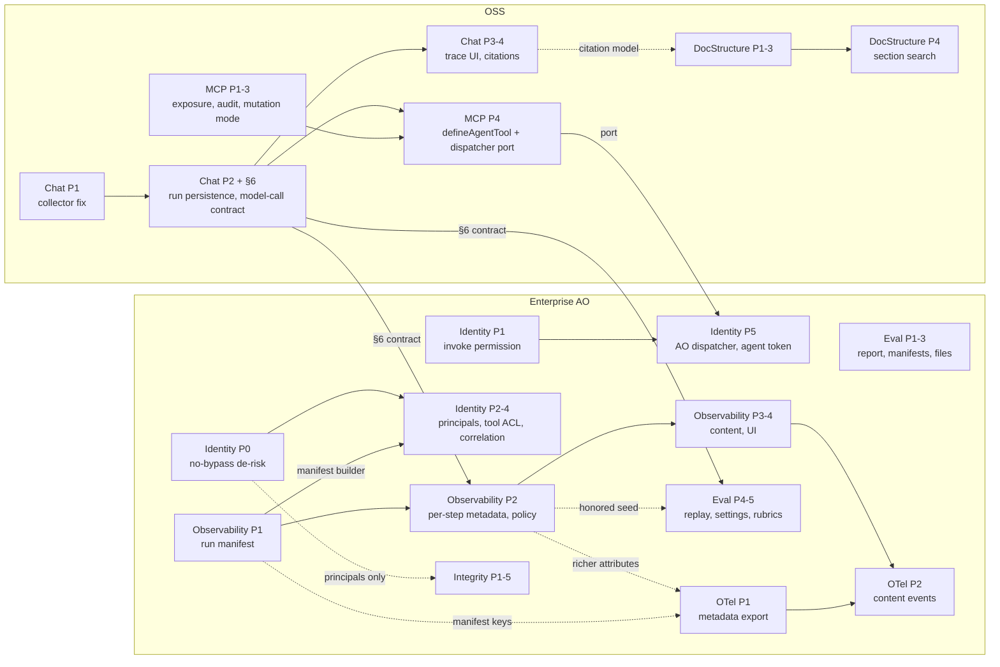

# Agent Platform Capabilities — Roadmap (umbrella)

> **Status:** Draft · **Date:** 2026-10-21 · **Type:** umbrella / roadmap (no code of its own)
> **Covers:** eight specs written on 2026-10-21: three OSS specs in `.ai/specs/` and five enterprise Agent Orchestrator (AO) specs in `.ai/specs/enterprise/agent-orchestrator/`. Enterprise content is limited to one-line summaries and paths here.

## TLDR

- Building one agent core that is reachable through a chat copilot, a headless API and a single MCP tool exposes eight generic platform gaps around agents: what an MCP server exposes and audits, who may invoke an agent and as whom it acts, whether chat runs leave a record, what a trace actually contains, whether structured output can be trusted, whether evals are portable and reproducible, whether traces can leave for an OpenTelemetry backend, and whether long documents can be read by section.
- Each gap has its own spec. This document lists them, orders them, records the **shared decisions** they must agree on (AO migration policy, one agent-dispatch seam, one model-call settings contract, one correlation vocabulary, capture levels), consolidates every open question with its assumed default, and lists the platform bugs and security findings found while writing them, each with an owning spec.
- Critical path for a governed, auditable agent: MCP exposure + audit, per-agent invoke permission, eval reports, run manifest + per-step metadata, document structure extraction, and either the integrity pipeline or a hand-written verifier.

## Motivation

A typical governed agent, one agent core that validates content against a rule set, must be reachable three ways (a chat copilot, a headless API and a single MCP tool) with identical permissions, audit and traces, verifiable evidence (exact quotes, real rule ids, "not applicable" and "needs review" outcomes), a portable regression report, full prompt-level observability, and optional OTLP export. Most of the platform already exists, but each requirement exposes a generic gap that every agent built on Open Mercato has. The specs below fix those gaps generically; domain modules (rule stores, ingestion jobs, validator agents) are application-specific and not specified here.

## The eight specs

| # | Spec | Scope | Package / module | One-line summary | Phases | Depends on |
|---|---|---|---|---|---|---|
| 1 | [`2026-10-21-mcp-tool-exposure-parity-and-audit.md`](2026-10-21-mcp-tool-exposure-parity-and-audit.md) | OSS | `ai-assistant` (`ai_assistant`), `core` `audit_logs` (env only) | Exposure allowlist + RBAC-filtered `tools/list`, MCP mutation mode (`direct` / `deny` / `approval` with a Pending AI actions page), agent-as-one-MCP-tool (`defineAgentTool`), **owner of the `aiAgentRunDispatcher` port**, `access_logs` audit per call | 1 exposure · 2 audit · 3 mutation mode + approval · 4 agent tool + dispatcher port · 5 AO dispatcher (via #4) | #2 (`runId`, `AiAgentRunChannel`, §6 contract) for Phase 4; #4 Phase 5 for AO agents |
| 2 | [`2026-10-21-chat-run-tracing-and-citations.md`](2026-10-21-chat-run-tracing-and-citations.md) | OSS | `ai-assistant`, `ui` (`src/ai`) | Fix AI SDK 7 step extraction, persist chat/object runs in OSS tables, run trace UI, citations UI part + shared resolver registry, **owner of the model-call contract (§6)** | 1 collector fix · 2 persistence + §6 · 3 trace UI · 4 citations | none |
| 3 | [`2026-10-21-document-structure-extraction.md`](2026-10-21-document-structure-extraction.md) | OSS | `core` `attachments` | Deterministic section tree with stable locators/anchors/offsets per attachment, API, read-only AI tool, opt-in per-section search | 1 engines · 2 persistence/API · 3 AI tool + UI · 4 section search | none (optional citation emission uses #2) |
| 4 | [`enterprise/agent-orchestrator/2026-10-21-agent-invocation-access-and-identity-binding.md`](enterprise/agent-orchestrator/2026-10-21-agent-invocation-access-and-identity-binding.md) | Enterprise | `agent_orchestrator` (+ `shared` types, `audit_logs` index) | Per-agent invoke permission at one choke point, declarative principals + universal `runAs`, least-privilege tool ACL, run correlation on action logs, AO implementation of the dispatcher | 0 no-bypass de-risk · 1 invoke permission · 2 principals · 3 tool ACL · 4 correlation · 5 doors (dispatcher, agent token) | Phase 4 manifest keys: #6 Phase 1 builder (either creates it); Phase 5: #1 port |
| 5 | [`enterprise/agent-orchestrator/2026-10-21-output-integrity-guardrails.md`](enterprise/agent-orchestrator/2026-10-21-output-integrity-guardrails.md) | Enterprise | `agent_orchestrator` (+ `shared` resolver type) | Declarative `evidence_quote`, `reference_exists`, `tool_consulted`, `abstain_or_review`, `custom` rules and untrusted-input screening, run before disposition | 1 pipeline + quotes · 2 refs/consulted/custom · 3 abstain/review · 4 untrusted inputs · 5 surfaces + OpenCode | #4 Phase 0 (only for agents with principals); artifact route of #6 for `raw_output` (route already exists) |
| 6 | [`enterprise/agent-orchestrator/2026-10-21-agent-run-observability-full-fidelity.md`](enterprise/agent-orchestrator/2026-10-21-agent-run-observability-full-fidelity.md) | Enterprise | `agent_orchestrator` (+ `ai-assistant` hook, `shared` collector) | Run manifest (versions, identity), per-step params/usage/cost, opt-in encrypted full content capture, Request/Response/diff UI | 0 spikes · 1 manifest · 2 per-step metadata + policy · 3 content · 4 UI/OpenCode/ingest | #2 §6 contract (either lands it); #4 for identity fields (falls back to `ctx.userId`) |
| 7 | [`enterprise/agent-orchestrator/2026-10-21-otel-genai-trace-export.md`](enterprise/agent-orchestrator/2026-10-21-otel-genai-trace-export.md) | Enterprise | `agent_orchestrator` | Opt-in, fail-open replay exporter of persisted AO traces to OTLP/HTTP JSON with GenAI conventions | 1 metadata replay export · 2 content events + protobuf · 3 live streaming (candidate split) | Phase 1: none hard; richer with #6 Phase 1–2. Phase 2: #6 Phase 3 |
| 8 | [`enterprise/agent-orchestrator/2026-10-21-eval-reports-and-reproducible-regression.md`](enterprise/agent-orchestrator/2026-10-21-eval-reports-and-reproducible-regression.md) | Enterprise | `agent_orchestrator` (+ `ai-assistant` tool-replay seam) | Portable eval reports (JSON/MD/JUnit), frozen content-hashed datasets, file eval sets, tool/model record-replay, rubric library, CI recipe | 1 report + judge fix · 2 manifests · 3 file sets · 4 replay + settings · 5 rubrics + CI | Phase 4: #2 §6 (`callSettings` / `modelSettings`); `honored` reporting: #6 Phase 2 |

## Dependency graph

Notes on the edges:
- `CH2 → OB2 / EV45 / MCP4` means "the §6 model-call contract and `AiAgentRunChannel` must exist"; whichever spec ships first implements them exactly as §6 specifies, so the arrows are about the contract, not about who writes it.
- `OB1 → ID24` is the shared `lib/trace/runManifest.ts` builder; either spec may create it.
- `ID0` is a hard prerequisite for anything that binds `runAs` (identity Phases 2–5) and for integrity only on agents that have principals.

## Recommended delivery order

| Wave | Items | Critical path? | Why here |
|---|---|---|---|
| 1 | MCP P1–P3; Chat P1; Identity P0 → P1; DocStructure P1–P2 | **Yes** (MCP single-tool exposure + audit, invoke permission, long-document ingestion by section) | Independent, small to medium, unblock everything else; P0 de-risks the identity work before any `runAs` binding |
| 2 | Chat P2 incl. §6 contract; Observability P0–P1; Eval P1–P2 | **Yes** (eval report and frozen dataset are core requirements; manifest answers "which prompt/rules version, who ran it") | Lands the shared contracts (§6, manifest builder) early so later work reuses them |
| 3 | Integrity P1–P2 (or an app-local verifier); DocStructure P3; MCP P4 + Identity P5 (dispatcher) | **Yes** for integrity *or* its hand-written substitute; dispatcher makes "one agent core, three doors" real for AO agents | Needs waves 1–2 |
| 4 | Observability P2; OTel P1 | Strongly recommended (when full prompts as sent are required, also Observability P3) / stretch | OTel Phase 1 is demonstrable on today's spans but far better after Observability P2 |
| 5 | Observability P3–P4; Chat P3–P4; Integrity P3–P5; Identity P2–P4; Eval P3–P5 | Partly (chat citations are part of the copilot story; P3 content capture if prompts must be shown) | Depth and parity |
| 6 | OTel P2 (and P3 as its own spec); DocStructure P4 | No | Unblocked 2026-10-22 (OTEL-Q2, DOC-Q3 approved) |

Decisions of 2026-10-22 that shape this order:
- **ID-Q3:** permanent delegation. Identity P1 and P5 ship in the same release as MCP P4, so `run-object` never runs an AO agent outside `agentRuntime.run()` in a released build.
- **MCP-Q1/Q2:** MCP P3 now includes the `approval` mode. It adds a stacked `ai_assistant` migration (`ai_pending_actions` columns) and a backend page, so MCP P3 grows from small to medium. Its migration should be ordered after Chat P2's migration, or the two should be merged in one PR, to keep one migration chain in `ai_assistant`.
- **EVAL-Q2:** YAML is part of Eval P3.

## Shared decisions

### 1. AO migration policy (all five AO specs state the same rule)

AO migrations are squash-only: `packages/enterprise/src/modules/agent_orchestrator/__tests__/helpers/squashMigration.ts` requires exactly one `Migration<ts>_agent_orchestrator.ts`, and a re-squash forces existing databases to drop and re-initialise the module's tables (`migrations/adopt-squash.mjs` targets the previous squash and is stale). Therefore:

- **No AO DDL** in any of these specs until the next planned re-squash.
- Run-level facts → the `run.manifest` system span (`agent_spans.attributes`, observability spec, builder `lib/trace/runManifest.ts`).
- Content → the encrypted artifact offload (`lib/trace/artifactStore.ts`, tenant DEK, `storage-s3`).
- Everything else → existing jsonb columns (`agent_eval_suite_runs.summary`, guardrail check `evidence`, `agent_context_bundles.payload_ref`, `agent_runs.agent_version`).
- OSS modules use their normal stacked migrations: `ai_assistant` (three run tables from chat; three `ai_pending_actions` columns + one index from MCP approval mode), `attachments` (two tables + two partition columns), `audit_logs` (one partial expression index on `action_logs`).

**Consolidated next-re-squash list** (promote with a one-off backfill from the manifest / summary):

| Item | Today's home | Source spec |
|---|---|---|
| `agent_runs.invoker_user_id`, `agent_runs.api_key_id` | manifest `om.invoker` | observability |
| `agent_runs.definition_hash`, `agent_runs.capture_level` | manifest `om.agent.definition_hash`, `om.capture` | observability |
| `agent_runs.entry_point`, `agent_runs.correlation_id` | manifest `om.entry_point`, `om.correlation_id` | identity, MCP |
| `agent_runs.raw_output_key` | check-row evidence `rawOutput.key`, manifest `om.integrity.raw_output_key` | integrity |
| table `agent_trace_exports` (export ledger) | logs + `reportError` | OTel |
| table `agent_eval_set_snapshots` | `agent_eval_suite_runs.summary.__evalSet` | eval |

### 2. One agent-dispatch seam

- **Port:** `AiAgentRunDispatcher` (`owns`, `isAvailable`, `runObject`), DI key `aiAgentRunDispatcher`, declared in OSS `@open-mercato/ai-assistant` — canonical definition in the MCP spec §4 "Agent run dispatcher".
- **Implementer:** AO, `lib/runtime/aiAgentRunDispatcher.ts` over `agentRuntime.run` — specified in the identity spec (Phase 5).
- **Callers (all of them):** MCP agent tools, `/tools/execute` agent tools, chat tools built with `defineAgentTool`, `POST /api/ai_assistant/ai/run-object`, the object branch of chat.
- **One helper** to expose an agent as a tool: `defineAgentTool` (OSS). The earlier names `defineOrchestratorAgentTool`, `defineAgentInvocationTool`, `AiAgentToolRunner` and per-module runner DI keys are dropped.
- `via: 'route' | 'tool'` maps to AO `entryPoint` `ai_assistant` / `tool`.

### 3. One model-call settings contract

Canonical in the chat-tracing spec §6 (OSS code); observability and eval consume it.

| Concept | Name |
|---|---|
| Settings type | `AiAgentCallSettings` (`temperature`, `topP`, `topK`, `maxOutputTokens`, `seed`, `stopSequences`, `presencePenalty`, `frequencyPenalty`, `providerOptions`) |
| Declared on an agent | `modelSettings` (`defineAiAgent`; AO `defineAgent` forwards it) |
| Passed at call time | `callSettings` (`runAiAgentText/Object`, `AgentRunCtx.callSettings`, dispatcher input, `run-object` body, eval override) — precedence `callSettings` > `modelSettings` > provider default |
| Observer | `observe?: AiAgentCallObserver` with `onPromptResolved`, `onModelCallStart` (reports `callSettings` as sent), `onModelCallEnd`; adapted from AI SDK `onLanguageModelCallStart/End`; owned by ai-assistant |
| Persist flag | `trace?: { persist?, channel?, correlationId? }`; AO passes `trace: { persist: false }` |
| Recorded as | `gen_ai.request.*` keys (OSS `model_params`, AO LLM span attributes, OTel export) |

### 4. Correlation vocabulary

| Key | Meaning | Written to |
|---|---|---|
| `correlationId` | One inbound request at a door (`x-correlation-id` header, else generated UUID, ≤ 128 chars) | `access_logs.context_json` (MCP), `ai_agent_runs.correlation_id`, AO manifest `om.correlation_id`, `action_logs.context_json.correlation.correlationId` |
| `aiAgentRunId` | `ai_agent_runs.id` (OSS run; called `runId` inside ai-assistant APIs) | access log context, chat message `metadata.runId`, `loop-finish` |
| `agentRunId` | The dispatcher's run id (`agent_runs.id` in AO) | access log context, `run-object` response for dispatched runs, `action_logs` correlation |
| `parentAgentRunId`, `proposalId`, `workflowInstanceId`, `processInstanceId`, `apiKeyId`, `grantId` | AO correlation keys | `action_logs.context_json.correlation` (identity §D) |
| `channel` | ai-assistant door: `chat \| playground \| run-object \| mcp \| tools-api \| internal` (MCP audit adds `mcpServer: http \| dev \| stdio`) | `ai_agent_runs.channel`, access log, AO manifest `om.channel` |
| `entryPoint` | AO door: `run_api \| rerun \| delegate \| workflow \| eval \| ai_assistant \| tool \| agent_api` | AO manifest `om.entry_point` only (no column) |
| `invoker` | AO: `user \| api_key \| workflow \| agent_token` (+ manifest-only `integration` for ingested runs) | AO manifest `om.invoker` |

Correction carried by all specs: `agent_runs` has **no** caller column today (earlier notes assumed it records the caller; it does not). Identity is recorded in the manifest.

### 5. Capture levels

| | OSS chat/object runs (chat spec) | AO runs (observability spec) |
|---|---|---|
| Levels | `off \| metadata \| full` | `off \| metadata \| full` |
| Default | `full` | `metadata` |
| `full` stores | input/output text, step text, tool args/results; **not** the system prompt (opt-in `OM_AI_RUN_TRACE_CAPTURE_PROMPT`) | complete provider request (system prompt, messages, tool schemas, response format, settings) and response, context payload |
| Where / cap | encrypted columns, 16 KB per payload | encrypted `storage-s3` artifacts, 1 MiB per artifact |
| Retention | 30 days (`AI_AGENT_RUNS_RETENTION_DAYS`) | 30 days (`contentRetentionDays`) |
| Read permission | `ai_assistant.runs.view` / `.view_all` | `agent_orchestrator.trace.view_content` |

The divergence is deliberate and stated in both specs: chat turns are short conversational text already persisted as messages; AO runs carry business records and composed prompts. Runs handed from ai-assistant to AO through the dispatcher follow the AO policy only (no OSS row).

### 6. New contract names (uniqueness check)

- **ACL features:** `ai_assistant.runs.view`, `ai_assistant.runs.view_all` (chat); `ai_assistant.pending_actions.approve` (MCP approval mode); `agent_orchestrator.trace.view_content` (observability; reused by OTel). No other spec adds features.
- **Events:** `ai_assistant.agent_run.completed` (chat), `agent_orchestrator.run.review_requested` (integrity). OTel consumes existing `agent_orchestrator.run.completed` / `run.ingested`.
- **Notification types:** `ai_assistant.pending_action.awaiting_approval` (MCP approval mode).
- **AI tools:** `ai_assistant.get_pending_action` (MCP approval mode).
- **DI keys:** `aiAgentRunDispatcher` (MCP port / AO impl), `aiAgentRunReader` (chat), `attachmentDocumentStructureService`, `attachmentDocumentStructureEngines` (doc), `agentReferenceResolver:<id>` (integrity).
- **Commands:** `agent_orchestrator.traceCapturePolicy.update`, `agent_orchestrator.otelExportSettings.update`, `agent_orchestrator.evalSets.import` (AO camelCase convention, e.g. `evalRuns.start`).
- **Env vars:** MCP `OM_MCP_TOOL_ALLOWLIST`, `OM_MCP_TOOL_DENYLIST`, `OM_MCP_MUTATION_MODE`, `OM_MCP_PENDING_ACTION_TTL_SECONDS`, `OM_MCP_AGENT_TOOLS`, `AUDIT_LOGS_CORE_RESOURCE_KINDS_EXTRA`; chat `OM_AI_RUN_TRACE_CAPTURE`, `OM_AI_RUN_TRACE_CAPTURE_PROMPT`, `OM_AI_RUN_TRACE_MAX_PAYLOAD_BYTES`, `AI_AGENT_RUNS_RETENTION_DAYS`; identity `OM_AGENT_TOOL_ACL_MODE`, `OM_AGENT_INVOKE_ENFORCEMENT`, `OM_AGENT_API_ENABLED`; observability `OM_AGENT_TRACE_CONTENT_DEFAULT`, `OM_AGENT_TRACE_CONTENT_MAX`, `OM_AGENT_TRACE_CONTENT_MAX_BYTES`; integrity `OM_AGENT_INTEGRITY`; OTel `OM_AGENT_OTEL_EXPORT`, `OM_AGENT_OTEL_EXPORT_ENDPOINT`, `OM_AGENT_OTEL_EXPORT_HEADERS`, `OM_AGENT_OTEL_EXPORT_PROTOCOL`, `OM_AGENT_OTEL_EXPORT_CONTENT`, `OM_AGENT_OTEL_EXPORT_DELAY_MS`, `OM_AGENT_OTEL_SERVICE_NAME`, `OM_AGENT_OTEL_EXPORT_SOURCES`, `OM_AGENT_OTEL_TRACE_URL_TEMPLATE` (Phase 3: `OM_AGENT_OTEL_EXPORT_MODE`); eval `OM_AGENT_EVAL_SET_MAX_BYTES`, `OM_EVAL_TENANT_ID`, `OM_EVAL_ORG_ID`, `OM_EVAL_GIT_SHA`; doc `OM_ATTACHMENT_STRUCTURE_*`. No collisions.
- **Scorer count:** the AO eval registry has **22** scorers today (the workbench spec says 21); the integrity spec's `guardrail_check` makes 23.

## Open questions (all specs, with assumed defaults)

### Roadmap-level
- **ROAD-Q1** — Who implements the shared pieces first (§6 contract, manifest builder, dispatcher port)? *Default: whichever spec ships first implements them exactly as the owning spec specifies; owners are chat §6, observability (manifest), MCP §4 (port).*
- **ROAD-Q2** — Accept manifest-only storage for `entryPoint` / `correlationId` / `raw_output_key` (jsonb `EXISTS` filters, not recorded when `OM_AGENT_TRACE_CAPTURE=off`) until the next re-squash? *Default: yes.*
- **ROAD-Q3** — Schedule the next AO re-squash (with the consolidated list above) for a specific release? *Default: not scheduled; revisit when the list or the jsonb query cost justifies it.*

### MCP (`2026-10-21-mcp-tool-exposure-parity-and-audit.md`)
- **MCP-Q1** — When does `OM_MCP_MUTATION_MODE` flip on the production server, and to what? **Resolved 2026-10-22:** no flip. The operator picks `direct` or `approval` (or `deny`) per deployment with the env flag; unset = `direct` with a startup WARN. Pending actions live 24 h. Every approver in the tenant/org gets a backoffice notification.
- **MCP-Q2** — `approval` mutation mode for raw MCP calls in v1? **Resolved 2026-10-22: yes.** Pending actions with a `channel` column, a Pending AI actions page, the approver feature `ai_assistant.pending_actions.approve`, and execution as the approver. Agent tools keep their `mutationPolicy` in `approval` mode.
- **MCP-Q3** — Per-tenant / per-API-key DB-backed exposure policy in v1? *Default: no; env/CLI per server process.*
- **MCP-Q4** — Does stdio `mcp:serve` adopt exposure + audit? *Default: yes for both.*

### Chat tracing (`2026-10-21-chat-run-tracing-and-citations.md`)
- **CHAT-Q1** — Default content capture level? *Default: `full` (encrypted, 16 KB caps), system prompt hash only; divergence from AO `metadata` is deliberate.*
- **CHAT-Q2** — Should AO mirror chat runs into `agent_runs`? *Default: not in this spec; event + `aiAgentRunReader` are the hook.*
- **CHAT-Q3** — Who may see a run trace? *Default: `ai_assistant.runs.view` = own runs + readable conversations; `.view_all` = tenant/org.*
- **CHAT-Q4** — Citation part id? *Default: `ai_assistant:citations` (FROZEN once shipped).*

### Document structure (`2026-10-21-document-structure-extraction.md`)
- **DOC-Q1** — Home module? *Default: extend `attachments`.*
- **DOC-Q2** — Relationship to SPEC-040? *Default: narrow it (it consumes this service).*
- **DOC-Q3** — Index encrypted section text in search? **Resolved 2026-10-22: approved as recommended.** Off by default; per-partition opt-in with a plaintext-egress warning. Phase 4 is unblocked.
- **DOC-Q4** — URL documents? *Default: caller fetches via its own safe client and stores bytes.*
- **DOC-Q5** — Split per-section search? *Default: keep as Phase 4 / separate PR.*

### Identity (`enterprise/agent-orchestrator/2026-10-21-agent-invocation-access-and-identity-binding.md`)
- **ID-Q1** — Split (C) tool ACL and (E) agent token into own specs? *Default: one spec, phased.*
- **ID-Q2** — Generic AO surfaces require `agents.run` **and** agent features? *Default: yes; `defineAgentTool` tools need only the agent's features.*
- **ID-Q3** — AO agent id on `run-object` / chat: delegate via `aiAgentRunDispatcher` or refuse with 409? **Resolved 2026-10-22: delegate, permanently; no interim 409.** Identity P1 and P5 ship together.
- **ID-Q4** — Principal role naming? *Default: org-qualified `agent:<agentId>@<orgId>`.*
- **ID-Q5** — `onBehalfOfUserId` for API-key callers? *Default: key owner when resolvable, else null + `apiKeyId` in correlation.*
- **ID-Q6** — Tool ACL mode default? *Default: `caller` now, `intersect` opt-in, flip next minor.*
- **ID-Q7** — Agent-token door here or in the dispatch/A2A spec? *Default: here, Phase 5, flag-gated.*

### Integrity (`enterprise/agent-orchestrator/2026-10-21-output-integrity-guardrails.md`)
- **INT-Q1** — Split `untrustedInputs` from the output pipeline? *Default: keep together.*
- **INT-Q2** — Runtimes? *Default: native first, OpenCode in Phase 5.*
- **INT-Q3** — `route: 'review'` on research agents: event or synthesized proposal? *Default: emit `agent_orchestrator.run.review_requested`.*
- **INT-Q4** — Default injection action on declared untrusted inputs? *Default: `warn`.*
- **INT-Q5** — Default quote normalization? *Default: `nfkc_ws`, case-sensitive.*
- **INT-Q6** — Raw model output storage? *Resolved: encrypted artifact (squash-only policy). Remaining: acceptable that it is not kept when `storage-s3` is unavailable? Default: yes, counts and rule ids are still recorded.*

### Observability (`enterprise/agent-orchestrator/2026-10-21-agent-run-observability-full-fidelity.md`)
- **OBS-Q1** — Split into manifest/metadata vs content capture? *Default: one spec, phased; content (Phase 3) is the natural cut.*
- **OBS-Q2** — Owner of the ai-assistant hook? *Resolved: chat spec §6.*
- **OBS-Q3** — Default capture level? *Default: `metadata` for runtime and eval; `full` is opt-in.*
- **OBS-Q4** — jsonb now, columns at next re-squash? *Default: yes (see consolidated list).*
- **OBS-Q5** — New feature `agent_orchestrator.trace.view_content` (admin/superadmin only)? *Default: yes.*
- **OBS-Q6** — Keep raw provider HTTP body at `full`? *Default: no; per-tenant `includeProviderBody` flag, off.*
- **OBS-Q7** — Identity ownership / `entry_point` column? *Resolved: identity owns, manifest stores it.*
- **OBS-Q8** — Capture default divergence with chat? *Default: keep, stated in both specs.*

### OTel export (`enterprise/agent-orchestrator/2026-10-21-otel-genai-trace-export.md`)
- **OTEL-Q1** — Hand-encode OTLP/HTTP JSON vs importing `@opentelemetry/*` into enterprise? *Default: hand-encode; protobuf later inside `@open-mercato/telemetry`.*
- **OTEL-Q2** — Content export? **Resolved 2026-10-22: approved as recommended.** Phase 2, three locks (deployment allow + tenant `full` + run captured `full`).
- **OTEL-Q3** — Per-tenant endpoints in Phase 1? *Default: no; Phase 2 via `integrations` credentials.*
- **OTEL-Q4** — Export ledger table? *Default: none in Phase 1; on the next-re-squash list.*
- **OTEL-Q5** — Split Phase 3 (live streaming) into its own spec? *Default: yes (likely OSS, with the chat-tracing owners).*
- **OTEL-Q6** — Export dispositions / effector / eval results? *Default: yes, as `om.*` spans/events.*
- **OTEL-Q7** — Export OSS chat runs? *Default: not here; belongs with the live-streaming follow-up or an OSS spec.*

### Eval (`enterprise/agent-orchestrator/2026-10-21-eval-reports-and-reproducible-regression.md`)
- **EVAL-Q1** — Snapshot storage? *Default: run-carried manifest in `summary.__evalSet`; `agent_eval_set_snapshots` at next re-squash.*
- **EVAL-Q2** — YAML eval sets (new production dependency)? **Resolved 2026-10-22: approved.** `yaml` is a production dependency of `@open-mercato/enterprise`; YAML ships in Phase 3; JSON stays the canonical export format.
- **EVAL-Q3** — Split record/replay or rubrics? *Default: one spec, separate PRs.*
- **EVAL-Q4** — CI tenant scope? *Default: `OM_EVAL_TENANT_ID` / `OM_EVAL_ORG_ID` + SQL lookup in the recipe.*
- **EVAL-Q5** — Payloads in reports by default? *Default: no; opt-in flag.*

## Platform bugs and security findings discovered while writing the specs

| # | Finding | Severity | Owning spec |
|---|---|---|---|
| F1 | **Run-object side door:** AO agents are registered as `AiAgentDefinition`s, so `POST /api/ai_assistant/ai/run-object` (gate `ai_assistant.view`) runs them via `runAiAgentObject` **outside** `agentRuntime.run` — no `AgentRun`, no guardrails, no trace, no principal. | High | Identity (P1 forwards `requiredFeatures`; P5 dispatcher) |
| F2 | **Mutation tools execute without approval over MCP and `POST /api/ai_assistant/tools/execute`:** `executeTool` calls handlers directly; `prepareMutation` exists only in the agent path. 34 `isMutation` tools; only `warranty_claims` defends in-handler. | High | MCP (P3 `OM_MCP_MUTATION_MODE` incl. `approval`; operator-chosen, recommended `approval` in production) |
| F3 | **`tools/list` on `mcp:serve-http` is not RBAC-filtered and every tool is registered for every caller**, contradicting `mcp.mdx`. | Medium | MCP (P1) |
| F4 | **No audit row per MCP call; `access_logs` rows of non-core kinds are deleted after 8 h** (`AUDIT_LOGS_NON_CORE_RETENTION_HOURS`). | Medium | MCP (P2, `AUDIT_LOGS_CORE_RESOURCE_KINDS_EXTRA`) |
| F5 | **No per-agent invoke permission:** anyone with `agent_orchestrator.agents.run` runs any agent (run route, rerun, `delegate_agent`, which is also reachable from MCP); `GET /agents` lists all. | High | Identity (P1) |
| F6 | **Possible no-bypass guard conflict with AO's own writes:** under `runAs`, `persistVerdict`, context-bundle persistence and trace ingest flush outside `withAuditedCommand` and would throw `AgentWriteBypassError`; no test covers a full native run under `runAs`. | High (latent) | Identity (P0) |
| F7 | `runAs` bound only by the workflow bridge and eval replay; in-process agents get no principal; `provisionAgentPrincipal` merges and can never narrow. | Medium | Identity (P2) |
| F8 | Eval replay tool ACL (principal) differs from production (caller). | Medium | Identity (P3) |
| F9 | Agent tokens (`aud=agent`) can be minted but no route accepts them. | Low | Identity (P5) |
| F10 | **`tool_scope` guardrail always passes:** the native runner calls `checkOutput` without `attemptedTools`. | Medium | Integrity (pipeline step 6) |
| F11 | **Agent input is never screened for prompt injection** and is passed to the model as raw `JSON.stringify(input)` without delimiting. | Medium | Integrity (P4) |
| F12 | **OpenCode runs execute no guardrails at all.** | Medium | Integrity (P5, INT-Q2) |
| F13 | `next/IMPLEMENTATION-TRACE.md` claims guardrail moderation/PII are implemented; no AO code produces them, and ai-assistant moderation runs only in chat, not object mode. | Low (doc) | Integrity (records it; fix belongs to the guardrails P2 spec) |
| F14 | **Judge results are never aggregated:** replayed judge `AgentEvalResult` rows lack `evalCaseRunId`, so they never reach the suite summary; `__judgeDeltas` is always empty; the judge never receives `expected`. | Medium | Eval (P1) |
| F15 | `evalSetVersion` is a free-text label; replays read live, editable cases and assertions. | Medium | Eval (P2) |
| F16 | Scorer count stated as 21 in the workbench spec; the registry has 22. | Low (doc) | Eval |
| F17 | **Chat trace collector reads pre-AI-SDK-5 fields** (`args`, `result`): every chat trace shows empty args/results, no errors, zero durations; same defect in `runAiAgentObject` steps. | Medium | Chat (P1) |
| F18 | `ui-parts.mdx` documents `ctx.uiParts?.enqueue(...)` but `McpToolContext` has no `uiParts`; read tools cannot emit UI parts. `LoopTracePanel` has hard-coded English. | Low | Chat (P4, P3) |
| F19 | AO traces store no request, params, per-step cost or versions; `payloadRef` is always null; the prompt-override version is discarded; `agent_version` is never stamped for native/OpenCode runs; `agent_runs` has no caller column. | Medium | Observability (P1–P3) |
| F20 | OpenCode runner embeds the live `_sessionToken` in the free-text message it sends; any future prompt capture must redact it. | High (if captured) | Observability (P3 redaction) |
| F21 | `agent_orchestrator.trace.view` is granted to `employee` by default — capturing prompts under it would widen PII exposure. | Medium | Observability (new `trace.view_content`) |
| F22 | `migrations/adopt-squash.mjs` targets the previous squash and is stale. | Low | Observability (records it) |
| F23 | Attachments: `releaseScoped` deletes without emitting `attachments.attachment.deleted`; OCR runs fire-and-forget without a page cap; the module has no `encryption.ts`; the AI attachment bridge truncates at 64 K characters. | Low–Medium | Document structure |
| F24 | An earlier proposal was to persist chat runs into the AO trace store — not possible (OSS must not depend on enterprise); chat runs get OSS tables plus an event for optional AO mirroring. | — (design correction) | Chat |

## Changelog

### 2026-10-21
- Initial roadmap created during the cross-spec consistency pass over the eight 2026-10-21 specs: spec table, dependency graph, delivery order with critical-path marking, shared decisions (AO squash-only / no-DDL policy and consolidated next-re-squash list, single `aiAgentRunDispatcher` seam owned by the MCP spec and implemented by AO, single model-call contract owned by chat §6, correlation vocabulary, capture levels, contract-name uniqueness check), consolidated open questions with ids, and the platform findings list with owners.

### 2026-10-22
- Product decisions recorded:
  - ID-Q3: permanent delegation; Identity P1 and P5 ship together.
  - MCP-Q1/Q2: `approval` mutation mode in scope. The mode is chosen by env flag, with no default flip. Pending actions live 24 h, and every approver is notified in the backoffice.
  - EVAL-Q2: YAML approved.
  - DOC-Q3, OTEL-Q2: recommendations approved.
- Contract-name list extended with `ai_assistant.pending_actions.approve`, notification `ai_assistant.pending_action.awaiting_approval`, tool `ai_assistant.get_pending_action`, and env `OM_MCP_PENDING_ACTION_TTL_SECONDS`. Delivery-order notes added.

### 2026-10-27
- Wave 2 implemented on one PR, stacked on wave 1:
  - Chat P2 + the §6 contract, Observability P0–P1 and Eval P2. Eval P1 already shipped in wave 1.
  - The optional MCP P4 + Identity P1/P5 bundle stays in wave 3, as the delivery order says (ID-Q3: they ship in one release).
- Shared pieces now exist for later waves to reuse:
  - `lib/agent-call-contract.ts` (§6) and `lib/trace/runManifest.ts` (the manifest builder the identity and integrity specs write keys through).
  - `@open-mercato/shared/lib/ai/run-observation`.
  - Eval `summary.__evalSet` (the `agent_eval_set_snapshots` re-squash candidate is unchanged).

- Wave 3 implemented on one PR (#8018), stacked on wave 2:
  - MCP P4 + Identity P1 + Identity P5 together (ID-Q3).
  - Integrity P1–P2.
  - DocStructure P3.
- Found and fixed while verifying: the AO `guardrail-checks` and `context-bundles` list routes returned 500 on every request (unregistered entity ids).
- New follow-up (pre-existing): the AO OAuth identity routes declare `POST: {}`, so they require a staff session.

- Wave 4 implemented on one PR (#8061), stacked on wave 3:
  - Observability P2 (per-step `gen_ai.*` metadata, cost micros, capture policy, `trace.view_content`).
  - OTel P1 (opt-in replay exporter to OTLP/HTTP JSON).
- Found and fixed while verifying: module-config cache entries were scoped by the caller's cache tenant, so background workers read settings up to 60 s stale (affected the new policies and the existing auto-approval policy).
- Next: wave 5 (Observability P3–P4, Chat P3–P4, Integrity P3–P5, Identity P2–P4, Eval P3–P5), best split into about three PRs.

