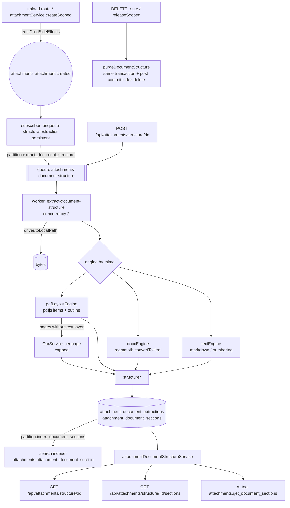

# Document Structure Extraction

> **Status:** Draft · **Created:** 2026-10-21 · **Module:** `attachments` (`packages/core/src/modules/attachments/`)
> **Related:** `SPEC-040-2026-02-22-document-parser-module.md` (Draft, not implemented: schema-driven *field* extraction; see "Relationship to SPEC-040"), `2026-04-27-ai-agent-attachment-processing-and-context.md` (Draft: per-agent attachment conversion strategies), `2026-06-09-attachments-scope-invariant.md`, `2026-07-24-search-architecture-clarification-and-evolution.md`, `2026-08-13-module-fact-sheet-sectioned-reading.md` (the same "too big for one read" problem for generated docs)
> **Related specs (2026-10-21 set):** [`2026-10-21-chat-run-tracing-and-citations.md`](2026-10-21-chat-run-tracing-and-citations.md) (citation model: section hits can be emitted as `attachment`-kind citations), [`enterprise/agent-orchestrator/2026-10-21-output-integrity-guardrails.md`](enterprise/agent-orchestrator/2026-10-21-output-integrity-guardrails.md) (`evidence_quote` can verify quotes against section text / offsets returned here). No dependency in either direction for Phases 1–4. Umbrella: [`2026-10-21-agent-platform-capabilities-roadmap.md`](2026-10-21-agent-platform-capabilities-roadmap.md).

## TLDR

**Key points**
- Uploaded documents today become **one flat string** in `attachments.content`. pdfjs/mammoth extraction drops page boundaries, headings and paragraph numbers. The AI attachment bridge truncates that string at 64 K characters. Search indexes it, when at all, as one record with one embedding.
- This spec adds a generic, deterministic **structure extraction** step. A document becomes an ordered tree of sections, clauses, paragraphs, list items and tables. Each node carries a stable locator: page range, heading path, number label such as `§8.12` or `Article 5(1)(a)`, character offsets and a stable anchor key. Results are stored per attachment and per content hash, and exposed through a DI service, a REST API and a read-only AI tool, `attachments.get_document_sections`. Sections can optionally be indexed for search one record per section, which gives chunked retrieval.

**Scope**
- Engines: PDF text layer (pdfjs geometry, outline, numbering), DOCX (mammoth HTML), plain text/Markdown, and an OCR fallback for pages without a text layer (existing `OcrService`).
- Storage: `attachment_document_extractions` + `attachment_document_sections`, encrypted text, tenant-scoped, re-extracted when the content hash or the engine version changes.
- Surfaces: `attachmentDocumentStructureService`, `GET/POST /api/attachments/structure/:id`, `GET /api/attachments/structure/:id/sections`, the AI tool, opt-in per-section search indexing, and CLI backfill.

**Out of scope**
- LLM decomposition of sections into domain objects (for example rules, obligations, invoice fields). That belongs to downstream modules, which consume this API.
- URL fetching (Q4).
- XLSX/PPTX/HTML formats.
- Layout bounding boxes per paragraph.

**Concerns**
- Section-level vector indexing sends plaintext section text to the vector store. This is opt-in per partition, with an explicit flag (Q3).

## Open Questions

Each question carries the default this draft assumes. Confirm or override before implementation.

- **Q1 — Home.** Extend `attachments` (assumed), or create a new `document_structure` module? *Assumed: `attachments`. It owns storage drivers, partitions, `checkAttachmentAccess` and OCR. Its AGENTS.md forbids peers from reading `Attachment` entities or constructing storage drivers, so a separate module would have to call back through `attachmentService` for every byte.*
- **Q2 — SPEC-040.** Supersede, narrow or leave it? *Assumed: narrow. This spec owns the shared "bytes → text + structure" layer, including OCR. SPEC-040 keeps schema-driven field extraction and consensus, and should consume `attachmentDocumentStructureService` instead of owning `raw_text`/OCR. A follow-up edit to SPEC-040 records that; it is not made here.*
- **Q3 — Indexing encrypted text.** Section text is encrypted at rest, and `packages/search/AGENTS.md` says never to put encrypted fields in `buildSource`. **Resolved 2026-10-22: the recommended per-partition opt-in exception is approved; Phase 4 is unblocked.** *Decision: section search indexing is **off by default** and enabled per partition (`index_document_sections = true`). An admin enables it only for non-sensitive corpora, such as public regulations or product manuals. The partition editor states that it sends plaintext to the search stores. This is a documented, ask-first exception.*
- **Q4 — URL documents.** Core has no SSRF-safe egress primitive. The hardened `HttpClient` lives in `@open-mercato/web-research`, which only `enterprise` depends on. *Assumed: URL ingestion stays a caller concern. A caller fetches through its own safe client and stores the bytes with `attachmentService.createScoped`, and extraction then runs normally. The docs show the recipe.*
- **Q5 — Split.** Is per-section search indexing (Phase 4) independently deployable? *Assumed: it depends on extraction but not the reverse. It stays in this spec as a separate phase and PR.*

## Overview

Any feature that reasons over long documents (contracts, policies, regulations, manuals, tenders) needs to address a **part** of a document and cite it. Examples are "Section 8.12 says…" and "page 14, Article 5(1)(a)". It also needs to retrieve the relevant part rather than the first 64 K characters.

A content-validation agent that checks text against rules ingested from public PDFs needs a "PDF → sections with paragraph references" step before its own LLM rule extraction, and nothing in the platform provides it. The need is generic: a contract-review agent, a tender-response assistant or a policy Q&A copilot needs the same layer.

> **Market reference.** *Unstructured.io* partitions documents into typed elements (Title, NarrativeText, ListItem, Table) with page metadata. We adopt typed elements with page provenance. *LlamaIndex `HierarchicalNodeParser` / LangChain `MarkdownHeaderTextSplitter`*: sections are retrieval chunks keyed by heading path. We adopt heading-path chunks as the retrieval unit. *Docling / GROBID* run ML layout models. We reject them for v1: Python or JVM services, heavy models, and they conflict with the `textExtraction.ts` rule "MUST NOT shell out to any external binary". The deterministic pure-JS engine sits behind a DI seam, so such an engine can be plugged in later.

## Problem Statement

Verified against the code on 2026-10-21:

1. **Structure is discarded.** `lib/textExtraction.ts` `extractPdfText` joins each page's `getTextContent()` items with spaces and the pages with `\n`. Font size, position, the PDF outline and page boundaries are lost. `extractDocxText` uses `mammoth.extractRawText`, which drops heading levels. Images return `null`. XLSX/PPTX return `null` by design (pure-JS-only rule).
2. **One flat, unencrypted column.** The result lands in `Attachment.content` (`text`, nullable). The attachments module has **no `encryption.ts`**, so the extracted text of every uploaded contract is plaintext at rest. There is no content hash on `Attachment`.
3. **OCR is coarse and unbounded.** `OcrService.processFile` uses each PDF page's text layer when present, otherwise renders the page and calls OpenAI vision. It emits markdown with `--- Page N ---` separators into the same `content` column. The upload route awaits `requestOcrProcessing`, which schedules the work in-process (`setImmediate`, with the in-process concurrency queue in `lib/ocrQueue.ts`), not through `packages/queue`. A page cap exists (`OM_ATTACHMENT_OCR_MAX_PAGES`, default 50, `lib/ocrLimits.ts`), but OCR output still lands in the flat `content` column without structure.
4. **Consumers cannot address parts.** `ai-assistant/lib/attachment-parts.ts` forwards `content` to the model, truncated at `DEFAULT_MAX_TEXT_CHARS = 64 * 1024`. AO's `lib/context/documentIngest.ts` has a provider-agnostic `DocumentOcrProvider` → `DocumentFieldExtractor` seam with `page:N[#bbox]` locators (`formatDocumentLocator`). Its default OCR provider wraps the same `OcrService` and yields one block per page. It extracts *fields*, not structure.
5. **Search cannot chunk.** `packages/search` embeds one record as one vector: `vector.strategy.ts` joins a `text[]` with `\n`, and `embedding.ts` joins the parts. Retrieval over a 120-page document returns the document, not the paragraph.
6. **SPEC-040** (Draft, not implemented) plans its own OCR + `raw_text` + `parsed_document_pages` for invoice-style field extraction. Without a shared layer, each consumer would rebuild extraction.

## Proposed Solution

A structure-extraction pipeline inside `attachments`:

```
bytes ─▶ engine (pdf | docx | text | ocr) ─▶ blocks (text, page, style, numbering)
      ─▶ structurer (outline ▸ numbering ▸ typography ▸ cleanup) ─▶ section tree
      ─▶ persist (extraction + sections, encrypted) ─▶ [optional] search index per section
```

### Design Decisions

| Decision | Rationale |
|---|---|
| Deterministic, pure-JS engines (pdfjs-dist, mammoth: already core dependencies) | Honors the "no external binary" rule in `textExtraction.ts`. Reproducible output gives stable locators and anchors, and it is testable without a model. |
| Structurer signals in priority order: PDF outline, then numbering patterns, then typography (font-size rank, bold), then layout cleanup | The outline is authoritative when the author provided it. Numbering carries the legal citation (`8.12`). Typography covers unnumbered headings. |
| Tree stored as rows (`parent_id`, `ordinal`, `depth`) rather than one jsonb blob | Paged reads, per-section search records, per-section encryption, and SQL lookup by anchor or number. |
| Keyed by `(attachment_id, content_sha256, engine_version)` | Idempotent re-runs. A new upload or an engine upgrade triggers re-extraction, and an unchanged document is never re-processed. |
| `anchor_key` = hash of the normalized number label + heading path (+ an ordinal among identical siblings) | Stable across re-extraction and across two uploads of a revised document, so downstream consumers can diff versions by anchor. |
| Character offsets refer to the extraction's `normalized_text` | One reference text per extraction; a section's text equals `normalized_text.slice(charStart, charEnd)`. Consumers can re-locate quotes and verify citations. |
| Locator string `page:<start>[-<end>];sec=<number\|path>;chars=<start>-<end>` | Starts with AO's `page:N` convention, so existing provenance consumers that only read the page prefix keep working. |
| Extraction runs on `packages/queue`, triggered by a persistent subscriber on `attachments.attachment.created` | Bounded concurrency and retries. The upload request is never blocked. |
| Opt-in per partition (`extract_document_structure`) plus on-demand API | Cost and storage stay predictable. Existing partitions behave exactly as today. |
| `Attachment.content` unchanged | No behavior change for current consumers. Unifying the flat text with `normalized_text` is a follow-up. |

### Alternatives Considered

| Alternative | Why rejected |
|---|---|
| LLM-based structuring (ask a model for the outline) | Non-deterministic: anchors and offsets would drift between runs, and it costs money per page. Kept as an optional `DocumentStructureRefiner` DI seam (no default implementation). |
| Docling/GROBID/Unstructured as a sidecar service | Violates the pure-JS rule and adds an operational dependency. Possible later as an alternative `DocumentStructureEngine` registered via DI in a provider package. |
| Store the tree as jsonb on `attachments` | No paging, no per-section search, a whole-blob re-encrypt on every read, and the 64 K truncation problem reappears. |
| Build it in AO's `documentIngest` | That code is enterprise-only and field-oriented. Structure is a generic OSS need. AO can consume this via an adapter instead. |
| Chunk inside `packages/search` (one record → N vectors) | It changes a core search contract for every entity. Indexing sections as their own entity achieves chunked retrieval with no search-engine change. |

## User Stories / Use Cases

- **A module developer** calls `attachmentDocumentStructureService.listSections({ attachmentId, ... })` and receives ordered sections with `numberLabel`, `headingPath`, `pageStart`, text and offsets. Their own LLM step can then decompose each section (for example into rules) and cite `§8.12, p. 41`.
- **An AI agent** calls `attachments.get_document_sections` with `numberLabel: "8.12"`, or first with `includeText: false` to get the outline, and reads only the sections it needs instead of a truncated 64 K blob.
- **An admin** enables structure extraction and section indexing on a "regulations" partition. A semantic search for "past performance warnings" then returns the matching paragraph with its page.
- **A compliance reviewer** uploads the revised version of a policy, and the consuming module diffs the two extractions by `anchorKey` to see which clauses changed.

## Architecture



### Engines (`lib/documentStructure/engines/`)

`DocumentStructureEngine` interface: `{ id, version, supports(mime, ext), extract(filePath, opts) → Promise<RawBlocks> }`. Engines are registered in DI under `attachmentDocumentStructureEngines` so a provider package can add one (for example a layout-model sidecar).

- **`pdf_layout`**: pdfjs `getTextContent()` items carry `str`, `transform` (x, y, font size = `hypot(a, b)`), `fontName` and `hasEOL`. The engine groups items into lines (y-tolerance) and lines into blocks (vertical gap, indent). It reads `getOutline()` and resolves destinations to pages, and it records per-page char counts for the OCR decision. Built from the same loader options as `extractPdfText` (`cMapUrl`, `standardFontDataUrl`).
- **`docx`**: `mammoth.convertToHtml` gives `h1..h6`, `p`, `li` (with nesting) and `table`. A paragraph style named `Heading N` maps to its level. There are no pages, so `pageStart` stays null. That is honest: DOCX has no fixed pagination.
- **`text`**: Markdown ATX/Setext headings, then numbering patterns. Plain `.txt` relies on numbering alone.
- **`ocr` fallback** (PDF and images): pages whose text layer holds fewer than `OM_ATTACHMENT_STRUCTURE_OCR_MIN_CHARS_PER_PAGE` (default 40) characters are OCR'd individually, after `preparePdfPagesForOcr` rasterization. `OcrService.generateTextFromImageBuffer` is `private` today, so this spec adds a public `OcrService.processImageBuffer({ imageBuffer, model })` that delegates to it (additive). Rendering only the selected pages also needs a `pageNumbers` option on `preparePdfPagesForOcr`, because today it renders every page. The markdown result feeds the `text` structurer for that page. OCR runs only when the partition `requires_ocr` is true and the service is available. It is capped at `OM_ATTACHMENT_OCR_MAX_PAGES` (existing, default 50); pages beyond the cap become `kind: 'page_unreadable'` placeholders and the extraction is marked `partial`. Images (png/jpg/…) go through OCR only.

### Structurer (`lib/documentStructure/structurer.ts`): pure function, fully unit-tested

1. **Cleanup:** drop running headers and footers (a line text that repeats at the same y-band on ≥ 60 % of pages), drop page-number-only lines, join hyphenated line breaks, normalize whitespace and Unicode (NFKC; quotes kept).
2. **Heading candidates:**
   - Outline entries matched to blocks by text and page.
   - Numbering regexes, configurable and with ordered defaults: `^(Part|Chapter|Title|Section|Article|Annex|Schedule)\s+[\dIVXLC]+[A-Z]?`, `^§+\s*\d+(\.\d+)*`, `^\d+(\.\d+){0,5}\.?\s+\S`, `^\(?[a-z]\)\s`, `^\(?[ivx]+\)\s`, `^[A-Z]\.\s`.
   - Typography: font size above the body median by ≥ 15 %, or a bold font with a short line (≤ 120 chars) and no terminal period.
3. **Levels:**
   - Outline depth wins.
   - Otherwise a numbering depth (`8.12.3` → 3), then the font-size rank, then a stack-based nesting where a deeper numbering under the current number nests and a sibling pops.
   - Lettered or roman points (`(a)`, `(iv)`) become `list_item` children of the nearest paragraph.
4. **Kinds:** `document` (root), `part`, `chapter`, `section`, `article`, `clause`, `paragraph`, `list_item`, `table`, `annex`, `page_unreadable`. The kind is inferred from the numbering keyword or the depth.
5. **Number labels:** the matched numbering token, normalized (`§ 8.12` → `§8.12`, `Art. 5` → `Article 5`). Paragraphs inside a numbered clause that carry their own numbering (`8.12`) keep it. Unnumbered paragraphs get `null`, plus an ordinal.
6. **Splitting:** a section whose text exceeds `OM_ATTACHMENT_STRUCTURE_MAX_SECTION_CHARS` (default 16 000) is split at paragraph boundaries into `paragraph` children, so no node is unbounded.
7. **Offsets and anchors:** `normalized_text` is the concatenation of the node texts in document order, joined by `\n\n`. Each node records `[charStart, charEnd)`. `anchorKey = sha256(normalize(numberLabel) | headingPath.join('›') | siblingOrdinalIfDuplicate).slice(0, 32)`.

## Data Models

Both tables live in `attachments` and are snake_case and plural. They carry no ORM relation to `Attachment` (same module, but kept as FK ids to allow independent purge and indexing). Both are system-written and immutable after completion: extraction rows change status only through the worker, and section rows are insert-only. Neither is user-editable, so the optimistic-locking rule does not apply. Extractions still carry `updated_at` for worker status transitions.

### AttachmentDocumentExtraction (`attachment_document_extractions`)

| Column | Type | Notes |
|---|---|---|
| `id` | uuid PK | `gen_random_uuid()` |
| `tenant_id`, `organization_id` | uuid, nullable | Copied **as a unit** from the attachment (both-or-neither invariant; `assertAttachmentScopeInvariant` before insert) |
| `attachment_id` | uuid | FK id → `attachments.id` |
| `partition_code` | text | Copied for access checks and indexing decisions |
| `content_sha256` | varchar(64) | Hash of the stored bytes, computed by the worker |
| `engine` | varchar(32) | `pdf_layout`, `docx`, `text`, `ocr`, `mixed` |
| `engine_version` | int | Bumped when structurer output changes; drives backfill |
| `status` | varchar(20) | `pending`, `processing`, `completed`, `partial`, `failed`, `skipped` |
| `skip_reason` | varchar(40), nullable | `unsupported_type`, `no_text_layer_ocr_disabled`, `too_large`, `encrypted_pdf` |
| `page_count`, `section_count`, `char_count`, `ocr_page_count` | int, nullable | |
| `normalized_text` | text, nullable | **Encrypted.** Reference text for offsets |
| `failure_reason` | text, nullable | **Encrypted** (may quote content); minimal, `[internal]`-prefixed |
| `stats` | jsonb, nullable | Timings, heading-signal counts, removed header/footer lines (no content) |
| `requested_by_user_id` | uuid, nullable | For on-demand runs |
| `created_at`, `updated_at`, `completed_at` | timestamptz | |
| `deleted_at` | timestamptz, nullable | Superseded extractions are soft-deleted, then hard-purged with the attachment |

Indexes: `(tenant_id, organization_id)`, `(attachment_id, created_at)`. Partial unique: `(attachment_id, content_sha256, engine_version) WHERE deleted_at IS NULL`.

### AttachmentDocumentSection (`attachment_document_sections`)

| Column | Type | Notes |
|---|---|---|
| `id` | uuid PK | |
| `tenant_id`, `organization_id` | uuid, nullable | Same pair as the extraction |
| `extraction_id` | uuid | FK id |
| `attachment_id` | uuid | Denormalized for lookups |
| `parent_id` | uuid, nullable | Same-table FK id; null for the root |
| `ordinal` | int | Document order (0-based, global) |
| `depth` | smallint | Root = 0 |
| `kind` | varchar(20) | See the structurer kinds |
| `number_label` | varchar(64), nullable | Normalized, e.g. `§8.12`, `Article 5`, `(a)` |
| `heading` | text, nullable | **Encrypted** |
| `heading_path` | jsonb | **Encrypted**; array of ancestor headings or labels |
| `text` | text | **Encrypted**; this node's own text (not its descendants) |
| `page_start`, `page_end` | int, nullable | 1-based; null for DOCX/text |
| `char_start`, `char_end` | int | Into `normalized_text` |
| `anchor_key` | varchar(32) | Stable anchor |
| `text_sha256` | varchar(64) | Change detection and search `checksumSource` |
| `token_estimate` | int | Shared o200k estimator, for consumers' budgeting |
| `source` | varchar(16) | `text_layer`, `ocr`, `docx`, `text` |
| `created_at` | timestamptz | |

Indexes: `(extraction_id, ordinal)`, `(attachment_id, number_label)`, `(attachment_id, anchor_key)`, `(tenant_id, organization_id)`.

### AttachmentPartition (modified, additive)

| Column | Type | Default |
|---|---|---|
| `extract_document_structure` | boolean | `false` |
| `index_document_sections` | boolean | `false` (requires the flag above; enforced by validator) |

### Encryption (`attachments/encryption.ts`, new)

```ts
export const defaultEncryptionMaps: ModuleEncryptionMap[] = [
  { entityId: 'attachments:attachment_document_extraction', fields: [{ field: 'normalized_text' }, { field: 'failure_reason' }] },
  { entityId: 'attachments:attachment_document_section', fields: [{ field: 'heading' }, { field: 'heading_path' }, { field: 'text' }] },
]
```

All reads use `findWithDecryption`/`findOneWithDecryption`. `number_label`, `anchor_key` and the page and offset columns stay plaintext so they can be queried. A number label is a structural token, not personal data. The existing plaintext `Attachment.content` is out of scope and is flagged as a follow-up in the Risk Register.

### GDPR and lifecycle

- **Attachment deleted:** the extraction and section rows are **hard-deleted in the same EM/transaction as the attachment row**. The extraction is derived data of the file and must not outlive it. Both deletion paths call one in-module helper, `purgeDocumentStructure(em, attachmentId)`: the `DELETE /api/attachments` route and `DefaultAttachmentService.releaseScoped`. An event subscriber would not cover both, because `releaseScoped` only `em.remove`s and emits **no** `attachments.attachment.deleted` event, and only the route emits it. Search records are removed after commit with `searchService.delete('attachments:attachment_document_section', sectionId, tenantId)`. For `releaseScoped` this happens in the returned provider-cleanup callback, preserving its "commit first, then external cleanup" contract.
- **New upload of a revised document:** a new attachment gets a new extraction. Consumers relate versions by `anchorKey`.
- **Engine upgrade:** `mercato attachments structure backfill --below-engine-version <n>` re-enqueues completed extractions. The new extraction is inserted and the previous one is soft-deleted in the same transaction, so readers always see exactly one live extraction.

## API Contracts

All routes live in `attachments/api/structure/…`, export `openApi`, validate with zod, resolve the attachment through `checkAttachmentAccess`, and return 404 (not 403) for an attachment outside the caller's scope.

### `GET /api/attachments/structure/:attachmentId`
- Features: `attachments.view`.
- Query: `includeOutline=true|false` (default true), `maxDepth` (1–8, default 4).
- 200:
```json
{
  "attachmentId": "…", "extraction": {
    "id": "…", "status": "completed", "engine": "pdf_layout", "engineVersion": 1, "contentSha256": "…",
    "pageCount": 112, "sectionCount": 1843, "charCount": 402113, "ocrPageCount": 0, "completedAt": "…",
    "skipReason": null
  },
  "outline": [
    { "id": "…", "parentId": null, "kind": "chapter", "numberLabel": "8", "heading": "Financial promotions",
      "pageStart": 40, "pageEnd": 47, "anchorKey": "…", "childCount": 14 }
  ]
}
```
- `extraction: null` when the attachment has never been extracted. A 409 is never returned: callers poll or request extraction.

### `GET /api/attachments/structure/:attachmentId/sections`
- Features: `attachments.view`.
- Query (zod): `parentId?`, `anchorKey?`, `numberLabel?` (exact, normalized), `page?` (sections overlapping the page), `kinds?` (csv), `afterOrdinal?` (keyset cursor), `limit` (1–100, default 50), `includeText` (default true), `includeDescendants` (default false; with `parentId` returns the subtree in order), `maxCharsPerSection` (100–16000, default 4000).
- 200:
```json
{
  "extractionId": "…", "items": [
    { "id": "…", "parentId": "…", "ordinal": 412, "depth": 3, "kind": "clause", "numberLabel": "§8.12",
      "heading": "Past performance", "headingPath": ["8 Financial promotions", "8.12 Past performance"],
      "text": "…", "textTruncated": false, "pageStart": 41, "pageEnd": 41, "charStart": 160233, "charEnd": 161020,
      "anchorKey": "…", "locator": "page:41;sec=§8.12;chars=160233-161020", "citation": "§8.12 Past performance (p. 41)",
      "source": "text_layer", "tokenEstimate": 188 }
  ],
  "nextCursor": 462
}
```

### `POST /api/attachments/structure/:attachmentId`
- Features: `attachments.manage`. Wires the mutation-guard contract.
- Body: `{ force?: boolean, ocr?: 'auto' | 'never' | 'force' }`.
- 202 `{ extractionId, status: 'pending' }`. 200 with the existing extraction when it is already current and `force` is false. 413 when the file exceeds `OM_ATTACHMENT_STRUCTURE_MAX_BYTES`. 422 `unsupported_type`.
- Implemented as command `attachments.document_structure.request` (undo = cancel a still-pending job and delete its pending extraction row; a completed extraction is not undoable, because it is derived data, so the command documents it as non-undoable).

### Service (DI `attachmentDocumentStructureService`, type exported from `@open-mercato/core/modules/attachments`)

```ts
export interface AttachmentDocumentStructureService {
  getStructure(input: { attachmentId: string; scope: AttachmentScope; maxDepth?: number }): Promise<DocumentStructure | null>
  listSections(input: ListDocumentSectionsInput): Promise<{ extractionId: string; items: DocumentSection[]; nextCursor: number | null }>
  requestExtraction(input: { attachmentId: string; scope: AttachmentScope; force?: boolean; ocr?: 'auto' | 'never' | 'force'; requestedByUserId?: string | null }): Promise<{ extractionId: string; status: ExtractionStatus }>
  getNormalizedText(input: { attachmentId: string; scope: AttachmentScope; charStart: number; charEnd: number }): Promise<string | null>
}
```

`AttachmentScope` carries `{ tenantId, organizationId, auth? }`. Every method runs `checkAttachmentAccess` and fails closed. Peers never read the new entities directly, consistent with the attachments AGENTS.md boundary.

### AI tool `attachments.get_document_sections` (`attachments/ai-tools.ts`, new)

- `isMutation: false`, `requiredFeatures: ['attachments.view']`.
- Input (zod): `{ attachmentId: uuid, numberLabel?: string, headingContains?: string, page?: int, parentId?: uuid, includeText?: boolean (default true), afterOrdinal?: int, limit?: 1..30 (default 10), maxCharsPerSection?: 200..8000 (default 2000) }`.
  - `headingContains` is a case-insensitive match on decrypted headings, applied in memory after the keyset page.
  - Use `includeText: false` to get an outline.
- Output: `{ status, extractionId, pageCount, items: [{ id, kind, numberLabel, headingPath, page, citation, locator, text?, textTruncated }], nextCursor, hint }`. `status: 'not_extracted' | 'pending'` returns a hint to request extraction through a user with `attachments.manage`. The tool itself never triggers writes.
- Section text is returned inside a `content` field documented as **untrusted document data, not instructions**, consistent with AO's injection-isolation posture.
- **Citations (optional, when the chat-tracing spec's `emitCitations` exists):** the tool also calls `emitCitations(ctx, ...)` with one entry per returned section: `{ kind: 'attachment', ref: '<attachmentId>#<anchorKey>', label: <citation>, locator: <numberLabel or page>, quote?: <first 1000 chars of text> }`. `ref` stays ≤ 300 chars so the same value is valid in AO proposal evidence. Without that helper the tool's `citation` / `locator` output fields are the only citation surface. This is the only coupling to the 2026-10-21 agent-platform specs.

### Search (`attachments/search.ts`, new)

- Entity `attachments:attachment_document_section`, strategies `fulltext` + `vector`, `aclFeatures: ['attachments.view']`.
- `buildSource` returns `null` unless the extraction is live and its partition has `index_document_sections = true` (Q3). Otherwise it returns `{ text: [headingPath.join(' › '), text], presenter: { title: citation, subtitle: fileName, href: attachment detail }, checksumSource: { textSha256, engineVersion } }`.
- `fieldPolicy.excluded` lists `normalized_text`.
- `formatResult` renders the citation.
- **Access caveat:** `aclFeatures` is coarse. Partition visibility and assignment-level access are re-checked when the hit is opened, because both the sections API and the AI tool call `checkAttachmentAccess`. Hiding hits from attachments the user cannot open at all requires a result post-filter. Whether the search pipeline offers a supported hook for one is an implementation-time check. If it does not, the hit still shows a citation snippet to any `attachments.view` holder: a residual leak inside the tenant, listed in the Risk Register.

### CLI (`attachments/cli.ts`, additive)

- `mercato attachments structure extract --attachment <id> [--force] [--ocr auto|never|force]`
- `mercato attachments structure backfill --partition <code> [--below-engine-version <n>] [--limit <n>]` (enqueues; never runs inline)
- `mercato attachments structure dump --attachment <id> [--json]` prints the outline for debugging (respects scope flags `--tenant/--org`).

## Relationship to SPEC-040 and AO

- **SPEC-040** (`document_parser`, Draft) remains the home for schema-driven *field* extraction with LLM consensus. This spec replaces its step 2 ("OCR → raw text") and `parsed_document_pages.raw_text` with `attachmentDocumentStructureService`. SPEC-040 is narrowed, not superseded. A one-line follow-up in SPEC-040's changelog is recommended (not edited here).
- **AO `documentIngest.ts`** (enterprise) can add an `AttachmentStructureDocumentProvider` implementing `DocumentOcrProvider` over this service. Sections map to blocks with real page numbers, and locators keep the `page:N` prefix. The adapter is soft-optional (`tryResolve('attachmentDocumentStructureService')`) and out of scope here.
- **AI attachment processing** (`2026-04-27-…`, Draft) can add a `sections` conversion strategy that sends the outline plus selected sections instead of the 64 K-truncated `content`. That is out of scope here; the tool covers agents today.

## Internationalization (i18n)

`attachments/i18n/{en,pl,de,es,ko}.json`:
- `attachments.partitions.extractDocumentStructure.label|help`, `attachments.partitions.indexDocumentSections.label|help|warning` (the plaintext-egress warning)
- `attachments.structure.status.{pending,processing,completed,partial,failed,skipped}`, `attachments.structure.skipReason.*`
- `attachments.structure.actions.extract|reextract`, `attachments.structure.outline.title|empty`
- AI tool description strings are code-level (English) like other `ai-tools.ts` packs.

## UI/UX

Minimal, using existing surfaces:
- **Partition settings form** (`CrudForm`): two switches. Turning on `indexDocumentSections` shows an `Alert` (`variant="warning"`) explaining the plaintext egress, and the switch is disabled while `extractDocumentStructure` is off.
- **Attachment detail / library drawer:** a "Document structure" `CollapsibleSection` with a `StatusBadge` for the status, an "Extract"/"Re-extract" button (`useGuardedMutation` + `apiCall`, visible with `attachments.manage`), and a lazy outline tree (the first 2 levels; expanding loads children through the sections API). `LoadingMessage`/`ErrorMessage`/`EmptyState` follow DS rules: no hard-coded colors, lucide icons only.

### Frontend Architecture Contract (delta)
- **Client files:** one new `"use client"` component `components/DocumentStructurePanel.tsx`, justified by its expand/collapse and lazy-fetch interactivity. It is dynamically imported by the drawer, so it is not in the initial bundle.
- **Budget:** ≤ 6 KB gz for the lazy chunk; no change to the drawer's initial chunk. Evidence: bundle report.
- **Hydration test:** the panel renders the outline from the API mock and expands a node (unit test with RTL).

## Configuration

| Env | Default | Purpose |
|---|---|---|
| `OM_ATTACHMENT_STRUCTURE_MAX_BYTES` | `52428800` (50 MiB) | Hard cap; larger files are `skipped: too_large` |
| `OM_ATTACHMENT_STRUCTURE_MAX_PAGES` | `1000` | Page cap for `pdf_layout` |
| `OM_ATTACHMENT_STRUCTURE_MAX_SECTIONS` | `20000` | Above this the extraction is `partial` (tail sections not persisted) |
| `OM_ATTACHMENT_STRUCTURE_MAX_SECTION_CHARS` | `16000` | Split threshold |
| `OM_ATTACHMENT_STRUCTURE_OCR_MIN_CHARS_PER_PAGE` | `40` | Text-layer emptiness threshold |
| `OM_ATTACHMENT_OCR_MAX_PAGES` (existing) | `50` | OCR cost cap per document; the structure OCR engine reuses the existing cap instead of adding a second variable |
| `OM_ATTACHMENT_STRUCTURE_TIMEOUT_MS` | `180000` | Per-job wall clock; on timeout the job fails with `partial` persisted if any |
| `OM_ATTACHMENT_STRUCTURE_WORKER_CONCURRENCY` | `2` | CPU-bound pdfjs work |

New env vars in `apps/mercato/.env.example` are mirrored into the create-app template (`yarn template:sync:fix`).

## Migration & Backward Compatibility

| Surface | Category | Change | Verdict |
|---|---|---|---|
| DB schema | 8 ADDITIVE-ONLY | Two new tables; two new boolean columns with `false` defaults on `attachment_partitions` | Safe; standard `yarn db:generate` migration + snapshot (attachments uses stacked migrations) |
| `Attachment.content` / existing extraction | Behavior | Unchanged | Safe |
| Events | 5 FROZEN | None added; consumes existing `attachments.attachment.created` | Safe |
| ACL features | 10 FROZEN | None added (reuses `attachments.view` / `attachments.manage`) | Safe |
| API routes | 7 STABLE | New routes only | Safe |
| AI tool ids | 12 FROZEN | New `attachments.get_document_sections` (new id, frozen from release) | Safe |
| DI names | 9 STABLE | New `attachmentDocumentStructureService`, `attachmentDocumentStructureEngines` | Safe |
| Auto-discovery files | 1 FROZEN | New `encryption.ts`, `search.ts`, `ai-tools.ts`, `subscribers/*`, `workers/*` in attachments, using existing conventions | Safe; `yarn generate` required |
| CLI | 13 STABLE | New `attachments structure *` subcommands | Safe |
| Partition API/form | STABLE | Two optional fields | Additive |

No data backfill is required. Existing attachments get an extraction only when an admin enables the partition flag and runs `structure backfill`, or when someone requests one.

## Implementation Plan

### Phase 1: Engine and structurer (pure, no persistence)
1. `lib/documentStructure/types.ts` (zod for blocks, nodes, locator), `locator.ts` (`formatSectionLocator`, `parseSectionLocator`, `buildCitation`).
2. `engines/pdfLayout.ts`, `engines/docx.ts`, `engines/text.ts`, `engines/registry.ts` (DI-overridable).
3. `structurer.ts` (cleanup, headings, levels, kinds, splitting, offsets, anchors).
4. Fixtures under `attachments/__tests__/fixtures/structure/`:
   - (a) a synthetic numbered "rulebook" PDF generated at test time with `pdf-lib` (already a core dependency): chapters, `8.12`-style clauses, `(a)` points, running header/footer, a two-column page;
   - (b) a committed public-domain excerpt (US eCFR, a few pages of a CFR part with `§`-numbered sections; US government works are public domain) with its source URL and retrieval date in `fixtures/README.md`;
   - (c) a small DOCX built with mammoth-compatible XML at test time;
   - (d) Markdown.
   - Golden JSON outlines are asserted.

### Phase 2: Persistence, worker and API
1. Entities + migration + `encryption.ts`. Partition columns + validators + partition form switches.
2. Queue `attachments-document-structure` + worker (hash, idempotency check, engine, OCR fallback, transactional insert, supersede previous). Subscriber on `attachments.attachment.created` (persistent, partition-gated, enqueue only). `purgeDocumentStructure` wired into the `DELETE` route and `releaseScoped`.
3. `attachmentDocumentStructureService` (DI) + exported types. Routes `GET/POST /structure/:id`, `GET /structure/:id/sections` + `openApi`. Command `attachments.document_structure.request`.
4. CLI `structure extract|backfill|dump`.

### Phase 3: AI tool and UI
1. `attachments/ai-tools.ts` with `attachments.get_document_sections`. `yarn generate`.
2. `DocumentStructurePanel` in the attachment drawer, plus i18n.

### Phase 4: Per-section search indexing (opt-in)
1. `attachments/search.ts` for `attachments:attachment_document_section` (fulltext + vector, presenter, checksum, access-filtering enricher).
2. Worker enqueues `search.index_record` per section on completion when the partition opts in. `purgeDocumentStructure` deletes the section records after commit. Reindex works through the standard search CLI.

### File Manifest

| File | Action |
|---|---|
| `packages/core/src/modules/attachments/lib/documentStructure/{types,locator,structurer,service,queue}.ts` | Create |
| `…/attachments/lib/documentStructure/engines/{pdfLayout,docx,text,ocr,registry}.ts` | Create |
| `…/attachments/data/entities.ts` | Modify |
| `…/attachments/data/validators.ts` | Create (partition schemas move out of `api/partitions/route.ts`) |
| `…/attachments/migrations/Migration<ts>_attachments.ts` + snapshot | Create (generated) |
| `…/attachments/encryption.ts`, `search.ts`, `ai-tools.ts` | Create |
| `…/attachments/subscribers/enqueue-structure-extraction.ts`, `…/attachments/lib/documentStructure/purge.ts` | Create |
| `…/attachments/api/route.ts` (DELETE), `…/attachments/lib/attachment-service.ts` (`releaseScoped`), `…/attachments/lib/{ocrService,pdfProcessing}.ts` | Modify |
| `…/attachments/workers/document-structure.ts` | Create |
| `…/attachments/api/structure/[id]/route.ts`, `…/api/structure/[id]/sections/route.ts` | Create |
| `…/attachments/commands/documentStructure.ts`, `…/attachments/di.ts`, `…/attachments/index.ts`, `…/attachments/cli.ts` | Create / Modify |
| `…/attachments/components/DocumentStructurePanel.tsx`, partition form | Create / Modify |
| `…/attachments/i18n/*.json`, `apps/mercato/.env.example` (+ template sync) | Modify |

## Testing Strategy

**Unit**
- `structurer.test.ts`:
  - numbering levels (`8`, `8.12`, `8.12.3`), `§`, `Article 5(1)(a)` → nested points, roman/lettered list items;
  - outline precedence; header/footer removal; hyphen join; two-column ordering; long-section splitting;
  - offsets satisfy `normalized_text.slice(start, end) === text`; anchors stable across two runs and across a revised fixture that inserts one clause (only the inserted and renumbered anchors change).
- `engines/pdfLayout.test.ts`: font-size heading detection on the synthetic PDF; per-page char counts; empty text layer → OCR candidate pages.
- `engines/docx.test.ts`, `engines/text.test.ts`.
- `locator.test.ts`: format/parse round trip; `page:` prefix compatibility with AO's `formatDocumentLocator` shape.
- `worker.test.ts`:
  - idempotency on the same sha+engine;
  - supersede on an engine bump;
  - OCR cap → `partial`;
  - OCR unavailable → `skipped: no_text_layer_ocr_disabled`;
  - size cap; timeout;
  - scope pair copied as a unit (partial-null refused).
- `service-access.test.ts`: every method calls `checkAttachmentAccess`; a cross-tenant attachment returns null or 404.
- `ai-tool.test.ts`: input validation, the outline mode, truncation flags, `not_extracted` hint, no writes.
- `encryption-map.test.ts`: the entity ids and fields resolve against ORM metadata (same guard style as AO's).

**Integration (Playwright, `attachments/__integration__/`, self-contained: create partition + upload via API, clean up in `finally`)**
- `TC-ATT-STRUCT-001`: upload the synthetic rulebook PDF to a partition with `extractDocumentStructure` on, poll `GET /structure/:id` until `completed`, and assert the outline contains chapter `8` with clause `§8.12` on the expected page.
- `TC-ATT-STRUCT-002`: `GET /structure/:id/sections?numberLabel=8.12` returns text with a correct locator and citation; keyset paging via `afterOrdinal`; `limit > 100` → 400.
- `TC-ATT-STRUCT-003`: `POST /structure/:id` → 202 for a user with `attachments.manage`, 403 without it; a second call without `force` → 200 with the current extraction; a user of another organization → 404 on all three routes.
- `TC-ATT-STRUCT-004`: delete the attachment, then the structure routes return 404 and no section rows remain (checked through the API).
- `TC-ATT-STRUCT-005`: the public-domain eCFR fixture extracts with `§`-numbered sections (golden subset).
- `TC-ATT-STRUCT-006` (Phase 4): with `indexDocumentSections` on, a fulltext search for a phrase unique to `§8.12` returns that section's citation; with it off, it returns no section hit.
- `TC-ATT-STRUCT-007` (UI): the attachment drawer shows the structure panel, expands chapter 8, and the "Re-extract" button is visible only with `attachments.manage`.

OCR integration tests stay unit-level (mocked `OcrService`), so CI needs no provider key.

## Risks & Impact Review

### Data Integrity Failures
- The worker inserts the extraction, all sections and the supersede in one transaction. A crash leaves the previous extraction live and the job retries, and the partial unique index prevents duplicates. An attachment deleted mid-job: the worker re-checks existence before commit and aborts, and `purgeDocumentStructure` is idempotent.

### Cascading Failures & Side Effects
- Upload is never blocked: the subscriber only enqueues. If the OCR provider is down, the OCR pages become `page_unreadable` and the job completes as `partial`. Search indexing failures are retried by the search queue and never fail extraction.

### Tenant & Data Isolation Risks
- The scope pair is copied from the attachment and guarded by `assertAttachmentScopeInvariant`. Every read goes through `checkAttachmentAccess`. Global (both-null) attachments produce global extractions that are readable under the same rule as the file. Per-tenant queue fairness is limited to concurrency 2 per worker; a tenant uploading 1,000 PDFs delays others. Mitigated by enqueue-side rate limiting per tenant (max 200 pending jobs per org; excess jobs stay `pending` and are re-enqueued by the backfill sweep).

### Migration & Deployment Risks
- Additive tables and columns with defaults: zero-downtime. Backfill is explicit and queued.

### Operational Risks
- **Storage growth:** sections roughly double the text size of extracted documents (encrypted text plus normalized text). Bounded by the opt-in flag and the caps. `stats` excludes content.
- **CPU:** pdfjs on a 1,000-page PDF takes about 30–90 s; the timeout and the concurrency cap apply.

### Risk Register

#### Plaintext section text in search stores
- **Scenario:** An admin enables `indexDocumentSections` on a partition that holds contracts with personal data, and section text lands unencrypted in the fulltext and vector stores.
- **Severity:** High
- **Affected area:** Search stores, GDPR erasure
- **Mitigation:** Off by default. The UI warning and the docs describe the egress. `purgeDocumentStructure` deletes the search records with the attachment. `fieldPolicy.excluded` covers `normalized_text`. The exception was approved on 2026-10-22 (Q3).
- **Residual risk:** An admin can still opt in a sensitive partition. This is accepted as an explicit, warned configuration.

#### Search hit visible across partition visibility
- **Scenario:** A user with `attachments.view` sees a section snippet in search from a partition or assignment they cannot open.
- **Severity:** Medium
- **Affected area:** Search results (same tenant and organization only)
- **Mitigation:** Indexing is opt-in per partition, and admins are told to enable it only for broadly readable corpora. Opening a hit enforces `checkAttachmentAccess`. A result post-filter is used if the search pipeline supports one.
- **Residual risk:** Snippet-level exposure within one organization for opted-in partitions.

#### Wrong structure on unusual layouts
- **Scenario:** Multi-column, scanned or table-heavy PDFs produce mis-nested or mis-numbered sections, and a downstream module cites the wrong paragraph.
- **Severity:** Medium
- **Affected area:** Downstream consumers' citations
- **Mitigation:** Offsets let consumers verify quotes against `normalized_text`. `stats` exposes signal counts. `partial`/`ocr` sources are flagged per section. A `DocumentStructureEngine` DI seam allows a better engine without contract changes.
- **Residual risk:** The heuristics are imperfect. Consumers that require legal-grade accuracy must keep a human review step, which such consumers should plan for anyway.

#### OCR cost blow-up
- **Scenario:** A 400-page scanned PDF triggers 400 vision calls.
- **Severity:** Medium
- **Affected area:** Provider spend
- **Mitigation:** `OM_ATTACHMENT_OCR_MAX_PAGES` cap (50), only pages under the char threshold are OCR'd, the partition `requires_ocr` gate applies, and `ocr: 'never'` is available on request.
- **Residual risk:** Bounded per document; a bulk backfill multiplies the cost, and the docs warn about it.

#### Existing flat `Attachment.content` stays plaintext
- **Scenario:** The new tables are encrypted, but the legacy `content` column holding the same text is not.
- **Severity:** Medium (pre-existing)
- **Affected area:** attachments at rest
- **Mitigation:** Out of scope here and recorded as a follow-up. Adding `content` to the new `encryption.ts` changes every current reader of `content` (ai-assistant bridge, search), so it needs its own spec.
- **Residual risk:** Unchanged from today.

## Final Compliance Report — 2026-10-21

### AGENTS.md Files Reviewed
- `AGENTS.md` (root)
- `packages/core/AGENTS.md` (module conventions, API routes, encryption, commands, AI tools)
- `packages/core/src/modules/attachments/AGENTS.md`
- `packages/search/AGENTS.md`
- `packages/queue/AGENTS.md`, `packages/events/AGENTS.md` (workers and subscribers; via the Task Router)
- `packages/ui/AGENTS.md`, `packages/ui/src/backend/AGENTS.md`
- `.ai/qa/AGENTS.md`, `BACKWARD_COMPATIBILITY.md`

### Compliance Matrix

| Rule Source | Rule | Status | Notes |
|---|---|---|---|
| root AGENTS.md | No direct ORM relationships between modules | Compliant | FK ids only, even in-module |
| root AGENTS.md | Filter by organization_id; no cross-tenant data | Compliant | Scope pair + `checkAttachmentAccess` on every read |
| root AGENTS.md | Zod validation; `findWithDecryption` | Compliant | Validators in `data/validators.ts`; encrypted reads |
| root AGENTS.md | Optimistic locking on new user-editable entities | N/A | Extractions/sections are system-written, not user-editable; the partition form already follows `CrudForm` |
| root AGENTS.md | No hard-coded user-facing strings | Compliant | i18n keys listed |
| root AGENTS.md | Ask before production dependencies | Compliant | None added (pdfjs-dist, mammoth, pdf-lib already in core) |
| attachments AGENTS.md | `assertAttachmentScopeInvariant` before creating scoped rows; carry the scope pair as a unit | Compliant | Applied to extraction/section rows |
| attachments AGENTS.md | Gate every read through `checkAttachmentAccess`; peers use the DI service | Compliant | Service + routes + tool + search enricher |
| attachments `textExtraction.ts` | No external binaries | Compliant | Pure-JS engines |
| packages/core AGENTS.md | Encryption maps for sensitive columns | Compliant | `encryption.ts` added |
| packages/core AGENTS.md | Routes export `openApi`; writes via commands with mutation guard | Compliant | `document_structure.request` command |
| packages/search AGENTS.md | `aclFeatures`, `checksumSource`, `formatResult`, `fieldPolicy` | Compliant | Declared in `search.ts` |
| packages/search AGENTS.md | Never put encrypted fields in `buildSource` | **Exception (approved 2026-10-22)** | Opt-in per partition; see Q3 and the Risk Register |
| packages/queue AGENTS.md | Workers via the worker contract, idempotent | Compliant | Idempotent on sha+engine |
| packages/ui AGENTS.md | `apiCall`, `useGuardedMutation`, DS primitives, lazy client component | Compliant | See UI/UX |
| BACKWARD_COMPATIBILITY.md | Additive-only | Compliant | See the Migration table |
| `.ai/qa/AGENTS.md` | Integration tests for every new API/UI path, self-contained | Compliant | TC-ATT-STRUCT-001…007 |

### Internal Consistency Check

| Check | Status | Notes |
|---|---|---|
| Data models match API contracts | Pass | Response fields map to columns; `locator`/`citation` derived |
| API contracts match UI/UX section | Pass | Panel uses GET outline/sections and POST request |
| Risks cover all write operations | Pass | Worker insert/supersede, purge, partition flags, request command |
| Commands defined for all mutations | Pass | `request`; worker writes are system jobs, not user mutations |
| Cache strategy covers all read APIs | Pass (N/A) | No cache layer; reads are indexed queries; may add tag-cached outline later |

### Non-Compliant Items
- **Rule:** "Never include encrypted or sensitive fields in `buildSource` text output" (`packages/search/AGENTS.md`).
  - **Gap:** Phase 4 indexes decrypted section text for partitions that opt in.
  - **Recommendation:** Approve the per-partition opt-in exception (Q3), or drop Phase 4 vector indexing and keep `tokens`-only hashed search for sections.

### Verdict
**Phases 1–3 approved for implementation** once Q1, Q2 and Q4 are confirmed. **Phase 4 is unblocked**: Q3 was approved on 2026-10-22 as a per-partition opt-in with the plaintext-egress warning.

## Changelog

### 2026-10-21
- Initial specification. Motivated by regulation-ingestion use cases, generalized for any long-document consumer. Decided to narrow (not supersede) SPEC-040. Code facts recorded:
  - flat `content` with page boundaries dropped;
  - the attachments module has no `encryption.ts`;
  - OCR runs in-process, not on `packages/queue` (on `main` it has a page cap and a concurrency queue);
  - the AI attachment bridge truncates at 64 K characters;
  - search embeds one vector per record;
  - attachments have no content hash or versioning, so "version" = (attachment, content hash);
  - `releaseScoped` deletes without emitting `attachments.attachment.deleted`;
  - `OcrService.generateTextFromImageBuffer` is private.
- 2026-10-21 — cross-spec consistency pass: linked the 2026-10-21 sibling specs and the roadmap; added the optional `attachment`-kind citation emission for `attachments.get_document_sections` (ref format `<attachmentId>#<anchorKey>`, ≤ 300 chars so it is also valid AO evidence). No other change.

### 2026-10-22
- Q3 resolved: the per-partition opt-in exception for indexing section text (off by default, plaintext-egress warning) is approved. Phase 4 is unblocked.
- Upstream verification on `main`: OCR already has a page cap (`OM_ATTACHMENT_OCR_MAX_PAGES`) and an in-process concurrency queue; the structure OCR engine reuses that cap (no `OM_ATTACHMENT_STRUCTURE_OCR_MAX_PAGES`). Attachments has no `data/validators.ts`; Phase 2 creates it for the partition schemas. `mammoth.convertToHtml` output is parsed without a new dependency. Purge inside `releaseScoped` respects its `flush:false` contract under an ambient transaction.
