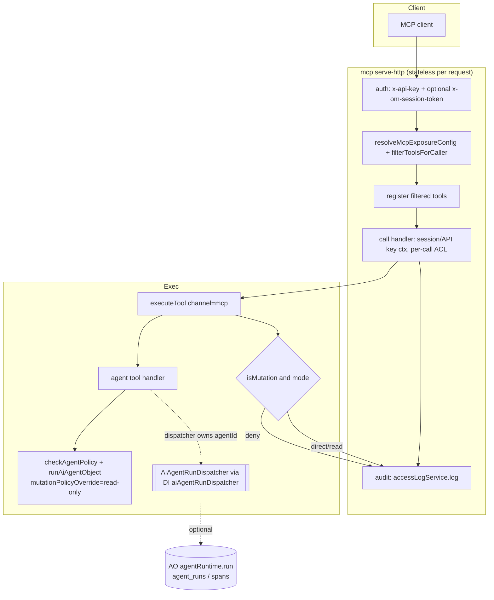

# MCP Tool Exposure, Channel Parity and Audit

> **Status:** Draft · **Date:** 2026-10-21 · **Package:** `@open-mercato/ai-assistant` (module `ai_assistant`) · **Touches (additive):** `@open-mercato/core` `audit_logs` (retention set only), `@open-mercato/enterprise` `agent_orchestrator` (optional `aiAgentRunDispatcher` registration, Phase 5)
> **Motivating use case:** one agent core exposed three ways (chat UI, headless API, one MCP tool) with identical permissions, audit and traces. This spec is generic.
> **Related specs:** [`implemented/2026-04-11-unified-ai-tooling-and-subagents.md`](implemented/2026-04-11-unified-ai-tooling-and-subagents.md) (D10 "MCP Surface": *sub-agents may be exposed through the generalized MCP registry later as additive tools*; this spec is that "later"), [`implemented/2026-04-28-ai-agents-agentic-loop-controls.md`](implemented/2026-04-28-ai-agents-agentic-loop-controls.md), [`implemented/2026-04-30-ai-overrides-and-module-disable.md`](implemented/2026-04-30-ai-overrides-and-module-disable.md), [`enterprise/agent-orchestrator/next/2026-06-19-agent-identity-and-on-behalf-of.md`](enterprise/agent-orchestrator/next/2026-06-19-agent-identity-and-on-behalf-of.md), companion [`2026-10-21-chat-run-tracing-and-citations.md`](2026-10-21-chat-run-tracing-and-citations.md) (run persistence that the MCP agent tool reuses for its `runId`). Sibling enterprise specs written in parallel: [`enterprise/agent-orchestrator/2026-10-21-agent-invocation-access-and-identity-binding.md`](enterprise/agent-orchestrator/2026-10-21-agent-invocation-access-and-identity-binding.md) (per-agent invoke feature, `runAs` on headless runs, and the AO **implementation** of the agent run dispatcher declared in §4 here), [`enterprise/agent-orchestrator/2026-10-21-agent-run-observability-full-fidelity.md`](enterprise/agent-orchestrator/2026-10-21-agent-run-observability-full-fidelity.md) (records `correlationId` / `channel` in the AO run manifest). Umbrella and shared decisions (migration policy, dispatch seam, correlation vocabulary): [`2026-10-21-agent-platform-capabilities-roadmap.md`](2026-10-21-agent-platform-capabilities-roadmap.md).

## TLDR

**Key Points:**
- The production MCP server (`mcp:serve-http`) registers **every** tool for every caller, filters nothing in `tools/list`, executes `isMutation` tools directly (no approval), cannot expose an AI agent as a tool, and writes no audit row per call. The UI chat and the headless API already enforce agent policy; MCP does not. This spec closes those gaps.
- Result: one declaration (a tool's `requiredFeatures`, an agent's `requiredFeatures` / `allowedTools` / `mutationPolicy`, an explicit exposure allowlist) decides what a caller can see and call in **all three channels**, and every MCP call leaves an audit row.

**Scope:**
1. Declarative **exposure control**: per-tool `mcp.expose` flag + server-level allowlist/denylist (env + CLI); default = today's behaviour.
2. **RBAC-filtered `tools/list`** on `mcp:serve-http` (API-key ACL, or session ACL when a session token is sent in a header).
3. **Agent policy on MCP**: agent `requiredFeatures`, `allowedTools` and `mutationPolicy` are honoured for agent-backed tools; a configurable **MCP mutation mode** for raw mutation tools (`direct` | `deny` | `approval`), so writes never silently bypass approval. `approval` turns a write into a pending action that a human approves on a new backend page **Pending AI actions** (§3.1).
4. **Agent as one MCP tool**: `defineAiAgent({ mcpTool: {...} })` plus a `defineAgentTool(...)` helper (the **only** helper name for "expose an agent as a tool", for chat, MCP and `/tools/execute`) that runs an object-mode agent with its own input/output schema. Agents owned by another engine are routed through the soft-optional **agent run dispatcher** (`AiAgentRunDispatcher`, DI key `aiAgentRunDispatcher`), declared here in ai-assistant and implemented by Agent Orchestrator (AO), so AO agents are exposed the same way and produce AO traces. The same dispatcher is the seam `run-object` and chat use for AO-owned agent ids (one seam, not two).
5. **Audit**: one `access_logs` row per MCP call (tool, principal, API key id, session user, outcome, latency, `correlationId`, `aiAgentRunId` / `agentRunId`).

**Concerns:**
- Changing the default for raw mutation tools on MCP is a behaviour change for existing MCP clients (Claude Code, the legacy OpenCode command palette). The spec keeps today's default (`direct`) and ships the switch. The operator chooses the mode per deployment with `OM_MCP_MUTATION_MODE`; there is no automatic default change (see Migration).
- `access_logs` rows for non-core resource kinds are rotated after 8 hours by default (`AUDIT_LOGS_NON_CORE_RETENTION_HOURS`). MCP audit needs a longer retention class, which is an additive change in `audit_logs`.

## Open Questions

Each question carries the default this spec assumes. Implementation can start on the defaults; a different answer changes only the named section.

- **Q1 — Raw mutation tools on `mcp:serve-http`: when does the default flip, and to what?** **Resolved 2026-10-22: the `approval` mode is implemented in this spec (Phase 3).** Ship `OM_MCP_MUTATION_MODE` (`direct` | `deny` | `approval`). **The env flag is the operator's choice per deployment. There is no planned default flip** (decision 2026-10-22). When the flag is unset the mode is `direct` (today's behaviour), and the server logs a startup warning that lists the exposed mutation tools and points to `approval`. `mcp:dev` follows the same flag. (Affects: Migration, Phase 3.)
- **Q2 — Do we need an `approval` mutation mode for raw MCP calls in v1?** **Resolved 2026-10-22: yes** (product decision). Specified in §3.1. The pending-action re-check gains a channel-aware branch for rows that have no agent, and a backend page **Pending AI actions** approves actions created outside the chat card. In `approval` mode, agent tools on MCP keep their own `mutationPolicy` instead of the read-only downgrade.
- **Q3 — Per-tenant / per-API-key exposure policy (DB-backed) in v1?** Default assumed: **no**; env/CLI allowlists per server process are enough (one MCP deployment per exposure profile). A tenant-level `ai_mcp_tool_policies` table is listed under Future Work.
- **Q4 — Should the in-repo `mcp:serve` (stdio) server adopt the same exposure/audit pipeline?** Default assumed: **yes** for exposure + list filtering (it already filters by ACL), **yes** for audit; it shares the new `resolveMcpToolExposure` helper.

---

## Overview

`@open-mercato/ai-assistant` serves the same typed tools (`defineAiTool` in module `ai-tools.ts`) through four entry points:

| Entry point | Code | Who calls it |
|---|---|---|
| In-app chat | `POST /api/ai_assistant/ai/chat` → `runAiAgentText` → `resolveAiAgentTools` (`lib/agent-tools.ts`) | Backend users in `<AiChat>` / `AiDock` |
| Headless agent run | `POST /api/ai_assistant/ai/run-object` → `runAiAgentObject` | Integrations with a session or API key |
| Headless tool call | `POST /api/ai_assistant/tools/execute` → `executeTool` (`lib/tool-executor.ts`) | Integrations, tests |
| MCP (production) | `mercato ai_assistant mcp:serve-http` → `lib/http-server.ts` | External MCP clients, the OpenCode-backed command palette |
| MCP (dev) | `yarn mcp:dev` → `lib/mcp-dev-server.ts` | Claude Code / local dev |
| MCP (stdio) | `mercato ai_assistant mcp:serve` → `lib/mcp-server.ts` | Local MCP clients |

The agent channels apply `checkAgentPolicy` (`lib/agent-policy.ts`): agent `requiredFeatures`, the `allowedTools` whitelist, execution mode and the effective `mutationPolicy`, with `isMutation` tools intercepted by `prepareMutation` (pending action + approval card). MCP only applies the tool's own `requiredFeatures` at execution time.

This spec makes MCP a first-class channel with the same guarantees, and lets a module ship "this agent, as one MCP tool" declaratively.

> **Market reference:** The MCP specification (2025-06-18 revision) defines `tools/list` as the caller's view of callable tools, `annotations.readOnlyHint` / `destructiveHint` as client hints, and `outputSchema` + `structuredContent` for typed results. GitHub's official MCP server exposes `--toolsets` and `--read-only` flags; Cloudflare's MCP servers scope tools per OAuth grant. **Adopted:** allowlist/toolset-style exposure flags, a read-only switch (our `deny` mutation mode), per-caller filtered lists, `outputSchema` for agent tools. **Rejected:** per-module MCP endpoints (`/mcp/<module>`), already rejected by the 2026-04-11 spec D10 for routing/auth duplication; OAuth-based MCP auth (out of scope; two-tier API key + session token stays).

## Problem Statement

Verified against the code on `develop` (2026-10-21):

1. **Everything is registered for everyone.** `createMcpServerForRequest` (`lib/http-server.ts`) iterates `getToolRegistry().getTools()` and calls `server.registerTool` for each one; the inline comment reads *"Register ALL tools - permission checks happen at execution time via session token"*. There is no way to run a server that exposes only one tool. `AiToolDefinition` (`lib/types.ts`) has no exposure field.
2. **`tools/list` is not RBAC-filtered in production.** The dev server filters at startup (`mcp-dev-server.ts`: `tools.filter((tool) => hasRequiredFeatures(...))`), and the stdio server filters per list call (`mcp-server.ts`), but the HTTP server does not. A caller learns the names, descriptions and schemas of tools it cannot call. The docs promise the opposite: *"a tool appears only if the API key's ACL covers it"* (`apps/docs/docs/framework/ai-assistant/mcp.mdx`, "What's exposed").
3. **The session token is only known at call time.** The user tier of two-tier auth arrives as a tool argument (`_sessionToken`), injected into every schema. At `tools/list` time only the `x-api-key` header is known, so the server cannot filter by the session user today.
4. **Agent policy is not applied on MCP.** Agents are not exposed (docs: *"MCP serves tools, not agents"*), so an agent's `requiredFeatures`, `allowedTools` and `mutationPolicy` never apply. The only way to "run an agent" over MCP today is a hand-written wrapper tool (the AO `agent_orchestrator.delegate_agent` pattern in `packages/enterprise/src/modules/agent_orchestrator/ai-tools.ts`), which every module would have to re-implement.
5. **Mutation tools bypass approval on MCP and on `/tools/execute`.** `executeTool` calls `tool.handler(...)` directly. The `prepareMutation` interception exists only inside `resolveAiAgentTools` (`lib/agent-tools.ts`, `canInterceptMutations`). 34 non-test tool definitions carry `isMutation: true` (including Code Mode `execute` in `lib/codemode-tools.ts`); only `warranty_claims` (`packages/core/src/modules/warranty_claims/ai-tools.ts`) defends in-handler with `if (!ctx.approvedPendingActionId) throw`. The package's own rule (`packages/ai-assistant/AGENTS.md` → Always: *"Route mutation-capable AI tools through the mutation approval path before execution"*) is not enforced on these two paths.
6. **No audit of MCP calls.** The HTTP server logs through `createLogger('ai_assistant').child({ component: 'mcp-http' })` only. A read through MCP leaves no `access_logs` row; a write leaves only whatever `action_logs` row the underlying command writes, with no link back to the MCP call, API key or session.

## Proposed Solution

### 1. Exposure model

One pure function decides what a server exposes, shared by all three MCP servers:

```ts
// lib/mcp-exposure.ts (new)
export type McpExposureConfig = {
  allow: string[] | null      // null = no allowlist (today's behaviour)
  deny: string[]
  mutationMode: 'direct' | 'deny' | 'approval'
  includeAgentTools: boolean  // default true
}
export function resolveMcpExposureConfig(env: NodeJS.ProcessEnv, cliArgs: Record<string, unknown>): McpExposureConfig
export function isToolExposed(tool: AiToolDefinition, config: McpExposureConfig): boolean
export function filterToolsForCaller(
  tools: AiToolDefinition[],
  config: McpExposureConfig,
  caller: { features: string[]; isSuperAdmin: boolean },
): AiToolDefinition[]
```

Order of checks (all must pass):

1. Registered and not disabled by an override (`aiToolOverrides` `null` already unregisters).
2. `tool.mcp?.expose !== false` (new optional field, default exposed).
3. If `allow` is set, the tool name matches one entry. Entries are exact names or a trailing `*` prefix glob (`customers.*`). The names `search`, `execute` (Code Mode) and `context_whoami` are matched like any other tool. An allowlist that does not mention them hides them.
4. Not matched by `deny`.
5. `mutationMode === 'deny'` hides `isMutation === true` tools.
6. Caller passes `hasRequiredFeatures(tool.requiredFeatures, ...)` (list-time filter, §2). The execution-time check stays.

Sources, highest precedence first: CLI flags (`--tools`, `--exclude-tools`, `--mutation-mode`, `--no-agent-tools`) → env (`OM_MCP_TOOL_ALLOWLIST`, `OM_MCP_TOOL_DENYLIST`, `OM_MCP_MUTATION_MODE`, `OM_MCP_AGENT_TOOLS`) → defaults (`allow: null`, `deny: []`, `mutationMode: 'direct'`, `includeAgentTools: true`). Defaults reproduce today's surface exactly, except that agent tools (new) appear only if a module declares one.

The server logs the effective config once at startup (counts and patterns, never secrets) and exposes it on `GET /health` as `{ exposure: { allowlist: boolean, mutationMode, toolCount } }`.

### 2. RBAC-filtered `tools/list`

`createMcpServerForRequest` keeps the stateless request model (one `McpServer` per HTTP request, `packages/ai-assistant/AGENTS.md` → "Enforce the Stateless Request Model") but resolves the **list principal** before registering tools:

- If the request carries a session token header (`x-om-session-token`, new, optional), resolve it with the existing `resolveSessionContext` and filter by the session user's ACL (`api_key:<sessionKeyId>` ACL, the same one used at call time).
- Otherwise filter by the server API key's ACL (`resolveApiKeyContext`, already used at call time when no `_sessionToken` is passed).
- Only tools passing `filterToolsForCaller` are registered, so `tools/list` and `tools/call` see the same set. A call for an unregistered tool fails at the SDK layer with the standard "tool not found" error, which is the desired behaviour.

Call-time behaviour is unchanged: `_sessionToken` in arguments still selects the session ACL and the per-call `hasRequiredFeatures` check stays (`AGENTS.md` → Never: *"skip per-tool ACL checks"*). If a call carries a `_sessionToken` whose ACL is wider than the list principal, the tool may be callable but not listed. That is acceptable and documented: clients that want a per-user list send the header.

The ACL resolved for the list is cached for the request only (no cross-request cache), so a role change takes effect on the next request.

### 3. Agent policy on MCP and the mutation rule

**Raw tools (not agent-backed).** `executeTool` gains an optional `channel` argument (`'mcp' | 'tools-api' | 'agent'`, default `'agent'` for BC). When `channel` is `'mcp'` or `'tools-api'` and the tool is `isMutation`:

| `mutationMode` | Behaviour |
|---|---|
| `direct` (used when the flag is unset) | Handler runs as today. A one-time startup `WARN` lists the exposed mutation tools. The audit row records `mutation: true`. |
| `deny` | Tool is hidden from `tools/list` (§1 step 5) and a direct call returns `{ code: 'MUTATION_REQUIRES_APPROVAL' }` with `isError: true`. |
| `approval` | Tool stays listed, and its `annotations` keep `destructiveHint`. The handler does **not** run. The call creates an `AiPendingAction` and returns `pending_approval` (§3.1). The write runs only after a human approves it. |

`POST /api/ai_assistant/tools/execute` reads the same `OM_MCP_MUTATION_MODE` value (it is the same channel class: a raw tool call without an agent). The tool's `requiredFeatures` check is unchanged.

#### 3.1 Approval mode

Approval mode reuses the existing mutation-approval gate (`ai_pending_actions`, `lib/pending-action-executor.ts`, the `/api/ai_assistant/ai/actions/:id` routes). The existing gate was built for chat: `prepareMutation` and `runPendingActionRechecks` require a registered agent, and the repository does **not** scope rows to their creator: `AiPendingActionRepository.getById` filters only by id, tenant and organization, and the GET, confirm and cancel routes check only `ai_assistant.view`, so today any same-tenant/org user with that feature can read or confirm another user's pending action (verified on `main` 2026-10-22). This spec closes that gap: chat rows (`channel = 'agent'`) become owner-only, and MCP / tools-api rows are reachable by the owner or an approver. This section adds what a raw tool call with no agent and no chat needs.

**Propose (at call time).**
1. `executeTool(..., { channel })` sees `isMutation` with mode `approval`. It runs the normal per-call checks first: exposure, the tool's `requiredFeatures` for the call principal, and input validation through `inputSchema`. A call that fails them is refused as today and creates no pending row.
2. New `prepareRawToolMutation(tool, args, ctx)` (`lib/prepare-mutation.ts`). It shares the field-diff, batch-records, record-version and idempotency internals with `prepareMutation`, refactored into private helpers with no behaviour change for `prepareMutation`. It creates the row with:
   - `agent_id` = the reserved constant `AI_RAW_TOOL_AGENT_ID = 'ai_assistant.raw_tool'`. The column stays NOT NULL; the agent registry rejects that id for real agents.
   - `channel` = `mcp` or `tools-api` (new column).
   - `api_key_id` (new column) and `correlation_id` (new column).
   - `created_by_user_id` = the session user, else the API key's `sessionUserId ?? createdBy` (`auth.userId` on `/tools/execute`; `auth.sub` is `api_key:<id>` there and is not a uuid). This is the same actor rule the audit row uses (§5). When no owning user can be resolved the call fails closed with `MUTATION_REQUESTER_UNRESOLVED` and no row is created.
   - `conversation_id` = null.
   - `expires_at` = now + `OM_MCP_PENDING_ACTION_TTL_SECONDS` (default 86 400). A human must open the backend, so the chat default of 15 minutes is too short.
   - Idempotency: repeating the same call (same principal, tool and normalized input) while the row is `pending` returns the existing row instead of a new one.
3. Result:
   - **MCP:** `structuredContent: { status: 'pending_approval', pendingActionId, expiresAt, approvalPath: '/backend/config/ai-assistant/pending-actions/<id>', summary: { toolName, targetEntityType, targetRecordId, recordCount } }`, with `isError: false` and `_meta.correlationId`.
   - **`/tools/execute`:** `202 { success: true, status: 'pending_approval', pendingActionId, expiresAt }`.
   - The audit row records `outcome: 'pending_approval'` and the `pendingActionId`.
4. Notification: a new backoffice (backend in-app) notification type, `ai_assistant.pending_action.awaiting_approval`. It always goes to `created_by_user_id` **and** to every user in the same tenant and organization who holds `ai_assistant.pending_actions.approve`, resolved through RBAC wildcard-aware feature matching (`notificationService.createForFeature` with `restrictRecipientsToOrganization: true`, plus `create` for the requester). Recipients are deduplicated through `groupKey` = the pending action id. The notification links to the row's detail view on the Pending AI actions page. When the row is approved, rejected or expired, its notifications are removed with `notificationService.deleteBySource('ai_assistant:ai_pending_action', id)` (the pattern AO uses for disposed proposals), so a decided action doesn't stay in everyone's inbox.

**Approve or reject.**
- **Who may act on a row with `channel` ≠ `agent`:**
  - `created_by_user_id` themself, with `ai_assistant.view`. This is unchanged from chat.
  - Any user in the same tenant and organization with the new feature `ai_assistant.pending_actions.approve`.

  Chat rows (`channel = 'agent'`) keep their current owner-only rule.
- New repository method `getByIdForApprover(id, scope, { userId, canApproveAny })`. The existing `getById` stays.
- The routes `GET /api/ai_assistant/ai/actions/:id`, `POST …/confirm` and `POST …/cancel` gain this approver path. Each route keeps `ai_assistant.view` in its metadata and checks `ai_assistant.pending_actions.approve` in the handler when the caller is not the creator.
- **Re-check for raw-tool rows** (`runPendingActionRechecks` branches on `channel`; agent rows are unchanged):
  1. Status and expiry (existing).
  2. Tool still registered, still `isMutation: true`, and still exposed: not hidden by `mcp.expose === false` or by the denylist the app process resolves.
  3. The **approver** holds the tool's `requiredFeatures`.
  4. The **requester** still holds them: the API key exists, is not revoked, and its ACL (or the session user's ACL) still covers them.
  5. Attachment scope (existing).
  6. Schema drift and record version (existing).

  Codes added to `PendingActionRecheckCode`: `tool_not_exposed`, `approver_features_denied` (step 3), `requester_revoked`, `requester_features_denied`.
- **Execution** runs under the **approver's** identity (`userId`, ACL), so the command's `action_logs` row names the human who approved the write. The tool handler context gains `auditCorrelation: { correlationId, apiKeyId, pendingActionId, requestedByUserId }` (`McpToolContext.auditCorrelation`), using the identity spec's `auditCorrelation` key. It reaches only the tool handler: `main` has no command-audit hook that would copy it into `action_logs`, so linking the approved write's `action_logs` row to the MCP call stays Future Work. The pending row stores `resolved_by_user_id` (existing column).
- **Result for the client:** a new read tool `ai_assistant.get_pending_action` (`isMutation: false`, feature `ai_assistant.view`, scoped like the `GET` route) returns `{ status, executionResult?, failedRecords?, resolvedAt }`. MCP clients poll it; it is subject to the exposure allowlist like any tool.

**Agent tools in `approval` mode.** The read-only downgrade (below) applies only in `direct` and `deny` modes. In `approval` mode an agent tool runs with the agent's own effective `mutationPolicy`. Its mutation tool calls go through the existing `prepareMutation` path. The rows get `channel = 'mcp' | 'tools-api'` and are approved on the same page, and the agent tool's result lists the `pendingActionIds` it created. Recheck for these rows keeps the agent guards (they have a real `agent_id`) and adds the approver guard.

**Backend page "Pending AI actions"** (`backend/config/ai-assistant/pending-actions/`, gated by `ai_assistant.view`):
- A `DataTable` over a new list route `GET /api/ai_assistant/ai/actions`. Filters: `status`, `channel`, `toolName`, `mine`. `pageSize` ≤ 100.
- Rows are scoped to the caller's own rows, or to all rows of the tenant/org with `ai_assistant.pending_actions.approve`.
- Columns: tool, target, requester, channel, created, expires, `StatusBadge`. The API returns `requester: { userId, apiKeyId }`; the page resolves user names through `/api/auth/users?ids=…` when the caller may read users and otherwise shows short ids.
- The detail view reuses the `mutation-preview-card` diff renderer and has Approve / Reject buttons over the existing confirm and cancel routes. Writes go through `useGuardedMutation(...).runMutation(...)`.
- The reject dialog takes an optional reason, stored in `execution_result.error.message`. Dialogs support `Cmd/Ctrl+Enter` and `Escape`.
- A sidebar entry under AI assistant settings, with a pending-count badge.

**Cleanup.** The existing `ai-pending-action-cleanup` worker expires these rows like chat rows. No new worker.

**Agent-backed tools** (§4) apply the agent's policy in full, through the existing runtime rather than a re-implementation:

- `checkAgentPolicy` runs first with `requestedExecutionMode: 'object'`; `agent_features_denied` → `{ code: 'UNAUTHORIZED' }`.
- The agent runs through `runAiAgentObject`, which resolves tools via `resolveAiAgentTools`, so `allowedTools` and per-tool features apply exactly as in chat.
- **Mutation rule:** in `direct` and `deny` modes the agent runs on MCP with `mutationPolicyOverride: 'read-only'`. Downgrades are always allowed (`isMutationPolicyEscalation` only blocks escalation), so a `confirm-required` agent never reaches `prepareMutation` there. There is no consumer for a pending-action UI part on MCP, and object mode has no approval loop, so blocking is the only behaviour in those modes that cannot bypass approval. An agent whose `allowedTools` are all mutations is still callable but will report that it could not act. In `approval` mode the downgrade is lifted and writes queue for the Pending AI actions page (§3.1).
- AO agents (reached through the dispatcher, Phase 5) are propose-only by construction: their output is a proposal returned as data and disposed through the AO decision card. No write happens inside the MCP call.

### 4. Agent as one MCP tool

Two declarative forms, both producing a normal `AiToolDefinition` that flows through the registry, overrides, exposure filtering and audit like any other tool.

**Form A: on the agent definition (ai-assistant agents).**

```ts
// <module>/ai-agents.ts
export const aiAgents = [
  defineAiAgent({
    id: 'catalog.product_reviewer',
    moduleId: 'catalog',
    executionMode: 'object',
    output: { schemaName: 'ProductReview', schema: productReviewSchema },
    requiredFeatures: ['catalog.products.view'],
    allowedTools: ['catalog.get_product', 'search.hybrid_search'],
    // ...
    mcpTool: {
      name: 'catalog.review_product',             // default: `${agent.id}.run`
      description: 'Review a product listing and return structured findings.',
      inputSchema: z.object({ productId: z.string().uuid(), focus: z.string().optional() }),
      toPrompt: (input) => `Review product ${input.productId}. Focus: ${input.focus ?? 'all'}`,
      requiredFeatures: ['catalog.products.view'], // default: agent.requiredFeatures
    },
  }),
]
```

- `mcpTool` is valid only for `executionMode: 'object'` agents with `output` set. The loader rejects the declaration with a logged error otherwise (same fail-soft path as other invalid registrations).
- Default `inputSchema`: `z.object({ input: z.string().min(1).max(8000) })`, with `toPrompt` defaulting to `(i) => i.input`.
- The tool's `requiredFeatures` default to the agent's `requiredFeatures`. An explicit value must be a **superset** of the agent's (validated at registration). A narrower tool gate would let `tools/list` advertise a tool that `checkAgentPolicy` then denies.
- The synthesized tool is `isMutation: false` (§3 mutation rule), tagged `['agent', <moduleId>]`, and carries `agentId` in a new optional `AiToolDefinition.agentRef` field, so the exposure, audit and settings UIs can show "this tool runs agent X".
- The result is the agent's object, validated against `output.schema`, returned as `structuredContent` with `outputSchema` advertised in `tools/list`, plus a JSON text block for clients that ignore `structuredContent`. Run metadata travels next to it: `{ result, agentId, runId, agentRunId?, usage }` (`runId` = the ai-assistant `ai_agent_runs.id`, `agentRunId` = the dispatcher's run id; see the correlation vocabulary below).

**Form B: `defineAgentTool` helper (any agent engine).** This is the single sanctioned helper for exposing an agent as a tool to chat, MCP and `/tools/execute`. The AO identity spec does not define a second one; AO modules call this helper with an AO agent id.

```ts
// lib/agent-tool.ts (new), exported from '@open-mercato/ai-assistant'
export function defineAgentTool<TInput, TOutput>(spec: {
  name: string
  description: string
  agentId: string
  inputSchema: z.ZodType<TInput>
  outputSchema?: z.ZodType<TOutput>
  toPrompt?: (input: TInput) => string        // ai-assistant engine only
  requiredFeatures?: string[]                  // default: the agent's requiredFeatures; an explicit value must be a superset
  timeoutMs?: number                           // default 120_000
}): AiToolDefinition<TInput, { result: TOutput; agentId: string; runId: string | null; agentRunId?: string | null }>
```

- Engine selection is by agent id, not by a per-tool key: if a registered `aiAgentRunDispatcher` reports `owns(agentId)`, the call goes through the dispatcher; otherwise the ai-assistant engine (`checkAgentPolicy` + `runAiAgentObject`) runs it. Form A is sugar over this helper with the ai-assistant engine.

#### Agent run dispatcher (canonical cross-package seam)

This section is the **single owner** of the dispatch contract. The AO identity spec (`enterprise/agent-orchestrator/2026-10-21-agent-invocation-access-and-identity-binding.md` §"ai-assistant dispatcher seam") implements it and does not redefine it. Every ai-assistant door that may reach an agent owned by another engine uses it: MCP agent tools, `/tools/execute` agent tools, chat agent tools built with `defineAgentTool`, `POST /api/ai_assistant/ai/run-object` and the object branch of `POST /api/ai_assistant/ai/chat`.

```ts
// lib/agent-run-dispatcher.ts (new), types exported from '@open-mercato/ai-assistant'
export const AI_AGENT_RUN_DISPATCHER_DI_KEY = 'aiAgentRunDispatcher'

export interface AiAgentRunDispatcher {
  owns(agentId: string): boolean
  isAvailable(agentId: string): Promise<boolean>
  runObject(input: {
    agentId: string
    input: unknown
    caller: {
      tenantId: string; organizationId: string
      userId: string | null; apiKeyId: string | null
      features: string[]; isSuperAdmin: boolean
    }
    channel: AiAgentRunChannel          // 'chat' | 'playground' | 'run-object' | 'mcp' | 'tools-api' | 'internal' (chat-tracing spec)
    via: 'route' | 'tool'               // a route (run-object / chat) or an agent tool built with defineAgentTool
    correlationId: string
    callSettings?: AiAgentCallSettings  // chat-tracing spec §6
    timeoutMs: number
    signal?: AbortSignal
  }): Promise<{ result: unknown; agentRunId: string | null; usage?: { inputTokens?: number; outputTokens?: number }; finishReason?: string | null }>
}
```

- ai-assistant declares the port and the DI key and never imports or names the implementer. It resolves the key with a soft-optional `try/catch` resolve (pattern from `packages/core/AGENTS.md` → Cross-Module Coupling).
- Absent dispatcher (no enterprise) → today's behaviour on every door. A tool whose agent id is not in the ai-assistant registry and not owned by a dispatcher, or whose dispatcher reports `isAvailable(agentId) === false`, is **dropped from `tools/list`**; a direct call returns `{ code: 'AGENT_DISPATCHER_UNAVAILABLE' }`.
- Typed denial errors from the dispatcher (for AO: `agent_invoke_denied`, `agent_principal_missing`) map to `AGENT_POLICY_DENIED` on MCP / tools and to the route's existing deny codes on `run-object` / chat (403 / 409), without echoing feature names.
- **AO implementation (Phase 5, enterprise, owned by the identity spec).** AO registers `aiAgentRunDispatcher` over `agentRuntime.run(agentId, input, ctx)` with `ctx.invoker` from `caller`, `ctx.entryPoint = via === 'tool' ? 'tool' : 'ai_assistant'`, `ctx.channel`, `ctx.correlationId`, `ctx.callSettings`. It mirrors the delegate tool's result unwrapping (`research` → `data`, `proposal` → `proposal`, artifacts → `{ artifacts, summary }`). Because it calls `agentRuntime.run`, the run lands in `agent_runs` / `agent_spans` with native trace capture, guardrails, online evals and the per-agent invoke check (`requiredFeatures`, identity spec §A). No AO-side sugar helper (`defineOrchestratorAgentTool`) and no per-module runner DI keys are introduced.
- Access: the tool gate is the tool's `requiredFeatures` (default = the agent's, which AO now forwards to `defineAiAgent`); the invoke check inside `agentRuntime.run` is authoritative. Generic AO surfaces keep additionally requiring `agent_orchestrator.agents.run`; tools built with `defineAgentTool` do not (identity spec Q2).

### 5. Audit of MCP calls

Every `tools/call` handled by any MCP server, and every `POST /api/ai_assistant/tools/execute`, writes one row through the DI `accessLogService` (`packages/core/src/modules/audit_logs/services/accessLogService.ts`, `log(input)`), resolved soft-optionally. A missing service or a failing write logs a warning and never fails the call.

| `access_logs` field | Value |
|---|---|
| `tenant_id`, `organization_id` | Effective context scope (session key or server key) |
| `actor_user_id` | Session user id, else the API key's `sessionUserId ?? createdBy` (same rule as `resolveApiKeyContext`) |
| `resource_kind` | `ai_assistant.mcp_tool_call` |
| `resource_id` | Tool name (encrypted by the existing `audit_logs:access_log` map) |
| `access_type` | `call` |
| `context` (encrypted `context_json`) | `{ channel: 'mcp' \| 'tools-api', mcpServer: 'http' \| 'dev' \| 'stdio' \| null, apiKeyId, sessionKeyId, principal: 'session' \| 'api_key', outcome: 'ok' \| 'denied' \| 'invalid_input' \| 'error' \| 'mutation_denied' \| 'pending_approval' \| 'dispatcher_unavailable', errorCode, durationMs, isMutation, agentId, aiAgentRunId, agentRunId, pendingActionIds, correlationId, argKeys }` |

- **Argument values are never logged**, only top-level key names (`argKeys`). This is the same redaction-by-construction rule AO applies to flow summaries.
- `correlationId`: the `x-correlation-id` request header if present (validated, max 128 chars), else a fresh UUID. It is echoed in the tool result `_meta.correlationId` and passed to `runAiAgentObject` (`trace.correlationId`) and to the dispatcher, so it lands in `ai_agent_runs.correlation_id` (chat-tracing spec), in the AO run manifest `om.correlation_id` (observability spec) and in `action_logs.context_json.correlation.correlationId` for writes an AO run causes (identity spec §D).
- **Correlation vocabulary** (shared by all 2026-10-21 agent-platform specs; see the roadmap): `correlationId` = one inbound request at a door; `aiAgentRunId` = `ai_agent_runs.id` (OSS run, called `runId` inside ai-assistant APIs); `agentRunId` = the dispatcher's run id (`agent_runs.id` for AO); `channel` = the ai-assistant door (`chat | playground | run-object | mcp | tools-api | internal`); `entryPoint` = AO's door enum (identity spec), never written by ai-assistant.
- **Retention:** `access_logs` rows outside `CORE_RESOURCE_KINDS` (`auth.user`, `auth.role`) are deleted after `AUDIT_LOGS_NON_CORE_RETENTION_HOURS` (default 8 h). This spec adds an additive env `AUDIT_LOGS_CORE_RESOURCE_KINDS_EXTRA` (comma list, appended to the frozen default set) to `audit_logs`, and documents `ai_assistant.mcp_tool_call` as a recommended entry. Core retention defaults to 7 days (`AUDIT_LOGS_CORE_RETENTION_DAYS`). Deployments needing longer retention ship logs to their SIEM. The default is unchanged to avoid growing every tenant's table.
- Writes through MCP keep producing their own `action_logs` rows via the command path (actor `api_key:<id>`). Writes caused by an AO run reached through the dispatcher carry `correlationId` via the identity spec's `CommandRuntimeContext.auditCorrelation`. Linking raw MCP tool writes (no agent run) to the MCP `correlationId` needs request-context propagation in the command bus and is Future Work; it should reuse the same `auditCorrelation` key.

### Design Decisions

| Decision | Rationale |
|---|---|
| Exposure is evaluated per request from a pure function, not by caching filtered servers | Keeps the stateless model and the "Never cache MCP server instances" rule; the cost is one ACL load per request, already paid at call time |
| Session token for listing via an optional header, not by changing `_sessionToken` semantics | `AGENTS.md` → Ask First: *"MCP authentication ... session-token semantics"*. A header is additive; the argument path is untouched |
| Agent tools run read-only on MCP in `direct` / `deny` modes | Object mode has no approval loop and MCP has no UI-part consumer. Blocking is the only answer in those modes that cannot bypass approval; it is a downgrade, which policy already allows |
| `approval` mode reuses `ai_pending_actions` with a `channel` column instead of a new table | One state machine, one executor, one cleanup worker and one diff renderer for chat and MCP writes; the re-check branches on `channel` |
| Execute an approved raw-tool write as the **approver**, re-checking the requester too | The `action_logs` actor is the accountable human; the requester re-check stops a revoked API key's queued writes from running |
| Raw-tool rows use a reserved `agent_id` instead of a nullable column | Keeps `AiPendingAction.agentId: string` and every existing reader unchanged |
| The mode is an operator choice (`OM_MCP_MUTATION_MODE`), with no automatic default flip | Product decision 2026-10-22. Deployments pick `direct` or `approval` explicitly; unset keeps today's behaviour, so no existing client breaks on upgrade |
| Every approver in the tenant/org is notified in the backoffice | Product decision 2026-10-22. A queued write must reach someone who can act on it, even when the requester is an API key nobody watches |
| `defineAgentTool` + one OSS-declared dispatcher port (`aiAgentRunDispatcher`) implemented by AO | ai-assistant (upstream) never imports or names AO (downstream), per `packages/core/AGENTS.md` → Cross-Module Coupling; AO stays optional. One port serves MCP, tools-api, chat tools, `run-object` and chat, so there is a single place where an ai-assistant door hands a run to another engine |
| Audit via `access_logs`, not a new table | Brief requires `audit_logs` services; access logs already carry actor, scope, resource and encrypted context and have a UI (`audit_logs.access.list`) |
| Unset `mutationMode` means `direct` | Code Mode `execute` and the OpenCode command palette rely on direct writes; changing the unset behaviour would break clients without a bridge (`BACKWARD_COMPATIBILITY.md` → Deprecation Protocol) |

### Alternatives Considered

| Alternative | Why rejected |
|---|---|
| Tenant-level exposure table in v1 | One MCP deployment per exposure profile covers typical integrations; adds a settings UI and cache invalidation (Q3) |
| Filter `tools/list` by the union of API-key and session ACL | Leaks tool metadata to callers who cannot use the tools; defeats the parity goal |
| Expose every object-mode agent automatically as an MCP tool | Agents' prompts are written for in-app use; exposure should be an explicit, reviewed decision (FROZEN tool name once published) |
| Re-implement agent policy in the MCP handler | Two policy implementations drift; reuse `checkAgentPolicy` + `runAiAgentObject` |
| `action_logs` for read calls | Action logs model undoable commands and feed the "Changes" UI; read calls there would be noise and get mis-projected as `system` actions |

## User Stories / Use Cases

- An **integrator** wants to run an MCP server that exposes exactly one tool (`validate_content`) so that an external client cannot discover or call anything else.
- A **security reviewer** wants `tools/list` for a given API key to show only tools that key may call, so that the list matches the in-app chat for the same role.
- A **module author** wants to publish an object-mode agent as one MCP tool with a typed input and output, without hand-writing a wrapper.
- An **enterprise module author** wants the same for an AO agent, so that MCP calls produce AO runs with traces and evals.
- An **auditor** wants to see who called which MCP tool, through which key, with which outcome and latency, and join it to the agent run.
- An **operations lead** wants writes requested by an external MCP client to wait in a queue, review the diff, and approve or reject them in the backend, so that no MCP write lands without a human decision.

## Architecture



### Parity matrix (target state)

| Concern | UI chat (`/ai/chat`) | Headless agent (`/ai/run-object`) | Headless tool (`/tools/execute`) | MCP prod (`mcp:serve-http`) | MCP dev / stdio |
|---|---|---|---|---|---|
| Authentication | Session cookie | Session or API key (`getAuthFromRequest`) | Session or API key | `x-api-key` + `_sessionToken` arg / `x-om-session-token` header (new) | Key at startup (dev) / key or flags (stdio) |
| Route gate | `ai_assistant.view` | `ai_assistant.view` | `ai_assistant.view` | API key valid | API key valid |
| Agent `requiredFeatures` | Yes (`checkAgentPolicy`) | Yes | n/a | **Yes for agent tools (new)** | **Yes for agent tools (new)** |
| Tool visibility | Agent `allowedTools` ∩ features | Same | n/a | **Exposure config ∩ features (new; today: everything)** | Exposure config ∩ features (today: features) |
| Tool `requiredFeatures` at call | Yes | Yes | Yes | Yes (unchanged) | Yes |
| Mutation tools | `prepareMutation` per `mutationPolicy` | Same (object mode) | **`OM_MCP_MUTATION_MODE` (new; today: direct)** | **Same (new; today: direct)** | Same, default `direct` |
| Mutation approval surface | Chat approval card | Pending action | **Pending AI actions page (`approval` mode, new)** | **Same (new)** | Same |
| Agent mutations | Approval card | Pending action | n/a | **`approval` mode: pending action; otherwise blocked by read-only downgrade (new)** | Same |
| Audit | Conversation + token usage | Token usage | **`access_logs` row (new)** | **`access_logs` row (new)** | **`access_logs` row (new)** |
| Run trace | Companion spec | Companion spec; AO trace when the dispatcher owns the agent | n/a | Companion spec (agent tools), AO traces (dispatcher) | Same |

### Commands & Events

No new commands: MCP calls are reads or delegate to existing commands. Approve and reject go through the existing pending-action confirm and cancel routes and executor. No new events in Phase 1–4. The audit row is written synchronously after the call, best-effort, not through an event. New notification type: `ai_assistant.pending_action.awaiting_approval` (§3.1).

### Access control (`acl.ts`, additive)

| Feature | Meaning | Default roles (`setup.ts` `defaultRoleFeatures`) |
|---|---|---|
| `ai_assistant.pending_actions.approve` (`dependsOn: ['ai_assistant.view']`) | Approve or reject pending actions created through MCP or `/tools/execute` by **other** users or API keys in the same tenant/organization | `admin` (superadmin via wildcard) |

## Data Models

No new tables. Additive type changes and one stacked `ai_assistant` migration (approval mode).

### `ai_pending_actions` (additive columns, Phase 3 migration)

| Column | Type | Notes |
|---|---|---|
| `channel` | `text NOT NULL DEFAULT 'agent'` | `agent` (chat / run-object, today's rows) \| `mcp` \| `tools-api` |
| `api_key_id` | `uuid NULL` | API key that made the call; used by the requester re-check |
| `correlation_id` | `text NULL` | §5 correlation id |

Index: `(tenant_id, organization_id, status, channel, created_at desc)` for the list page. The entity gains `channel`, `apiKeyId`, `correlationId` as optional properties; `AI_RAW_TOOL_AGENT_ID` is exported from `lib/pending-action-types.ts`.

### `AiToolDefinition` (additive, `lib/types.ts`)

```ts
interface AiToolDefinition<TInput, TOutput> extends McpToolDefinition<TInput, TOutput> {
  // existing fields unchanged
  /** MCP channel controls. Omitted = exposed (today's behaviour). */
  mcp?: {
    expose?: boolean
    /** Optional JSON-schema-compatible output schema advertised as MCP `outputSchema`. */
    outputSchema?: z.ZodTypeAny
  }
  /** Set by `defineAgentTool` / `defineAiAgent({ mcpTool })`; identifies the agent the tool runs. */
  agentRef?: { agentId: string; engine: 'ai-assistant' | 'dispatcher' }
}
```

### `AiAgentDefinition` (additive, `lib/ai-agent-definition.ts`)

```ts
interface AiAgentDefinition {
  // existing fields unchanged
  mcpTool?: {
    name?: string
    description?: string
    inputSchema?: z.ZodTypeAny
    toPrompt?: (input: unknown) => string
    requiredFeatures?: string[]
    expose?: boolean
  }
}
```

### `ToolExecutionResult.errorCode` (additive union members)

`'MUTATION_REQUIRES_APPROVAL' | 'MUTATION_REQUESTER_UNRESOLVED' | 'AGENT_DISPATCHER_UNAVAILABLE' | 'AGENT_POLICY_DENIED'`. Existing members keep their meaning. `ToolExecutionResult` gains an optional `pendingApproval?: { pendingActionId: string; expiresAt: string }`. When it is set, `success` is `true` and the handler did not run.

### `access_logs` usage

New `resource_kind` value `ai_assistant.mcp_tool_call`; schema unchanged; `context_json` and `resource_id` are already encrypted (`packages/core/src/modules/audit_logs/encryption.ts`).

## API Contracts

### MCP `tools/list` (`POST /mcp`, JSON-RPC)

- **Headers:** `x-api-key` (required, unchanged); `x-om-session-token` (optional, new); `x-correlation-id` (optional, new).
- **Behaviour:** returns only tools passing §1 for the list principal. Agent tools include `outputSchema` when the agent declares `output`. `annotations` unchanged (`buildMcpToolAnnotations`).
- **Errors:** invalid `x-om-session-token` → HTTP 401 `{ error: 'Invalid or expired session token' }` (the header is opt-in, so failing loudly is correct; the argument path keeps its friendly `SESSION_EXPIRED` tool error).

### MCP `tools/call`

- **Success (raw tool):** unchanged content shape; adds `_meta: { correlationId }`.
- **Success (agent tool):** `structuredContent: { result, agentId, runId, agentRunId }` (`runId` = `ai_agent_runs.id` or null; `agentRunId` = dispatcher run id or null), `content: [{ type: 'text', text: JSON }]`, `_meta: { correlationId }`.
- **Pending approval (mutation tool, `approval` mode):** `structuredContent: { status: 'pending_approval', pendingActionId, expiresAt, approvalPath, summary }`, `isError: false`. Agent tools in `approval` mode add `pendingActionIds: string[]` to their `structuredContent`.
- **New error codes (in the JSON text body, `isError: true`):** `MUTATION_REQUIRES_APPROVAL`, `AGENT_POLICY_DENIED` (with the `checkAgentPolicy` deny code, e.g. `agent_features_denied`, or the dispatcher's `agent_invoke_denied`), `AGENT_DISPATCHER_UNAVAILABLE`.

### `POST /api/ai_assistant/tools/execute`

- Request/response unchanged. New: in `deny` mode a mutation tool returns `403 { success: false, error, code: 'MUTATION_REQUIRES_APPROVAL' }`; in `approval` mode it returns `202 { success: true, status: 'pending_approval', pendingActionId, expiresAt }`; every call writes an audit row with `channel: 'tools-api'`.
- OpenAPI doc updated with the new 403 and 202 responses.

### `GET /api/ai_assistant/ai/actions` (new, approval mode)

- Metadata: `requireAuth`, `requireFeatures: ['ai_assistant.view']`. Without `ai_assistant.pending_actions.approve` the result is limited to `created_by_user_id = caller`.
- Query (zod): `status?`, `channel?`, `toolName?`, `mine?` (boolean via `parseBooleanToken`), `page`, `pageSize` (≤ 100).
- Response: `{ items: SerializedPendingAction[], total, page, pageSize }`. Uses the existing whitelist serializer (`normalizedInput`, `createdByUserId` and `idempotencyKey` never leave the server), plus `channel`, `requester: { userId, apiKeyId }` and `expiresAt`. Display names are resolved client-side (see the page section).
- OpenAPI doc exported.

### `GET|POST /api/ai_assistant/ai/actions/:id`, `/confirm`, `/cancel` (existing, additive)

- Same request shapes. `GET /ai/actions/:id` additionally returns `channel` and `requester: { userId, apiKeyId }` (additive). Chat rows (`channel = 'agent'`) become reachable only by their creator (today any same-tenant/org user with `ai_assistant.view` can reach them; behaviour change documented in `UPGRADE_NOTES.md`). Rows with `channel` ≠ `agent` are reachable by the creator and by users with `ai_assistant.pending_actions.approve` in the same tenant/org; others get 404. New re-check codes: `tool_not_exposed` (403), `approver_features_denied` (403), `requester_revoked` (403), `requester_features_denied` (403). `cancel` already accepts an optional `{ reason?: string }` (max 500 chars), stored in `execution_result.error`; no change.

### AI tool `ai_assistant.get_pending_action` (new, read-only)

- Input: `{ pendingActionId: uuid }`. Output: `{ status, expiresAt, resolvedAt, executionResult?, failedRecords? }`. Scoped like `GET /ai/actions/:id` for the call principal. Tool name FROZEN once published.

### `GET /health` (MCP HTTP server)

- Additive `exposure: { allowlist: boolean, denylistCount: number, mutationMode: 'direct' | 'deny' | 'approval', toolCount: number, agentToolCount: number }`.

### CLI (`mercato ai_assistant ...`)

- `mcp:serve-http`, `mcp:serve`: new optional flags `--tools <csv>`, `--exclude-tools <csv>`, `--mutation-mode direct|deny|approval`, `--no-agent-tools`. Existing flags unchanged.
- `mcp:list-tools`: new `--as-api-key <secret>` and `--effective` to print the exposure-filtered list for a principal (debugging aid).

## Internationalization (i18n)

- MCP error strings are machine-facing JSON codes plus English messages; they follow the existing pattern in `http-server.ts` and are not user-facing UI strings.
- Settings UI (Phase 4): `ai_assistant.mcp.exposure.title`, `ai_assistant.mcp.exposure.mutationMode.direct`, `ai_assistant.mcp.exposure.mutationMode.deny`, `ai_assistant.mcp.exposure.mutationMode.approval`, `ai_assistant.mcp.exposure.agentTool`, `ai_assistant.mcp.exposure.hidden`, `ai_assistant.mcp.exposure.empty`.
- Pending AI actions page (Phase 3): `ai_assistant.pendingActions.title`, `.empty`, `.columns.{tool,target,requester,channel,created,expires,status}`, `.filters.{status,channel,mine}`, `.status.{pending,confirmed,cancelled,expired,executing,failed}`, `.channel.{agent,mcp,toolsApi}`, `.actions.{approve,reject}`, `.reject.{title,reasonLabel,confirm}`, `.errors.{toolNotExposed,requesterRevoked,requesterFeaturesDenied,stale,expired}`, `.flash.{approved,rejected}`; notification `ai_assistant.notifications.pendingActionAwaitingApproval.{title,body}`; the ACL feature title lives in the auth feature catalog as `auth.acl.features.ai_assistant.pending_actions.approve` (core `auth` module locales). All keys in every locale file of the module.

## UI/UX

**Pending AI actions page (Phase 3)**: specified in §3.1. Served at `/backend/config/ai-assistant/pending-actions` (list) and `/backend/config/ai-assistant/pending-actions/<id>` (detail). Built with `DataTable` + `LoadingMessage` / `ErrorMessage`, `StatusBadge` with semantic status tokens, the existing `mutation-preview-card` diff renderer in the detail view, and `useGuardedMutation` for approve and reject. Sidebar entry via `page.meta.ts` in the Module Configs settings group, with a pending-count badge through the `backend:nav:badges` injection spot (`setNavBadge`).

**MCP exposure section**: read-only. The existing AI assistant settings page (`backend/config/ai-assistant/settings/page.tsx`) gets an **"MCP exposure"** `CollapsibleSection` that calls `GET /api/ai_assistant/tools?view=mcp` (additive query flag on the existing ACL-filtered route `api/tools/route.ts`) and renders, per tool: name, module, `StatusBadge` (exposed / hidden by flag / hidden by allowlist / hidden by mutation mode), `agentRef` badge. The page server process cannot see the MCP process's env, so the section shows only what the **app** process resolves from the same env and labels it as such. `EmptyState` when no tools. No new client root: the section is a leaf inside the existing client page. No `dark:` overrides, semantic status tokens only.

## Configuration

| Env | Default | Meaning |
|---|---|---|
| `OM_MCP_TOOL_ALLOWLIST` | unset | Comma list of tool names / `prefix.*` globs; unset = all |
| `OM_MCP_TOOL_DENYLIST` | unset | Comma list removed after the allowlist |
| `OM_MCP_MUTATION_MODE` | unset → `direct` | Operator choice per deployment: `direct` \| `approval` (\| `deny` for read-only servers); applies to MCP servers and `/tools/execute`; no automatic default change |
| `OM_MCP_PENDING_ACTION_TTL_SECONDS` | `86400` (24 h) | Lifetime of pending actions created in `approval` mode (chat rows keep `AI_PENDING_ACTION_TTL_SECONDS`) |
| `OM_MCP_AGENT_TOOLS` | `on` | `off` hides all agent-backed tools |
| `AUDIT_LOGS_CORE_RESOURCE_KINDS_EXTRA` | unset | (audit_logs) extra access-log kinds kept for core retention |

Mirror the new `OM_MCP_*` keys into `apps/mercato/.env.example` and the create-app template (`yarn template:sync:fix`), per the root Task Router.

## Migration & Backward Compatibility

Contract surfaces touched (`BACKWARD_COMPATIBILITY.md`):

| # | Surface | Change | Class | BC handling |
|---|---|---|---|---|
| 2 | `AiToolDefinition`, `AiAgentDefinition`, `ToolExecutionResult` | Optional fields / union members added | STABLE, additive | No action |
| 3 | `executeTool(name, input, ctx)` | Optional 4th arg `options?: { channel }` | STABLE, additive | Default `'agent'` keeps behaviour |
| 4 | Import paths | New exports `defineAgentTool`, `AiAgentRunDispatcher`, `AI_AGENT_RUN_DISPATCHER_DI_KEY`, `resolveMcpExposureConfig` from `@open-mercato/ai-assistant` | additive | — |
| 7 | API routes | `/tools/execute` may return 403 `MUTATION_REQUIRES_APPROVAL` (`deny`) or 202 `pending_approval` (`approval`) only when an operator sets those modes; new `GET /ai/actions`; `/ai/actions/:id*` gain the approver path and four re-check codes; `GET /ai/actions/:id` adds `channel` and `requester` | STABLE, additive | Opt-in in this minor |
| 8 | DB schema | `ai_pending_actions` + `channel` (default `agent`), `api_key_id`, `correlation_id`, one index | ADDITIVE-ONLY | Stacked `ai_assistant` migration; existing rows read as `agent` |
| 10 | ACL features | New `ai_assistant.pending_actions.approve` | FROZEN once shipped | Granted to `admin` in `setup.ts`; `yarn mercato auth sync-role-acls` for existing tenants |
| 11 | Notification types | New `ai_assistant.pending_action.awaiting_approval` | FROZEN once shipped | — |
| 9 | DI names | New optional key `aiAgentRunDispatcher`, declared by ai-assistant, registered by AO (identity spec Phase 5) | additive | Absent = today's behaviour |
| 12 | AI tool names | New agent tool names are FROZEN once published | FROZEN | Module authors choose names deliberately |
| 13 | CLI | New optional flags | additive | — |
| — | `tools/list` content on `mcp:serve-http` | Now filtered by the API key ACL | **Behaviour change** | Documented in `UPGRADE_NOTES.md`; matches documented intent (mcp.mdx "a tool appears only if the API key's ACL covers it"); clients relying on seeing uncallable tools gain nothing (calls already failed) |
| — | `OM_MCP_MUTATION_MODE` | Unset = `direct` (unchanged behaviour); `approval` / `deny` are opt-in per deployment (Q1, resolved) | No behaviour change | Startup WARN in `direct`; `UPGRADE_NOTES.md` entry recommending `approval` for production MCP servers |
| — | `prepareMutation` internals | Diff / record-version / idempotency code extracted into private helpers shared with `prepareRawToolMutation` | Internal | Signature and behaviour unchanged; existing tests stay green |

One stacked `ai_assistant` migration (approval-mode columns, Phase 3). `audit_logs` change is an env-read addition.

Docs to update in the same change: `apps/docs/docs/framework/ai-assistant/mcp.mdx` (replace "MCP serves tools, not agents" with "MCP serves tools; an agent can be published as one tool"), `agents.mdx` (`mcpTool`), `packages/ai-assistant/AGENTS.md` (MCP HTTP server rules: list filtering, exposure, audit), `UPGRADE_NOTES.md`.

## Implementation Plan

### Phase 1: Exposure config and filtered list
1. Add `lib/mcp-exposure.ts` (`resolveMcpExposureConfig`, `isToolExposed`, `filterToolsForCaller`) with unit tests for precedence, globs, deny, mutation mode.
2. Add `mcp?: { expose, outputSchema }` and `agentRef` to `AiToolDefinition`; ensure `loadModuleTools` keeps them (it spreads the full tool; add a regression test).
3. `http-server.ts`: make `createMcpServerForRequest` async (it is synchronous today and must load the ACL), resolve the list principal (header session token → session ACL, else API key ACL), register only filtered tools; extend `/health`.
4. `mcp-dev-server.ts` and `mcp-server.ts`: replace their inline filters with `filterToolsForCaller`.
5. CLI flags on `mcp:serve-http` / `mcp:serve`; `mcp:list-tools --effective`.

### Phase 2: Audit
1. `lib/mcp-audit.ts`: `recordMcpToolCall(container, entry)` that soft-resolves `accessLogService`, never throws, redacts to `argKeys`.
2. Wrap the call handler in all three servers and `/tools/execute` with timing + outcome mapping + correlation id.
3. `audit_logs`: read `AUDIT_LOGS_CORE_RESOURCE_KINDS_EXTRA` into `CORE_RESOURCE_KINDS` (unit test).

### Phase 3: Mutation mode and approval
1. `executeTool(..., { channel })`; MCP servers pass `'mcp'`, `/tools/execute` passes `'tools-api'`.
2. `deny` → hidden from list + `MUTATION_REQUIRES_APPROVAL`; `direct` → startup WARN listing exposed mutation tools.
3. Approval data: `ai_pending_actions` columns + index (entity update, `yarn db:generate`, keep only this change), `AI_RAW_TOOL_AGENT_ID`, registry guard against that id, `getByIdForApprover`, list query.
4. `prepareRawToolMutation` (shared helpers extracted from `prepareMutation`), `approval` branch in `executeTool`, MCP `pending_approval` result, `/tools/execute` 202.
5. Re-check `channel` branch (`tool_not_exposed`, `approver_features_denied`, `requester_revoked`, `requester_features_denied`), approver path on the `GET` / `confirm` / `cancel` routes, execution as approver with `auditCorrelation`, cancel reason.
6. Agent tools in `approval` mode: lift the read-only downgrade, stamp `channel` on rows `prepareMutation` creates, return `pendingActionIds`.
7. `acl.ts` feature + `setup.ts` grant, notification type + renderer, `ai_assistant.get_pending_action` tool.
8. `GET /api/ai_assistant/ai/actions` + Pending AI actions page + sidebar entry, i18n.
9. Docs (`mcp.mdx` approval section) + `UPGRADE_NOTES.md` entry recommending `OM_MCP_MUTATION_MODE=approval` for production MCP servers. Mirror `OM_MCP_MUTATION_MODE` and `OM_MCP_PENDING_ACTION_TTL_SECONDS` into `apps/mercato/.env.example` and the create-app template.

### Phase 4: Agent as one MCP tool (ai-assistant engine)
1. `lib/agent-tool.ts`: `defineAgentTool` and the built-in ai-assistant engine (calls `checkAgentPolicy` then `runAiAgentObject` with `mutationPolicyOverride: 'read-only'`, `enableTools: true`, `container`, `authContext` from the MCP context; `sessionId` = correlation id; `trace: { channel, correlationId }`). `lib/agent-run-dispatcher.ts`: the `AiAgentRunDispatcher` port + soft resolve helper, used by `defineAgentTool` and (identity spec Phase 5) by `run-object` / chat.
2. `defineAiAgent({ mcpTool })`: the tool loader synthesizes tools after `loadAgentRegistry()`; validation (object mode, `output` present, features superset).
3. `structuredContent` + `outputSchema` in the MCP registration path for tools that declare `mcp.outputSchema`.
4. Settings page "MCP exposure" section (read-only).
5. Docs (`mcp.mdx`, `agents.mdx`).

### Phase 5: AO dispatcher (enterprise, separate PR in the same release train)
1. AO implementation of `aiAgentRunDispatcher` (`agent_orchestrator/lib/runtime/aiAgentRunDispatcher.ts` + `di.ts`) — specified in the identity spec Phase 5; this spec only depends on it.
2. `AgentRunCtx.correlationId` / `channel` (identity spec data model) are recorded in the AO run manifest (`om.correlation_id`, `om.channel`, observability spec) — `agent_runs` has no metadata column, so nothing is stored on the run row — so audit ↔ `agent_runs` join works.
3. Module-decoupling test: with `agent_orchestrator` disabled, an AO-backed tool is absent from `tools/list` and the server starts cleanly.

### File Manifest

| File | Action | Purpose |
|---|---|---|
| `packages/ai-assistant/src/modules/ai_assistant/lib/mcp-exposure.ts` | Create | Exposure resolution and caller filtering |
| `packages/ai-assistant/src/modules/ai_assistant/lib/mcp-audit.ts` | Create | Best-effort `access_logs` writer |
| `packages/ai-assistant/src/modules/ai_assistant/lib/agent-tool.ts` | Create | `defineAgentTool`, ai-assistant engine |
| `packages/ai-assistant/src/modules/ai_assistant/lib/agent-run-dispatcher.ts` | Create | `AiAgentRunDispatcher` port, DI key, soft resolve |
| `packages/ai-assistant/src/modules/ai_assistant/lib/http-server.ts` | Modify | List principal, filtered registration, audit, health |
| `packages/ai-assistant/src/modules/ai_assistant/lib/mcp-dev-server.ts` | Modify | Shared filter, audit |
| `packages/ai-assistant/src/modules/ai_assistant/lib/mcp-server.ts` | Modify | Shared filter, audit |
| `packages/ai-assistant/src/modules/ai_assistant/lib/tool-executor.ts` | Modify | `channel` option, mutation mode |
| `packages/ai-assistant/src/modules/ai_assistant/lib/tool-loader.ts` | Modify | Synthesize agent tools |
| `packages/ai-assistant/src/modules/ai_assistant/lib/types.ts` | Modify | Additive fields |
| `packages/ai-assistant/src/modules/ai_assistant/lib/ai-agent-definition.ts` | Modify | `mcpTool` |
| `packages/ai-assistant/src/modules/ai_assistant/api/tools/execute/route.ts` | Modify | Channel, audit, 403 |
| `packages/ai-assistant/src/modules/ai_assistant/api/tools/route.ts` | Modify | `view=mcp` exposure view |
| `packages/ai-assistant/src/modules/ai_assistant/cli.ts` | Modify | Flags |
| `packages/core/src/modules/audit_logs/services/accessLogService.ts` | Modify | `AUDIT_LOGS_CORE_RESOURCE_KINDS_EXTRA` |
| `packages/ai-assistant/src/modules/ai_assistant/data/entities.ts` + `migrations/Migration<ts>.ts` | Modify / Create | `ai_pending_actions.channel`, `api_key_id`, `correlation_id`, index |
| `packages/ai-assistant/src/modules/ai_assistant/data/repositories/AiPendingActionRepository.ts` | Modify | `getByIdForApprover`, list query |
| `packages/ai-assistant/src/modules/ai_assistant/lib/prepare-mutation.ts` | Modify | Shared helpers, `prepareRawToolMutation` |
| `packages/ai-assistant/src/modules/ai_assistant/lib/pending-action-recheck.ts` | Modify | `channel` branch, new codes |
| `packages/ai-assistant/src/modules/ai_assistant/lib/pending-action-types.ts` | Modify | `AI_RAW_TOOL_AGENT_ID`, channel type |
| `packages/ai-assistant/src/modules/ai_assistant/api/ai/actions/route.ts` | Create | List route |
| `packages/ai-assistant/src/modules/ai_assistant/api/ai/actions/[id]/{route,confirm/route,cancel/route}.ts` | Modify | Approver path, cancel reason |
| `packages/ai-assistant/src/modules/ai_assistant/backend/config/ai-assistant/pending-actions/` | Create | Pending AI actions page |
| `packages/ai-assistant/src/modules/ai_assistant/{acl,setup,notifications,notifications.client,ai-tools}.ts` | Modify | Feature, grant, notification type, `get_pending_action` tool |
| `packages/enterprise/src/modules/agent_orchestrator/lib/runtime/aiAgentRunDispatcher.ts` | Create (Phase 5, identity spec) | AO dispatcher implementation |
| `packages/enterprise/src/modules/agent_orchestrator/di.ts` | Modify (Phase 5, identity spec) | Register `aiAgentRunDispatcher` |

### Testing Strategy

**Unit (Jest, `packages/ai-assistant`):**
- `mcp-exposure.test.ts`: precedence CLI > env > default; globs; deny after allow; mutation mode hides `isMutation`; empty allowlist hides all; Code Mode tools obey allowlist.
- `http-server.list-filter.test.ts`: build the per-request server with a fake container; API key with `customers.*` sees only customer tools + `context_whoami`; header session token narrows further; invalid header → 401.
- `tool-executor.channel.test.ts`: `deny` blocks mutation on `mcp` / `tools-api` channels, not on `agent`.
- `agent-tool.test.ts`: policy denial maps to `AGENT_POLICY_DENIED`; `mutationPolicyOverride: 'read-only'` is passed; output validated; agent id unknown to the registry with no dispatcher → tool hidden + `AGENT_DISPATCHER_UNAVAILABLE`; a fake dispatcher that `owns` the id receives `{ caller, channel, via: 'tool', correlationId }`; feature-superset validation.
- `mcp-audit.test.ts`: argument values never present; failure of `accessLogService` does not fail the call; outcome mapping.
- `tool-executor.approval.test.ts`: `approval` creates exactly one pending row (idempotent on repeat), does not call the handler, fails closed on invalid input or missing features without creating a row.
- `pending-action-recheck.channel.test.ts`: raw-tool rows skip agent guards and run tool-exposed / approver / requester guards; revoked API key → `requester_revoked`; agent rows unchanged.
- `prepare-mutation.test.ts` (existing) stays green after the helper extraction.
- Repository: `getByIdForApprover` returns chat rows only to their owner, and MCP rows to holders of the approve feature in the same tenant/org only.
- `audit_logs` `accessLogService` retention extra-kinds test.

**Integration (Playwright, `packages/ai-assistant/src/modules/ai_assistant/__integration__/`, self-contained fixtures via API, cleanup in `finally`):**
- `TC-AI-MCP-EXPOSURE-010`: create a role with only `ai_assistant.view` + one domain feature and an API key bound to it; start the HTTP handler in-process on an ephemeral port (export a `createMcpHttpRequestHandler` factory from `http-server.ts` for tests); assert `tools/list` contains exactly the permitted tools; with `OM_MCP_TOOL_ALLOWLIST=<one tool>` assert a one-element list.
- `TC-AI-MCP-PARITY-011`: for the same role, compare the tool set reachable by the agent in `/api/ai_assistant/ai/agents` (agent `allowedTools` ∩ features) with the MCP list filtered to that agent's tools; and assert an agent tool for an agent whose `requiredFeatures` the role lacks is absent from MCP and denied on `/ai/run-object`.
- `TC-AI-MCP-AGENT-TOOL-012`: test agent with `mcpTool` (fixture module in the test app or a stubbed model via the existing test model provider); `tools/call` returns `structuredContent.result` matching the schema.
- `TC-AI-MCP-MUTATION-013`: `deny` mode: mutation tool absent from list, direct call → `MUTATION_REQUIRES_APPROVAL`; `/tools/execute` → 403.
- `TC-AI-MCP-APPROVAL-015`: `approval` mode: an API key creates a customer-update pending action over MCP; the record is unchanged; a second user with `ai_assistant.pending_actions.approve` sees it on the Pending AI actions page and approves it; the record changes, `action_logs` names the approver, `ai_assistant.get_pending_action` returns `confirmed`. Variant: reject with a reason → status `cancelled`, record unchanged. Variant: revoke the API key before approval → `requester_revoked`. Variant: a user without the feature cannot see another user's row (404).
- `TC-AI-MCP-APPROVAL-016`: `/tools/execute` in `approval` mode returns 202 with a `pendingActionId`.
- `TC-AI-MCP-AUDIT-014`: after a call, `GET /api/audit_logs/audit-logs/access?resourceKind=ai_assistant.mcp_tool_call` returns a row with `apiKeyId`, `outcome`, `durationMs`, no argument values.
- Extend `TC-AI-TOOLS-EXECUTE-007-direct-tool-execution.spec.ts` with the audit assertion.
- Enterprise (Phase 5): `TC-AO-MCP-DISPATCH-001`: an AO researcher agent exposed via `defineAgentTool({ agentId: <AO id> })`; a call creates an `agent_runs` row whose `run.manifest` span carries `om.correlation_id` equal to the audit row's `correlationId` and `om.entry_point = 'tool'`.

## Risks & Impact Review

### Data Integrity Failures
- MCP calls do not write domain data except via existing commands; no new transactional surface. Audit writes happen after the call and are best-effort: a crash between tool success and audit write loses the audit row (accepted; see risk register).

### Cascading Failures & Side Effects
- `accessLogService` unavailable or slow → call still succeeds; the write is awaited with a short timeout (500 ms) to bound latency, then abandoned with a warning.
- Agent tools call an LLM; provider outage → `EXECUTION_ERROR` with a sanitized message, audited as `error`.

### Tenant & Data Isolation Risks
- List filtering uses the same scope (`tenantId`, `organizationId`) as the call path; no cross-request cache.
- Agent tools run with the caller's `authContext`, never the server key's when a session token is present.
- Audit rows are scoped to the effective tenant/org; `context_json` is encrypted.

### Migration & Deployment Risks
- No DB migration. Rollback = redeploy previous build; env vars are ignored by older builds.
- Filtering the list may surprise an MCP client that cached tool names. Mitigated by the upgrade note and by calls having already failed for those tools.

### Operational Risks
- Audit volume: one row per tool call. An agentic client may make hundreds of calls per session. `access_logs` writes are already chunked (`logMany`) and rotated; volume is bounded by retention.
- A misconfigured allowlist can expose zero tools; the startup log prints the effective count and `/health` reports it.

### Risk Register

#### Mutation writes still bypass approval while `direct` is the default
- **Scenario**: An external MCP client with a write-capable key calls Code Mode `execute` or a module mutation tool; the write happens without a human approval.
- **Severity**: High
- **Affected area**: MCP prod/dev servers, `/tools/execute`
- **Mitigation**: `approval` and `deny` modes available immediately; startup WARN; audit row with `isMutation: true`; `UPGRADE_NOTES.md` and `mcp.mdx` recommend `approval` for production; API-key roles remain the hard gate.
- **Residual risk**: Deployments that leave the flag unset keep direct writes. That is an explicit operator choice (Q1), and they were already in this state.

#### Approval queue misuse or staleness
- **Scenario**: An approver rubber-stamps a queued write whose target changed, or a leaked API key floods the queue with pending writes.
- **Severity**: Medium
- **Affected area**: Data written through approved MCP actions; approver attention
- **Mitigation**: The record-version and schema-drift re-checks run at approval time. The requester is re-checked, so revoking the key voids its queue. Idempotency collapses identical repeats. Rows expire after `OM_MCP_PENDING_ACTION_TTL_SECONDS`. Existing per-key rate limiting applies to `tools/call`. Approvers need an explicit feature, and the write runs under the approver's ACL.
- **Residual risk**: An approver can still approve a harmful but valid write. That is the intended human decision, and it is recorded in `action_logs`.

#### Cross-user visibility of pending writes
- **Scenario**: A pending action's diff shows field values to an approver who could not read that record.
- **Severity**: Medium
- **Affected area**: Data exposure inside a tenant
- **Mitigation**: Only holders of `ai_assistant.pending_actions.approve` (admin by default) see other users' rows. Approval re-checks the approver's ACL against the tool's `requiredFeatures` before execution. The list page hides the diff until the detail view, which runs the same check and returns 403 when it fails.
- **Residual risk**: Admin-level approvers see diffs across modules; acceptable for the role.

#### List principal narrower than call principal
- **Scenario**: Server key has fewer features than a session user; a tool callable with `_sessionToken` is not listed.
- **Severity**: Low
- **Affected area**: OpenCode-backed command palette (uses a superadmin-owned key provisioned by `mcp:ensure-api-key`, so practically unaffected), custom clients.
- **Mitigation**: `x-om-session-token` header yields a per-user list; documented.
- **Residual risk**: Clients that do not send the header see a conservative list.

#### Lost audit rows
- **Scenario**: Process crash or audit write timeout after the tool ran.
- **Severity**: Medium
- **Affected area**: Compliance evidence for MCP reads
- **Mitigation**: Write before returning the response; 500 ms bound; WARN log with correlation id for reconciliation; agent tools also have a persisted run (companion spec / AO).
- **Residual risk**: Rare gaps; acceptable for an access log (not a legal mutation record, which stays in `action_logs`).

#### Agent tool cost/latency abuse
- **Scenario**: An MCP client loops on an agent tool, incurring LLM cost.
- **Severity**: Medium
- **Affected area**: LLM spend, tenant quotas
- **Mitigation**: Agent loop budgets (`loop.budget`) and `timeoutMs` apply; token usage is recorded per run (`ai_token_usage_events`); existing rate limiting (`lib/rate-limit.ts`) can be applied per API key on the HTTP handler (Phase 4 step 1 wires it for agent tools).
- **Residual risk**: Per-key spend caps are out of scope.

#### AO dispatcher absent or failing
- **Scenario**: Enterprise disabled; module declared an AO-backed tool.
- **Severity**: Low
- **Affected area**: That tool only
- **Mitigation**: Soft-optional resolve; tool hidden; module-decoupling test.
- **Residual risk**: None material.

## Final Compliance Report — 2026-10-21

### AGENTS.md Files Reviewed
- `AGENTS.md` (root)
- `packages/ai-assistant/AGENTS.md`
- `packages/core/AGENTS.md` (Cross-Module Coupling, Access Control, Encryption)
- `packages/enterprise/src/modules/agent_orchestrator/AGENTS.md`
- `.ai/specs/AGENTS.md`
- `BACKWARD_COMPATIBILITY.md`

### Compliance Matrix

| Rule Source | Rule | Status | Notes |
|---|---|---|---|
| root AGENTS.md | Never expose cross-tenant data | Compliant | Same scope resolution as call path; no cross-request cache |
| root AGENTS.md | Never bypass mutation guards / RBAC wildcard matching | Compliant | Reuses `hasRequiredFeatures` / `checkAgentPolicy`; adds a deny path for unguarded writes |
| root AGENTS.md | Ask First: changing public contracts | Compliant (approved) | Additive only; approval mode approved 2026-10-22 (Q1/Q2); mode is an operator-chosen env flag, unset keeps today's behaviour |
| root AGENTS.md | Optimistic locking on user-editable entities | Compliant | Pending actions are not user-edited; the status state machine and `AiPendingActionStateError` (409) guard concurrent approve/reject |
| root AGENTS.md | Dialogs: `Cmd/Ctrl+Enter`, `Escape`; `pageSize` ≤ 100; `useGuardedMutation` | Compliant | Pending AI actions page |
| packages/ai-assistant/AGENTS.md | Never cache MCP server instances / skip per-tool ACL | Compliant | Per-request server kept; call-time check kept |
| packages/ai-assistant/AGENTS.md | Ask First: MCP authentication / session-token semantics | Compliant (flagged) | Header is additive; argument semantics untouched |
| packages/ai-assistant/AGENTS.md | Route mutation tools through approval | Partially compliant | `approval` mode routes raw and agent writes through the pending-action gate; `direct` remains selectable by the operator and is used when the flag is unset (Q1) |
| packages/ai-assistant/AGENTS.md | Never log credentials/tokens/raw tenant data | Compliant | Audit stores arg keys only; tokens never logged |
| packages/core/AGENTS.md | Cross-module coupling: upstream never resolves consumer | Compliant | ai-assistant declares the dispatcher port; AO registers it; soft-optional resolve |
| packages/core/AGENTS.md | Encryption for sensitive columns | Compliant | Uses already-encrypted `access_logs.context_json` / `resource_id` |
| BACKWARD_COMPATIBILITY.md | Additive-only on STABLE/FROZEN surfaces | Compliant | See Migration table |
| .ai/specs/AGENTS.md | OSS scope in `.ai/specs/` | Compliant | AO dispatcher implementation is an optional enterprise phase referenced, specified in the identity spec |

### Internal Consistency Check

| Check | Status | Notes |
|---|---|---|
| Data models match API contracts | Pass | `agentRef`, `mcp.outputSchema` ↔ `structuredContent` / `outputSchema` |
| API contracts match UI/UX section | Pass | Settings view uses `GET /tools?view=mcp` |
| Risks cover all write operations | Pass | Only write is the audit row + delegated commands |
| Commands defined for all mutations | Pass | No new mutations |
| Cache strategy covers all read APIs | Pass | No caching by design (per-request ACL) |

### Non-Compliant Items
- **Rule**: "Route mutation-capable AI tools through the mutation approval path before execution."
- **Source**: `packages/ai-assistant/AGENTS.md`
- **Gap**: Raw MCP / `/tools/execute` mutation calls run without approval when the operator chooses `direct` or leaves the flag unset.
- **Recommendation**: Set `OM_MCP_MUTATION_MODE=approval` on production MCP servers (documented; Q1 resolved as an operator choice).

### Verdict
- **Approved with one tracked deviation** (`direct` remains an operator-selectable mode and is used when the flag is unset), ready for implementation of Phases 1–5.

## Future Work
- Tenant / per-API-key exposure policy table (`ai_mcp_tool_policies`) with settings UI.
- Propagate MCP `correlationId` into `action_logs.context_json.correlation` for raw tool writes, reusing the identity spec's `auditCorrelation` key.

## Changelog
### 2026-10-21
- Initial specification (exposure allowlist + per-tool flag, RBAC-filtered list, agent policy and mutation rule on MCP, agent-as-tool with optional AO runner, MCP audit via `access_logs`).
- 2026-10-21 — cross-spec consistency pass: replaced the per-module runner DI key (`engine: { runnerDiKey }`, `AiAgentToolRunner`, `agentOrchestratorAgentToolRunner`, `defineOrchestratorAgentTool`) with ONE OSS-declared dispatcher port `AiAgentRunDispatcher` / DI `aiAgentRunDispatcher` (canonical in §4, implemented by AO per the identity spec Phase 5) shared with `run-object` and chat; `defineAgentTool` is the only "agent as tool" helper; error code `AGENT_RUNNER_UNAVAILABLE` → `AGENT_DISPATCHER_UNAVAILABLE`; audit context uses the shared correlation vocabulary (`channel: mcp|tools-api` + `mcpServer`, `aiAgentRunId`, `agentRunId`, `correlationId`); `correlationId` lands in the AO run manifest (no "run metadata" column exists on `agent_runs`); per-agent AO invoke feature now provided by the identity spec (removed from Future Work); linked sibling specs and the roadmap.

### 2026-10-22
- Q1/Q2 resolved by product decision: the `approval` mutation mode is in scope (§3.1, Phase 3). Raw MCP and `/tools/execute` writes become pending actions (`ai_pending_actions` + `channel`, `api_key_id`, `correlation_id`; reserved `agent_id` `ai_assistant.raw_tool`). They are approved on a new Pending AI actions page by the requester or by holders of the new feature `ai_assistant.pending_actions.approve`. The re-check is channel-aware (`tool_not_exposed`, `requester_revoked`, `requester_features_denied`), and the write executes as the approver with `auditCorrelation`. Also added: notification `ai_assistant.pending_action.awaiting_approval`, list route `GET /ai/actions`, read tool `ai_assistant.get_pending_action`, and env `OM_MCP_PENDING_ACTION_TTL_SECONDS` (24 h). Agent tools keep their `mutationPolicy` in `approval` mode. Removed the approval mode from Future Work.
- Follow-up decisions, same day:
  - `OM_MCP_MUTATION_MODE` is an operator choice (`direct` / `approval`, plus `deny`), with no planned default flip; unset = `direct`.
  - The pending-action TTL is 24 h.
  - The backoffice notification always goes to the requester **and** every approver in the tenant/org, and is resolved for the others once decided.
  - The opt-in env `OM_MCP_APPROVAL_NOTIFY_APPROVERS` is dropped.
- Upstream verification on `main`: pending actions are not owner-scoped today (`getById` ignores the user; routes check only `ai_assistant.view`), so chat rows become owner-only as part of Phase 3; cancel reason already exists; the approval page lives under `/backend/config/ai-assistant/pending-actions`; `createMcpServerForRequest` becomes async; API-key requesters resolve to `auth.userId` and fail closed with `MUTATION_REQUESTER_UNRESOLVED` when no owner exists; notifications are cleared with `deleteBySource`.
- Implementation alignment (Phase 3 shipped):
  - The raw-tool re-check has four codes: `approver_features_denied` (the approver lacks the tool's `requiredFeatures`) joins `tool_not_exposed`, `requester_revoked` and `requester_features_denied`.
  - `auditCorrelation` reaches only the tool handler context (`McpToolContext.auditCorrelation`); `main` has no command-audit hook, so linking approved writes to `action_logs` stays Future Work.
  - `GET /ai/actions` and `GET /ai/actions/:id` return `channel` and `requester: { userId, apiKeyId }` (not display names); the Pending AI actions page resolves names through `/api/auth/users` when permitted, else shows short ids.
  - Notifications for a decided or expired row are cleared with `notificationService.deleteBySource`.
  - The ACL feature title lives in the auth catalog key `auth.acl.features.ai_assistant.pending_actions.approve`.
  - Operator docs (`apps/docs/docs/framework/ai-assistant/mcp.mdx`), `UPGRADE_NOTES.md` and the `OM_MCP_*` `.env.example` entries landed with the Phase 3 integration tests.
