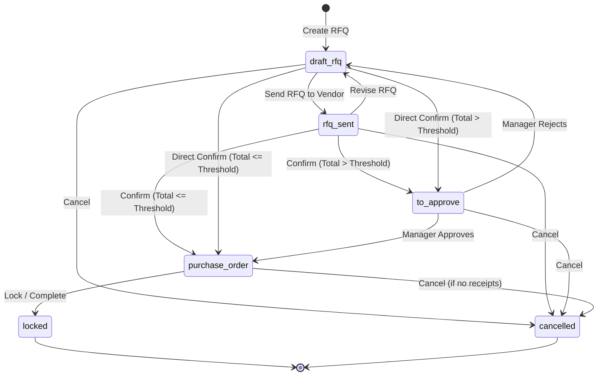
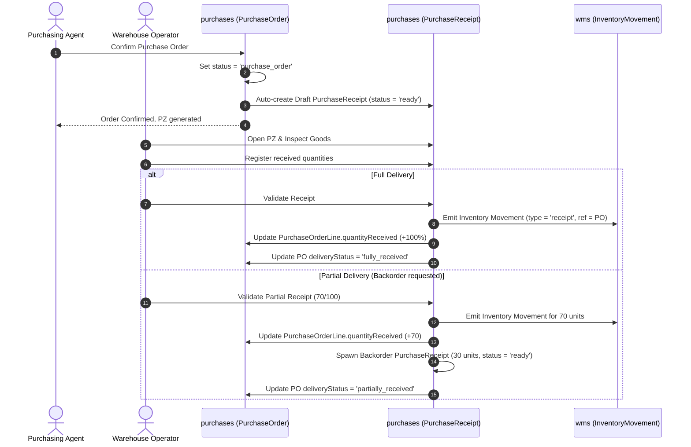
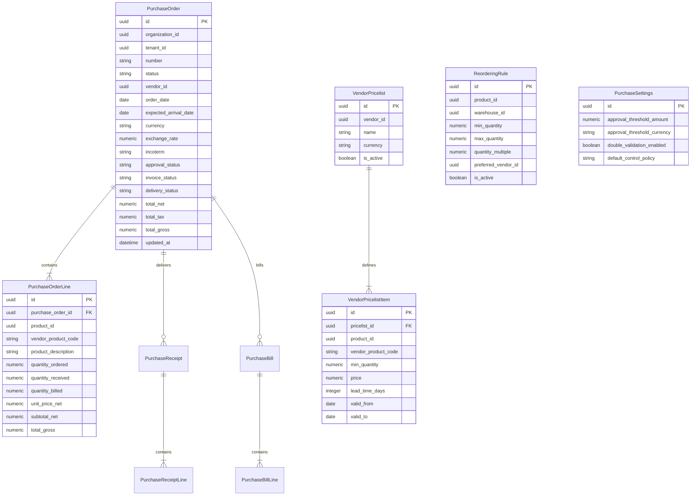

# Purchasing Module (Odoo Purchase Parity)

**Date**: 2026-10-22  
**Status**: Implemented (Complete - All Phases 1-3 Verified)  
**Scope**: Core Platform Module (`packages/core/src/modules/purchases/`)  
**Task / Spec Type**: New Business Module  

---

## TLDR

**Key Points:**
- Introduces the first-class `purchases` business module at `packages/core/src/modules/purchases/`, providing end-to-end procurement and purchasing lifecycle matching Odoo Purchase.
- Manages Request for Quotations (RFQs), Purchase Orders (POs), vendor pricelists, goods receipts (PZ documents), 3-way invoice matching, and automated replenishment (Min-Max inventory engine + Make-to-Order).
- Strictly follows Open Mercato architectural laws: scoped to `organization_id` and `tenant_id`, zero cross-module direct ORM relationships, canonical CRUD APIs (`makeCrudRoute`), optimistic concurrency locking (`updated_at`), event-driven side effects (`createModuleEvents`), and Design-System-compliant backoffice UI (`@open-mercato/ui`).

**Scope:**
- **Phase 1: Core RFQ & Purchase Orders**: Data entities (`PurchaseOrder`, `PurchaseOrderLine`, `PurchaseDocumentSequence`, `PurchaseSettings`), state machine transitions, automatic sequential numbering (`RFQ/YYYY/XXXX` and `PO/YYYY/XXXX`), double-authorization approval limit, multi-currency lines, CRUD endpoints, and full backoffice admin UI.
- **Phase 2: Vendor Pricelists & Warehouse Goods Receipt (PZ)**: Vendor pricelists (`VendorPricelist`, `VendorPricelistItem`) with tier breaks and auto-suggest, physical goods reception (`PurchaseReceipt`, `PurchaseReceiptLine`), stock movement synchronization into `wms`, tracking `quantityReceived`, and backorder splitting.
- **Phase 3: Automated Procurement & 3-Way Matching**: Min-Max reordering rule engine with cron scheduled action, Make-to-Order (MTO) generation from sales orders, vendor bill verification (`PurchaseBill`), 3-way matching engine (`PO` vs `PZ` vs `Bill`), and exception handling.

**Concerns:**
- Cross-module decoupling: External references (`vendorId` &rarr; `customers.CustomerEntity`, `productId` &rarr; `catalog.Product`, `warehouseId` &rarr; `wms.Warehouse`, `buyerId` &rarr; `auth.User`) are strictly string UUID identifiers resolved through DI service lookups or asynchronous events.
- Concurrency & Double Reception: Concurrent physical warehouse receipts must be serialized via optimistic locking (`updated_at` version headers) to prevent duplicate stock increments in WMS and race conditions on `quantityReceived`.

---

## Overview

The `purchases` module brings enterprise-grade procurement workflows to Open Mercato. It bridges supplier relationships with warehouse operations and accounting, offering full lifecycle tracking from initial supplier quote request to verified supplier payment.

### Market Reference: Odoo Purchase Parity
We studied Odoo 17/18 Purchase and adopted its core strengths while adapting them to Open Mercato's clean modular architecture:
- **Adopted from Odoo:**
  - *Unified document lifecycle*: An RFQ seamlessly becomes a Purchase Order upon confirmation without record cloning.
  - *Manager double authorization*: Configurable financial threshold where high-value POs require manager approval (`to_approve`).
  - *Vendor pricelist structure (`product.supplierinfo`)*: Tiered volume pricing (`minQuantity`), supplier SKUs, and supplier delivery lead times.
  - *Warehouse receipt & backorder flow*: Physical goods receipts (PZ) track received quantities; partial arrivals generate backorders or close out remainders.
  - *Dual billing control policy & 3-way matching*: Invoicing based on *Received Quantities* vs *Ordered Quantities*, with automated 3-way reconciliation (PO &harr; PZ &harr; Vendor Bill) flagging unit price or quantity exceptions.
  - *Dual-mode replenishment*: Periodic Min-Max inventory recalculation and customer Make-to-Order (MTO) generation.
- **Adapted for Open Mercato:**
  - Pure modular boundaries: No cross-module foreign key constraints or SQL joins with `catalog`, `customers`, or `wms`.
  - Canonical framework primitives: CRUD routes created via `makeCrudRoute`, backoffice forms built on `CrudForm` and `DataTable`, and event emissions via `createModuleEvents`.
  - Optimistic locking: All mutating endpoints enforce concurrency guards with standard 409 conflict handling.

---

## Problem Statement

Currently, Open Mercato includes modules for CRM (`customers`), Product Catalog (`catalog`), Order Management (`sales`), and Inventory/Warehouse (`wms`), but lacks a procurement engine:
1. **No Supplier Purchasing**: Businesses cannot create formal purchase agreements, compare supplier quotations, or issue Purchase Orders.
2. **Disconnected Warehouse Reception**: Inbound warehouse shipments (`wms` movements with `type = 'receipt'`) cannot be linked to commercial purchase commitments or expected quantities.
3. **Manual Stock Replenishment**: Low inventory requires manual intervention; there is no automated trigger to reorder stock when reaching safety thresholds or when fulfilling customer back-to-back orders.
4. **Billing Risk**: Without 3-way matching, businesses risk paying supplier invoices that differ from negotiated purchase prices or cover unreceived quantities.

---

## Proposed Solution

A dedicated module at `packages/core/src/modules/purchases/` implementing a full procurement pipeline.

### Design Decisions

| Decision | Rationale |
|----------|-----------|
| **Module Placement: `packages/core/src/modules/purchases/`** | Standard core business module alongside `sales`, `customers`, and `wms`. Follows the canonical plural naming convention. |
| **Vendor Representation via `customers`** | Vendors are external organizations represented by `customers.CustomerEntity` (with `type = 'company'` and role/tag `supplier`/`vendor`). Avoids duplicating contact, company, tax identification (NIP/VAT), and address schemas. |
| **Receipt Document (`PurchaseReceipt`) in `purchases`** | The commercial receipt document (PZ) belongs to the purchasing process. Once validated, it triggers stock movements into `wms` via events and service calls, keeping the commercial audit trail intact. |
| **Numeric precision for financial & quantity fields** | Amounts stored as `numeric(16, 4)` and quantities as `numeric(16, 4)` to support fractional unit packaging and currency conversions without floating-point inaccuracies. |
| **Event-driven MTO and WMS synchronization** | Decouples `sales` and `wms` from `purchases`. The `sales` module emits `sales.order.confirmed`, and `purchases` subscribes to generate RFQs for products configured with `procure_method = 'mto'`. |
| **PostgreSQL Document Sequence Generator** | Sequential identifiers (`RFQ/YYYY/XXXX`, `PO/YYYY/XXXX`, `PZ/YYYY/XXXX`) use dedicated PostgreSQL sequences to guarantee atomic, gap-free numbering under high concurrency. |

### Alternatives Considered

| Alternative | Why Rejected |
|-------------|-------------|
| **Extend `sales` module with negative quantities / purchase flags** | Conflates outbound revenue flows with inbound cost commitments. Pollutes sales entities, tax calculations, and permissions. |
| **Direct ORM ManyToOne to `catalog.Product` and `customers.CustomerEntity`** | Violates Open Mercato's fundamental architectural rule: zero direct ORM foreign keys between packages/modules. |
| **Store pricelists directly in `catalog`** | Supplier pricelists are procurement-specific and involve vendor-specific lead times and minimum quantities; catalog focuses on master product data and retail/sale pricing. |

---

## User Stories / Use Cases

1. **Purchasing Agent creates and issues an RFQ**:
   - *As a Buyer*, I want to create a Request for Quotation for a specific vendor and add product lines with target prices so that I can send it to the supplier for pricing confirmation.
2. **Manager Approves High-Value Orders**:
   - *As a Procurement Manager*, I want purchase orders exceeding our authorization limit (e.g., > 10,000 PLN) to pause in `to_approve` status so that I can review and confirm them before legal commitment.
3. **Warehouse Specialist receives goods**:
   - *As a Warehouse Operator*, I want to open the Purchase Receipt (PZ), enter physical received quantities, and complete the receipt so that inventory levels in `wms` increase automatically.
4. **Partial Shipment & Backorder**:
   - *As a Warehouse Operator*, when a shipment arrives partially (e.g. 70 of 100 units), I want the system to generate a backorder for the remaining 30 units so that pending deliveries are not lost.
5. **Accountant conducts 3-Way Matching**:
   - *As an Accounts Payable Specialist*, I want supplier invoices matched against the Purchase Order and Goods Receipt so that any price hike or quantity overbilling is flagged for dispute before payment.
6. **System automates inventory reordering**:
   - *As an Operations Manager*, I want the system to periodically calculate stock shortages based on Min-Max rules and generate draft RFQs for preferred suppliers automatically.

---

## Architecture & Workflows

### 1. Purchase Order State Machine



### 2. Physical Reception & Stock Synchronization (PZ)



### 3. Entity Relationship Diagram (Internal to Module)



---

## Commands & Events

### Commands (Domain Services)
- `purchases.order.create`: Initialize a draft RFQ.
- `purchases.order.update`: Modify header or line items with automatic tax/subtotal recalculation.
- `purchases.order.send`: Transition RFQ to `rfq_sent`.
- `purchases.order.confirm`: Transition to `purchase_order` (or `to_approve` if above threshold).
- `purchases.order.approve`: Manager approval moving `to_approve` &rarr; `purchase_order`.
- `purchases.order.cancel`: Revert or cancel active order.
- `purchases.receipt.validate`: Validate physical stock arrival, create backorder if partial, update `quantityReceived`, and emit inventory movements.
- `purchases.bill.match`: Execute 3-way match between bill, purchase order lines, and received lines.
- `purchases.reorder.execute`: Run min-max replenishment evaluation.

### Events (`packages/core/src/modules/purchases/events.ts`)
Using canonical `createModuleEvents`:
- `purchases.order.created`: New order/RFQ recorded.
- `purchases.order.confirmed`: PO officially confirmed; triggers warehouse receipt creation.
- `purchases.order.approved`: High-value PO approved by manager.
- `purchases.order.cancelled`: Order cancelled.
- `purchases.receipt.validated`: Goods receipt completed; triggers WMS inventory movement.
- `purchases.bill.matched`: 3-way matching completed with verified/exception status.

---

## Data Models

All entities extend `PurchasesScopedEntity`:
- `id`: UUID (Primary Key)
- `organization_id`: UUID (Indexed)
- `tenant_id`: UUID (Indexed)
- `metadata`: JSONB (Nullable)
- `created_at`: Date
- `updated_at`: Date (Optimistic Locking trigger)
- `deleted_at`: Date (Soft delete support)

### 1. `PurchaseOrder`
Table: `purchases_orders`
- `number`: `string` (Unique per tenant/org, e.g. `PO/2026/0001` or `RFQ/2026/0001`)
- `status`: `enum` (`draft_rfq`, `rfq_sent`, `to_approve`, `purchase_order`, `locked`, `cancelled`)
- `vendor_id`: `string` (UUID &rarr; `customers.CustomerEntity`)
- `order_date`: `Date`
- `expected_arrival_date`: `Date` (Nullable)
- `currency`: `string` (e.g. `'PLN'`, `'EUR'`, `'USD'`, default `'PLN'`)
- `exchange_rate`: `numeric(16, 6)` (default `1.000000`)
- `payment_term_id`: `string` (UUID, Nullable)
- `incoterm`: `string` (Nullable, e.g. `'FOB'`, `'CIF'`, `'EXW'`)
- `buyer_id`: `string` (UUID &rarr; `auth.User`, Nullable)
- `approval_status`: `enum` (`not_required`, `pending`, `approved`, `rejected`)
- `invoice_status`: `enum` (`no`, `to_invoice`, `invoiced`)
- `delivery_status`: `enum` (`pending`, `partially_received`, `fully_received`)
- `control_policy`: `enum` (`on_received`, `on_ordered`, default `'on_received'`)
- `subtotal_net`: `numeric(16, 4)` (default `'0.0000'`)
- `total_tax`: `numeric(16, 4)` (default `'0.0000'`)
- `total_gross`: `numeric(16, 4)` (default `'0.0000'`)
- `notes`: `text` (Nullable)
- `lines`: `OneToMany(() => PurchaseOrderLine)`
- `receipts`: `OneToMany(() => PurchaseReceipt)`
- `bills`: `OneToMany(() => PurchaseBill)`

### 2. `PurchaseOrderLine`
Table: `purchases_order_lines`
- `purchase_order_id`: `ManyToOne(() => PurchaseOrder)`
- `product_id`: `string` (UUID &rarr; `catalog.Product`)
- `vendor_product_code`: `string` (Nullable, supplier's catalog SKU)
- `product_description`: `text`
- `quantity_ordered`: `numeric(16, 4)`
- `quantity_received`: `numeric(16, 4)` (default `'0.0000'`)
- `quantity_billed`: `numeric(16, 4)` (default `'0.0000'`)
- `unit_price_net`: `numeric(16, 4)`
- `tax_rate_percent`: `numeric(5, 2)` (default `'23.00'`)
- `subtotal_net`: `numeric(16, 4)`
- `total_tax`: `numeric(16, 4)`
- `total_gross`: `numeric(16, 4)`
- `expected_delivery_date`: `Date` (Nullable)

### 3. `VendorPricelist` & `VendorPricelistItem`
Tables: `purchases_vendor_pricelists`, `purchases_vendor_pricelist_items`
- Pricelist Header:
  - `vendor_id`: `string` (UUID &rarr; `customers.CustomerEntity`)
  - `name`: `string`
  - `currency`: `string`
  - `is_active`: `boolean` (default `true`)
- Pricelist Item:
  - `pricelist_id`: `ManyToOne(() => VendorPricelist)`
  - `product_id`: `string` (UUID &rarr; `catalog.Product`)
  - `vendor_product_code`: `string` (Nullable)
  - `min_quantity`: `numeric(16, 4)` (default `'1.0000'`)
  - `price`: `numeric(16, 4)`
  - `lead_time_days`: `integer` (default `0`)
  - `valid_from`: `Date` (Nullable)
  - `valid_to`: `Date` (Nullable)

### 4. `PurchaseReceipt` & `PurchaseReceiptLine` (PZ)
Tables: `purchases_receipts`, `purchases_receipt_lines`
- Header:
  - `purchase_order_id`: `ManyToOne(() => PurchaseOrder)`
  - `number`: `string` (e.g. `PZ/2026/0001`)
  - `status`: `enum` (`draft`, `ready`, `done`, `cancelled`)
  - `warehouse_id`: `string` (UUID &rarr; `wms.Warehouse`)
  - `is_backorder`: `boolean` (default `false`)
  - `backorder_of_id`: `string` (UUID, Nullable)
  - `received_date`: `Date` (Nullable)
- Line:
  - `receipt_id`: `ManyToOne(() => PurchaseReceipt)`
  - `order_line_id`: `string` (UUID &rarr; `PurchaseOrderLine`)
  - `product_id`: `string` (UUID)
  - `quantity_expected`: `numeric(16, 4)`
  - `quantity_done`: `numeric(16, 4)` (default `'0.0000'`)

### 5. `PurchaseBill` & `PurchaseBillLine` (Vendor Invoices)
Tables: `purchases_bills`, `purchases_bill_lines`
- Header:
  - `purchase_order_id`: `ManyToOne(() => PurchaseOrder)`
  - `vendor_bill_number`: `string` (External invoice reference from supplier)
  - `bill_date`: `Date`
  - `status`: `enum` (`draft`, `posted`, `cancelled`)
  - `matching_status`: `enum` (`pending`, `verified`, `exception`)
  - `exception_notes`: `text` (Nullable)
  - `total_net`: `numeric(16, 4)`
  - `total_gross`: `numeric(16, 4)`
- Line:
  - `bill_id`: `ManyToOne(() => PurchaseBill)`
  - `order_line_id`: `string` (UUID, Nullable)
  - `product_id`: `string` (UUID)
  - `quantity`: `numeric(16, 4)`
  - `unit_price_net`: `numeric(16, 4)`
  - `subtotal_net`: `numeric(16, 4)`

### 6. `ReorderingRule`
Table: `purchases_reordering_rules`
- `product_id`: `string` (UUID &rarr; `catalog.Product`)
- `warehouse_id`: `string` (UUID &rarr; `wms.Warehouse`)
- `min_quantity`: `numeric(16, 4)` (Safety threshold / trigger level)
- `max_quantity`: `numeric(16, 4)` (Target replenishment level)
- `quantity_multiple`: `numeric(16, 4)` (Batch order multiple, e.g. 10 or 24)
- `preferred_vendor_id`: `string` (UUID, Nullable)
- `is_active`: `boolean` (default `true`)

### 7. `PurchaseSettings`
Table: `purchases_settings`
- `approval_threshold_amount`: `numeric(16, 4)` (default `'10000.0000'`)
- `approval_threshold_currency`: `string` (default `'PLN'`)
- `double_validation_enabled`: `boolean` (default `true`)
- `default_control_policy`: `enum` (`on_received`, `on_ordered`, default `'on_received'`)
- `auto_create_receipt_on_confirm`: `boolean` (default `true`)

### 8. `PurchaseDocumentSequence`
Table: `purchases_document_sequences`
- `document_kind`: `enum` (`rfq`, `po`, `pz`, `bill`)
- Counter managed atomically via PostgreSQL sequence (`purchases_docseq_<id>`).

---

## API Contracts

All endpoints live under `/api/purchases/` and are built using `makeCrudRoute` or standard platform handlers.

### 1. Purchase Orders
- `GET /api/purchases/orders`: List purchase orders (Filter by `status`, `vendorId`, `deliveryStatus`, `invoiceStatus`, pagination, sorting).
- `POST /api/purchases/orders`: Create new draft RFQ.
- `GET /api/purchases/orders/:id`: Get PO detail with lines, receipts, and billing history.
- `PUT /api/purchases/orders/:id`: Update PO header and lines (Enforces `If-Match` / optimistic locking header).
- `DELETE /api/purchases/orders/:id`: Delete draft RFQ.
- `POST /api/purchases/orders/:id/confirm`: Confirm order (evaluates approval threshold).
- `POST /api/purchases/orders/:id/approve`: Approve order by authorized manager.
- `POST /api/purchases/orders/:id/cancel`: Cancel order.

### 2. Vendor Pricelists
- `GET /api/purchases/pricelists`: List vendor pricelists.
- `POST /api/purchases/pricelists`: Create vendor pricelist.
- `GET /api/purchases/pricelists/:id`: Detail with items.
- `PUT /api/purchases/pricelists/:id`: Update pricelist & tier items.
- `GET /api/purchases/pricelists/resolve?vendorId=...&productId=...&quantity=...`: Resolves best unit price and lead time.

### 3. Goods Receipts (PZ)
- `GET /api/purchases/receipts`: List receipts (PZ).
- `GET /api/purchases/receipts/:id`: Get receipt detail with line items.
- `POST /api/purchases/receipts/:id/validate`: Confirm physical delivery quantities. Body accepts:
  ```json
  {
    "lines": [
      { "orderLineId": "uuid", "quantityDone": 70 }
    ],
    "createBackorder": true
  }
  ```

### 4. 3-Way Matching & Invoicing
- `POST /api/purchases/bills`: Register incoming vendor bill.
- `POST /api/purchases/bills/:id/verify-match`: Executes 3-way reconciliation against PO and PZ. Returns match status or flags discrepancies.

### 5. Automated Reordering
- `GET /api/purchases/reordering-rules`: List reordering rules.
- `POST /api/purchases/reordering-rules`: Create/update min-max rule.
- `POST /api/purchases/reordering-rules/run`: Trigger manual replenishment recalculation.

---

## Backoffice UI Layouts

Built with `@open-mercato/ui` design system:
1. **List View (`/backend/purchases/orders`)**:
   - `DataTable` with status badges, vendor column, order date, total gross, and delivery indicator (`truck` icon with color tokens: green for full, amber for partial, muted for pending).
   - Filter pills: *All*, *RFQs*, *To Approve*, *Purchase Orders*, *Waiting Bills*.
2. **Detail / Edit View (`/backend/purchases/orders/:id`)**:
   - Top Status Breadcrumb Bar: Visual pipeline of lifecycle states (`Draft RFQ` &rarr; `RFQ Sent` &rarr; `To Approve` &rarr; `Purchase Order` &rarr; `Locked`).
   - Action Buttons: `Send RFQ`, `Confirm Order`, `Approve`, `Receive Products` (PZ shortcut), `Cancel`.
   - 2-Column Form (`CrudForm`):
     - Left: Vendor selector, Currency, Buyer, Order Date.
     - Right: Expected Arrival Date, Destination Warehouse, Payment Term, Incoterm.
   - Line Item Matrix: Product autocomplete, Vendor SKU, Quantity, Price (auto-filled from Vendor Pricelist), Tax, and Subtotal Net.
   - Activity / Chatter Sidebar: Audit log timeline, PDF download button, and internal notes.
3. **Goods Receipt Modal / View**:
   - Compares `quantity_expected` vs input for `quantity_done`.
   - Confirmation dialog for Backorder choice when `quantity_done < quantity_expected`.

---

## Phasing & Implementation Plan

```mermaid
flowchart TD
    subgraph Phase 1: Core RFQ and Purchase Orders
        P1_1[1.1 Entities and Migration: PurchaseOrder, Lines, Sequence, Settings]
        P1_2[1.2 Domain Service and Calculations: Totals, Currency, Sequential Numbering]
        P1_3[1.3 CRUD APIs and State Machine Transitions]
        P1_4[1.4 Backoffice UI: DataTable and CrudForm with Line Matrix]
        P1_5[1.5 Integration and Unit Tests for Phase 1]
    end

    subgraph Phase 2: Vendor Pricelists and Goods Receipt
        P2_1[2.1 Entities: VendorPricelist, Items, PurchaseReceipt, ReceiptLines]
        P2_2[2.2 Pricelist Resolution Engine: Auto-suggest prices and lead times]
        P2_3[2.3 Goods Receipt PZ Validation and Backorder Engine]
        P2_4[2.4 WMS Integration: Emit Inventory Movement Receipts]
        P2_5[2.5 Backoffice UI: Receipt View, Pricelist Manager, Delivery Badges]
        P2_6[2.6 Integration Tests for Phase 2]
    end

    subgraph Phase 3: Procurement Automation and 3-Way Matching
        P3_1[3.1 Entities: ReorderingRule, PurchaseBill, BillLines]
        P3_2[3.2 Min-Max Reordering Scheduler Action]
        P3_3[3.3 Sales Order MTO Subscriber]
        P3_4[3.4 3-Way Matching Engine: PO vs PZ vs Vendor Bill]
        P3_5[3.5 Backoffice UI: Reordering Rules and Billing Verification]
        P3_6[3.6 End-to-End Test Suite and Documentation]
    end

    P1_5 --> P2_1
    P2_6 --> P3_1
```



### Phase 1: Core RFQ & Purchase Orders
- **Step 1.1**: Define entities `PurchaseOrder`, `PurchaseOrderLine`, `PurchaseDocumentSequence`, and `PurchaseSettings` with MikroORM decorators, indexes, and migrations.
- **Step 1.2**: Implement `PurchaseOrderService` (sequential numbering, subtotal/tax recalculation, state machine transition guards, approval threshold logic).
- **Step 1.3**: Create typed events (`packages/core/src/modules/purchases/events.ts`) and register CRUD API routes.
- **Step 1.4**: Build the backoffice UI pages: Order list with `DataTable` and Order form with 2-column header and dynamic line items table.
- **Step 1.5**: Write unit tests for line calculations and state transitions, and integration tests for API endpoints.

### Phase 2: Vendor Pricelists & Goods Receipt (PZ)
- **Step 2.1**: Implement `VendorPricelist`, `VendorPricelistItem`, `PurchaseReceipt`, and `PurchaseReceiptLine` entities.
- **Step 2.2**: Implement `VendorPricelistService` resolving optimal tier price and lead time. Wire into PO line creation.
- **Step 2.3**: Implement `PurchaseReceiptService` handling physical goods validation, `quantityReceived` synchronization, and backorder splitting.
- **Step 2.4**: Wire WMS integration: emit `purchases.receipt.validated` and publish inventory movements (`InventoryMovement` with `type = 'receipt'`).
- **Step 2.5**: Add Goods Receipt backoffice view and receipt validation modal with backorder prompt.
- **Step 2.6**: Write integration tests covering full receipt and partial delivery with backorders.

### Phase 3: Automated Procurement & 3-Way Matching
- **Step 3.1**: Implement `ReorderingRule`, `PurchaseBill`, and `PurchaseBillLine` entities.
- **Step 3.2**: Implement `ReorderingEngine` running periodic Min-Max calculations ($\text{Stock} + \text{Inbound} - \text{Reserved} < \text{Min}$) and generating draft RFQs.
- **Step 3.3**: Implement `SalesOrderSubscriber` listening to `sales.order.confirmed` for MTO items to generate linked RFQs.
- **Step 3.4**: Implement `ThreeWayMatchService` comparing bill lines to order lines and receipt lines, flagging price and quantity exceptions.
- **Step 3.5**: Add Bill reconciliation UI view and reordering rules configuration table.
- **Step 3.6**: Complete documentation and end-to-end integration tests.

---

## Risks & Impact Review

- **Cross-Module Failure Isolation**: If `wms` is temporarily offline or unavailable, stock movement events must be queued or retried without aborting the commercial receipt.
- **Concurrency Conflicts on Receipts**: Multiple warehouse operators scanning goods simultaneously could cause race conditions on `quantityReceived`. Resolved via entity versioning (`updated_at`) and atomic database updates.
- **Data Integrity on Currency Fluctuation**: Exchange rates are snapshotted on the `PurchaseOrder` at confirmation time so future exchange rate shifts do not retroactively alter the order's base currency totals.

---

## Final Compliance Report

| Rule / Requirement | Status | Verification Note |
|---|---|---|
| Singular naming for entities & events | PASS | `PurchaseOrder`, `PurchaseOrderLine`, `purchases.order.confirmed` |
| Plural snake_case module name | PASS | `packages/core/src/modules/purchases/` |
| Scoped by `organization_id` & `tenant_id` | PASS | All entities extend `PurchasesScopedEntity` |
| No cross-module ORM direct relations | PASS | All external references (`vendorId`, `productId`, `warehouseId`) are UUID strings |
| Optimistic locking on mutable entities | PASS | `updated_at` column included and checked via concurrency headers |
| Canonical CRUD and UI primitives | PASS | Uses `makeCrudRoute`, `DataTable`, `CrudForm`, and `StatusBadge` |
| Design System token compliance | PASS | Strictly uses semantic status tokens (`success`, `warning`, `destructive`) and shared UI components |
