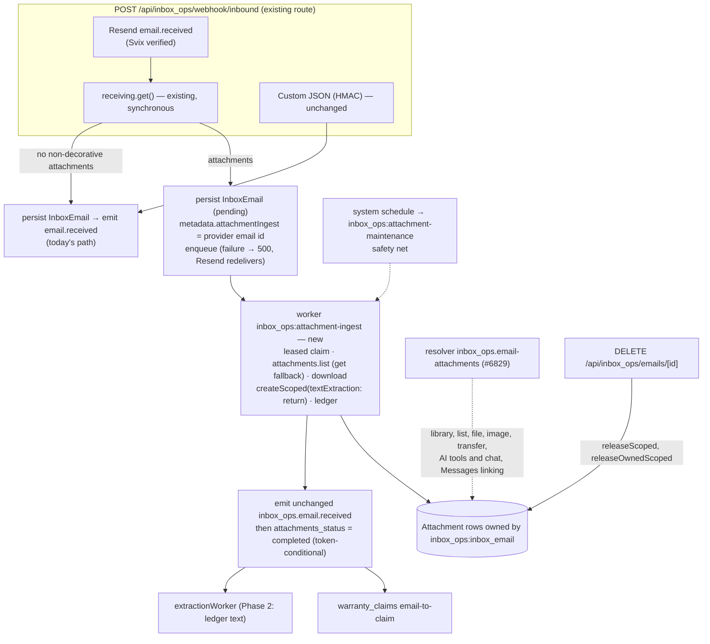

# InboxOps Inbound Email Attachments

**Status**: Draft
**Created**: 2026-10-25
**Issue**: [#6282](https://github.com/open-mercato/open-mercato/issues/6282)
**Modules**: `inbox_ops` (primary), `attachments` (additive service contract, access resolver adoption), `ai_assistant`, `catalog` and `messages` (owner access enforcement on the existing paths listed in the audit table)
**Depends on**: [#6829](https://github.com/open-mercato/open-mercato/pull/6829) (implementation of `2026-10-01-attachment-access-resolvers.md`) and an enterprise change to `agent_orchestrator` attachment staging (Open Question 5). Merge order: #6829 → the access-hardening PR (Phase 0 of this spec) → the enterprise change, which uses Phase 0's helper → the ingestion PR (Phases 1–3).
**Related specs**: `2026-10-01-attachment-access-resolvers.md` (owner-scoped attachment authorization), `2026-05-21-email-integration-foundation.md` (hub email normalization), `2026-03-23-inbound-webhook-handlers.md` (Phase 4 moves this webhook onto the generic inbound system), `2026-04-27-ai-agent-attachment-processing-and-context.md` (AI agent attachment context)

## 📝 TLDR

**Key Points:**
- The AI Inbox drops every attachment of an inbound email today: the file is never stored, never reaches the LLM extraction and is invisible on the proposal. Supplier offers, purchase orders, invoices and RMA photos almost always arrive as attachments.
- After this change, attachments of Resend inbound mail are stored as platform attachments owned by the `InboxEmail`, readable only by users who may read the email; their extracted text is kept encrypted with the email and feeds the extraction prompt; they are listed on the proposal and in the mirrored Messages thread; deleting the email releases them.
- Files are persisted before `inbox_ops.email.received` is emitted, so every existing subscriber sees them without changes. Access is enforced by an `inbox_ops` owner access resolver (#6829) on every attachment route and on every OSS path that reads or moves attachment rows by id outside those routes (AI attachment tools, AI chat attachments, AI pending-action rechecks, the catalog media-description AI tool, Messages attachment linking), found by an audit of all direct readers of the attachments table.

**Scope:**
- Phase 0 (own PR): owner access enforcement on every OSS path that reads or moves attachment rows by id outside #6829's routes.
- Phase 1: ingest attachments of Resend inbound mail; `inbox_ops` owner access resolver; `listInLibrary` library exclusion; release on email deletion; attachment list API.
- Phase 2: attachment text in the extraction prompt, field-level source references.
- Phase 3: attachments on the proposal detail page and in the Messages thread.
- Follow-up specs, not delivered here: raw MIME intake for self-hosted relays and the Gmail/IMAP hub, copying attachments onto records created by accepted actions (issue Phase 4), warranty-claim attachments, raw `.eml` retention, LLM OCR for inbound files.

**Concerns:**
- Blocked on #6829; ingestion is also blocked on the enterprise `attachmentStager` change (Open Question 5), which only maintainers can make (`enterprise-contribution-guard.yml` blocks external changes to `packages/enterprise`).
- Inbound mail from unauthenticated senders consumes the tenant attachment quota (default 512 MB).
- XML and HTML attachments, including XML e-invoices, are refused by the attachments module as active content (Open Question 4).

## Overview

The `inbox_ops` module turns forwarded or received emails into proposals (orders, quotes, contacts, replies) that a human accepts or rejects. Its inbound webhook (`api/webhook/inbound.ts`) accepts a Resend `email.received` event or a custom HMAC-signed JSON payload, persists an `InboxEmail`, and emits `inbox_ops.email.received`. Two persistent subscribers consume that event: the LLM extraction worker (`subscribers/extractionWorker.ts`) and the warranty-claim intake (`warranty_claims/subscribers/email-to-claim.ts`).

This spec makes attachments of Resend inbound mail part of that flow and keeps every existing contract (webhook JSON body, event IDs and payloads, `attachmentIds` response field and its redaction) intact. The custom JSON webhook keeps carrying no attachments.

> **Market reference.** Rails Action Mailbox, django-anymail, GitLab, Discourse, Zammad and Odoo store files in a generic storage service owned by the receiving record (`ir.attachment` with `res_model`/`res_id`, Zammad `Store` with object and id), persist the message first and process asynchronously; we adopt that ownership and ordering. They normalize to raw MIME because most of their sources deliver raw messages; Resend serves each part by a stable id, which gives a deterministic idempotency key, so this spec downloads Resend parts individually and leaves raw MIME to the hub follow-up, where `mailparser` already parses Gmail and IMAP mail. We reject the habits that lose data silently: Chatwoot keeps only the last 15 attachments and Frappe skips oversized files without a trace. Field-level provenance follows Azure Document Intelligence and Rossum: page or sheet plus a quoted snippet.

## Problem Statement

Verified on `main` (`b7e6aaf96`):

1. **The webhook never reads attachments.** `inbound.ts` builds `emailInput` from nine fields on both provider paths; `fetchResendEmail()` maps nine fields from `resend.emails.receiving.get()` and ignores its `attachments[]` array.
2. **`InboxEmail.attachment_ids` is a dead column.** It ships in `Migration20260216151619`, in the `GET /api/inbox_ops/emails` projection and in the `EMAIL_CONTENT_FIELDS` redaction list (`api/emails/response.ts`), but nothing writes it.
3. **Attachment-only emails collide in deduplication.** `contentHash` is `sha256(subject, from, text)` (`emailParser.ts:252`). Two emails from the same supplier with the subject "Offer", an empty body and different PDFs hash identically, so the second is dropped as a duplicate.
4. **Attachment-only emails fail extraction.** `extractionWorker.ts:149` marks an email `failed` with "No text content found in email" when the body is empty, which is the common shape of a supplier offer.
5. **The extraction prompt is blind to documents.** `lib/extractionPrompt.ts` receives the body text only; a `create_order` proposal is built from the body even when the order lines exist only in an attached file.
6. **Resend already exposes everything needed.** In `resend@6.24.0` (the version in `packages/core/package.json`), `receiving.get()` returns attachment metadata (`id`, nullable `filename`, `size`, `content_type`, nullable `content_disposition`, `content_id`), and `receiving.attachments.get({ emailId, id })` returns a `download_url` that expires after one hour. The `email.received` webhook carries metadata only.
7. **Attachment access is organization-wide on several paths.**
   - `GET /api/attachments/library` and `GET /api/attachments` require only `attachments.view` (granted to `employee` by default); `/api/attachments/file/[id]` checks scope only. #6829 adds owner access resolvers to these routes.
   - Paths outside #6829 read or move attachment rows by caller-supplied id with tenant and organization checks only (see the audit table under Components): the AI tools in `ai_assistant/ai-tools/attachments-pack.ts`, the AI chat attachment loader `ai_assistant/lib/attachment-parts.ts` (also used by `warranty_claims/lib/aiAssist.ts`), the AI pending-action recheck `ai_assistant/lib/pending-action-recheck.ts`, the catalog media-description AI tool (`catalog/ai-tools/authoring-pack.ts`), and Messages linking (`messages/lib/attachments.ts` `linkAttachmentsToMessage`, which re-parents any attachment id of the organization onto a message).
   - Storing inbound files without closing all of these would let colleagues without inbox access read mail content that `inbox_ops` otherwise encrypts and gates behind `inbox_ops.proposals.view`.

## Proposed Solution

### Design Decisions

| # | Decision | Rationale |
|---|----------|-----------|
| D1 | **Resend parts are downloaded individually by their stable attachment ids**, taken from the `receiving.get()` metadata, with fresh URLs from `receiving.attachments.list()` (falling back to `receiving.attachments.get()` per part). | Provider ids give every part a deterministic key, so retries can never store a file twice; no MIME parser or new dependency is needed; one list call per page keeps the worker under Resend's API rate limit. |
| D2 | **The attachments module stays the source of truth for files.** Each stored part is an `Attachment` row owned by `(entityId: 'inbox_ops:inbox_email', recordId: email.id)` in the private `privateAttachments` partition, created through `attachmentService.createScoped()`. | Same ownership model as Messages and as Odoo/Zammad. `createScoped` already enforces the scope invariant, executable and active-content blocking, MIME sniffing and quota leasing. |
| D3 | **`inbox_ops` declares an owner access resolver** (`data/attachment-access.ts`, contract from #6829) for `inbox_ops:inbox_email`: `read`, `render`, `metadata` and `export` require `inbox_ops.proposals.view` (wildcard-aware) and an owning email whose deletion is not pending release (D11); `reassign` and `delete` are denied to every user (and `create`, if #6829 adds that action). The resolver makes no per-row database query: one query per request and scope loads the emails whose deletion is pending release. The protected target also declares, durably on the partition, that these rows are not listed in the shared attachments library, which excludes them by primary `entity_id` in its records, count and facet queries. The owner is a protected target, so protection persists when `inbox_ops` is disabled. | Inbound mail must be exactly as readable as the email it came with, wherever attachments are reachable. Only `inbox_ops` manages these files' lifecycle (D11 releases them). #6829 evaluates every matching row of a library scan (offset paging, twice per request) under a shared 15-second deadline, so unbounded inbound rows would eventually make the shared library time out for every module, however cheap each decision is; inbound files are browsed from the inbox, not the generic library. Hiding files from listings alone would leave them downloadable by id. |
| D4 | **Every OSS path that reads or moves attachment rows by id outside #6829's routes evaluates owner access** through one row-level helper built on #6829's `evaluateAttachmentAccess`, for the real principal (a user, or an API key for key-authenticated calls): `metadata`/`read` for listing and reading (including sending bytes or text to an LLM), `reassign` on both the current and the destination owner for transfer and linking. | These paths bypass the routes #6829 guards; without this, the resolver would not hold. The fix protects every protected owner (Documents included), not only `inbox_ops`. |
| D5 | **Extracted text is handed to the caller by `createScoped`, not persisted on the attachment, and is kept encrypted in the `inbox_ops` ledger, written in the same transaction as the Attachment row.** `textExtraction: 'return'` runs the pure-JS extractor at upload, never queues LLM OCR, leaves `Attachment.content` empty, and passes the text to `persistLink`. | Mail content stays under `inbox_ops` encryption and access rules; no plaintext copy lands in the attachments table, where search, AI tools and library responses could expose it. The attachments OCR would send PDFs and images to OpenAI whenever `OPENAI_API_KEY` is set and would arrive after extraction. No new system-wide read method is needed. |
| D6 | **`inbox_ops` owns acquisition and the ingest state.** The attachments module gains only additive surface: a `code` on upload errors, the `textExtraction` input with an optional `content` in the result, the optional `releaseOwnedScoped` method, the `evaluateAttachmentRowAccess` helper, and `listInLibrary` with the `attachment_partitions.library_excluded_entities` column and its library filter. No provider registry, no new DI key, no queue in the attachments module. | Provider credentials and email semantics do not belong in the storage layer; that is how every precedent and every existing attachments consumer works. |
| D7 | **Ingest before emit.** When a Resend email carries non-decorative attachments, the webhook persists it with `attachments_status = 'pending'` and the provider email id, and enqueues the ingest worker; the worker stores the parts and only then emits the **unchanged** `inbox_ops.email.received`. Emails without attachments follow today's path exactly. | Both persistent subscribers see the files with no change to their code or to the event contract; `reprocess` and `extract` need no change. |
| D8 | **The webhook keeps today's synchronous `receiving.get()`**; only the byte downloads move to the worker. | A failing `receiving.get()` keeps returning 500 so Resend retries the webhook, as today. Moving the fetch out of the request is left to the inbound-webhook-handlers Phase 4. |
| D9 | **Recovery is self-contained.** A failed enqueue answers 500 so Resend redelivers, and the duplicate branch re-enqueues an email that is still `pending` or `processing` with an expired lease; an abandoned job is re-enqueued from the worker's `onJobAbandoned`; after the queue's last attempt the worker re-enqueues itself with a delay and finalizes in-band once 6 hours have passed since its first failure (a failed fetch or upload, a lease takeover or an abandoned job). A scheduled sweep remains as a safety net. | No email waits forever because the scheduler module is absent or a schedule is disabled; the queue's retries are seconds apart, so a short provider outage must not drop files. |
| D10 | **A per-part ledger** `inbox_email_attachments` records every part of an email that enters ingestion, with status and reason, keyed by `resend:<attachment id>` unique per email; a **leased claim** on the email (`attachments_claim_token`, `attachments_claimed_at`, renewed after each part) guards every ingest transition. | No silent loss; retries converge on the same row; the sweep and a slow job cannot process the same email concurrently or both emit. |
| D11 | **Deleting an email invalidates any in-flight ingest and releases its attachments** through `attachmentService.releaseScoped()` for ingested parts and `releaseOwnedScoped()` for any other row referencing the email, marking the ledger rows `released`. | Users cannot delete these files (D3), so the email's lifecycle must free them; otherwise inbound mail would fill the tenant quota with no way out. An ingest that outlives the deletion must neither store more files nor emit. |
| D12 | **`attachment_ids` stays as a denormalized mirror** of the stored attachment ids. | The field is already public and in the redaction list; filling it makes it truthful without a deprecation cycle. |
| D13 | **`contentHash` includes fingerprints of the non-decorative parts** when there are any; other emails keep their current hash. | Fixes Problem 3 without changing deduplication for existing mail or for mail whose only parts are inline logos. |
| D14 | **The email is never lost.** Quota exceeded, blocked type, oversized part or download failure each mark the part `skipped` or `failed` with a reason; the email continues to extraction. | Acceptance criterion of #6282. |
| D15 | **Attachment text reaches only the instance's configured LLM provider**, as delimited, budgeted, untrusted context. Neither email nor attachment content is logged. | Data-residency requirements of operators; consistent with the existing prompt-injection safety block. |
| D16 | **Field provenance is stored in a new encrypted column** `inbox_proposal_actions.source_refs`, not in the payload or the plaintext `metadata`. | Action payloads are validated against each action's registered `payloadSchema` (#6520); snippets and file names quote mail content, so they need the module's encryption like the payload itself. |
| D17 | **The Messages thread shows the email's attachments through the existing `inbox_ops.email` content renderer** (`components/messages/InboxEmailContent.tsx`), not through copies. | Quota counts `sum(file_size)` over all attachment rows (`attachments/lib/quota-service.ts`), so copies would double quota use; the renderer already belongs to `inbox_ops`, and the resolver keeps downloads gated. |
| D18 | **No new ACL feature.** Reading follows `inbox_ops.proposals.view` (the feature that gates email content and `attachmentIds`); deletion follows the existing email delete permission. | ACL feature IDs are frozen once shipped (BC §10); a separate feature can be added later without breaking anything. |

### Alternatives Considered

| Alternative | Why Rejected |
|-------------|-------------|
| Storing inbound files before an owner access policy exists, or only hiding them from listings (`listable: false`) | Any authenticated user of the organization could still download them by id; inbound mail would be readable beyond `inbox_ops.proposals.view`. |
| Relying on #6829's route guards alone | AI tools, AI chat attachments, AI pending-action rechecks, the catalog media-description tool and Messages linking read or move rows directly and would bypass the resolver. |
| Persisting extracted text in `Attachment.content` and reading it back with a new system-scope method | Leaves a plaintext copy of mail content in the attachments table and adds a method that lets any module read any owner's text. |
| Provider-agnostic descriptors with a fetcher registry and a generic ingest worker in the attachments module | No precedent puts provider fetchers in the storage layer; it would freeze a new DI key, queue and type for one provider. |
| Resend raw-first (`raw.download_url` parsed with `mailparser`) | Parsed parts carry no Resend id, so retries need heuristic matching and can store a file twice; it adds a production dependency to core. |
| Raw `message/rfc822` intake on the custom webhook in this spec | Needs a MIME parser in core, a durable raw copy that holds the decrypted body, and structural parse limits `mailparser` does not offer; it belongs with the hub, which already parses raw MIME. |
| A new `inbox_ops.email.ready` event | Three routes emit `inbox_ops.email.received` and `warranty_claims` subscribes to it; a new event forces changes in all of them. |
| Ingestion as "step 0" inside the extraction worker | Couples ingestion to extraction and leaves other subscribers without files. |
| A new `ingesting` value in `InboxEmailStatus` | Adds a visible status value to filters and counts; D7 achieves the ordering without it. |
| Finalizing on the queue's last attempt | Retries are seconds apart; a short outage would drop every file. |
| Persisting provider download URLs | They expire after one hour; the worker lists fresh URLs when it runs and refreshes an expired one per part. |
| `attachment_ids` as the source of truth | Duplicates ownership held by the attachments table and cannot express skipped or failed parts. |
| Copying attachments onto the mirrored Message | Doubles quota use (D17). |
| Sending images or PDF pages directly to a multimodal model | Provider-specific, costly and outside the structured-output path `inbox_ops` uses. |

## User Stories / Use Cases

- A **buyer** forwards a supplier's offer whose prices exist only in an attached PDF, so that the proposal contains the offered lines and prices. Spreadsheets gain the same behavior once XLSX text extraction (#6938) lands; until then they contribute a metadata-only line. XML e-invoices are refused today (Open Question 4).
- A **reviewer** sees which file and which page or sheet a proposed value came from, so that they can verify it before accepting.
- A **reviewer** opens the attached files from the proposal or from the Messages thread, so that they can compare the proposal with the source document.
- A **colleague without inbox access** cannot open, list, move or ask the AI assistant about those files anywhere.
- An **administrator** sees why a file was not stored (over quota, executable, too large), and deleting an email frees its files' quota.

## Architecture

Takeaway: the only behavioral fork is "does this Resend email carry non-decorative attachments". Without them, nothing changes. With them, the email row is created in the request together with its recovery source, the event fires once every part is stored, skipped or failed, the stored files are readable only by users who may read the email, and they live exactly as long as the email.

### Components

**Shared rules**
- **Decoration rule** (applied by the webhook when it writes the ledger): a part with `content_disposition = inline`, a `content_id`, and `size` below `INBOX_OPS_INLINE_IMAGE_MIN_BYTES` (16 KiB) is decorative. A null `content_disposition` counts as `attachment`. A larger inline image, such as a pasted photo, is kept.
- **Part key**: `resend:<attachment id>`.
- **Status per reason**: `skipped` for policy outcomes (`inline_decoration`, `too_many`, `too_large`, `total_too_large`, `dangerous_executable`, `active_content`); `failed` for errors (`quota_exceeded`, `partition_unavailable`, `fetch_failed`, `store_failed`, `processing_failed`, `ingest_timeout`); `released` after email deletion.
- **File names**: a missing name becomes `attachment-<n>` with an extension from the content type. The ledger keeps the original (encrypted) name for display; the stored attachment and its download use the attachments module's ASCII-sanitized name (`sanitizeUploadedFileName`).
- **Forwarded-as-attachment messages**: a nested `message/rfc822` part is stored as one `.eml` file and contributes a metadata-only line to extraction; unpacking it belongs to the raw MIME follow-up.

**Access resolver (`data/attachment-access.ts`)**
- `attachmentAccessResolvers`: one resolver `inbox_ops.email-attachments`, `targetPartition: '*'`, `targetEntity: 'inbox_ops:inbox_email'`.
  - For `read`, `render`, `metadata` and `export`:
    - It checks `inbox_ops.proposals.view` against `subject.userFeatures` with the shared wildcard-aware matcher. This needs no database work, and super-admins pass through their effective features. Without the feature: 404.
    - With it, the first call for a given tenant and organization in a request runs one query: the ids of emails in that scope with `deleted_at is not null`, `attachments_released_at is null`, and either `attachments_status is not null` or `attachments_release_requested_at is not null`, filtered in `WHERE` and served by a partial index. Keying on the email's own state, not only on the request timestamp, also covers emails deleted while an older build ran. The set is cached in `input.cache` under a tenant-and-organization key (a super-admin scan can cover several scopes); it is normally tiny, because deletion releases files and then sets `attachments_released_at`. Rows owned by an email id that does not exist are not in the set; they can only be planted through the generic upload route (see Risks).
    - Each row is then decided in memory. Take the email ids from `input.targets` filtered to `entityId: 'inbox_ops:inbox_email'` (primary owner or assignment, as #6829 collects them). Allow unless one of them is in the cached set (404). The tenant and organization match is already enforced by #6829's baseline check.
  - For `reassign`, `delete` (and `create`, if #6829 adds it), it returns 403.
- `protectedAttachmentTargets`: `{ resolverId: 'inbox_ops.email-attachments', targetPartition: '*', targetEntity: 'inbox_ops:inbox_email', listInLibrary: false }`. #6829 copies the requirement `{ resolverId, targetEntity }` onto the partition on upload (and in attachments setup), so protection survives disabling the module; because the owner assignment stays on the row even if `entityId` is changed, it also survives re-parenting.
- `listInLibrary` is an optional field on the protected-target declaration, added in Phase 1 together with its first user (or by #6829, if it ships an equivalent):
  - The declaration schema (code-level, validated in the same build) accepts it, and rejects `listInLibrary: false` with a wildcard `targetEntity`, because the exclusion matches exact `entity_id` values. The flag is **not** added to the shape of #6829's stored requirement rows, whose strict parser in an older build would deny every attachment.
  - The attachments module keeps it durably in a new nullable column `attachment_partitions.library_excluded_entities` (jsonb array of owner entity ids). The column is written at every place requirements are written: partition creation (`ensureDefaultPartitions`, `POST /api/attachments/partitions`), the setup-time sync, and `ensureAttachmentPartitionProtection` on upload, whose early-return check compares the column too. Writes merge as a union and never remove entries, like requirements, so a sync while the owner module is disabled keeps the exclusion. An older build ignores the column.
  - `GET /api/attachments/library` excludes, by primary `entity_id`, every owner listed in the registry's `listInLibrary: false` targets or in that column, in its records, count and facet queries, before any resolver runs. The record-scoped `GET /api/attachments?entityId=&recordId=` is unaffected, because it is bounded to one record.
- System paths (`createScoped`, `releaseScoped`) are server-side and unaffected.

**Enforcement on the remaining attachment paths**

Audit of every direct reader of the attachments table on `main` (`b7e6aaf96`), outside the attachments module:

| Path | Reads by caller-supplied id? | Action in this spec |
|------|------------------------------|---------------------|
| `ai_assistant/ai-tools/attachments-pack.ts` (`list_record_attachments`, `read_attachment`, `transfer_record_attachments`) | Yes | Evaluate `metadata`/`read`/`reassign` |
| `ai_assistant/lib/attachment-parts.ts` (chat `attachmentIds`, agent runtime; reused by `warranty_claims/lib/aiAssist.ts`) | Yes | Evaluate `read` before bytes or text reach the model |
| `ai_assistant/lib/pending-action-recheck.ts` | Yes | Evaluate `read` |
| `catalog/ai-tools/authoring-pack.ts` `loadUserMedia()` (tool `catalog.draft_description_from_media`, `userUploadedAttachmentIds`) | Yes | Evaluate `metadata`; drop denied ids |
| `messages/lib/attachments.ts` `linkAttachmentsToMessage`, `messages/commands/attachments.ts` link path | Yes | Evaluate `reassign` |
| `messages/commands/shared.ts`, `messages/commands/attachments.ts` undo paths | Only ids previously linked through the guarded path | None |
| `messages/lib/attachments.ts` `linkLibraryAttachmentsToMessage` | Yes — re-parents `attachments:library` rows selected by a caller-supplied `sourceRecordId`, which may carry other owners' assignments | Evaluate `reassign` |
| `messages/lib/attachments.ts` `copyAttachmentsForForwardMessages`; `messages/api/route.ts` counts | No — filtered to message-owned rows | None |
| `ai_assistant/api/ai/run-object` | Through `attachment-parts.ts` | Covered by that row |
| Other `catalog/*` readers, `ecommerce/*`, `forms/api/[id]/theme-logo`, `sync_excel/*`, `eudr/*`, `sync-akeneo`, warranty portal | No — filtered to their own owner entity or record | None |
| Enterprise `agent_orchestrator/lib/runtime/attachmentStager.ts` | Yes | Outside this OSS spec; the same evaluation is needed in the enterprise package (Open Question 5) |

Readers marked "None" select rows by their primary `entity_id`, so they never return a row whose primary owner is protected, such as a Documents file or an inbound email attachment. A row whose primary owner is unprotected but which also carries an assignment to a protected record stays protected on the attachment routes only; its file is already visible to its primary owner's audience.

- **Row-level helper.** The attachments module exports one row-level helper next to #6829's runner: `evaluateAttachmentRowAccess({ container, em?, auth, rows, action, destination? })`. Callers pass the rows they already loaded. It:
  - loads the rows' partitions;
  - builds the context with `createAttachmentAccessContext(container)`;
  - calls `evaluateAttachmentAccess` for protected rows and, when `destination: { entityId, recordId, moveAssignments? }` is given for `reassign`, also evaluates the row as it would look after the move; `moveAssignments` rewrites assignments that point at the source record, as #6829's transfer route does;
  - returns `{ allowed, denied }`; rows of owners without a policy are always allowed.
- **Callers build an `AuthContext` for the real principal.** #6829 recomputes features from `auth.sub` through `rbacService`, so the principal must be exact:
  - User sessions pass `sub` = the user id, with tenant, organization and super-admin flag.
  - MCP calls authenticated by an API key or a session key pass `sub = 'api_key:<keyId>'` (the API key id or the session key id, whichever the ACL was loaded for) with `isApiKey: true`, never the user id. `ai_assistant/lib/http-server.ts` sets `ctx.userId` to the session user or the key creator while features come from the key, so the tool context gains the key id (additive). The exported `buildAttachmentAccessAuth` builds this principal.
  - Tool contexts carry no backing user verified by API-key authentication (the HTTP MCP server carries the key's creator or session user unverified), so the key is evaluated without a backing user: access that only that user's own ownership or shares grant is refused on these paths (fail closed).
  - A caller without a principal is denied for protected owners.
- **Messages signature change.** `linkAttachmentsToMessage` and `linkLibraryAttachmentsToMessage` gain an optional `access: { auth, container }` parameter; a denied attachment fails the whole request (no partial link). The command context supplies it at its call sites in `messages/commands/messages.ts` and `messages/commands/attachments.ts`. Without it, protected attachments are refused (fail closed).
- **Unprotected owners keep today's behavior,** because the runner allows them unchanged.

**Webhook (`api/webhook/inbound.ts`)**
- `fetchResendEmail()` (called from `verifyAndParse`) also returns the `attachments` metadata. When at least one non-decorative part exists and `INBOX_OPS_ATTACHMENTS_ENABLED` is on, the email is persisted with `attachments_status = 'pending'` and `metadata.attachmentIngest = { provider: 'resend', providerEmailId }` together with one ledger row per metadata entry in the same transaction (created through the ORM, so the encryption subscriber encrypts `file_name`), with the decoration rule and the count, per-file and total limits already applied (`skipped` rows with their reason, the rest `pending`). The ledger is therefore the authoritative part list from the start, and a later fetch failure always has rows to mark. Then an ingest job `{ emailId, tenantId, organizationId }` is enqueued with no bytes and no URLs, and the request does **not** emit `inbox_ops.email.received`. If enqueueing fails, the request answers 500 so Resend redelivers the webhook.
- In the duplicate branch, when the existing email is still `pending`, or `processing` with an expired lease, the request re-enqueues its job before answering 200 (500 if that enqueue fails). A unique-index violation on insert (the indexes also cover soft-deleted emails, which `checkDuplicate` skips) is answered as a duplicate (200, `inbox_ops.email.deduplicated`) instead of a 500 that the provider would retry forever.
- The custom JSON path is unchanged. The signature, admission and rate-limit logic, which #7611 rewrites, is untouched; only the field mapping in `fetchResendEmail()` and the post-persist section change.

**Ingest worker (`workers/attachment-ingest.ts`, queue `inbox-ops-attachment-ingest`, concurrency 2, `lockDuration` above the worst-case job time in `WorkerMeta`)**
Text extraction (pdfjs, mammoth) is CPU-bound, hence the low concurrency.
1. **Claim.** (The email row missing or `attachments_status` null ends the job; a soft-deleted email has its status set to `completed` without an emit and the job ends.) `nativeUpdate`, conditional on `deleted_at is null`, sets `attachments_status = 'processing'`, a new `attachments_claim_token` and `attachments_claimed_at = now`, where `attachments_status = 'pending'`, or where it is `processing` with `attachments_claimed_at` older than `INBOX_OPS_ATTACHMENT_LEASE_MS` (default 30 minutes). On 0 rows it reads the email: when the status is `completed`, or the email is soft-deleted (whose claim is then completed without an emit), the job ends; when another claim's lease is still live, the job re-enqueues itself with `delayMs` equal to the remaining lease, so a fast retry after a crash cannot end the chain. `WorkerMeta.lockDuration` is at least the lease.
2. **Acquire.** The ledger rows written by the webhook are the part list. For every part still `pending`, take a fresh URL (below) and download it with a streamed size cap; parts already `stored`, `skipped` or `failed` are not retried. Every SDK call and download is bounded by `INBOX_OPS_ATTACHMENT_FETCH_TIMEOUT_MS`. The SDK returns `{ error }` instead of throwing:
   - 429, 5xx, timeouts, network errors (`statusCode: null`), and 401/403 (a rotated or restricted key an operator can fix) are transient until the 6-hour finalization;
   - A 404 from the SDK for the attachment or the email is permanent, so the affected parts (or all `pending` parts, if the email itself is gone at the provider) are marked `failed`/`fetch_failed` without retrying.
   - Download URLs expire after one hour: before each download the worker checks `expires_at`, and a 403/404 from the `download_url` itself means an expired URL, so it takes a fresh one from `receiving.attachments.get({ emailId, id })` and retries the part once before treating it as a transient failure.
   - URLs come from `receiving.attachments.list({ emailId })`, paged with the `after` cursor until `has_more` is false. When a list call fails, or a part is missing from the list, the part's URL comes from `receiving.attachments.get({ emailId, id })`.
3. **Persist** with `persistInboundParts()`. After a part's bytes are fully downloaded and right before `createScoped`, the worker sets the part's `in_flight_at` and commits it (conditional on the claim); it clears the marker whenever `createScoped` returns, successfully or with a classified error. A part found with `in_flight_at` still set was interrupted by a crash, so its `attempts` is incremented. Only such crashes count: download failures and returned transient errors follow the 6-hour clock instead. When a part has crashed `INBOX_OPS_ATTACHMENT_MAX_PART_ATTEMPTS - 1` times (default 3) it is uploaded with `textExtraction: 'none'`, so a file whose extraction crashes the process is still stored, without text; a part beyond that limit is marked `failed`/`processing_failed`. Extraction keeps the attachments module's page caps. Every renewal of `attachments_claimed_at` and every ledger write is conditional on the claim token and on `deleted_at is null`; a failed condition aborts the run without emitting.
4. **Finish.** Re-check the claim token and `deleted_at is null`; if either fails, stop without emitting. Emit `inbox_ops.email.received` with the webhook's payload (`emailId`, `tenantId`, `organizationId`, `forwardedByAddress`, `subject`) plus the optional `attachmentCount`, and the same options (`persistent: true`, `tenantId`, `organizationId`). The `attachment_ids` mirror is written in a token-conditional update before the emit, so subscribers see it; after the emit, conditional on the claim token, set `attachments_status = 'completed'`. A crash between the two steps leads to a re-run and a duplicate emit, which both subscribers tolerate (extraction claims `received → processing`; warranty intake is idempotent through its intake message reference).
5. **Retry.** On a transient failure (including the `quota_unavailable`, `storage_failed` and `persistence_failed` upload codes), reset the email to `pending` conditional on the claim token and rethrow. On the queue's last attempt (`ctx.attemptNumber` reaching 3, the attempt count `createModuleQueue` uses by default; one shared constant), enqueue a fresh job with `delayMs: INBOX_OPS_ATTACHMENT_RETRY_DELAY_MS` (default 15 minutes) instead of rethrowing. The first failure of any kind sets `attachments_first_failure_at` (if null): a transient fetch or upload failure, a claim taken over from an expired lease, or an abandoned job reported to `onJobAbandoned`. Once it is older than 6 hours, mark the remaining `pending` parts `failed` with `ingest_timeout` and finish as in step 4. A worker or queue outage therefore never times out parts that nobody tried to fetch. `WorkerMeta.onJobAbandoned` re-enqueues abandoned jobs. Duplicate jobs are harmless because of the claim.
6. **Report.** Every path that records a `failed` part or finalizes an email reports through `getTelemetryRuntime()?.reportError` (`@open-mercato/shared/lib/telemetry/runtime`, as other core modules do), with codes matching `module.reason`: `inbox_ops.attachment_fetch_failed`, `inbox_ops.attachment_store_failed`, `inbox_ops.attachment_ingest_timeout`. Log lines carry ids and reason codes only, never file names or content.

`attachmentService` is resolved softly; when it is absent, the webhook ignores attachments as today and the worker completes pending emails with `failed`/`store_failed` parts.

**`persistInboundParts()` (`lib/inboundAttachments.ts`, internal, not exported from the module index)**
- The decoration rule and limits are applied by the webhook on the metadata, filtering before limiting so decoration cannot use up slots: decoration rule; count limit (`INBOX_OPS_MAX_ATTACHMENTS`, 20 → `too_many`); per-file limit (attachments module maximum, 25 MiB → `too_large`); total limit (`INBOX_OPS_MAX_ATTACHMENTS_TOTAL_BYTES`, 25 MiB → `total_too_large`). The worker re-checks the downloaded size against the per-file limit.
- Every native (`nativeUpdate`) write of an encrypted ledger column goes through `tenantDataEncryptionService.encryptEntityPayload` first; rows are created through the ORM.
- For each accepted part whose row is not `stored`, calls `attachmentService.createScoped({ entityId: 'inbox_ops:inbox_email', recordId: email.id, partitionCode: 'privateAttachments', fileName, declaredMimeType, buffer, textExtraction: 'return', persistLink })`. No extra assignment is added.
- `persistLink` runs in the attachment's transaction and receives the extracted text (D5). It does two things:
  - It renews the claim (`nativeUpdate` on `inbox_emails` where the claim token matches and `deleted_at is null`). On 0 rows it throws `CrudHttpError(409, { code: 'inbox_claim_lost' })`.
  - It marks the part (`nativeUpdate … set status = 'stored', attachment_id = :id, extracted_text = :text where id = :rowId and status <> 'stored'`). The text is truncated to `INBOX_OPS_MAX_ATTACHMENT_TEXT_CHARS_PER_FILE` and encrypted with `tenantDataEncryptionService.encryptEntityPayload` before the update, because the encryption subscriber does not see `nativeUpdate`. On 0 rows it throws `CrudHttpError(409, { code: 'inbox_part_already_stored' })`.

  Either throw rolls the Attachment insert and its quota reservation back and propagates unchanged (`scoped-upload-service.ts` rethrows `CrudHttpError` from `persistLink`). The caller treats `inbox_part_already_stored` as stored and `inbox_claim_lost` as an abort.
- Maps upload error codes: `quota_exceeded`, `dangerous_executable`, `active_content`, `max_upload_size` → `too_large`, `partition_unavailable`, `quota_target_exists`/`quota_recovery_unsupported` → `store_failed`; `quota_unavailable`, `storage_failed`, `persistence_failed` and errors without a code (for example the 500 when the upload service is unavailable) → transient.

**Release on deletion (`api/emails/[id]/route.ts` DELETE)**
- The soft delete, `attachments_release_requested_at = now()` (on every deletion, whatever the attachment status, so rows planted under any email are covered) and the invalidation of the claim (`attachments_claim_token = null`, and `attachments_status = 'completed'` only when it was not `null`) are one update on the email row. That row lock serializes with `persistLink`'s claim renewal: a part committed before the delete is listed and released, and a part attempted after it fails `inbox_claim_lost` and rolls back.
- After the update commits, the route releases every `stored` part through `attachmentService.releaseScoped()` with the owner assignment `{ type: 'inbox_ops:inbox_email', id: email.id }`. Each stored row is marked `released` (with `file_name` and `extracted_text` cleared) only after its own release succeeds, or after `releaseOwnedScoped` has removed the email's reference from it (a row `releaseScoped` refused because other assignments remain); skipped, failed and pending rows are marked `released` and cleared at once. Provider cleanup runs after commit, as the attachments contract requires.
- Besides the ledger's `stored` parts, the route releases every other attachment owned by the email (for example rows planted through the generic upload route) through the new optional `attachmentService.releaseOwnedScoped({ owner, tenantId, organizationId })`. It removes the email's reference from every row that carries it:
  - a row whose primary owner is the email and that has no other assignment is deleted, reusing `releaseScoped`'s per-row reference locking (bytes are deleted only when the last row referencing the stored object goes);
  - a row whose primary owner is the email but that has other assignments is re-pointed to the first remaining assignment in stored order, and loses the email's assignment;
  - a row whose primary owner is something else (for example a library upload, whose owner is never added as an assignment) only loses the email's assignment.

  After it, no row references the email.
- When everything is released, the route sets the new `inbox_emails.attachments_released_at`. A failed release leaves it null; the maintenance worker retries until it is set, treating a 404 as already released. Without the scheduler module, such files stay until the module is enabled. Without `attachmentService`, release is deferred: the email stays in the deny set, which keeps its files unreadable, and the sweep finishes the release once the service is available again.

**Maintenance (worker `inbox_ops:attachment-maintenance`, queue `inbox-ops-attachment-maintenance`, every 15 minutes)**
- One `scopeType: 'system'` cron schedule (`*/15 * * * *`, `sourceType: 'module'`, `sourceModule: 'inbox_ops'`, `targetQueue: 'inbox-ops-attachment-maintenance'`) with a deterministic id carrying RFC 4122 version and variant bits (lesson *deterministic-schedule-ids-must-pass-scheduler-validators*; a test round-trips it through the scheduler validators). It is registered through a soft-optional `schedulerService` only when `exists()` reports it missing (`register()` resets `nextRunAt`), from `seedDefaults` (whose context carries the container) and lazily from the webhook the first time a process sets an email to `pending` (cached per process).
- The worker scans emails across tenants and handles each in that email's own tenant and organization scope:
  - It re-enqueues emails that are `pending` with `coalesce(attachments_claimed_at, created_at)` older than 15 minutes, and emails that are `processing` with `attachments_claimed_at` past the lease.
  - It finalizes emails whose `attachments_first_failure_at` is older than 6 hours and that are still not `completed`, by taking the same claim the worker takes (and skipping emails whose lease is live), then finishing as the worker does. Emails without a recorded failure are only re-enqueued.
  - It retries releases of emails with `deleted_at is not null`, `attachments_released_at is null`, and either `attachments_status is not null` or `attachments_release_requested_at is not null` (emails deleted before the upgrade have neither a status nor a request timestamp and are never swept; emails deleted while an older build ran are caught by their status).

**Attachment list API (Phase 1)**
- `GET /api/inbox_ops/emails/[id]/attachments` lists the ledger rows (without `extracted_text`, and without `inline_decoration` rows), gated by `inbox_ops.proposals.view`, so ingestion outcomes are observable before any UI exists.

**Phase 2: extraction context (`subscribers/extractionWorker.ts`, `lib/extractionPrompt.ts`)**
- Before building the prompt, loads the email's ledger rows, including the decrypted `extracted_text`, through `findWithDecryption`.
- Builds an `<attachments>` section: one delimited block per file (`<attachment index="1" name="…" type="…" attachmentId="…">`), text truncated per file and in total (`INBOX_OPS_MAX_ATTACHMENT_TEXT_CHARS`, 60 000). A file without text (images, archives, nested `.eml`, XLSX before #6938) contributes a metadata-only line; skipped and failed parts contribute a line with their reason, except `inline_decoration` rows, which are left out. The safety block states that attachment text is untrusted data.
- An empty body no longer fails extraction when at least one attachment has text. When the body is empty and stored attachments exist but none has text (images, scans, archives, XLSX before #6938), the LLM call is skipped and the email is set to `needs_review` instead of `failed`, so a person handles it from the log page.
- The output schema gains optional `sourceRefs` per action: `[{ kind: 'email_body' | 'attachment', attachmentId?, fileName?, page?, sheet?, row?, snippet }]`. References to ids that are not stored parts of this email are dropped. They are stored in the encrypted `inbox_proposal_actions.source_refs` column. Page and sheet values are best-effort until text extraction emits page and sheet markers (follow-up).

**Phase 3: surfaces**
- The processing log page (`backend/inbox-ops/log/page.tsx`) shows each email's attachments with the same component, so files of emails without a proposal (failed extraction, `needs_review`, no LLM key) are visible with their skip reasons.
- The log page and the proposal detail page gain a "Delete email" action (existing `DELETE /api/inbox_ops/emails/[id]`, `inbox_ops.proposals.manage`, confirmation dialog with `Cmd/Ctrl+Enter` and `Escape`), which releases the email's attachments and their quota (D11). A retention policy is a follow-up.
- The proposal detail page (`backend/inbox-ops/proposals/[id]/page.tsx`) renders an Attachments section and shows `sourceRefs` on action cards. Downloads use the existing `/api/attachments/file/[id]` route, guarded by the resolver.
- `InboxEmailContent` renders the same list for the mirrored Message, taking the email id from the `objects[]` entry with `entityModule: 'inbox_ops'` and `entityType: 'inbox_email'`. A 403 or 404 from the list route hides the section. Forwarding that Message does not carry the email's files (unchanged forward behavior).

### Commands & Events

- **Event** `inbox_ops.email.received`: ID and payload fields unchanged; for Resend emails with attachments it is emitted by the ingest worker after the parts are processed; payload gains optional `attachmentCount`.
- No new event IDs and no new commands: ingestion and release are system writes with no user undo.

## Data Models

### InboxEmailAttachment (new, table `inbox_email_attachments`)
- `id`: uuid PK
- `inbox_email_id`: uuid, FK id to `inbox_emails` (same module)
- `part_key`: text; unique with `inbox_email_id`
- `file_name`: text, nullable (encrypted; cleared on release)
- `declared_mime_type`: text, nullable
- `mime_type`: text, nullable (sniffed type returned by `createScoped`)
- `size_bytes`: integer, nullable
- `content_id`: text, nullable
- `attempts`: integer, default 0 (upload or extraction runs interrupted by a crash)
- `in_flight_at`: timestamptz, nullable (set before `createScoped`, cleared when it returns)
- `disposition`: text — `attachment` | `inline`
- `status`: text — `pending` | `stored` | `skipped` | `failed` | `released`
- `reason`: text, nullable (see Shared rules)
- `attachment_id`: uuid, nullable (FK id to `attachments`, no ORM relation)
- `extracted_text`: text, nullable (encrypted)
- `organization_id`, `tenant_id`: uuid, required
- `created_at`, `updated_at`, `deleted_at`

Indexes: unique `(inbox_email_id, part_key)`; `(organization_id, tenant_id, inbox_email_id)`.

System-written, not user-editable, so no optimistic-lock surface; `updated_at` follows the common-column contract.

### InboxEmail (existing)
- New nullable columns: `attachments_status` (`pending` | `processing` | `completed`; `null` for emails without attachments and for emails created before this change), `attachments_claim_token` (uuid), `attachments_claimed_at` (timestamptz), `attachments_first_failure_at` (timestamptz), `attachments_release_requested_at` (timestamptz), `attachments_released_at` (timestamptz). Index `(attachments_status, attachments_claimed_at)` for the ingest sweep; partial index `(tenant_id, organization_id) where deleted_at is not null and attachments_released_at is null and (attachments_status is not null or attachments_release_requested_at is not null)` for the resolver's deny set and the release sweep, so emails deleted before the upgrade never enter it.
- `metadata.attachmentIngest` (existing JSON column): `{ provider: 'resend', providerEmailId }`. The column is plaintext by design (`inbox_ops/encryption.ts`) and redacted from callers without `inbox_ops.proposals.view`.
- `attachment_ids` (existing): now written with the stored attachment ids.

### InboxProposalAction (existing)
- New nullable column `source_refs` (json, encrypted), Phase 2.

### Encryption
- `inbox_ops/encryption.ts` gains `inbox_ops:inbox_email_attachment` with `file_name` and `extracted_text`, and adds `source_refs` to `inbox_ops:inbox_proposal_action`; reads go through `findWithDecryption`; the migration backfills the map rows for existing tenants.
- `Attachment.content` stays empty for inbound files (D5). `Attachment.file_name` is plaintext in the attachments module (Open Question 1); the resolver keeps it away from users who may not read the email.

### AttachmentPartition (existing, attachments module, Phase 1)
- New nullable column `library_excluded_entities` (jsonb array of owner entity ids), maintained as described under the access resolver.

### Migrations
- Phase 1: one additive migration in `attachments` adding `attachment_partitions.library_excluded_entities` and a GIN (`jsonb_path_ops`) index on `attachments.storage_metadata`, with its snapshot.
- Phases 1–3: one additive migration in `inbox_ops`: create `inbox_email_attachments`, add the six `inbox_emails` columns and `inbox_proposal_actions.source_refs`.
- The same migration runs `buildEncryptionMapBackfillSql` (`@open-mercato/shared/lib/encryption/migration-backfill`) for `inbox_ops:inbox_email_attachment` and the extended `inbox_ops:inbox_proposal_action` map, with an empty `down()`. Encryption maps are seeded per tenant only at creation, and `encryptEntityPayload` returns the payload unchanged without a map row, so existing tenants would otherwise store these fields in plaintext (`packages/core/AGENTS.md` → Encryption).

## API Contracts

### `POST /api/inbox_ops/webhook/inbound` (existing route)
- Request unchanged. For Resend emails with attachments, 200 means "stored and queued for attachment ingestion"; a failed enqueue answers 500 so the provider redelivers.

### `GET /api/inbox_ops/emails/[id]` and list (existing)
- `attachmentIds` is now populated; it stays in `EMAIL_CONTENT_FIELDS`, so callers without `inbox_ops.proposals.view` keep receiving `null`.
- Additive field `attachmentsStatus`. The internal columns `attachmentsClaimToken`, `attachmentsClaimedAt`, `attachmentsFirstFailureAt`, `attachmentsReleaseRequestedAt` and `attachmentsReleasedAt` are never serialized: `serializeInboxEmail` strips them, and so does `GET /api/inbox_ops/proposals/[id]`, which returns the email entity directly today.

### `DELETE /api/inbox_ops/emails/[id]` (existing)
- Unchanged request and response; additionally releases the email's stored attachments (D11).

### `GET /api/inbox_ops/emails/[id]/attachments` (new, Phase 1)
- Feature: `inbox_ops.proposals.view`; tenant and organization scoped; 404 for an email outside the caller's scope; zod schemas in `data/validators.ts`.
- Response: `{ items: [{ id, partKey, fileName, mimeType, sizeBytes, disposition, status, reason, attachmentId, url }] }`; `url` is `/api/attachments/file/{attachmentId}` for stored files, `null` otherwise.

### Attachment access (existing paths)
- For attachments owned by `inbox_ops:inbox_email`, these paths apply the `inbox_ops.email-attachments` resolver: hidden or 404 without `inbox_ops.proposals.view`; reassignment and deletion refused. The shared library does not list them at all (`listInLibrary: false`).
  - Guarded by #6829: `GET /api/attachments/library`, `GET /api/attachments`, `/api/attachments/file/[id]`, `/api/attachments/image/[id]`, `/api/attachments/library/[id]`, `/api/attachments/transfer`.
  - Guarded by this spec: every path in the audit table — the AI tools in `attachments-pack.ts`, AI chat attachments, AI pending-action rechecks, the catalog media-description tool, and Messages attachment linking.

### `attachmentService` (DI `attachmentService`, additive)
- `validateUpload` and `createScoped` failures add `code` (`dangerous_executable`, `max_upload_size`, and every `ScopedAttachmentUploadErrorCode`) next to the translated `error` in the `CrudHttpError` body.
- Optional `textExtraction?: 'partition' | 'return' | 'none'` on `CreateScopedAttachmentInput` (`'none'` skips extraction and OCR):
  - `'partition'` (default) keeps today's behavior: text is extracted at upload only when the partition has `requiresOcr`, stored in `Attachment.content`, and LLM OCR is queued when available.
  - `'return'` runs the pure-JS extractor at upload whatever the partition flag, never queues LLM OCR, leaves `Attachment.content` empty, passes the text to `persistLink` as an optional third argument (`{ content }`), and returns it in the result's new optional `content` field.
- New exports: `evaluateAttachmentRowAccess({ container, em?, auth, rows, action, destination? })` → `{ allowed, denied }`, and `buildAttachmentAccessAuth(principal)`, used by the paths in the audit table.
- Optional `releaseOwnedScoped({ owner, tenantId, organizationId })` → `{ deleted, repointed, detached }`: removes `owner`'s reference from every row carrying it, following the three rules under Release on deletion (provider cleanup after commit).

### Extraction output (Phase 2)
- `proposedActions[].sourceRefs?` as described above; optional.

## Internationalization (i18n)

- `inbox_ops.attachments.*`: section title, empty state, status labels (`stored`, `skipped`, `failed`, `pending`, `released`), one label per reason code, download action, source-reference tooltip; `inbox_ops.emails.delete.*` for the delete action and its confirmation dialog.
- `attachments.errors.ownerAccessDenied` (or the key #6829 defines) for refused AI-tool and Messages-link requests.
- Locales: en, pl, de, es, ko (module parity).

## UI/UX

- **Proposal detail**: an Attachments section below the email preview (`CollapsibleSection`, `StatusBadge` for non-stored parts, file name, type, size, download link). Skipped and failed parts show the translated reason; pending parts show a pending state. Empty state when the email had no attachments. Loading and error states via `LoadingMessage`/`ErrorMessage`.
- **Source references**: action cards show the cited file name with page or sheet, and the snippet in a tooltip.
- **Messages thread**: `InboxEmailContent` renders the same list under the email body; hidden when the viewer cannot read it.

## Configuration

| Variable | Default | Purpose |
|----------|---------|---------|
| `INBOX_OPS_ATTACHMENTS_ENABLED` | `true` | Kill switch; `false` ignores attachments on new mail. Emails already `pending` still finish. |
| `INBOX_OPS_MAX_ATTACHMENTS` | `20` | Parts stored per email. |
| `INBOX_OPS_MAX_ATTACHMENTS_TOTAL_BYTES` | 25 MiB | Total stored bytes per email. |
| `INBOX_OPS_INLINE_IMAGE_MIN_BYTES` | 16 KiB | Decoration threshold for inline parts. |
| `INBOX_OPS_ATTACHMENT_FETCH_TIMEOUT_MS` | `30000` | Per SDK call and download. |
| `INBOX_OPS_ATTACHMENT_LEASE_MS` | `1800000` | Ingest claim lease. |
| `INBOX_OPS_ATTACHMENT_RETRY_DELAY_MS` | `900000` | Delay of the self-re-enqueued job after the last queue attempt. |
| `INBOX_OPS_ATTACHMENT_MAX_PART_ATTEMPTS` | `3` | Crash-interrupted upload/extraction runs allowed per part; the last one stores the file without text extraction. |
| `INBOX_OPS_MAX_ATTACHMENT_TEXT_CHARS` / `_PER_FILE` | `60000` / `20000` | Prompt budget; the per-file value also caps the stored ledger text. |

New variables are mirrored into `apps/mercato/.env.example` and `packages/create-app/template/.env.example` (`yarn template:sync:fix`).

## Migration & Compatibility

| Surface | Change | Classification |
|---------|--------|----------------|
| `POST /api/inbox_ops/webhook/inbound` | Request unchanged; a failed enqueue answers 500 | ADDITIVE (behavior documented) |
| `inbox_ops.email.received` | Same ID and fields; emitted after parts are processed for Resend emails with attachments; optional `attachmentCount` | ADDITIVE (timing documented in `UPGRADE_NOTES.md`) |
| `GET /api/inbox_ops/emails[/id]`, `GET /api/inbox_ops/proposals/[id]` | `attachmentIds` populated; new `attachmentsStatus`; claim fields never serialized | ADDITIVE |
| `DELETE /api/inbox_ops/emails/[id]` | Also releases the email's attachments | ADDITIVE (behavior documented) |
| `GET /api/inbox_ops/emails/[id]/attachments` | New route | ADDITIVE |
| AI attachment tools, AI chat attachments, AI pending-action rechecks, the catalog media-description tool, Messages attachment linking | Refuse protected attachments the actor may not access, including Documents files protected by #6829; unprotected attachments behave as before; `linkAttachmentsToMessage` and `linkLibraryAttachmentsToMessage` gain an optional parameter | Security tightening: a dated `BACKWARD_COMPATIBILITY.md` entry and a named maintainer acknowledgment, as #6829 requires for its Documents tightening |
| `inbox_email_attachments`, six `inbox_emails` columns, `inbox_proposal_actions.source_refs`, encryption-map backfill | New table and nullable columns; map rows added for existing tenants | ADDITIVE |
| `inbox_ops/data/attachment-access.ts` | New auto-discovered declaration (convention from #6829) | ADDITIVE |
| `ProtectedAttachmentTarget.listInLibrary`, `attachment_partitions.library_excluded_entities`, library candidate filter | Optional declaration field; new nullable column; owners that set `false` are not listed by `GET /api/attachments/library` | ADDITIVE |
| `attachmentService` and attachments exports | `code` in error bodies; optional `textExtraction` input; optional `content` in the result and as `persistLink`'s third argument; optional `releaseOwnedScoped`; `evaluateAttachmentRowAccess` export | ADDITIVE (BC §3, §9) |
| Queues `inbox-ops-attachment-ingest`, `inbox-ops-attachment-maintenance`; workers `inbox_ops:attachment-ingest`, `inbox_ops:attachment-maintenance` | New | ADDITIVE |

Emails received before the upgrade keep `attachments_status = null` and behave as before. Rollback of the feature: `INBOX_OPS_ATTACHMENTS_ENABLED=false`; stored attachments stay readable by authorized users and are released with their emails. Code rollback is safe down to the ingestion build, which reads the exclusion column; emails deleted while an older build runs are released by the sweep once the code is restored, because the deny set and the sweep key on the email's status. Rolling back further, to a build without the ingestion PR, keeps the inbox requirement on partitions (its shape is #6829's own) but ignores the column, so library scans walk the inbound rows again until the code is restored.

Coordination:
- #6829 must merge first; the resolver contract (`AttachmentAccessResolver`, `ProtectedAttachmentTarget`, `evaluateAttachmentAccess`, `data/attachment-access.ts`) is taken from it and follows its final shape. If #6829 itself closes the paths of the audit table (and carries the API key principal) before merging, the corresponding parts of Phase 0 are dropped.
- Enterprise builds: `agent_orchestrator/lib/runtime/attachmentStager.ts` reads attachments by id with tenant and organization checks, and, when `Attachment.content` is empty (always, for inbound files), runs the OpenAI-only `OcrService`. The enterprise change must route it through Phase 0's row-level helper and skip OCR for rows owned by `inbox_ops:inbox_email`. It merges after Phase 0 and before the ingestion PR (Open Question 5).
- `2026-03-23-inbound-webhook-handlers.md` Phase 4 moves this webhook onto `POST /api/webhooks/inbound/[endpointId]` with the same event IDs; the Resend handler there must keep the "attachments → pending + enqueue, no emit" branch.

## Implementation Plan

Delivery:
- **Spec PR:** design only.
- **Access-hardening PR (Phase 0):** stacked on #6829, merged after it. It protects every protected owner, Documents included, and is useful without this feature.
- **Enterprise change (maintainers):** uses Phase 0's helper.
- **Ingestion PR (Phases 1–3):** as ordered steps, merged last.

Merge order: #6829 → Phase 0 → the enterprise change to `agent_orchestrator/lib/runtime/attachmentStager.ts` (row-level access check through Phase 0's helper, no OCR for inbound-owned rows; Open Question 5) → Phases 1–3. The enterprise change is enterprise scope: maintainers make it (external changes to `packages/enterprise` are blocked by `enterprise-contribution-guard.yml`), and its owner specifies it under `.ai/specs/enterprise/`; this spec does not. Each step leaves the app working; no email enters the `pending` state before Phase 1 step 6, when the resolver, the path fixes, the worker, the sweep and the release path already exist.

### Phase 0: Attachment access hardening (own PR)

1. `attachments`, `ai_assistant`, `catalog` and `messages`: the row-level access helper (unless #6829 ships it) and owner access evaluation in every path of the audit table (`attachments-pack.ts`, `attachment-parts.ts`, `pending-action-recheck.ts`, `authoring-pack.ts` `loadUserMedia()`, `linkAttachmentsToMessage` with its new optional parameter and its call sites, `linkLibraryAttachmentsToMessage`), with the API key id carried in key-authenticated tool contexts. Unit tests:
   - protected rows omitted or refused for actors without access, including a caller without a principal;
   - an API key without the required feature refused even when its creator has it;
   - a transfer into a protected destination refused;
   - linking library attachments that include a protected row refused as a whole;
   - access granted when allowed; unprotected rows unchanged;
   - a chat turn carrying a protected attachment id refused before the model call.
2. `UPGRADE_NOTES.md` and the dated `BACKWARD_COMPATIBILITY.md` entry for the tightening; `attachments/AGENTS.md` rule that direct readers use the helper. Integration test: a Documents file is refused through `attachments.read_attachment` for a user who cannot view the document.

### Phase 1: Ingest and access

1. `attachments`: `listInLibrary` in `access-types.ts` and the declaration schema (`data/validators.ts`); the nullable `attachment_partitions.library_excluded_entities` column (entity, migration, snapshot) maintained by the protection sync with its own change detection; the exclusion by primary `entity_id` in the library's records, count and facet queries (unless #6829 ships an equivalent). Tests: the registry stays valid with the field; stored requirement rows are unchanged; the column is filled at partition creation and on partitions whose requirements were already merged; a sync without the owner module keeps the entries; a wildcard `targetEntity` with `listInLibrary: false` is rejected; the exclusion persists after the owner module is disabled. Benchmark: a library request in a tenant with 100 000 rows of an excluded owner answers as fast as without them, facets included; a GIN (`jsonb_path_ops`) index on `attachments.storage_metadata` so `releaseOwnedScoped` finds assignment references without a scope scan (attachments migration and snapshot); thumbnail-cache clearing (`clearAttachmentThumbnailCache`) in `releaseScoped` and `releaseOwnedScoped`, so cached thumbnails do not outlive their rows; `releaseOwnedScoped` (tests: email-owned row without other assignments deleted with bytes released only for the last reference; email-owned row with other assignments re-pointed deterministically; library-owned row only loses the email's assignment; idempotent on retry); `code` on `validateUpload`/`createScoped` errors; optional `textExtraction` (`partition`, `return`, `none`) and `content` in the result. Unit tests per code; `return` extracts regardless of `requiresOcr`, returns the text, leaves `Attachment.content` empty and never queues OCR; `none` extracts nothing.
2. `inbox_ops`: entity `InboxEmailAttachment`, the `inbox_emails` columns, `inbox_proposal_actions.source_refs`, encryption-map entries with the `buildEncryptionMapBackfillSql` backfill (test: a tenant created before the migration stores ciphertext), claim fields stripped in `serializeInboxEmail` and `GET /api/inbox_ops/proposals/[id]`, migration and snapshot; `yarn generate`.
3. `inbox_ops`: `data/attachment-access.ts` with the resolver and protected target; `yarn generate`. Unit tests: read/render/metadata/export allowed with `inbox_ops.proposals.view` (including wildcard and super-admin grants), 404 without it, 404 for an email whose deletion is pending release, 403 for reassign and delete (also for super-admins), no database lookup without the feature, one query per tenant-and-organization scope with it, decisions keyed by scope for super-admin scans.
4. `inbox_ops`: `lib/inboundAttachments.ts` (decoration rule, part keys, file-name fallback, limits, `persistInboundParts()`) and `contentHash` fingerprints in `emailParser.ts` (sorted `filename|size|content_type` of non-decorative parts). Unit tests:
   - decoration applied before limits (21 parts with logos first);
   - nameless part, null disposition, non-ASCII file name;
   - executable and oversized parts;
   - quota exceeded keeps the email;
   - `inbox_part_already_stored` treated as stored;
   - extracted text stored as ciphertext and truncated;
   - hash unchanged without attachments or with inline logos only, distinct for attachment-only emails.
5. `inbox_ops`: release on email deletion, `workers/attachment-ingest.ts` and `workers/attachment-maintenance.ts` with their queues and the schedule registration. Unit tests, with a mocked Resend SDK and a stubbed `attachmentService`:
   - ingest: per-part downloads with fresh URLs; SDK error classification; timeouts; transient retry; last attempt re-enqueues with a delay; 6-hour finalization in the worker and in the sweep;
   - poison parts: a part whose processing crashes the worker is stored without text on its last attempt and marked `processing_failed` beyond it; lease takeover and abandoned jobs start the 6-hour clock;
   - claims: concurrent claims; lease renewal and expiry; token-conditional reset; abandoned-job re-enqueue; `persistLink` claim loss rolls back;
   - deletion: deletion during an in-flight ingest (no further parts stored, no emit, stored parts released, names and text cleared); planted rows deleted and rows with other assignments detached by `releaseOwnedScoped`; `attachments_released_at` set only after a full release; release retry by the sweep; pre-upgrade deleted emails never swept;
   - events and schedule: emitted payload equal to the webhook's; sweep age columns; schedule registered only when missing; deterministic schedule id passing the scheduler validators.
6. `inbox_ops`: Resend branch in the webhook (`pending` email with `metadata.attachmentIngest` and its ledger rows with decoration and limit outcomes in one transaction, enqueue, 500 on enqueue failure, re-enqueue from the duplicate branch, unique violation answered as a duplicate, no emit), the kill switch, and `GET /api/inbox_ops/emails/[id]/attachments`. Unit tests: ledger rows written with the email (encrypted names, `skipped` reasons) and the email completing with `failed` rows when the provider fetch never succeeds; mail without attachments unchanged, inline-only mail unchanged, switch off (fingerprints still included in the hash), pending email finishes after the switch is turned off, redelivery after deletion answered as a duplicate, list route scoping.
7. Integration test support:
   - A test-only Resend stub in the `example` app module, mirrored into the create-app template (`yarn template:sync:fix`). Its routes exist only when the explicit opt-in `OM_ENABLE_RESEND_STUB=true` is set, because the harness runs with `NODE_ENV=production`, and they require the stub API key. It provides fixture registration, `GET /emails/receiving/{id}`, `GET /emails/receiving/{id}/attachments` (with the `after` cursor and `has_more`), `GET /emails/receiving/{id}/attachments/{attachmentId}` and `POST /emails`, returning download URLs it serves itself.
   - The harness sets `OM_ENABLE_RESEND_STUB`, `RESEND_BASE_URL` (the stub), `RESEND_API_KEY` and `RESEND_WEBHOOK_SIGNING_SECRET` test values in `packages/cli/src/lib/testing/integration.ts` and `scripts/test-create-app-integration.ts`, and in `.github/workflows/snapshot.yml` and `.github/workflows/npm-snapshot-preview.yml` (lesson *standalone-ci-runners-must-mirror-webhook-security-env*; workflow edits need maintainer approval).
   - These variables affect every Resend client in the environment: with `RESEND_API_KEY` set, the inbox reply send route (`api/proposals/[id]/replies/[replyId]/send`) and the `channel_resend` preset switch to Resend mode against the stub. The stub therefore also answers `POST /emails` with a recorded message id, and the existing reply-send and channel tests are run before and after the switch to confirm their expectations still hold (adjusting any that asserted the "not configured" path).
8. Docs and config: env vars in both `.env.example` files, `UPGRADE_NOTES.md` (event timing, enqueue-failure 500, release on deletion, AI-tool and Messages tightening, new route and resolver), module docs (attachment behavior, limits, scheduler note).
9. Integration tests `TC-INBOX-ATT-001`…`007`.

### Phase 2: Attachment text in extraction

1. `inbox_ops`: attachments section in `buildExtractionUserPrompt()` from ledger text, with budgets, metadata-only lines and the extended safety block; prompt tests.
2. `inbox_ops`: empty-body rule, `sourceRefs` in the output schema, validation against stored parts, persistence in the encrypted `source_refs` column (the column and its map entry ship with the Phase 1 migration); worker tests.
3. Integration test `TC-INBOX-ATT-008`.

### Phase 3: Surfaces

1. UI: Attachments section and source-reference display on the proposal detail page; the same list in `InboxEmailContent` and on the log page; the "Delete email" action on the log and proposal pages; i18n in all locales.
2. Integration test `TC-INBOX-ATT-009`.

### Follow-up specs (not delivered here)
- Raw MIME intake for self-hosted relays (`message/rfc822`) together with hub adoption: `ingest-inbound-message.ts` persists the parts the Gmail/IMAP adapters already parse with `mailparser`, through the same part helper moved to a neutral core location; unpacking forwarded-as-attachment messages.
- Copy selected attachments onto records created by accepted actions (issue Phase 4): copy, not move; the reviewer selects files; a mapping from `createdEntityType` values (`sales_order`, `sales_quote`, `customer_interaction`) to attachment owner ids (`sales:sales_order`, …); attachments UI on the target pages; copies routed through the quota ledger and protected by the target module's resolver.
- Warranty claims: attach the email's files to the claim created by `email-to-claim`.
- Raw `.eml` retention for reprocessing, owned by `inbox_ops` and covered by the same resolver.
- Opt-in LLM OCR for inbound images and scanned PDFs, after Open Question 3.
- Page and sheet markers in `attachments/lib/textExtraction.ts` for precise `sourceRefs`.

### File Manifest

| File | Action | Purpose |
|------|--------|---------|
| `packages/core/src/modules/attachments/lib/attachment-service.ts`, `lib/scoped-upload-service.ts` | Modify | Error codes, `textExtraction: 'return'`, `content` in the result, `releaseOwnedScoped` |
| `packages/core/src/modules/attachments/lib/access-types.ts`, `data/validators.ts`, `data/entities.ts`, `migrations/*`, the protection sync, `lib/partitions.ts`, `api/partitions/route.ts`, `setup.ts`, `api/library/route.ts` | Modify / Create | `listInLibrary`; `library_excluded_entities` column; library exclusion in records, count and facets |
| `packages/core/src/modules/inbox_ops/data/attachment-access.ts` | Create | Owner access resolver and protected target |
| `packages/core/src/modules/attachments/index.ts`, `lib/access-*.ts`, `AGENTS.md` | Modify | Row-level access helper (unless #6829 ships it); rule that direct readers use it |
| `packages/ai-assistant/src/modules/ai_assistant/ai-tools/attachments-pack.ts`, `lib/attachment-parts.ts`, `lib/pending-action-recheck.ts` | Modify | Owner access evaluation |
| `packages/core/src/modules/messages/lib/attachments.ts`, `commands/messages.ts`, `commands/attachments.ts` | Modify | Owner access evaluation when linking; thread `access` from the command context |
| `packages/core/src/modules/inbox_ops/api/webhook/inbound.ts` | Modify | Resend attachment branch |
| `packages/core/src/modules/inbox_ops/api/emails/[id]/route.ts` | Modify | Release on deletion |
| `packages/core/src/modules/inbox_ops/api/emails/response.ts`, `api/proposals/[id]/route.ts` | Modify | Strip claim fields |
| `packages/core/src/modules/inbox_ops/lib/emailParser.ts` | Modify | Fingerprints in `contentHash` |
| `packages/core/src/modules/inbox_ops/events.ts` | Modify | Optional `attachmentCount` in the `inbox_ops.email.received` payload type |
| `packages/core/src/modules/inbox_ops/lib/inboundAttachments.ts` | Create | Rules, keys, limits, persistence |
| `packages/core/src/modules/inbox_ops/workers/attachment-ingest.ts`, `workers/attachment-maintenance.ts` | Create | Ingest worker, sweep |
| `packages/core/src/modules/inbox_ops/data/entities.ts`, `encryption.ts`, `migrations/*` | Modify / Create | Ledger table, status and claim columns |
| `packages/core/src/modules/inbox_ops/setup.ts` | Modify | Schedule registration in `seedDefaults` |
| `packages/core/src/modules/inbox_ops/api/emails/[id]/attachments/route.ts`, `data/validators.ts` | Create / Modify | Attachment list API |
| `packages/core/src/modules/inbox_ops/subscribers/extractionWorker.ts`, `lib/extractionPrompt.ts` | Modify | Phase 2 context and `sourceRefs` |
| `packages/core/src/modules/inbox_ops/backend/inbox-ops/proposals/[id]/page.tsx`, `components/proposals/*`, `components/messages/InboxEmailContent.tsx`, `i18n/*.json` | Modify | Phase 3 UI |
| `apps/mercato/src/modules/example/…` (Resend stub) and its create-app template mirror | Create | Integration-test stub behind an explicit opt-in |
| `packages/core/src/modules/catalog/ai-tools/authoring-pack.ts`, `packages/ai-assistant/src/modules/ai_assistant/lib/http-server.ts` | Modify | Owner access evaluation; API key id in tool contexts |
| `packages/cli/src/lib/testing/integration.ts`, `scripts/test-create-app-integration.ts`, `.github/workflows/snapshot.yml`, `.github/workflows/npm-snapshot-preview.yml` | Modify | Test-only Resend settings |
| `apps/mercato/.env.example`, `packages/create-app/template/.env.example`, `UPGRADE_NOTES.md`, module docs | Modify | Configuration and upgrade notes |

### Testing Strategy

Unit tests cover the resolver, the bypass fixes, the Resend path (SDK mocked), rules, keys, limits, claims, retries, release and prompt building. Integration tests are self-contained:
- **Fixtures and roles.** They register fixtures with the Resend stub, post Svix-signed `email.received` envelopes, and poll `attachmentsStatus` until `completed`. Custom roles are created in setup.
- **Unique values per run.** Every run uses unique Message-IDs and subjects, because the `message_id` and `content_hash` unique indexes also cover soft-deleted emails.
- **Rate limit.** The tests post few enough webhooks to stay under the global Resend admission bucket.
- **Teardown.** Created emails are deleted through `DELETE /api/inbox_ops/emails/[id]`, which releases their attachments and bytes.
- **No sweep needed.** The harness spawns workers.

| Test | Phase | Covers |
|------|-------|--------|
| `TC-INBOX-ATT-001` | 1 | Resend email with two files → two stored, scoped Attachment rows owned by the email; `attachmentIds` populated; ledger shows both `stored`; `Attachment.content` empty |
| `TC-INBOX-ATT-002` | 1 | Redelivered webhook → no new email, no new attachments |
| `TC-INBOX-ATT-003` | 1 | Executable part → `skipped` with `dangerous_executable` in the list API; email and other parts stored |
| `TC-INBOX-ATT-004` | 1 | `GET /api/inbox_ops/emails/[id]` → `attachmentIds` for an authorized caller, `null` for a role with `inbox_ops.log.view` but without `inbox_ops.proposals.view`; claim fields absent |
| `TC-INBOX-ATT-005` | 1 | Same-organization role with `attachments.view` and `attachments.manage` but without `inbox_ops.proposals.view` → file absent from the library and generic list, 404 from `/api/attachments/file/[id]`, delete and transfer refused by the resolver, `attachments.read_attachment` refused through `/api/ai_assistant/tools/execute`, linking to a Messages draft refused (the chat path is covered by a unit test, because `/api/ai/chat` stops at `provider_not_configured` without an LLM key) |
| `TC-INBOX-ATT-006` | 1 | Cross-tenant read of an inbound attachment → denied |
| `TC-INBOX-ATT-007` | 1 | Deleting the email releases its attachments: the file route answers 404 for an admin and the record-scoped `GET /api/attachments?entityId=inbox_ops:inbox_email&recordId=…` returns no rows (the email list API keeps returning 404 for deleted emails, as today) |
| `TC-INBOX-ATT-008` | 2 | Order lines only in an attached PDF → proposal contains them, `sourceRefs` cite the file (skipped without an LLM key, like `TC-INBOX-P2-001`) |
| `TC-INBOX-ATT-009` | 3 | Proposal page lists files; the Messages thread and the log page show the same files; a user without `inbox_ops.proposals.view` sees no list; "Delete email" from the log page releases the files |

Over-quota behavior is covered by unit tests with a stubbed `attachmentService`, because exhausting a tenant quota in a shared integration environment is not self-contained.

## Risks & Impact Review

#### Dependency on #6829
- **Scenario**: #6829's contract changes before it merges.
- **Severity**: Low
- **Affected area**: `data/attachment-access.ts`, `listInLibrary`, and the row-level helper used by the audit-table paths
- **Mitigation**: The resolver contract is used in one declaration file and the row-level helper; Phase 0 is stacked on #6829 and adapts to its final shape before the ingestion PR builds on it.
- **Residual risk**: Small rework if the contract changes.

#### Inbound mail exhausts the tenant attachment quota
- **Scenario**: A busy inbox stores every attachment and reaches the 512 MB default; other features' uploads then fail.
- **Severity**: Medium
- **Affected area**: All attachment uploads of the tenant
- **Mitigation**: Count and size limits, decoration filter, no copies onto Messages (D17), release on email deletion (D11), kill switch, reasons visible to admins.
- **Residual risk**: No per-feature sub-quota (Open Question 2).

#### Email stranded without extraction
- **Scenario**: The enqueue fails, the job is lost or abandoned, or the provider stays down.
- **Severity**: High
- **Affected area**: Proposals, warranty claims
- **Mitigation**:
  - A failed enqueue answers 500, and the provider's redelivery re-enqueues the job.
  - `onJobAbandoned` re-enqueues abandoned jobs.
  - The worker re-enqueues itself with a delay and finalizes in-band 6 hours after its first failure.
  - The sweep is a safety net.
  - Emit-then-complete prevents a lost event after completion.
- **Residual risk**: A job lost after a successful enqueue, with neither stalled-job recovery nor `onJobAbandoned` firing and no scheduler module, leaves the email `pending`.

#### Duplicate files or events under concurrency
- **Scenario**: The sweep or a redelivery re-enqueues while the original job still runs, or a job retries after a partial run.
- **Severity**: Medium
- **Affected area**: Storage, quota, subscribers
- **Mitigation**:
  - Leased, renewed claim token on every transition.
  - Resend-id part keys, unique per email (`inbox_email_id, part_key`).
  - The `inbox_part_already_stored` conflict rolls back a duplicate Attachment insert.
  - Duplicate emits are tolerated by both subscribers.
- **Residual risk**: A crash between the provider write and the database commit leaves an unreferenced object, which the attachments quota-recovery worker reconciles.

#### Malicious content from unauthenticated senders
- **Scenario**: Executables, HTML/SVG with scripts, disguised types, zip bombs, prompt injection in documents.
- **Severity**: High
- **Affected area**: Storage, downloads, LLM extraction
- **Mitigation**: `createScoped` blocks executables and active content and sniffs MIME; archives are stored but not expanded; OOXML zip-bomb limits belong to the extractor (#6938); attachment text is delimited and declared untrusted in the prompt; actions still require human acceptance.
- **Residual risk**: Prompt injection can bias a proposal; acceptance stays manual.

#### Confidentiality of inbound files inside the tenant
- **Scenario**: Users without inbox access reach inbound files or their text.
- **Severity**: High
- **Affected area**: Confidentiality of inbound mail
- **Mitigation**:
  - The resolver guards every attachment route (D3) and every OSS path from the audit table (D4).
  - Extracted text never lands in `Attachment.content` and is encrypted in the ledger (D5).
  - `TC-INBOX-ATT-005` and `TC-INBOX-ATT-006` prove it.
  - Ingestion does not ship before #6829, Phase 0 and the enterprise change.
- **Residual risk**:
  - `Attachment.file_name` is plaintext at rest (Open Question 1).
  - The generic upload route lets an `attachments.manage` user create rows under any owner (#6829 has no create action). Such rows are readable only under this resolver, cannot be deleted by users, and are released with their email. Rows planted under a non-existent email id, under emails deleted before the upgrade, or under an email after its release finished, are readable to holders of `inbox_ops.proposals.view` and stay until #6829 gains an owner check on upload; they hold no mail content and consume quota the same way any upload by that user can.
  - The enterprise `agent_orchestrator` attachment staging needs the same evaluation (Open Question 5).
  - Future code that reads attachment rows directly must use the row-level helper; `attachments/AGENTS.md` gains that rule.

#### Attachment library performance
- **Scenario**: #6829 evaluates every matching row of a library or list scan (twice for the library: records, then facets) under a shared 15-second deadline; many inbound files multiply resolver calls for every module's users.
- **Severity**: High
- **Affected area**: Attachments library for all modules
- **Mitigation**: Inbound rows never enter the library candidate query (`listInLibrary: false`); record-scoped lists stay bounded to one email; the resolver decides each row in memory with one query per scope; a Postgres benchmark at 100 000 inbound rows covers the library and its facet pass.
- **Residual risk**: Other protected owners still go through #6829's full scan; that is #6829's scan strategy, not this feature's.

#### Attachment content leaves the instance
- **Scenario**: Document content is sent to an AI provider the operator did not choose.
- **Severity**: High
- **Affected area**: Data residency
- **Mitigation**: Inbound files never use LLM OCR (D5); extraction uses the configured `inbox_ops` provider only.
- **Residual risk**: None in OSS. Enterprise builds depend on the enterprise `attachmentStager` change (a merge precondition).

#### Conflict with in-flight webhook changes
- **Scenario**: #7611 rewrites admission and signature ordering in the same file.
- **Severity**: Low
- **Affected area**: `inbound.ts`
- **Mitigation**: Changes stay in `fetchResendEmail()`'s field mapping and the post-persist section; rebase after #7611.
- **Residual risk**: Textual conflicts only.

## Open Questions (for maintainers)

1. **Encryption of attachment file names.** `inbox_ops` encrypts email subjects and bodies, while `Attachment.file_name` is plaintext. Should the attachments module gain an encryption map for it? That change cuts across the platform and affects library search.
2. **Quota policy.** Should inbound mail count against the general tenant attachment quota, or get a sub-quota?
3. **OCR provider.** Should `OcrService` use the platform AI provider factory (`OM_AI_PROVIDER`) instead of OpenAI only? This affects every OCR caller and unblocks opt-in OCR for inbound files.
4. **XML attachments.** The attachments module refuses `application/xml`, `text/xml` and `.xml` as active content (`attachments/lib/security.ts`), which also refuses XML e-invoices (UBL, XRechnung, national e-invoicing formats). Should XML be storable as a download-only, never-rendered file with text extraction, and in which module should that policy live?
5. **Enterprise attachment staging.** `packages/enterprise/src/modules/agent_orchestrator/lib/runtime/attachmentStager.ts` stages attachments by id with tenant and organization checks only, and falls back to the OpenAI-only `OcrService` when `Attachment.content` is empty. It needs the row-level evaluation and must skip OCR for inbound-owned rows, in an enterprise PR, made by maintainers, that merges after Phase 0 and before the ingestion PR. Who owns that change?

## Final Compliance Report — 2026-10-25

### AGENTS.md Files Reviewed
- `AGENTS.md` (root)
- `packages/core/AGENTS.md`
- `packages/core/src/modules/attachments/AGENTS.md`
- `packages/ai-assistant/AGENTS.md`
- `packages/queue/AGENTS.md`
- `packages/events/AGENTS.md`
- `packages/ui/AGENTS.md`
- `.ai/specs/AGENTS.md`
- `BACKWARD_COMPATIBILITY.md`

### Compliance Matrix

| Rule Source | Rule | Status | Notes |
|-------------|------|--------|-------|
| root AGENTS.md | Never expose cross-tenant data; filter by `organization_id` | Compliant | Scoped ledger, jobs and resolver; the system sweep handles each email in its own scope |
| root AGENTS.md | No direct ORM relationships between modules | Compliant | `attachment_id` is a plain FK id |
| root AGENTS.md | Optimistic locking on new user-editable entities | N/A | Ledger rows are system-written |
| root AGENTS.md | No hard-coded user-facing strings | Compliant | Reason codes map to i18n keys |
| root AGENTS.md | Use `findWithDecryption` | Compliant | Ledger reads with encrypted `file_name` and `extracted_text` |
| root AGENTS.md | Wildcard-aware feature checks in runtime helpers | Compliant | Resolver and AI tools use the shared matcher and runner |
| root AGENTS.md | Optional integrations resolved softly | Compliant | `attachmentService`, `schedulerService` |
| root AGENTS.md | Error-recording catches report errors | Compliant | `getTelemetryRuntime()?.reportError` with `module.reason` codes |
| attachments AGENTS.md | Cross-module consumers use the `attachmentService` contract | Compliant | No entity access from `inbox_ops` |
| attachments AGENTS.md | Scope invariant before persisting | Compliant | Enforced by `createScoped` |
| attachments AGENTS.md | Every attachment read gated | Compliant | Host routes and resolver from #6829; every OSS direct reader from the audit table added here; enterprise staging in Open Question 5 |
| attachments AGENTS.md | Permanent deletion through `releaseScoped` with the owned assignment | Compliant | Ingested parts through `releaseScoped`, other referencing rows through `releaseOwnedScoped` (same reference locking); provider cleanup after commit |
| queue AGENTS.md | Idempotent workers, metadata export, concurrency ≤ 20, timeouts | Compliant | Leased claim, unique part key, concurrency 2, bounded SDK calls; one queue per worker |
| lessons | Module schedules target own workers; deterministic ids pass validators; CI runners mirror webhook env | Compliant | `inbox_ops:` workers; RFC 4122 id; harness and snapshot workflows |
| core AGENTS.md | API routes export `openApi` | Compliant | New list route |
| core AGENTS.md | Encryption maps for sensitive columns, with a backfill migration for deployed modules | Compliant | Ledger `file_name`, `extracted_text`; action `source_refs`; `buildEncryptionMapBackfillSql` in the migration; Attachment `file_name` in Open Question 1 |
| BACKWARD_COMPATIBILITY.md | Event IDs frozen, payload additive | Compliant | Same ID and fields, optional `attachmentCount`, timing documented |
| BACKWARD_COMPATIBILITY.md | Schema additive-only | Compliant | New table, nullable columns |
| BACKWARD_COMPATIBILITY.md | DI interfaces: optional methods and fields only | Compliant | Optional input, optional result field, additive error field |
| BACKWARD_COMPATIBILITY.md | ACL feature IDs frozen | Compliant | No new feature |
| ui AGENTS.md / DS rules | Shared primitives, semantic tokens | Compliant | `CollapsibleSection`, `StatusBadge`, `LoadingMessage` |

### Internal Consistency Check

| Check | Status | Notes |
|-------|--------|-------|
| Data models match API contracts | Pass | List route fields map to ledger columns; `attachmentsStatus` exposed, claim fields and `extracted_text` never returned |
| API contracts match UI/UX section | Pass | Proposal list, Messages renderer, guarded download URL |
| Risks cover all write operations | Pass | Webhook, worker, sweep, release, resolver, bypass fixes |
| Commands defined for all mutations | Pass | System ingestion and release have no undo |
| Cache strategy covers all read APIs | N/A | No cached reads added |

### Verdict

Phase 0 is ready for implementation on top of #6829. Phases 1–3 merge only after Phase 0 and the enterprise `attachmentStager` change; Open Question 5 (who owns that change) blocks their merge. Open Questions 1–4 do not block Phase 1.

## Changelog

### 2026-10-25
- Initial specification.
