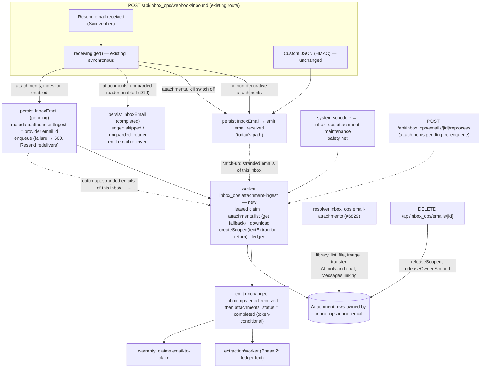

# InboxOps Inbound Email Attachments

**Status**: Draft
**Created**: 2026-10-25
**Issue**: [#6282](https://github.com/open-mercato/open-mercato/issues/6282)
**Modules**: `inbox_ops` (primary), `attachments` (additive service contract, access resolver adoption)
**Depends on**: `2026-11-03-attachment-direct-reader-owner-access.md`, implemented by [#7989](https://github.com/open-mercato/open-mercato/pull/7989), which builds on [#6829](https://github.com/open-mercato/open-mercato/pull/6829) (`2026-10-01-attachment-access-resolvers.md`, merged as `66ee9694f`). Merge order: #7989 → the ingestion PR (Phases 1–3).
**Related specs**: `2026-10-01-attachment-access-resolvers.md` (owner-scoped attachment authorization), `2026-11-03-attachment-direct-reader-owner-access.md` (owner access on direct attachment readers, unguarded-reader declarations), `2026-05-21-email-integration-foundation.md` (hub email normalization), `2026-03-23-inbound-webhook-handlers.md` (Phase 4 moves this webhook onto the generic inbound system), `2026-04-27-ai-agent-attachment-processing-and-context.md` (AI agent attachment context)

## 📝 TLDR

**Key Points:**
- The AI Inbox drops every attachment of an inbound email today: the file is never stored, never reaches the LLM extraction and is invisible on the proposal. Supplier offers, purchase orders, invoices and RMA photos almost always arrive as attachments.
- After this change, attachments of Resend inbound mail are stored as platform attachments owned by the `InboxEmail`, readable only by users who may read the email; their extracted text is kept encrypted with the email and feeds the extraction prompt; they are listed on the proposal and in the mirrored Messages thread; deleting the email releases them.
- Files are persisted before `inbox_ops.email.received` is emitted, so every existing subscriber sees them without changes. Access is enforced by an `inbox_ops` owner access resolver (#6829) on every attachment route and, through `2026-11-03-attachment-direct-reader-owner-access.md`, on every OSS path that reads or moves attachment rows by id outside those routes.
- Ingestion stays off while an enabled module still reads attachment rows without owner checks (today: the enterprise `agent_orchestrator` attachment stager), so the feature ships safely without waiting for that enterprise fix (D19).

**Scope:**
- Prerequisite, specified separately: `2026-11-03-attachment-direct-reader-owner-access.md` (#7989).
- Phase 1: ingest attachments of Resend inbound mail; `inbox_ops` owner access resolver; `listInLibrary` library exclusion; release on email deletion; attachment list API.
- Phase 2: attachment text in the extraction prompt, field-level source references.
- Phase 3: attachments on the proposal detail page, in the Messages thread and on the processing log; Retry and Delete actions.
- Follow-up specs, not delivered here: raw MIME intake for self-hosted relays and the Gmail/IMAP hub, copying attachments onto records created by accepted actions (issue Phase 4), warranty-claim attachments, raw `.eml` retention, LLM OCR for inbound files.

**Concerns:**
- Enterprise builds that enable `agent_orchestrator` ingest no attachments until enterprise maintainers make its stager enforce owner access (D19).
- Inbound mail from unauthenticated senders consumes the tenant attachment quota (default 512 MB).
- XML and HTML attachments, including XML e-invoices, are refused by the attachments module as active content (Open Question 4).

## Overview

The `inbox_ops` module turns forwarded or received emails into proposals (orders, quotes, contacts, replies) that a human accepts or rejects. Its inbound webhook (`api/webhook/inbound.ts`) accepts a Resend `email.received` event or a custom HMAC-signed JSON payload, persists an `InboxEmail`, and emits `inbox_ops.email.received`. Two persistent subscribers consume that event: the LLM extraction worker (`subscribers/extractionWorker.ts`) and the warranty-claim intake (`warranty_claims/subscribers/email-to-claim.ts`).

This spec makes attachments of Resend inbound mail part of that flow and keeps every existing contract (webhook JSON body, event IDs and payloads, `attachmentIds` response field and its redaction) intact. The custom JSON webhook keeps carrying no attachments.

> **Market reference.** Rails Action Mailbox, django-anymail, GitLab, Discourse, Zammad and Odoo store files in a generic storage service owned by the receiving record (`ir.attachment` with `res_model`/`res_id`, Zammad `Store` with object and id), persist the message first and process asynchronously; we adopt that ownership and ordering. They normalize to raw MIME because most of their sources deliver raw messages; Resend serves each part by a stable id, which gives a deterministic idempotency key, so this spec downloads Resend parts individually and leaves raw MIME to the hub follow-up, where `mailparser` already parses Gmail and IMAP mail. We reject the habits that lose data silently: Chatwoot keeps only the last 15 attachments and Frappe skips oversized files without a trace. Field-level provenance follows Azure Document Intelligence and Rossum: page or sheet plus a quoted snippet.

## Problem Statement

Verified on `main` (`71cf6e269`):

1. **The webhook never reads attachments.** `inbound.ts` builds `emailInput` from nine fields on both provider paths; `fetchResendEmail()` maps nine fields from `resend.emails.receiving.get()` and ignores its `attachments[]` array.
2. **`InboxEmail.attachment_ids` is a dead column.** It ships in `Migration20260216151619`, in the `GET /api/inbox_ops/emails` projection and in the `EMAIL_CONTENT_FIELDS` redaction list (`api/emails/response.ts`), but nothing writes it.
3. **Attachment-only emails collide in deduplication.** `contentHash` is `sha256(subject, from, text)` (`emailParser.ts:252`). Two emails from the same supplier with the subject "Offer", an empty body and different PDFs hash identically, so the second is dropped as a duplicate.
4. **Attachment-only emails fail extraction.** `extractionWorker.ts:149` marks an email `failed` with "No text content found in email" when the body is empty, which is the common shape of a supplier offer.
5. **The extraction prompt is blind to documents.** `lib/extractionPrompt.ts` receives the body text only; a `create_order` proposal is built from the body even when the order lines exist only in an attached file.
6. **Resend already exposes everything needed.** In `resend@6.24.0` (the version in `packages/core/package.json`), `receiving.get()` returns attachment metadata (`id`, nullable `filename`, `size`, `content_type`, nullable `content_disposition`, `content_id`), and `receiving.attachments.get({ emailId, id })` returns a `download_url` that expires after one hour. The `email.received` webhook carries metadata only.
7. **Attachment access is organization-wide unless the owner declares a policy.**
   - `GET /api/attachments/library` and `GET /api/attachments` require only `attachments.view` (granted to `employee` by default). #6829 makes these routes, `/api/attachments/file/[id]`, `/api/attachments/image/[id]`, `/api/attachments/library/[id]` and `/api/attachments/transfer` evaluate owner access resolvers, but only for owners that declare one.
   - Paths outside those routes (AI attachment tools, AI chat attachments, the AI pending-action recheck, the catalog media-description tool, Messages linking, and the enterprise `agent_orchestrator` attachment stager) read or move rows by caller-supplied id with tenant and organization checks only; `2026-11-03-attachment-direct-reader-owner-access.md` audits and closes the OSS ones.
   - Storing inbound files without a resolver and without those fixes would let colleagues without inbox access read mail content that `inbox_ops` otherwise encrypts and gates behind `inbox_ops.proposals.view`.

## Proposed Solution

### Design Decisions

| # | Decision | Rationale |
|---|----------|-----------|
| D1 | **Resend parts are downloaded individually by their stable attachment ids**, taken from the `receiving.get()` metadata, with fresh URLs from `receiving.attachments.list()` (falling back to `receiving.attachments.get()` per part). | Provider ids give every part a deterministic key, so retries can never store a file twice; no MIME parser or new dependency is needed; one list call per page keeps the worker under Resend's API rate limit. |
| D2 | **The attachments module stays the source of truth for files.** Each stored part is an `Attachment` row owned by `(entityId: 'inbox_ops:inbox_email', recordId: email.id)` in the private `privateAttachments` partition, created through `attachmentService.createScoped()`. | Same ownership model as Messages and as Odoo/Zammad. `createScoped` already enforces the scope invariant, executable and active-content blocking, MIME sniffing and quota leasing. |
| D3 | **`inbox_ops` declares an owner access resolver** (`data/attachment-access.ts`, contract from #6829) for `inbox_ops:inbox_email`: `read`, `render`, `metadata` and `export` require `inbox_ops.proposals.view` (wildcard-aware) and an owning email whose deletion is not pending release (D11); `reassign` and `delete` are denied to every user. The resolver makes no per-row database query: one query per request and scope loads the emails whose deletion is pending release. The protected target also declares, durably on the partition, that these rows are not listed in the shared attachments library, which excludes them by primary `entity_id` in its records, count and facet queries. The owner is a protected target, so protection persists when `inbox_ops` is disabled. | Inbound mail must be exactly as readable as the email it came with, wherever attachments are reachable. Only `inbox_ops` manages these files' lifecycle (D11 releases them). #6829 evaluates every matching row of a library scan (offset paging, twice per request) under a shared 15-second deadline, so unbounded inbound rows would eventually make the shared library time out for every module, however cheap each decision is; inbound files are browsed from the inbox, not the generic library. Hiding files from listings alone would leave them downloadable by id. |
| D4 | **Direct readers are closed by a separate spec.** `2026-11-03-attachment-direct-reader-owner-access.md` makes every OSS path that reads or moves attachment rows by id outside #6829's routes evaluate owner access through `evaluateAttachmentRowAccess`; this spec relies on it and merges after it. | Those paths bypass the routes #6829 guards, so the resolver would not hold without them. The fix protects every protected owner (Documents included) and is useful without this feature, so it is specified and shipped on its own. |
| D5 | **Extracted text is handed to the caller by `createScoped`, not persisted on the attachment, and is kept encrypted in the `inbox_ops` ledger, written in the same transaction as the Attachment row.** `textExtraction: 'return'` runs the pure-JS extractor at upload, never queues LLM OCR, leaves `Attachment.content` empty, and passes the text to `persistLink`. | Mail content stays under `inbox_ops` encryption and access rules; no plaintext copy lands in the attachments table, where search, AI tools and library responses could expose it. The attachments OCR would send PDFs and images to OpenAI whenever `OPENAI_API_KEY` is set and would arrive after extraction. No new system-wide read method is needed. |
| D6 | **`inbox_ops` owns acquisition and the ingest state.** The attachments module gains only additive surface: a `code` on upload errors, the `textExtraction` input with an optional `content` in the result, the optional `releaseOwnedScoped` method, `content` as an optional third argument of `persistLink`, `listInLibrary` with the `attachment_partitions.library_excluded_entities` column and its library filter, and a GIN index on `attachments.storage_metadata`. No provider registry, no new DI key, no queue in the attachments module. | Provider credentials and email semantics do not belong in the storage layer; that is how every precedent and every existing attachments consumer works. |
| D7 | **Ingest before emit.** When a Resend email carries non-decorative attachments, the webhook persists it with `attachments_status = 'pending'` and the provider email id, and enqueues the ingest worker; the worker stores the parts and only then emits the **unchanged** `inbox_ops.email.received`. Emails without attachments follow today's path exactly; so do emails with attachments while the kill switch is off. With the switch on and an unguarded reader enabled, the email is persisted `completed` with `skipped`/`unguarded_reader` ledger rows and emitted at once (D19). The webhook checks the switch first, then the gate. In every mode `contentHash` includes the attachment ids (D13), so deduplication of such emails differs from today even with the switch off. | Both persistent subscribers see the files with no change to their code or to the event contract; `extract` needs no change, and `reprocess` changes only for emails with pending attachments or with parts failed for an operator-fixable reason (`ingest_timeout`, `quota_exceeded`, `partition_unavailable`; Manual retry). |
| D8 | **The webhook keeps today's synchronous `receiving.get()`**; only the byte downloads move to the worker. | A failing `receiving.get()` keeps returning 500 so Resend retries the webhook, as today. Moving the fetch out of the request is left to the inbound-webhook-handlers Phase 4. |
| D9 | **Recovery is self-contained.** A failed enqueue answers 500 so Resend redelivers, and the duplicate branch re-enqueues an email that is still `pending` or `processing` with an expired lease; an abandoned job is re-enqueued from the worker's `onJobAbandoned`; after the queue's last attempt the worker re-enqueues itself with a delay and finalizes in-band once 6 hours have passed since its first failure (a failed fetch or upload, a lease takeover or an abandoned job); a failed emit is retried without a time limit. An email left without any job (the replacement enqueue failed, or a job vanished without an abandonment report) stays durably `pending` and is re-enqueued by the next webhook request for the same inbox, by a manual retry through the existing reprocess route, or by the scheduled sweep when the scheduler module is installed. | No email depends on the optional scheduler module or an enabled schedule: every stranded state is persisted on the email and recovered by requests `inbox_ops` already serves. The queue's retries are seconds apart, so a short provider outage must not drop files. |
| D10 | **A per-part ledger** `inbox_email_attachments` records every part of an email that enters ingestion, with status and reason, keyed by `resend:<attachment id>` unique per email; a **leased claim** on the email (`attachments_claim_token`, `attachments_claimed_at`, renewed after each part) guards every ingest transition; an **ingest generation**, reserved by every enqueue (`attachments_ingest_generation`), carried in the job and confirmed once the enqueue succeeded (`attachments_current_generation`), lets only the most recently enqueued job run. | No silent loss; retries converge on the same row; the sweep and a slow job cannot process the same email concurrently or both emit. The queue's coalescing (`coalesceBy`, `EnqueueOptions.coalesce`) does not fit this job: the async strategy discards a colliding add, so a re-enqueue carrying a new generation would be dropped while the surviving job keeps the old one and ends as superseded, and the queue's own contract forbids delayed work on a coalesced key. The `inbox-ops-attachment-ingest` queue therefore sets no `coalesceBy` and no enqueue passes `coalesce`; the generation selects the current job of a per-part, self-re-enqueuing run, not a recompute. Every recovery path enqueues, so without the generation each extra job would start its own self-re-enqueuing chain. |
| D11 | **Deleting an email invalidates any in-flight ingest and releases its attachments** through `attachmentService.releaseScoped()` for ingested parts and `releaseOwnedScoped()` for any other row referencing the email, marking the ledger rows `released`. | Users cannot delete these files (D3), so the email's lifecycle must free them; otherwise inbound mail would fill the tenant quota with no way out. An ingest that outlives the deletion must neither store more files nor emit. |
| D12 | **`attachment_ids` stays as a denormalized mirror** of the stored attachment ids. | The field is already public and in the redaction list; filling it makes it truthful without a deprecation cycle. |
| D13 | **`contentHash` includes the sorted Resend attachment ids of the non-decorative parts** when there are any; other emails keep their current hash. | Fixes Problem 3 without changing deduplication for existing mail or for mail whose only parts are inline logos. File name, size and type do not identify content: two different files with equal metadata would collide on the unique `content_hash` index and in `checkDuplicate`, which also matches on the hash when Message-IDs differ, so the second email would be dropped. The bytes are downloaded only by the worker, after the deduplication decision, so a content digest is not available to it. A webhook redelivery carries the same ids and is still deduplicated (by Message-ID as well); the same message forwarded twice gets new provider ids and is stored twice, which a reviewer resolves by rejecting the second proposal instead of losing an email (D14). |
| D14 | **The email is never lost.** Quota exceeded, blocked type, oversized part or download failure each mark the part `skipped` or `failed` with a reason; the email continues to extraction. | Acceptance criterion of #6282. |
| D15 | **Attachment text reaches only the instance's configured LLM provider**, as delimited, budgeted, untrusted context. Neither email nor attachment content is logged. | Data-residency requirements of operators; consistent with the existing prompt-injection safety block. |
| D16 | **Field provenance is stored in a new encrypted column** `inbox_proposal_actions.source_refs`, not in the payload or the plaintext `metadata`. | Action payloads are validated against each action's registered `payloadSchema` (#6520); snippets and file names quote mail content, so they need the module's encryption like the payload itself. |
| D17 | **The Messages thread shows the email's attachments through the existing `inbox_ops.email` content renderer** (`components/messages/InboxEmailContent.tsx`), not through copies. | Quota counts `sum(file_size)` over all attachment rows (`attachments/lib/quota-service.ts`), so copies would double quota use; the renderer already belongs to `inbox_ops`, and the resolver keeps downloads gated. |
| D18 | **No new ACL feature.** Reading follows `inbox_ops.proposals.view` (the feature that gates email content and `attachmentIds`); deletion follows the existing email delete permission. | ACL feature IDs are frozen once shipped (BC §10); a separate feature can be added later without breaking anything. |
| D19 | **No inbound file is stored while an unguarded attachment reader is enabled.** While `listUnguardedAttachmentReaders()` (`2026-11-03-attachment-direct-reader-owner-access.md`) returns any module (today the enterprise `agent_orchestrator` until its stager declares owner-access enforcement), the webhook persists the email without an ingest job: it writes the ledger rows of its non-decorative parts as `skipped`/`unguarded_reader`, sets `attachments_status = 'completed'` and emits as today, so an administrator sees on the email why its files were not stored; the ingest worker marks every remaining `pending` part `skipped`/`unguarded_reader` instead of fetching it and completes the email as usual. One warning per process names those modules. Files stored before such a module was enabled stay readable through it; `UPGRADE_NOTES.md` makes enabling one in an instance that already holds inbound attachments a documented precondition, and the maintenance worker logs a warning while both are true. The integration harness opts out with `INBOX_OPS_ATTACHMENTS_ALLOW_UNGUARDED_READERS=true`, which is honored only together with `OM_ENABLE_RESEND_STUB=true` and logs a warning. | That stager stages any attachment id of the organization for an agent run and can send files without text to the OpenAI-only `OcrService`, so inbound mail would leak to agent runs of users without inbox access. Its fix is an enterprise follow-up with acceptance criteria in the hardening spec and no enterprise spec yet; the gate keeps OSS safe and mergeable without it, and enterprise builds gain ingestion as soon as the stager declares. Upstream CI enables `agent_orchestrator` for every job, so the test opt-out is needed; it takes two explicit test-only flags and logs a warning, so it cannot be switched on by accident. |

### Alternatives Considered

| Alternative | Why Rejected |
|-------------|-------------|
| Storing inbound files before an owner access policy exists, or only hiding them from listings (`listable: false`) | Any authenticated user of the organization could still download them by id; inbound mail would be readable beyond `inbox_ops.proposals.view`. |
| Relying on #6829's route guards alone | AI tools, AI chat attachments, AI pending-action rechecks, the catalog media-description tool and Messages linking read or move rows directly and would bypass the resolver. |
| Making the enterprise stager fix a merge precondition of this feature | The fix belongs to enterprise maintainers and is not scheduled; the feature would stay blocked indefinitely. D19 keeps inbound files away from the stager instead. |
| Shipping ingestion everywhere and documenting the enterprise exposure | Inbound mail would reach agent runs and OpenAI OCR in enterprise builds, breaking D3 and D15 there. |
| Persisting extracted text in `Attachment.content` and reading it back with a new system-scope method | Leaves a plaintext copy of mail content in the attachments table and adds a method that lets any module read any owner's text. |
| Provider-agnostic descriptors with a fetcher registry and a generic ingest worker in the attachments module | No precedent puts provider fetchers in the storage layer; it would freeze a new DI key, queue and type for one provider. |
| Resend raw-first (`raw.download_url` parsed with `mailparser`) | Parsed parts carry no Resend id, so retries need heuristic matching and can store a file twice; it adds a production dependency to core. |
| Raw `message/rfc822` intake on the custom webhook in this spec | Needs a MIME parser in core, a durable raw copy that holds the decrypted body, and structural parse limits `mailparser` does not offer; it belongs with the hub, which already parses raw MIME. |
| A new `inbox_ops.email.ready` event | Three routes emit `inbox_ops.email.received` and `warranty_claims` subscribes to it; a new event forces changes in all of them. |
| Ingestion as "step 0" inside the extraction worker | Couples ingestion to extraction and leaves other subscribers without files. |
| A new `ingesting` value in `InboxEmailStatus` | Adds a visible status value to filters and counts; D7 achieves the ordering without it. |
| Fingerprinting parts by file name, size and content type | Different files with equal metadata (a recurring `order.csv` of the same size) would make a new email a duplicate of an earlier one and drop it before its files are ingested. |
| Fingerprinting parts by a digest of their bytes | The bytes are downloaded by the worker after the email row, with its unique `content_hash`, already exists; deduplicating that late would discard an acknowledged email. |
| Finalizing on the queue's last attempt | Retries are seconds apart; a short outage would drop every file. |
| Relying on the scheduled sweep to recover an email whose replacement job could not be enqueued | The scheduler module is optional and a schedule can be disabled; without them the email would stay `pending` with no job indefinitely. |
| Persisting provider download URLs | They expire after one hour; the worker lists fresh URLs when it runs and refreshes an expired one per part. |
| `attachment_ids` as the source of truth | Duplicates ownership held by the attachments table and cannot express skipped or failed parts. |
| Copying attachments onto the mirrored Message | Doubles quota use (D17). |
| Sending images or PDF pages directly to a multimodal model | Provider-specific, costly and outside the structured-output path `inbox_ops` uses. |

## User Stories / Use Cases

- A **buyer** forwards a supplier's offer whose prices exist only in an attached PDF, so that the proposal contains the offered lines and prices. Spreadsheets gain the same behavior once XLSX text extraction (#6938) lands; until then they contribute a metadata-only line. XML e-invoices are refused today (Open Question 4).
- A **reviewer** sees which file and which page or sheet a proposed value came from, so that they can verify it before accepting.
- A **reviewer** opens the attached files from the proposal or from the Messages thread, so that they can compare the proposal with the source document.
- A **colleague without inbox access** cannot open, list, move or ask the AI assistant about those files anywhere.
- An **administrator** sees why a file was not stored (over quota, executable, too large), and deleting an email frees its files' quota.

## Architecture

Takeaway: the behavioral fork is "does this Resend email carry non-decorative attachments, and is ingestion enabled". Without them, nothing changes; with the kill switch off, only the deduplication hash differs (D13); with an unguarded reader enabled, the email records why its files were not stored and is emitted at once. Otherwise, the email row is created in the request together with its recovery source, the event fires once every part is stored, skipped or failed, the stored files are readable only by users who may read the email, and they live exactly as long as the email.

### Components

**Shared rules**
- **Decoration rule** (applied by the webhook when it writes the ledger): a part with `content_disposition = inline`, a `content_id`, and `size` below `INBOX_OPS_INLINE_IMAGE_MIN_BYTES` (16 KiB) is decorative. A null `content_disposition` counts as `attachment`. A larger inline image, such as a pasted photo, is kept.
- **Part key**: `resend:<attachment id>`.
- **Status per reason**: `skipped` for policy outcomes (`inline_decoration`, `too_many`, `too_large`, `total_too_large`, `dangerous_executable`, `active_content`, `unguarded_reader`); `failed` for errors (`quota_exceeded`, `partition_unavailable`, `fetch_failed`, `store_failed`, `processing_failed`, `ingest_timeout`); `released` after email deletion.
- **File names**: a missing name becomes `attachment-<n>` with an extension from the content type. The ledger keeps the original (encrypted) name for display; the stored attachment and its download use the attachments module's ASCII-sanitized name (`sanitizeUploadedFileName`).
- **Forwarded-as-attachment messages**: a nested `message/rfc822` part is stored as one `.eml` file and contributes a metadata-only line to extraction; unpacking it belongs to the raw MIME follow-up.

**Access resolver (`data/attachment-access.ts`)**
- `attachmentAccessResolvers`: one resolver `inbox_ops.email-attachments`, `targetPartition: '*'`, `targetEntity: 'inbox_ops:inbox_email'`.
  - For `read`, `render`, `metadata` and `export`:
    - It checks `inbox_ops.proposals.view` against `subject.userFeatures` with the shared wildcard-aware matcher. This needs no database work, and super-admins pass through their effective features. Without the feature: 404.
    - With it, the first call for a given tenant and organization in a request runs one query: the ids of emails in that scope with `deleted_at is not null`, `attachments_released_at is null`, and either `attachments_status is not null` or `attachments_release_requested_at is not null`, filtered in `WHERE` and served by a partial index. Keying on the email's own state, not only on the request timestamp, also covers emails deleted while an older build ran. The set is cached in `input.cache` under a tenant-and-organization key (a super-admin scan can cover several scopes); it is normally tiny, because deletion releases files and then sets `attachments_released_at`. Rows owned by an email id that does not exist are not in the set; they can only be planted through the generic upload route (see Risks).
    - Each row is then decided in memory. Take the email ids from `input.targets` filtered to `entityId: 'inbox_ops:inbox_email'` (primary owner or assignment, as #6829 collects them). Allow unless one of them is in the cached set (404). The tenant and organization match is already enforced by #6829's baseline check.
  - For `reassign` and `delete`, it returns 403.
- `protectedAttachmentTargets`: `{ resolverId: 'inbox_ops.email-attachments', targetPartition: '*', targetEntity: 'inbox_ops:inbox_email', listInLibrary: false }`. #6829 copies the requirement `{ resolverId, targetEntity }` onto the partition on upload (and in attachments setup), so protection survives disabling the module; because the owner assignment stays on the row even if `entityId` is changed, it also survives re-parenting.
- `listInLibrary` is an optional field on the protected-target declaration, added in Phase 1 together with its first user (#6829's `ProtectedAttachmentTarget` has only `resolverId`, `targetEntity` and `targetPartition`):
  - The declaration schema (code-level, validated in the same build) accepts it, and rejects `listInLibrary: false` with a wildcard `targetEntity`, because the exclusion matches exact `entity_id` values. The flag is **not** added to the shape of #6829's stored requirement rows, whose strict parser in an older build would deny every attachment.
  - The attachments module keeps it durably in a new nullable column `attachment_partitions.library_excluded_entities` (jsonb array of owner entity ids). The column is written at every place requirements are written: partition creation (`ensureDefaultPartitions`, `POST /api/attachments/partitions`), the setup-time sync, and `ensureAttachmentPartitionProtection` on upload, whose early-return check compares the column too. Writes merge as a union and never remove entries, like requirements, so a sync while the owner module is disabled keeps the exclusion. An older build ignores the column.
  - `GET /api/attachments/library` excludes, by primary `entity_id`, every owner listed in the registry's `listInLibrary: false` targets or in that column, in its records, count and facet queries, before any resolver runs. The record-scoped `GET /api/attachments?entityId=&recordId=` is unaffected, because it is bounded to one record.
- System paths (`createScoped`, `releaseScoped`) are server-side and unaffected.

**Direct readers and the ingestion gate**
- The OSS paths that read or move attachment rows by id outside #6829's routes evaluate the resolver through `evaluateAttachmentRowAccess` (`2026-11-03-attachment-direct-reader-owner-access.md`, #7989); this spec adds no code to them.
- `lib/inboundAttachments.ts` exports `unguardedAttachmentReadersBlockingIngest()`, which returns `listUnguardedAttachmentReaders()` unless the test opt-out of D19 applies (then an empty list), and `isInboundAttachmentIngestEnabled()`: `INBOX_OPS_ATTACHMENTS_ENABLED` is on and no unguarded reader blocks ingestion. When it returns modules, the first webhook or worker run in the process that meets attachments logs one warning with their ids, so an operator knows why files are not stored. The check is an in-memory lookup evaluated per request and at the start of every worker run (Ingest worker, step 2).
- While an unguarded reader is enabled and any `stored` ledger row exists, one warning per process says those files are readable through it (D19). The maintenance worker logs it, and so does the first webhook or worker run that meets the closed gate, so it appears without the scheduler module too.

**Webhook (`api/webhook/inbound.ts`)**
- `fetchResendEmail()` (called from `verifyAndParse`) also returns the `attachments` metadata. When at least one non-decorative part exists and `isInboundAttachmentIngestEnabled()` is true, the email is persisted with `attachments_status = 'pending'` and `metadata.attachmentIngest = { provider: 'resend', providerEmailId }` together with one ledger row per metadata entry in the same transaction (created through the ORM, so the encryption subscriber encrypts `file_name`), with the decoration rule and the count, per-file and total limits already applied (`skipped` rows with their reason, the rest `pending`). The ledger is therefore the authoritative part list from the start, and a later fetch failure always has rows to mark. The email is inserted with `attachments_ingest_generation = 1`, `attachments_current_generation = 1` and `attachments_next_run_at = now`. Then an ingest job `{ emailId, tenantId, organizationId, generation: 1 }` is enqueued with no bytes and no URLs, and the request does **not** emit `inbox_ops.email.received`. If enqueueing fails, the request answers 500 so Resend redelivers the webhook.
- When non-decorative parts exist but an unguarded reader blocks ingestion (D19), the email is persisted with `attachments_status = 'completed'` and its ledger rows written in the same transaction as `skipped`/`unguarded_reader`; nothing is enqueued and `inbox_ops.email.received` is emitted as today. With the kill switch off, attachments are ignored as today.
- In the duplicate branch, when the existing email's `attachments_status` is still `pending`, or `processing` with an expired lease, the request re-enqueues its job before answering 200 (500 if that enqueue fails). A unique-index violation on insert (the indexes also cover soft-deleted emails, which `checkDuplicate` skips) is answered as a duplicate (200, `inbox_ops.email.deduplicated`) instead of a 500 that the provider would retry forever, with the same re-enqueue rule for the email it collided with.
- **Stranded** means: not soft-deleted, and `attachments_status = 'pending'` with `attachments_next_run_at` older than 15 minutes, or `processing` with `attachments_claimed_at` past the lease and `attachments_next_run_at` older than 15 minutes. `attachments_next_run_at` is when the current job was due to start, so a job that is still waiting for its delay or its turn in the queue is not stranded for 15 minutes after that. Under a queue backlog longer than that, recovery re-enqueues waiting jobs at the tail of the queue; this delays them but never multiplies them.
- **Catch-up.** Every request that resolved an inbox (new email or duplicate) also re-enqueues that tenant and organization's stranded emails, at most 10 per request, served by the `(attachments_status, attachments_next_run_at)` index. It runs at most once per process and scope every 5 minutes, after the email's own writes and enqueue. Its failures are reported and never change the response. Each re-enqueue supersedes the email's earlier jobs (D10), so catch-ups on several processes or replicas never multiply job chains.
- The custom JSON path is unchanged. The signature, admission and rate-limit logic (as rewritten by #7611) is untouched; only the field mapping in `fetchResendEmail()` and the post-persist section change.

**Ingest worker (`workers/attachment-ingest.ts`, queue `inbox-ops-attachment-ingest`, concurrency 2, `lockDuration: 1800000` in `WorkerMeta`)**
Text extraction (pdfjs, mammoth) is CPU-bound, hence the low concurrency.
1. **Claim.** (The email row missing or `attachments_status` null ends the job; a job whose `generation` is below the email's `attachments_current_generation` has been superseded and ends without any write; a soft-deleted email has its status set to `completed` without an emit and the job ends.) `nativeUpdate`, conditional on `deleted_at is null` and `attachments_current_generation <= :generation` (so a job superseded after its read cannot claim), sets `attachments_status = 'processing'`, a new `attachments_claim_token` and `attachments_claimed_at = now`, where `attachments_status = 'pending'`, or where it is `processing` with `attachments_claimed_at` older than `INBOX_OPS_ATTACHMENT_LEASE_MS` (default 30 minutes). On 0 rows it reads the email: when the status is `completed`, or the email is soft-deleted (whose claim is then completed without an emit), the job ends; when another claim's lease is still live, the job re-enqueues itself (through the helper, so it becomes the only current job) with `delayMs` equal to the remaining lease, so a fast retry after a crash cannot end the chain. A claim holder that was superseded while running finishes its run; its own queue retries then end as superseded. `WorkerMeta.lockDuration` is a literal 1800000, because the generator copies it into the registry at `yarn generate` time; configuration validation refuses a lease above it. The async strategy renews the job lock while the handler runs, so the lock only has to outlast the longest event-loop block, one part's extraction, which the lease already bounds.
2. **Acquire.** When an unguarded reader is enabled (`unguardedAttachmentReadersBlockingIngest()` returns modules), every part still `pending` is marked `skipped`/`unguarded_reader` and the run continues with step 4; the kill switch does not stop an email already `pending`. Otherwise the ledger rows written by the webhook are the part list. For every part still `pending`, take a fresh URL (below) and download it with a streamed size cap; parts already `stored`, `skipped` or `failed` are not retried. A transient failure of one part (download or upload) is recorded for the run and the worker moves on to the next part, so a part that keeps failing never blocks the others; the run handles its transient failures once, in step 5, after every pending part was attempted. After every attempted part, stored or not, the worker renews `attachments_claimed_at` (conditional on the claim token and `deleted_at is null`), so a run of many slow failing parts keeps its claim. The lease must exceed the worst-case time of one part (four bounded calls, each up to `INBOX_OPS_ATTACHMENT_FETCH_TIMEOUT_MS`, plus extraction); the defaults (30 minutes against 4 × 30 seconds) leave a wide margin, and configuration validation refuses a lease below that bound. Every SDK call and download is bounded by `INBOX_OPS_ATTACHMENT_FETCH_TIMEOUT_MS`. The SDK returns `{ error }` instead of throwing:
   - 429, 5xx, timeouts, network errors (`statusCode: null`), and 401/403 (a rotated or restricted key an operator can fix) are transient until the 6-hour finalization;
   - A 404 from the SDK for the attachment or the email is permanent, so the affected parts (or all `pending` parts, if the email itself is gone at the provider) are marked `failed`/`fetch_failed` without retrying.
   - Download URLs expire after one hour: before each download the worker checks `expires_at`, and a 403/404 from the `download_url` itself means an expired URL, so it takes a fresh one from `receiving.attachments.get({ emailId, id })` and retries the part once before treating it as a transient failure.
   - URLs come from `receiving.attachments.list({ emailId })`, paged with the `after` cursor until `has_more` is false. When a list call fails, or a part is missing from the list, the part's URL comes from `receiving.attachments.get({ emailId, id })`.
3. **Persist** with `persistInboundParts()`. When it starts acquiring a part (before the first SDK call for it), the worker sets the part's `in_flight_at` and commits it (conditional on the claim); it clears the marker when the part's attempt ends, stored or with a classified or transient error. A part found with `in_flight_at` still set was interrupted by a crash during its download, upload or extraction, so its `attempts` is incremented. Only such crashes count: download failures and returned transient errors follow the 6-hour clock instead. When a part has crashed `INBOX_OPS_ATTACHMENT_MAX_PART_ATTEMPTS - 1` times (2 with the default limit of 3) it is uploaded with `textExtraction: 'none'`, so a file whose extraction crashes the process is still stored, without text; a part beyond that limit is marked `failed`/`processing_failed`. Extraction keeps the attachments module's page caps. Every renewal of `attachments_claimed_at` and every ledger write is conditional on the claim token and on `deleted_at is null`; a failed condition aborts the run without emitting.
4. **Finish.** Re-check the claim token and `deleted_at is null`; if either fails, stop without emitting. Emit `inbox_ops.email.received` with the webhook's payload (`emailId`, `tenantId`, `organizationId`, `forwardedByAddress`, `subject`) plus the optional `attachmentCount` (the number of the email's `stored` parts), and the same options (`persistent: true`, `tenantId`, `organizationId`). The `attachment_ids` mirror is written in a token-conditional update before the emit, so subscribers see it; after the emit, conditional on the claim token, set `attachments_status = 'completed'`. A failed emit is a transient failure (step 5): the email stays not `completed`, so the event is retried instead of being swallowed as the webhook does today. A crash between the two steps leads to a re-run and a duplicate emit, which both subscribers tolerate (extraction claims `received → processing`; warranty intake is idempotent through its intake message reference). A deletion that commits between the re-check and the emit lets the event go out for a deleted email; extraction then runs on it, as it does today for an email deleted right after receipt.
5. **Retry.** When the run ends with at least one part still `pending` after a transient failure (including the `quota_unavailable`, `storage_failed` and `persistence_failed` upload codes), or with a failed emit, reset the email to `pending` conditional on the claim token and rethrow; the reset clears the claim token and sets `attachments_next_run_at = now`, because the queue retries the job within seconds. On the queue's last attempt (`ctx.attemptNumber` reaching 3, the attempt count `createModuleQueue` uses by default; one shared constant), enqueue a fresh job with `delayMs: INBOX_OPS_ATTACHMENT_RETRY_DELAY_MS` (default 15 minutes) instead of rethrowing. If that enqueue fails, the worker reports `inbox_ops.attachment_requeue_failed` and rethrows; the email stays `pending` with `attachments_first_failure_at` set and no job, `onJobAbandoned` does not fire because the handler ran, and the email is recovered by the webhook catch-up, the manual retry or the sweep, each of which re-enqueues it; the next run finishes it or finalizes it once 6 hours have passed. A failed emit with no part left `pending` is retried without a time limit and never finalizes, because there is nothing to time out. The first failure of any other kind sets `attachments_first_failure_at` (if null): a transient fetch or upload failure, a claim taken over from an expired lease, or an abandoned job reported to `onJobAbandoned` (only when its generation is not superseded). Finalization happens only in the worker, at the end of a run that left at least one part `pending` after attempting every remaining `pending` part: if `attachments_first_failure_at` is then older than 6 hours, the worker marks those parts `failed` with `ingest_timeout` and finishes as in step 4. The marking runs in one transaction that starts with a conditional update on the email (claim token, and `attachments_first_failure_at` still older than 6 hours); on 0 rows, because a manual retry reset the clock meanwhile, it skips finalization and retries as usual. A worker or queue outage therefore never times out parts that nobody tried to fetch. `WorkerMeta.onJobAbandoned` receives the queued-job envelope, so it reads the generation from `job.payload.generation`; it re-enqueues an abandoned job only while that generation is not superseded, because abandonment reports are delivered at least once and a stale report must not supersede the live job. At most one job per email is current at any time: a recovery path that re-enqueues while the worker's delayed job waits supersedes it, so the retry cadence never multiplies.
6. **Report.** Every path that records a `failed` part, finalizes an email or fails to re-enqueue one reports through `getTelemetryRuntime()?.reportError` (`@open-mercato/shared/lib/telemetry/runtime`, as other core modules do), with codes matching `module.reason`: `inbox_ops.attachment_fetch_failed`, `inbox_ops.attachment_store_failed`, `inbox_ops.attachment_ingest_timeout`, `inbox_ops.attachment_requeue_failed`. Log lines carry ids and reason codes only, never file names or content.

`attachmentService` is resolved softly; when it is absent, the webhook ignores attachments as today and the worker completes pending emails with `failed`/`store_failed` parts.

Every re-enqueue (duplicate branch, catch-up, `onJobAbandoned`, manual retry, sweep, the worker's own delayed job) goes through one internal helper in `lib/inboundAttachments.ts`. It works in three steps:
1. **Reserve.** One conditional `UPDATE … RETURNING attachments_ingest_generation` increments the reservation counter (email not soft-deleted and not `completed`; the worker's own re-enqueues and `onJobAbandoned` also require that the job is not superseded), so two concurrent callers always get different generations. When the update matches no row, nothing is enqueued.
2. **Enqueue** `{ emailId, tenantId, organizationId, generation }` and nothing else.
3. **Confirm**, only after the enqueue succeeded: `set attachments_current_generation = :generation, attachments_next_run_at = now + delayMs where attachments_current_generation < :generation`.

A failed enqueue therefore changes nothing: the previous job stays current, so a healthy email never strands because a recovery attempt failed, and concurrent failed attempts cannot undo each other. A job enqueued but not yet confirmed (or whose confirmation failed) is not superseded, because only a lower generation is; when two jobs are current (a confirmation failed), the claim serializes them, and the first successful re-enqueue by either supersedes the other. Without any job the email stays stranded, which the recovery paths of D9 handle.

**Manual retry (`api/emails/[id]/reprocess/route.ts`, existing route)**
- Today the route answers 409 for an email whose `status` is `received` or `processing`, so it cannot retry an ingest. Two cases change; each clears `attachments_first_failure_at`, so an operator who fixed the cause (for example a rotated API key) gets a fresh 6-hour window instead of an immediate `ingest_timeout`:
  - **Stranded or waiting ingest** (`attachments_status` `pending`, or `processing` with an expired lease): the route clears `attachments_first_failure_at` with a conditional `nativeUpdate` (`deleted_at is null`) and re-enqueues the ingest job. It retires no proposals (a proposal can exist only if a crash fell between the emit and `completed`, and the re-run tolerates it), changes no `status`, emits nothing, and answers 200 with the existing response shape (`retiredProposalCount` and `retiredActionCount` are 0).
  - **Finalized ingest with retryable failed parts** (`attachments_status = 'completed'` and at least one ledger part `failed` with `ingest_timeout`, `quota_exceeded` or `partition_unavailable`, the operator-fixable reasons), when the email's `status` allows reprocessing today: in the same transaction that retires active proposals as today, the route first sets the email's columns with a conditional `nativeUpdate` (`deleted_at is null` and `attachments_status = 'completed'`; on 0 rows it rolls back and answers 404 when the email was deleted, or 409 when a concurrent reprocess already reset it), so a concurrent deletion can never be overwritten by an ORM flush; that update sets `status = 'received'`, `attachments_status = 'pending'` and `attachments_next_run_at = now`, and the transaction resets those parts to `pending`. After the commit, the route emits `inbox_ops.email.reprocessed` as today and then calls the helper instead of emitting `inbox_ops.email.received`. The worker emits `inbox_ops.email.received` once the parts are processed, so extraction sees the files. Parts that failed with one of those reasons are reset to `pending`; parts that failed for a permanent reason (`fetch_failed` after a provider 404, `processing_failed`) and policy skips stay as they are.
  - In both cases a failed enqueue answers 500; the email is then stranded and recovered as in D9. When the helper's reservation matches no row (the email completed or was deleted concurrently), the route answers 409. In the finalized-email branch, a 409 or 500 after the commit leaves the proposals retired and the email reset to `pending`, which D9 then recovers like any stranded email.
- `processing` with a live lease keeps answering 409. Every other case is unchanged; emails with a non-null `attachments_status` did not exist before this change, so no existing request changes its outcome.
- Feature `inbox_ops.proposals.manage`, as today.

**`persistInboundParts()` (`lib/inboundAttachments.ts`, internal, not exported from the module index)**
- The decoration rule and limits are applied by the webhook on the metadata, filtering before limiting so decoration cannot use up slots: decoration rule; count limit (`INBOX_OPS_MAX_ATTACHMENTS`, 20 → `too_many`); per-file limit (attachments module maximum, 25 MiB → `too_large`); total limit (`INBOX_OPS_MAX_ATTACHMENTS_TOTAL_BYTES`, 25 MiB → `total_too_large`). The worker re-checks the downloaded size against the per-file limit.
- Every native (`nativeUpdate`) write of an encrypted ledger column goes through `tenantDataEncryptionService.encryptEntityPayload` first; rows are created through the ORM.
- For each accepted part whose row is not `stored`, calls `attachmentService.createScoped({ entityId: 'inbox_ops:inbox_email', recordId: email.id, partitionCode: 'privateAttachments', fileName, declaredMimeType, buffer, textExtraction: 'return', persistLink })`. No extra assignment is added.
- `persistLink` runs in the attachment's transaction and receives the extracted text (D5). It does two things:
  - It renews the claim (`nativeUpdate` on `inbox_emails` where the claim token matches and `deleted_at is null`). On 0 rows it throws `CrudHttpError(409, { code: 'inbox_claim_lost' })`.
  - It marks the part (`nativeUpdate … set status = 'stored', attachment_id = :id, extracted_text = :text where id = :rowId and status <> 'stored'`). The text is truncated to `INBOX_OPS_MAX_ATTACHMENT_TEXT_CHARS_PER_FILE` and encrypted with `tenantDataEncryptionService.encryptEntityPayload` before the update, because the encryption subscriber does not see `nativeUpdate`. On 0 rows it throws `CrudHttpError(409, { code: 'inbox_part_already_stored' })`.

  Either throw rolls the Attachment insert and its quota reservation back and propagates unchanged (`scoped-upload-service.ts` rethrows `CrudHttpError` from `persistLink`). The caller treats `inbox_part_already_stored` as stored and `inbox_claim_lost` as an abort.
- Maps upload error codes: `quota_exceeded`, `dangerous_executable`, `active_content`, `max_upload_size` → `too_large`, `partition_unavailable`, `quota_target_exists`/`quota_recovery_unsupported` → `store_failed`; `quota_unavailable`, `storage_failed`, `persistence_failed` and errors without a code (for example the 500 when the upload service is unavailable) → transient.

**Release on deletion (`api/emails/[id]/route.ts` DELETE)**
- The soft delete, `attachments_release_requested_at = now()` (on every deletion, whatever the attachment status, so rows planted under any email are covered) and the invalidation of the claim (`attachments_claim_token = null`, and `attachments_status = 'completed'` only when it was not `null`) are one update on the email row. That row lock serializes with `persistLink`'s claim renewal: a part committed before the delete is listed and released, and a part attempted after it fails `inbox_claim_lost` and rolls back.
- After the update commits, the route releases every `stored` part through `attachmentService.releaseScoped()` with the owner assignment `{ type: 'inbox_ops:inbox_email', id: email.id }`. Each stored row is marked `released` (with `file_name` and `extracted_text` cleared) only after its own release succeeds, or after `releaseOwnedScoped` has removed the email's reference from it (a row `releaseScoped` refused because other assignments remain); skipped, failed and pending rows are marked `released` and cleared at once. Provider cleanup runs after commit, as the attachments contract requires.
- Besides the ledger's `stored` parts, the route releases every other attachment owned by the email (for example rows planted through the generic upload route) through the new optional `attachmentService.releaseOwnedScoped({ owner, tenantId, organizationId })`. It removes the email's reference from every row that carries it:
  - a row whose primary owner is the email and that has no other assignment is deleted, reusing `releaseScoped`'s per-row reference locking (bytes are deleted only when the last row referencing the stored object goes);
  - a row whose primary owner is the email but that has other assignments is re-pointed to the first remaining assignment in stored order, and loses the email's assignment;
  - a row whose primary owner is something else (for example a library upload, whose owner is never added as an assignment) only loses the email's assignment.

  After it, no row references the email.
- When everything is released, the route sets the new `inbox_emails.attachments_released_at`. A failed release leaves it null; the maintenance worker retries until it is set, treating a 404 as already released. Without the scheduler module, such files stay until the module is enabled. Without `attachmentService`, release is deferred: the email stays in the deny set, which keeps its files unreadable, and the sweep finishes the release once the service is available again.

**Maintenance (worker `inbox_ops:attachment-maintenance`, queue `inbox-ops-attachment-maintenance`, concurrency 1, every 15 minutes)**
- One `scopeType: 'system'` cron schedule (`*/15 * * * *`, `sourceType: 'module'`, `sourceModule: 'inbox_ops'`, `targetQueue: 'inbox-ops-attachment-maintenance'`) with a deterministic id carrying RFC 4122 version and variant bits (lesson *deterministic-schedule-ids-must-pass-scheduler-validators*; a test round-trips it through the scheduler validators). It is registered through a soft-optional `schedulerService` only when `exists()` reports it missing (`register()` resets `nextRunAt`), from `seedDefaults` (whose context carries the container) and lazily from the webhook the first time a process sets an email to `pending` (cached per process).
- The worker scans emails across tenants and handles each in that email's own tenant and organization scope:
  - It re-enqueues stranded emails (as defined under Webhook), at most 100 per run, oldest `attachments_next_run_at` first. It sets soft-deleted emails whose `attachments_status` is `pending` or `processing` to `completed` (claim token cleared, no emit), so they never occupy recovery batches.
  - It never finalizes: an email past its 6-hour window is only re-enqueued, and the worker finalizes it after a run that attempted every remaining part (step 5), so a queue backlog or outage never times out parts nobody tried.
  - It retries releases of emails with `deleted_at is not null`, `attachments_released_at is null`, and either `attachments_status is not null` or `attachments_release_requested_at is not null` (emails deleted before the upgrade have neither a status nor a request timestamp and are never swept; emails deleted while an older build ran are caught by their status).

**Attachment list API (Phase 1)**
- `GET /api/inbox_ops/emails/[id]/attachments` lists the ledger rows (without `extracted_text`, and without `inline_decoration` rows), gated by `inbox_ops.proposals.view`, so ingestion outcomes are observable before any UI exists. A missing or soft-deleted email answers 404, as the detail and reprocess routes do.

**Phase 2: extraction context (`subscribers/extractionWorker.ts`, `lib/extractionPrompt.ts`)**
- Before building the prompt, loads the email's ledger rows, including the decrypted `extracted_text`, through `findWithDecryption`.
- Builds an `<attachments>` section: one delimited block per file (`<attachment index="1" name="…" type="…" attachmentId="…">`), text truncated per file and in total (`INBOX_OPS_MAX_ATTACHMENT_TEXT_CHARS`, 60 000). A file without text (images, archives, nested `.eml`, XLSX before #6938) contributes a metadata-only line; skipped and failed parts contribute a line with their reason, except `inline_decoration` rows, which are left out. The safety block states that attachment text is untrusted data.
- An empty body no longer fails extraction when at least one attachment has text. When the body is empty and stored attachments exist but none has text (images, scans, archives, XLSX before #6938), the LLM call is skipped and the email is set to `needs_review` instead of `failed`, so a person handles it from the log page.
- The output schema gains optional `sourceRefs` per action: `[{ kind: 'email_body' | 'attachment', attachmentId?, fileName?, page?, sheet?, row?, snippet }]`. References to ids that are not stored parts of this email are dropped. They are stored in the encrypted `inbox_proposal_actions.source_refs` column. Page and sheet values are best-effort until text extraction emits page and sheet markers (follow-up).

**Phase 3: surfaces**
- The processing log page (`backend/inbox-ops/log/page.tsx`) gains a "Show attachments" row action for emails with a non-null `attachmentsStatus`; it opens a dialog with the same list component, loaded for that email only, so files of emails without a proposal (failed extraction, `needs_review`, no LLM key) are visible with their skip reasons without one request per row on page load. The row action is rendered only when `attachmentsStatus` is non-null. Its existing Retry action, offered today for `failed` and `needs_review`, is also offered when the new list field `attachmentsRetryable` is true (`attachmentsStatus` `pending` or `processing`, or at least one part `failed` with `ingest_timeout`, `quota_exceeded` or `partition_unavailable`, computed in the list query), and calls the reprocess route (Manual retry). On an email whose `status` is `processed`, Retry first asks for confirmation through `useConfirmDialog`, because the route retires its active proposals. The route decides: a refusal (live lease, extraction running, actions already executed) is shown with the route's error message, which the route translates.
- The log page and the proposal detail page gain a "Delete email" action (existing `DELETE /api/inbox_ops/emails/[id]`, `inbox_ops.proposals.manage`, confirmation dialog with `Cmd/Ctrl+Enter` and `Escape`), which releases the email's attachments and their quota (D11). The request carries the email's `updatedAt` as the optimistic-lock header whenever the page received it. The existing `validateCrudMutationGuard` call stays before the transaction and `runCrudMutationGuardAfterSuccess` after its commit. Inside the delete transaction the route reads the email with `findOneWithDecryption` and `LockMode.PESSIMISTIC_WRITE` (as the attachments library route does), then calls `enforceCommandOptimisticLockWithGuards` with `resourceKind: 'inbox_ops.email'` (the dotted form of the module's other command locks, `inbox_ops.settings` and `inbox_ops.action`) and the locked row's `updatedAt`, as the module's settings and action routes do; this honors `OM_OPTIMISTIC_LOCK` and the record-lock guard seam, and a stale version gets the 409 conflict body. A missing or already deleted email goes through `enforceRecordGoneIsConflict` (409 with the header, as the shared contract prescribes for a concurrent delete) and otherwise answers 404. The route maps a thrown `CrudHttpError` to its own status and body instead of the generic 500 of its `catch`. Without it (for example a user with `inbox_ops.proposals.manage` but not `inbox_ops.proposals.view`, whose responses redact `updatedAt` through `EMAIL_CONTENT_FIELDS`), the route behaves as today. Ingest, claim and release writes leave `updated_at` unchanged, so ingestion never turns a delete into a conflict. A retention policy is a follow-up.
- Every Retry and Delete write runs through `useGuardedMutation(...).runMutation(...)` with `apiCall` and passes `retryLastMutation` in the injection context (see Frontend Architecture Contract).
- The proposal detail page (`backend/inbox-ops/proposals/[id]/page.tsx`) renders an Attachments section and shows `sourceRefs` on action cards. Downloads use the existing `/api/attachments/file/[id]` route, guarded by the resolver.
- `InboxEmailContent` renders the same list for the mirrored Message, taking the email id from the `objects[]` entry with `entityModule: 'inbox_ops'` and `entityType: 'inbox_email'`. A 403 or 404 from the list route hides the section. Forwarding that Message does not carry the email's files (unchanged forward behavior).

### Commands & Events

- **Event** `inbox_ops.email.received`: ID and payload fields unchanged; for Resend emails with attachments it is emitted by the ingest worker after the parts are processed; payload gains optional `attachmentCount`.
- No new event IDs and no new commands: ingestion and release are system writes with no user undo.

## Data Models

### InboxEmailAttachment (new, table `inbox_email_attachments`)
- `id`: uuid PK
- `inbox_email_id`: uuid, FK id to `inbox_emails` (same module)
- `part_key`: text; unique with `inbox_email_id`
- `file_name`: text, nullable (encrypted; cleared on release)
- `declared_mime_type`: text, nullable
- `mime_type`: text, nullable (sniffed type returned by `createScoped`)
- `size_bytes`: integer, nullable
- `content_id`: text, nullable
- `attempts`: integer, default 0 (acquisitions of the part, download, upload or extraction, interrupted by a crash)
- `in_flight_at`: timestamptz, nullable (set before the first SDK call for the part, cleared when its attempt ends)
- `disposition`: text — `attachment` | `inline`
- `status`: text — `pending` | `stored` | `skipped` | `failed` | `released`
- `reason`: text, nullable (see Shared rules)
- `attachment_id`: uuid, nullable (FK id to `attachments`, no ORM relation)
- `extracted_text`: text, nullable (encrypted)
- `organization_id`, `tenant_id`: uuid, required
- `created_at`, `updated_at`, `deleted_at`

Indexes: unique `(inbox_email_id, part_key)`; `(organization_id, tenant_id, inbox_email_id)`.

System-written, not user-editable, so no optimistic-lock surface; `updated_at` follows the common-column contract.

### InboxEmail (existing)
- New nullable columns: `attachments_status` (`pending` | `processing` | `completed`; `null` for emails without attachments and for emails created before this change), `attachments_claim_token` (uuid), `attachments_claimed_at` (timestamptz), `attachments_first_failure_at` (timestamptz), `attachments_release_requested_at` (timestamptz), `attachments_released_at` (timestamptz), `attachments_ingest_generation` (integer, default 0; reserved by every ingest enqueue, D10), `attachments_current_generation` (integer, default 0; confirmed after a successful enqueue), `attachments_next_run_at` (timestamptz; when the current job is due). Indexes `(attachments_status, attachments_next_run_at)` and `(attachments_status, attachments_claimed_at)` for the stranded-email queries of the catch-up and the sweep; partial index `(tenant_id, organization_id) where deleted_at is not null and attachments_released_at is null and (attachments_status is not null or attachments_release_requested_at is not null)` for the resolver's deny set and the release sweep, so emails deleted before the upgrade never enter it.
- `metadata.attachmentIngest` (existing JSON column): `{ provider: 'resend', providerEmailId }`. The column is plaintext by design (`inbox_ops/encryption.ts`) and redacted from callers without `inbox_ops.proposals.view`.
- `attachment_ids` (existing): now written with the stored attachment ids.

### InboxProposalAction (existing)
- New nullable column `source_refs` (json, encrypted), Phase 2.

### Encryption
- `inbox_ops/encryption.ts` gains `inbox_ops:inbox_email_attachment` with `file_name` and `extracted_text`, and adds `source_refs` to `inbox_ops:inbox_proposal_action`; reads go through `findWithDecryption`; the migration backfills the map rows for existing tenants.
- `Attachment.content` stays empty for inbound files (D5). `Attachment.file_name` is plaintext in the attachments module (Open Question 1); the resolver keeps it away from users who may not read the email.

### AttachmentPartition (existing, attachments module, Phase 1)
- New nullable column `library_excluded_entities` (jsonb array of owner entity ids), maintained as described under the access resolver.

### Migrations
- Phase 1: one additive migration in `attachments` adding `attachment_partitions.library_excluded_entities`, and a second one that builds the GIN (`jsonb_path_ops`) index on `attachments.storage_metadata` with `isTransactional() => false`, `drop index concurrently if exists` and then `create index concurrently`, so the build does not block uploads on a large shared table and a retried failed build removes PostgreSQL's INVALID index stub instead of `IF NOT EXISTS` accepting it (precedent: `attachments/migrations/Migration20261009120000_attachments.ts`); both with the snapshot.
- Phases 1–3: one additive migration in `inbox_ops`: create `inbox_email_attachments`, add the nine `inbox_emails` columns and `inbox_proposal_actions.source_refs`.
- The same migration runs `buildEncryptionMapBackfillSql` (`@open-mercato/shared/lib/encryption/migration-backfill`) for `inbox_ops:inbox_email_attachment` and the extended `inbox_ops:inbox_proposal_action` map, with an empty `down()`. Encryption maps are seeded per tenant only at creation, and `encryptEntityPayload` returns the payload unchanged without a map row, so existing tenants would otherwise store these fields in plaintext (`packages/core/AGENTS.md` → Encryption).

## API Contracts

### `POST /api/inbox_ops/webhook/inbound` (existing route)
- Request unchanged. For Resend emails with attachments, 200 means "stored and queued for attachment ingestion"; a failed enqueue answers 500 so the provider redelivers.

### `GET /api/inbox_ops/emails/[id]` and list (existing)
- `attachmentIds` is now populated; it stays in `EMAIL_CONTENT_FIELDS`, so callers without `inbox_ops.proposals.view` keep receiving `null`.
- Additive fields `attachmentsStatus` and, on the list, `attachmentsRetryable` (boolean, see Phase 3). Both join `EMAIL_CONTENT_FIELDS`, so callers without `inbox_ops.proposals.view` (the list needs only `inbox_ops.log.view`) get `null` and see neither the row action nor Retry for attachments. The internal columns `attachmentsClaimToken`, `attachmentsClaimedAt`, `attachmentsFirstFailureAt`, `attachmentsReleaseRequestedAt`, `attachmentsReleasedAt`, `attachmentsIngestGeneration`, `attachmentsCurrentGeneration` and `attachmentsNextRunAt` are never serialized: `serializeInboxEmail` strips them, and so does `GET /api/inbox_ops/proposals/[id]`, which returns the email entity directly today.

### `DELETE /api/inbox_ops/emails/[id]` (existing)
- Unchanged request and response; additionally releases the email's stored attachments (D11). An optional optimistic-lock header makes a stale version answer 409 with the standard conflict body (Phase 3).

### `POST /api/inbox_ops/emails/[id]/reprocess` (existing)
- Unchanged request and response shape. For an email whose attachments are `pending`, or `processing` with an expired lease, it re-enqueues the ingest (200) instead of answering 409. For an email finalized with parts failed with `ingest_timeout`, `quota_exceeded` or `partition_unavailable`, reprocessing first re-fetches those parts and the worker then emits `inbox_ops.email.received`. 500 when the enqueue fails (Manual retry).

### `GET /api/inbox_ops/emails/[id]/attachments` (new, Phase 1)
- Feature: `inbox_ops.proposals.view`; tenant and organization scoped; 404 for an email outside the caller's scope; zod schemas in `data/validators.ts`.
- Response: `{ items: [{ id, partKey, fileName, mimeType, sizeBytes, disposition, status, reason, attachmentId, url }] }`; `url` is `/api/attachments/file/{attachmentId}` for stored files, `null` otherwise.

### Attachment access (existing paths)
- For attachments owned by `inbox_ops:inbox_email`, these paths apply the `inbox_ops.email-attachments` resolver: hidden or 404 without `inbox_ops.proposals.view`; reassignment and deletion refused. The shared library does not list them at all (`listInLibrary: false`).
  - Guarded by #6829: `GET /api/attachments/library`, `GET /api/attachments`, `/api/attachments/file/[id]`, `/api/attachments/image/[id]`, `/api/attachments/library/[id]`, `/api/attachments/transfer`.
  - Guarded through `2026-11-03-attachment-direct-reader-owner-access.md`: the AI tools in `attachments-pack.ts`, AI chat attachments, AI pending-action rechecks, the catalog media-description tool, and Messages attachment linking.

### `attachmentService` (DI `attachmentService`, additive)
- `validateUpload` and `createScoped` failures add `code` (`dangerous_executable`, `max_upload_size`, and every `ScopedAttachmentUploadErrorCode`) next to the translated `error` in the `CrudHttpError` body.
- Optional `textExtraction?: 'partition' | 'return' | 'none'` on `CreateScopedAttachmentInput` (`'none'` skips extraction and OCR):
  - `'partition'` (default) keeps today's behavior: text is extracted at upload only when the partition has `requiresOcr`, stored in `Attachment.content`, and LLM OCR is queued when available.
  - `'return'` runs the pure-JS extractor at upload whatever the partition flag, never queues LLM OCR, leaves `Attachment.content` empty, passes the text to `persistLink` as an optional third argument (`{ content }`), and returns it in the result's new optional `content` field.
- Optional `releaseOwnedScoped({ owner, tenantId, organizationId })` → `{ deleted, repointed, detached }`: removes `owner`'s reference from every row carrying it, following the three rules under Release on deletion (provider cleanup after commit).

### Extraction output (Phase 2)
- `proposedActions[].sourceRefs?` as described above; optional.

## Internationalization (i18n)

- `inbox_ops.attachments.*`: section title, empty state, status labels (`stored`, `skipped`, `failed`, `pending`, `released`), one label per reason code, download action, source-reference tooltip; `inbox_ops.emails.delete.*` for the delete action and its confirmation dialog; `inbox_ops.log.actions.showAttachments` (Retry keeps the existing `inbox_ops.action.retry`); `inbox_ops.errors.*` for the reprocess route's refusals, new (live lease, concurrent reprocess, reservation miss, failed enqueue) and existing (already queued, actions already executed, today hard-coded English), resolved server-side with `resolveTranslations`. The delete conflict uses the shared optimistic-lock body and `ui.forms.flash.recordModified`.
- Locales: en, pl, de, es, ko (module parity).

## UI/UX

- **Proposal detail**: an Attachments section below the email preview (`CollapsibleSection`, `StatusBadge` for non-stored parts, file name, type, size, download link). Skipped and failed parts show the translated reason; pending parts show a pending state. Empty state when the email had no attachments on the proposal page; in the Messages thread (`InboxEmailContent`) the section is not rendered when the list is empty or the email's `attachmentsStatus` is null. Loading and error states via `LoadingMessage`/`ErrorMessage`.
- **Source references**: action cards show the cited file name with page or sheet, and the snippet in a tooltip.
- **Messages thread**: `InboxEmailContent` renders the same list under the email body; hidden when the viewer cannot read it.
- **Processing log**: "Show attachments" row action with the list in a dialog; Retry for retryable ingests; "Delete email" with a confirmation dialog.

### Frontend Architecture Contract (Phase 3)

**Server/Client boundary map**

| Route / surface | Server root | Client islands | Data owner | Notes |
| --- | --- | --- | --- | --- |
| `/backend/inbox-ops/log` | none: `log/page.tsx` is an existing `"use client"` page root (236 LOC) | `EmailAttachmentsDialog`, `DeleteEmailDialog` | `GET /api/inbox_ops/emails`, `GET /api/inbox_ops/emails/[id]/attachments`, reprocess and delete routes | Retained client root; new logic lives in the islands |
| `/backend/inbox-ops/proposals/[id]` | none: existing `"use client"` page root (677 LOC) | `EmailAttachmentsList`, `DeleteEmailDialog`; `SourceRefs` inside the existing client `ActionCard` | proposal detail API, attachment list route, delete route | Retained client root; see Budgets |
| Messages thread (`inbox_ops.email` content renderer) | Messages page, unchanged | `InboxEmailContent` (existing client component) renders `EmailAttachmentsList` | attachment list route | 403/404 hides the section |

Converting the two existing page roots to server components is out of scope: both load their data client-side with `apiCall` today and own their client state; this phase adds no page-root `"use client"` and keeps every new interaction in a named island.

**`"use client"` ledger**

| File | Reason | Imported by | Heavy deps? | Cleanup / hydration risk | Alternative rejected |
| --- | --- | --- | --- | --- | --- |
| `components/attachments/EmailAttachmentsList.tsx` (new, < 150 LOC) | Effect-driven fetch through `apiCall`; loading, error and hidden state | proposal page, `EmailAttachmentsDialog`, `InboxEmailContent` | No | Aborts its request on unmount; renders `LoadingMessage` on first paint, so server and client markup match | Server component: its parents are client trees and the list depends on the viewer's session |
| `components/attachments/EmailAttachmentsDialog.tsx` (new, < 80 LOC) | Dialog open state; mounts the list only while open | log page | No | List not mounted while closed | Inline list per log row: one request per row on page load |
| `components/emails/DeleteEmailDialog.tsx` (new, < 150 LOC) | Confirmation dialog, keyboard handling (`Cmd/Ctrl+Enter`, `Escape`), guarded mutation | log page, proposal page | No | No subscriptions; state resets on close | Browser `confirm()`: not DS-compliant, no conflict surface |
| `components/proposals/SourceRefs.tsx` (new, no directive) | Tooltip rendering inside the existing client `ActionCard` | `ActionCard` | No | None | Own `"use client"` directive: unnecessary inside a client tree |
| `backend/inbox-ops/log/page.tsx`, `backend/inbox-ops/proposals/[id]/page.tsx`, `components/proposals/ActionCard.tsx`, `components/messages/InboxEmailContent.tsx` (existing) | Already client; gain imports and placement JSX only | unchanged | No | Unchanged | — |

**Budgets**

| Budget | Default target | Spec value |
| --- | --- | --- |
| Generated backend page-root `"use client"` | 0 new unallowlisted | 0 new; the two touched page roots already exist |
| Touched client page/root files over 300 LOC | 0 unless justified | Proposal page (677 LOC today) is a retained exception: this phase adds at most 25 lines to it (imports and placement JSX). Migration task: a follow-up issue, filed with the implementation PR, splits it into a thin root with `ProposalHeader`, `ProposalActions` and `ProposalEmailSection` islands. `ActionCard` (445 LOC today) is a retained exception too: it gains only the `SourceRefs` import and placement, at most 10 lines |
| Heavy browser libraries at page/provider root | 0 | 0 |
| Per-route hydration smoke test | required for changed interactive route | Log page, proposal page, Messages thread of an inbox email |
| Performance evidence | static check + one runtime/build/bundle/RSS signal when feasible | `yarn check:client-boundaries` before and after (no new page root, no new oversized root); the log page issues no attachment request on load |

**Provider / bootstrap scope**: none touched. `InboxEmailContent` stays registered through the existing `inbox_ops` message-type renderer; no provider or global bootstrap import is added.

**Guarded interactions**
- Retry keeps the existing seam on the log page: `runMutation` from `useGuardedMutation({ contextId: 'inbox-ops-log' })` around `apiCall(POST /api/inbox_ops/emails/[id]/reprocess)`, now with `context: { retryLastMutation }`.
- Delete uses `useGuardedMutation({ contextId: 'inbox-ops-email-delete' })`; the operation calls `apiCallOrThrow(DELETE /api/inbox_ops/emails/[id])` inside `withScopedApiRequestHeaders(buildOptimisticLockHeader(email.updatedAt), …)`, so a 409 arrives as a `raiseCrudError` error, and passes `context: { retryLastMutation }`. `useGuardedMutation` surfaces a 409 with `surfaceRecordConflict` itself, so the dialog adds no flash for it and stays open; any other failure keeps the dialog open with the route's error; success closes it and reloads the log, or navigates from the proposal page back to the inbox list.
- Delete is rendered after `POST /api/auth/feature-check` confirms `inbox_ops.proposals.manage` (the check `DataTable` uses for perspectives). Retry keeps today's visibility. A 403 from either route shows the route's error flash.

**Test and evidence plan**
- Unit (React Testing Library): `EmailAttachmentsList` loading, error, empty, hidden on 403/404, statuses and reasons; `DeleteEmailDialog` `Cmd/Ctrl+Enter` submits, `Escape` cancels without a request, 409 shows the conflict bar once (from the hook) and keeps the dialog open, 403 and other errors keep the dialog open with the route's message, success closes it and reloads the log or navigates from the proposal page; Delete hidden when the feature check denies `inbox_ops.proposals.manage`; Retry success reloads the log, Retry 403 or 409 shows the route's message; Retry and Delete pass `retryLastMutation` in the context.
- Integration: `TC-INBOX-ATT-009` (lists and visibility) and `TC-INBOX-ATT-010` (Delete and Retry interactions), each loading its routes without hydration errors in the console.
- `yarn check:client-boundaries` output attached to the implementation PR.

## Configuration

| Variable | Default | Purpose |
|----------|---------|---------|
| `INBOX_OPS_ATTACHMENTS_ENABLED` | `true` | Kill switch; `false` ignores attachments on new mail. Emails already `pending` still finish. Ingestion also stays off while an unguarded attachment reader is enabled (D19). |
| `INBOX_OPS_ATTACHMENTS_ALLOW_UNGUARDED_READERS` | `false` | Test harness only: lets ingestion run while an unguarded reader is enabled; honored only with `OM_ENABLE_RESEND_STUB=true`. Not mirrored into `.env.example`. |
| `OM_ENABLE_RESEND_STUB` | `false` | Test harness only: mounts the Resend stub routes of the `example` module and enables the opt-out above. Not mirrored into `.env.example`. |
| `INBOX_OPS_MAX_ATTACHMENTS` | `20` | Parts stored per email. |
| `INBOX_OPS_MAX_ATTACHMENTS_TOTAL_BYTES` | 25 MiB | Total stored bytes per email. |
| `INBOX_OPS_INLINE_IMAGE_MIN_BYTES` | 16 KiB | Decoration threshold for inline parts. |
| `INBOX_OPS_ATTACHMENT_FETCH_TIMEOUT_MS` | `30000` | Per SDK call and download. |
| `INBOX_OPS_ATTACHMENT_LEASE_MS` | `1800000` | Ingest claim lease; must exceed four fetch timeouts (extraction time is not bounded by configuration, so validation checks only the fetch part) and must not exceed the ingest worker's `lockDuration` of 1800000 (validated at startup). |
| `INBOX_OPS_ATTACHMENT_RETRY_DELAY_MS` | `900000` | Delay of the self-re-enqueued job after the last queue attempt. |
| `INBOX_OPS_ATTACHMENT_MAX_PART_ATTEMPTS` | `3` | Crash-interrupted acquisitions (download, upload or extraction) allowed per part; the last one stores the file without text extraction. |
| `INBOX_OPS_MAX_ATTACHMENT_TEXT_CHARS` / `_PER_FILE` | `60000` / `20000` | Prompt budget; the per-file value also caps the stored ledger text. |

New variables, except the test-only opt-out, are mirrored into `apps/mercato/.env.example` and `packages/create-app/template/.env.example` (`yarn template:sync:fix`).

## Migration & Compatibility

| Surface | Change | Classification |
|---------|--------|----------------|
| `POST /api/inbox_ops/webhook/inbound` | Request unchanged; a failed enqueue answers 500 | ADDITIVE (behavior documented) |
| `inbox_ops.email.received` | Same ID and fields; emitted after parts are processed for Resend emails with attachments; optional `attachmentCount` | ADDITIVE (timing documented in `UPGRADE_NOTES.md`) |
| `GET /api/inbox_ops/emails[/id]`, `GET /api/inbox_ops/proposals/[id]` | `attachmentIds` populated; new `attachmentsStatus` (and `attachmentsRetryable` on the list); claim fields never serialized | ADDITIVE |
| `DELETE /api/inbox_ops/emails/[id]` | Also releases the email's attachments; optional optimistic-lock header (409 on a stale version) | ADDITIVE (behavior documented) |
| `POST /api/inbox_ops/emails/[id]/reprocess` | Re-enqueues the ingest of an email whose attachments are stranded, and re-fetches parts failed with `ingest_timeout`, `quota_exceeded` or `partition_unavailable` before extraction when reprocessing a finalized one; only emails with a non-null `attachments_status`, which this change introduces, are affected | ADDITIVE (behavior documented) |
| `GET /api/inbox_ops/emails/[id]/attachments` | New route | ADDITIVE |
| `inbox_email_attachments`, nine `inbox_emails` columns, `inbox_proposal_actions.source_refs`, encryption-map backfill | New table, nullable columns and two integer columns with a default; map rows added for existing tenants | ADDITIVE |
| `inbox_ops/data/attachment-access.ts` | New auto-discovered declaration (convention from #6829) | ADDITIVE |
| `ProtectedAttachmentTarget.listInLibrary`, `attachment_partitions.library_excluded_entities`, library candidate filter | Optional declaration field; new nullable column; owners that set `false` are not listed by `GET /api/attachments/library` | ADDITIVE |
| `attachmentService` | `code` in error bodies; optional `textExtraction` input; optional `content` in the result and as `persistLink`'s third argument; optional `releaseOwnedScoped` | ADDITIVE (BC §3, §9) |
| Ingestion in builds with an unguarded attachment reader | New attachments are recorded as `skipped`/`unguarded_reader` without being fetched, pending parts are skipped the same way, and a warning names the module (D19) | ADDITIVE (behavior documented in `UPGRADE_NOTES.md`) |
| Queues `inbox-ops-attachment-ingest`, `inbox-ops-attachment-maintenance`; workers `inbox_ops:attachment-ingest`, `inbox_ops:attachment-maintenance` | New | ADDITIVE |

Emails received before the upgrade keep `attachments_status = null` and behave as before. Rollback of the feature: `INBOX_OPS_ATTACHMENTS_ENABLED=false` (the `contentHash` of emails with non-decorative parts keeps including their attachment ids, D13); stored attachments stay readable by authorized users and are released with their emails. Code rollback is safe down to the ingestion build, which reads the exclusion column; emails deleted while an older build runs are released by the sweep once the code is restored, because the deny set and the sweep key on the email's status. Rolling back further, to a build without the ingestion PR, keeps the inbox requirement on partitions (its shape is #6829's own) but ignores the column, so library scans walk the inbound rows again until the code is restored.

Coordination:
- #6829 is merged; the resolver contract (`AttachmentAccessResolver`, `ProtectedAttachmentTarget`, `evaluateAttachmentAccess`, `data/attachment-access.ts`) is taken from `main`. This spec adds `listInLibrary` to `ProtectedAttachmentTarget`; everything else it uses exists.
- #7989 (`2026-11-03-attachment-direct-reader-owner-access.md`) merges before the ingestion PR: it provides `evaluateAttachmentRowAccess` on the direct readers and `listUnguardedAttachmentReaders()` for D19.
- Enterprise builds: `agent_orchestrator/lib/runtime/attachmentStager.ts` keeps ingestion off (D19) until enterprise maintainers implement the acceptance criteria in `2026-11-03-attachment-direct-reader-owner-access.md` (Enterprise follow-up) and declare it. No OSS merge waits for that change.
- `2026-03-23-inbound-webhook-handlers.md` Phase 4 moves this webhook onto `POST /api/webhooks/inbound/[endpointId]` with the same event IDs; the Resend handler there must keep the "attachments → pending + enqueue, no emit" branch.

## Implementation Plan

Delivery:
- **Spec PR:** design only. It also carries `2026-11-03-attachment-direct-reader-owner-access.md`.
- **Access-hardening PR:** #7989 implements `2026-11-03-attachment-direct-reader-owner-access.md`.
- **Ingestion PR (Phases 1–3):** as ordered steps, merged after #7989.

Each step leaves the app working; no email enters the `pending` state before Phase 1 step 6, when the resolver, the worker, the sweep and the release path already exist. The enterprise stager fix is not part of this plan (D19).

### Phase 1: Ingest and access

1. `attachments`: `listInLibrary` in `access-types.ts` and the declaration schema (`data/validators.ts`); the nullable `attachment_partitions.library_excluded_entities` column (entity, migration, snapshot) maintained by the protection sync with its own change detection; the exclusion by primary `entity_id` in the library's records, count and facet queries. Tests: the registry stays valid with the field; stored requirement rows are unchanged; the column is filled at partition creation and on partitions whose requirements were already merged; a sync without the owner module keeps the entries; a wildcard `targetEntity` with `listInLibrary: false` is rejected; the exclusion persists after the owner module is disabled. Benchmark: a library request in a tenant with 100 000 rows of an excluded owner answers as fast as without them, facets included; a GIN (`jsonb_path_ops`) index on `attachments.storage_metadata` so `releaseOwnedScoped` finds assignment references without a scope scan, built concurrently in a non-transactional migration (test: the migration declares `isTransactional() => false` and drops the index before creating it, as `catalog/__tests__/product-scope-keys-index.test.ts` asserts for catalog); thumbnail-cache clearing (`clearAttachmentThumbnailCache`) in `releaseScoped` and `releaseOwnedScoped`, so cached thumbnails do not outlive their rows; `releaseOwnedScoped` (tests: email-owned row without other assignments deleted with bytes released only for the last reference; email-owned row with other assignments re-pointed deterministically; library-owned row only loses the email's assignment; idempotent on retry); `code` on `validateUpload`/`createScoped` errors; optional `textExtraction` (`partition`, `return`, `none`) and `content` in the result. Unit tests per code; `return` extracts regardless of `requiresOcr`, returns the text, leaves `Attachment.content` empty and never queues OCR; `none` extracts nothing.
2. `inbox_ops`: entity `InboxEmailAttachment`, the `inbox_emails` columns, `inbox_proposal_actions.source_refs`, encryption-map entries with the `buildEncryptionMapBackfillSql` backfill (test: a tenant created before the migration stores ciphertext), claim fields stripped in `serializeInboxEmail` and `GET /api/inbox_ops/proposals/[id]`, migration and snapshot; `yarn generate`.
3. `inbox_ops`: `data/attachment-access.ts` with the resolver and protected target; `yarn generate`. Unit tests: read/render/metadata/export allowed with `inbox_ops.proposals.view` (including wildcard and super-admin grants), 404 without it, 404 for an email whose deletion is pending release, 403 for reassign and delete (also for super-admins), no database lookup without the feature, one query per tenant-and-organization scope with it, decisions keyed by scope for super-admin scans.
4. `inbox_ops`: `lib/inboundAttachments.ts` (decoration rule, part keys, file-name fallback, limits, `persistInboundParts()`) and `contentHash` fingerprints in `emailParser.ts` (sorted Resend attachment ids of non-decorative parts). Unit tests:
   - decoration applied before limits (21 parts with logos first);
   - nameless part, null disposition, non-ASCII file name;
   - executable and oversized parts;
   - quota exceeded keeps the email;
   - `inbox_part_already_stored` treated as stored;
   - extracted text stored as ciphertext and truncated;
   - hash unchanged without attachments or with inline logos only, distinct for attachment-only emails;
   - two attachment-only emails with the same sender, subject and empty body and parts with equal file name, size and content type but different attachment ids (different bytes) → different hashes; the same envelope delivered twice → equal hashes.
5. `inbox_ops`: the ingestion gate helpers (`unguardedAttachmentReadersBlockingIngest()`, `isInboundAttachmentIngestEnabled()`), release on email deletion, `workers/attachment-ingest.ts` and `workers/attachment-maintenance.ts` with their queues and the schedule registration. Unit tests, with a mocked Resend SDK and a stubbed `attachmentService` (the cases for the webhook catch-up and the reprocess route ship with step 6, which delivers them):
   - ingest: per-part downloads with fresh URLs; SDK error classification; timeouts; transient retry; a part that always times out does not block the others (parts 2..n stored, part 1 retried); last attempt re-enqueues with a delay; 6-hour finalization only in the worker after a run that attempted every remaining part, never in the sweep, and skipped when a manual retry reset the clock during the run;
   - stranded email without the scheduler module: a transient failure on the last attempt whose replacement enqueue fails leaves the email `pending` with `attachments_first_failure_at` set and reports `inbox_ops.attachment_requeue_failed`; the next webhook for the same inbox re-enqueues it (once per scope within the throttle window, at most 10 emails, response unchanged when the catch-up fails), and so does the reprocess route (200, no proposal retired, no emit; 409 for a live lease; 500 on enqueue failure); the re-run finishes the email, or finalizes it once 6 hours have passed;
   - poison parts: a part whose processing crashes the worker is stored without text on its last attempt and marked `processing_failed` beyond it; lease takeover and abandoned jobs start the 6-hour clock;
   - claims: concurrent claims; lease renewal and expiry; token-conditional reset setting `attachments_next_run_at = now`; a job superseded between its read and its claim cannot claim; abandoned-job re-enqueue; `persistLink` claim loss rolls back;
   - single job chain: during a provider outage, catch-up and sweep runs inside and after the worker's delayed-retry window, a duplicate-branch re-enqueue, a manual retry and a re-delivered abandonment report each leave exactly one current job; two concurrent helper calls get different generations; superseded jobs (including the queue retries of a superseded claim holder) end without writes or provider calls; no re-enqueue for a `completed` or soft-deleted email;
   - stranded detection: a job waiting for its delay or its turn in the queue is not re-enqueued until 15 minutes past `attachments_next_run_at`; a failed recovery enqueue, including two concurrent failed ones, leaves the previous job current and `attachments_next_run_at` unchanged; soft-deleted `pending` emails are completed by the sweep and never re-enqueued; a `processing` email whose lease just expired is not re-enqueued before 15 minutes past `attachments_next_run_at`; a stale abandonment report neither re-enqueues nor sets `attachments_first_failure_at`;
   - a failed `inbox_ops.email.received` emit with no part `pending` leaves the email not `completed`, does not set `attachments_first_failure_at`, never finalizes and is retried;
   - a run longer than the lease made of slow failing parts keeps its claim through per-part renewal and is not taken over; a crash during a part's download is counted in `attempts`; a lease below the per-part bound is refused by configuration validation;
   - manual retry after finalization: an email finalized with `ingest_timeout`, `quota_exceeded` or `partition_unavailable` parts is reprocessed with those parts reset to `pending`, its proposals retired, no `inbox_ops.email.received` emit from the route, the parts fetched again under a fresh 6-hour window and the event emitted by the worker afterwards; permanently failed parts stay failed;
   - deletion: deletion during an in-flight ingest (no further parts stored, no emit, stored parts released, names and text cleared); planted rows deleted and rows with other assignments detached by `releaseOwnedScoped`; `attachments_released_at` set only after a full release; release retry by the sweep; pre-upgrade deleted emails never swept;
   - queue: the re-enqueue helper never passes `coalesce` and the ingest queue sets no `coalesceBy`; the ingest and maintenance workers pass with both the `local` and the `async` strategy;
   - events and schedule: emitted payload equal to the webhook's; sweep age columns; schedule registered only when missing; deterministic schedule id passing the scheduler validators.
6. `inbox_ops`: Resend branch in the webhook (`pending` email with `metadata.attachmentIngest` and its ledger rows with decoration and limit outcomes in one transaction, enqueue, 500 on enqueue failure, re-enqueue from the duplicate branch, catch-up of stranded emails, unique violation answered as a duplicate, no emit), the kill switch and the unguarded-reader gate (D19), the manual retry in the reprocess route, and `GET /api/inbox_ops/emails/[id]/attachments`. Unit tests: ledger rows written with the email (encrypted names, `skipped` reasons) and the email completing with `failed` rows when the provider fetch never succeeds; mail without attachments unchanged, inline-only mail unchanged, switch off (attachment ids still included in the hash), an enabled unguarded reader recorded as `skipped`/`unguarded_reader` ledger rows on a `completed` email with no job and an unchanged emit, with one warning per process naming it and ingestion resuming once it declares, a gate that closes during an ingest marking the remaining parts `skipped`/`unguarded_reader` and completing the email, the test opt-out ignored without `OM_ENABLE_RESEND_STUB=true`, the maintenance warning while stored rows and an unguarded reader coexist, pending email finishes after the switch is turned off, redelivery after deletion answered as a duplicate, a second attachment-only email with the same sender, subject and attachment metadata but a different Message-ID and attachment ids persisted and ingested (not deduplicated), reprocess unchanged for emails without attachments, list route scoping.
7. Integration test support:
   - A test-only Resend stub in the `example` app module, mirrored into the create-app template (`yarn template:sync:fix`). Its routes exist only when the explicit opt-in `OM_ENABLE_RESEND_STUB=true` is set, because the harness runs with `NODE_ENV=production`, and its API routes require the stub API key, while download URLs carry a signed per-fixture token, as Resend's presigned URLs do. It provides fixture registration with an optional failure switch (downloads answer 503 until the fixture is updated), `GET /emails/receiving/{id}`, `GET /emails/receiving/{id}/attachments` (with the `after` cursor and `has_more`), `GET /emails/receiving/{id}/attachments/{attachmentId}` and `POST /emails`, returning download URLs it serves itself.
   - The harness sets `OM_ENABLE_RESEND_STUB`, `INBOX_OPS_ATTACHMENTS_ALLOW_UNGUARDED_READERS` (D19 test opt-out), `RESEND_BASE_URL` (the stub), `RESEND_API_KEY` and `RESEND_WEBHOOK_SIGNING_SECRET` test values in `packages/cli/src/lib/testing/integration.ts` and `scripts/test-create-app-integration.ts`, and in `.github/workflows/snapshot.yml` and `.github/workflows/npm-snapshot-preview.yml` (lesson *standalone-ci-runners-must-mirror-webhook-security-env*; workflow edits need maintainer approval).
   - These variables affect every Resend client in the environment: with `RESEND_API_KEY` set, the inbox reply send route (`api/proposals/[id]/replies/[replyId]/send`) switches to Resend mode against the stub; the `channel_resend` preset does not, because the harness sets `SYSTEM_EMAIL_PROVIDER=__test_seed__` and the preset seeds only when Resend is the selected provider. The stub therefore also answers `POST /emails` with a recorded message id, and the existing reply-send and channel tests are run before and after the switch to confirm their expectations still hold (adjusting any that asserted the "not configured" path).
8. Docs and config: env vars in both `.env.example` files, `UPGRADE_NOTES.md` (event timing, enqueue-failure 500, release on deletion, ingest retry through reprocess, ingestion off while an unguarded attachment reader such as the enterprise `agent_orchestrator` is enabled, and the precondition not to enable such a module in an instance that already holds inbound attachments, new route and resolver), module docs (attachment behavior, limits, scheduler note).
9. Integration tests `TC-INBOX-ATT-001`…`007`.

### Phase 2: Attachment text in extraction

1. `inbox_ops`: attachments section in `buildExtractionUserPrompt()` from ledger text, with budgets, metadata-only lines and the extended safety block; prompt tests.
2. `inbox_ops`: empty-body rule, `sourceRefs` in the output schema, validation against stored parts, persistence in the encrypted `source_refs` column (the column and its map entry ship with the Phase 1 migration); worker tests.
3. Integration test `TC-INBOX-ATT-008`.

### Phase 3: Surfaces

1. `inbox_ops`: optimistic-lock check in `DELETE /api/inbox_ops/emails/[id]` when the header is present. Unit tests: matching header deletes; stale header answers 409 with the conflict body; an already deleted email answers 409 with a header and 404 without one; no header behaves as today; ingest and release writes leave `updated_at` unchanged.
2. UI islands from the Frontend Architecture Contract: `EmailAttachmentsList`, `EmailAttachmentsDialog`, `DeleteEmailDialog`, `SourceRefs`; their placement on the proposal page, in `InboxEmailContent` and on the log page; Retry for retryable ingests; i18n in all locales. Unit tests as listed in the contract's test plan.
3. Integration tests `TC-INBOX-ATT-009` and `TC-INBOX-ATT-010`; `yarn check:client-boundaries` output.

### Follow-up specs (not delivered here)
- Raw MIME intake for self-hosted relays (`message/rfc822`) together with hub adoption: `ingest-inbound-message.ts` persists the parts the Gmail/IMAP adapters already parse with `mailparser`, through the same part helper moved to a neutral core location; unpacking forwarded-as-attachment messages.
- Copy selected attachments onto records created by accepted actions (issue Phase 4): copy, not move; the reviewer selects files; a mapping from `createdEntityType` values (`sales_order`, `sales_quote`, `customer_interaction`) to attachment owner ids (`sales:sales_order`, …); attachments UI on the target pages; copies routed through the quota ledger and protected by the target module's resolver.
- Warranty claims: attach the email's files to the claim created by `email-to-claim`.
- Raw `.eml` retention for reprocessing, owned by `inbox_ops` and covered by the same resolver.
- Opt-in LLM OCR for inbound images and scanned PDFs, after Open Question 3.
- Page and sheet markers in `attachments/lib/textExtraction.ts` for precise `sourceRefs`.

### File Manifest

| File | Action | Purpose |
|------|--------|---------|
| `packages/core/src/modules/attachments/lib/attachment-service.ts`, `lib/scoped-upload-service.ts` | Modify | Error codes, `textExtraction: 'return'`, `content` in the result, `releaseOwnedScoped` |
| `packages/core/src/modules/attachments/lib/access-types.ts`, `data/validators.ts`, `data/entities.ts`, `migrations/*`, the protection sync, `lib/partitions.ts`, `api/partitions/route.ts`, `setup.ts`, `api/library/route.ts` | Modify / Create | `listInLibrary`; `library_excluded_entities` column; library exclusion in records, count and facets |
| `packages/core/src/modules/inbox_ops/data/attachment-access.ts` | Create | Owner access resolver and protected target |
| `packages/core/src/modules/inbox_ops/api/webhook/inbound.ts` | Modify | Resend attachment branch |
| `packages/core/src/modules/inbox_ops/api/emails/[id]/route.ts` | Modify | Release on deletion; optimistic-lock check |
| `packages/core/src/modules/inbox_ops/api/emails/[id]/reprocess/route.ts` | Modify | Manual ingest retry |
| `packages/core/src/modules/inbox_ops/api/emails/route.ts`, `api/emails/response.ts`, `api/proposals/[id]/route.ts` | Modify | `attachmentsStatus` and `attachmentsRetryable` in the list query and its `openApi`; strip claim fields |
| `packages/core/src/modules/inbox_ops/lib/emailParser.ts` | Modify | Fingerprints in `contentHash` |
| `packages/core/src/modules/inbox_ops/lib/inboundAttachments.ts` | Create | Rules, keys, limits, persistence |
| `packages/core/src/modules/inbox_ops/workers/attachment-ingest.ts`, `workers/attachment-maintenance.ts` | Create | Ingest worker, sweep |
| `packages/core/src/modules/inbox_ops/data/entities.ts`, `encryption.ts`, `migrations/*` | Modify / Create | Ledger table, status and claim columns |
| `packages/core/src/modules/inbox_ops/setup.ts` | Modify | Schedule registration in `seedDefaults` |
| `packages/core/src/modules/inbox_ops/api/emails/[id]/attachments/route.ts`, `data/validators.ts` | Create / Modify | Attachment list API |
| `packages/core/src/modules/inbox_ops/subscribers/extractionWorker.ts`, `lib/extractionPrompt.ts` | Modify | Optional `attachmentCount` in `EmailReceivedPayload`; Phase 2 context and `sourceRefs` |
| `packages/core/src/modules/inbox_ops/components/attachments/EmailAttachmentsList.tsx`, `components/attachments/EmailAttachmentsDialog.tsx`, `components/emails/DeleteEmailDialog.tsx`, `components/proposals/SourceRefs.tsx` | Create | Phase 3 client islands |
| `packages/core/src/modules/inbox_ops/backend/inbox-ops/proposals/[id]/page.tsx`, `backend/inbox-ops/log/page.tsx`, `components/proposals/ActionCard.tsx`, `components/messages/InboxEmailContent.tsx`, `i18n/*.json` | Modify | Phase 3 placement and strings |
| `apps/mercato/src/modules/example/…` (Resend stub) and its create-app template mirror | Create | Integration-test stub behind an explicit opt-in |
| `packages/cli/src/lib/testing/integration.ts`, `scripts/test-create-app-integration.ts`, `.github/workflows/snapshot.yml`, `.github/workflows/npm-snapshot-preview.yml` | Modify | Test-only Resend settings |
| `apps/mercato/.env.example`, `packages/create-app/template/.env.example`, `UPGRADE_NOTES.md`, module docs | Modify | Configuration and upgrade notes |

### Testing Strategy

Unit tests cover the resolver, the ingestion gate, the Resend path (SDK mocked), rules, keys, limits, claims, retries, release and prompt building. Integration tests are self-contained:
- **Fixtures and roles.** They register fixtures with the Resend stub, post Svix-signed `email.received` envelopes, and poll `attachmentsStatus` until `completed`; UI tests also wait for a terminal email `status` (`failed`, `needs_review` or `processed`), because extraction changes the email's `updated_at` after ingestion, and the conflict case changes the email on purpose after the page loaded. Custom roles are created in setup.
- **Proposal and message fixtures.** CI has no LLM key, so extraction fails before it creates a proposal or the mirrored Message. Tests that need them (`TC-INBOX-ATT-004` for the proposal route, `TC-INBOX-ATT-009`) insert them through `withClient` for the ingested email, as `TC-INBOX-010` does: a row in `inbox_proposals`, and a message of type `inbox_ops.email` with an `objects[]` entry `inbox_ops`/`inbox_email`/`<emailId>`; teardown deletes both.
- **Unique values per run.** Every run uses unique Message-IDs and subjects, because the `message_id` and `content_hash` unique indexes also cover soft-deleted emails.
- **Rate limit.** The `webhook:resend` admission bucket admits 10 webhooks per minute (`lib/rateLimiter.ts`) with no override, and the suite posts about 15. A shared helper posts every envelope and, on 429, waits for `Retry-After` and retries, within a total wait of 70 seconds; every webhook-posting spec raises its timeout with `test.setTimeout(120_000)`, because the harness default is 20 seconds. The bucket also caps 100 webhooks per hour, so on a reused environment the helper skips the spec with a clear message when `Retry-After` exceeds its budget.
- **Teardown.** Created emails are deleted through `DELETE /api/inbox_ops/emails/[id]`, which releases their attachments and bytes.
- **No sweep needed.** The harness spawns workers.
- **Ingestion gate.** Upstream CI enables `agent_orchestrator` for every job, so the harness sets the D19 test opt-out next to `OM_ENABLE_RESEND_STUB`; the closed gate is covered by unit tests.

| Test | Phase | Covers |
|------|-------|--------|
| `TC-INBOX-ATT-001` | 1 | Resend email with two files → two stored, scoped Attachment rows owned by the email; `attachmentIds` populated; ledger shows both `stored`; `Attachment.content` empty; an admin with `inbox_ops.proposals.view` gets both from the record-scoped `GET /api/attachments?entityId=inbox_ops:inbox_email&recordId=…` but not from `GET /api/attachments/library` (`listInLibrary: false`) |
| `TC-INBOX-ATT-002` | 1 | Redelivered webhook → no new email, no new attachments; two attachment-only emails with the same sender, subject and attachment metadata but different bytes, Message-IDs and attachment ids → two emails, each with its own stored file |
| `TC-INBOX-ATT-003` | 1 | Executable part → `skipped` with `dangerous_executable` in the list API; email and other parts stored |
| `TC-INBOX-ATT-004` | 1 | `GET /api/inbox_ops/emails/[id]` → `attachmentIds` for an authorized caller, `null` for a role with `inbox_ops.log.view` but without `inbox_ops.proposals.view`; claim fields absent there and from the `email` of `GET /api/inbox_ops/proposals/[id]` |
| `TC-INBOX-ATT-005` | 1 | Same-organization role with `attachments.view`, `attachments.manage`, `ai_assistant.view`, `messages.compose` and `messages.attach_files` but without `inbox_ops.proposals.view` → file absent from the library and generic list, 404 from `/api/attachments/file/[id]`, delete and transfer refused by the resolver, `attachments.read_attachment` through `/api/ai_assistant/tools/execute` answering `result.found === false` (while an admin gets `found: true`), linking to a Messages draft refused with 403 and `messages.errors.attachmentAccessDenied`, the attachment's `entityId` still `inbox_ops:inbox_email` afterwards (the chat path is covered by a unit test, because `/api/ai_assistant/ai/chat` stops at `provider_not_configured` without an LLM key) |
| `TC-INBOX-ATT-006` | 1 | Cross-tenant read of an inbound attachment → denied |
| `TC-INBOX-ATT-007` | 1 | Deleting the email releases its attachments: the file route answers 404 for an admin and the record-scoped `GET /api/attachments?entityId=inbox_ops:inbox_email&recordId=…` returns no rows (`GET /api/inbox_ops/emails/[id]` keeps returning 404 for deleted emails, as today); because the deny set alone would satisfy those, a database check through `withClient` (`helpers/integration/dbFixtures.ts`) asserts that no `attachments` row of the email remains, `attachments_released_at` is set and the ledger rows are `released` with `file_name` and `extracted_text` cleared |
| `TC-INBOX-ATT-008` | 2 | Order lines only in an attached PDF → proposal contains them, `sourceRefs` cite the file (skipped without an LLM key, like `TC-INBOX-P2-001`) |
| `TC-INBOX-ATT-009` | 3 | Proposal page lists files; the Messages thread and the log page dialog show the same files; a user with `inbox_ops.log.view` but without `inbox_ops.proposals.view` sees no "Show attachments" action on the log page (`attachmentsStatus` redacted) and, as a recipient of the inserted Messages thread, no attachment section there (the list route answers 403); each route loads without hydration errors |
| `TC-INBOX-ATT-010` | 3 | "Delete email" from the log page: `Escape` cancels without a request; a user without `inbox_ops.proposals.manage` sees no Delete action and gets 403 from the route; an email whose `updated_at` the test bumps through `withClient` after the page loaded shows the conflict bar; confirming with `Cmd/Ctrl+Enter` releases the files. Retry on an email with pending attachments re-enqueues the ingest: the fixture's downloads answer 503, the test polls through `withClient` until `attachments_status = 'pending'`, `attachments_first_failure_at` is set and `attachments_next_run_at` is in the future (the queue's attempts are spent and the delayed job waits), clears the failure, clicks Retry and polls until `completed` |

Over-quota behavior is covered by unit tests with a stubbed `attachmentService`, because exhausting a tenant quota in a shared integration environment is not self-contained.

## Risks & Impact Review

#### Ingestion off in enterprise builds
- **Scenario**: An enterprise build enables `agent_orchestrator` before its stager declares owner-access enforcement; inbound attachments are not stored.
- **Severity**: Medium
- **Affected area**: Inbound attachments in those builds
- **Mitigation**: One warning per process names the module; `UPGRADE_NOTES.md` explains the condition; emails, bodies and extraction keep working as today; ingestion starts once the module declares (`2026-11-03-attachment-direct-reader-owner-access.md`, Enterprise follow-up).
- **Residual risk**: Files of mail received while the gate is closed are not fetched later; the provider keeps them for its own retention period. Files stored before an unguarded reader was enabled are readable through it; the precondition in `UPGRADE_NOTES.md` and the maintenance warning are the only guard until the reader declares.

#### Inbound mail exhausts the tenant attachment quota
- **Scenario**: A busy inbox stores every attachment and reaches the 512 MB default; other features' uploads then fail.
- **Severity**: Medium
- **Affected area**: All attachment uploads of the tenant
- **Mitigation**: Count and size limits, decoration filter, no copies onto Messages (D17), release on email deletion (D11), kill switch, reasons visible to admins.
- **Residual risk**: No per-feature sub-quota (Open Question 2).

#### Email stranded without extraction
- **Scenario**: The enqueue fails, the job is lost or abandoned, or the provider stays down.
- **Severity**: High
- **Affected area**: Proposals, warranty claims
- **Mitigation**:
  - A failed enqueue answers 500, and the provider's redelivery re-enqueues the job.
  - `onJobAbandoned` re-enqueues abandoned jobs.
  - The worker re-enqueues itself with a delay and finalizes in-band 6 hours after its first failure.
  - An email left without a job (a failed replacement enqueue, or a job lost without an abandonment report) stays `pending` and is re-enqueued by the next webhook for the same inbox or a manual retry through the reprocess route; neither needs the scheduler module.
  - The sweep is a safety net.
  - Emit-then-complete prevents a lost event after completion.
- **Residual risk**: Without the scheduler module, a stranded email of an inbox that receives no further mail waits for a manual retry; the log page shows it with its attachments pending and offers Retry (Phase 3).

#### Duplicate files or events under concurrency
- **Scenario**: The sweep or a redelivery re-enqueues while the original job still runs, or a job retries after a partial run.
- **Severity**: Medium
- **Affected area**: Storage, quota, subscribers
- **Mitigation**:
  - Leased, renewed claim token on every transition.
  - The ingest generation keeps one current job per email; superseded jobs end without writing (D10).
  - Resend-id part keys, unique per email (`inbox_email_id, part_key`).
  - The `inbox_part_already_stored` conflict rolls back a duplicate Attachment insert.
  - Duplicate emits are tolerated by both subscribers.
- **Residual risk**:
  - A crash between the provider write and the database commit leaves an unreferenced object, which the attachments quota-recovery worker reconciles.
  - With worker concurrency 2, a crash caused by one email's part is also counted against the part another job had in flight in the same process. A harmless part hit twice this way is stored without extracted text; the file itself is never lost.

#### Malicious content from unauthenticated senders
- **Scenario**: Executables, HTML/SVG with scripts, disguised types, zip bombs, prompt injection in documents.
- **Severity**: High
- **Affected area**: Storage, downloads, LLM extraction
- **Mitigation**: `createScoped` blocks executables and active content and sniffs MIME; archives are stored but not expanded; OOXML zip-bomb limits belong to the extractor (#6938); attachment text is delimited and declared untrusted in the prompt; actions still require human acceptance.
- **Residual risk**: Prompt injection can bias a proposal; acceptance stays manual.

#### Confidentiality of inbound files inside the tenant
- **Scenario**: Users without inbox access reach inbound files or their text.
- **Severity**: High
- **Affected area**: Confidentiality of inbound mail
- **Mitigation**:
  - The resolver guards every attachment route (D3) and every OSS direct reader through `2026-11-03-attachment-direct-reader-owner-access.md` (D4).
  - Extracted text never lands in `Attachment.content` and is encrypted in the ledger (D5).
  - `TC-INBOX-ATT-005` and `TC-INBOX-ATT-006` prove it.
  - Ingestion does not ship before #7989, and stores nothing while an unguarded reader is enabled (D19).
- **Residual risk**:
  - `Attachment.file_name` is plaintext at rest (Open Question 1).
  - The generic upload route lets an `attachments.manage` user create rows under any owner (#6829 has no create action). Such rows are readable only under this resolver, cannot be deleted by users, and are released with their email. Rows planted under a non-existent email id, under emails deleted before the upgrade, or under an email after its release finished, are readable to holders of `inbox_ops.proposals.view` and stay until the attachments module gains an owner check on upload; they hold no mail content and consume quota the same way any upload by that user can.
  - Future code that reads attachment rows directly must use the row-level helper (`attachments/AGENTS.md` rule from #7989); an unlisted enterprise reader would not be detected by D19.

#### Attachment library performance
- **Scenario**: #6829 evaluates every matching row of a library or list scan (twice for the library: records, then facets) under a shared 15-second deadline; many inbound files multiply resolver calls for every module's users.
- **Severity**: High
- **Affected area**: Attachments library for all modules
- **Mitigation**: Inbound rows never enter the library candidate query (`listInLibrary: false`); record-scoped lists stay bounded to one email; the resolver decides each row in memory with one query per scope; a Postgres benchmark at 100 000 inbound rows covers the library and its facet pass.
- **Residual risk**: Other protected owners still go through #6829's full scan; that is #6829's scan strategy, not this feature's.

#### Attachment content leaves the instance
- **Scenario**: Document content is sent to an AI provider the operator did not choose.
- **Severity**: High
- **Affected area**: Data residency
- **Mitigation**: Inbound files never use LLM OCR (D5); extraction uses the configured `inbox_ops` provider only.
- **Residual risk**: None in OSS. In enterprise builds D19 stores no inbound file while the stager is unguarded; files stored before it was enabled can reach its OCR fallback until its fix, whose acceptance criteria exclude protected rows from `OcrService`, declares owner-access enforcement.

## Open Questions (for maintainers)

1. **Encryption of attachment file names.** `inbox_ops` encrypts email subjects and bodies, while `Attachment.file_name` is plaintext. Should the attachments module gain an encryption map for it? That change cuts across the platform and affects library search.
2. **Quota policy.** Should inbound mail count against the general tenant attachment quota, or get a sub-quota?
3. **OCR provider.** Should `OcrService` use the platform AI provider factory (`OM_AI_PROVIDER`) instead of OpenAI only? This affects every OCR caller and unblocks opt-in OCR for inbound files.
4. **XML attachments.** The attachments module refuses `application/xml`, `text/xml` and `.xml` as active content (`attachments/lib/security.ts`), which also refuses XML e-invoices (UBL, XRechnung, national e-invoicing formats). Should XML be storable as a download-only, never-rendered file with text extraction, and in which module should that policy live?

## Final Compliance Report — 2026-11-03

### AGENTS.md Files Reviewed
- `AGENTS.md` (root)
- `packages/core/AGENTS.md`
- `packages/core/src/modules/attachments/AGENTS.md`
- `packages/ai-assistant/AGENTS.md`
- `packages/queue/AGENTS.md`
- `packages/events/AGENTS.md`
- `packages/ui/AGENTS.md`
- `.ai/skills/om-spec-writing/references/frontend-architecture-contract.md`
- `.ai/specs/AGENTS.md`
- `BACKWARD_COMPATIBILITY.md`

### Compliance Matrix

| Rule Source | Rule | Status | Notes |
|-------------|------|--------|-------|
| root AGENTS.md | Never expose cross-tenant data; filter by `organization_id` | Compliant | Scoped ledger, jobs and resolver; the system sweep handles each email in its own scope |
| root AGENTS.md | No direct ORM relationships between modules | Compliant | `attachment_id` is a plain FK id |
| root AGENTS.md | Optimistic locking on new user-editable entities | N/A | Ledger rows are system-written |
| root AGENTS.md | No hard-coded user-facing strings | Compliant | Reason codes map to i18n keys |
| root AGENTS.md | Use `findWithDecryption` | Compliant | Ledger reads with encrypted `file_name` and `extracted_text` |
| root AGENTS.md | Wildcard-aware feature checks in runtime helpers | Compliant | Resolver and AI tools use the shared matcher and runner |
| root AGENTS.md | Optional integrations resolved softly | Compliant | `attachmentService`, `schedulerService` |
| root AGENTS.md | Error-recording catches report errors | Compliant | `getTelemetryRuntime()?.reportError` with `module.reason` codes |
| attachments AGENTS.md | Cross-module consumers use the `attachmentService` contract | Compliant | No entity access from `inbox_ops` |
| attachments AGENTS.md | Scope invariant before persisting | Compliant | Enforced by `createScoped` |
| attachments AGENTS.md | Every attachment read gated | Compliant | Host routes and resolver from #6829; OSS direct readers through `2026-11-03-attachment-direct-reader-owner-access.md`; no file stored while the enterprise stager is unguarded (D19), earlier files a documented precondition |
| attachments AGENTS.md | Permanent deletion through `releaseScoped` with the owned assignment | Compliant | Ingested parts through `releaseScoped`, other referencing rows through `releaseOwnedScoped` (same reference locking); provider cleanup after commit |
| queue AGENTS.md | Idempotent workers, metadata export, concurrency ≤ 20, timeouts | Compliant | Leased claim, unique part key, concurrency 2, bounded SDK calls; one queue per worker |
| queue AGENTS.md | Connection budget when adding queues | Compliant | Ingest concurrency 2 and maintenance concurrency 1 add 3 to `Σ(per-queue concurrency)`; each ingest job holds one connection for at most the lease |
| queue AGENTS.md | Test with both strategies | Compliant | Phase 1 step 5 runs both workers under `local` and `async` |
| queue AGENTS.md | Coalesce recompute-from-state jobs; no hand-rolled coalescing | Not applicable | The ingest job is a per-part, delayed self-re-enqueuing run, not a recompute; coalescing would drop generation-carrying re-enqueues (D10), so the queue sets no `coalesceBy` |
| lessons | Module schedules target own workers; deterministic ids pass validators; CI runners mirror webhook env | Compliant | `inbox_ops:` workers; RFC 4122 id; harness and snapshot workflows |
| core AGENTS.md | API routes export `openApi` | Compliant | New list route |
| core AGENTS.md | Encryption maps for sensitive columns, with a backfill migration for deployed modules | Compliant | Ledger `file_name`, `extracted_text`; action `source_refs`; `buildEncryptionMapBackfillSql` in the migration; Attachment `file_name` in Open Question 1 |
| BACKWARD_COMPATIBILITY.md | Event IDs frozen, payload additive | Compliant | Same ID and fields, optional `attachmentCount`, timing documented |
| BACKWARD_COMPATIBILITY.md | Schema additive-only | Compliant | New table, nullable columns |
| BACKWARD_COMPATIBILITY.md | DI interfaces: optional methods and fields only | Compliant | Optional input, optional result field, additive error field |
| BACKWARD_COMPATIBILITY.md | ACL feature IDs frozen | Compliant | No new feature |
| ui AGENTS.md / DS rules | Shared primitives, semantic tokens | Compliant | `CollapsibleSection`, `StatusBadge`, `LoadingMessage` |
| root AGENTS.md / ui AGENTS.md | Non-`CrudForm` writes through `useGuardedMutation` with `retryLastMutation` in context | Compliant | Retry and Delete (Frontend Architecture Contract) |
| root AGENTS.md | Optimistic locking on edit/delete forms | Compliant | Delete sends `buildOptimisticLockHeader(updatedAt)`; conflicts via `surfaceRecordConflict` |
| root AGENTS.md | Dialogs: `Cmd/Ctrl+Enter` submit, `Escape` cancel | Compliant | `DeleteEmailDialog`, `TC-INBOX-ATT-010` |
| frontend-architecture-contract.md | Boundary map, ledger, budgets, provider scope, evidence | Compliant | Two retained client page roots and `ActionCard` justified; no new page-root `"use client"` |
| core AGENTS.md | Cross-module coupling with module-absent behavior | Compliant | D19 reads module ids through `listUnguardedAttachmentReaders()`; no enterprise import |

### Internal Consistency Check

| Check | Status | Notes |
|-------|--------|-------|
| Data models match API contracts | Pass | List route fields map to ledger columns; `attachmentsStatus` exposed, claim fields and `extracted_text` never returned |
| API contracts match UI/UX section | Pass | Proposal list, Messages renderer, guarded download URL |
| Risks cover all write operations | Pass | Webhook, worker, sweep, release, resolver, ingestion gate, delete action |
| Commands defined for all mutations | Pass | System ingestion and release have no undo |
| Cache strategy covers all read APIs | N/A | No cached reads added |

### Verdict

Ready for implementation after #7989 (`2026-11-03-attachment-direct-reader-owner-access.md`). No enterprise change blocks the merge (D19). Open Questions 1–4 have default answers in this spec and do not block Phase 1.

## Changelog

### 2026-10-25
- Initial specification.

### 2026-10-29
- Deduplication fingerprints are the Resend attachment ids of the non-decorative parts (D13).
- Stranded emails are recovered without the scheduler module, by a catch-up on the next webhook for the same inbox and by a manual retry through the reprocess route. The manual retry also re-fetches timed-out parts of finalized emails under a fresh 6-hour window (D9).
- An ingest generation and a due time on the email keep one current job per email and tell stranded emails from waiting ones (D10); a failed `inbox_ops.email.received` emit from the worker is retried.
- A part that keeps failing never blocks the other parts of its email, and only the worker finalizes an email, after a run that attempted every remaining part.
- The GIN index on `attachments.storage_metadata` is built concurrently in a non-transactional migration that drops an invalid index first.

### 2026-11-03
- Former Phase 0 (owner access on direct attachment readers) moved to `2026-11-03-attachment-direct-reader-owner-access.md`, implemented by #7989; this spec depends on it.
- Aligned with #6829 as merged: no `create` access action, `listInLibrary` added here, #7611 merged.
- The enterprise attachment stager fix is no longer a merge precondition: no inbound file is stored while an unguarded attachment reader is enabled (D19); the integration harness opts out together with the Resend stub.
- Frontend Architecture Contract for Phase 3: boundary map, `"use client"` ledger, budgets, guarded Retry and Delete with `retryLastMutation`, optimistic-lock header on Delete, log page attachments in a dialog, `TC-INBOX-ATT-010`.
- The ingest queue uses no queue coalescing (D10); integration webhooks honor the admission limit's `Retry-After` within raised test timeouts.
- Delete keeps its mutation-guard calls and checks the version through `enforceCommandOptimisticLockWithGuards` on a locked read; the ingest worker's `lockDuration` is a fixed literal that caps the lease; the client uses `apiCallOrThrow`; manual retry also resets `quota_exceeded` and `partition_unavailable` parts; new route refusals are translated.
