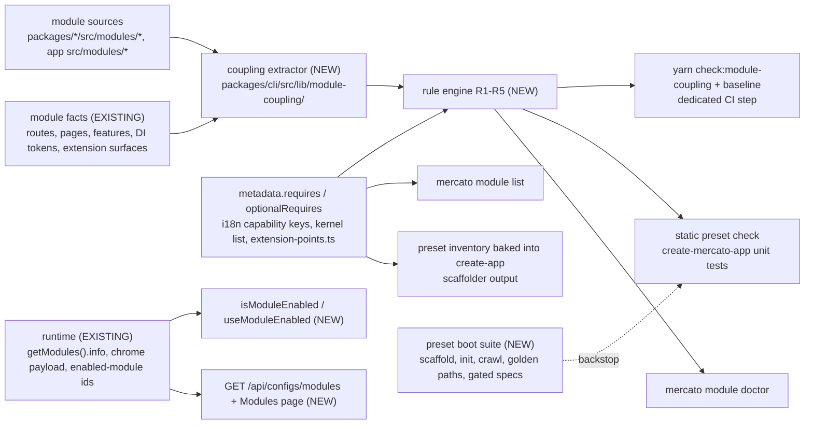

# Module dependency integrity — verified optional dependencies, preset boot tests and module diagnostics (#8784)

- **Status:** Draft
- **Date:** 2026-11-05
- **Scope:** OSS
- **Owner:** Platform / DX
- **Tracking issue:** #8784
- **Related:**
  - [`2026-09-29-module-sets-for-standalone-apps.md`](./2026-09-29-module-sets-for-standalone-apps.md) (draft; owns the dependency resolver, multi-module `module enable` and module sets)
  - [`2026-06-09-create-app-module-picker.md`](./2026-06-09-create-app-module-picker.md) (draft, Phase 1 implemented; owns scaffold-time module selection, tracking issue #3304)
  - [`2026-04-02-empty-app-starter-presets.md`](./2026-04-02-empty-app-starter-presets.md) (draft; defines the starter presets)
  - [`2026-10-01-catalog-runtime-module-dependencies.md`](./2026-10-01-catalog-runtime-module-dependencies.md) and [`2026-04-23-cli-optional-module-orchestration.md`](./2026-04-23-cli-optional-module-orchestration.md)
  - PR #6863 (`ModuleInfo.optionalRequires`), PR #7148 (per-tenant module availability), issues #7587, #6733 and #6144
  - `apps/docs/docs/architecture/module-dependencies.mdx`, `packages/core/AGENTS.md` → Cross-Module Coupling

## TLDR

**Key points:**
- An app's enabled module set becomes verifiable. Every reference from one module to another is a declared hard dependency (`requires`), a declared optional dependency (`optionalRequires`), a UMES contribution into the other module's host, or a reference inside the platform kernel. A static check fails on anything else, and on an upstream module that references its own consumer.
- Every shipped starter preset is scaffolded, booted and exercised in CI, and the CLI and admin UI report which optional capabilities a module set leaves inactive.

**Scope:** four parts that ship as separate PRs.
- **Phase 1:** boot tests for the `empty`, `crm` and `wms` presets.
- **Phase 2:** the dependency model, one shared "is this module enabled" helper, the static coupling check with its baseline, and the resolution of every reference from a preset module to a module outside its preset.
- **Phase 3:** `mercato module doctor` and `mercato module list`.
- **Phase 4:** scaffolder output that names what a preset leaves out, and a read-only Modules page in settings.

**Concerns:**
- An independent scope review returned SPLIT (see Q1). The maintainer decided to keep one spec with four separately shipped phases.
- Phase 2 builds on `ModuleInfo.optionalRequires`, which is defined in PR #6863 and not merged.
- Phase 3 builds on the module index and resolver that the module-sets spec owns and that are not implemented.
- Phase 2 introduces a "platform kernel" list (Q10), a new concept that the maintainer confirmed. The coupling check's first report verifies its seed membership.

## Resolved assumptions (autonomous defaults)

The Open Questions gate was answered with conservative defaults because this spec was authored autonomously. Q1 and Q10 were flagged for the maintainer and have been decided; the other rows can still be overridden in review.

| # | Question | Default applied | Why | Confirm |
|---|---|---|---|---|
| Q1 | One spec or several? | One spec, four phases, one implementation PR per phase. | The requester asked for one spec. An independent scope review returned **SPLIT** along the four phases: only Phase 2 and part of Phase 3 consume the coupling graph, Phase 1 depends on nothing here, and Phase 4 needs only `optionalRequires` metadata. The module-sets spec kept one document under the same verdict. | confirmed by the maintainer, 2026-11-05: "Keep one spec" |
| Q2 | Which field declares an optional dependency? | `ModuleInfo.optionalRequires?: string[]`, exactly as PR #6863 defines it. This spec adds no competing field. If #6863 has not merged when Phase 2 starts, Phase 2 lands the same change (the type field, the generator comments, the `optionalRequires` module fact and its test) as its first commit, coordinated with that PR's author. | Two fields for one concept would be a permanent contract mistake. | ok |
| Q3 | Where does the text "what is lost without the peer" live? | An i18n key `<moduleId>.optionalRequires.<peerId>` in the declaring module's locale files. The coupling check requires it for every `optionalRequires` entry. | No further change to `ModuleInfo`, the text is translatable, and the CLI reads the `en` value statically. | ok |
| Q4 | Which rules block? | R1 (declaration) and R5 (direction) block from day one against a committed baseline. R2 (guard evidence) blocks from day one, because every `optionalRequires` entry is new. R4 (test metadata) blocks for modules in shipped presets once Phase 2 lands and is advisory elsewhere. | `yarn check:pagination-capped` and `yarn check:time-bombs:fail` are the precedents: a script, an allowlist file and a dedicated CI step. | ok |
| Q5 | How are presets booted, and when? | A real standalone scaffold through Verdaccio, in a preset mode of `scripts/test-create-app-integration.ts`. A new workflow runs it nightly on `main`, on pull requests that touch preset definitions or module metadata, and on manual dispatch. | The failures happen in standalone apps built from compiled packages. Pull requests that change module code are covered by the static check; the boot suite is the behavioral backstop. | ok |
| Q6 | Which permission guards the Modules page? | The existing `configs.system_status.view`. | No new FROZEN feature ID and no ACL sync for existing tenants. | ok |
| Q7 | Does anything name a module that is not enabled at request time? | No. Neither the API dispatcher nor `apiCall` changes. | A path-prefix guess is unreliable (`api_docs` serves `/api/version`), and the dispatcher has a byte-identical template mirror. `module doctor` covers the need. | ok |
| Q8 | How does this relate to per-tenant module availability (PR #7148)? | This spec covers deployment-level enablement only. UI that depends on a peer module gates on one of the peer's features, which composes with #7148 because both mechanisms deny the peer's features. | A module can be enabled in the deployment and unavailable for one tenant. | ok |
| Q9 | Who owns the module index, the resolver and the preset closure test? | The module-sets spec owns the index and the resolver. Whichever work lands first creates `packages/cli/src/lib/module-index.ts` in the shape that spec defines and replaces the regex closure test; the other extends it. Both specs carry a changelog note. | One enumeration of installed modules, one closure algorithm, one preset test. | ok |
| Q10 | How do always-present, mutually dependent modules satisfy the declaration rule? | Through an explicit **platform kernel** list. References to a kernel module need no declaration, and tools require every kernel module to be enabled. Seed: `auth`, `directory`, `api_keys`, confirmed by the extractor's first report. | Declaring these edges in `requires` creates cycles (`auth` and `directory` import each other; `auth` needs `api_keys`, which requires `auth`). The module-sets resolver rejects cycles, and the Catalog spec declined a reverse edge for the same reason. | confirmed by the maintainer, 2026-11-05: "Confirm kernel" |

## Overview

Open Mercato apps enable modules in `src/modules.ts`. Starter presets in `create-mercato-app` (`classic`, `empty`, `crm`, `wms`) are curated module lists, and developers also hand-pick modules. A module set is coherent when every module in it can do what its UI and setup code attempt. Today the platform verifies only part of that: `ModuleInfo.requires` is enforced by the generators at `yarn generate`.

This spec closes the rest of the gap for module authors (a check that tells them when they introduced an undeclared dependency), for app developers (a CLI diagnosis of their own module set), for preset maintainers (boot tests), and for administrators (a page that shows which optional capabilities are inactive).

> **Market Reference**: Magento 2 ships a static dependency integrity test that scans module code for references to other modules and fails when a reference is not declared, distinguishing hard from soft dependencies and keeping a list of known exceptions. This spec adopts that shape: a static scan, two dependency classes and a committed baseline. Nx's `enforce-module-boundaries` lint rule is the same idea for monorepo libraries; its tag-based constraint language is rejected because module ids and `requires` already express the constraints here. Odoo resolves optional glue with `auto_install` bridge modules; that is rejected because the documented Open Mercato pattern keeps the glue in the optional consumer (`packages/core/AGENTS.md` → Cross-Module Coupling). npm's `peerDependenciesMeta.optional` is the naming precedent for `optionalRequires`.

## Problem Statement

Evidence is from `main` at `797e0e2a37`, read from source and not from a running app.

**A CRM-preset app ships features that depend on modules the preset does not enable.**

| # | In an app scaffolded with `--preset crm` | Cause |
|---|---|---|
| E1 | "Mark deal as lost" cannot be confirmed | `packages/core/src/modules/customers/components/detail/ConfirmDealLostDialog.tsx:55` loads the `sales.deal_loss_reason` dictionary, which only `sales` seeds (`packages/core/src/modules/sales/lib/dictionaries.ts`). Without entries the confirm button stays disabled (`:124`). |
| E2 | Schedule activity, link type "Offer", is always empty | `packages/core/src/modules/customers/components/detail/schedule/LinkedEntitiesField.tsx:104` calls `/api/sales/quotes`. |
| E3 | "Translate" on dictionary entries and custom-field definitions opens a dialog that cannot save | `packages/core/src/modules/dictionaries/components/DictionaryEntriesEditor.tsx:35` and `packages/core/src/modules/entities/backend/entities/user/[entityId]/page.tsx:29` import the `translations` module's `TranslationManager` directly. `translations` already injects that component through `packages/core/src/modules/translations/widgets/injection-table.ts`, which is the path that disappears cleanly when the module is absent. |
| E4 | Connected IMAP and Gmail mailboxes are not polled automatically | `packages/core/src/modules/communication_channels/setup.ts:199` registers the poll and Gmail watch-renewal schedules only when `schedulerService` is registered and otherwise returns silently. |

E4 is correctly guarded and still a defect for the user: nothing reports that mail sync is off.

**Root causes.**

1. **One dependency class.** `ModuleInfo.requires` (`packages/shared/src/modules/registry.ts`) is the only declaration. Optional coupling is prose plus a `try/catch` (`packages/core/AGENTS.md` → Cross-Module Coupling). `apps/docs/docs/architecture/module-dependencies.mdx` says the declared graph is "the floor, not the ceiling".
2. **Nothing compares declarations with code.** The same defect class was reported one case at a time in #5164, #5897, #6094, #6169, #6302, #6517, #7444 and #7587.
3. **Presets are hand-written lists.** `packages/create-app/src/lib/starter-presets.ts` is guarded by a regex test (`apply-starter-preset.test.ts`, "every non-classic preset satisfies the declared `requires`") and by per-incident tests such as the `profile:communication-channels:connect` provider test in the same file.
4. **CI boots only `classic`.** `scripts/test-create-app.ts` and `scripts/test-create-app-integration.ts` pass no `--preset`, and `snapshot.yml` and `npm-snapshot-preview.yml` scaffold the default.
5. **The CLI offers no diagnosis.** `mercato module enable` ignores `requires` (`packages/cli/src/lib/module-install.ts`); the generators check direct dependencies only and exit. There is no `module list` or `module doctor`.
6. **Guards are ad hoc.** "Is module X enabled" is answered with `getModules().map(...)` (`customers/backend/calendar/page.tsx`), two different `getEnabledModuleIds()` functions (`shared/src/security/enabledModulesRegistry.ts`, `shared/src/modules/widgets/injection-loader.ts`), `container.hasRegistration(...)`, per-module `tryResolve` helpers, entity-id registry checks, and a one-off hook (`packages/ui/src/ai/useAiAssistantAvailable.ts`). Only 5 of 73 injection widgets in the packages declare `requiredModules`.
7. **The direction rule is unchecked.** `packages/core/AGENTS.md` says the upstream module must not import, resolve or hard-require its consumer. E1 and E2 are `customers` referencing `sales`, which requires `customers`.
8. **Integration specs carry the same coupling.** Specs can declare `dependsOnModules` (`.ai/qa/AGENTS.md` → Conditional Metadata) and are then skipped when a module is absent, but specs under preset modules call other modules' APIs without declaring it, so the suite cannot run against a preset.

## Proposed Solution

### The model

A module A may reference a module B in exactly four sanctioned ways:

| Kind | Declared by | Meaning | Enforcement |
|---|---|---|---|
| Hard dependency | `metadata.requires` in A's `index.ts` (exists) | A cannot work without B. | The generators fail when B is not enabled (exists). |
| Optional dependency | `metadata.optionalRequires` in A's `index.ts` (PR #6863) plus the i18n key `A.optionalRequires.B` | A is the optional consumer of B: it works without B and loses a named capability. | Every reference from A to B must be guarded (R2). Tools report the capability as inactive when B is not enabled. |
| Structural contribution | A's UMES contribution files (injection table, enricher, interceptor, subscriber) that target B's host or event | A's glue only runs when B is enabled. | None needed. The edge is already in the extension-surface facts (`packages/cli/src/lib/generators/module-extension-facts.ts`, resolution `optional-target-missing`). |
| Kernel reference | B is in the platform kernel list | B is enabled in every supported app. | Tools require every kernel module to be enabled. |

Any other reference is **undeclared** and is a defect.

**The platform kernel** is the smallest set of modules that every supported app enables and that reference each other in cycles that cannot be removed without changing what the modules are. It is a constant in the coupling tooling (`packages/cli/src/lib/module-coupling/kernel.ts`), not a type or a runtime concept. A module joins it only when it is in the `empty` preset baseline (`EMPTY_MODULES`) and is part of a reference cycle with `auth`. The seed is `auth`, `directory` and `api_keys`; the extractor's first report confirms it. Changing the list requires an update to this spec.

### The rules

- **R1 — declaration (blocking).** Every reference from module A to module B is covered by A's `requires` closure, by A's `optionalRequires`, is a structural contribution, or targets a kernel module. Each `optionalRequires` entry has its `A.optionalRequires.B` key in `en`.
- **R2 — guard evidence (blocking).** A file in A that references an optional peer B carries a sanctioned guard: a feature gate on a feature that B owns, `useModuleEnabled` in client files, `isModuleEnabled` in server files, `requiredModules` including B on the widget metadata, or a `tryResolve`-style `try/catch` or `hasRegistration` check for DI tokens. `isModuleEnabled` in a `"use client"` file does not count.
- **R3 — provider presence.** A host that declares `minContributions` has at least that many enabled contributions. This is checked for a concrete module set (presets, `module doctor`), never for the monorepo as a whole.
- **R4 — test metadata.** An integration spec under A that references B declares `dependsOnModules` including B, unless B is in A's `requires` closure or in the kernel.
- **R5 — direction (blocking).** If B's `requires` or `optionalRequires` closure contains A, then A does not reference B, unless both are kernel modules. The fix is inversion: B contributes through a UMES host that A declares. This also keeps the declared graph free of cycles.

This spec does not decide whether a cross-module import is legitimate. It requires the edge to be declared and to point the right way. The data-ownership policy for foreign entity imports stays with #6733.

### Safety nets

1. **Author time:** the coupling check runs in CI as a dedicated step. It catches a pull request that adds a cross-module reference.
2. **Preset time:** a static preset check applies R1, R3 and the kernel requirement to each preset's module list in the `create-mercato-app` unit tests, and the preset boot suite runs each preset as a real app.
3. **App build time:** `mercato module doctor` applies the same rules to the app's own module set, including third-party and app modules.
4. **Runtime:** the shared guard helper hides optional UI, and the Modules page shows inactive capabilities.

The static check does not see data-level coupling (E1 is a dictionary key). Only a boot test that performs the action can catch that class, so the boot suite includes explicit golden paths.

### Design Decisions

| Decision | Rationale |
|---|---|
| The coupling graph is computed on demand and never written into `module-facts.v2.json`. | The module-facts sidecars ship in scaffolded apps and are covered by harness tests (`packages/create-app/src/lib/module-facts-build.test.ts`, `agent-instruction-budget.test.ts`). Extending them is a separate, governed change. |
| Owner resolution uses existing module facts (`apiRoutes`, `backendPages`, `aclFeatures`, `diTokens`), not a path-prefix guess. | A literal `/api/x/y` is attributed to the module whose route facts match it. A path no module serves is reported as dangling. |
| The baseline is keyed by module pair, not by file or line. | The unit of decision is "A depends on B". A pair-level file has one line per decision, churns only when a pair is resolved, and conflicts rarely. |
| Runtime surfaces read only `getModules()[i].info`, the backend chrome payload and the client enabled-module registry. | The generated registry already carries `info: <module>.metadata`. No new generated file and no new `BootstrapData` field. |
| The Modules page is read-only. | Enabling a module changes `src/modules.ts`, generated registries and migrations. A toggle in the UI would not be truthful. |
| Feature gates are the preferred guard for optional UI. | `authorizeFeatures` and `filterGrantsByEnabledModules` (`packages/shared/src/security/`) already deny the features of a disabled module, including for superadmins, and PR #7148 adds per-tenant denial to the same path. |

### Alternatives Considered

| Alternative | Why rejected |
|---|---|
| Declare every soft dependency as a hard `requires`. | It forces presets to pull in whole suites (`customers` would require `sales`, which requires `catalog`) and contradicts the optional-peer rule in `packages/core/AGENTS.md`. |
| Declare kernel edges in `requires`. | It creates `requires` cycles, which the module-sets resolver rejects and the Catalog spec avoided. |
| A new field with capability text, for example `integrates: [{ module, enables }]`. | It competes with `optionalRequires` from PR #6863 and puts user-facing copy into a type instead of locale files. |
| Run the coupling scan inside `yarn generate`. | Generators must stay fast and deterministic (`packages/cli/AGENTS.md`). The scan parses all enabled module sources. |
| Register the check in `REPO_WIDE_GUARDS`. | That list holds Jest test files with a budget of about ten seconds for the whole set (`scripts/repo-wide-guards.mjs`). The scan is a script with its own CI step. |
| Name the missing module in the API `404` body, or in `apiCall`. | See Q7. |
| Boot presets by rebuilding the monorepo app with a different `modules.ts`. | The monorepo app runs TypeScript sources and workspace packages; standalone apps run compiled packages. The defects being prevented are standalone defects. |
| Only boot tests, no static check. | Boot tests cover shipped presets. They say nothing about hand-picked module sets or third-party modules, and they find a defect after it merged. |

## User Stories / Use Cases

- A **module author** wants CI to fail when their change makes one module call another module's API without declaring it, so that the dependency is a decision and not an accident.
- An **app developer** wants to run one command that says what their module set is missing and what it would cost to leave it out, so that they do not find out from a broken button.
- A **preset maintainer** wants every shipped preset to be booted and exercised automatically, so that a preset cannot ship a dead-end page.
- An **administrator** wants to see which optional capabilities are inactive in their deployment and what to ask a developer to enable.
- A **new user** scaffolding an app wants to see what the chosen preset leaves out before they start building.

## Architecture



The extractor feeds the CI check, the static preset check and `module doctor`. `module list`, the preset inventory, the guard helpers and the Modules page read only metadata.

### Coupling extractor

A new directory `packages/cli/src/lib/module-coupling/` parses module sources with the TypeScript compiler API that `module-facts.ts` already uses, without type-checking. It skips `__tests__`, `migrations`, `i18n` and generated files, treats `__integration__` files separately for R4, and ignores `@open-mercato/shared/modules/<name>` specifiers, whose names collide with module ids.

| Reference kind | Detected from | Owner resolved through |
|---|---|---|
| `import` | Value imports, re-exports and dynamic imports whose specifier resolves into another module's directory (`@open-mercato/<pkg>/modules/<B>/...` or a relative path). Type-only imports are ignored. | The module directory. |
| `api-path` | String and template literals that start with `/api/`. | The `apiRoutes` facts of all installed modules. |
| `page-path` | String and template literals that start with `/backend/`. | The `backendPages` facts. |
| `feature` | Feature ids in `requireFeatures`, `features`, `requiredFeatures` and widget `features` arrays. | The module whose `acl.ts` declares the feature, from the `aclFeatures` facts. |
| `di-token` | The string argument of `resolve(...)` and `hasRegistration(...)`. | The `diTokens` facts. |
| `extension` | Contributions and their targets. | The existing extension-surface facts. These edges are structural and need no declaration. |

A reference whose literal matches no installed module is reported as **dangling**, for example the `/backend/support` link in `packages/core/src/modules/auth/notifications.ts`. Template literals are matched on their static head. A literal the extractor cannot attribute is ignored and counted in the report.

### Guard helpers

- **Server:** `isModuleEnabled(moduleId: string): boolean`, exported from `@open-mercato/shared/security/enabledModulesRegistry` beside `getEnabledModuleIds()`, on that file's existing registry accessor. It returns `false` when the module registry is not registered, so an optional feature stays hidden instead of running against missing tables. The neighbouring `filterGrantsByEnabledModules` fails open for legacy reasons; this helper deliberately does not.
- **Client:** `useModuleEnabled(moduleId: string): boolean | null` in `packages/ui/src/backend/modules/useModuleEnabled.ts`. It reads the client enabled-module registry (`getEnabledModuleIds` and `subscribeToInjectionRegistryChanges` from `@open-mercato/shared/modules/widgets/injection-loader`, through `useSyncExternalStore`). When that registry is not registered, it falls back to a new optional `enabledModuleIds` field on `BackendChromePayload` (`packages/shared/src/modules/navigation/backendChrome.ts`), which the server fills from `getEnabledModuleIds()`.
- **`null` means unknown, never disabled.** The client registry is filled by the app-owned `ClientBootstrap`; an app with an older shell never registers it. The payload fallback makes the answer available to those apps as soon as the chrome payload arrives. Callers render nothing optional while the value is `null`.
- `useAiAssistantAvailable` moves onto the hook as `useModuleEnabled(id) !== false && hasFeature(...)`, which is its current behavior.
- Neither helper answers per-tenant availability. Code that needs "the user can use B here" gates on one of B's features.

### Host provider requirement

`InjectionExtensionHostDeclarationBase` in `packages/shared/src/modules/widgets/extension-points.ts` gains `minContributions?: number`. It is valid on exact-spot injection hosts only; the check rejects it on pattern hosts. `communication_channels` sets it to `1` on the `profileConnect` host (`packages/core/src/modules/communication_channels/extension-points.ts`).

The rule engine reads the value from `extension-points.ts` with the static reader, so the generated extension-surface facts do not change. R3 counts the enabled contributions bound to the spot from those facts. Each host with the flag renders its own empty state: for `profileConnect`, the profile page shows `EmptyState` when the spot resolves no widget, where `ConnectChannelMenu.tsx` returns `null` today.

### Preset boot suite

`scripts/test-create-app-integration.ts` gains a preset mode, `--preset <id>`. In that mode it passes the preset to `create-mercato-app` and skips the steps that only make sense for `classic`: adding the enterprise dependency, the `OM_ENABLE_ENTERPRISE_MODULES*` flags and the example-module activation. It builds once, initializes and starts the app, and sets `OM_PRESET_BOOT=<id>`. For each of `empty`, `crm` and `wms` it runs three layers:

1. **The backend crawl**, `TC-CONF-007`, in `packages/core/src/modules/configs/__integration__/` (`configs` is in every preset). Its metadata declares `requiredEnvVars: ['OM_PRESET_BOOT']`, so the normal integration job never runs it. It signs in as the admin, reads `groups`, `settingsSections` and `profileSections` from `/api/auth/admin/nav`, opens every listed page, and fails on an `/api/**` response with status `404` or `5xx`, an uncaught page error, or a console error outside a short allowlist.
2. **Preset golden paths**, one spec per preset, also gated on `OM_PRESET_BOOT`. Each performs the preset's primary user actions and creates fixtures only through the APIs of modules in the preset. For `crm` (`TC-CRM-8784` in `customers/__integration__/`): create a company, a person and a deal; move the deal to another stage; mark it lost with a reason; schedule an activity and add every offered link type; open the dictionary entries editor; open the communication-channels profile page. For `empty`: create a role and a user, upload an organization logo, open global search. For `wms`: the primary flow of `catalog`, `sales` and `wms`, defined in the Phase 1 PR.
3. **The module suites.** The standard discovered integration suite runs for the preset. Specs are excluded by their `dependsOnModules` metadata when a module is absent.

Pull requests that match the path filter run layers 1 and 2. The nightly run adds layer 3. When a nightly run fails, the workflow opens or updates one issue per preset, titled "Preset boot suite failing: <preset>", and closes it on the next green run.

What the suite proves is bounded by what the crawl loads and what the golden paths perform. E1 to E3 are caught by the `crm` golden path, not by the crawl. E4 is not observable in a boot test; it is covered by the declaration (R1) and by the reports in Phases 3 and 4.

### Resolution of preset-breaking references

Phase 2 resolves every pair whose source is a module in a shipped preset and whose target is outside that preset. The rows below are the known ones; the extractor's first report is authoritative. Rows marked *audit* come from the source audit and were not re-verified line by line.

| Pair | Evidence | Rule | Mechanism | Glue owner | When the peer is absent |
|---|---|---|---|---|---|
| `customers` → `sales`, loss reasons | E1 | R5 | Ownership of the `sales.deal_loss_reason` dictionary moves to `customers`, which seeds and manages it. The dictionary key is unchanged, so existing tenants keep their entries. `sales` stops seeding it. | `customers` | No dependency remains. |
| `customers` → `sales`, Offer link | E2 | R5 | The link types of `LinkedEntitiesField` become an extension host declared in `customers/extension-points.ts`. `sales` contributes the Offer type. | `sales` | The Offer type is not offered. |
| `dictionaries`, `entities` → `translations` | E3 | R1 | The direct imports are removed. `translations` contributes the Translate action through injection hosts on the entries editor and the field-definition editor, the mechanism it already uses for `crud-form:*:header`. | `translations` | No Translate action. |
| `communication_channels` → `scheduler` | E4 | R1 | `optionalRequires: ['scheduler']` with the capability key. The existing `hasRegistration` guard is the R2 evidence. | `communication_channels` | No automatic polling or watch renewal; reported as an inactive capability. |
| `integrations`, `ai_assistant` → `scheduler` | *audit*: both skip their schedules without `schedulerService` | R1 | `optionalRequires: ['scheduler']` with capability keys. | the consumer | Health probes and cleanup jobs do not run; reported as inactive. |
| `communication_channels` → `integrations` | *audit*: resolves `integrationCredentialsService`; #6144 asks for a guard | R1 | Declared either hard or optional, decided in #6144. | `communication_channels` | Per that decision. |
| `channel_imap`, `channel_gmail` → `communication_channels`, `integrations` | The other channel packages declare `requires: ['communication_channels', 'integrations']`; these two declare none | R1 | The same `requires`. | — | The generator rejects the module set. |
| `customers` → `staff`, `resources` | *audit*: calendar and assignment already degrade | R1 | `optionalRequires` with capability keys; the existing checks move to the shared helper. | `customers` | Assignment falls back to auth users; resource fields are hidden. |
| `dashboards` → `sales`, `catalog` | *audit*: analytics widgets gated on `sales.orders.view`; a seed that imports sales entities | R5 | The sales-specific widgets and their seed move to `sales`, which contributes them as dashboard widgets. | `sales` | The widgets do not exist. |

The first two rows and the third are also the fixes for E1 to E3. They may ship earlier as bug fixes; Phase 2 does not close until they have.

### Commands & Events

None. The tooling, the HTTP endpoint and the page perform no mutation, so there are no commands, events or undo behavior. The dictionary ownership move in the table above reuses the existing dictionary seeding and management paths of `customers`.

## Data Models

No database schema, entity or migration is added. The feature adds static artifacts and two optional type fields.

**Coupling baseline** — `.ai/module-coupling-baseline.json`, committed, following the allowlist pattern of `scripts/pagination-capped-allowlist.json` and `.ai/time-bomb-allowlist.json`:

```jsonc
{
  "version": 1,
  "undeclared": [
    { "module": "customers", "target": "notifications" }
  ],
  "upstream": [
    { "module": "customers", "target": "sales" }
  ]
}
```

One entry per module pair and rule, sorted. The check fails on a violating pair that is missing from the baseline and on an entry whose pair no longer violates. `--prune-baseline` removes stale entries and never adds one; a new entry is a manual, reviewed edit.

**Kernel list** — `PLATFORM_KERNEL_MODULES` in `packages/cli/src/lib/module-coupling/kernel.ts`.

**Preset inventory** — `packages/create-app/src/lib/preset-inventory.json`, generated at build time from module metadata and `en` capability keys, guarded by a freshness test like the other inventories in that package. Per preset it lists the inactive optional dependencies: declaring module, peer module, the peer's package and the capability text.

**Type fields**
- `minContributions?: number` on the injection host declaration.
- `enabledModuleIds?: string[]` on `BackendChromePayload`.
- `ModuleInfo.optionalRequires?: string[]` is defined by PR #6863 and not redefined here.

## API Contracts

### CLI (additive)

```text
yarn mercato module list   [--all] [--json]
yarn mercato module doctor [--strict] [--json]
```

Both are static: they read `src/modules.ts`, installed package sources and module facts, and never touch the database, the DI container or generated registries.

- `module list` prints the modules enabled in this app with package, version, `requires`, `optionalRequires` and "required by". `--all` adds installed modules that are not enabled. It is the local counterpart of `module info`, which describes one catalog entry.
- `module doctor` prints six groups, each finding with its file and line where one exists:
  1. Kernel modules that are not enabled.
  2. Missing hard dependencies, including transitive ones in a single run.
  3. Inactive optional capabilities, each with the capability text and the exact `yarn mercato module enable <package> --module <id>` command.
  4. Undeclared references and upstream references to modules that are not enabled.
  5. Hosts with fewer contributions than `minContributions`.
  6. Dangling references.

  The exit code is non-zero for groups 1 and 2, and with `--strict` also for groups 4 to 6. Group 3 never fails the command. `--json` prints `{ version: 1, enabled, findings: [{ group, module, target?, kind?, file?, line?, message }] }`.
- When a module's source cannot be read statically, the module is listed as "not analyzed" and the command still succeeds.

`mercato generate` prints one line, once per run and after all generators, when at least one enabled module has an `optionalRequires` entry that is not enabled: the count and a pointer to `module doctor`. It writes nothing and never fails on it.

### Root scripts (additive)

```text
yarn check:module-coupling                    # report R1, R2, R4, R5 for the monorepo
yarn check:module-coupling --fail             # exit non-zero on blocking violations outside the baseline
yarn check:module-coupling --prune-baseline   # remove stale baseline entries
```

The blocking form runs as its own step in `.github/workflows/ci.yml`, next to `yarn check:pagination-capped` and `yarn check:time-bombs:fail`.

### HTTP

`GET /api/configs/modules` in `packages/core/src/modules/configs/api/modules/route.ts`.

- `metadata`: `GET: { requireAuth: true, requireFeatures: ['configs.system_status.view'] }`. The route exports `openApi`.
- No query parameters and no request body.
- `200` response, with its zod schema beside the other configs schemas in `configs/api/openapi.ts`:

```ts
{
  modules: Array<{
    id: string
    title: string | null
    requires: string[]
    optionalRequires: string[]
    requiredBy: string[]
    inactiveOptional: Array<{ moduleId: string; capabilityKey: string }>
  }>
}
```

- Errors: `401` unauthenticated, `403` without the feature.
- The response is built from `getModules()` and contains no tenant or organization data, so it is identical for every tenant. It is not cached; building it is a pass over an in-memory array.

`GET /api/auth/admin/nav` gains the optional `enabledModuleIds` field described above. Nothing else in that response changes.

### Shared helpers (additive)

```ts
// @open-mercato/shared/security/enabledModulesRegistry
export function isModuleEnabled(moduleId: string): boolean

// @open-mercato/ui/backend/modules/useModuleEnabled
export function useModuleEnabled(moduleId: string): boolean | null
```

## Internationalization (i18n)

- Capability keys: `<moduleId>.optionalRequires.<peerId>` in each declaring module's `i18n/*.json`, one sentence fragment naming what the peer adds, for example `communication_channels.optionalRequires.scheduler`: "Automatic mailbox polling and Gmail watch renewal". All locales are filled, as `yarn i18n:check-sync` requires.
- Page keys under `configs.modules.*` in `packages/core/src/modules/configs/i18n/*.json`: title, column headers, the two status labels, the filter label, the no-results text, the command hint and the copy button label.
- CLI output is developer-facing and not translated.
- No key is added to `apps/mercato/src/i18n/**`, so no template sync is needed.

## UI/UX

**Modules page** — `/backend/config/modules`, in the System group of settings next to System status, guarded by `configs.system_status.view`.

```text
Modules                                   [ ] Only modules with inactive integrations
+-----------------------+-------------------------+----------------------------+-------------+
| Module                | Requires                | Optional integrations      | Required by |
+-----------------------+-------------------------+----------------------------+-------------+
| Customers             | progress, dictionaries, | staff       (inactive)     | sales, wms  |
| customers             | feature_toggles         | resources   (inactive)     |             |
| Communication channels| progress                | scheduler   (inactive)     | -           |
+-----------------------+-------------------------+----------------------------+-------------+
  v Communication channels
    scheduler - Automatic mailbox polling and Gmail watch renewal.
    Ask a developer to run:  yarn mercato module doctor            [copy]
```

- The list is a `DataTable` with `extensionTableId` `configs.modules`, declared as a host in `configs/extension-points.ts`. It is paginated on the client with a page size of 50, uses the table's expandable rows, and has no export, perspective or row actions.
- Each optional peer is a `StatusBadge` (active or inactive) using semantic status tokens. The expanded row shows the capability text and a copyable command; the copy control is an `IconButton` with an `aria-label`.
- Loading and failure use `LoadingMessage` and `ErrorMessage`. The filter with no match uses the table's empty state. The table itself is never empty.
- The page has no write action and therefore no dialog, no `useGuardedMutation` and no optimistic locking.

**Scaffolder** — after a non-classic preset is applied, `create-mercato-app` prints the preset's inactive optional capabilities from the baked inventory, one line each with the enable command, and stores the same list in `.mercato/starter-preset.json`. It asks nothing and changes no module list; interactive toggling stays with the module picker's Phase 2.

## Frontend Architecture Contract

**Server/Client boundary map**

| Route / surface | Server root | Client islands | Data owner | Notes |
|---|---|---|---|---|
| `/backend/config/modules` | `configs/backend/config/modules/page.tsx` | `configs/components/ModulesTable.tsx` | `GET /api/configs/modules` | No page-root `"use client"`, the same shape as the System status page. |
| Optional UI in any module | unchanged | the consuming component | client registry, chrome payload | `useModuleEnabled` adds no provider. |

**`"use client"` ledger**

| File | New or touched | Reason | Heavy deps? | Cleanup / hydration risk | Alternative rejected |
|---|---|---|---|---|---|
| `configs/components/ModulesTable.tsx` | new | Filter and row-expansion state, clipboard API, `apiCall`. | `DataTable` only. | None; no subscriptions. | A server-rendered table cannot offer the copy control or the filter. |
| `packages/ui/src/backend/modules/useModuleEnabled.ts` | new | Effect subscription through `useSyncExternalStore`. | None. | Released by React. The server snapshot is `null`, so markup is identical before registration. | Reading the registry during render misses late registration. |
| `packages/ui/src/ai/useAiAssistantAvailable.ts` | touched (50 lines) | Moves onto the hook; behavior unchanged. | None. | None. | — |
| `customers/components/detail/schedule/LinkedEntitiesField.tsx` | touched (288 lines) | Link types come from the new host instead of a constant. | None added. | The host resolves asynchronously; the two built-in types render first. | Keeping the hard-coded Offer type. |
| `dictionaries/components/DictionaryEntriesEditor.tsx` | touched (551 lines) | Removes the `TranslationManager` import; renders an injection host. | Removes one. | None added. | Guarding the direct import. |
| `entities/backend/entities/user/[entityId]/page.tsx` | touched (713 lines, page root) | Removes the `TranslationManager` import; renders an injection host. | Removes one. | None added. | Guarding the direct import. |
| `communication_channels/backend/profile/communication-channels/` page and `ConnectChannelMenu.tsx` | touched (120 lines) | Renders `EmptyState` when the connect spot is empty. | None. | None. | Returning `null`, as today. |

**Client blob guardrail** — `ModulesTable.tsx` stays under 300 lines. Two touched files are already over 300 lines (`DictionaryEntriesEditor.tsx`, the entities page root). The changes remove an import from each and add a host; they do not grow the files, and splitting them is outside this spec.

**Budgets**

| Budget | Default target | Spec value |
|---|---|---|
| Generated backend page-root `"use client"` | 0 new unallowlisted | 0 |
| Touched client page/root files over 300 LOC | 0 unless justified | 2 existing files, justified above |
| Heavy browser libraries at page/provider root | 0 | 0 |
| Per-route hydration smoke test | required | `TC-CONF-009` for the Modules page; the `crm` golden path for the touched routes |
| Performance evidence | static check plus one runtime signal | `yarn check:client-boundaries`, and the build output of the settings route before and after |

**Provider / bootstrap scope** — none touched. The feature reuses `registerEnabledModuleIds` and `BackendChromeProvider`, and adds no provider, registry or global listener.

**Test and evidence plan** — route load and hydration, filter, row expansion and copy in `TC-CONF-009`; `yarn check:client-boundaries` output attached to the Phase 2 and Phase 4 PRs.

## Configuration

One environment variable, `OM_PRESET_BOOT`, set only by the preset boot script to select the gated specs. It has no effect on a running app and is not added to `.env.example`.

## Migration & Backward Compatibility

All changes are additive. Per `BACKWARD_COMPATIBILITY.md`:

| Surface | Change | Handling |
|---|---|---|
| 2. Type definitions (STABLE) | `ModuleInfo.optionalRequires` (PR #6863); `minContributions?` on the injection host declaration; `enabledModuleIds?` on `BackendChromePayload`. | Optional fields. `ModuleExtensionPoints` explicitly allows new optional metadata. |
| 3. Function signatures (STABLE) | New `isModuleEnabled` and `useModuleEnabled`. | New exports; nothing changed or removed. |
| 4. Import paths (STABLE) | New `@open-mercato/ui/backend/modules/useModuleEnabled`. | New path. |
| 6. Widget injection spot IDs (FROZEN) | New spot ids: `data-table:configs.modules:*`, and the hosts added by the resolution table (link types, the two Translate hosts). | Additive; existing ids are unchanged. Each new id is frozen once shipped and is named in the PR that adds it. |
| 7. API route URLs (STABLE) | New `GET /api/configs/modules`; one optional response field on `GET /api/auth/admin/nav`. | Additive. The dispatcher is unchanged. |
| 10. ACL feature IDs (FROZEN) | None. | The page reuses `configs.system_status.view`. |
| 13. CLI commands (STABLE) | New `module list` and `module doctor`; one informational line in `mercato generate`. | Existing commands, flags and exit codes are unchanged. |
| 14. Generated file contracts (STABLE) | Module facts gain content: the `optionalRequires` fact (PR #6863), new `requires` values, the new configs route and page, the new hosts. | No export or shape change. |
| 1, 5, 8, 9, 11, 12 | No change. | — |

**Behavior that can newly fail.** Declaring a missing hard dependency in a module's `requires` makes `yarn generate` reject an app that enabled that module without the dependency. Each such addition is listed in `UPGRADE_NOTES.md` with the module to enable, following the precedent of the Catalog change. A reference is declared hard only when the code cannot run without the peer.

**Behavior that moves.** The resolution table moves the seeding of one dictionary from `sales` to `customers` and moves sales-specific dashboard widgets to `sales`. Widget ids, dictionary keys and stored data are unchanged. In an app with all modules enabled nothing visible changes.

**Monorepo and template.** No file under `apps/mercato/src/app/**` or `apps/mercato/src/i18n/**` changes, so the template sync checklist in `packages/create-app/AGENTS.md` is not triggered. `packages/create-app/template/AGENTS.md` and the standalone harness are refreshed with the `module doctor` command through `om-refresh-standalone-harness`.

## Implementation Plan

Each phase is delivered as one or more implementation PRs, and each PR leaves a working application.

### Phase 1 — Preset boot suite

1. Add the preset mode to `scripts/test-create-app-integration.ts` and `--preset` to `scripts/test-create-app.ts`; the default behavior is unchanged.
2. Add the crawl spec `TC-CONF-007` with its `OM_PRESET_BOOT` gate and console-error allowlist.
3. Add the golden-path specs. Steps that fail on E1 to E3 land with the fixes for those defects.
4. Sweep the integration specs of modules in the three presets and add `dependsOnModules` wherever a spec uses a module outside its module's `requires` closure.
5. Add `.github/workflows/preset-boot.yml` with a `[empty, crm, wms]` matrix: nightly on `main` (all three layers), pull requests matching `packages/create-app/src/lib/starter-presets.ts`, `packages/*/src/modules/*/index.ts`, `packages/create-app/template/src/modules.ts` and the gated specs (layers 1 and 2), and manual dispatch. Add the failure-issue step.
6. Document the suite in `.ai/qa/AGENTS.md` and `packages/create-app/AGENTS.md`.

Exit: layers 1 and 2 are green for all three presets, and the nightly run is green.

### Phase 2 — Declared and verified dependencies

Tooling (one PR):

1. Land `optionalRequires` (PR #6863 merged, or the same change as the first commit; see Q2).
2. Add `isModuleEnabled`, `useModuleEnabled` and the `enabledModuleIds` payload field with unit tests; move `customers/backend/calendar/page.tsx` and `useAiAssistantAvailable` onto them.
3. Add the coupling extractor and rule engine with unit tests over fixture modules for every reference kind, type-only imports, template literals, dangling paths, structural contributions, kernel references and upstream references.
4. Confirm the kernel list from the extractor's first report, add `yarn check:module-coupling`, generate `.ai/module-coupling-baseline.json`, and add the CI step.
5. Add `minContributions`, set it on `profileConnect`, render the empty state, and replace the bespoke connect-spot test in `apply-starter-preset.test.ts` with the generic R3 check.
6. Replace the regex closure test in `apply-starter-preset.test.ts` with the static preset check (see Q9).
7. Update `packages/core/AGENTS.md` → Cross-Module Coupling and `apps/docs/docs/architecture/module-dependencies.mdx`.

Resolutions (one PR per row or per source module):

8. Resolve each row of the resolution table, and any further preset-breaking pair the extractor reports, with its tests, removing the pair from the baseline.

Exit: the CI step is green, and no pair with a `crm` or `wms` preset module as source and a module outside that preset as target is in the baseline.

### Phase 3 — CLI diagnostics

1. Create or reuse `packages/cli/src/lib/module-index.ts` (see Q9).
2. Add `module list` and `module doctor` with the output and exit codes above, plus help text.
3. Add the informational line to `mercato generate`.
4. Add CLI docs pages `apps/docs/docs/cli/module-list.mdx` and `module-doctor.mdx`; update `packages/cli/AGENTS.md`.

Exit: a fixture app produces a finding in each of the six groups.

### Phase 4 — Visibility

1. Generate `preset-inventory.json` in the `create-mercato-app` build with a freshness test; print it after preset selection and store it in `.mercato/starter-preset.json`.
2. Add `GET /api/configs/modules`, the page, the client table, the host declaration and the locale keys.
3. Refresh the standalone harness guidance.

Exit: the page lists the inactive capabilities of a `crm` app, and scaffolding with `--preset crm` prints the same list.

### Testing Strategy

- **Unit:** extractor per reference kind; rule engine for R1 to R5; baseline diff (new violation, stale entry, prune never adds); `isModuleEnabled` with and without a registered registry; `useModuleEnabled` with the client registry, with only the payload, and with neither; the modules route's response builder over `registerModules(testModules)` fixtures; preset inventory generation; doctor output and exit codes.
- `packages/core/src/__tests__/module-decoupling.test.ts` stays. It verifies runtime behavior with a reduced registry; the coupling check verifies source references. They are complementary.
- **Integration:** see Integration Coverage.

## Integration Coverage

All specs are self-contained, create what they need through the API and clean up.

| Path | Spec | Covers |
|---|---|---|
| Preset apps (`empty`, `crm`, `wms`) | `TC-CONF-007` | Sign-in; every sidebar, settings and profile page loads without a failed API call, page error or console error. |
| `crm` preset | `TC-CRM-8784` | The golden path above, including: a deal is marked lost with a reason (E1); the activity link types offered are exactly those of enabled modules (E2); the dictionary entries editor shows no Translate action (E3); the communication-channels profile page offers at least one provider. |
| `empty` and `wms` presets | one golden-path spec each | The preset's primary actions. |
| Monorepo app, all modules enabled | additions to the existing customers, dictionaries and entities specs | The Offer link type and the Translate actions are still present when `sales` and `translations` are enabled. |
| Preset apps, nightly | the discovered module suites, gated by `dependsOnModules` | Each enabled module's own flows on the preset's module set. |
| `GET /api/configs/modules` | `TC-CONF-008` | `401` without a session, `403` without the feature, response shape, `requires` and `requiredBy` consistency. In the `crm` preset run: an inactive `communication_channels` → `scheduler` entry. |
| `/backend/config/modules` | `TC-CONF-009` | Route load and hydration, the filter, row expansion, the copy control. |
| `mercato module list` / `doctor` | a CLI integration test beside `TC-INT-007` and `TC-INT-008` in `packages/cli/src/lib/__integration__/` | A fixture app produces a finding in each of the six groups; `--strict` and `--json` behave as specified. |
| `create-mercato-app --preset crm` | an addition to `starter-preset-example-delivery.test.ts` | The inactive-capability list is printed and stored. |

## Risks & Impact Review

The tooling, the endpoint and the page perform no writes and read no tenant data: the HTTP response is built from the deployment's module registry and is the same for every tenant. The resolution table moves existing seeding and widgets between modules without changing stored data. The risks are in tooling accuracy, CI cost, sequencing and the two new concepts.

#### Static extraction misses or misattributes a reference
- **Scenario**: A path is built dynamically, or a literal looks like an API path and is not one, so an undeclared dependency passes or a false violation appears.
- **Severity**: Medium
- **Affected area**: The coupling check, `module doctor`.
- **Mitigation**: Owners come from route, page, feature and DI facts instead of prefixes. Unattributed literals are counted in the report. The baseline absorbs a false positive until the extractor is fixed.
- **Residual risk**: Data-level coupling such as dictionary keys stays invisible to the static check. It is caught only where a golden path performs the action.

#### An optional dependency is declared and not guarded
- **Scenario**: A module adds `optionalRequires: ['sales']` to satisfy R1 and keeps calling `/api/sales/...` unconditionally. The generator no longer protects it, and the call fails at request time.
- **Severity**: High
- **Affected area**: Any module with optional dependencies.
- **Mitigation**: R2 blocks from day one, the capability key forces the author to state what is lost, R5 rejects the declaration when the peer is the module's own consumer, and the preset boot suite runs with the peer absent.
- **Residual risk**: R2 is file-level evidence. A guard in the wrong branch of the same file passes.

#### The kernel list grows into an escape hatch
- **Scenario**: Modules are added to the kernel to silence R1 instead of declaring dependencies.
- **Severity**: Medium
- **Affected area**: The declaration rule.
- **Mitigation**: Membership has two stated conditions, the list is a reviewed constant, and a change requires an update to this spec. Tools fail when a kernel module is not enabled, so adding a module has a visible cost.
- **Residual risk**: The maintainer confirmed the concept and the seed (Q10). The extractor's first report still has to show that the seed matches the code.

#### The baseline is large and long-lived
- **Scenario**: The first run records a few hundred module pairs. A rough count during review found about 200 pairs with value imports while 24 modules declare any `requires`.
- **Severity**: Medium
- **Affected area**: Modules outside the presets; reviewers of the baseline file.
- **Mitigation**: Pair-level entries keep the file to one line per decision. The check fails on stale entries, `--prune-baseline` only removes, and Phase 2 clears every preset-breaking pair.
- **Residual risk**: Pairs inside a preset and pairs between non-preset modules stay until someone resolves them. Two pull requests that resolve neighbouring pairs can conflict on the file.

#### `useModuleEnabled` cannot answer in an app with an older shell
- **Scenario**: A standalone app's `ClientBootstrap` predates `registerEnabledModuleIds`, so the client registry is never registered.
- **Severity**: Medium
- **Affected area**: Optional UI in apps that upgraded packages without updating their shell.
- **Mitigation**: The hook falls back to `enabledModuleIds` on the chrome payload, which packages produce and consume without the app shell. `null` is documented as unknown.
- **Residual risk**: Optional UI stays hidden until the chrome payload arrives, as feature-gated UI does today.

#### Preset boot tests are slow or flaky
- **Scenario**: Three standalone scaffolds, installs and production builds per run; the standalone integration path already has flaky specs (#4973).
- **Severity**: Medium
- **Affected area**: CI duration and signal.
- **Mitigation**: Pull requests run the crawl and golden paths only, and only on the path filter. The module suites run nightly. A failing nightly run opens one issue per preset and closes it when green.
- **Residual risk**: A defect that only the nightly layer catches is noticed a day late.

#### Sequencing against unmerged work
- **Scenario**: PR #6863 or the module-sets Phase 1 changes shape or stalls.
- **Severity**: Medium
- **Affected area**: Phases 2 and 3.
- **Mitigation**: Q2 and Q9 define the fallback: land the same change, or create the module index in the shape the module-sets spec defines.
- **Residual risk**: If `optionalRequires` is renamed during review of #6863, this spec is updated before Phase 2 starts.

#### New hard dependencies break minimized apps
- **Scenario**: A reference turns out to be a real hard dependency. Declaring it makes `yarn generate` fail for an app that enabled the module without it.
- **Severity**: Medium
- **Affected area**: Standalone apps with hand-picked module sets.
- **Mitigation**: The generator message names the module to enable, and each addition is listed in `UPGRADE_NOTES.md`. The app was already broken at runtime; the failure moves earlier.
- **Residual risk**: An app that used only an unaffected part of the module must now enable the dependency.

#### Moving ownership changes behavior for apps without the consumer
- **Scenario**: After the resolution table ships, an app with `customers` and without `sales` gets loss reasons it did not have. The same move could seed duplicates in an app that has both modules if the new seeding is not idempotent.
- **Severity**: Low
- **Affected area**: CRM-only apps; tenants of apps with both modules.
- **Mitigation**: The dictionary key and widget ids are unchanged. The move must keep seeding idempotent and is covered by a test that seeds twice. The monorepo specs assert that the all-modules behavior is the same.
- **Residual risk**: Existing CRM-only tenants receive the default loss reasons on the next default seeding.

#### The Modules page reveals deployment composition
- **Scenario**: A user with `configs.system_status.view` learns which modules are enabled.
- **Severity**: Low
- **Affected area**: Admin settings.
- **Mitigation**: The same permission already exposes the environment snapshot on System status. The enabled module ids already ship in the client bundle.
- **Residual risk**: None beyond what is exposed today.

#### Published packages without readable sources
- **Scenario**: A third-party package ships only compiled output.
- **Severity**: Low
- **Affected area**: `module doctor` in standalone apps.
- **Mitigation**: The extractor parses `dist` JavaScript when `src` is absent; string literals and import specifiers survive compilation. A module that cannot be parsed is listed as "not analyzed".
- **Residual risk**: Minified third-party output gives weaker file and line evidence.

## Final Compliance Report — 2026-11-05

### AGENTS.md Files Reviewed
- `AGENTS.md` (root)
- `packages/core/AGENTS.md` (API Routes, Cross-Module Coupling, Testing with Disabled Modules)
- `packages/core/src/modules/customers/AGENTS.md`
- `packages/shared/AGENTS.md`
- `packages/ui/AGENTS.md`, `packages/ui/src/backend/AGENTS.md`
- `packages/cli/AGENTS.md`
- `packages/create-app/AGENTS.md`, `packages/create-app/template/AGENTS.md`
- `.ai/specs/AGENTS.md`, `.ai/qa/AGENTS.md`, `.ai/docs/module-development.md`
- `BACKWARD_COMPATIBILITY.md`

### Compliance Matrix

| Rule Source | Rule | Status | Notes |
|---|---|---|---|
| root AGENTS.md | No direct ORM relationships between modules | Compliant | No entity is added. |
| root AGENTS.md | Filter by `organization_id`; never expose cross-tenant data | N/A | The endpoint returns deployment-level module metadata and no tenant data. |
| root AGENTS.md | Never add code directly under `apps/mercato/src/` | Compliant | No file there changes. |
| root AGENTS.md | Never edit generated files; run `yarn generate` after discovery changes | Compliant | The new route, page and hosts are discovered normally. |
| root AGENTS.md | Follow `BACKWARD_COMPATIBILITY.md` before touching a contract surface | Compliant | See Migration & Backward Compatibility; all additive. |
| root AGENTS.md (Ask First) | Ask before changing pipeline or QA flow, public contracts, or multiple modules outside a spec | Compliant | The CI step, the workflow, the optional fields and the cross-module resolutions are proposed here for review. This spec PR changes none of them. |
| root AGENTS.md | Use `apiCall`; no raw `fetch`; no hard-coded user-facing strings | Compliant | The page uses `apiCall` and `useT()`. |
| root AGENTS.md (Design System Rules) | Semantic status tokens, DS scale, shared primitives | Compliant | `DataTable`, `StatusBadge`, `IconButton` with `aria-label`, `LoadingMessage`, `ErrorMessage`, `EmptyState`. |
| root AGENTS.md | Optimistic locking on every new user-editable entity | N/A | Nothing is editable. |
| packages/core/AGENTS.md → API Routes | Route files export `openApi` and per-method `metadata` | Compliant | `GET /api/configs/modules`. |
| packages/core/AGENTS.md → Cross-Module Coupling | The optional consumer owns the glue; the upstream module must not reference its consumer | Compliant | R5 makes the rule checkable, and the resolution table inverts every known upstream reference. |
| packages/core/AGENTS.md → Cross-Module Coupling | Optional peers are never hard-required and degrade gracefully | Compliant | `optionalRequires` with R2. |
| packages/core/AGENTS.md → Access Control | Features in `acl.ts` are synced to roles | N/A | No feature is added. |
| packages/shared/AGENTS.md | No domain logic in shared; precise types | Compliant | `isModuleEnabled` is infrastructure over the module registry. |
| packages/shared/AGENTS.md | Runtime code never reads the CLI module registry | Compliant | The helper uses the app registry accessor already in `enabledModulesRegistry.ts`. |
| packages/shared/AGENTS.md (Ask First) | Ask before adding a shared public type that becomes a cross-package contract | Compliant | Two optional fields are proposed here for review. |
| packages/ui/AGENTS.md | `DataTable` for lists, stable `extensionTableId`, `pageSize` ≤ 100 | Compliant | `configs.modules`, page size 50. |
| packages/ui/src/backend/AGENTS.md | `LoadingMessage` / `ErrorMessage`, `useT()`, `IconButton` | Compliant | See UI/UX. |
| packages/cli/AGENTS.md | Generator output deterministic; post-steps never fail generation | Compliant | The `mercato generate` line is informational and printed by the command, not by a generator. |
| packages/cli/AGENTS.md (Ask First) | Ask before changing CLI command contracts | Compliant | Two new subcommands are proposed here; existing ones are unchanged. |
| packages/create-app/AGENTS.md | Template sync for `apps/mercato/src/app/**`, i18n, env | N/A | None of those files change. |
| packages/create-app/AGENTS.md | Keep standalone agent guidance aligned | Compliant | Phase 4 refreshes the harness. |
| .ai/docs/module-development.md | UI extension hosts are declared in `extension-points.ts` | Compliant | The Modules table and the hosts of the resolution table are declared. |
| .ai/qa/AGENTS.md | Specs in module `__integration__` folders, self-contained, no seeded data | Compliant | See Integration Coverage; env gating uses the documented metadata. |
| .ai/specs/AGENTS.md | Date-first filename; required sections; update related specs | Compliant | The module-sets and picker specs get a changelog note in this PR. |

### Internal Consistency Check

| Check | Status | Notes |
|---|---|---|
| Data models match API contracts | Pass | No entities; the response schema and the two optional fields match the artifacts described. |
| API contracts match UI/UX section | Pass | The page renders every field of `GET /api/configs/modules` and nothing else. |
| Risks cover all write operations | Pass | The only data movement is the ownership move in the resolution table, covered by its own risk. |
| Commands defined for all mutations | Pass | No new mutation is introduced. |
| Cache strategy covers all read APIs | Pass | The single new read API is an uncached pass over in-memory data. |

### Non-Compliant Items

None against AGENTS rules. The scope-cohesion review returned SPLIT (Q1); the spec checklist routes that verdict to the maintainer, who decided to keep one spec.

### Verdict

- **Fully compliant**: Approved for specification review. Both flagged decisions (Q1 and Q10) are made. Phase 2 waits for the `optionalRequires` outcome in Q2.

## Changelog

### 2026-11-05
- Initial specification for #8784. Open Questions Q1 to Q10 resolved with autonomous defaults; Q1 and Q10 are flagged for the maintainer.
- Grounded against `main` at `797e0e2a37`: the generators' `requires` check, `create-mercato-app` presets and their tests, the injection loader and extension-surface facts, and a source audit of the `crm` preset's modules.

### Review — 2026-11-05
- **Reviewer**: Agent (independent, fresh context)
- **Security**: Passed. No tenant data, no new permission, no secret.
- **Performance**: Passed. The scan runs in CI and on demand, never in `yarn generate` or at request time.
- **Cache**: Passed. No cached read is introduced.
- **Commands**: Passed. No mutation is introduced.
- **Risks**: Revised. The review found that the first draft's declaration rule forced `requires` cycles, that the crawl could not catch the evidence defects, that `null` from the client hook would hide features in apps with an older shell, and that the enforcement path and compatibility table were misdescribed. This revision adds the platform kernel, the direction rule R5, the resolution table, the golden paths, the chrome-payload fallback, a dedicated CI step and the corrected compatibility table, and removes the request-time hint.
- **Verdict**: Needs maintainer decisions on Q1 (scope: the review's verdict is SPLIT) and Q10.

### 2026-11-05 — Q1 decided
- The maintainer answered Q1: keep one spec, four phases, one implementation PR per phase. Q10 (the platform kernel) is the remaining open decision.

### 2026-11-05 — Q10 decided
- The maintainer confirmed the platform kernel (Q10) with the seed `auth`, `directory` and `api_keys`. No maintainer decision remains open, and the spec PR leaves draft.
