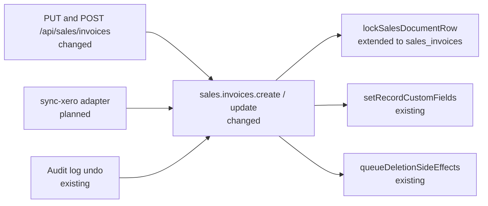

# Sales — Invoice Write Path for Imported Invoices

| Field | Value |
|-------|-------|
| **Status** | Draft — for review with the sales maintainers |
| **Created** | 2026-11-06 |
| **Module** | `sales` (`packages/core/src/modules/sales`) |
| **Issue** | [#7336](https://github.com/open-mercato/open-mercato/issues/7336) |
| **First consumer** | `@open-mercato/sync-xero` Phase 2 (`.ai/specs/2026-09-26-app-spec-xero-integration.md`, § 0.2.3, § 6.2a, § 10 #19 and #25) |
| **Verified against** | `main` @ `620dfa185f`. Line numbers drift; the symbol beside each one is the durable reference. |

## TLDR

**Key Points:**
- Integrations that import invoices from an accounting system cannot store them faithfully today: the invoice write path drops custom fields, rejects negative line amounts and ignores line changes on update.
- `sales.invoices.create` and `sales.invoices.update` will keep custom fields, accept negative amounts, and replace lines when the caller sends the new `replaceLines: true`. Undo stays correct for all three, and it answers 409 when the invoice changed after the write being undone.

**Scope:**
- Phase 1: custom fields on invoice create and update, with a row-locked, phased update and an undo that checks for staleness
- Phase 2: negative amounts on invoice lines and on three header amounts
- Phase 3: line replacement on update, with line restore on undo

**Concerns:**
- Phases 2 and 3 rest on one decision the sales maintainers have not made yet: see [Decision needed](#decision-needed).
- Undo of `sales.invoices.create` and `sales.invoices.update` changes behavior: it answers 409 where it used to overwrite or delete the row, or report success without doing anything.

## Decision needed

`sales/AGENTS.md:7-9` asks for `salesCalculationService` for document math, the Quote → Order → Invoice flow and a channel on every document. Invoices already work differently: `SalesInvoice` has no channel column, `orderId` is optional and is not stored (TC-SALES-032 reads it back null), and `.ai/specs/2026-09-07-sales-external-amounts-mode.md` leaves invoices out because they already take caller-asserted amounts.

**Question for the sales maintainers:** are invoices and credit memos caller-asserted records, exempt from those three rules?

- **Recommended, and assumed by this spec:** yes. Phase 2 records the exemption in `sales/AGENTS.md`, with the same note in the Channel Scoping section (`sales/AGENTS.md:75-80`).
- **Alternative:** a synthetic order and channel per source organization. It adds documents nobody issued, and it needs the order link persisted, since `orderId` is not stored.

Phase 1 does not depend on the answer. Phases 2 and 3 start after it.

## Overview

`SalesInvoice` is the record an accounting integration writes when it mirrors invoices issued elsewhere. The amounts are the source system's, so Open Mercato stores them as sent and does not recompute them. The one exception is a line with a net of 0 and a positive gross, which `deriveLineNetFromGross` rewrites (see [Risks](#risk-register)). The first consumer is `@open-mercato/sync-xero`, whose Phase 2 imports Xero sales invoices (`ACCREC`). The Xero App Spec makes this work a hard prerequisite of that phase and uses no workaround. Its Phase 1, Contacts into Companies (#7337), does not depend on it.

> **Market Reference:** Odoo and ERPNext both allow a negative line on an ordinary sales invoice and both refuse a negative document total, sending the user to a credit note: Odoo with [“You cannot validate an invoice with a negative total amount”](https://www.odoo.com/forum/help-1/how-to-correct-when-wrong-product-shipped-164697), and ERPNext by [keeping negative amounts for a return invoice](https://docs.frappe.io/erpnext/credit-note.md) and [rejecting a negative grand total otherwise](https://discuss.frappe.io/t/sales-invoice-with-negative-grand-total/80890). **Adopted:** negative lines, and a gross total that stays ≥ 0 with `SalesCreditMemo` as the home for negative documents. **Rejected:** ERPNext's return-invoice flag, because Open Mercato already has a separate credit memo entity. The Odoo and ERPNext evidence is partly forum posts about older versions.

## Problem Statement

`SalesInvoice` has no customer column, so an invoice without an order records its Company in a custom field, in the same transaction as the invoice. A re-sync must also correct an invoice that was edited at the source. On `main`:

| Gap | Where | Effect on an import |
|---|---|---|
| Custom fields are dropped | `invoiceCreateSchema` declares no `customFields` (`data/validators.ts:983`); the create command writes them only when `customFieldSetId` is passed, and then from the already-stripped input (`commands/documents.ts:9868-9878`); the route drops them before the command (`api/invoices/route.ts:99-104`) | The invoice loses its Company link |
| Negative amounts are rejected | Line amounts are `decimal({ min: 0 })` (`data/validators.ts:1007-1014`) | An invoice with a discount or deposit line fails |
| Line changes are ignored | `invoiceUpdateSchema` accepts `lines` through `invoiceCreateSchema.partial()` (`data/validators.ts:1029-1033`), but `applyInvoiceHeaderUpdate` ignores them (`commands/documents.ts:10005-10027`) | The stored lines stop matching the source after an edit |

## Proposed Solution

1. **Custom fields** follow the path #4951 gave order and quote create, and the path the order update already uses (`commands/documents.ts:1585-1601`). They are written with `setDocumentCustomFieldsIfSupplied` inside the command's atomic flush, and undo resets what the write changed.
2. **Negative amounts** are allowed on five line fields and three header fields. A gross total stays ≥ 0, because a document with a negative total is a credit memo.
3. **Line replacement** is opt-in through `replaceLines: true`. An update without the flag keeps ignoring `lines`.
4. **Every invoice update and its undo** run as one phased, row-locked transaction from Phase 1. Undo answers 409 if the invoice no longer matches what the write left behind, or if a create undo would strand a payment allocation, credit memo or note.

### Design Decisions

| Decision | Rationale |
|---|---|
| `replaceLines: z.literal(true).optional()` instead of honouring `lines` | Honouring `lines` would silently replace rows for callers whose `lines` are ignored today |
| `replaceLines` requires the five summing header totals | New lines with old totals would leave a document that does not add up; amounts are caller-asserted, so nothing recomputes them |
| `customFields` is `z.unknown().optional()` | `setDocumentCustomFieldsIfSupplied` already ignores `null` and non-objects, so those shapes keep passing. Values that cannot be stored now fail; see the compatibility table |
| Negative amounts are allowed on every line `kind` | `kind` describes what the line is, not its sign. A source system can put a negative amount on a product line (a correction), and remapping it to `adjustment` would change the source document and complicate a later re-sync |
| `taxTotalAmount`, `subtotalNetAmount` and `grandTotalNetAmount` may be negative | They are components of the total, and a negative line can push one below 0 while the total stays ≥ 0: a taxed discount line pushes tax below 0, a tax-free deposit line pushes net below 0 |
| `subtotalGrossAmount` and `grandTotalGrossAmount` stay ≥ 0 | A document with a negative total is a credit memo, and `SalesCreditMemo` covers that |
| Line replacement is allowed on an invoice with payment allocations | Nothing computes from invoice lines today (`commands/payments.ts:588-636` does not recompute invoice totals). #7202 may revisit this |
| Undo answers 409 unless the invoice still matches the write's `after`, header-only updates included | `buildCustomFieldResetMap` writes back every key in `before`, not only the keys the update changed, so an unchecked undo would overwrite another actor's custom field, or put old totals on newer lines |
| The row lock and stale check ship in Phase 1 | Phase 1 is the first undo that touches custom fields, and neither piece depends on the maintainers' decision |
| Create undo answers 409 when a payment allocation, credit memo or note references the invoice | Allocation and credit memo foreign keys are `on delete set null`, and notes have no foreign key, so the delete would succeed and silently strand them |
| Create undo locks with `FOR UPDATE`, not `lockSalesDocumentRow` | `FOR NO KEY UPDATE` still admits the `KEY SHARE` lock of a foreign-key insert, so an allocation committed after the count would be unlinked. `lockOrderForUndo` uses the same stronger mode |

### Alternatives Considered

| Alternative | Why rejected |
|---|---|
| Reject `lines` on update without `replaceLines` | Narrows an accepted schema, which `BACKWARD_COMPATIBILITY.md` forbids |
| A separate non-undoable `sales.invoices.replace_lines` command | Smaller, but line replacement could not be undone from the audit log, while every other sales document write can |
| Delete the invoice and create it again on a re-sync | `sales_invoices_number_unique` counts soft-deleted invoices, so the number stays taken, and the invoice id would change under its payment allocations |
| Diff lines by a source line id | Needs a new stored key on `sales_invoice_lines`; replacing the set gives the same result with no schema change |
| Write through `runCrudCommandWrite` | It writes custom fields after its transaction, so a failed write would leave an invoice without its Company link |
| Write with `dataEngine.setCustomFields` | It validates values, but it writes outside the transaction |
| Reuse `assertOrderGraphUndoCurrent` | It ignores header amounts and line values, which are the fields this undo must protect |
| Copy create's single flush phase | A scalar change followed by a query in one phase is lost (`packages/shared/src/lib/commands/flush.ts:131-136`) |

## User Stories / Use Cases

- **An integration** wants to **create an invoice with custom fields in one transaction** so that an invoice is never stored without its Company link.
- **An integration** wants to **store a discount or deposit line as the source system reports it** so that lines and totals match the source.
- **An integration** wants to **replace an invoice's lines on re-sync** so that an invoice edited at the source is corrected.
- **An operator** wants to **undo a write from the audit log** so that it is reverted completely, or refused when it can no longer be reverted safely.
- **An existing API client** wants its **current calls to keep working unchanged**.

## Architecture

The change sits in `sales`, apart from one `openApi` status on the `audit_logs` undo route. It calls the existing `entities` helpers. `sync-xero` is a new consumer that ships separately.



Update and its undo share one transaction shape, and create undo has its own. Undo does not pass through the mutation guard, as today.

### Commands & Events

No command id, event id or event payload changes. `sales.invoice.*` events keep their current shape.

| Command | Change |
|---|---|
| `sales.invoices.create` | Writes `customFields`; undo resets them and checks for staleness |
| `sales.invoices.update` | Writes `customFields`, optionally replaces lines, runs phased under a row lock; undo restores and checks for staleness |

### Custom fields (Phase 1)

- Add `customFields` to the invoice create and update schemas. The command writes it with `setDocumentCustomFieldsIfSupplied` inside its atomic flush, not gated on `customFieldSetId`. The route folds `custom` back into `customFields`, as `api/documents/factory.ts` does.
- `customFieldSetId` stays ignored on update.
- Values are not validated against definitions, as on orders.
- `setRecordCustomFields` does not sanitize rich text, so the invoice commands call `sanitizeCustomFieldHtmlRichTextValuesServer(em, …)` first. They narrow the value to a non-array object before that call, as `setDocumentCustomFieldsIfSupplied` does, because the sanitizer throws on `null`.
- The audit `changes` include `customFields`.
- Invoice line custom fields stay out of scope: `InvoiceLineSnapshot` does not carry them.

### Update transaction (Phase 1)

Every update runs in one `withAtomicFlush(em, phases, { transaction: true })`, following `lockOrderForTotalsWrite` (`commands/documents.ts:5652`).

| Phase | Work |
|---|---|
| 1 | Find the invoice with today's filter (`id`, `parsed.organizationId`, `parsed.tenantId`, `deletedAt: null`), and take the lock scope from the row. Add `sales_invoices` to `lockSalesDocumentRow` (`commands/shared.ts:74`, table type at `:52`), take the lock, reload the invoice with `{ refresh: true }`, read the lines, capture `before`, apply the header |
| 2 | Delete and insert lines, only with `replaceLines` (Phase 3) |
| 3 | Write custom fields |
| Last | `em.clear()`, capture `after` |

- `sales_invoice_lines` has no unique key, so without the lock two overlapping updates could keep both line sets.
- The scope checks at `:10047-10048` stay, and the filter keeps `parsed.organizationId`, so organization scoping does not change.
- A missing invoice, or the lock returning false, answers 404 with `sales.documents.errors.invoiceNotFound`. Today `findOneOrFail` turns a missing row into a 500.
- `writeLockedDocumentGraph` (`:5769`) is the model, not a dependency: it is typed to orders and quotes and builds a totals event. Invoices reuse its pattern. `prepare` keeps its check of the row's organization and tenant (`:10034-10043`), which is what answers 403, and returns `{}`. `execute` always captures `before` and `after` under the lock and stores them in an `invoiceUpdateSnapshots` WeakMap keyed by its result object, because `zod` gives `execute` a new input object. `captureAfter` and `buildLog` read that map. `buildLog` always writes `before`, because undo returns silently without it (`:10127`).
- **Version checks** stay as they are. The `makeCrudRoute` row-level guard covers PUT, and no command-level optimistic lock is added, because `concurrency-locking.mdx` forbids a second check on a row-guarded route.

### Undo (Phase 1)

Both undo handlers call `ensureOrganizationScope` and `ensureTenantScope` on the snapshot's scope before they lock, as `undoOrderGraph` does (`:4702`), so a caller who reaches the handler from outside the organization gets 403 and never a 409.

**Update undo** runs in one transaction, under the same row lock and the same phase split, and clears the identity map after the stale check, as `withVerifiedOrderGraph` does (`commands/documents.ts:4677`). Today it sets the header and calls a plain `em.flush()` (`:10124-10151`).

- It restores custom fields with `setRecordCustomFields(…, values: toSnapshotCustomFieldWriteValues(buildCustomFieldResetMap(before.invoice.customFields ?? undefined, after.invoice.customFields ?? undefined)))`, so fields the update added are cleared and `cf_` keys are stripped.
- After commit it calls `emitCrudUndoSideEffects` with `indexer: { entityType: E.sales.sales_invoice }`. The command bus already invalidates the CRUD cache.

**Create undo** runs in one transaction under a `FOR UPDATE` lock on the invoice row, taken with `LockMode.PESSIMISTIC_WRITE` as `lockOrderForUndo` does (`:4660-4667`). A foreign-key insert in flight blocks it until that insert commits, so the dependant count sees it.

- It resets the custom fields the create wrote, with `setRecordCustomFields(…, values: toSnapshotCustomFieldWriteValues(buildCustomFieldResetMap(undefined, after.invoice.customFields ?? undefined)))`, because snapshot keys carry `cf_`. A scalar leaves a row that reads back `null`, so tests assert no non-null value, not zero rows.
- It reads the lines under the lock and calls `queueDeletionSideEffects` on them after commit, because a reindex can have added them.
- After commit it calls `emitCrudUndoSideEffects` with `action: 'deleted'` and `indexer: { entityType: E.sales.sales_invoice }`.

**Stale undo.** Undo of `sales.invoices.update`, header-only included, and of `sales.invoices.create` answers 409 unless the invoice still matches the write's `after`:

- Under the row lock, `loadInvoiceSnapshot` is non-null, and `sameRecords([current.invoice], [after.invoice]) && sameRecords(current.lines, after.lines)`. `customFields` sit in `invoice`.
- Before comparing, drop custom-field values that are `null`, `undefined`, `''` or `[]` from both snapshots and treat `{}` as `null`, because clearing a scalar field leaves a row that reads back `cf_x: null`. `0` and `false` count as values.
- A soft-deleted invoice counts as changed.
- A lock that finds no live row, soft-deleted or removed, is this same 409, not the not-found the update path answers.
- Create undo also counts `SalesPaymentAllocation`, `SalesCreditMemo` and invoice-context `SalesNote` rows that reference the invoice, under the lock, and answers 409 when any exist, as `assertOrderGraphUndoCurrent` counts dependants (`:4625`). The counts filter by `organizationId` and `tenantId`. The count includes soft-deleted credit memos, because the delete would unlink them too. A payment can allocate to an invoice without changing it (`commands/payments.ts:607-626`).
- `throwDocumentUndoStale` gains an `invoice` kind with its own i18n key.

`sales.invoice.*` events already emitted are not compensated, and undo still publishes none. The command bus invalidates the cache on undo today, so only the index side effects are new.

Undo entries written before deployment already carry `customFields`, because `loadInvoiceSnapshot` includes them on `main`, so they go through the same reset and stale check.

### Negative amounts (Phase 2)

- Allow negative `unitPriceNet`, `unitPriceGross`, `taxAmount`, `totalNetAmount` and `totalGrossAmount` on invoice lines. Keep `quantity` and `discountAmount` ≥ 0.
- A line with any of those five fields below 0 must send both `totalNetAmount` and `totalGrossAmount`.
- On such a line, a net ≤ 0 with a positive gross is rejected, because `deriveLineNetFromGross` rewrites that state (`commands/shared.ts:135`), and that function stays unchanged. These lines are rejected today, so this narrows nothing.
- The negative-line rule sits on the line object.
- Allow negative `taxTotalAmount`, `subtotalNetAmount` and `grandTotalNetAmount` in the header.

### Line replacement (Phase 3)

- With `replaceLines: true`, `lines` is required and non-empty, and the update replaces every line.
- It requires `subtotalNetAmount`, `subtotalGrossAmount`, `taxTotalAmount`, `grandTotalNetAmount` and `grandTotalGrossAmount`, and answers 400 otherwise. `discountTotalAmount`, `paidTotalAmount` and `outstandingAmount` stay optional and keep their values when omitted.
- Without the flag, `lines` stays accepted and ignored, as today.
- The `replaceLines` rule goes on a separate `invoiceUpdateInputSchema = invoiceUpdateSchema.superRefine(…)` used by the route and the command, so the exported schemas stay unrefined and their `.partial()` keeps working. This is the pattern at `commands/documents.ts:629-732`: an unrefined base with refined schemas built from it.
- Create and replacement share one line mapper, so a line stores the same net on both paths. `orderLineId` stays unstored, as on create. Undo re-inserts stored snapshot values as they are, without the mapper.
- The audit keeps lines in `snapshotBefore` and `snapshotAfter`, as for orders.

**Update undo with lines.** It touches lines only when the update replaced them, which means the ids of `before.lines` and `after.lines` differ. Then it deletes the current lines and re-inserts the before-snapshot lines with their ids. A header-only undo leaves the lines alone.

**Redo** re-runs the stored input, so it takes the row lock and writes new line ids. As today, it has no stale check.

**Search index.** Replaced lines are removed from the index with `queueDeletionSideEffects(dataEngine, previousLines, E.sales.sales_invoice_line)` after commit. `previousLines` are entities read under the lock, not snapshot lines.

- New lines are not indexed, matching create, which emits only `E.sales.sales_invoice`. They reach the index on the next reindex.
- Undo also calls `queueDeletionSideEffects` on the `after.lines` whose ids are not in `before.lines`, with the invoice's `organizationId` and `tenantId` added. Restored lines return on the next reindex.

### Cross-module touchpoints

| Touchpoint | Mechanism | Absent peer |
|---|---|---|
| `sales` → `entities` custom-field helpers | Existing imports used by every sales document | Not optional |
| `sync-xero` → `sales`, writes | Command ids, as App Spec § 6.2 rule 1 requires, because its own mutation guard blocks the API. No ORM link | `sync-xero` requires `sales` |
| `sync-xero` → `sales`, reads | App Spec § 6.2 rule 3 compares lines before writing, and no API returns them. The adapter reads `SalesInvoiceLine` by invoice id, scoped, through the class `sales` registers in DI (`di.ts:172`). It holds no ORM relation, and no route is added | `sync-xero` requires `sales` |

### Relation to the Xero App Spec

This spec differs from App Spec § 0.2.3, § 6.2a and § 10 #19 on `main`, which say `sales.invoices.update` replaces lines whenever `lines` is sent and that header totals keep `min: 0`. An adapter built from that text would send `lines` without the flag, succeed and keep stale lines. The App Spec must say instead that:

- the adapter sends `replaceLines: true` with the five summing totals;
- the three net and tax header amounts may be negative;
- a line with a net of 0 and a positive gross is stored rewritten, so its write-on-change comparison must not read it as a difference on every full pass;
- a `DueDate` removed at the source stays stored, because the update cannot clear it;
- the adapter omits a negative `DiscountAmount` or `TotalDiscount`;
- the commit estimate for this platform work grows, wherever the App Spec repeats it.

That change lands on this spec's branch once #7335 merges, before Xero Phase 2 starts.

## Data Models

No entity, column, index or migration change. `lines` stays unbounded in the schema, as it is today; a replacement costs one bulk delete and one batched insert in a single transaction. The create undo count uses `sales_payment_allocations_invoice_idx` and `sales_notes_context_idx`. `sales_credit_memos` has no `invoice_id` index, and that scan is accepted, because undo is rare. The count is scoped by tenant and organization, while the `on delete set null` action scans the table unscoped, as it does on `main`.

Custom-field values keep the existing storage and per-definition encryption of `setRecordCustomFields`. No new PII field or encryption map is added.

## API Contracts

Route guards stay as they are: `requireAuth` with `sales.invoices.manage` on every method. Tenant and organization scoping stay in the route and command. `openApi` is updated for the new fields.

### `POST /api/sales/invoices`

- Request adds `customFields` and `cf_*`, stored from now on.
- Line and header amounts accept negatives as listed above.
- Response is unchanged.

### `PUT /api/sales/invoices`

```json
{
  "id": "uuid",
  "replaceLines": true,
  "lines": [
    { "quantity": "1", "currencyCode": "EUR", "totalNetAmount": "100.00", "totalGrossAmount": "123.00" },
    { "quantity": "1", "currencyCode": "EUR", "kind": "discount", "totalNetAmount": "-10.00", "totalGrossAmount": "-12.30" }
  ],
  "subtotalNetAmount": "90.00",
  "subtotalGrossAmount": "110.70",
  "taxTotalAmount": "20.70",
  "grandTotalNetAmount": "90.00",
  "grandTotalGrossAmount": "110.70",
  "customFields": { "xero_company_id": "uuid" }
}
```

| Response | When |
|---|---|
| 200 `{ invoiceId }` | As today. No line data is added to any response |
| 500 | Custom-field values that cannot be stored, such as more than 128 keys or a non-numeric value for an integer definition. They are not validated first, as on orders. The invoice rolls back. POST answers the same |
| 400 | `replaceLines` without `lines`, with `lines: []` or without the required totals; `replaceLines: false`; a line without `quantity` or `currencyCode`; a negative line missing a total, or with a net ≤ 0 and a positive gross |
| 403 | The invoice's organization is outside the caller's scope, from `ensureOrganizationScope` |
| 404 | The invoice is missing, soft-deleted, or not in the request's organization (the body's `organizationId`, else the selected one). Today this is a 500 |
| 409 | The row-level optimistic lock, as today |

The OpenAPI description says `lines` has no effect without `replaceLines`.

### `GET /api/sales/invoices`

`cf_<key>` values now appear; the keys already exist for every active definition. `taxTotalAmount`, `subtotalNetAmount` and `grandTotalNetAmount` can be negative.

### Undo of `sales.invoices.create` and `sales.invoices.update`

| Response | When |
|---|---|
| 200 | The invoice still matches `after` |
| 400 `Undo token not available` | The undo route refuses before the handler runs: the caller's organization differs from the log entry's, or the same actor has a later undoable entry, a later delete included. Existing behavior |
| 403 | Only a tenant-level undoer with no selected organization and a restricted scope reaches the handler from outside the organization |
| 409 | It no longer matches, it was deleted, or (for create undo) a payment allocation, credit memo or note references it. The body carries the translated `undoStaleInvoice` message. The undo route's `openApi` lists this status |

## Internationalization (i18n)

Add to all five locale files in `sales/i18n/`:

- `sales.documents.errors.undoStaleInvoice`: “This change can no longer be undone because the invoice was changed afterwards.” (Phase 1)
- `sales.documents.errors.invoiceNotFound`: “Invoice not found.” (Phase 1)
- `sales.invoices.errors.negativeLineTotalsRequired` and `sales.invoices.errors.negativeNetPositiveGross` (Phase 2)
- `sales.invoices.errors.replaceLinesRequiresLines` and `sales.invoices.errors.replaceLinesRequiresTotals` (Phase 3)

`makeCrudRoute` returns zod failures as `{ error: 'Invalid input', details }`. The validation keys are the zod issue messages in `details`, so an API client can translate them; the route does not translate them itself.

## UI/UX

No UI change. The invoice API is the only invoice edit surface today (#100 proposes one on the order details page). The audit log shows the 409 message through its existing undo error handling (`AuditLogsActions.tsx:133-135`).

## Cache

No cached read path is added. The command bus already invalidates the CRUD cache for both commands and their undo, and tags stay tenant-scoped.

## Migration & Compatibility

No data migration. Each phase rolls back by reverting its PR, newest first, because Phase 3 builds on Phase 1's transaction and Phase 2's amounts. Phases 1 and 2 do not depend on each other. Rows written while a phase was live stay valid after its revert. Undo of a `replaceLines` entry after Phase 3 is reverted restores the header only, so it would put old totals on newer lines.

Each phase adds its own rows below to `BACKWARD_COMPATIBILITY.md` and `UPGRADE_NOTES.md` in its PR.

For a dated section in `BACKWARD_COMPATIBILITY.md` and `UPGRADE_NOTES.md`:

| Surface | Change | Class |
|---|---|---|
| POST and PUT `/api/sales/invoices` | `customFields` and `cf_*` are stored, dropped until now (Phase 1); the five line fields, `taxTotalAmount`, `subtotalNetAmount` and `grandTotalNetAmount` accept negatives (Phase 2) | Additive |
| PUT `/api/sales/invoices` | A missing invoice answers 404 instead of 500 (Phase 1) | Bug fix |
| POST and PUT `/api/sales/invoices` | Custom-field values that cannot be stored, such as more than 128 keys or a non-numeric value for an integer definition, used to be dropped with a 2xx. They now answer 500 and roll the invoice back (Phase 1) | Behavior change, `UPGRADE_NOTES.md` |
| PUT `/api/sales/invoices` | New optional `replaceLines`; `lines` without it stays ignored (Phase 3) | Additive |
| GET `/api/sales/invoices` | `cf_<key>` values now appear (Phase 1); the three header amounts can be negative (Phase 2) | Additive |
| `sales.invoices.update` undo | Answers 409 when the invoice no longer matches the update's `after`, including when it was deleted. Before, it overwrote the row, or did nothing and reported success (Phase 1) | Behavior change, `UPGRADE_NOTES.md` |
| `sales.invoices.create` undo | Answers 409 when the invoice no longer matches the create's `after`, when it was deleted, or when a payment allocation, credit memo or note references it. Before, it deleted the row, or did nothing and reported success (Phase 1) | Behavior change, `UPGRADE_NOTES.md` |
| Invoice undo side effects | Undo of create and update now runs index side effects; no `sales.invoice.*` event is published (Phase 1) | Additive |
| `sales.invoice.*` events, DB, ACL, DI | None | N/A |

Readers checked on `main`: payments do not recompute invoice totals (`commands/payments.ts:588-636`); no PDF, analytics or payment code reads invoice lines; nothing in core reads the three header amounts that may turn negative outside the invoices route. GL posting (PR #6046) is not on `main` yet and would see negative lines only from callers that send them.

## Implementation Plan

### Phase 1: Custom fields and safe undo

Independent of [Decision needed](#decision-needed).

1. Add `customFields` to the schemas, fold `custom` in the route, and write them in the create command, narrowed and sanitized, with `openApi` and compatibility rows. Test: POST with `customFields` and no `customFieldSetId` stores them.
2. Add `sales_invoices` to `lockSalesDocumentRow`, and move update into `withAtomicFlush` with the locked `before` and `after` plumbing, the 404 and its key. Rewrite `documents.invoice-credit-memo-update.test.ts`, which pins `findOneOrFail` and has no transaction in its harness. Test: header-only updates behave as before; a missing invoice answers 404; an invoice outside the caller's scope answers 403.
3. Write custom fields in their update phase, narrowed and sanitized, with the audit `changes` key. Test: an update with header fields and custom fields stores both; a failed custom-field write rolls the invoice back.
4. Make update undo transactional under the lock, with the reset, side effects, stale check, the `invoice` kind and its key, and the undo route's `openApi`. Test: undo restores previous values and clears an added field; the update 409 cases.
5. Make create undo transactional under `FOR UPDATE`, with the reset, stale check, dependant count and index removal. Test: no non-null custom-field value remains; the create 409 cases.

### Phase 2: Negative amounts

Starts after the maintainers' decision.

1. Record the invoice exemption in `sales/AGENTS.md`, including Channel Scoping.
2. Relax the five line fields and add the line rule, its keys and its compatibility rows. Test: each field on every `kind`; rejections for `quantity`, `discountAmount`, a missing total, and a net ≤ 0 with a positive gross.
3. Relax the three header fields. Test: those pass; negative `subtotalGrossAmount` and `grandTotalGrossAmount` are rejected.

### Phase 3: Line replacement

Starts after the maintainers' decision and after Phases 1 and 2.

1. Add `replaceLines` and `invoiceUpdateInputSchema`, with OpenAPI, keys and compatibility rows. Test: the rejections; an update without the flag leaves lines untouched.
2. Replace lines in their phase and remove old lines from the index. Test: replacement stores lines and totals; concurrent updates end with one line set.
3. Restore lines in update undo. Test: original ids come back; a failed undo leaves lines unchanged.

### File Manifest

| File | Action | Purpose |
|---|---|---|
| `sales/data/validators.ts` | Modify | `customFields`, negative rules, `replaceLines`, `invoiceUpdateInputSchema` |
| `sales/api/invoices/route.ts` | Modify | Fold `custom`, use the refined schema, `openApi` |
| `sales/commands/documents.ts` | Modify | Create, update, undo and `throwDocumentUndoStale` |
| `sales/commands/shared.ts` | Modify | `sales_invoices` in `lockSalesDocumentRow` |
| `sales/i18n/*.json` | Modify | New keys |
| `sales/AGENTS.md` | Modify | Exemption, in Phase 2 |
| `BACKWARD_COMPATIBILITY.md`, `UPGRADE_NOTES.md` | Modify | Dated entries, per phase |
| `packages/core/src/modules/audit_logs/api/audit-logs/actions/undo/route.ts` | Modify | 409 status in `openApi` |
| `.ai/specs/2026-09-26-app-spec-xero-integration.md` | Modify | § 0.2.3, § 6.2a, § 10 #19 and every repeat of the commit estimate, after #7335 merges |
| `sales/commands/__tests__/documents.undo-custom-fields.test.ts`, `documents.invoice-credit-memo-update.test.ts` | Modify | Unit coverage |
| `sales/__integration__/TC-SALES-7336-*.spec.ts` | Create | Integration coverage |

### Testing Strategy

Unit tests extend `commands/__tests__/documents.undo-custom-fields.test.ts` and `documents.invoice-credit-memo-update.test.ts`. Integration tests are self-contained: new `TC-SALES-7336-*` specs, modeled on `TC-SALES-042-document-update-custom-fields.spec.ts`, create fixtures through the API and clean them up. They read lines through `withClient` (`helpers/integration/dbFixtures.ts`) or the audit `snapshotAfter`, because no API response carries lines.

**Phase 1 acceptance**
- Create with `customFields` and no `customFieldSetId` stores them. So does POST or PUT with `cf_*` input, and GET returns `cf_<key>`.
- `customFields: null` or a non-object passes and stores nothing.
- `customFieldSetId` is ignored on update.
- Rich-text values are sanitized on create and update.
- Update changes custom fields, its audit `changes` include them, and undo of the update restores them and clears a field the update added.
- An update and its undo that carry header fields and custom fields store both.
- A failed custom-field write rolls the invoice back.
- A missing invoice on update answers 404. An update of an invoice outside the caller's scope answers 403. An update that omits `organizationId`, of an invoice in another allowed organization than the selected one, answers 404.
- Two concurrent writes of one invoice serialize on the row lock: an undo that loses to an update answers 409.
- A failed undo leaves the header and custom fields as they were.
- Undo of a create leaves no custom-field value on the removed invoice and, after a reindex that puts its lines in the index, removes them.
- Undo of a create answers 409 when a payment allocation, credit memo (soft-deleted included) or note references the invoice, and leaves everything linked.
- At command level, undo by a caller outside the invoice's organization answers 403, including on a missing row.
- At command level, a lock that finds no live row answers 404 on update and 409 on undo.
- An allocation inserted while a create undo waits for the lock is not unlinked: undo answers 409.
- Undo after a later update by a different actor answers 409 and leaves the invoice unchanged, whether that update changed the header or only a custom field.
- Undo answers 200 after the update cleared a scalar or multi-value custom field.
- After a later update by the same actor, the undo route answers 400 `Undo token not available` before the handler runs, and undoing both in reverse order succeeds.
- Undo of an update or a create on a soft-deleted or removed invoice, by a different actor from the one who deleted it, answers 409 and leaves the row unchanged.
- Undo after a different actor's later update to `0` or `false` answers 409.
- Undo of a create after a later update by a different actor answers 409.
- The 409 body carries the translated message.
- Undo runs its index and cache side effects.
- An undo entry written before deployment still works.

**Phase 2 acceptance**
- Negative values pass on the five line fields on every line `kind`, and a negative line is stored unchanged.
- `quantity` and `discountAmount` still reject negatives.
- A negative line without its net or gross total, or with a net ≤ 0 and a positive gross, is rejected.
- Undo of an update that changed negative header amounts restores them.
- A non-negative line with a net of 0 and a positive gross is still rewritten, as today.
- A negative `taxTotalAmount`, `subtotalNetAmount` or `grandTotalNetAmount` passes.
- A negative `subtotalGrossAmount` or `grandTotalGrossAmount` is rejected.

**Phase 3 acceptance**
- An update without `replaceLines`, with or without `lines`, leaves the lines untouched.
- An update with `replaceLines` replaces them and stores the header totals sent with them. Omitted `discountTotalAmount`, `paidTotalAmount` and `outstandingAmount` keep their values.
- Its undo restores the original lines with the same ids and every stored value, and clears a custom field the update added.
- A replacement line with a net of 0 and a positive gross stores the same net as on create.
- A failed update leaves the old header, lines and custom fields. A failed undo leaves the lines unchanged.
- Undo after a later `replaceLines` update by a different actor answers 409 and leaves the lines unchanged.
- Audit `snapshotBefore` and `snapshotAfter` carry the lines, and `orderLineId` stays unstored.
- Undo of a header-only update keeps the line rows and, after a reindex that puts them there, their index entries.
- Two concurrent updates with `replaceLines` end with exactly one line set.
- After a reindex that puts the lines in the index (create does not index them), replaced lines leave the index.
- Undo removes the lines the update added from the index.
- `replaceLines` without `lines`, with `lines: []`, without the required totals, or set to `false` is rejected.
- Redo of an undone `replaceLines` update replaces the lines again.
- A `replaceLines` update succeeds on an invoice with payment allocations and leaves them linked.

## Out of Scope

Invoice numbers over 191 characters (the limit of every sales document number), credit memos, an invoice UI (#100), payment allocations (#7202), lines in an invoice API response, a command-level optimistic lock, invoice line custom fields, clearing `dueDate` on update (the adapter omits it; `null` would store 1970-01-01), and `sales.invoices.delete` undo, which appears to insert the same id while the soft-deleted row still exists (`commands/documents.ts:10235`; not run, so it needs its own check).

## Risks & Impact Review

### Data Integrity Failures

Every update and undo is one transaction, so a crash leaves the domain rows in their previous state. The undo claim and `markUndone` commit separately, as they do on `main`, so a crash after the handler commits leaves the log entry in `undoing`. The row lock serializes writers of the same invoice, and the parent-before-children lock order matches orders and quotes.

### Cascading Failures & Side Effects

Index removal runs after commit, so the write stays committed if it fails, and a stale entry lasts until the next reindex. With `OM_CACHE_SAFETY_ALWAYS_CONSISTENT` on, that failure also reaches the caller after commit. Nothing in `main` derives from invoice lines.

### Tenant & Data Isolation Risks

`lockSalesDocumentRow` filters by id, tenant and organization. Custom-field writes carry the invoice's scope. The update lookup keeps its organization filter, and a cross-organization update stays refused and is covered by a test.

### Migration & Deployment Risks

No schema change. Phases 1 and 2 deploy in either order, Phase 3 needs both, and the revert order is in [Migration & Compatibility](#migration--compatibility).

### Operational Risks

The blast radius is limited to invoices. A large replacement holds one row lock for the length of its transaction. Each `replaceLines` stores the lines several times in the action log (redo input, undo payload, audit snapshots), so a large import grows the audit tables faster than a header update does. A refused undo reaches only the operator who asked; no alert watches 409 rates, because a refusal leaves data unchanged.

### Risk Register

#### Undo starts refusing where it used to succeed
- **Scenario**: A different actor changed an invoice, and an operator's undo that used to overwrite it now gets 409.
- **Severity**: Medium
- **Affected area**: Audit log undo of `sales.invoices.create` and `sales.invoices.update`
- **Mitigation**: A translated message, an `UPGRADE_NOTES.md` entry, and a comparison that ignores empty custom-field values, so an ordinary cleared field does not cause a refusal.
- **Residual risk**: An operator must redo the correction by hand. After a custom-field definition is removed, a value can read back in another shape and an unchanged invoice can be refused. Both are the intended trade for not corrupting newer data.

#### A client assumes header amounts are ≥ 0
- **Scenario**: A third-party reader of `GET /api/sales/invoices` meets a negative `taxTotalAmount`, `subtotalNetAmount` or `grandTotalNetAmount`.
- **Severity**: Low
- **Affected area**: External API consumers
- **Mitigation**: Negatives appear only on invoices whose caller sends them. Core readers were checked, and the change is documented.
- **Residual risk**: Third-party code cannot be checked from here.

#### Replacing lines on a partly paid invoice
- **Scenario**: Lines change on an invoice with payment allocations.
- **Severity**: Low
- **Affected area**: Future allocation work in #7202
- **Mitigation**: Nothing computes from invoice lines today, and `paidTotalAmount` and `outstandingAmount` keep their values unless sent.
- **Residual risk**: #7202 may add a rule.

#### New lines are missing from search until a reindex
- **Scenario**: After a replacement, old lines leave the index and new ones are absent.
- **Severity**: Low
- **Affected area**: Search over `sales_invoice_line`
- **Mitigation**: This matches create, which does not index lines either.
- **Residual risk**: Line search is incomplete until the next reindex.

#### A line with a net of 0 and a positive gross is rewritten
- **Scenario**: A source system sends a tax-only line. `deriveLineNetFromGross` replaces its net of 0, so the stored line differs from the source.
- **Severity**: Low
- **Affected area**: Exact mirroring required by the Xero App Spec
- **Mitigation**: Rejecting such a line would narrow the schema, and changing the function affects every document, so neither is done here.
- **Residual risk**: Such a line is not byte-identical to the source, and this needs to be reflected in the App Spec.

#### Two updates with the same version
- **Scenario**: Two PUTs pass the row guard before either takes the lock, and the second silently wins.
- **Severity**: Low
- **Affected area**: `PUT /api/sales/invoices`
- **Mitigation**: The lock keeps one consistent line set. A second version check on a guarded route is forbidden.
- **Residual risk**: Last write wins in this narrow window, as on any row-guarded route.

#### Negative amounts in Xero are not yet confirmed
- **Scenario**: Xero may not produce a negative `SubTotal` on an `ACCREC` invoice, or may produce a negative total, which this spec refuses. A discount on a negative line may report a negative `DiscountAmount` or `TotalDiscount`, and `discountAmount` and `discountTotalAmount` stay ≥ 0.
- **Severity**: Low
- **Affected area**: The Xero adapter
- **Mitigation**: Allowing a negative subtotal costs nothing if Xero never sends one. A sandbox check of all these amounts comes before Xero Phase 2. App Spec § 6.2a maps both discount fields as informational, so the adapter can omit a negative one.
- **Residual risk**: A negative-total invoice would fail the import and be reported as a failed item.

#### Create undo orphans a pending payment undo
- **Scenario**: A payment allocated to the invoice is deleted, which removes its allocation, so create undo counts none. Undo of the payment delete then re-inserts an allocation to the removed invoice.
- **Severity**: Low
- **Affected area**: Payment undo
- **Mitigation**: The foreign key rejects the insert, so the failure is visible.
- **Residual risk**: That payment undo cannot succeed. No data is lost.

#### A note added during create undo is stranded
- **Scenario**: A note on the invoice commits after the dependant count. Notes have no foreign key, so `FOR UPDATE` does not block the insert.
- **Severity**: Low
- **Affected area**: Create undo
- **Mitigation**: The count refuses every note already committed.
- **Residual risk**: A note written in that window points at a removed invoice. The window is short, and a note holds no money.

#### Overlap with the recurring orders spec
- **Scenario**: `.ai/specs/2026-10-21-sales-recurring-orders.md` also changes `sales.invoices.create`, so the two can conflict.
- **Severity**: Low
- **Affected area**: `commands/documents.ts`
- **Mitigation**: Whichever lands second rebases. Both keep the command id and its input additive. That spec also makes credit memo create write the invoice's `outstanding`, and it refuses delete on generated invoices. So whichever lands second must take this row lock in that new writer, add its ledger row to create undo's dependant count and its delete refusal to create undo, and refuse `replaceLines` on generated invoices, or recompute the order's derived totals.
- **Residual risk**: A merge conflict, and these follow-ups to carry.

## Related

`.ai/specs/2026-10-21-sales-recurring-orders.md`, #4951 (the order and quote fix Phase 1 mirrors), #4143 (duplicate-invoice race), #7202, #100, PR #6046.

## Final Compliance Report — 2026-11-06

### AGENTS.md Files Reviewed

- `AGENTS.md` (root)
- `packages/core/AGENTS.md`
- `packages/core/src/modules/sales/AGENTS.md`
- `.ai/specs/AGENTS.md`
- `.ai/qa/AGENTS.md`
- `BACKWARD_COMPATIBILITY.md`

### Compliance Matrix

| Rule Source | Rule | Status | Notes |
|---|---|---|---|
| root AGENTS.md | No direct ORM relationships between modules | Compliant | Helpers only; `sync-xero` writes through commands and reads lines by FK id |
| root AGENTS.md | Filter by organization and tenant | Compliant | Lock scope comes from the loaded invoice |
| root AGENTS.md | Validate inputs with zod | Compliant | `invoiceUpdateInputSchema` |
| root AGENTS.md | Use `findWithDecryption` | Compliant | New reads follow `lockOrderForTotalsWrite`; `sales/encryption.ts` has no invoice map |
| root AGENTS.md | Mutations are commands with undo | Compliant | Both commands, with undo specified |
| `BACKWARD_COMPATIBILITY.md` | Validators must not narrow | Compliant | New schema rules apply only to input that is rejected today, or to the new flag. Custom-field values that cannot be stored now fail in the write, not in the schema, and are recorded in the compatibility table |
| root AGENTS.md | No hard-coded user strings | Compliant | Keys listed per phase |
| `.ai/qa/AGENTS.md` | Integration coverage for affected paths | Compliant | Acceptance per phase, `TC-SALES-7336-*` |
| `sales/AGENTS.md` | `salesCalculationService`, document flow, channel scope | Open | Decision needed; Phases 2 and 3 wait for it |
| `sales/AGENTS.md` | Ask before changing flow or channel behavior | Compliant | Raised in Decision needed |
| `packages/core/AGENTS.md` | `makeCrudRoute` with `indexer`, `openApi` exported | Compliant | Route shape unchanged; `openApi` updated |
| root AGENTS.md | Optimistic locking on new entities | N/A | No new entity; existing guard kept |
| root AGENTS.md | Design system rules | N/A | No UI change |

### Internal Consistency Check

| Check | Status | Notes |
|---|---|---|
| Data models match API contracts | Pass | No model change; the example matches the schema |
| API contracts match UI/UX section | Pass | No UI; the 409 reaches the audit log |
| Risks cover all write operations | Pass | Create, update and undo |
| Commands defined for all mutations | Pass | Two commands |
| Cache strategy covers all read APIs | Pass | Bus invalidation covers both commands and undo |
| Related specs agree | Pass with action | App Spec aligned after #7335 merges |

### Verdict

Fully compliant for Phase 1. Phases 2 and 3 wait for the maintainers' decision.

## Changelog

### 2026-11-06
- Initial specification
