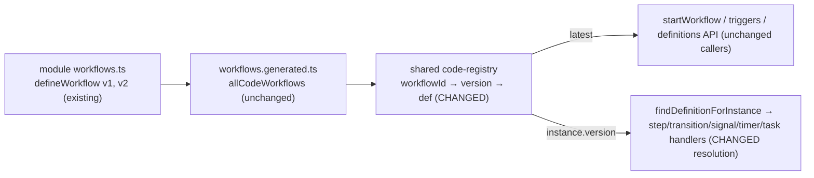

# Version Pinning for Code-Defined Workflows

| Field | Value |
|-------|-------|
| Status | Draft |
| Issue | [#7184](https://github.com/open-mercato/open-mercato/issues/7184) |
| Related | `.ai/specs/implemented/2026-04-14-code-based-workflow-definitions.md` (revises its "WorkflowInstance (unchanged)" live-read decision), `.ai/specs/2026-06-26-subworkflow-explicit-ports-schema-builder.md` (DB draft/published versioning), #1444, #7183, #9298 (prerequisite fix, separate PR) |
| Module | `workflows` (`packages/core`), `@open-mercato/shared/modules/workflows` |

## 📝 TLDR

Module authors who ship workflows in `workflows.ts` cannot change a workflow's shape safely: every in-flight instance re-reads the **current** code definition on each step, so a deploy that renames or removes a step strands parked instances, and a rollback strands instances that already moved forward. `defineWorkflow({ version })` is accepted but inert. **Proposed (future behaviour):** the code registry keeps every exported version of a workflow; new starts use the highest version, and an in-flight instance resolves the version it persisted at start. A workflow exporting a single version behaves exactly as today, the persisted `definitionId` is unchanged, and no migration is needed.

## 📝 Overview

The `workflows` module lets module authors ship workflow definitions in code (`workflows.ts`). This spec makes the already-accepted `defineWorkflow({ version })` field meaningful: the code registry retains every exported version of a workflow, new starts use the highest version, and an in-flight instance keeps resolving the version it persisted at start (`workflow_instances.version`). The change is limited to the shared code registry, the core definition-resolution functions and the completed sub-workflow child's output-contract lookup; it builds on the separate #9298 fix for two row-id-only lookups. There is no schema change, no migration and no new authoring API. Visibility additions (a `?version=` read param and `retainedVersions`) ship as a separate, read-only phase.

## 📝 Problem Statement

Today (`packages/core/src/modules/workflows/lib/find-definition.ts`):

- `codeWorkflowUuid(workflowId)` hashes only the workflow id; every version of a code workflow shares one `definitionId`.
- `resolveCodeDefinitionForInstance` / `findDefinitionForInstance` rebuild the virtual definition from `getCodeWorkflow(workflowId)` — the **only** registered entry, i.e. the current code.
- `findWorkflowDefinition` ignores a requested `version` for code definitions ("version filter not applicable to code defs").
- The shared registry (`packages/shared/src/modules/workflows/code-registry.ts`) is a `Map<workflowId, CodeWorkflowDefinition>`; exporting a second `defineWorkflow` with the same `workflowId` silently overwrites the first.

Yet the engine already persists the started version: `WorkflowInstance.version` is written from `definition.version` in `startWorkflow` (`lib/workflow-executor.ts`). The data needed for pinning exists; resolution ignores it.

Evidence it matters: the issue reporter's production app freezes step/transition ids per `workflowId` (enforced by a test) and forks a new `workflowId` for every shape change, letting old instances drain. That workaround fragments triggers, reporting and the definitions list. DB-defined workflows already have immutable published versions (`(workflowId, version, tenantId)` unique, draft/published lifecycle); code-defined workflows are the only definitions without them.

## 📝 Proposed Solution

1. **Multi-version code registry.** The shared registry stores `Map<workflowId, Map<version, CodeWorkflowDefinition>>`. A module retains an old version simply by keeping its `defineWorkflow({ workflowId, version: N, … })` export in the `workflows` array next to version `N+1`. No new authoring API; `version` (already on the type, default `1`) becomes meaningful.
2. **Latest for new starts.** Every existing "which code workflow is this?" read — `getCodeWorkflow(workflowId)`, `getAllCodeWorkflows()`, triggers, the definitions list, customize, reset-to-code, context-schema, test-step — returns the **highest registered version**. For a single-version workflow this is the same object as today.
3. **Pinned for in-flight instances.** `resolveCodeDefinitionForInstance` / `findDefinitionForInstance` resolve `getCodeWorkflowVersion(workflowId, instance.version)`. `findWorkflowDefinition({ workflowId, version })` with an explicit version (sub-workflow pins) resolves that exact code version.
4. **Identity unchanged.** `definitionId` stays `codeWorkflowUuid(workflowId)` for every version; the pin is `(definitionId, instance.version)`, both already persisted. No migration, no change to existing instance rows.
5. **Missing pinned version.** When the requested/persisted version is not registered (an old version was deleted from code, or a legacy instance predates retention), resolution falls back to the highest registered version — exactly today's behaviour — and emits a once-per-process `logger.warn` keyed by `(workflowId, version)`. This applies uniformly to in-flight resolution and to explicit-version starts (sub-workflow pins, `POST /api/workflows/instances` with `version`), both of which already get "latest" today.
6. **Prerequisite (separate fix, #9298): two direct lookups that bypass the code fallback.** `activity-worker-handler.ts:710` (resume of a SUB_WORKFLOW parent: `em.findOne(WorkflowDefinition, { id: parent.definitionId })`) and `step-handler.ts:201` (`emitStepMilestone`) load the definition by row id only, so a **code-defined** parent/instance gets `null` today (lost `outputMapping`, no milestone event). Issue #9298 routes both through `findDefinitionForInstance` in its own PR; this spec does not implement that change. Once it lands, both sites become version-pinned through item 3 with no further edit. Phase 1 depends on #9298 for code-defined parents; until it merges, a code-defined parent's async resume stays broken exactly as today, independent of pinning.
7. **Pin the completed child's output contract.** When an asynchronous SUB_WORKFLOW child completes, `activity-worker-handler.ts:727-730` reads the child's `io` output contract with `findWorkflowDefinition({ workflowId: subWorkflowId, version })`, where `version` is the parent's SUB_WORKFLOW step config (`:712-716`), not the child instance's version. For an unpinned child it is `undefined`, so a child started on v1 is validated against whatever is latest when it completes (v2 after a deploy) even when v1 is still retained; a changed required output port then rejects the v1 child's valid output and fails the parent. The completion-time lookup resolves `findDefinitionForInstance(em, childInstance)` instead (the child instance is already loaded at `:718-722`), i.e. the definition the child actually ran on. Start-time child selection (`step-handler.ts:1164`, `findWorkflowDefinition({ workflowId: subWorkflowId, version })`) is unchanged: latest, or the explicit pinned version.

A strict mode (fail instead of falling back) is **deferred**: today a `null` definition makes `executeWorkflow` throw `DEFINITION_NOT_FOUND` without marking the instance FAILED, and the error handler / compensation also need the definition, so a strict miss would strand the instance in RUNNING/PAUSED. Strict needs its own terminal-failure path and is a follow-up.

### Alternatives considered

| Option | Why it lost |
|--------|-------------|
| Version-qualified identity: `codeWorkflowUuid(workflowId, version)` as `definitionId` | Changes a persisted identity: every existing instance carries the unversioned hash and would need a dual-resolution path forever; breaks `GET /api/workflows/definitions/:id`, the concurrency-limit count in `loadCodeTriggers`, and the context-schema `codeWorkflowUuid` fallback, which all assume one id per code workflow. `instance.version` already discriminates versions. |
| Snapshot the code definition into a DB row at first start | Pins perfectly but turns every code workflow into a persisted row per tenant, collides with the "DB row with `codeWorkflowId` = user customization" meaning, and reintroduces the shadowing problem fixed by `Migration20260716120000`. |
| Document `version` as inert + per-instance migration hook (issue's fallback) | Leaves the correctness problem with every module author; a migration hook is still needed for genuine shape changes and can be layered later on top of retention. Deferred, not rejected. |
| Strict (fail) when a pinned version is missing — default or opt-in | As default it would fail every legacy in-flight instance whose module bumped `version` before this feature. As an opt-in it needs a terminal-failure path that does not exist today (see item 5 note). Deferred. |

## 📝 Architecture

Takeaway: the generator and every caller keep their signatures; only the registry's storage and the two instance-resolution functions change.

**Shared (`packages/shared/src/modules/workflows/code-registry.ts`)** — additive exports:
- `getCodeWorkflowVersion(workflowId: string, version: number): CodeWorkflowDefinition | undefined`
- `getCodeWorkflowVersions(workflowId: string): CodeWorkflowDefinition[]` (ascending by version)
- `getCodeWorkflow`, `getAllCodeWorkflows`, `isCodeWorkflow` keep their signatures and return the latest version.
- `registerCodeWorkflowEntries`: a duplicate `(workflowId, version)` is last-wins. The warning keeps today's rule (`code-registry.ts:30-36`): it fires only when the existing entry comes from a different `moduleId`, including when a different module contributes a new version of an existing `workflowId` (ownership is per `workflowId`). A duplicate within one module overwrites silently, as today.
- "Latest" = highest registered version regardless of its `enabled` flag (the unpinned start path keeps its existing `enabled` gate). A version dropped by validation is simply not registered.
- Storage location (module-scope map) is unchanged; moving it to `globalThis` is unrelated and out of scope.

**Core bridge (`packages/core/src/modules/workflows/lib/code-registry.ts`)** — re-export the two new functions next to the existing four.

**Types / builder** — no change. `version` already exists on `WorkflowBuilderConfig` and `CodeWorkflowDefinition` (default `1`).

**Core (`packages/core/src/modules/workflows/lib/find-definition.ts`)**:
- `resolveCodeDefinitionForInstance(instance)` — instance param type gains optional `version?: number`. UUID-equality gate unchanged. Resolution: exact version → else latest + warning. Absent `version` → latest (BC for any external caller passing a narrower object).
- `findDefinitionForInstance` — passes `version` through (internal callers already pass the full `WorkflowInstance`).
- `findWorkflowDefinition({ version })` for code: exact version when registered, else latest + warning (today's result). Unpinned path unchanged (latest + `enabled` gate).
- `activity-worker-handler.ts` completed-child path: the child output contract comes from `findDefinitionForInstance(em, childInstance)` instead of `findWorkflowDefinition({ workflowId: subWorkflowId, version })` (`:727-730`). The parent's step config still supplies `outputMapping`; its `version` is no longer read on this path. The parent lookup (`:710`) and `step-handler.ts` `emitStepMilestone` (`:201`) are fixed by #9298, not here.
- `buildVirtualCodeDefinition` unchanged; `virtual.version` now reflects the resolved version.
- Disabled flags: an old retained version's `enabled` flag is ignored for in-flight resolution, matching the existing rule that disabling blocks new starts, not running instances.

**Validation** — `registerCodeWorkflows` already validates each entry independently; each retained version is validated on its own. A retained version that fails validation is dropped with the existing warning, which then falls under the missing-version fallback.

**Cross-module coupling** — none added.

**Customization** — `customize` and the `[id]` PUT override path copy the **latest** code version (`existingOverride.version = codeDef.version`). A DB override created at v1 and re-customized after v2 ships therefore moves to v2; instances started on the DB row are unaffected because they resolve by row id. Instances started on the code UUID keep resolving code versions by `instance.version` even after a customization exists. `reset-to-code` removes the override; new starts return to the latest code version.

## 📝 Data Models

No schema change and no migration. Relies on existing columns: `workflow_instances.definition_id`, `workflow_instances.workflow_id`, `workflow_instances.version` (non-null, written at start).

## 📝 API Contracts

Additive only:

- `GET /api/workflows/definitions/:id?version=N` — new optional query param, honoured only when `:id` resolves to a code definition (the `code:<workflowId>` form or the `codeWorkflowUuid` form). Returns that retained version's serialized definition; `404` when not registered (no fallback — the read API reports what exists). Ignored for DB rows (those already have one row per version). OpenAPI `query` schema updated. Validation: `z.coerce.number().int().positive().optional()`.
- Code-definition serialization (`serializeCodeWorkflowDefinition`) gains additive `retainedVersions: number[]` so the definitions list/detail can show which versions are still loadable. Existing fields unchanged.

Not changed: start/instances APIs, event payloads (`workflows.instance.*` already carry `version`), trigger shapes, `workflows.generated.ts`.

## 📝 UI/UX

Minimal, read-only:
- Instance detail (`backend/instances/[id]/page.tsx`) fetches `/api/workflows/definitions/${instance.definitionId}?version=${instance.version}` so the graph shown is the one the instance runs. On `404` it falls back to the unversioned fetch (today's behaviour) — the instance is running on the latest version via the fallback.
- Definition detail for a code workflow shows a "Retained versions: 1, 2" line from `retainedVersions` (i18n key `workflows.definitions.retainedVersions`).

No new pages, forms or dialogs; no mockups needed (text-only spec).

## 📝 Edge Cases & Failure Scenarios

| Scenario | Behaviour |
|----------|-----------|
| Single-version workflow (all existing modules) | Identical to today: latest == only version; instance.version matches. Regression test. |
| Module bumped `version` before this feature, never retained old one; instance persisted `N`, code has `N+1` | Fallback → runs `N+1` (today's behaviour) + one warning per process. |
| Old version deleted while instances still parked on it | Same as above; author is warned. Operational guidance: keep a version exported until `instances where version = N and status in (RUNNING, PAUSED, WAITING…)` is empty. |
| Rollback deploy: code goes back to a build that only knows `N`, instances already started on `N+1` | `N+1` missing → they fall back to `N` with a warning. Documented guidance: roll forward instead — keep `N+1` retained and re-export `N`'s shape as `N+2` so new starts use it. Not automated. |
| Retained version references an activity/handler that no longer exists | Unchanged from today: failure surfaces at that step. Out of scope (no versioning of activity handlers). |
| Sub-workflow pinned to code version `V` | Resolves exactly `V` when retained; otherwise latest + warning (today's result). |
| Code-defined SUB_WORKFLOW parent resumes after child completes | Once #9298 lands, the parent definition resolves through `findDefinitionForInstance` and therefore at `parent.version` (today: `null`, output mapping lost). Before #9298 it stays broken as today. |
| Unpinned child parked on v1 completes after v2 becomes latest (v1 still retained) | The output contract is v1's, from `findDefinitionForInstance(em, childInstance)`; v1 output passes and the parent resumes. Today it is validated against v2. Regression test. |
| Child parked on v1 completes after v1 was removed from code | `findDefinitionForInstance` falls back to latest + warning (item 5), so the contract is v2's, the same as today. |
| Trigger-started instance | `loadCodeTriggers` stamps `workflowVersion` from the latest; start resolves that exact version. `maxConcurrentInstances` counts by `definitionId`, i.e. across all versions of the workflow (unchanged semantics, now explicit). |
| User customizes a code workflow while instances run on old code versions | Those instances keep resolving code versions by `instance.version` (their `definitionId` is the code UUID, not the new row). |
| Two modules register the same `workflowId` | Versions from both are merged; a colliding `(workflowId, version)` is last-wins with today's cross-module warning. Not a supported configuration. |
| Duplicate `(workflowId, version)` within one module | Last wins, no warning (today's semantics: the warning fires only across modules). |

## 📝 Risks & Impact Review

| Scenario | Severity | Affected area | Mitigation | Residual risk |
|----------|----------|---------------|------------|---------------|
| A change to a contract surface in `BACKWARD_COMPATIBILITY.md` (shared exports, types, API, DB, generated files) breaks third-party modules | Low | Shared registry exports, `find-definition.ts`, definitions API | Additive functions with unchanged signatures; one optional type field; one optional query param and one additive response field; no DB or generated-file change | None; no deprecation required |
| A module that exports several entries with the same `workflowId` today gets "last wins"; after this change it gets "highest version wins" for new starts | Low | Modules already exporting duplicate `workflowId`s | Today a cross-module duplicate logs a warning and a same-module duplicate overwrites silently; both rules are kept, now per `(workflowId, version)` | Behaviour of such modules changes, and same-module duplicates still change silently; it only affects an already-unsupported configuration |
| Phase 1 depends on #9298 (code-defined parent resume and milestone lookups), which ships in a separate PR | Low | Code-defined SUB_WORKFLOW parents, `workflows.instance.milestone_reached` for code workflows | Phase 1 rebases onto #9298 when it merges; without it those two paths stay broken exactly as today, while every other pinned path works | Code-defined parents are not pinned until #9298 merges |
| The completed-child contract changes from "latest, or the parent's pinned version" to "the definition the child ran on", for DB-defined children too | Low | `activity-worker-handler.ts` completed-child path | Same contract in the common case; differs only when the child's definition changed while it ran, and then the new contract is the correct one. A DB child whose row was later disabled or superseded now validates against its own row instead of the newest published one. Unit tests cover code and DB children | A DB-defined parent whose `outputMapping` targets a port added only in a newer child version now fails that mapping for children started earlier; a child cannot have produced that port anyway |
| Retained versions stay in memory | Low | Process memory of the shared code registry | Definitions are small JSON, bounded by what authors export | Negligible |
| Retention is manual (author keeps old exports), so an old version dropped while instances still run falls back to the latest | Medium | In-flight instances of workflows whose old version was removed | Fallback to latest (today's behaviour) with a once-per-process `logger.warn`; operational guidance to keep a version exported until no non-terminal instance references it; strict mode and a migration hook deferred | Instances may run a different shape than they started on until a drain-detection or migration hook ships (product direction call, not a rule violation) |
| Rolling this feature back | Low | Registry and resolution | Revert restores latest-only resolution, exactly today's behaviour | None; no data to undo |

## Resolved assumptions (autonomous defaults)

| # | Question | Default chosen | Rationale |
|---|----------|----------------|-----------|
| Q1 | Change `definitionId` to a version-qualified hash, or keep it and pin via `instance.version`? | Keep `codeWorkflowUuid(workflowId)`; pin via persisted `instance.version`. | No persisted-identity change, no migration, all existing instances resolve unchanged. |
| Q2 | How do old versions stay resolvable? | Author keeps exporting `defineWorkflow({ version: N })` beside `N+1`; registry indexes by `(workflowId, version)`. | Reuses the existing authoring API and generator; no new contract. |
| Q3 | What happens when a pinned version is gone? | Fall back to latest + once-per-process warning; strict mode deferred. | Preserves today's behaviour for legacy instances; a strict miss would strand instances until a terminal-failure path exists. |
| Q4 | Which version do triggers, list, customize, context-schema use? | Latest. | Matches "new starts use latest"; single-version behaviour identical. |
| Q5 | Add a per-instance migration hook (issue's alternative)? | No — deferred. | Smallest scope that satisfies "Done when"; can layer on later. |
| Q6 | Should the instance view show the pinned graph? | Yes, via additive `?version=` read param with fallback. | Otherwise the admin sees a graph the instance is not running; additive and read-only. |
| Q7 | Split into several specs? | No; Phase 2 ships as a separate PR. | Registry + resolution are one capability; the read param/UI is visibility on top of it. |

## 📋 Phasing

- **Phase 1 — Engine pinning** (satisfies the issue's "Done when"; code-defined parent resume additionally needs #9298): multi-version registry, fallback, instance/sub-workflow resolution, completed-child contract pin, unit + integration tests.
- **Phase 2 — Visibility**: `?version=` read param, `retainedVersions`, instance-detail fetch, docs.

## 📋 Implementation Plan

### Phase 1 — Engine pinning

1. **Shared registry** — store `workflowId → version → def`; add `getCodeWorkflowVersion`, `getCodeWorkflowVersions`; latest-returning `getCodeWorkflow`/`getAllCodeWorkflows`/`isCodeWorkflow`. Unit tests: single version identical; two versions → latest; exact lookup; duplicate warning.
2. **Core bridge** — re-export `getCodeWorkflowVersion` / `getCodeWorkflowVersions` from `lib/code-registry.ts`.
3. **Resolution** — `resolveCodeDefinitionForInstance` / `findDefinitionForInstance` / `findWorkflowDefinition({ version })` per Architecture, with once-per-process warning. Unit tests: instance v1 resolves v1 steps while v2 is latest; new start resolves v2; missing version → latest + single warning; absent `instance.version` → latest; UUID gate still rejects foreign ids; latest picked regardless of `enabled`.
3a. **Prerequisite: #9298** — the parent lookup (`activity-worker-handler.ts:710`) and `emitStepMilestone` (`step-handler.ts:201`) move to `findDefinitionForInstance` in the separate #9298 PR, with its own tests. Not implemented here; if it has not merged when Phase 1 starts, implement Phase 1 without it and do not duplicate the change. After it merges, add one unit test here: a code-defined parent on v1 resumes with v1's `outputMapping` while v2 is latest.
3b. **Completed-child contract** — in the completed-child path of `activity-worker-handler.ts`, replace `findWorkflowDefinition({ workflowId: subWorkflowId, version })` with `findDefinitionForInstance(em, childInstance)`. Start-time child selection in `step-handler.ts` is unchanged. Unit tests (mocked em): (a) under a DB-defined parent (so the test does not depend on #9298), an unpinned code child started on v1 completes after the registry holds v1+v2 where v2 adds a required output port; the v1 output passes and the parent resumes (fails before the change with `OUTPUT_VALIDATION`); (b) the child's version was removed: contract falls back to latest + one warning; (c) DB-defined child resolves its own row by `definitionId`; (d) a pinned SUB_WORKFLOW still starts the pinned version and an unpinned one still starts latest.
4. **Executor regression** — unit test through `startWorkflow` + `executeWorkflow` with mocked em: instance started on v1, registry re-registered with v1+v2, next transition follows v1's graph; single-version workflow path unchanged.
5. **Integration test** (`packages/core/src/modules/workflows/__integration__/TC-WF-<next free id>.spec.ts`; TC-WF-070 and 074-077 are taken by open PRs; run via `yarn test:integration:ephemeral` only) — fixture in `apps/mercato/src/modules/example/workflows.ts`, registered only when `OM_INTEGRATION_TEST` is set: `example.version-pinning-fixture` exported at v1 and v2. Each version parks on a `WAIT_FOR_SIGNAL` step and then takes a different path (v1: `wait_v1` → `approved_v1` → END; v2: `wait_v2` → `approved_v2` → END). The test uses only existing authenticated APIs:
   - `POST /api/workflows/instances` with `version: 1` (accepted by `startWorkflowInputSchema`, `data/validators.ts:1588`, and forwarded to definition resolution and `startWorkflow`, `api/instances/route.ts:303,326`) → instance `version: 1`, parked on `wait_v1`.
   - `POST /api/workflows/instances` without `version` → instance `version: 2`, parked on `wait_v2`.
   - `POST /api/workflows/instances/:id/signal` on the v1 instance → it completes through `approved_v1` (asserted via `GET /api/workflows/instances/:id/steps`), never a v2 step id; the same signal on the v2 instance completes through `approved_v2`.
   - Existing single-version example workflow still starts with `version: 1`; the definitions list shows the fixture once (latest).

   Both versions are registered in one process, so this proves exact-version resolution on the start, signal and transition paths, not a deploy switch; the deploy switch (v1 instance started before v2 is registered) stays covered by the step-4 mocked executor test. Today `POST` with `version: 1` starts v2 (code definitions ignore the version filter), so the v1 assertions fail before this change. Self-contained; cancels and cleans up its instances in `finally`.

### Phase 2 — Visibility

6. **Read API** — `?version=` on `GET /api/workflows/definitions/[id]` for code ids + OpenAPI; `retainedVersions` in `serializeCodeWorkflowDefinition`. Integration test (same TC): `?version=1` returns v1 step ids, `?version=99` → 404, `retainedVersions` = `[1, 2]`.
7. **Instance detail** — versioned fetch with unversioned fallback; i18n key for "Retained versions". Unit test for the fetch helper. Integration check (same TC, Playwright, ephemeral runner): open `/backend/instances/<v1 instance id>` and assert the graph shows v1's steps (`wait_v1`, `approved_v1`), not v2's; open the v2 instance and assert v2's. Missing-version fallback: no supported API creates an instance whose persisted version is not registered (start persists the resolved definition's version, `workflow-executor.ts:275`), so the check stubs only the versioned definition response with `page.route(...)` returning `404` and asserts the page still renders the graph from the unversioned fetch, with no error state.
8. **Docs** — update `apps/docs` workflows code-definitions page and the implemented code-definitions spec's "WorkflowInstance" section (pointer to this spec); author guidance: keep a version exported until no non-terminal instance references it; the fallback warning and what it means.

## Final Compliance Report

- Tenant scoping: unchanged — virtual definitions are still stamped with the instance's tenant/org; the read param is behind the existing route guards and tenant filter.
- BC: additive exports, no type change, one optional query param, one additive response field; no DB/event/generated-file change (see Risks).
- Tests: unit (registry, resolution, completed-child contract, executor), integration via the ephemeral runner with an `OM_INTEGRATION_TEST`-gated example-module fixture: explicit v1 and unversioned v2 starts through the API, signal resume on each, and the Phase 2 instance-page graph check with the missing-version fallback.
- i18n: one new key; no hard-coded strings. No new error swallowing (warnings are logged, not caught errors).

## Changelog

- 2026-11-11 — Initial draft from issue #7184 (autonomous defaults).
- 2026-11-11 — Fresh-context review: deferred strict mode (would strand instances), added the two direct-lookup sites and the core bridge, clarified start-time and customization semantics, dropped the `globalThis` move.
- 2026-11-12 — Review round 2: the completed child's output contract resolves through `findDefinitionForInstance(em, childInstance)` (new item 7, step 3b) with a parked-v1-child regression; the parent-lookup and `emitStepMilestone` fixes move to the separate #9298 as a prerequisite; integration plan starts v1 explicitly through `POST /api/workflows/instances` and resumes it by signal; Phase 2 adds an instance-page integration check; duplicate-version wording corrected (the warning fires only across modules).
