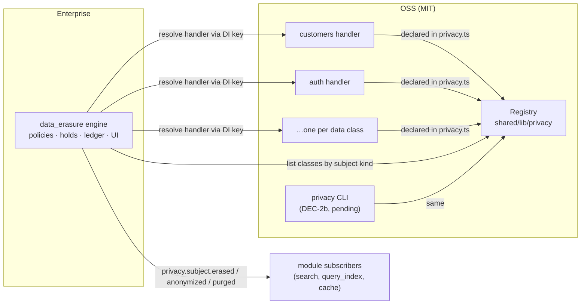

# GDPR-ready deployments — program spec

> **Tracker:** open-mercato/open-mercato#8593
> **Evidence:** [`analysis/2026-11-15-gdpr-readiness-audit-verification.md`](analysis/2026-11-15-gdpr-readiness-audit-verification.md) — every "today" statement below is verified there against `main` @ `08dada9624`.
> **Kind:** program spec. It orders work, fixes cross-cutting rules and names the spec that carries each design. It designs no feature; no package may be implemented from this file alone.
> **Status:** our own working plan. It proceeds on the assumptions under Decisions without waiting for maintainer or PR-author confirmation; those assumptions must be surfaced before the first upstream PR built on them is opened.

Extends: .ai/specs/2026-08-18-tenant-legal-documents-and-consent-versioning.md
Extends: .ai/specs/2026-10-22-crm-contact-permissions-and-consent-history.md
Extends: .ai/specs/2026-10-09-eu-transactional-email-providers.md
Extends: .ai/specs/2026-10-29-production-content-security-policy.md
Extends: .ai/specs/2026-11-06-setup-encryption-preflight.md
Extends: .ai/specs/enterprise/2026-11-13-sign-in-activity.md

## 📝 TLDR

Operators who run Open Mercato on EU personal data cannot today answer a data-subject request, bound how long data is kept, or name their sub-processors from the product alone. Issue #8593 proposes a seven-phase umbrella to fix that. **Proposed (future):** deliver it as seven dependency-ordered tracks of 52 independently shippable work packages. Each package is bound to a carrier: an existing spec, an open PR, a tracked issue, or one of twenty-four child specs named here and not yet written. Designs that so far existed only on the unmerged PR #5557 branch are re-specified in our own child specs; that branch is reference only. The issue's audit was re-verified first; about a third of its claims were stale, wrong or narrower than stated, and this plan uses the corrected baseline.

**Out of scope:** legal work that stays with the controller (lawful-basis assessment, DPAs, DPIA content, review of the Art. 30 register, age verification and parental consent, an in-product breach register). The platform supplies mechanisms and generated drafts, not legal conclusions.

## 📝 Overview

"GDPR-ready by default" means: a deployment that follows the documented path has a product mechanism for each data-subject right, privacy-preserving production defaults, a documented list of data flows, and a command that reports what is still missing.

> **Market reference.**
> - **WordPress core** (4.9.6+) and **Frappe/ERPNext** both solve cross-module erasure with a *registry*: each plugin or app declares the personal data it holds and supplies its own exporter and eraser; the core only orchestrates. Adopted — this is the data-class contract (Track C). Rejected: a generic SQL deletion engine, which bypasses module rules and side effects.
> - **Discourse** and **GitLab** *anonymize* accounts linked to records that must survive (posts, commits) instead of refusing deletion. Adopted for people linked to deals and sales documents.
> - **Matomo** ships scheduled retention with instance defaults an operator can tighten. Adopted for operational tables (Track D).
> - Not adopted: a built-in cookie-consent manager. The core app sets only first-party functional cookies, so the program ships a consent *gate* for apps that add trackers.

## 📝 Problem Statement

**What is true today**

- **No data-subject tooling outside `forms`.** There is no export for a CRM person, portal user or staff user. Deleting a person is refused when deals are linked, and nothing anonymizes. Undo snapshots keep the full deleted record indefinitely; the staff-user snapshot includes `passwordHash`. Attachments, messages, AI chats and notifications are untouched by any subject delete.
- **Retention is mostly absent.** Five pruners exist and nothing schedules them. Action logs, staff sessions, webhook deliveries, messages, AI chats and soft-deleted rows are never pruned. An admin cannot wire the pruners by hand, because the scheduler UI only targets `schedulerSafe` workers and none of them is.
- **Encryption has holes.** With no Vault and no fallback key, mapped writes land as plaintext and the only signal is a log line. Nine column groups the issue names are unmapped, and a second tier it does not name (documents, staff HR data, workflow context, integration logs) has no coverage either.
- **Transparency is vendor-specific.** `/privacy` and `/terms` name the vendor as controller. There is no consent history, suppression list or unsubscribe.
- **No accountability surface.** Auth events are ephemeral and carry no IP, there is no deployment or sub-processor documentation, and no `doctor` command.

**Corrections to the issue's audit**

| Issue says | Verified |
|---|---|
| Published fallback key in production Compose | Fixed (#7231). The refusal lives only in the Compose preflight; the runtime accepts any key |
| `sendEmail` is Resend-only | Stale. SES and SMTP transports ship; Brevo and Mailjet do not exist |
| No access-log retention | Wrong. Rotation runs inline at 7 days / 8 hours |
| 27 modules ship encryption maps | 25 |
| Defaulting `SEARCH_EXCLUDE_ENCRYPTED_FIELDS` to on closes the search leak | It covers Meilisearch only, not the token index, vector text or `search_text` |
| Moderation is hard-coded to `api.openai.com` | It is a fallback URL; moderation is off by default |
| #5557 has no CI on head | CI runs and fails |

**Gaps the issue does not list**

- Attachment OCR is hard-wired to OpenAI.
- AI tools return decrypted CRM data to the LLM with no masking.
- About fifteen person-data modules are missing from the erasure list.
- Production Compose defaults Meilisearch to a development key.
- The `auth.user.deleted` event carries `id`, but two cascade subscribers read `userId`. The channel cascade returns early; the SSO cleanup has no guard and runs its statements with an undefined id. Neither behaviour has been run or tested.
- The issue plans no mechanism for restriction of processing or for objection outside marketing (see the coverage map).

## 📝 Prior spec drift

- `.ai/specs/enterprise/2026-07-08-gdpr-data-erasure.md` → Data Model, API Contracts: specifies an `erasure_request` ledger and `POST /api/data_erasure/requests`. No code exists on `main`. The implementation on `upstream/feat/security-readiness` uses `privacy_operations` and `/api/data_erasure/subjects` and brings anonymization in scope; the PR itself annotates the older file as design history. This spec does **not** mark the older spec superseded, because it carries no replacement design itself. Our `privacy-dsr-engine` child spec will supersede those sections and add the annotation when it is written.
- `.ai/specs/2026-09-30-unified-crm-email-history-and-context.md`: specifies refusing person and company DELETE while email history exists. That refusal is not in code; today the delete removes those interactions. When it is implemented it must exempt the erasure path (recorded in C4's spec).
- `.ai/specs/2026-10-22-crm-contact-permissions-and-consent-history.md`: the issue cites it for unsubscribe links and `List-Unsubscribe`. The spec covers consent history and suppression only; it names public preference centres as a non-goal and never mentions the header. Its tracker #7700 covers CRM field-model Phase 1 only (#8779 confirms), so the consent work has no tracking issue.
- `.ai/specs/2026-10-09-eu-transactional-email-providers.md`: keeps Resend as the runtime default. The issue's "EU-first default providers" would contradict it (DEC-6).
- `.ai/specs/2026-08-18-tenant-legal-documents-and-consent-versioning.md`: sits in the OSS directory while its tracker #5423 is labelled `enterprise`.
- `.ai/specs/enterprise/2026-11-13-sign-in-activity.md`: rejects persisting sign-in events in OSS because its tracker #8106 is labelled `enterprise`. The issue cites #7972 for the audit trail, but #7972 is a separate Job Inspector access-log defect.
- `upstream/feat/security-readiness:.ai/specs/2026-08-21-access-log-durability-retention.md`: proposes blocking access-log writes with a 90-day default. `main` rotates inline at 7 days / 8 hours, and PR #8472 (approved, automerge) bounds writes differently.
- Backups: #4030 (open) says backups belong at the infra layer. PR #9333, which builds an enterprise `backups` module, is in the merge queue with automerge.

## ⚠️ Decisions

These are our working assumptions (issue assignee, 2026-11-15 and 2026-11-16). **No maintainer has confirmed any of them, and the plan does not wait for that.** Each ⚠ row names who would have to agree before the work can merge upstream, and what changes if they do not. Decision ids use the `DEC-` prefix; `D1`–`D6` elsewhere in this file are Track D packages.

| # | Assumption | Confirmation needed |
|---|---|---|
| DEC-1 | This file is a program spec. Missing designs are child specs, one independently deployable capability each, written as follow-ups. | None |
| DEC-2 | **Edition split.** OSS: security defaults, defect fixes, the MIT privacy contract types, module-owned handlers. Enterprise: tenant policies, legal holds, the operation ledger, admin UI, restore replay. | ⚠ Maintainer, before the first upstream PR for Tracks C–G. Not a gate on writing our specs. The maintainer comment on #8593 (2026-11-12) says: "we won't accept community contributions (PRs) implementing it in the open-source edition". The issue carries `enterprise`. This assumption follows the issue body and the #5557 design instead. See the fallback table below. |
| DEC-2b | **OSS invoker.** A minimal OSS CLI runs registered handlers for one subject, with no ledger, holds or UI, so rights are not paid-only. | ⚠ Maintainer. Taken for the export case by `2026-11-16-privacy-data-class-contract.md`. If refused, the export CLI and C6 are dropped and C7 moves to enterprise. |
| DEC-3 | **We write our own specs; PR #5557 is reference only.** The seven designs that exist only on its branch are re-specified in our own child specs (table below). Where its design is sound we keep the same contract and event names so the two can converge, and credit it. | None to proceed. If #5557 or a slice of it lands on `main` first, the matching child spec is rebased onto it or withdrawn. |
| DEC-4 | **Backups.** Erasure replay must also work for a restore performed outside the product (infra-level point-in-time recovery). | ⚠ Maintainer. #9333 is about to merge, which settles the module question in practice; #4030 should then be closed or re-scoped. Both carriers put the manifest inside the `backups` module, so this constraint is a gap in them, not a decided design. |
| DEC-5 | **Breaking defaults** follow `BACKWARD_COMPATIBILITY.md` as set out under Migration: the exception only where the accepted input is itself the vulnerability, the ordinary protocol everywhere else. | Named maintainer sign-off on each exception PR |
| DEC-6 | **MFA and default providers.** Recommended: staff TOTP moves to OSS while enforcement policy and SSO assurance stay enterprise. Recommended: the runtime default stays as the 10-09 spec has it; the create-app template's `.env.example` leaves the email and AI provider for the operator to choose, docs list EU options first, and `doctor` warns on a non-EU choice. | ⚠ Maintainer. Blocks only E7 and F4. |
| DEC-7 | The audit file cited by the issue was never committed. The verification record linked above stands in for it. | None |

**If DEC-2 is answered "enterprise-only"**

| Outcome | Packages |
|---|---|
| Unchanged — a defect or security fix in OSS code, public documentation, or contributor guardrails | A1–A9, B1–B8, C2, D1, D2, D4, F3, F4, G5, G7, G8 |
| Unchanged — already specified in an OSS spec that maintainers would have to move | E2, F2 |
| Capability moves to enterprise; OSS keeps only a seam (event payload, hook or convention file) | C1, C4, C8, E1, F1, G1 |
| Moves to enterprise outright | C3, C5, C7, C9, C10, D3, D5, D6, E3–E6, G2–G4, G6 |
| Dropped | C6, E7 |

One consequence needs its own ruling: handlers must live in the module that owns the data, and those modules are OSS. If maintainers refuse OSS handlers, enterprise handlers would have to query core tables directly, which breaks module isolation. That is an architecture decision, not a licensing one.

**Enterprise ownership.** Enterprise packages (C3, C9, C10, D5, D6, E4, E6, G1, G2) can only be shipped upstream by a contributor on the allowlist. **Resolved 2026-11-16:** the issue assignee is a core member authorized to change enterprise modules and owns them. Whether a capability belongs in OSS or Enterprise (DEC-2) remains a separate product decision.

**Packages re-specified in our own child specs instead of taken from #5557**

| Package | Our child spec | Reference on the branch |
|---|---|---|
| A3 | `kms-fail-closed` | `2026-08-20-production-encryption-fail-closed.md` |
| C1 | `privacy-data-class-contract` | `enterprise/2026-08-21-privacy-retention-dsr-engine.md`, `packages/shared/src/lib/privacy/contracts.ts` |
| C2 | `audit-snapshot-redaction` | `2026-08-20-command-audit-sensitive-data-redaction.md` |
| C3, D5 | `privacy-dsr-engine` (enterprise) | `enterprise/2026-08-21-privacy-retention-dsr-engine.md` |
| C8 | `tenant-exit-export` | `2026-08-24-tenant-exit-export.md` |
| C9 | `erasure-restore-replay` (enterprise) | the same DSR engine spec |
| D4 | `access-log-retention` | `2026-08-21-access-log-durability-retention.md` |

## 📝 Coverage map

What the program covers for each right and principle, and where it does not.

| GDPR | Mechanism | Packages | Status |
|---|---|---|---|
| Art. 15 access, Art. 20 portability | Subject export in machine-readable form | C4, C6, C7 | Planned |
| Art. 16 rectification | Existing edit screens. A portal user can change only their display name today | C7 | Planned for portal; staff side exists |
| Art. 17 erasure | Erase or anonymize through data-class handlers | C4, C3 | Planned |
| Art. 18 restriction, Art. 21 objection | Not in the issue. Legal hold blocks deletion but does not restrict use; suppression covers marketing only | C10 (proposed), E2 | **Gap — proposed package** |
| Art. 19 notifying recipients | Erasure events available to integrations and webhooks | C4 | Constraint on the carrier |
| Art. 22 automated decisions | Agents are propose-only; `enterprise/agent-orchestrator/next/2026-06-19-agent-decision-transparency-and-ai-act.md` | — | Outside this program; referenced |
| Art. 5(1)(e) storage limitation | Scheduled pruners, tenant policy | Track D | Planned |
| Art. 6–7 lawful basis, consent | Legal documents, consent history, unsubscribe, consent gate | Track E | Planned |
| Art. 25 by design | Coverage test; guardrails for new modules | C5, G7 | Planned |
| Art. 28, Chapter V processors and transfers | Provider choice, sub-processor matrix with region | Track F, G5 | Planned |
| Art. 30 register | Generated draft | G3 | Planned |
| Art. 32 security | Defaults, encryption, auth hardening | Tracks A, B | Planned |
| Art. 33–34 breach | Sign-in log, alerting, runbook | G1, G2, G5 | Detection and runbook only; no breach register |
| Art. 8 children | — | — | Out of scope |

**Coverage limits.** Integration provider packages (`packages/gateway-*`, `packages/channel-*`, `packages/carrier-*`) are in scope for C4. `external/official-modules` is a separate repository and needs its own follow-up once the contract ships.

## 📝 Proposed Solution

**Rules that hold across every package**

1. **One package, one PR-sized change, one carrier.** A carrier is an existing spec, an open PR, a tracked issue, or a new child spec. Small fixes with no contract change ship on an issue alone.
2. **Module-owned privacy handlers.** No engine queries another module's tables.
3. **One deletion path per data class.** Where a table belongs to a data class, retention and erasure go through that class's handler.
4. **Anonymize where a record must survive, delete where it need not.** The coverage child spec states the default per class.
5. **Secure by default, disclosed when breaking.** Every changed default ships with an `UPGRADE_NOTES.md` entry and a `doctor` check. The `doctor` skeleton therefore ships in Phase 1.
6. **A package is done** when its integration tests ship in the same PR, its data flows are in the sub-processor matrix, and its `doctor` check exists if it adds a default.

**Alternatives considered**

| Alternative | Why rejected |
|---|---|
| One monolithic spec for all capabilities | Cannot be reviewed, phased or handed to an implementer. |
| Land #5557 as one PR | 351 files, conflicting, QA no-go, CI red. Its reviewers asked for slices. |
| Generic SQL erasure by column map | Bypasses command side effects, events, blobs and legal-retention rules. |
| Derive data classes automatically from encryption maps | A map lists columns, not subjects, actions or retention. |
| Adopt #5557's specs as the design of record | Considered first. The branch is conflicting, QA no-go and owned by another author, so depending on it puts our schedule in someone else's hands. It stays a reference. |

## 📝 Architecture

### 1. Privacy contract and fan-out (planned — to be specified in `privacy-data-class-contract`)

Nothing in this diagram is on `main`. The shape below is the one implemented on the #5557 branch, which our contract spec starts from. Takeaway: a subject action fans out to every data class that declares the subject's kind, and each module changes only its own rows.

- **Definition** (`PrivacyDataClassDefinition`): `id`, `module`, `handlerService` (a DI key), `subjectKinds`, `subjectIdentifierKinds`, `retention`, `subjectActions`.
- **Handler** (`PrivacyDataClassHandler`): optional `runRetention`, `resolveSubjects`, `discoverSubject`, `exportSubject`, `eraseSubject`, `anonymizeSubject`, each taking a tenant and organization scope and a `dryRun` flag.
- **Registration**: our contract spec makes `privacy.ts` a declarative convention file that the generator surfaces on the module registry, as `encryption.ts` is today. The branch instead registers by side effect from `di.ts`; it has fourteen such files, three with subject actions (`auth`, `customers`, `audit_logs`) and the rest for sandbox sanitization or export exclusion.
- **Events**: `privacy.subject.erased`, `.anonymized`, `.purged`, declared by `audit_logs`.

**Constraints this program hands to carriers** (not designed here)

| Constraint | Why | Carrier |
|---|---|---|
| Decide how `privacy.ts` is loaded | It is not a generator convention on the branch | C1 — settled: declarative convention file |
| Allow a tenant-level scope before the type is first released | `PrivacyScope.organizationId` is a required string on the branch; staff users are not organization-scoped. Widening a released type is a breaking change | C1 — settled: organization is optional |
| Give `customers` an email and phone lookup hash | Without one, a CRM person can only be found by a decrypting scan | B1 |
| Ship a tool that rehashes lookup columns, and rotation for system-scoped records | Until then an unsafe lookup secret can only be warned about, and the key guard's default cannot flip | B1 |
| Report a service running outside production mode or under the development runner's mark | Both bypass the key guard | G4 |
| Let a module declare an exemption with a reason | The coverage test must pass for tables holding no subject data | C5 |
| Report stored-file deletion alongside row changes | Attachments have rows and blobs | C4 |
| Carry what a class is for and which categories of data it holds | Feeds the draft register. Legal basis and processing location are deliberately not carried: the first is the controller's decision, the second a fact about a vendor the product cannot verify | G3 |

### 2. Retention scheduling (existing mechanism, new registrations)

Recurring work uses the existing scheduler: a module calls the idempotent `schedulerService.register(...)` from `setup.ts` `seedDefaults`, guarded by `hasRegistration('schedulerService')`. Schedules are `system`, `tenant` or `organization` scoped.

- **Operational tables** (sessions, tokens, deliveries, progress jobs) hold no data class. They get plain queue workers with instance-level defaults. These need only the scheduler.
- **Person-data classes** are pruned through the class handler, so they wait for the contract.
- **Tenant policy** (enterprise) runs the same handlers per tenant.
- With no scheduler module, nothing registers and nothing is pruned; `doctor` reports it.

### 3. Production guard (existing pattern, extended)

The JWT secret is already refused at boot when weak (`packages/shared/src/lib/auth/jwt.ts:145-153`, `apps/mercato/src/instrumentation.ts:11-13`). The tenant encryption key gets a guard at the same place, reusing the denylist that today lives only in `packages/starter/src/encryption-preflight.mjs`. `doctor` runs the same checks without booting the app.

### 4. Coupling

- Handlers live in the module that owns the data. Enterprise modules register their own.
- The enterprise engine is an optional peer. OSS code never imports it.
- Cross-module effects of an erasure travel as events.
- The scheduler and the search module are optional peers of every pruner and handler.

## 📝 Data Models

This spec adds no entity. Entity design belongs to the carriers.

| Family | Carrier | Edition |
|---|---|---|
| Retention policies, legal holds, operation ledger, erasure manifest | `privacy-dsr-engine`, `erasure-restore-replay` | Enterprise |
| Legal documents and versioned consent events | 08-18 spec | Per DEC-2 |
| Contact permissions and consent history | 10-22 spec | OSS |
| Sign-in log | 11-13 spec | Enterprise |
| New encryption-map entries and backfill migrations | Child spec for B1 | Both |

Two rules bind every carrier. New person-data columns ship with an encryption-map entry **and** a `buildEncryptionMapBackfillSql` migration; the core guide already requires this and only two modules comply. Once C1 has landed, every new person-data table registers a data class or an exemption in the same PR; before that, the carrier lists the table and C4 picks it up.

## 📝 API Contracts

Public surfaces the program touches, with their `BACKWARD_COMPATIBILITY.md` class. Shapes are owned by the carriers.

| Surface | Change | Class | Package |
|---|---|---|---|
| `@open-mercato/shared/lib/privacy` | New import path | §4 — stable once shipped | C1 |
| Module `privacy.ts` | New convention file | §1 — additive, then frozen | C1 |
| `privacy.subject.*` events | New event ids | §5 — frozen once shipped | C1 |
| `/api/data_erasure/*` | New routes | §7 — additive | C3 |
| Privacy and `doctor` CLI commands | New commands | §13 — stable once shipped | C6, G3, G4 |
| `SendEmailOptions` | New optional headers field | §3 — additive | E3 |
| Portal account routes | New self-service routes; the self-delete refusal changes | §7 — additive plus a behaviour change | C7 |
| `auth.user.deleted` subscribers | Defect fix; the event's payload does not change. Two clean-up commands | §13 — additive | A9 |
| Persistent event-queue payloads | Content replaced by ids for four jobs | §5 — needs a bridge | B6 |
| Tenant key validation at boot | Published keys refused; short or missing keys refused after one minor | Exception / ordinary | A1, A2 |
| KMS fallback | Mapped writes fail instead of landing as plaintext | Ordinary unless a maintainer grants the exception | A3 |
| `SEARCH_EXCLUDE_ENCRYPTED_FIELDS` default | `false` → `true` after one minor | Dated entry + upgrade note | B4 |
| `Strict-Transport-Security`, `Permissions-Policy` | New response headers | §7 — additive; HSTS is sticky for clients | A5 |

## 📋 Work packages

Edition: **O** = OSS, **E** = enterprise. "New" names a child spec to be written under `.ai/specs/` (or `.ai/specs/enterprise/` for E). Notes are constraints on the carrier, not design.

### Track A — Stop active risk

| ID | Package | Ed. | Carrier | Notes |
|---|---|---|---|---|
| A1 | Production refuses a *published* tenant encryption secret, in every process and at every service start | O | [`2026-11-16-runtime-encryption-key-guard.md`](2026-11-16-runtime-encryption-key-guard.md) — written | Exception route, as #7231. Fixes the container's swallow-all bootstrap `catch` first, or the refusal would turn into silent plaintext. |
| A2 | Production *services* refuse a weak secret or unconfigured encryption, after one release of warnings | O | Same spec, separate PR | Ordinary protocol behind a `warn` / `enforce` setting. The default flip is a tracked release task gated on rotation tooling. Lookup-secret findings only warn until a rehash tool exists (B1). |
| A3 | When no key is available at write time: count and report, use a key in memory, and let an operator choose that the write fails (#2241) | O | [`2026-11-16-kms-fail-closed.md`](2026-11-16-kms-fail-closed.md) — written | Its own setting, separate from the key guard's. The command bus checks before it runs a command, because the audit row is written after commit. Does not close #2241 alone: the derived-key takeover is A4. |
| A4 | Rows sealed under the fallback key after a Vault outage | O | Issue | Separate from A3 so nothing rides along with it. |
| A5 | HSTS and Permissions-Policy when serving HTTPS in production | O | Issue; mechanism from the CSP spec | No `preload` by default. App and template in one PR. |
| A6 | Production Compose defaults: Meilisearch development key, `postgres` password | O | Issue | Whether `DEMO_MODE` defaulting to true there is intended needs a maintainer answer. |
| A7 | Next.js telemetry off outside Docker | O | Issue | Template sync applies. |
| A8 | Auth defects #7216, #7530, #7549; backports #9348, #8479 | O/E | Existing | #7239 is closed. |
| A9 | `auth.user.deleted` cascade subscribers | O/E | Issue; the requirement is [below this table](#a9--required-fix) | **Must be fixed.** Reproduced 2026-11-16 against a stubbed connection: both subscribers do nothing. The SSO cleanup issues `"user_id" is null` and matches zero rows; the channel cascade returns early, so a deleted user's channels stay connected with their credentials. Neither touches another user's rows. Guard: `ignoreUndefinedInQuery` must stay off. |

#### A9 — required fix

**This defect must be fixed.** It is live on `main`, it depends on no other package, and it ships in Phase 1. No later package replaces it: the erase run of Track C cleans up after an erasure, but an ordinary user deletion relies on these two subscribers and nothing else.

**What is wrong.** `auth.user.deleted` carries `{ id, organizationId, tenantId }` (`auth/commands/users.ts:214-223`). Both subscribers read `payload.userId`, which is never set.

| Subscriber | Today | Left behind after a user is deleted |
|---|---|---|
| `communication_channels/subscribers/user-deleted-cascade.ts` | Returns early | The user's channels stay connected and active, with the pointer to their stored credential |
| `enterprise/…/sso/subscribers/user-deleted-cleanup.ts` | Issues three statements with `"user_id" is null`, which match nothing | The identity (subject, email, name, groups), role grants and deactivations. Sign-in repairs only the identity, and only when that subject signs in again |

**What the fix must do.**

1. Both subscribers take the user id from `id`. They also accept `userId`, so an event already queued by a test or another emitter is still handled. The event's payload does not change.
2. With no id, a subscriber issues no statement and logs once. The SSO subscriber may no longer send a statement whose condition is `is null`.
3. The SSO clean-up matches on the user id, and on the tenant when both the event and the row carry one. The channel cascade keeps its present effect and its present refusal to run without a tenant.
4. Rows left by earlier deletions are cleaned up by one idempotent command per module (`mercato communication_channels cleanup-deleted-users`, `mercato sso cleanup-deleted-users`): it takes the user ids on its own rows, looks them up by id in batches without a join across modules, and applies the same clean-up to those whose user is gone. It reports by default and changes rows only with `--apply`. Neither module has a `cli.ts` today, so each command adds one.

**Tests, in the same change.**

- Each subscriber's unit test builds its payload with `userCrudEvents.buildPayload`. The channel test's hand-written `{ userId }` payload is what hid the defect, and is replaced.
- The SSO subscriber gets its first test. The characterization in the enterprise coverage spec lands first and becomes this regression test.
- One integration test per module deletes a user through the API, waits for the persistent subscriber, and asserts: the channel is disconnected with no credential pointer; no live identity, grant or deactivation remains; a second user's rows are unchanged.
- A guard test fails if the ORM configuration sets `ignoreUndefinedInQuery`. With that setting on, an undefined condition is dropped and the unfixed SSO code would delete every row in all three tables.

**Compatibility.** The event id, its payload and both subscriber ids are unchanged. The two commands are additive.

### Track B — Close encryption gaps

| ID | Package | Ed. | Carrier | Notes |
|---|---|---|---|---|
| B1 | Map and backfill the named columns | O/E | [`2026-11-16-encryption-map-coverage-and-backfill.md`](2026-11-16-encryption-map-coverage-and-backfill.md) — written; PRs #8987, #9011 | First makes the path trustworthy: catch-up migrations for the roughly 195 mapped fields older tenants never received, three guards, a batched row-backfill command separate from key rotation. Then webhook bodies, notifications, attachment text, channel copies, SSO email and name, HR notes, workflow data. Left in clear with a recorded reason, pending a person's answer: three names that lists search and sort in SQL, the SSO subject, CRM interaction participants. |
| B2 | Second tier of unmapped person data | O | Same spec, Phases B and C | Per column: encrypt, minimize or retention-only. Documents content is deliberately plain for collaborative editing. |
| B3 | Encrypted-read correctness: #2115, #5447, #7048, #5845, #5870, #7691, #6002 | O | Existing issues; PR #8744 | — |
| B4 | Search-index protection | O | [`2026-11-16-search-index-pii-protection.md`](2026-11-16-search-index-pii-protection.md) — written (token and vector indexes); [`2026-11-16-fulltext-encrypted-field-exclusion.md`](2026-11-16-fulltext-encrypted-field-exclusion.md) — written (Meilisearch); #8134, #7872, #5712, #8135; PR #8410 | Token hashes keyed per tenant, with both forms read for one minor; vector display fields encrypted. Flipping the Meilisearch setting removes all fulltext matching on encrypted fields. |
| B5 | S3 server-side encryption option | O | Issue | — |
| B6 | Queue payloads: ids where the content is already stored, sealed at rest where it is not; failed-job retention bounded by age | O | [`2026-11-16-queue-payload-minimization.md`](2026-11-16-queue-payload-minimization.md) — written | Narrowed from "ids, not content": inbound messages, provider events and persistent events exist nowhere else before the worker runs, and event fields may not be removed. Bounds and the two id changes ship first, with no key. |
| B7 | Logger redaction on stdout; New Relic drops `request.*` by default | O | Issue + docs | — |
| B8 | Auth hardening | O | PRs #8899, #8485, #8582, #9449; #5083, #4184 | Residual: staff lockout; `requireShared` (#9280) as the production default. |

### Track C — Privacy contract and data-subject rights

| ID | Package | Ed. | Carrier | Notes |
|---|---|---|---|---|
| C1 | Contract, `privacy.ts` discovery, `privacy` module, read-only handlers for staff user, CRM person and portal user, export CLI | O | [`2026-11-16-privacy-data-class-contract.md`](2026-11-16-privacy-data-class-contract.md) — written | First package of the track. Read side only; nothing destructive. |
| C2 | No credential in the command audit log: no replay input for commands that cannot be replayed; password, hash and token removed from the ones that can; history cleared by migration | O | [`2026-11-16-audit-snapshot-redaction.md`](2026-11-16-audit-snapshot-redaction.md) — written | Narrowed from the issue: personal data stays in snapshots while an action can be undone. The enterprise password-change command stores both plaintext passwords today. PR #9578 covers MFA. |
| C3 | `data_erasure` engine: policies, holds, ledger, admin page, scheduler command | E | [`enterprise/2026-11-16-privacy-dsr-engine.md`](enterprise/2026-11-16-privacy-dsr-engine.md) — written | Not approved until the OSS erase run is. Holds and the ledger store the subject's kind and id in clear, and the guard refuses when it cannot answer. Supersedes five sections of the 07-08 erasure spec. |
| C4 | Erasure: one operation in which each data class deletes, anonymizes or retains per section; the run; three roots; audit history | O | [`2026-11-16-privacy-subject-erasure.md`](2026-11-16-privacy-subject-erasure.md) — written | Not approved until DEC-2b is answered. A kind is erasable only when every class declaring it implements erase. Coverage of the other modules is the roll-out plan below, in four domain specs. |
| C5 | Coverage test: every entity belongs to a data class or a declared exemption | O | [`2026-11-16-privacy-table-coverage.md`](2026-11-16-privacy-table-coverage.md) — written | Every table is covered by a class, declared with a reason, or on a per-package backlog that the coverage specs empty. Reads migration snapshots, so it is not limited to mapped entities. Ships with C1. |
| C6 | Subject CLI: erase command | O | Folded into C4's spec | Pending DEC-2b. |
| C7 | Portal self-service: download, delete with a grace period, edit own profile | O | [`2026-11-16-portal-privacy-self-service.md`](2026-11-16-portal-privacy-self-service.md) — written; [`2026-11-16-portal-email-change.md`](2026-11-16-portal-email-change.md) — written | Display-name editing can ship now. Download and deletion wait for DEC-2b. Changing the account email is its own spec: a link to the new address, a notice to the old, sessions ended on confirmation. |
| C8 | Tenant exit export | O | [`2026-11-16-tenant-exit-export.md`](2026-11-16-tenant-exit-export.md) — written | Blocked on one ruling: whether a command may read every module's declared tables generically. Exclusions, redactions and how a table without a tenant column belongs to a tenant are declared by the owning module. |
| C9 | Erasure manifest and post-restore replay | E | [`enterprise/2026-11-16-erasure-restore-replay.md`](enterprise/2026-11-16-erasure-restore-replay.md) — written | Meets DEC-4: a row per erasure in the database and a file outside it; what is pending is files minus rows. Needs a directory every replica shares. Supersedes the manifest section of the 07-08 backup spec. |
| C10 | Restriction of processing and objection: a documented procedure; no flag | E | [`enterprise/2026-11-16-processing-restriction-and-objection.md`](enterprise/2026-11-16-processing-restriction-and-objection.md) — written, as a decision record | Proposed by this spec; not in the issue. A mark that blocks edits would stop the one thing Art. 18 does not ask to be stopped. The default is a procedure with existing controls — a legal hold, contact permissions, an export — and a plain statement that the product has no technical restriction. Requirements for a "record freeze" are kept for a later decision. |

### Coverage roll-out plan

The five domain specs are written, each from a reading of its modules' entities, encryption maps and delete paths. The open points below are the ones known before they were written; each spec's own assumptions supersede them. A class must ship export and erase together, because a subject kind is erasable only when every class declaring it implements erase.

| Domain spec | Modules | Known open points |
|---|---|---|
| [`2026-11-16-privacy-coverage-commerce.md`](2026-11-16-privacy-coverage-commerce.md) — written | `sales`, `cart`, `checkout`, `payment_gateways`, `warranty_claims` | "Fiscal" is not decidable from `placed_at` alone; invoices carry no customer columns; checkout payers are found only by scanning an encrypted email, one subject per transaction |
| [`2026-11-16-privacy-coverage-communication.md`](2026-11-16-privacy-coverage-communication.md) — written | `messages`, `communication_channels`, `inbox_ops`, `phone_calls` | Messages have no sender-display column and a non-nullable sender; user-scoped channels hold mailbox credentials |
| [`2026-11-16-privacy-coverage-people-ops.md`](2026-11-16-privacy-coverage-people-ops.md) — written | `staff`, `onboarding`, `devices`, `notifications`, `push_notifications`, per-user rows in `integrations`, `api_keys`, `perspectives`, `dashboards` | Team members with no linked user are unreachable by a user subject; the onboarding lookup hash is globally unique |
| [`2026-11-16-privacy-coverage-content-ai.md`](2026-11-16-privacy-coverage-content-ai.md) — written | `forms`, `documents`, `eudr`, `ai_assistant` | The forms service anonymizes per submission and only flagged fields, and leaves the attachment blob |
| [`enterprise/2026-11-16-privacy-coverage-enterprise.md`](enterprise/2026-11-16-privacy-coverage-enterprise.md) — written | `sso`, `security`, `agent_orchestrator` | MFA rows and SSO identities are orphaned by a user delete today |

Reference-only columns (assignee, created-by, in about fifteen modules) are left as ids; they render as "Unknown user". Webhook delivery payloads and logs are bounded by retention, not by subject erasure.

### Track D — Storage limitation

| ID | Package | Ed. | Carrier | Notes |
|---|---|---|---|---|
| D1 | Schedule the existing integrations and portal pruners | O | [`2026-11-16-operational-retention-pruners.md`](2026-11-16-operational-retention-pruners.md) — written | Not marked `schedulerSafe`. Existing installations need upgrade actions. Forms retention moved to **New** `forms-retention-scheduling`; sudo sessions, MFA challenges and the SCIM log to **New** `operational-retention-enterprise` (E). |
| D2 | Prune operational tables: expired rows from the first run, history after a thirty-day counting period per installation | O | Same spec | Not approved for upstream work until the edition question is answered. Inbound webhook receipts are deliberately kept: they are a replay defence. |
| D3 | Retention for records people read: notifications and assistant conversations first; change history and inactive contacts each in their own spec | O | [`2026-11-16-privacy-record-retention.md`](2026-11-16-privacy-record-retention.md) — written; [`enterprise/2026-11-16-action-log-retention.md`](enterprise/2026-11-16-action-log-retention.md) — written (#2980); [`2026-11-16-inactive-subject-retention.md`](2026-11-16-inactive-subject-retention.md) — written | Rows pruned by age are retention sets in their own registry, not data classes. OSS ships the handlers and manual commands; schedules and policy are D5. Change history is stripped of values at one age and deleted at another, sparing the record of privacy operations; its one OSS routine is shared with the erasure strip and needs a maintainer's yes. Erasing inactive people needs a maintained last-activity time, which does not exist today. |
| D4 | Access-log retention: scheduled and batched, same windows | O | [`2026-11-16-access-log-retention.md`](2026-11-16-access-log-retention.md) — written | After #8472, which still awaits review. The inline delete stays as a safety net driven by the table's own state. |
| D5 | Per-tenant retention policy | E | Same spec as C3, Phase 3 | After C3 and C4. |
| D6 | Bounded backup retention | E | Backup specs; #9333 | — |

### Track E — Lawful basis and transparency

| ID | Package | Ed. | Carrier | Notes |
|---|---|---|---|---|
| E1 | Tenant-owned `/privacy` and `/terms`; acceptance stored with version and hash | per DEC-2 | 08-18 spec, #5423 | A test pins the vendor identity and must change. |
| E2 | Consent history; suppression before outbound sends | O | 10-22 spec | **Needs a tracking issue.** |
| E3 | Unsubscribe link and `List-Unsubscribe` | O | [`2026-11-16-email-unsubscribe-headers.md`](2026-11-16-email-unsubscribe-headers.md) — written | Good practice, not a legal minimum: the product sends no marketing or bulk mail. Form invitations and staff notification email only. Person-to-person mail stays with the 10-22 spec. |
| E4 | Forms reference versioned consent documents | E | #7068 | After E1. |
| E5 | Consent gate hook; honest cookie notice | O | [`2026-11-16-consent-gate-hook.md`](2026-11-16-consent-gate-hook.md) — written | The notice becomes one button. The gate ships with no first-party use; whether built-in browser telemetry goes behind it is left for a person. `user_consents` is not reused: it is staff-only and has no visitor key. |
| E6 | Portal MFA | E | #7345 | — |
| E7 | Staff TOTP in OSS | O | Issue, after DEC-6 | Not started unless a maintainer says yes. |

### Track F — Processors

| ID | Package | Ed. | Carrier | Notes |
|---|---|---|---|---|
| F1 | AI data protection: the tenant's provider allow-list enforced for every model call; a separate switch for sending files to a model; whether to withhold fields from model input | O | [`2026-11-16-ai-data-protection.md`](2026-11-16-ai-data-protection.md) — written (provider policy); [`2026-11-16-ai-model-input-minimisation.md`](2026-11-16-ai-model-input-minimisation.md) — written, direction open; relates to PR #5557 | The allow-list is advisory today even for chat, and absent everywhere else; refusing is a marked behaviour change. Field-level withholding is recommended against for now: it would cover some routes to a model and be read as covering all. Embedding settings are a search-settings defect, not part of this. |
| F2 | Brevo and Mailjet provider packages | O | 10-09 spec, #5556 | SES and SMTP already give an EU path. |
| F3 | Map tiles opt-in or self-hosted for the deals map and the EUDR plot map | O | Issue | — |
| F4 | Template provider choice | O | Issue, after DEC-6 | — |

### Track G — Accountability and verification

| ID | Package | Ed. | Carrier | Notes |
|---|---|---|---|---|
| G1 | Durable sign-in log with IP and user agent | E + OSS seam | 11-13 spec, #8106 | — |
| G2 | Alerts for administrators: repeated failed sign-ins, throttling, portal lockouts, large exports, privileged changes, new API keys | E | [`enterprise/2026-11-16-security-event-alerting.md`](enterprise/2026-11-16-security-event-alerting.md) — written; OSS seam [`2026-11-16-export-audit-event.md`](2026-11-16-export-audit-event.md) — written | The new-device notice is already in the 11-13 spec, and sign-ins refused by the rate limit stay silent as that spec decided. Needs OSS seams: the portal lockout event actually emitted, an event for feature changes, API-key events, and exports recorded with their total. Tells people; blocks nothing. |
| G3 | Art. 30 register generator | O | [`2026-11-16-privacy-ropa-generator.md`](2026-11-16-privacy-ropa-generator.md) — written | A command that prints a draft for one tenant. Fills in what declarations and configuration can know; prints legal basis, purpose and transfers as blanks for the controller. |
| G4 | `mercato privacy doctor`: configuration findings with severities; non-zero exit on an error | O | [`2026-11-16-privacy-doctor-cli.md`](2026-11-16-privacy-doctor-cli.md) — written | Renamed from the issue's `doctor privacy`. Creates the `privacy` module. Other packages add checks through an optional export. The processor report moved to G5. |
| G5 | Deployment docs: sub-processor matrix with region, hardening checklist, DSR and breach runbooks | O | [`2026-11-16-gdpr-deployment-docs.md`](2026-11-16-gdpr-deployment-docs.md) — written | Matrix stub in Phase 1, from the verified outbound-call list. |
| G6 | End-to-end verification suite | O/E | [`2026-11-16-privacy-verification-suite.md`](2026-11-16-privacy-verification-suite.md) — written | An independent scan that decrypts and searches every store it can reach, and an end-to-end test that fails on a planted value found outside what the classes declared as retained. Scenarios under Integration Coverage are its acceptance criteria. |
| G7 | Guardrails for new modules: scaffold, module guide, review checklist | O | Issue | So a new module cannot skip the contract unnoticed. |
| G8 | External review | — | #546 | After G6. |

**Child specs (39; all written).**

| State | Specs |
|---|---|
| Written | `privacy-data-class-contract`, `runtime-encryption-key-guard`, `kms-fail-closed`, `audit-snapshot-redaction`, `command-audit-credential-check`, `privacy-doctor-cli`, `privacy-subject-erasure`, `operational-retention-pruners`, `forms-retention-scheduling`, `operational-retention-enterprise` (E), `gdpr-deployment-docs`, `portal-privacy-self-service`, `search-index-pii-protection`, `fulltext-encrypted-field-exclusion`, `encryption-map-coverage-and-backfill`, `privacy-dsr-engine` (E), `erasure-restore-replay` (E), `access-log-retention`, `privacy-record-retention`, `email-unsubscribe-headers`, `consent-gate-hook`, `queue-payload-minimization`, `tenant-exit-export`, `privacy-table-coverage`, `privacy-verification-suite`, `ai-data-protection`, `ai-model-input-minimisation`, `security-event-alerting` (E), `privacy-ropa-generator`, `export-audit-event`, `portal-email-change`, `processing-restriction-and-objection` (E, a decision record), `action-log-retention` (E), `inactive-subject-retention`, `privacy-coverage-commerce`, `privacy-coverage-communication`, `privacy-coverage-people-ops`, `privacy-coverage-content-ai`, `privacy-coverage-enterprise` (E) |
| To write | None |

Each carries its own Delta, data model and compliance report. Every one was read by an independent reviewer with fresh context and revised; the revisions themselves have not been re-read. Two end in a question for a person instead of a design to build: `ai-model-input-minimisation` and `processing-restriction-and-objection`. The coverage specs' reviews also changed the contract and the erasure run, which now carry addenda: aliases, a subject for a person known only by an address or a name, history stripped by record, a read-only check before anything changes, and credential-holding classes running last.

**#5557 slices we do not re-specify.** The issue lists them under its Phase 1; they are not on the GDPR critical path, stay with that PR and gate nothing here: `attachment-scanning-gate`, `signed-audit-evidence-export`, `non-production-sanitization-contract` and its enterprise counterpart, `security-pipeline-coverage`, `intercepted-login-session-finalization`, `sso-mfa-login-assurance`, `hardened-ai-runtime-foundation`, `provider-independent-ai-content-safety`.

## 📝 Delta

This spec changes no behaviour itself. Each carrier that changes behaviour owns a Delta section. The behaviours below exist on `main` and are modified or removed by the program, so each carrier starts with a characterization test that pins the current behaviour.

| Current behaviour | Change | Package |
|---|---|---|
| Production runtime accepts any tenant encryption key | Refuses published keys; later short or missing ones | A1, A2 |
| KMS unavailable with no fallback → plaintext write | Mapped write fails | A3 |
| Production Compose starts with a development Meilisearch key | Refused | A6 |
| `auth.user.deleted` cascades read a field the event does not carry | Fixed | A9 |
| Meilisearch indexes decrypted fields by default | Excluded after one minor | B4 |
| Jobs store message, event and provider content in clear | Ids for two; sealed at rest for the rest | B6 |
| Request attributes and emails reach logs and New Relic | Redacted or dropped by default | B7 |
| Staff accounts have no lockout; rate limiter is in-memory in production | Lockout; shared limiter required | B8 |
| Delete-user undo snapshot restores `passwordHash` | Snapshot carries no credential | C2 |
| Deleting a person with linked deals returns 422 | Anonymized in place | C4 |
| Person and company DELETE refused while email history exists | Reconciled with erasure | C4 |
| A portal user cannot delete their own account | Delete request with a grace period | C7 |
| The five existing pruners never run | Scheduled by default | D1 |
| Access logs are deleted inline, unbounded, after a write | Scheduled and batched; same windows; `0` keeps | D4 |
| `/privacy` and `/terms` name the vendor | Tenant-owned content | E1 |
| Cookie notice "Accept" and "Dismiss" are equivalent | Notice matches behaviour | E5 |
| Maps load OSM tiles by default | Opt-in | F3 |

## 📝 Scenarios every carrier must answer

These are requirements on the named carriers, not designs.

- **Partial fan-out** (C3, C4). One handler fails mid-erasure. The subject must not be reported as erased, and a re-run must be safe.
- **Wrong subject** (C3, C6). A name can match several people. No mutation may run on an unselected candidate.
- **Records under legal retention** (C4). An invoice outlives the person. State which fields remain and confirm the export still lists the document.
- **Erasure, then restore** (C9). A restore older than an erasure brings the subject back, including a restore done outside the product.
- **Optional modules absent** (all). No scheduler, no search module, no enterprise engine: each must degrade without error.
- **Fail-closed on an existing deployment** (A1–A3). State what an operator running on a weak key sees at upgrade and how they recover.
- **First prune on an old database** (D1–D3). Years of rows match at once. State the batching and what is reported before anything is deleted.
- **Free text** (C4). Names inside notes and email bodies survive field-level anonymization. State, per class, whether free text is deleted, redacted or retained and why.

## 📝 Migration & Backward Compatibility

- **Additive surfaces** (contract types, convention file, events, routes, CLI, optional email headers) need no bridge; they are frozen or stable once released.
- **Emergency Security Exception — A1 only.** It applies when the accepted input is itself the vulnerability. A published key qualifies and has precedent (`BACKWARD_COMPATIBILITY.md`, "Compose encryption (2026-11-01, #7231)"). The PR must argue the condition, keep no toggle, add a dated entry and an `UPGRADE_NOTES.md` entry with operator steps, and carry a named maintainer approval.
- **Ordinary protocol — A2, A3, B4, B6, D1, A5.** A short key, a missing key or a never-configured KMS "merely makes an insecure usage possible" (`BACKWARD_COMPATIBILITY.md:15`), so the exception does not cover them. Each ships behind an explicit setting for one minor with a warning, then the default changes and the old behaviour stays available as an explicit opt-out. A maintainer may still grant the exception for A3's outage case; the plan does not assume it.
- **Backports.** Patch releases carry no `UPGRADE_NOTES.md` window (`CONTRIBUTING.md:246`), and the exception requires such an entry. No breaking default in this program is backported to `release/v0.9.x` without a maintainer decision. Existing backports (#9348, #8479) are unaffected.
- **Schema.** New tables and columns only. Encryption backfills use `buildEncryptionMapBackfillSql` with an empty `down()`.
- **Template sync.** A5, A7, E1, E5 and F4 touch `apps/mercato/src/app/**` or `.env.example` and mirror into the create-app template in the same PR.
- **Spec directory.** The capability-archive step the spec-writing skill describes needs a `.ai/specs/capabilities/` directory that does not exist; adding it is a taxonomy change that needs a maintainer's agreement and is not assumed here.

## 📋 Phasing

| Phase | Content | Depends on |
|---|---|---|
| 0 | Assumptions recorded; tracker hygiene | — |
| 1 | Track A; `doctor` skeleton (G4); sub-processor matrix stub (G5) | — |
| 2 | Privacy contract: C1, C2, C8; B3 | — |
| 3 | Track B | Phase 1 |
| 4 | Rights: C3–C7, C9, C10 | Phase 2; DEC-2b for C6; DEC-4 for C9 |
| 5 | Storage limitation | D1, D2, D4: scheduler only. D3: Phase 2. D5, D6: Phase 4 |
| 6 | Tracks E and F | E3, E5, F2, F3 are independent. E1, E2, F1 can start, and register their data classes once Phase 2 has landed. E7, F4 need DEC-6 |
| 7 | Track G remainder | G6 needs Phases 2–5 |

## 📋 Implementation Plan

Each step is one package or one decision, testable on its own, and leaves the application working.

**Phase 0 — Assumptions and hygiene**
1. Proceed on DEC-1 to DEC-7 as written. Writing specs does not wait for confirmation.
2. Before the first upstream PR for Tracks C–G, surface DEC-2, DEC-2b and the enterprise-ownership question, with the fallback table.
3. Before C9, C10, E7 and F4 are written, settle DEC-4, DEC-6, whether C10 is wanted, and the `DEMO_MODE` default.
4. Open the missing trackers: E2, A4, A5, A6, A7, A9, B5, B7, F3, G7.
5. Correct the issue body's stale rows and the #7700 and #7972 references.

**Phase 1 — Stop active risk**
1. Write `privacy-doctor-cli`; ship the skeleton with the checks that already have something to check.
2. Implement A1, then A2 as a separate PR, from `2026-11-16-runtime-encryption-key-guard.md`. Its test-environment phase lands first.
3. Write `kms-fail-closed`; ship A3 behind its setting; then A4.
4. Ship A5, A6, A7 as separate small PRs, each adding its `doctor` check.
5. Fix A9 as required under Track A; it is already reproduced. Land A8.
6. Publish the sub-processor matrix stub.

**Phase 2 — Privacy contract**
1. Implement C1 from `2026-11-16-privacy-data-class-contract.md`.
2. Write `audit-snapshot-redaction`; characterize the delete-user snapshot; ship C2.
3. Write `tenant-exit-export`; ship C8.
4. Close B3 issues as their PRs land.

**Phase 3 — Encryption gaps**
1. Write `encryption-map-coverage-and-backfill`; ship B1 per module with its backfill; then B2.
2. Write `search-index-pii-protection`; ship the setting, then flip the default one minor later.
3. Write `queue-payload-minimization`; ship B6 with its bridge.
4. Ship B5, B7 and the B8 residuals.

**Phase 4 — Rights**
1. Write `privacy-data-class-coverage`; characterize the two delete refusals; ship handlers module by module.
2. Write `privacy-verification-suite`; ship the coverage test (C5).
3. Write `privacy-dsr-engine` and `erasure-restore-replay`; ship C3 and C9 under the enterprise owner.
4. Ship C6 if DEC-2b allows; write and ship `portal-privacy-self-service`.
5. Write and ship C10 if approved.

**Phase 5 — Storage limitation**
1. Write `operational-retention-pruners`; ship D1 with a first-run report, then D2.
2. Write `access-log-retention`; ship D4 on top of #8472.
3. Ship D3 as class handlers; then D5 and D6.

**Phase 6 — Transparency and processors**
1. E1 from the 08-18 spec; update the pinned legal-entity test.
2. E2 from the 10-22 spec; write and ship `email-unsubscribe-headers`.
3. Write `consent-gate-hook`; ship E5. Then E4 and E6.
4. Write `ai-data-protection`; ship masking first.
5. Ship F2, F3; F4 and E7 once DEC-6 is answered.

**Phase 7 — Accountability and verification**
1. G1 from the 11-13 spec; write and ship `security-event-alerting`.
2. Write and ship `privacy-ropa-generator`.
3. Complete the docs (G5) and the new-module guardrails (G7).
4. Ship the verification suite (G6); run the external review (G8); close #8593.

## 🧪 Integration Coverage

Per-package coverage is listed in each carrier. The scenarios below are the acceptance criteria for the `privacy-verification-suite` child spec and the gate for closing #8593. Tests create their own fixtures through the API and remove them afterwards.

| Scenario | Asserts |
|---|---|
| Erase a subject everywhere | A subject has data in every module that registers a data class. After erasure, no plaintext identifier remains in any table, index, vector store, cache or queue file **outside the declared retained set**: audit evidence under its own retention, fiscal fields under legal retention, and free text a class declares as retained. The test reads that set from the registry. |
| Export completeness | The export lists a record from every registered class. |
| Anonymize with dependants | A person linked to a deal and an invoice is anonymized; both records still load. |
| Legal hold | A held subject is skipped and reported. |
| Coverage | Adding a person-data entity without a data class or exemption fails. |
| Fail closed | With the KMS unavailable in production mode, a mapped write fails and nothing is stored. |
| Boot guard | A production boot with a published key exits non-zero with the rotation hint. |
| Pruners | Each removes only rows past its window and is safe to run twice. |
| Doctor | Exits non-zero on a deliberately weak configuration and zero on the documented one. |
| Portal self-service | A portal user downloads their data, requests deletion, and cancels within the grace period. |
| Cross-tenant | Resolving an identifier never returns a subject from another tenant. |
| User deleted (A9) | Deleting a user through the API disconnects their channels and removes their SSO identity, grants and deactivations; another user's rows are unchanged. |

Key UI paths at program level: `/backend/security/privacy`, the portal account page, `/privacy`, `/terms`.

## 📝 Risks & Impact Review

#### The plan is built on an edition split the maintainers have contradicted
- **Scenario**: Work starts on OSS packages in Tracks C–G and is then refused under the 2026-11-12 statement.
- **Severity**: Critical
- **Affected area**: Phases 2, 4, 5, 7
- **Mitigation**: Accepted for now: we write our own specs first. Track A and Track B are defect and security work and are safe either way. The assumption is surfaced before the first upstream PR for Tracks C–G, and the fallback table states where each package goes.
- **Residual risk**: The handler-placement question has no clean enterprise-only answer and may reopen the contract design.

#### An erasure removes the wrong person
- **Scenario**: An operator resolves a subject by name, picks the wrong candidate, and applies erasure.
- **Severity**: Critical
- **Affected area**: customers, sales, every class keyed by the person
- **Mitigation**: Required of C3 and C6: candidates only, explicit selection, dry-run report first.
- **Residual risk**: Erasure is irreversible by requirement. A wrong confirmed selection can be undone only from a backup.

#### A security default stops a production instance at upgrade
- **Scenario**: An instance on a published key upgrades and refuses to boot.
- **Severity**: High
- **Affected area**: deployments outside the documented path
- **Mitigation**: `doctor` ships first and runs before upgrade; only the published-key case has no bridge; the upgrade note leads with the rotation command.
- **Residual risk**: Operators who upgrade without reading notes get downtime. Accepted: the key is public.

#### Newly scheduled pruners delete data an operator expected to keep
- **Scenario**: A pruner that never ran deletes years of rows on first schedule.
- **Severity**: High
- **Affected area**: forms submissions, integration logs, action logs
- **Mitigation**: Required of the pruner child spec: reviewed defaults, a report before the first deletion, every window configurable, and a stated default for action logs.
- **Residual risk**: An operator who needed longer retention and did not configure it loses data past the default.

#### Our specs duplicate or collide with PR #5557
- **Scenario**: #5557 or a slice of it merges while our child specs for the same packages are in progress, leaving two designs for one contract.
- **Severity**: High
- **Affected area**: A3, C1–C3, C8, C9, D4, D5
- **Mitigation**: Our contract spec starts from the branch's type and event names so the two can converge. Each of the seven child specs checks the state of #5557 before it is written and again before its implementation PR.
- **Residual risk**: Duplicate design work if both proceed without coordination; we have chosen not to coordinate yet.

#### Cross-tenant leakage through a handler
- **Scenario**: A handler resolves an email without tenant scope.
- **Severity**: Critical
- **Affected area**: every subject-resolution implementation
- **Mitigation**: Scope is a required contract input; a cross-tenant negative test per handler is an acceptance criterion.
- **Residual risk**: Low once that test is enforced.

#### Anonymized records remain re-identifiable
- **Scenario**: Direct identifiers are removed but free text or attachments still identify the person.
- **Severity**: Medium
- **Affected area**: notes, comments, email bodies, attachments
- **Mitigation**: C4 must state the free-text rule per class.
- **Residual risk**: Text retained for a documented reason stays identifying; that is a controller decision.

#### Search loses function when encrypted fields leave the index
- **Scenario**: After the default flips, users cannot find a person by name through fulltext search.
- **Severity**: Medium
- **Affected area**: global search, CRM lists
- **Mitigation**: One minor on the old default; B4's child spec must offer an exact-match path before the flip.
- **Residual risk**: Fuzzy search on encrypted fields is gone for deployments that keep the new default.

## Final Compliance Report — 2026-11-15

### AGENTS.md Files Reviewed
- `AGENTS.md` (root) and `.ai/specs/AGENTS.md` — in full
- `BACKWARD_COMPATIBILITY.md` — protocol, Emergency Security Exception, §1, and the #7231 dated entry
- `packages/core/AGENTS.md` — Encryption section and section index
- `packages/queue/AGENTS.md`, `packages/create-app/AGENTS.md` — MUST rules only
- Not reviewed: `packages/ui`, `packages/search`, `packages/ai-assistant`, `packages/cli`, `.ai/qa`. They bind the child specs that touch those areas.

### Compliance Matrix

| Rule Source | Rule | Status | Notes |
|---|---|---|---|
| root AGENTS.md | No direct ORM relationships between modules | Compliant | Handlers are module-owned; the enterprise-only fallback would strain this and is flagged |
| root AGENTS.md | Never expose cross-tenant data | Compliant | Scope is a required handler input; negative test required |
| root AGENTS.md | Ask before reducing scope, changing architecture or public contracts | Compliant | Every changed surface is listed with its class. Open decisions are working assumptions here; each names who must agree before an upstream PR |
| root AGENTS.md | Integration coverage listed | Compliant | Program-level acceptance criteria listed; per-package coverage delegated |
| `.ai/specs/AGENTS.md` | No enterprise-only scope in the OSS specs directory | Compliant | Enterprise packages are referenced by carrier only |
| `.ai/specs/AGENTS.md` | Required sections present | Compliant | Data Models and API Contracts are pointer tables; this spec adds no entity or route |
| `.ai/specs/AGENTS.md` | Ask before changing the spec directory taxonomy | Compliant | The capabilities directory is not assumed |
| packages/core/AGENTS.md → Encryption | Maps plus a backfill migration | Compliant | Made binding on every carrier |
| packages/queue/AGENTS.md | Workers idempotent; no custom polling | Compliant | Pruners are queue workers; running twice is an acceptance scenario |
| packages/create-app/AGENTS.md | Template sync | Compliant | Packages that need it are named |
| `BACKWARD_COMPATIBILITY.md` | Deprecation protocol, or an argued exception | Compliant | Exception limited to A1 |

### Internal Consistency Check

| Check | Status | Notes |
|---|---|---|
| Data models match API contracts | Pass | Both point to the same carriers |
| API contracts match UI/UX section | N/A | No UI is designed here |
| Risks cover all write operations | Pass | Erasure, anonymization, pruning, boot and write refusal |
| Every package has a carrier | Pass | 52 packages; 24 child specs carry 30 of them |
| Every pending decision states its fallback | Pass | DEC-2, DEC-2b, DEC-3, DEC-4, DEC-6 |
| Phasing matches package dependencies | Pass | Re-checked after review |

### Non-Compliant Items
None in this document.

### Verdict
**Approved as our working plan.** The document is internally compliant and no phase waits on outside confirmation. Its edition split (DEC-2) is unconfirmed and contradicts the tracker; that is an accepted risk, to be surfaced before the first upstream PR for Tracks C–G.

## Changelog

### 2026-11-15
- Skeleton with open questions; audit re-verified against `main` @ `08dada9624`.
- Open questions answered by the issue assignee as working assumptions; full program written.
- Revised after independent review: decision ids renamed to `DEC-`; edition fallback made per package; Emergency Security Exception limited to the published-key case; packages split where the carrier did not cover them (A1/A2, A4, A9, C5, C6, C10, D3, E3, G2, G7); `doctor` and the matrix moved to Phase 1; `Supersedes` line withdrawn; coverage map added; feature design relabelled as constraints on carriers.

### 2026-11-16
- Enterprise ownership resolved: the assignee is a core member. Specs for enterprise packages are now written alongside the OSS ones.
- After review, `privacy-data-class-coverage` was renamed `privacy-subject-erasure` and narrowed to the operation and three roots; the module roll-out became the plan above, in five domain specs. The pruner spec lost forms retention and the enterprise tables to two further child specs. The child-spec list is now 31.
- Five more child specs written autonomously, each with its unconfirmed choices listed under "Resolved assumptions": `kms-fail-closed`, `audit-snapshot-redaction`, `privacy-doctor-cli`, `privacy-data-class-coverage`, `operational-retention-pruners`. `privacy-subject-cli` folded into the coverage spec; `command-audit-credential-check` added as a new child spec split out of audit-snapshot redaction.
- A1 and A2 specified in `2026-11-16-runtime-encryption-key-guard.md` after two review rounds. New constraints handed to B1 (lookup rehash, system-scoped rotation) and G4 (non-production service detection).
- C1 specified in `2026-11-16-privacy-data-class-contract.md`: declarative `privacy.ts`, read-only contract, export CLI. C6 narrowed to the mutation commands; a lookup hash for `customers` added as a constraint on B1.
- Made the plan self-owned at the assignee's direction: PR #5557 demoted to reference (DEC-3), its seven branch-only designs moved to our own child specs (24 in total), and outside confirmations changed from gates to obligations before upstream PRs.

### Review — 2026-11-15
- **Reviewer**: Agent (fresh context, spec path only), then author revision
- **Security**: Passed after revision — exception misapplication corrected
- **Performance**: N/A at program level; batching is a required scenario for pruners and handlers
- **Cache**: N/A at program level
- **Commands**: N/A at program level
- **Risks**: Edition-split risk added as Critical
- **Verdict**: Reviewer said resolve direction first. On 2026-11-16 the assignee chose to proceed on working assumptions instead
- Synced with the child specs written and reviewed on 2026-11-16. Packages whose design moved after review: B6 (sealing instead of "ids only"), B4 (split in two), C5 and G6 (split in two), D3 (narrowed to notifications and assistant conversations, with two specs added), E3 (form invitations and staff notifications only), E5 (telemetry not gated), C8 (blocked on one ruling). Four child specs were added to the list — `portal-email-change`, `action-log-retention`, `inactive-subject-retention`, `fulltext-encrypted-field-exclusion` — and `privacy-table-coverage` split from the verification suite. The `privacy.ts` convention's default export became an object, because the generated registry loads nothing else.
- All child specs are now written. Added since the last sync: `export-audit-event`, `portal-email-change`, `action-log-retention`, `inactive-subject-retention`, `ai-model-input-minimisation`, and the five coverage specs. C10 became a decision record that recommends a documented procedure over a flag. F1 was split after review into a provider-policy spec and an open question about withholding fields from model input. G2's throttled-sign-in rule was dropped and its export seam moved to an OSS spec. G3 no longer carries legal basis or processing location.
- Final sync for 2026-11-16. All 39 child specs are written and reviewed. The five coverage specs were revised after review: each module ships export and erase together; hashes are written and filled by the owning module; people known only by an address are one contract-level subject; a staff user's HR record is a subject of its own; agent records about a customer are retained by default, with clearing them left as a question. A possible live defect was noted and not verified: the SSO subscriber on `auth.user.deleted` passes an undefined user id into its delete statements.
- A9 reproduced: the two `auth.user.deleted` subscribers do nothing; neither deletes another user's rows. The package row carries the result.
- A9 is now a stated requirement under Track A: what the fix must do, the clean-up of rows already left behind, and its tests.
