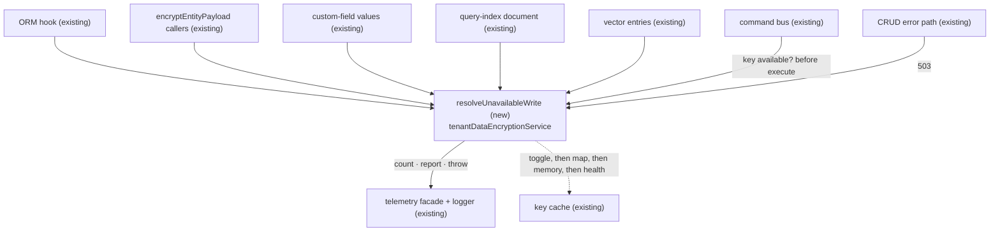

# Fail closed when the key service is unavailable

> **Program:** package A3 of [`2026-11-15-gdpr-ready-deployments-program.md`](2026-11-15-gdpr-ready-deployments-program.md) (tracker open-mercato/open-mercato#8593). Addresses open-mercato/open-mercato#2241 in part; see the acceptance table.
> **Reference only:** `.ai/specs/2026-08-20-production-encryption-fail-closed.md` on `upstream/feat/security-readiness` (PR #5557).
> **Verified at** `main` @ `08dada9624` by reading code; nothing was run.
> **Written autonomously.** No question was put to a person; the choices are listed under Resolved assumptions.

Extends: .ai/specs/2026-11-15-gdpr-ready-deployments-program.md
Extends: .ai/specs/2026-11-16-runtime-encryption-key-guard.md
Extends: .ai/specs/implemented/2026-05-29-integrations-credentials-encryption-fail-closed.md

## 📝 TLDR

When tenant encryption is on and the key service cannot supply a key at the moment of a write, most write paths today store the value in clear and log a throttled warning. An operator who configured encryption gets plaintext rows during every outage and has nothing to alert on. **Proposed (future):** three steps, each shippable alone. First, every such write is counted and reported. Second, a key already in memory is used while it is valid, so a short outage stops touching active tenants. Third, an operator can choose that such a write fails instead of landing in clear.

**Not in this spec:** boot-time configuration (the key-guard spec); the derived-key takeover when Vault is down and a fallback secret is set (program package A4); writes that bypass the encryption layer altogether; a readiness endpoint.

## 📝 Overview

Four callers already fail closed and name the condition the same way: custom-entity documents, API-key session secrets, integration credentials and OAuth grants. This spec brings the general write paths into line with them.

> **Market reference.** HashiCorp's guidance for Transit consumers and Rails' Active Record Encryption both raise on a write when no key can be resolved; neither stores cleartext as a fallback. Adopted: raise, with a typed, stable error. Rejected: wiring the condition into a liveness or readiness probe, as the reference branch did — a key-service outage would then make an orchestrator eject every replica and turn a write outage into a full one.

## 📝 Resolved assumptions (autonomous defaults)

| # | Question | Chosen | Rationale |
|---|---|---|---|
| 1 | Which write paths change? | The five that go through the encryption layer: the ORM hook, direct payload encryption, custom-field values, the query-index document, vector entries | A carve-out among them leaves a plaintext path. Writes that bypass the layer are listed as a known limit. |
| 2 | Does this spec touch the derived-key fallback? | No | The maintainer's note on #2241 says "Do not add a derived-key fallback to hide a failure" and asks for tests with it explicitly disabled. This spec adds none and tests that way. What an *existing* fallback does during an outage is program package A4. |
| 3 | Compatibility route for failing the write | The ordinary protocol: a setting, default unchanged for the release that ships it | ⚠ NEEDS HUMAN CONFIRMATION. The most reversible choice. The maintainer's acceptance list asks for atomic rejection, which reads as "by default". The other legitimate route is the Emergency Security Exception: fail always in production, with no setting at all. |
| 4 | One setting with the key guard, or its own | Its own: `TENANT_DATA_ENCRYPTION_UNAVAILABLE_WRITES` | An operator who opted into strict boot checks must not silently gain write failures in a later release. The two also flip on different gates. |
| 5 | Readiness or health endpoint | None | See the market reference. The reference branch's route was also flagged in review as unauthenticated and disclosing key-service state. |
| 6 | Use a key already in memory while the key service is unhealthy | Yes, for writes and for reads, under either setting | It only ever encrypts where today it would store cleartext, and it is what makes failing tolerable. |
| 7 | Reads with no key at all | Unchanged | Returning ciphertext to a caller is an availability and display problem, not a confidentiality one. |

## 📝 Acceptance list from #2241

The maintainer's comment of 2026-11-04, item by item.

| Item | Status here |
|---|---|
| Reject mapped writes atomically | Met when the setting is `fail`, including the command bus (see Architecture). Not the default — assumption 3 |
| Cover unavailable at start, healthy then unavailable, null key, recovery | Met, by unit tests |
| Distinguish the operator's opt-out | Met: encryption switched off is untouched |
| Preserve null values, system keys, no-provision previews | Met: only a changed, non-null mapped column can fail; system-scoped maps follow the same decision; the preview path is pinned by an existing test |
| No derived fallback to hide a failure | Met: none is added, and tests run with it disabled |
| PostgreSQL and API regressions that inspect stored values, with rollback and a CRM control | Met by database-backed tests; they need a CI change to run (see Integration Coverage) |
| Sanitized, retryable errors | Met: HTTP 503 with a generic body |
| The branch for entities with no encryption policy | Declined: an entity with no map is not protected data, and nothing changes for it |
| Plaintext already written during outages | Addressed by measurement and documentation: the new counter sizes it, and the existing rotation command, run without an old key, encrypts such rows |

## 📝 Problem Statement

Encryption is "unavailable" in two shapes: the key service reports unhealthy, or it is healthy but returns no key for the tenant.

| Write path | Today, when unavailable |
|---|---|
| ORM hook, every mapped column | Plaintext; a warning at most once a minute per process, or only a debug line when the key is simply missing (`packages/shared/src/lib/encryption/subscriber.ts:92-107, 289-294`; `tenantDataEncryptionService.ts:625-628`) |
| Direct payload encryption — access-log inserts, SSO config, agent artifacts, CLI commands | Plaintext, silent (`tenantDataEncryptionService.ts:611-614`) |
| Custom-field values | Plaintext; one warning per tenant, entity and field per outage (`customFieldValues.ts:127-175`) |
| Query-index document | Plaintext, silent (`indexDoc.ts:93-94`) |
| Vector entries | Plaintext, silent (`packages/search/src/vector/services/vector-index.service.ts:174-185`) |
| Custom-entity documents | **Throws** `KMS_UNAVAILABLE` (`customEntityDoc.ts:29-35`) |
| API-key session secret | **Not stored** (`packages/core/src/modules/api_keys/services/apiKeyService.ts:43-60`) |
| Integration credentials | **Throws**, surfaced as HTTP 503 (`packages/core/src/modules/integrations/lib/credentials-service.ts:326-334`) |

- **A key in memory does not help.** Keys are cached for 15 minutes per process, but each write path checks health before it looks in the cache (`subscriber.ts:290`, `customFieldValues.ts:64`, `indexDoc.ts:94`, the vector service at `:174`). Reads are gated the same way (`subscriber.ts:429`).
- **One tenant can open the breaker for all.** A failed call opens the circuit breaker for 30 seconds (`kms.ts:238-283`). A 403 on creating one tenant's key counts as a failure (`kms.ts:316`), so a single tenant that cannot be provisioned repeatedly sends every tenant without a cached key to plaintext.
- **The update hook sees the whole record.** `beforeUpdate` passes the entity, not the change (`subscriber.ts:554-556`). Staff login updates only `lastLoginAt`, but the flush still hands the user's email and name to the hook (`packages/core/src/modules/auth/services/authService.ts:71-72, 113`).
- **The audit entry is written after the command has committed**, on its own flush, and its `command_id` is an encrypted column that is never empty (`packages/shared/src/lib/commands/command-bus.ts:381, 443, 1044-1046`; `packages/core/src/modules/audit_logs/encryption.ts:5-8`).
- **Provisioning failure is quiet.** Tenant setup logs a missing or failed key only in debug mode, whether the call throws, returns nothing or finds the service unhealthy (`packages/core/src/modules/auth/lib/setup-app.ts:394-412`).
- **Nothing is alertable.** The encryption library never calls the error-reporting facade.
- **With a fallback secret, none of this applies.** The fallback service stays healthy and serves a derived key (`kms.ts:46-75`). That is package A4.

## 📝 Proposed Solution

One function decides what to do with a mapped write when encryption is on and no key can be resolved. All five write paths call it.

| Situation | Setting `plaintext` (default) | Setting `fail` |
|---|---|---|
| Key available, or in memory and still valid | Encrypts | Encrypts |
| Encryption switched off | Plaintext, silent | Plaintext, silent |
| No changed, non-null mapped column in the write | Proceeds | Proceeds |
| Key unavailable, a changed non-null mapped column | Plaintext, as today, counted and reported | Throws |

The setting is `TENANT_DATA_ENCRYPTION_UNAVAILABLE_WRITES`. It takes effect only in production, with the key-guard spec's meaning of production; elsewhere behaviour stays as today.

### Design decisions

| Decision | Rationale |
|---|---|
| For an update, look at the changed columns only | Otherwise an update that touches nothing sensitive — a login timestamp — fails, or is falsely reported as plaintext. Unchanged columns are not written. |
| "Non-null", not "non-empty" | The encryption layer already skips only null and undefined. |
| The command bus checks key availability before it runs a command | The audit entry is written after commit. Without the check a command would commit, then fail on its audit row: a 500 after the change is saved, post-commit work skipped, and a retry that duplicates. |
| Reuse the existing error type | `TenantDataEncryptionError` with code `KMS_UNAVAILABLE` is already thrown by custom-entity documents (`aes.ts:13-19`). |
| HTTP 503 with a generic body | Integration credentials already answer that way, and it tells a client the request can be retried. |
| Count every occurrence; report with a throttle | The count, by entity type, is what sizes the plaintext written under the default. The report is what pages someone. |
| Report codes in the facade's `module.reason` shape | `KMS_UNAVAILABLE` does not match it and would be dropped from `error.code` (`packages/shared/src/lib/telemetry/error-code.ts:12`). |
| A 4xx on key creation does not open the breaker | It is one tenant's problem, not an outage. |
| Key-provisioning failure at tenant setup is reported, not fatal | The next write tries again. |

### Alternatives considered

| Alternative | Why rejected |
|---|---|
| Fail always in production, no setting | Recorded as assumption 3: the exception route, for a maintainer to choose. |
| Share the key guard's setting | Recorded as assumption 4. |
| Write the audit entry inside the command's transaction | A larger change to the bus than a check before execution. |
| Exempt audit and access logs, or the index and vector projections | Each would be a plaintext path for the same values. |
| Queue the write and replay it after recovery | A second durable store of the plaintext. |
| A readiness probe | Amplifies a write outage into a full outage. |

### Known limits

- **Writes that bypass the encryption layer are not covered:** `nativeUpdate`, `em.upsert` (it has no hook), query-builder and raw SQL writes. They were never encrypted and this spec does not change that.
- **Projections can go stale.** A web process holding a key commits a row; a worker without one cannot index it. The indexer records the failure and nothing retries, so list and search miss the row until a reindex.
- **The key cache is per process**, and its lifetime runs from when the key was fetched. "Up to 15 minutes" is the best case.
- **A deployment with a fallback secret is unchanged**, whatever the setting.

## 📝 Delta

### Capability: tenant-encryption-availability

#### MODIFIED Requirement: Mapped write when no key is available
When tenant encryption is on and no key can be resolved for a write that changes a non-null encrypted column, the system SHALL count and report the condition, and in production with the setting at `fail` SHALL fail the write without storing the value.

##### Scenario: Fail
- WHEN a production process set to `fail` saves a record with a changed encrypted column while the key service is unreachable and no key is in memory
- THEN the save fails, the API answers 503, and no row is written or changed

##### Scenario: Command
- WHEN a command is submitted in the same situation
- THEN it is refused before it runs, and nothing is committed

##### Scenario: Plaintext
- WHEN the same save happens with the setting at `plaintext`
- THEN the value is stored as today, the counter for that entity type increases, and an error is reported within the throttle window

##### Scenario: Nothing sensitive changed
- WHEN an update changes only columns that are not encrypted, during an outage, under `fail`
- THEN it succeeds and nothing is reported

##### Scenario: Recovery
- WHEN the key service becomes reachable again
- THEN the next save encrypts, with no restart

Frozen by: `packages/shared/src/lib/encryption/__tests__/subscriber.kms-recovery.test.ts`, `packages/shared/src/lib/encryption/__tests__/customFieldValues.plaintext-fallback.test.ts`, and `packages/shared/src/lib/encryption/__tests__/unavailable-write.characterization.test.ts` (to be added for the paths no test pins today)

#### ADDED Requirement: Key in memory during an outage
The system SHALL encrypt and decrypt with a tenant's key held in memory while that key is still valid, whether or not the key service is currently reachable, and only when encryption is switched on.

##### Scenario: Short outage
- WHEN the key service is unreachable and a process fetched a tenant's key five minutes ago
- THEN that process encrypts that tenant's saves and decrypts its reads normally

#### ADDED Requirement: One tenant does not open the breaker
The system SHALL NOT treat a rejected key creation for one tenant as a key-service outage.

##### Scenario: Provisioning refused
- WHEN creating a key for one tenant is refused with a client error
- THEN other tenants' writes are unaffected

#### ADDED Requirement: Provisioning failure is visible
The system SHALL report, at error level and without debug logging, a tenant setup that ends without a key for the tenant, whatever the cause.

##### Scenario: Setup without a key
- WHEN tenant setup cannot obtain or create the tenant's key
- THEN an error is reported and setup continues

## 📝 Architecture

Takeaway: one decision point replaces five separate fallbacks; it looks in memory before it asks about health; and the command bus asks before it commits anything.

### Components

- **`resolveUnavailableWrite`** in `packages/shared/src/lib/encryption/tenantDataEncryptionService.ts`. Given the reason and whether the write changes a non-null mapped column, it returns "proceed in clear" or throws. It increments an unthrottled counter by entity type, and reports through the telemetry runtime at most once per reason per minute per process, with code `encryption.kms_unavailable` or `encryption.dek_unavailable`. When no telemetry backend is configured the runtime is absent, so it also writes an explicit error-level log line.
- **Lookup order.** Each of the five paths, and the read path, resolves in this order: the encryption toggle, the entity's map, the key in memory, then the health check. The four separate health gates move behind the cache lookup.
- **Update hook.** Decides on the change set's columns intersected with the mapped columns.
- **Command bus.** Before `handler.execute`, when the command will be logged and encryption is on, it asks the encryption service whether a key is available for the tenant and applies the same decision.
- **Breaker.** A 4xx response to a key-creation call returns "no key" without opening the breaker.
- **CRUD error path.** Maps the error to HTTP 503 with a generic body, as the credentials route does.
- **Tenant setup.** Reports when it ends without a key, on the throwing, empty and unhealthy branches alike.
- **Policy accessor.** The key-guard's module exports `isTenantEncryptionProductionRuntime()`; that spec is updated to list it.

### What happens under `fail` during an outage

A tenant whose key is in a process's memory is unaffected in that process until the key expires.

| Flow | Effect |
|---|---|
| Staff login | Works: only an unencrypted column changes |
| Portal login | Fails: the session row carries an encrypted IP and user agent |
| Saving a customer, order, message, user | 503 |
| Any command | Refused before it runs |
| Access-log entry for a read | Dropped; the read succeeds (`packages/shared/src/lib/crud/factory.ts:986-1006`) |
| Queue job that writes mapped data | Retried three times; the async strategy keeps the failed job, the local strategy drops it |
| Persistent event subscriber | Follows the queue row above |
| Inline event subscriber | Logged and skipped (`packages/events/src/bus.ts:449-456`) |
| Index and vector projection | Recorded as an indexer error; restored by reindexing |

## 📝 Data Models

None. No entity, table, column or migration. The data-model graph is skipped for that reason.

## 📝 API Contracts

- **Error.** `TenantDataEncryptionError` with `code: 'KMS_UNAVAILABLE'` gains an optional `reason: 'kms-unhealthy' | 'dek-unavailable'`.
- **HTTP.** CRUD and command routes answer 503 with a generic message when the error reaches them.
- **Setting.** `TENANT_DATA_ENCRYPTION_UNAVAILABLE_WRITES` — `plaintext` (default) or `fail`. An unrecognised value falls back to the default and is reported once. Added to both `.env.example` files.
- **Telemetry.** Counter `encryption.unavailable_writes`, labelled by entity type, reason and outcome (`plaintext` or `refused`). Reported error codes `encryption.kms_unavailable` and `encryption.dek_unavailable`. Neither carries a tenant id, a value or key material.

## 📝 Edge Cases & Failure Scenarios

| Case | Behaviour |
|---|---|
| Vault down, fallback secret set | Unchanged: the derived key takes over (A4) |
| Vault healthy, key missing, creation refused | "No key" for that tenant, reason `dek-unavailable`; the breaker stays closed |
| Outage shorter than a key's remaining lifetime | Invisible in processes that hold the key |
| Process restarted during an outage | Its cache is empty; its writes follow the setting |
| Update that changes no encrypted column | Proceeds |
| Create with all encrypted columns null | Proceeds |
| System-scoped map (no tenant) | Same decision, with the system key |
| One-off CLI command with nothing configured | Follows the setting; the key-guard spec only warns at start for a command |
| Local queue strategy under `fail` | A job that exhausts its attempts during an outage is dropped. The operator page says to use the async strategy with `fail` |
| Bulk import mid-outage | Rows already committed stay; the failing row aborts its own transaction |
| Recovery | The breaker goes half-open after its cooldown (30 seconds by default); the next write succeeds |

## 📝 Migration & Backward Compatibility

| Change | Route |
|---|---|
| Mapped write fails when no key is available | Ordinary protocol: opt-in through the setting; the default stays `plaintext` in the release that ships it |
| Key in memory used during an outage, for writes and reads | Behaviour improvement; dated entry |
| A 4xx key creation no longer opens the breaker | Behaviour correction; dated entry |
| `reason` on the error; the counter; the setting; the accessor | Additive |

- **`encryptEntityPayload`** is a stable function whose behaviour changes under `fail`. The dated `BACKWARD_COMPATIBILITY.md` entry follows the wording of "Encrypt Path Rejects Wrong-Key Ciphertext (2026-09-11)": a deliberate trade of availability for integrity.
- **Flipping the default to `fail`** is a tracked release task, separate from the key guard's. Its gates: one minor has shipped the counter and the report; the fallback takeover (A4) has been decided, so `fail` means the same thing with and without a fallback secret; the projection staleness has an operator procedure.
- **If a maintainer chooses the exception route instead**, the setting is not added and production always fails the write. Phases 1 and 2 are unaffected.
- **`UPGRADE_NOTES.md`:** what the setting does; the flows that fail during an outage; that the local queue strategy drops jobs; that a reindex may be needed after an outage; how to find and encrypt rows written in clear during past outages; that module code calling the encryption service directly must let the error propagate.
- **Backports.** None.

## 📋 Phasing

| Phase | Outcome | Behaviour change |
|---|---|---|
| 1 | Characterization tests; one decision function; counting and reporting; breaker correction | Signals where there were none |
| 2 | Memory-first lookup for writes and reads | Encrypts and decrypts through short outages |
| 3 | The `fail` setting; command-bus check; 503 | Only when the operator opts in |

Each phase is its own PR.

## 📋 Implementation Plan

### Phase 1 — One decision point, observable
1. **Characterize.** Add `unavailable-write.characterization.test.ts` pinning today's result for the paths with no test: the ORM hook with a healthy service and no key; an update that changes only an unencrypted column; direct payload encryption; the query-index document; vector entries. Commit it alone, green.
2. Add `resolveUnavailableWrite` returning "proceed in clear" in every case, and route the five call sites through it. No result changes.
3. Make the update hook decide on changed mapped columns. Unit test: a login-style update is neither counted nor reported.
4. Add the counter, the throttled report with `module.reason` codes, and the explicit log line. Raise the missing-key log from debug. Unit tests for the throttle, for the absent-runtime path, and that nothing identifying is emitted.
5. Stop a 4xx key creation from opening the breaker. Report tenant setup that ends without a key on all three branches. Unit tests for each.

### Phase 2 — Memory first
1. Move the four health gates behind the cache lookup, keeping the toggle and the map first. Apply the same order to reads. Unit tests: a key in memory encrypts and decrypts during an outage; an expired one does not; encryption switched off is still plaintext; another tenant's key is never used.
2. Update `subscriber.kms-recovery.test.ts` for the cached case.

### Phase 3 — Fail
1. Add the setting and the production accessor. Under `fail`, throw when the write changes a non-null mapped column. Update the characterization tests and the two existing fallback tests to the new scenarios. Unit tests for every cell of the table per call site, including null values, the preview path, system-scoped maps and encryption switched off.
2. Add the command-bus check before execution. Unit tests: nothing commits; post-commit work is not skipped for a command that proceeds.
3. Map the error to 503 in the CRUD error path.
4. Database-backed tests and TC-ENCRYPTION-OUTAGE-001 to 003.
5. `UPGRADE_NOTES.md`, the dated `BACKWARD_COMPATIBILITY.md` entries, the encryption pages in `apps/docs`, both `.env.example` files.
6. Open the tracking issue for the default flip with its gates.
7. Archive this Delta into `.ai/specs/capabilities/tenant-encryption-availability.md` if that directory has been adopted by then; it does not exist today.

### File manifest

| File | Action |
|---|---|
| `packages/shared/src/lib/encryption/tenantDataEncryptionService.ts` | Modify — decision function, lookup order |
| `packages/shared/src/lib/encryption/{subscriber,customFieldValues,indexDoc,aes,kms}.ts` | Modify |
| `packages/shared/src/lib/encryption/keyPolicy.ts` | Modify — production accessor (file created by the key-guard spec) |
| `packages/search/src/vector/services/vector-index.service.ts` | Modify |
| `packages/shared/src/lib/commands/command-bus.ts` | Modify — check before execute |
| `packages/shared/src/lib/crud/factory.ts` (error path) | Modify — 503 |
| `packages/core/src/modules/auth/lib/setup-app.ts` | Modify — report |
| `packages/shared/src/lib/encryption/__tests__/unavailable-write.characterization.test.ts`, a database-backed test file, updates to existing tests | Create / modify |
| `packages/core/src/modules/entities/__integration__/TC-ENCRYPTION-OUTAGE-00{1..3}.spec.ts` | Create |
| `.github/workflows/ci.yml`, `packages/core/package.json` (test pattern) | Modify — run the database-backed tests |
| `.ai/specs/2026-11-16-runtime-encryption-key-guard.md` | Modify — accessor export |
| `UPGRADE_NOTES.md`, `BACKWARD_COMPATIBILITY.md`, `apps/docs/docs/user-guide/encryption.mdx`, `apps/docs/docs/architecture/data-encryption.mdx`, both `.env.example` files | Modify |

Changing the CI test pattern is a pipeline change; the repository rules ask for a maintainer's agreement.

## 🧪 Integration Coverage

Every write route's behaviour changes under `fail`, but only during an outage, which the running app in the suite cannot be put into. Coverage is therefore in three layers.

**Database-backed tests** (real PostgreSQL, a key service that can be switched healthy, unhealthy and keyless, the derived fallback disabled). These are the stored-value regressions the maintainer asked for:

| Case | Asserts on the stored row |
|---|---|
| CRM person created while healthy | Ciphertext (the control) |
| Same create under `fail`, unhealthy | No row; the transaction rolled back |
| Same create under `plaintext`, unhealthy | Cleartext, and the counter moved |
| Update of an unencrypted column, unhealthy, `fail` | Applied |
| Key in memory, unhealthy | Ciphertext |
| Recovery | Ciphertext again, no restart |
| Command under `fail`, unhealthy | Neither the business row nor an audit row |

The repository runs such tests only for a fixed set of paths today, so the pattern is extended.

**CLI tests against the ephemeral database.** The outage is produced in a child process: production mode, encryption on, a Vault address that refuses connections, a token, and both secret variables set to an empty string. Exit codes are read through `spawnSync`; stored values through a direct query. Each test removes the rows it creates, including the lookup hashes the child writes.

| Test | Covers |
|---|---|
| TC-ENCRYPTION-OUTAGE-001 | Setting `fail`: `mercato auth add-user` exits non-zero and no user row exists |
| TC-ENCRYPTION-OUTAGE-002 | Setting `plaintext`: the command succeeds, the row's encrypted columns hold cleartext, and the output carries the reported condition |
| TC-ENCRYPTION-OUTAGE-003 | Setting `fail`, encryption switched off: the command succeeds and stores cleartext, with no report |

**Unit tests** for what neither can reach: the per-call-site table, the throttle, the projections, the breaker, the 503 mapping.

## 📝 Risks & Impact Review

#### A key-service outage becomes a write outage
- **Scenario**: Under `fail`, Vault is unreachable for an hour; processes without a key in memory cannot save, and portal users cannot log in.
- **Severity**: High
- **Affected area**: every write of mapped data
- **Mitigation**: Opt-in; keys in memory cover short outages; the failing flows are listed for operators; clients get a retryable 503.
- **Residual risk**: By design. The alternative is cleartext in the database.

#### A command commits and then fails
- **Scenario**: The check before execution passes, the key expires from memory during the command, and the audit write fails after commit.
- **Severity**: Medium
- **Affected area**: commands under `fail`
- **Mitigation**: The check and the audit write use the same in-memory key within one request; the window is the length of one command.
- **Residual risk**: A long-running command that outlives the key. It reports, and the missing audit row is detectable.

#### Background work is lost during an outage
- **Scenario**: Jobs that write mapped data exhaust three attempts in a few seconds and, on the local queue strategy, are dropped.
- **Severity**: High
- **Affected area**: queue workers, event side effects
- **Mitigation**: The operator page pairs `fail` with the async strategy, which keeps failed jobs for replay.
- **Residual risk**: Inline event-subscriber side effects are skipped and not replayed, as for any subscriber error today.

#### Search and lists go stale after an outage
- **Scenario**: Rows committed by a process with a key are not indexed by a worker without one.
- **Severity**: Medium
- **Affected area**: `query_index`, vector search
- **Mitigation**: Indexer errors are recorded; the upgrade note and operator page give the reindex step.
- **Residual risk**: Stale results until someone runs it.

#### Deployments with a fallback secret believe they are covered
- **Scenario**: An operator sets `fail`, has Vault and a fallback secret, and a Vault outage still produces rows under a second key.
- **Severity**: High
- **Affected area**: Vault deployments with a fallback
- **Mitigation**: Stated in the TLDR, the known limits and the upgrade note; A4 is a gate on the default flip.
- **Residual risk**: Until A4 lands, `fail` does not protect those deployments from mixed keys.

#### A write path outside the layer stays in clear
- **Scenario**: Code writes a mapped column through `nativeUpdate` or raw SQL.
- **Severity**: Medium
- **Affected area**: completeness
- **Mitigation**: Listed as a known limit; a unit test asserts each of the five paths calls the decision function.
- **Residual risk**: Those writes were never encrypted. Finding them is the encryption-coverage spec's concern (program package B3).

## Final Compliance Report — 2026-11-16

### AGENTS.md Files Reviewed
- `AGENTS.md` (root), `.ai/specs/AGENTS.md` — in full
- `BACKWARD_COMPATIBILITY.md` — protocol, Emergency Security Exception, the 2026-09-11 dated entry
- `packages/core/AGENTS.md` — Encryption section
- Not reviewed: `packages/shared/AGENTS.md`, `packages/search/AGENTS.md`, `packages/telemetry/AGENTS.md`. The reporting design follows what the review found in the telemetry code; the implementer reads the guide.

### Compliance Matrix

| Rule Source | Rule | Status | Notes |
|---|---|---|---|
| root AGENTS.md | Never bypass encryption helpers | Compliant | The change is inside them |
| root AGENTS.md | A catch that records an error must also report it | Compliant | Reporting is Phase 1 |
| root AGENTS.md | Ask before changing public contracts | Needs approval | Assumption 3 |
| root AGENTS.md | Ask before changing pipeline automation | Needs approval | CI test pattern |
| root AGENTS.md | Integration coverage for affected paths | Partly | Write routes change only during an outage the suite cannot produce; covered by database-backed and CLI tests instead |
| packages/core/AGENTS.md → Encryption | Never hand-roll AES or KMS | Compliant | No cryptographic code changes |
| `BACKWARD_COMPATIBILITY.md` | Protocol for a stable function's behaviour | Compliant | Ordinary route; the exception named as the only alternative |

### Internal Consistency Check

| Check | Status | Notes |
|---|---|---|
| Problem table matches the component list | Pass | Five fail-open paths, five call sites, plus bus, breaker, setup |
| Delta scenarios map to tests | Pass | Unit, database-backed or TC for each |
| MODIFIED requirement has characterization tests | Pass | Two existing, one to add |
| Every step leaves the app working | Pass | Phases 1 and 2 never refuse a write |

### Non-Compliant Items
- **Rule**: integration tests for every affected API path. **Gap**: no HTTP-level test can produce the outage. **Recommendation**: accept the three-layer coverage described.

### Verdict
**Approved for implementation of Phases 1 and 2.** Phase 3 waits for a decision on assumption 3.

## Changelog

### 2026-11-16
- Written autonomously with resolved assumptions.
- Revised after independent review: the update hook decides on changed columns, so login no longer trips it; the command bus checks before it runs a command, because the audit row is written after commit; the setting is separated from the key guard's; report codes follow the telemetry facade's shape and every occurrence is counted; memory-first lookup extended to reads and ordered after the toggle; a 4xx key creation no longer opens the breaker; 503 mapping; the #2241 acceptance list is answered item by item; known limits stated.

### Review — 2026-11-16
- **Reviewer**: Agent (fresh context, spec path only), then author revision
- **Security**: Two blast-radius claims were wrong and are corrected
- **Performance**: Counter is unthrottled; report throttled
- **Cache**: Key cache behaviour specified; no application cache involved
- **Commands**: Check added before execution
- **Risks**: Post-commit failure, stale projections added
- **Verdict**: Revised; the revision has not been independently re-read
