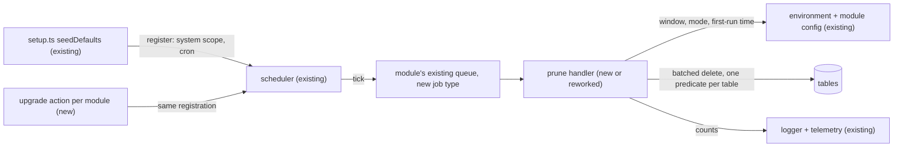

# Operational retention pruners

> **Program:** packages D1 and D2 of [`2026-11-15-gdpr-ready-deployments-program.md`](2026-11-15-gdpr-ready-deployments-program.md) (tracker open-mercato/open-mercato#8593), for core tables. Forms retention and the enterprise tables were split out after review and are listed in the program.
> **Verified at** `main` @ `08dada9624` by reading code, twice (author and independent reviewer); nothing was run.
> **Written autonomously.** No question was put to a person; the choices are listed under Resolved assumptions.
> **Status:** not approved for upstream work. Assumption 8 (edition) needs a maintainer first.

Extends: .ai/specs/2026-11-15-gdpr-ready-deployments-program.md

## 📝 TLDR

Expired staff sessions, password-reset tokens and message access tokens are never removed. A dozen operational tables grow without bound, and several hold personal data in clear: webhook delivery payloads, push-notification payloads, integration logs, indexer error payloads. Three cleanup jobs for some of these exist in the code and nothing runs them. **Proposed (future):** each table gets a scheduled, batched prune with a documented default window. Rows that are merely expired are deleted from the start. Rows that are history an operator may still be reading are only counted for thirty days on each installation, then deleted.

**Not in this spec:** the command audit log, which the maintainers placed in Enterprise (#2980); forms submission retention, which changes user-visible data and gets its own spec; enterprise tables (sudo sessions, MFA challenges, SCIM log), which belong in an enterprise spec; inbound webhook receipts, which stay; data classes pruned through the privacy contract (notifications, onboarding requests, messages, AI conversations); per-tenant policy; access logs, which already rotate.

## 📝 Overview

> **Market reference.** Matomo ships scheduled log deletion with instance-wide defaults an administrator can change, and warns before enabling it that deletion is permanent. Sidekiq and BullMQ bound their own job history by age as well as count. Adopted: instance-level windows with documented defaults, a counting period before history is deleted, an age bound on failed jobs. Rejected: per-site windows — per-tenant policy here is the enterprise engine's job.

## 📝 Resolved assumptions (autonomous defaults)

| # | Question | Chosen | Rationale |
|---|---|---|---|
| 1 | Scope of each prune | One installation-wide predicate per table, no tenant walk | Three of the tables have no tenant column and three allow a null tenant, so a walk would skip rows. The existing AI usage prune works this way. |
| 2 | Where windows are configured | Environment variables read by the worker at run time | A module-registered schedule's payload cannot be edited by an administrator. |
| 3 | What `0` means | That prune is disabled. Unset means the default | The existing AI usage variable treats zero as "use the default" and is left unchanged; the new variables say what they mean in the example file. |
| 4 | When history starts being deleted | Thirty days after the installation's first counting run for that table, unless the operator sets the mode explicitly | ⚠ NEEDS HUMAN CONFIRMATION. A release-relative bridge gives an operator who skips a version no warning at all. |
| 5 | Schedule values | Cron expressions, not intervals | Re-registering an interval schedule resets its next run, and registration runs at every onboarding; on the local poller a daily interval could then never fire. |
| 6 | How existing installations get the schedules | An upgrade action per module, the mechanism the cart sweeps already use | ⚠ NEEDS HUMAN CONFIRMATION. `mercato seed:defaults` would also re-enable schedules an administrator disabled and re-merge default role features. Upgrade actions are manual and behind a flag that is in neither example environment file; nothing detects an installation that never ran them. |
| 7 | Queues | The prune is a job type on the module's existing queue where it has one; a new queue only where the module has none | Every queue takes a database connection against a default budget of twenty. |
| 8 | Edition | OSS | ⚠ NEEDS HUMAN CONFIRMATION, and it blocks upstream work. The umbrella issue itself is labelled `enterprise` with the maintainer's statement that OSS PRs will not be accepted, and #2980's title is "opt-in retention prune". The expired group is security hygiene and the easiest to argue for OSS; the history group is the likeliest to be claimed. |
| 9 | Split | Forms and enterprise tables moved out; expired and history kept together | They share one helper and one registration pattern, and ship as separate phases. |

## 📝 Problem Statement

**Jobs that exist and never run**

| Job | Does | What must change before it can be scheduled |
|---|---|---|
| integrations `log-pruner` | Deletes `integration_logs` older than a window in its payload | Unvalidated window; one unbatched delete; expects an organization scope that a system schedule does not supply |
| portal `cleanupExpiredSessions` | Deletes expired and soft-deleted portal sessions | Unbatched |
| portal `cleanupExpiredTokens` | Deletes expired or used verifications and resets, and accepted or cancelled invitations | Unbatched; removes settled invitations the instant they settle |

**Scheduler facts**

- A module registers a schedule through `schedulerService.register(...)`, an upsert by a deterministic id (`packages/scheduler/src/modules/scheduler/services/schedulerService.ts:11-122`). Any number of tenants registering the same system-scoped schedule produce one row.
- Omitting `isEnabled` preserves an administrator's disable; passing `true` overrides it.
- Each call resets `nextRunAt` to now plus the interval (`:50-54, 93`); the local poller fires only when `nextRunAt` has passed.
- At dispatch the scheduler replaces the payload's scope with the schedule row's; a system-scoped schedule delivers a null tenant and organization.
- A module-registered schedule dispatches when its module owns the queue; `schedulerSafe` only governs schedules an administrator authors.
- Registration runs from `seedDefaults`: at init, at `seed:defaults`, at onboarding. Not on upgrade.

**Unbounded tables in scope.** None has an inbound foreign key.

| Table | Scope column | Personal data in clear | Notes |
|---|---|---|---|
| `sessions` (staff) | None | User id | Rejected after expiry and never extended |
| `password_resets` | None | User id | One-hour lifetime |
| `message_access_tokens` | None | User id | Seven-day lifetime |
| Portal sessions and tokens | Tenant | — | Existing workers |
| `webhook_deliveries` | Organization, tenant | **Payload and response body** | The retry route re-queues a row in any status, so pruning ends manual redelivery of old rows |
| `webhook_ingestions` | Organization, tenant | Encrypted | Statuses include failed and duplicate |
| `push_notification_deliveries` | Tenant | **Payload**, user id | A partial unique index guards idempotency |
| `progress_jobs` | Tenant | `meta`, error stack | Parent and child jobs; referenced softly by sync runs |
| `sync_runs` | Tenant | Error text | Has `deleted_at`; `paused` is not terminal; retry reuses the old run's cursor |
| `integration_logs` | Organization, tenant | **Payload** | Feeds a 30-day analytics view |
| `indexer_error_logs` | Tenant, nullable | **Payload and stack** | Keyed on `occurred_at` |
| `channel_ingest_dead_letters` | Tenant | Encrypted | Operator replay |
| `ai_moderation_flags` | Tenant | User id | An abuse audit record |
| Failed queue jobs | — | Payloads may hold personal data | BullMQ keeps the last 1000 with no age bound |

**Left alone on purpose.** `webhook_inbound_receipts` is the only replay defence for a source that sends no timestamp header: the inbound route treats such a request as fresh (`packages/webhooks/src/modules/webhooks/api/inbound/[endpointId]/route.ts:317-319`) and relies on the unique receipt. Deleting receipts would let a captured request replay.

**House pattern.** The AI token-usage prune deletes with `delete … where id in (select id … limit n)` in batches until a short batch, one statement per transaction, with no tenant filter (`packages/ai-assistant/src/modules/ai_assistant/workers/ai-token-usage-prune.ts:49-73`). Index migrations on large tables use `CREATE INDEX CONCURRENTLY` in a non-transactional migration (`packages/core/src/modules/attachments/migrations/Migration20261009120000_attachments.ts:10-13`).

## 📝 Proposed Solution

Each owning module gets a prune handler and one system-scoped cron schedule. The handler runs one installation-wide predicate per table, deletes in bounded batches, stops after a fixed number of batches, and reports counts.

### Two groups

| Group | Tables | Behaviour |
|---|---|---|
| **Expired** — nothing can read the row | Staff sessions, password resets, message access tokens, portal sessions and tokens | Deleted from the first run |
| **History** — someone may be reading it | Webhook deliveries and ingestions, push deliveries, progress jobs, sync runs, integration logs, indexer errors, dead letters, moderation flags | Counted first; deleted once the installation's counting period has passed |

**History mode.** `OM_RETENTION_HISTORY_MODE` may be `report` or `delete`. When it is unset, the helper records the time of each table's first counting run in module configuration, and begins deleting that table thirty days later. An explicit value overrides this either way.

### Defaults

| Table | Eligible when | Default | Variable |
|---|---|---|---|
| `sessions` | `expires_at` older than | 7 days | `OM_AUTH_SESSION_RETENTION_DAYS` |
| `password_resets` | Expired or used, older than | 1 day | `OM_AUTH_PASSWORD_RESET_RETENTION_DAYS` |
| `message_access_tokens` | Expired, older than | 1 day | `OM_MESSAGES_ACCESS_TOKEN_RETENTION_DAYS` |
| Portal sessions | Expired or soft-deleted | At expiry | — |
| Portal tokens and invitations | Expired or settled, older than | 1 day | `OM_PORTAL_TOKEN_RETENTION_DAYS` |
| `webhook_deliveries` | Status delivered, failed or expired, older than | 30 days | `OM_WEBHOOKS_DELIVERY_RETENTION_DAYS` |
| `webhook_ingestions` | Any status but pending, older than | 30 days | `OM_WEBHOOKS_INGESTION_RETENTION_DAYS` |
| `push_notification_deliveries` | Terminal status, older than | 30 days | `OM_PUSH_DELIVERY_RETENTION_DAYS` |
| `integration_logs` | Older than; never below the analytics window | 30 days | `OM_INTEGRATIONS_LOG_RETENTION_DAYS` |
| `sync_runs` | Completed, failed or cancelled — not running or paused — older than; never below the log window | 90 days | `OM_DATA_SYNC_RUN_RETENTION_DAYS` |
| `progress_jobs` | Finished, older than; children with their parent | 90 days | `OM_PROGRESS_JOB_RETENTION_DAYS` |
| `indexer_error_logs` | `occurred_at` older than | 30 days | `OM_QUERY_INDEX_ERROR_LOG_RETENTION_DAYS` |
| `channel_ingest_dead_letters` | Older than | 90 days | `OM_CHANNELS_DEAD_LETTER_RETENTION_DAYS` |
| `ai_moderation_flags` | Older than | Disabled | `OM_AI_MODERATION_FLAG_RETENTION_DAYS` |
| Failed queue jobs | Older than, in addition to the count cap | 30 days | `OM_QUEUE_FAILED_JOB_RETENTION_DAYS` |

The exact status names are confirmed against each entity in that module's step. Sync runs are hard-deleted. Unset uses the default; `0` disables; a value that is not a non-negative integer uses the default and is reported once.

### Design decisions

| Decision | Rationale |
|---|---|
| Only rows in a terminal state are eligible where a table has retries | A pending delivery, a running or paused sync and an unfinished job must never be removed. |
| Windows are ordered by configuration, not by reading another module's table | Sync runs keep at least as long as their logs, and progress jobs as long as sync runs, by clamping the variables. No module queries another's rows. |
| Batched deletes with a cap per run, and a bounded count | Bounded lock time; the counting run stops at a ceiling instead of scanning a whole backlog every day. |
| Registration omits `isEnabled` | An administrator who disabled a pruner keeps it disabled. |
| Moderation flags default to disabled | They are an abuse audit record; an operator opts in. |
| A day's grace for settled portal invitations | Today's worker would erase them the moment they are accepted. |
| Each run reports through the logger and a counter | Otherwise the counting period tells nobody anything. |

### Alternatives considered

| Alternative | Why rejected |
|---|---|
| Walk tenants | See assumption 1. It also needs a tenant list from another module. |
| One schedule per organization | Thousands of rows and jobs, and every existing organization needs seeding. |
| Register schedules at boot | No module does; every process would write scheduler rows. |
| Inline rotation after writes, as the access log does | Never runs on an idle installation and adds a delete to hot paths. |
| Prune inbound receipts | Removes a replay defence. |
| A release-relative bridge for history | See assumption 4. |

## 📝 Delta

### Capability: operational-retention

#### MODIFIED Requirement: Expired credentials and tokens
The system SHALL delete expired staff sessions, password-reset tokens, message access tokens, and portal sessions and tokens on a schedule.

##### Scenario: Expired staff session
- WHEN a staff session expired more than the configured window ago and the pruner runs
- THEN the row is gone and a session that has not expired is untouched

Frozen by: `packages/core/src/modules/auth/services/__tests__/authService.session-retention.characterization.test.ts`

#### MODIFIED Requirement: Operational history
The system SHALL, on a schedule, count operational history rows older than their window, and SHALL delete them once the installation's counting period for that table has passed or the mode is `delete`.

##### Scenario: Counting period
- WHEN a webhook delivery finished 40 days ago and the table's first counting run was yesterday
- THEN the row stays and the run reports one row eligible

##### Scenario: After the counting period
- WHEN the first counting run was more than thirty days ago
- THEN the row is gone and a delivery still awaiting retry is untouched

##### Scenario: Explicit report mode
- WHEN the mode is set to `report`
- THEN nothing is deleted however long ago counting began

##### Scenario: Disabled
- WHEN a table's window is set to `0`
- THEN nothing is counted or deleted for that table

Frozen by: `packages/webhooks/src/modules/webhooks/__tests__/deliveries.retention.characterization.test.ts`

#### ADDED Requirement: Bounded runs
The system SHALL delete in batches and SHALL stop a run after a fixed number of batches.

##### Scenario: Large backlog
- WHEN more rows are eligible than one run may delete
- THEN the run deletes its limit, reports that more remain, and the next run continues

## 📝 Architecture

Takeaway: the scheduler, the queues and module configuration are used as they are; what is new is one helper, a handler per module, and the registrations.

### Components

- **Shared helper** `packages/shared/src/lib/retention/prune.ts`: parses a window variable; resolves the history mode, reading and recording the first counting run through `moduleConfigService` resolved softly; runs the bounded count; runs the batched delete loop given a table and a predicate; reports. Handlers supply only the table and predicate.
- **Handlers**: `auth` (new queue — the module has no worker), `messages`, `customer_accounts` (two existing workers, batched, with the grace window), `webhooks`, `push_notifications`, `progress`, `integrations` (existing worker reworked: window from the environment, no scope needed), `data_sync`, `query_index`, `communication_channels`, `ai_assistant` (a separate handler from its existing usage prune, which is unchanged).
- **Registration** in each module's `setup.ts` through a function the upgrade action also calls. System-scoped, cron-valued, `isEnabled` omitted, guarded by `hasRegistration('schedulerService')`.
- **Upgrade actions**: one per module, following `cart.register-sweeper-schedules` (`packages/core/src/modules/configs/lib/upgrade-actions.ts:214-226`).
- **Queue**: the async strategy's failed-job option gains an age; its type widens from a number.

### Coupling

| Touchpoint | Mechanism | Absent |
|---|---|---|
| Module → scheduler | `schedulerService` by DI key, checked with `hasRegistration` | No schedule; nothing is pruned |
| Handler → its tables | Its own module's entities | — |
| Helper → module config | `moduleConfigService` by DI key, resolved softly | No first-run time can be recorded: history stays in counting mode unless the mode is set explicitly |
| Module → module | None; window ordering is by configuration | — |

## 📝 Data Models

No new entity. Additive indexes, created concurrently in non-transactional migrations, each with its module snapshot. The generator does not emit these; they are written by hand following the attachments precedent.

| Table | Index |
|---|---|
| `sessions`, `password_resets`, `message_access_tokens`, portal session and token tables | `expires_at` |
| `webhook_deliveries`, `webhook_ingestions` | `created_at` (the existing indexes lead with the organization) |
| `progress_jobs` | `finished_at` |
| `sync_runs`, `integration_logs` | `created_at` |

One module-configuration key per history table holds the time of its first counting run. The data-model graph is omitted: indexes on existing tables.

## 📝 API Contracts

- **Settings** — the variables in the Defaults table and `OM_RETENTION_HISTORY_MODE`. All are added to `apps/mercato/.env.example` and the create-app template's copy, each with its default and the meaning of `0`.
- **Schedules** — one per module, with a stable id derived from a fixed key.
- **Upgrade actions** — one id per module.
- **Telemetry** — counter `retention.rows`, labelled by table and outcome (`eligible`, `deleted`).
- **No route or type is added.** The integrations worker ignores a `retentionDays` in its payload from now on; nothing else enqueues it.

## 📝 Edge Cases & Failure Scenarios

| Case | Behaviour |
|---|---|
| Scheduler module not enabled | Nothing registers; nothing is pruned |
| Existing installation after upgrade | No schedules until the upgrade actions run. Nothing detects this; the upgrade note is the only control |
| An administrator disabled a pruner's schedule | It stays disabled across re-registration |
| A backlog of years | Each run deletes its limit; later runs continue |
| A delivery awaiting retry, a running or paused sync, an unfinished job | Never eligible |
| Manual redelivery of a delivery older than the window | No longer possible; stated in the upgrade note |
| Module configuration service unavailable | History is counted and never deleted, unless the mode is set explicitly |
| Operator sets a sync-run window shorter than the log window | Clamped up to the log window, and reported once |
| Handler fails mid-run | Deleted batches stay deleted; the job retries; the delete is idempotent |
| Local queue strategy | The tick is a job like any other. Failed-job age applies to the async strategy only; the local one keeps no failed jobs |
| BullMQ failed-job age | Trimming happens when a later job fails, so it bounds growth but is not a deadline |

## 📝 Migration & Backward Compatibility

| Change | Route |
|---|---|
| Expired rows are deleted | Hygiene: nothing can read them. Dated entry and upgrade note |
| History rows are deleted after a per-installation counting period | Ordinary protocol, with the bridge measured on the installation instead of the release |
| Portal invitations are kept one day after settling | A grace the existing worker lacks |
| New variables, indexes, schedules, upgrade actions, one queue | Additive |

- **`UPGRADE_NOTES.md`:** enable upgrade actions and run each module's action once; the table of defaults; what the counting period is and how to end or extend it; that manual redelivery of old webhook deliveries ends; that a worker process and the scheduler must be running.
- **Template sync:** both `.env.example` files in the same change.
- **Backports:** none.

## 📋 Phasing

| Phase | Outcome | Deletes anything |
|---|---|---|
| 1 | Shared helper; indexes; characterization tests | No |
| 2 | Expired group | Yes — expired rows |
| 3 | History group | After each installation's counting period |
| 4 | Existing workers reworked and scheduled; failed-job age | As their group |

Each phase is its own PR, and none goes upstream before assumption 8 is answered.

## 📋 Implementation Plan

### Phase 1 — Foundation
1. **Characterize** that an expired staff session and a 40-day-old terminal webhook delivery both persist today. Commit alone.
2. Add the shared helper with unit tests: window parsing including `0` and garbage; mode resolution with an explicit value, with a recorded first run inside and outside thirty days, and with module configuration absent; the bounded count; the batch loop with a cap; an injectable clock.
3. Add the index migrations.

### Phase 2 — Expired group
One step per module — `auth`, `messages`: the handler, the registration function, its call from `setup.ts`, the upgrade action, unit tests with a fake clock, and the integration test for `auth`.

### Phase 3 — History group
One step per module — `webhooks`, `push_notifications`, `progress`, `data_sync`, `query_index`, `communication_channels`, `ai_assistant`. Each step begins by confirming the table's terminal statuses and key column against its entity, then adds the handler as a job type on the module's queue, the registration, the upgrade action, and unit tests for counting, deletion and non-terminal rows.

### Phase 4 — Existing workers and the queue
1. Portal cleanup: batch both workers; add the grace window; register.
2. Integrations: window from the environment, no scope, batched, clamped; register.
3. Failed-job age in the async strategy.
4. `UPGRADE_NOTES.md`, both `.env.example` files, the operations docs page.
5. Archive this Delta into `.ai/specs/capabilities/operational-retention.md` if that directory has been adopted by then; it does not exist today.

### File manifest

| File | Action |
|---|---|
| `packages/shared/src/lib/retention/prune.ts` and tests | Create |
| For each module named: its prune handler, `setup.ts`, a migration where it gains an index | Create / modify |
| `packages/core/src/modules/configs/lib/upgrade-actions.ts` | Modify — one action per module |
| `packages/core/src/modules/{integrations,customer_accounts}/workers/*` | Modify |
| `packages/queue/src/strategies/async.ts` | Modify |
| `packages/core/src/modules/auth/__integration__/TC-AUTH-RETENTION-001.spec.ts`, `packages/webhooks/…/__integration__/TC-WEBHOOKS-RETENTION-001.spec.ts` | Create |
| `apps/mercato/.env.example`, template copy, `UPGRADE_NOTES.md`, docs | Modify |

## 🧪 Integration Coverage

No API route changes; the observable effect is rows disappearing. Two constraints shape what an integration test can show. A system-scoped tick prunes the whole shared test database, so tests use rows backdated far beyond any real row and assert only on their own. And the window and mode come from the worker's environment, which in the suite is the running app's, so a single test cannot exercise two modes.

| Test | Covers |
|---|---|
| TC-AUTH-RETENTION-001 | A staff session backdated beyond the window and a used reset token are deleted by one tick; the test's own live session still authenticates against `POST /api/auth/login`-issued credentials; checked by direct query |
| TC-WEBHOOKS-RETENTION-001 | With the default mode on a fresh database, a terminal delivery backdated beyond the window is counted and still listed by the deliveries API; a row awaiting retry is untouched |

Deletion of history, an explicit mode, a `0` window, clamping, the counting period's end, and each module's terminal predicate are unit-tested against the helper and each handler with an injected clock and configuration. That is a gap against the rule that integration tests cover each affected path; it is stated here and in the compliance report.

## 📝 Risks & Impact Review

#### The work is refused upstream as Enterprise scope
- **Scenario**: Maintainers apply the umbrella's `enterprise` label and their statement on #2980 to operational pruning.
- **Severity**: High
- **Affected area**: the whole spec
- **Mitigation**: Nothing goes upstream before the question is answered; the expired group is separable and the strongest case for OSS.
- **Residual risk**: The history group moves to an enterprise spec, with the helper kept in OSS as its seam.

#### Data an operator still needed is deleted
- **Scenario**: Deliveries or logs older than the default are removed and someone needed them for a dispute.
- **Severity**: High
- **Affected area**: webhook deliveries, integration logs, sync runs
- **Mitigation**: Thirty days of counting on each installation; every window is a variable; `0` disables; an explicit `report` mode never deletes.
- **Residual risk**: An operator who reads neither the note nor the reports.

#### Existing installations stay unpruned
- **Scenario**: Nobody runs the upgrade actions.
- **Severity**: High
- **Affected area**: every upgraded installation
- **Mitigation**: The upgrade note. The doctor cannot detect it: its checks do not read the database.
- **Residual risk**: Undetected. A later doctor check, once that command can read scheduler rows, closes it.

#### A prune or an index build locks a hot table
- **Scenario**: A first run over millions of rows, or creating an index on them.
- **Severity**: Medium
- **Affected area**: webhook deliveries, integration logs
- **Mitigation**: Batches, a cap per run, one statement per transaction; indexes created concurrently.
- **Residual risk**: A concurrent index build that fails leaves an invalid index to drop and retry; the migration notes it.

#### Soft references dangle
- **Scenario**: A sync run points at a progress job that was pruned.
- **Severity**: Low
- **Affected area**: `sync_runs.progress_job_id`, `push_notification_deliveries.notification_id`
- **Mitigation**: Windows are clamped so the referenced row lives at least as long as the referrer.
- **Residual risk**: An operator who sets windows by hand against the clamp's warning.

## Final Compliance Report — 2026-11-16

### AGENTS.md Files Reviewed
- `AGENTS.md` (root), `.ai/specs/AGENTS.md` — in full
- `packages/queue/AGENTS.md` — MUST rules, connection budget
- `packages/create-app/AGENTS.md` — template sync
- Not reviewed: `packages/core/AGENTS.md` → Upgrade Actions and Module Config beyond what the research cites, and the module guides. Each module step reads its own.

### Compliance Matrix

| Rule Source | Rule | Status | Notes |
|---|---|---|---|
| root AGENTS.md | Background jobs via the worker contract | Compliant | Queue workers and the scheduler only |
| root AGENTS.md | Never skip tenant scoping | Deviation, stated | Pruning is installation-wide by design: it removes rows by age regardless of tenant, as the existing AI usage prune does. No tenant's data is exposed to another |
| root AGENTS.md | Ask before touching multiple modules | Needs approval | Eleven modules |
| root AGENTS.md | Mirror env vars into the template | Compliant | Named |
| root AGENTS.md | Migration workflow | Deviation, stated | Concurrent index migrations are hand-written, following an existing precedent |
| root AGENTS.md | Integration coverage for affected paths | Partly | Two integration tests; the rest unit-tested for the reasons given |
| packages/queue/AGENTS.md | Idempotent workers; connection budget | Compliant | Deletes are idempotent; one new queue |
| `.ai/specs/AGENTS.md` | No enterprise-only scope in the OSS directory | Compliant | Enterprise tables were moved out |
| `BACKWARD_COMPATIBILITY.md` | Protocol for behaviour changes | Compliant | Counting period before deletion |

### Internal Consistency Check

| Check | Status | Notes |
|---|---|---|
| Problem table matches the defaults table | Pass | Every in-scope table has a row; receipts are named as excluded |
| Delta scenarios map to tests | Pass | TC or unit test for each |
| MODIFIED requirements have characterization tests | Pass | Phase 1 step 1 |
| Every step leaves the app working | Pass | Indexes and helper first; each handler is independent |

### Non-Compliant Items
- **Rule**: integration tests for each affected path. **Gap**: nine modules are unit-tested only. **Recommendation**: accept, or add a per-module test once the suite can run a worker with its own environment.

### Verdict
**Not approved for upstream work** until assumption 8 is answered. The design is ready for a maintainer's review.

## Changelog

### 2026-11-16
- Written autonomously with resolved assumptions.
- Revised after independent review: inbound webhook receipts removed from pruning because they are a replay defence; tenant walk replaced by one installation-wide predicate per table, since several tables have no tenant column; schedules use cron values because re-registration resets an interval; existing installations use upgrade actions instead of `seed:defaults`, which has side effects; the counting period is measured per installation; terminal states and window ordering specified; forms retention and enterprise tables split out; queue count reduced to one new queue; integration coverage stated honestly; the edition risk added and made a gate.

### Review — 2026-11-16
- **Reviewer**: Agent (fresh context, spec path only), then author revision
- **Security**: One prune would have removed a replay defence; removed
- **Performance**: Bounded count and delete; concurrent indexes
- **Cache**: N/A
- **Commands**: N/A
- **Risks**: Edition and undetected-unpruned risks added
- **Verdict**: Revised; the revision has not been independently re-read
