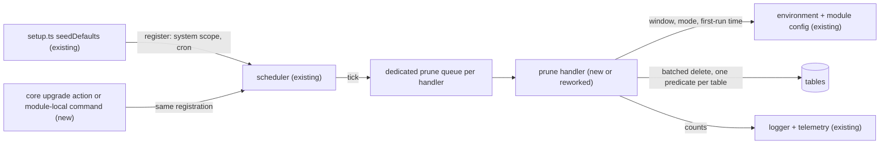

# Operational retention pruners

> **Program:** packages D1 and D2 of [`2026-11-15-gdpr-ready-deployments-program.md`](2026-11-15-gdpr-ready-deployments-program.md) (tracker open-mercato/open-mercato#8593), for core tables. Forms retention and the enterprise tables were split out after review and are listed in the program.
> **Code baseline checked for this revision:** read-only snapshot `9e09023483`; specifications only, no runtime tests run.
> **Written autonomously.** No question was put to a person; the choices are listed under Resolved assumptions.
> **Status:** not approved for upstream work. Assumption 8 (edition) needs a maintainer first.

Extends: .ai/specs/2026-11-15-gdpr-ready-deployments-program.md

**Delivery dependencies:** history Phase 3 and its opt-in minor require Phase 1 of `2026-11-16-privacy-data-class-contract.md` (R3-2 — The registry carries the whole `privacy.ts` default export) and Phase 3 of `2026-11-16-privacy-doctor-cli.md` (DEC-I — The doctor's extension point). The default flip additionally requires R3-4 — An opt-in database tier for the doctor, that spec's Phase 5 check `pruners.unscheduled`, and its scheduler-owned count service. Forms has an independent mode and release gate. DEC-H — The counting-period bridge governs operational history; B6's failed-job age bridge is separate.

## 📝 TLDR

Expired staff sessions, password-reset tokens and message access tokens are never removed. A dozen operational tables grow without bound, and several hold personal data in clear: webhook delivery payloads, push-notification payloads, integration logs, indexer error payloads. Three cleanup jobs for some of these exist in the code and nothing runs them. **Proposed (future):** each table gets a scheduled, batched prune with a documented default window. Rows that are merely expired are deleted from the start. Rows that are history an operator may still be reading are only counted, unless the operator opts in to deleting them, for one minor; from the next minor they are deleted by default, after thirty days of counting on each installation.

**Not in this spec:** age policies for command audit history, which the maintainers placed in Enterprise (#2980), while C4 owns the OSS strip routine under DEC-B — The audit-history strip routine; forms submission retention, which changes user-visible data and gets its own spec; enterprise tables (sudo sessions, MFA challenges, SCIM log), which belong in an enterprise spec; inbound webhook receipts, which stay; notification, assistant-conversation and unreferenced chat-draft record sets owned by [`2026-11-16-privacy-record-retention.md`](2026-11-16-privacy-record-retention.md); onboarding-request cleanup owned by [`2026-11-16-privacy-coverage-people-ops.md`](2026-11-16-privacy-coverage-people-ops.md), “Unfinished signups”; message-specific retention and clearing owned by [`2026-11-16-privacy-coverage-communication.md`](2026-11-16-privacy-coverage-communication.md); per-tenant policy; access logs, which already rotate; failed queue jobs, whose age bound — its one setting, its default and the timed cleanup that runs for every async queue — is owned by [`2026-11-16-queue-payload-minimization.md`](2026-11-16-queue-payload-minimization.md) (package B6).

## 📝 Overview

> **Market reference.** Matomo ships scheduled log deletion with instance-wide defaults an administrator can change, and warns before enabling it that deletion is permanent. Sidekiq and BullMQ bound their own job history by age as well as count. Adopted: instance-level windows with documented defaults; history deletion opt-in for one minor, then a counting period on each installation before it starts. The age bound on failed jobs is adopted by the queue-payload spec, not here. Rejected: per-site windows — per-tenant policy here is the enterprise engine's job.

## 📝 Resolved assumptions (autonomous defaults)

| # | Question | Chosen | Rationale |
|---|---|---|---|
| 1 | Scope of each prune | One installation-wide predicate per table, no tenant walk | Six tables have no tenant column: staff sessions/resets, message access tokens, portal sessions, portal email verifications and portal resets; only `indexer_error_logs` among the other listed tables has a nullable tenant, so a walk would skip rows. The existing AI usage prune works this way. |
| 2 | Where windows are configured | Environment variables read by the worker at run time | A module-registered schedule's payload cannot be edited by an administrator. |
| 3 | What `0` means | That prune is disabled. Unset means the default | The existing AI usage variable treats zero as "use the default" and is left unchanged; the new variables say what they mean in the example file. |
| 4 | When history starts being deleted | Opt-in for one minor: with `OM_RETENTION_HISTORY_MODE` unset, history is only counted, and a warning at start and in `doctor` names the next minor's default. From the next minor, unset means delete, thirty days after the installation's first counting run for that table. An explicit mode overrides either way | The program's ordinary protocol: an explicit setting for one minor with a warning, then the default changes and `report` stays as the opt-out. The per-installation count is kept behind the flip, because an operator who skips the opt-in minor would otherwise get no warning at all. Deleting expired rows is not bridged: nothing can read them. |
| 5 | Schedule values | Cron expressions, not intervals | Re-registering an interval schedule resets its next run, and registration runs at every onboarding; on the local poller a daily interval could then never fire. |
| 6 | How existing installations get the schedules | Core modules use their own upgrade actions, following cart; `webhooks` and `ai_assistant` use module-local registration commands | ⚠ NEEDS HUMAN CONFIRMATION. `mercato seed:defaults` would also re-enable schedules an administrator disabled and re-merge default role features. Registration is manual on upgrades; `pruners.unscheduled` in `privacy doctor --database` detects missing or disabled schedules. The flip is gated on that check shipping. Default: keep manual registration; fallback: defer the flip if diagnostics are unavailable. |
| 7 | Queues | Every prune has a dedicated queue; reuse only the three existing cleanup-only queues, never a delivery queue | Nine new queues at concurrency 1 add nine to peak demand; the queue inventory and deployment gate below count every queue, including the three reused ones. |
| 8 | Edition | OSS | ⚠ NEEDS HUMAN CONFIRMATION, and it blocks upstream work. The umbrella issue itself is labelled `enterprise` with the maintainer's statement that OSS PRs will not be accepted, and #2980's title is "opt-in retention prune". The expired group is security hygiene and the easiest to argue for OSS; the history group is the likeliest to be claimed. |
| 9 | Split | Forms and enterprise tables moved out; expired and history kept together | They share one helper and one registration pattern, and ship as separate phases. |

## 📝 Problem Statement

**Jobs that exist and never run**

| Job | Does | What must change before it can be scheduled |
|---|---|---|
| integrations `log-pruner` | Deletes `integration_logs` older than a window in its payload | Unvalidated window; one unbatched delete; expects an organization scope that a system schedule does not supply |
| portal `cleanupExpiredSessions` | Deletes expired and soft-deleted portal sessions | Unbatched |
| portal `cleanupExpiredTokens` | Deletes expired or used verifications and resets, and accepted or cancelled invitations | Unbatched; removes settled invitations the instant they settle |

**Scheduler facts**

- A module registers a schedule through `schedulerService.register(...)`, an upsert by a deterministic id (`packages/scheduler/src/modules/scheduler/services/schedulerService.ts:11-122`). Any number of tenants registering the same system-scoped schedule produce one row.
- Omitting `isEnabled` preserves an administrator's disable; passing `true` overrides it.
- Each call resets `nextRunAt` to now plus the interval (`:50-54, 93`); the local poller fires only when `nextRunAt` has passed.
- At dispatch the scheduler replaces the payload's scope with the schedule row's; a system-scoped schedule delivers a null tenant and organization.
- A module-registered schedule dispatches when its module owns the queue; `schedulerSafe` only governs schedules an administrator authors.
- Registration runs from `seedDefaults`: at init, at `seed:defaults`, at onboarding. Not on upgrade.

**Unbounded tables in scope.** None has an inbound foreign key.

| Table | Scope column | Personal data in clear | Notes |
|---|---|---|---|
| `sessions` (staff) | None | User id | Rejected after expiry and never extended |
| `password_resets` | None | User id | One-hour lifetime |
| `message_access_tokens` | None | User id | Seven-day lifetime |
| Portal sessions, email verifications and password resets | No tenant column; user FK only | User id | Existing installation-wide workers |
| Portal invitations | Organization, tenant | Invitation contact data | Existing token cleanup worker |
| `webhook_deliveries` | Organization, tenant | **Payload and response body** | The retry route re-queues a row in any status, so pruning ends manual redelivery of old rows |
| `webhook_ingestions` | Organization, tenant | Encrypted | Statuses include failed and duplicate |
| `push_notification_deliveries` | Organization, tenant | **Payload**, user id | A partial unique index guards idempotency |
| `progress_jobs` | Organization, tenant | `meta`, error stack | Parent and child jobs; referenced softly by sync runs |
| `sync_runs` | Organization, tenant | Error text | Has `deleted_at`; `paused` is not terminal; retry reuses the old run's cursor |
| `integration_logs` | Organization, tenant | **Payload** | Feeds a 30-day analytics view |
| `indexer_error_logs` | Organization, tenant (nullable) | **Payload and stack** | Keyed on `occurred_at` |
| `channel_ingest_dead_letters` | Organization, tenant | Encrypted | Operator replay |
| `ai_moderation_flags` | Organization, tenant | User id | An abuse audit record |

**Owned elsewhere.** Failed queue jobs: BullMQ keeps the last 1000 with no age bound, and their payloads may hold personal data. The queue-payload spec (package B6), “Part 1 — Bounds and compatible id jobs”, owns `QUEUE_FAILED_JOB_RETENTION_HOURS`: unset means `0` in bridge minor N, then `168` in N+1; explicit `0` preserves count-only retention. With a positive effective age, every async worker runs cleanup at start and hourly. The independent `mercato queue prune-failed (--queue <name> | --all) [--apply]` reaches quiet and retired queues without starting their handlers; it reports by default. Operators whose workers may stop run `mercato queue prune-failed --all --apply` at least hourly from their operations scheduler, including for quiet or retired queues. No worker or operational cleanup pass means no wall-clock age bound; unacknowledged abandon reports may also keep jobs indefinitely. DEC-H does not govern that B6 bridge. This spec adds no queue setting and does not touch `packages/queue`.

**Left alone on purpose.** `webhook_inbound_receipts` is the only replay defence for a source that sends no timestamp header: the inbound route treats such a request as fresh (`packages/webhooks/src/modules/webhooks/api/inbound/[endpointId]/route.ts:317-319`) and relies on the unique receipt. Deleting receipts would let a captured request replay.

**House pattern.** The AI token-usage prune deletes with `delete … where id in (select id … limit n)` in batches until a short batch, one statement per transaction, with no tenant filter (`packages/ai-assistant/src/modules/ai_assistant/workers/ai-token-usage-prune.ts:49-73`). Index migrations on large tables use `CREATE INDEX CONCURRENTLY` in a non-transactional migration (`packages/core/src/modules/attachments/migrations/Migration20261009120000_attachments.ts:10-13`).

## 📝 Proposed Solution

Each handler has its own cleanup-only queue and system-scoped cron schedule. It runs installation-wide predicates over its own tables. Deletes use batches of at most 100 rows, one transaction per batch, and a 30-second run budget with a database statement timeout. A run that exhausts its budget enqueues one coalesced continuation immediately on the same queue, until a short batch shows it has caught up. There is no per-day batch ceiling. A fixed cutoff is carried between continuations; a fresh cron run computes a new one. Three consecutive exhausted runs log a warning with counts and backlog status. Counts are bounded at 10,000 matches and report `atLeast: true` when truncated; they never claim to be an exact total.

### Two groups

| Group | Tables | Behaviour |
|---|---|---|
| **Expired** — nothing can read the row | Staff sessions, password resets, message access tokens, portal sessions and tokens | Deleted from the first run |
| **History** — someone may be reading it | Webhook deliveries and ingestions, push deliveries, progress jobs, sync runs, integration logs, indexer errors, dead letters, moderation flags | Counted. Deleted only where the operator opts in during the opt-in minor; by default from the next minor, once the installation's counting period has passed |

**History mode.** `OM_RETENTION_HISTORY_MODE` may be `report` or `delete`. The helper always records the time of each table's first counting run in module configuration. An explicit value overrides the default either way.

| Release | Unset means | Warning |
|---|---|---|
| The opt-in minor — the one that ships the history handlers | `report`: history is counted, never deleted | Logged once per process at the start of its first prune run, and reported by `doctor`: history deletion is off; from the next minor an unset mode deletes history after the counting period |
| The next minor | `delete`, beginning thirty days after the table's first counting run | With the mode unset, `doctor` remains `warning`; during counting each process warns once per table and counting start, naming the table and the UTC deletion-start date |

The flip changes the operational caller's default as a tracked task in the minor after Phases 3 and 4 ship, with its own upgrade note. It cannot ship before the database-tier `pruners.unscheduled` check; it does not flip forms' independent setting. Expired rows are deleted from the first run in both releases.

### Defaults

| Table | Eligible when and age anchor | Default | Variable |
|---|---|---|---|
| `sessions` | `expires_at` older than | 7 days | `OM_AUTH_SESSION_RETENTION_DAYS` |
| `password_resets` | Expired or used; age from `used_at` if used, otherwise `expires_at` | 1 day | `OM_AUTH_PASSWORD_RESET_RETENTION_DAYS` |
| `message_access_tokens` | Expired; age from `expires_at` | 1 day | `OM_MESSAGES_ACCESS_TOKEN_RETENTION_DAYS` |
| Portal sessions | Expired or soft-deleted; immediate eligibility, as today | At expiry | — |
| Portal tokens and invitations | Expired or settled; age from `used_at`, `accepted_at` or `cancelled_at` when present, otherwise `expires_at` | 1 day | `OM_PORTAL_TOKEN_RETENTION_DAYS` |
| `webhook_deliveries` | `delivered`, `failed` or `expired`, with no `next_retry_at`; age from `greatest(created_at, updated_at, enqueued_at, delivered_at, last_attempt_at)` | 30 days | `OM_WEBHOOKS_DELIVERY_RETENTION_DAYS` |
| `webhook_ingestions` | `status in ('processed','failed','duplicate')`; age from `greatest(created_at, updated_at, coalesce(processed_at, created_at))`; never `received` or `processing` | 30 days | `OM_WEBHOOKS_INGESTION_RETENTION_DAYS` |
| `push_notification_deliveries` | `sent`, `failed`, `skipped` or `expired`, with no `next_retry_at`; age from `greatest(created_at, updated_at, sent_at)` | 30 days | `OM_PUSH_DELIVERY_RETENTION_DAYS` |
| `integration_logs` | `created_at` older than; system tick never below the 30-day analytics window (legacy scoped payload unchanged) | 30 days | `OM_INTEGRATIONS_LOG_RETENTION_DAYS` |
| `sync_runs` | `completed`, `failed` or `cancelled`, including soft-deleted rows; age from `updated_at`; never below the log window | 90 days | `OM_DATA_SYNC_RUN_RETENTION_DAYS` |
| `progress_jobs` | `completed`, `failed` or `cancelled`, with non-null `finished_at` older than cutoff; a parent and all its children must each qualify before that family is removed | 90 days | `OM_PROGRESS_JOB_RETENTION_DAYS` |
| `indexer_error_logs` | `occurred_at` older than | 30 days | `OM_QUERY_INDEX_ERROR_LOG_RETENTION_DAYS` |
| `channel_ingest_dead_letters` | `created_at` older than | 90 days | `OM_CHANNELS_DEAD_LETTER_RETENTION_DAYS` |
| `ai_moderation_flags` | `created_at` older than | Disabled | `OM_AI_MODERATION_FLAG_RETENTION_DAYS` |

These status names and timestamp columns were checked against the owning entities and the inbound status union in `packages/shared/src/lib/webhooks/inbound-types.ts`. Each batch repeats the terminal predicate and cutoff in the delete statement, so a concurrently retried or completed row is not deleted using stale selection. PostgreSQL `greatest` ignores nullable arguments; `created_at` remains the fallback. Sync runs are hard-deleted. Unset uses the default; `0` disables; a value that is not a non-negative integer uses the default and is reported once.

### Design decisions

| Decision | Rationale |
|---|---|
| Only rows in a terminal state are eligible where a table has retries | A pending delivery, a running or paused sync and an unfinished job must never be removed. |
| Windows are ordered by configuration, not by reading another module's table | Clamp the sync-run window to at least the integration-log window, and the progress-job window to at least the sync-run window. This orders configured durations only; different age anchors and batches can still leave soft references dangling. No module queries another's rows. |
| Batched deletes with a time budget and coalesced continuations; bounded counts | Bounded lock time without a daily throughput ceiling; a truncated count is a lower bound. |
| Registration omits `isEnabled` | An administrator who disabled a pruner keeps it disabled. |
| Moderation flags default to disabled | They are an abuse audit record; an operator opts in. |
| A day's grace for settled portal invitations | Today's worker would erase them the moment they are accepted. |
| Each run reports through the logger and a counter | Scheduled installation-wide hygiene has no subject decision or actor. It deliberately creates no `privacy.retention_run` action-log entry, whose tenant attribution would be invented; deployments requiring durable evidence retain structured logs externally. Each report carries table, effective window, cutoff, requested/effective mode, counts, truncation, continuation and errors, without row ids or payloads. |

### Alternatives considered

| Alternative | Why rejected |
|---|---|
| Walk tenants | See assumption 1. It also needs a tenant list from another module. |
| One schedule per organization | Thousands of rows and jobs, and every existing organization needs seeding. |
| Register schedules at boot | No module does; every process would write scheduler rows. |
| Inline rotation after writes, as the access log does | Never runs on an idle installation and adds a delete to hot paths. |
| Prune inbound receipts | Removes a replay defence. |
| A release-relative bridge alone, without the per-installation count | An operator who skips the opt-in minor would get deletion with no warning; see assumption 4. |
| Deleting history by default from the first release, after a per-installation count | Contradicts the program's ordinary protocol, which this package follows. |
| A failed-job age in this spec | The queue-payload spec owns it, with one setting, one default and a timer that runs for every async queue. |

## 📝 Delta

### Capability: operational-retention

#### MODIFIED Requirement: Expired credentials and tokens
The system SHALL delete expired staff sessions, password-reset tokens, message access tokens, and portal sessions and tokens on a schedule.

##### Scenario: Expired staff session
- WHEN a staff session expired more than the configured window ago and the pruner runs
- THEN the row is gone and a session that has not expired is untouched

Frozen by: `packages/core/src/modules/auth/services/__tests__/authService.session-retention.characterization.test.ts`

#### MODIFIED Requirement: Operational history
The system SHALL, on a schedule, count operational history rows older than their window. It SHALL delete them when the mode is `delete`, and, from the minor after the opt-in minor, when the mode is unset and the installation's counting period for that table has passed. In the opt-in minor it SHALL NOT delete them while the mode is unset.

##### Scenario: Opt-in minor
- WHEN the mode is unset in the opt-in minor and the table's first counting run was sixty days ago
- THEN no history row is deleted, the run reports the eligible rows, the process has logged the warning once, and `doctor` names the next minor's default

##### Scenario: Opting in
- WHEN the mode is `delete` in the opt-in minor
- THEN a terminal webhook delivery 40 days old is gone and a delivery still awaiting retry is untouched

##### Scenario: Counting period
- WHEN, from the next minor on, the mode is unset, a webhook delivery finished 40 days ago and the table's first counting run was yesterday
- THEN the row stays, the run reports one row eligible, and a once-per-process warning names the table and deletion-start date

##### Scenario: After the counting period
- WHEN, from the next minor on, the mode is unset and the first counting run was more than thirty days ago
- THEN the row is gone and a delivery still awaiting retry is untouched

##### Scenario: Explicit report mode
- WHEN the mode is set to `report`
- THEN nothing is deleted however long ago counting began

##### Scenario: Disabled
- WHEN a table's window is set to `0`
- THEN nothing is counted or deleted for that table

Frozen by: `packages/webhooks/src/modules/webhooks/__tests__/deliveries.retention.characterization.test.ts`

#### ADDED Requirement: Bounded runs
The system SHALL delete in batches under a time budget and SHALL enqueue a coalesced continuation immediately while eligible rows remain.

##### Scenario: Large backlog
- WHEN more rows are eligible than one run may delete
- THEN the run reports the spent budget and enqueues one immediate continuation; repeated exhaustion warns after three runs

## 📝 Architecture



Takeaway: the scheduler, the queues and module configuration are used as they are; what is new is one helper, a handler per module, and the registrations.

### Components

- **Shared helper** `packages/shared/src/lib/retention/prune.ts` exports `parseRetentionWindow`, `resolveRetentionMode`, `recordRetentionFirstCount`, `reportRetentionRun` and `pruneBatches`. `resolveRetentionMode` is pure: it takes the setting name, configured value, caller's release default, clock and first-count time. `recordRetentionFirstCount` accepts a storage callback; shared never imports core. The configs service adds an atomic insert-if-absent operation with cache invalidation; concurrent first runs use the earliest persisted timestamp. `pruneBatches` accepts an entity manager, table, parameterized predicate, cutoff (including fractional days), batch size and time budget, and returns `{ deleted, more }`. It has no mode or configuration dependency. Forms uses mode parsing and reporting with its own durable per-form notice state; access logs use only the delete loop.
- **Effective windows:** `packages/shared/src/lib/retention/windows.ts` owns `getOperationalRetentionWindows()`, specified below. Every new system-tick handler, both portal handlers and the integrations system path use its result for their effective duration and disabled state. It uses `parseRetentionWindow` from `prune.ts`; no module, register collector or doctor check carries a copied parser or defaults. The existing integrations scoped payload keeps its separate legacy duration contract.
- **Doctor checks:** `packages/core/src/modules/configs/privacy.ts` exports `{ dataClasses: [], doctorChecks: [...] }` under R3-2 — The registry carries the whole `privacy.ts` default export and DEC-I — The doctor's extension point, preserving any other owners' members/checks. `configs.retention_history_mode_default` reads the same shared mode parser and effective-window accessor as the pruners, and warns while the mode is unset under either default (including the next minor's default and the counting-period rule). It never reads per-table dates or scheduler rows in the default tier. `pruners.unscheduled` belongs to the doctor spec's Phase 5 and is declared only in scheduler's `privacy.ts`, using that spec's sole check-id prefix exception, `needs: 'database'` and `countServices['scheduler.retention_schedules']`. The ordinary `{ em }` factory returns exactly `PrivacyDoctorCountingService`; the binding and counters below supply the enabled-handler manifest. Only scheduler counts its rows, returning aggregates without ids or payloads. Deduplicated system expectations are counted once with `tenantId: null` even with no tenants; tenant expectations retain their exact non-null tenant predicate. Service keys keep the scheduler prefix. With scheduler absent, configuration check `scheduler.module_absent` warns and no database assessment is claimed. Configuration-only doctor never inspects schedule health or instantiates a counting service.
- **Handlers and queues:** all metadata declares concurrency 1. The module owns its tables and its queue, and no delivery handler receives a retention tick.

| Module | Queue | New queue |
|---|---|---|
| `auth` | `auth-retention-prune` | Yes |
| `messages` | `messages-access-token-prune` | Yes |
| `customer_accounts` sessions | `customer-accounts-cleanup-sessions` | No |
| `customer_accounts` tokens | `customer-accounts-cleanup-tokens` | No |
| `webhooks` | `webhooks-retention-prune` | Yes |
| `push_notifications` | `push-notifications-retention-prune` | Yes |
| `progress` | `progress-retention-prune` | Yes |
| `integrations` | `integration-log-pruner` | No |
| `data_sync` | `data-sync-retention-prune` | Yes |
| `query_index` | `query-index-error-retention-prune` | Yes |
| `communication_channels` | `communication-channels-dead-letter-prune` | Yes |
| `ai_assistant` | `ai-assistant-moderation-prune` | Yes |

These are twelve cleanup queues, nine new and three reused, contributing twelve concurrent database jobs when all are enabled, nine more than today. Before shipping, inventory every other enabled queue and verify `Σ concurrency ≤ worker connection budget` and `web_pool_max + worker_pool_max + scheduler/overhead ≤ Postgres max_connections`. A default budget of twenty is not evidence that the whole installation fits. If queue floors exceed it, use existing per-queue worker processes with budgeted groups or provision headroom before enabling them; document the resolved ceiling for local and async strategies.

- **Registration:** one schedule per queue above, through a module-local function called from `setup.ts.seedDefaults`. System scope, daily cron, `isEnabled` omitted, guarded by `hasRegistration('schedulerService')`.
- **Upgrade actions:** only core modules add to `packages/core/src/modules/configs/lib/upgrade-actions.ts`, following `cart.register-sweeper-schedules`. Core does not import `@open-mercato/webhooks` or `@open-mercato/ai-assistant`. Those packages expose `mercato webhooks register-retention-schedule` and `mercato ai_assistant register-retention-schedule` in their own `cli.ts`; the upgrade note names both. No module-contributed upgrade-action registry is added.

### Enabled-handler schedule expectations

Each owner declares optional `retentionSchedules` on its `privacy.ts` default object under R3-2. Each entry is `{ key: string, queue: string, scopeType: 'system' | 'tenant' }`. The module id is stamped by the collector, never supplied by the entry. Definitions are side-effect-free constants imported by that same module's setup/upgrade registration function; registration and diagnostics must not keep separate lists. `getRetentionScheduleDefinitions(modules)` in shared `modules/registry.ts` validates non-empty keys/queues, unique keys and the scope discriminant, preserving the other default members. It includes only enabled modules with that declared cleanup handler, and neither resolves services nor imports a worker at collection time. Window zero/report mode does not remove an expected schedule: it describes an enabled handler whose age rule or deletion may be disabled separately.

Use the cart module's existing deterministic UUID algorithm: SHA-256 of the UTF-8 key, first 32 lower-case hex digits, grouped `8-4-4-4-12`. These are the exact new system keys; registration passes their derived UUIDs, `scopeType: 'system'`, `tenantId: null` and `organizationId: null`.

| Module | Exact key | Queue | Exact schedule id |
|---|---|---|---|
| `auth` | `auth:retention-prune:system` | `auth-retention-prune` | `4ede942e-12af-f3fe-420f-d9e4a49c276e` |
| `messages` | `messages:access-token-prune:system` | `messages-access-token-prune` | `e593df23-0d49-afa8-4b58-8901c97b12da` |
| `customer_accounts` | `customer_accounts:cleanup-sessions:system` | `customer-accounts-cleanup-sessions` | `14ca45b7-6bad-255f-5e18-a50ce4f88224` |
| `customer_accounts` | `customer_accounts:cleanup-tokens:system` | `customer-accounts-cleanup-tokens` | `c517c800-d3ce-7a0d-5840-7896d1f02e85` |
| `webhooks` | `webhooks:retention-prune:system` | `webhooks-retention-prune` | `e55f7b54-be95-9b4d-c8b1-e9dcd5e30de3` |
| `push_notifications` | `push_notifications:retention-prune:system` | `push-notifications-retention-prune` | `c7f815d3-6a30-83bb-8d8d-3d21e1ab6406` |
| `progress` | `progress:retention-prune:system` | `progress-retention-prune` | `5c6ee757-7462-cc7f-7773-c1fd9ea402c2` |
| `integrations` | `integrations:log-pruner:system` | `integration-log-pruner` | `f2321282-aaf4-3865-e8fa-3f2d295f7d18` |
| `data_sync` | `data_sync:retention-prune:system` | `data-sync-retention-prune` | `796e9824-cbe7-1e92-4f1f-b38927e895f4` |
| `query_index` | `query_index:error-retention-prune:system` | `query-index-error-retention-prune` | `833da3f4-5fad-53bd-53fd-5c9c0f2a8ab9` |
| `communication_channels` | `communication_channels:dead-letter-prune:system` | `communication-channels-dead-letter-prune` | `71aec8c0-3a8b-f479-3f57-30023ec9de49` |
| `ai_assistant` | `ai_assistant:moderation-prune:system` | `ai-assistant-moderation-prune` | `36cb7896-2f98-0592-c8b7-0f7a664f6750` |

Forms, access-log and enterprise specs contribute their own keys through this same member; shared and scheduler import no optional package's owner code. `getRetentionScheduleExpectations({ definitions, tenantIds })` expands system definitions once to `{ moduleId, key, queue, scheduleId, scopeType, tenantId: null, organizationId: null }`, even for an empty tenant list. A tenant definition expands once per distinct validated tenant id, with `scheduleId = stableScheduleUuid(key + ':' + tenantId)` and `organizationId: null`. No handler in the table above uses tenant scope. This pure expansion defines ids explicitly; it never guesses schedules from queue names or copies other modules' key lists.

The doctor CLI already holds the enabled module snapshot. Before handing scheduler's selected check to the database runner, call scheduler-owned `bindPrunerScheduleDoctorCheck(check, definitions)` with that collected manifest. It replaces only `countServices['scheduler.retention_schedules']` with `({ em }) => createPrunerScheduleCounter({ em, definitions })`, preserving the doctor's exact factory signature. The unbound factory refuses; there is no global mutable registry or general `di.ts` bootstrap. This is scheduler-owned code, and `--only pruners.unscheduled --database` must work in isolation. It uses the doctor's ordinary `resolveCountingService('scheduler.retention_schedules')`, returning `PrivacyDoctorCountingService`, and calls `count({ tenantId: null, counter: 'missing' })` / `count({ tenantId: null, counter: 'disabled' })` once for the installation's system expectations. For allowed tenant expectations it calls `count({ tenantId, counter })` with that exact non-null tenant id. The resolver accepts null only for scheduler's selected `pruners.unscheduled` check resolving `scheduler.retention_schedules`; every other check/service pair rejects null, and every non-null tenant outside the supplied list is rejected.

The supported counter names are `missing` and `disabled`; unknown names refuse. For null tenant, expand only system definitions, deduplicate their deterministic ids, require `scope_type = 'system'`, `tenant_id IS NULL` and `organization_id IS NULL`, and run each counter once independently of the tenant list, including when it is empty. For a non-null tenant, compare only that tenant's expanded expectations with `scope_type = 'tenant'`, the exact tenant predicate and `organization_id IS NULL`. A tenant- or organization-specific row cannot satisfy a system expectation. A missing or soft-deleted expected id counts as missing. A live row must match the expected scope, `source_module`, `target_queue`, `source_type = 'module'` and `target_type = 'queue'`; then `is_enabled = false` counts only as disabled and true counts as neither. A mismatch counts only as missing, never accepted by id alone. Select only count-relevant scheduler columns; no target payload or personal field is returned. Aggregate missing and disabled totals separately in the `pruners.unscheduled` warning. Enabled rows prove registration only, never a running worker or a finite deletion deadline.

### Shared process-window accessor

`getOperationalRetentionWindows(): Array<{ id: string; value: number | null; unit: 'hours' | 'days'; enabled: boolean; source: 'this_process' }>` returns the exact process-window shape owned by `2026-11-16-privacy-ropa-generator.md`, Architecture. It is side-effect-free, reads this process's environment on each invocation, and returns stable table ids in sorted order. It opens no container or database, records no first-count time and emits no logs at import or collection time. Worker/doctor reporting owns parse warnings.

There is one row per table in Defaults. Split the portal groups into `customer_user_sessions`, `customer_user_email_verifications`, `customer_user_password_resets` and `customer_user_invitations`; other ids are their table names. Windows are in days. A positive value means `enabled: true`; explicit zero means `{ value: 0, enabled: false }`; the disabled, unset moderation window is `{ value: null, enabled: false }`. The existing immediate portal-session cleanup is the sole zero-age enabled row, `{ id: 'customer_user_sessions', value: 0, unit: 'days', enabled: true, source: 'this_process' }`: zero there describes expiry cleanup rather than a disabled variable. Invalid values use the same effective default as the deleting owner. Apply the system integration-log minimum and sync/progress ordering before returning the values; a disabled window is never re-enabled by a clamp. A registered positive history window is still reported while history mode is report or its counting period is running: `enabled` describes the age rule, not proof of deletion or a live schedule.

The register collector imports this accessor; the configs doctor declaration consumes it beside the shared mode parser. Deleting handlers select their own table's row, and owner tests prove their cutoffs equal the returned effective windows. The accessor describes these core system-tick windows only; it does not claim to cover forms' per-form notice state, legacy scoped integrations calls, B6 queue cleanup or enterprise-owned windows.

### Operational bound projection for C5/G6

R4-13 — Operational retention bounds adds `{ kind: 'operational_pruner', prunerId: string }` to C5's `retention_bounded.boundedBy` union. Each pruned table below has exactly one such bound reference for C5; a `retention_bounded` classification uses it as `boundedBy`. The reference must resolve against the operational-pruners registry through the already named `getOperationalRetentionBounds(modules)` collector, under R3-2 — The registry carries the whole `privacy.ts` default export. It identifies the owning pruner; it is neither a record-retention set nor an environment-variable name. The separate `operationalRetentionBounds` default-export shape and its duplicate definition/status/`describe` contract are dropped. No `pruneRecords` adapter is required.

The table below declares the required registry inventory: one existing `<moduleId>.<table>` pruner id per exact table target, with that table's reviewed columns, owner predicate and schedule key. The owner and registry use the same constants as the deleting handler. The table's id in `getOperationalRetentionWindows()` supplies its effective duration; the already named `<camelCaseModuleId>OperationalRetentionBounds` DI service, for example `customerAccountsOperationalRetentionBounds`, supplies the read-only owner handler. Collection validates unique same-module pruner ids, exact target/column/anchor inventory and the schedule key against `getRetentionScheduleDefinitions(modules)`, without resolving services or importing workers. Missing or foreign references, mismatched columns/targets and unsupported subsets fail closed. These are bound references, not automatic replacements for a table's existing class or credential classification. Such tables keep their independent coverage/export requirements; neither a second `personalData` discriminant nor a duplicate table claim is introduced.

**OPEN_DESIGN — Registry publication:** R4-13 drops the duplicate default-export shape, but neither it nor the current owner specs defines a replacement source from which `getOperationalRetentionBounds(modules)` can obtain the required static pruner metadata and owner-handler mapping. The table references carry only `prunerId`; `retentionSchedules` carries only schedule keys, queues and scope types. This spec owns that missing publication design; it must be agreed before registry collection, static validation or survivor coverage can be claimed. No replacement member or registration interface is invented here.

Use C5's exact `PrivacyRetentionBoundTarget`, `PrivacyRetentionBoundProjection` and `PrivacyRetentionBoundHandler` contracts from [`2026-11-16-privacy-table-coverage.md`](2026-11-16-privacy-table-coverage.md), “Retention bounds for independent verification” and “API Contracts”. The owner implements these existing methods, with `boundId` equal to the referenced `prunerId`:

```ts
resolve(input: { scope: PrivacyScope; boundId: string; now: string; em: EntityManager }):
  Promise<PrivacyRetentionBoundProjection>
evaluateFixtureRow(input: {
  scope: PrivacyScope; boundId: string; table: string; subset?: string
  rowId: string; now: string; em: EntityManager
}): Promise<{
  status: 'within_window' | 'expired' | 'not_eligible' | 'unbounded' | 'not_found' | 'unknown'
  anchorAt: string | null; expiresAt: string | null; reason: string
}>
```

`resolve` returns C5's `boundId` and `targets`, with each target's exact `table`, supported `subset` if any, `columns`, `ageAnchor: { columns, rule }` and `eligibility`. Anchor columns are precisely those used by the Defaults expression, and the existing pruner id names that owner's shared anchor/eligibility rule. Reuse C5's `effectiveWindow`, `mode`, `countingGraceEndsAt`, `enabled`, `scheduled`, `workerState` and `unboundedReason`; no parallel status shape is defined here. The duration, terminal predicate, cutoff and release mode come from the same window accessor and helpers as deletion, including clamps, zero/disabled semantics and configs-service first-count metadata. The projection returns no personal row values. It uses the supplied read-only snapshot manager, never a foreign table read, mutation, enqueue or bootstrap. Scheduler state remains scheduler-owned; unavailable observations remain unknown rather than being inferred from a configured schedule.

The following columns are the complete reviewed survivor allowlist for each current row shape, including ids and scope metadata. Every name was checked against the owning canonical snapshot; a future column needs explicit review. These are temporary retention allowances, not permission to export credentials or hashes. Credential tables keep their C5 credential/export-redaction classification. The history predicate applies to each captured fixture row; pending/retrying rows and any unsupported subset or remainder stay outside a finite-deadline allowance.

| Bound id / table | C5 `boundedBy` reference | Exact permitted columns | Group and age anchor | Schedule key |
|---|---|---|---|---|
| `auth.sessions` / `sessions` | `{ kind: 'operational_pruner', prunerId: 'auth.sessions' }` | `created_at`, `deleted_at`, `expires_at`, `id`, `last_used_at`, `token`, `user_id` | `expired`; `expires_at` | `auth:retention-prune:system` |
| `auth.password_resets` / `password_resets` | `{ kind: 'operational_pruner', prunerId: 'auth.password_resets' }` | `created_at`, `deleted_at`, `expires_at`, `id`, `token`, `used_at`, `user_id` | `expired`; `used_at if used, otherwise expires_at` | `auth:retention-prune:system` |
| `messages.message_access_tokens` / `message_access_tokens` | `{ kind: 'operational_pruner', prunerId: 'messages.message_access_tokens' }` | `created_at`, `expires_at`, `id`, `message_id`, `recipient_user_id`, `token`, `use_count`, `used_at` | `expired`; `expires_at` | `messages:access-token-prune:system` |
| `customer_accounts.customer_user_sessions` / `customer_user_sessions` | `{ kind: 'operational_pruner', prunerId: 'customer_accounts.customer_user_sessions' }` | `created_at`, `deleted_at`, `expires_at`, `id`, `ip_address`, `last_used_at`, `token_hash`, `user_agent`, `user_id` | `expired`; `expires_at or deleted_at; immediate cleanup` | `customer_accounts:cleanup-sessions:system` |
| `customer_accounts.customer_user_email_verifications` / `customer_user_email_verifications` | `{ kind: 'operational_pruner', prunerId: 'customer_accounts.customer_user_email_verifications' }` | `created_at`, `expires_at`, `id`, `purpose`, `token`, `used_at`, `user_id` | `expired`; `used_at if used, otherwise expires_at` | `customer_accounts:cleanup-tokens:system` |
| `customer_accounts.customer_user_password_resets` / `customer_user_password_resets` | `{ kind: 'operational_pruner', prunerId: 'customer_accounts.customer_user_password_resets' }` | `created_at`, `expires_at`, `id`, `token`, `used_at`, `user_id` | `expired`; `used_at if used, otherwise expires_at` | `customer_accounts:cleanup-tokens:system` |
| `customer_accounts.customer_user_invitations` / `customer_user_invitations` | `{ kind: 'operational_pruner', prunerId: 'customer_accounts.customer_user_invitations' }` | `accepted_at`, `cancelled_at`, `created_at`, `customer_entity_id`, `display_name`, `email`, `email_hash`, `expires_at`, `id`, `invited_by_customer_user_id`, `invited_by_user_id`, `organization_id`, `person_entity_id`, `role_ids_json`, `tenant_id`, `token` | `expired`; `accepted_at or cancelled_at when settled, otherwise expires_at` | `customer_accounts:cleanup-tokens:system` |
| `webhooks.webhook_deliveries` / `webhook_deliveries` | `{ kind: 'operational_pruner', prunerId: 'webhooks.webhook_deliveries' }` | `attempt_number`, `created_at`, `delivered_at`, `duration_ms`, `enqueued_at`, `error_message`, `event_type`, `id`, `last_attempt_at`, `max_attempts`, `message_id`, `next_retry_at`, `organization_id`, `payload`, `response_body`, `response_headers`, `response_status`, `status`, `target_url`, `tenant_id`, `updated_at`, `webhook_id` | `history`; `greatest(created_at, updated_at, enqueued_at, delivered_at, last_attempt_at)` | `webhooks:retention-prune:system` |
| `webhooks.webhook_ingestions` / `webhook_ingestions` | `{ kind: 'operational_pruner', prunerId: 'webhooks.webhook_ingestions' }` | `created_at`, `duration_ms`, `error_message`, `event_type`, `external_message_id`, `handler_count`, `handler_results`, `headers`, `id`, `organization_id`, `payload`, `processed_at`, `source_key`, `status`, `tenant_id`, `updated_at` | `history`; `greatest(created_at, updated_at, coalesce(processed_at, created_at))` | `webhooks:retention-prune:system` |
| `push_notifications.push_notification_deliveries` / `push_notification_deliveries` | `{ kind: 'operational_pruner', prunerId: 'push_notifications.push_notification_deliveries' }` | `attempts`, `created_at`, `id`, `last_error`, `next_retry_at`, `notification_id`, `notification_type_id`, `organization_id`, `payload`, `provider`, `provider_response`, `sent_at`, `silent`, `status`, `tenant_id`, `token_snapshot`, `updated_at`, `user_device_id`, `user_id` | `history`; `greatest(created_at, updated_at, sent_at)` | `push_notifications:retention-prune:system` |
| `progress.progress_jobs` / `progress_jobs` | `{ kind: 'operational_pruner', prunerId: 'progress.progress_jobs' }` | `cancel_requested_at`, `cancellable`, `cancelled_by_user_id`, `created_at`, `description`, `error_message`, `error_stack`, `eta_seconds`, `finished_at`, `heartbeat_at`, `id`, `job_type`, `meta`, `name`, `organization_id`, `parent_job_id`, `partition_count`, `partition_index`, `processed_count`, `progress_percent`, `result_summary`, `started_at`, `started_by_user_id`, `status`, `tenant_id`, `total_count`, `updated_at` | `history`; `finished_at; eligible terminal family only` | `progress:retention-prune:system` |
| `integrations.integration_logs` / `integration_logs` | `{ kind: 'operational_pruner', prunerId: 'integrations.integration_logs' }` | `code`, `created_at`, `id`, `integration_id`, `level`, `message`, `organization_id`, `payload`, `run_id`, `scope_entity_id`, `scope_entity_type`, `tenant_id` | `history`; `created_at` | `integrations:log-pruner:system` |
| `data_sync.sync_runs` / `sync_runs` | `{ kind: 'operational_pruner', prunerId: 'data_sync.sync_runs' }` | `batches_completed`, `created_at`, `created_count`, `cursor`, `deleted_at`, `direction`, `entity_type`, `failed_count`, `id`, `initial_cursor`, `integration_id`, `job_id`, `last_error`, `organization_id`, `parameters`, `progress_job_id`, `skipped_count`, `status`, `tenant_id`, `triggered_by`, `updated_at`, `updated_count` | `history`; `updated_at` | `data_sync:retention-prune:system` |
| `query_index.indexer_error_logs` / `indexer_error_logs` | `{ kind: 'operational_pruner', prunerId: 'query_index.indexer_error_logs' }` | `entity_type`, `handler`, `id`, `message`, `occurred_at`, `organization_id`, `payload`, `record_id`, `source`, `stack`, `tenant_id` | `history`; `occurred_at` | `query_index:error-retention-prune:system` |
| `communication_channels.channel_ingest_dead_letters` / `channel_ingest_dead_letters` | `{ kind: 'operational_pruner', prunerId: 'communication_channels.channel_ingest_dead_letters' }` | `channel_id`, `created_at`, `error_class`, `error_message`, `external_message_id`, `external_uid`, `id`, `organization_id`, `provider_key`, `raw_body`, `tenant_id` | `history`; `created_at` | `communication_channels:dead-letter-prune:system` |
| `ai_assistant.ai_moderation_flags` / `ai_moderation_flags` | `{ kind: 'operational_pruner', prunerId: 'ai_assistant.ai_moderation_flags' }` | `agent_id`, `categories`, `created_at`, `id`, `model_id`, `organization_id`, `provider_id`, `tenant_id`, `user_id` | `history`; `created_at` | `ai_assistant:moderation-prune:system` |

Disabled windows project `mode: 'off'` with `enabled: false`; the unset moderation window projects `effectiveWindow: null`. For history bounds, explicit report and the opt-in default project `mode: 'report'`. An unset flipped history mode before its persisted deadline also projects report and supplies `countingGraceEndsAt`. Enabled expired rules project delete without a counting period, including immediate portal-session cleanup with its zero-age enabled window. Explicit operational delete preserves its existing bypass of the installation counting period. Unknown first-count metadata without an explicit mode, missing/disabled registration, unavailable or unknown worker evidence, and outstanding continuations are unbounded/pending conditions, with `unboundedReason`; they never become an enforced finite-deadline exception. An enabled schedule alone proves no worker liveness. Forms' independent notice gate, legacy scoped integrations calls, queue copies and enterprise-owned windows stay outside these sixteen declarations.

The pruner owner's `evaluateFixtureRow` applies the same exact terminal/eligibility predicate and age calculation to the captured `rowId` on the supplied read-only snapshot manager, including Defaults' retry exclusions and the progress-family rule. It verifies the declared table, supported subset, scope and anchor instead of accepting a class's retained claim or evaluating metadata strings as code. A row still inside the actual window may return `within_window`; one past its cutoff returns `expired`; a non-terminal or otherwise excluded row returns `not_eligible` and grants no allowance. Disabled/report/counting/unscheduled/unobserved/pending enforcement returns `unbounded`, and unavailable or malformed evidence returns `unknown`. Missing rows return `not_found`. Neither an unresolved pruner nor a missing/throwing owner evaluator excuses a survivor. C5/G6 match exact table/subset/row/column evidence against this result; the registry publication design and implementation of the owner methods and fixture tests are required before coverage can close.

### Coupling

| Touchpoint | Mechanism | Absent |
|---|---|---|
| Module → scheduler | `schedulerService` by DI key, checked with `hasRegistration` | No schedule; nothing is pruned |
| Handler → its tables | Its own module's entities | — |
| Helper → module config | `moduleConfigService` by DI key, resolved softly | No first-run time can be recorded: history stays in counting mode unless the mode is set explicitly |
| Module → module | None; window ordering is by configuration | — |

## 📝 Data Models

No new entity. Additive indexes, created concurrently in non-transactional migrations, each with its module snapshot. The generator does not emit these; they are written by hand following the attachments precedent.

| Table | Index |
|---|---|
| `sessions`, `password_resets`, `message_access_tokens`, portal session and token tables | `expires_at` |
| `webhook_deliveries`, `webhook_ingestions`, `push_notification_deliveries` | Partial `(age expression, id)` indexes using the exact terminal predicates and `greatest` expressions in Defaults |
| `progress_jobs` | `finished_at` |
| `sync_runs` | Partial `(updated_at, id)` for `completed`, `failed`, `cancelled` |
| `integration_logs`, `channel_ingest_dead_letters`, `ai_moderation_flags` | `(created_at, id)` where an equivalent leading index is absent |

One installation-scoped `module_configs` row (`module_id = configs`, name `retention.operational.<table>.firstCountAt`, null tenant) holds the first counting time, inserted atomically through the configs service. These are internal installation metadata, separate from R3-3 — Tenant privacy settings live in `module_configs`, in the contract spec. The data-model graph is omitted: indexes on existing tables.

## 📝 API Contracts

- **Settings** — the variables in the Defaults table and `OM_RETENTION_HISTORY_MODE`. All are added to `apps/mercato/.env.example` and the create-app template's copy, each with its default and the meaning of `0`.
- **Schedules** — one per cleanup queue in the inventory, using the exact `retentionSchedules` keys and UUIDs in “Enabled-handler schedule expectations”. Its pure collectors and scheduler-owned count binding are additive shared/DI contracts under R3-2 and R3-4.
- **Upgrade actions** — one id per core module; the two non-core registration commands above are new stable CLI surfaces.
- **Telemetry** — counter `retention.rows`, labelled by table and outcome (`eligible`, `deleted`).
- **Doctor check id** — `configs.retention_history_mode_default`. Stable once released.
- **Shared accessor** — `getOperationalRetentionWindows()` has the process-window result in Architecture; additive shared export, with no route added. The existing scoped integrations payload keeps its `retentionDays` and `scope` semantics for callers; only the new system tick uses environment settings and its analytics minimum. The 30-day clamp applies only to system-tick mode; legacy scoped callers retain their supplied duration and scope exactly, including values below thirty days. Validate both with zod; reject partial scopes. The two portal workers currently ignore generic job payloads and delete installation-wide; keep that payload compatibility and system-wide semantics, rather than inventing an existing scoped mode. New auth/messages/history tick schemas accept no tenant scope; the integrations union distinguishes fully scoped legacy payloads from system ticks and rejects a partial scope. Portal payloads remain ignored as today.
- **Operational bounds** — each pruned table declares a `{ kind: 'operational_pruner', prunerId }` reference for C5's `retention_bounded.boundedBy` under R4-13, without replacing an existing class or credential classification. The operational-pruners registry and already named `getOperationalRetentionBounds(modules)` must resolve the exact ids/targets in Architecture; their metadata publication source remains the explicit OPEN_DESIGN above. Owner services implement C5's `PrivacyRetentionBoundHandler.resolve` and `evaluateFixtureRow`, using its existing projection and fixture-result names. The duplicate default-export bound/status shape is removed; no record-retention set or route is added.

## 📝 Edge Cases & Failure Scenarios

| Case | Behaviour |
|---|---|
| Scheduler module not enabled | Nothing registers; nothing is pruned |
| Existing installation after upgrade | No schedules until core upgrade actions and package-local commands run; `privacy doctor --database` warns on missing or disabled schedules |
| An administrator disabled a pruner's schedule | It stays disabled across re-registration |
| A backlog of years | Time-bounded runs immediately continue on a coalesced job until caught up; repeated exhaustion warns |
| A delivery awaiting retry, a running or paused sync, an unfinished job | Never eligible |
| Manual redelivery of a pruned delivery | No longer possible; stated in the upgrade note |
| Retry or resume using a pruned sync-run id | Returns not found (the retry route returns 404); Run again still uses the shared cursor, not the removed run's cursor |
| Old creation with recent completion or retry | Kept until the terminal age anchor passes its window; a re-queued non-terminal row is never eligible |
| Module configuration service unavailable | History is counted and never deleted, unless the mode is set explicitly |
| Operator sets a sync-run window shorter than the log window | Clamped up to the log window, and reported once |
| Handler fails mid-run | Deleted batches stay deleted; the job retries; the delete is idempotent |
| Local queue strategy | The tick is a job like any other |
| The mode is unset in the opt-in minor | History is counted and never deleted; the warning is logged once per process and `doctor` reports it |
| An installation skips the opt-in minor | It upgrades straight to the flipped default; history is counted for thirty days from its first counting run, with a once-per-process/table warning naming the deletion-start date and a warning-level doctor finding while unset |

## 📝 Migration & Backward Compatibility

| Change | Route |
|---|---|
| Expired rows are deleted | Hygiene: nothing can read them, so this is not bridged. It covers the portal pruners of package D1. Dated entry and upgrade note |
| History rows are deleted | Ordinary protocol: opt-in for one minor, with a warning at start and in `doctor` naming the next minor's default; from the next minor the default is `delete`, after the per-installation counting period, and `report` stays as the opt-out |
| Portal invitations are kept one day after settling | A grace the existing worker lacks |
| New variables, indexes, schedules, core upgrade actions, package-local commands, nine queues | Additive |

- **`UPGRADE_NOTES.md`:** enable upgrade actions and run each core module's action once, and run the two package-local registration commands; check `privacy doctor --database` for missing schedules; the table of defaults; that history deletion is off by default in this minor and how to opt in (`OM_RETENTION_HISTORY_MODE=delete`); that from the next minor an unset mode deletes history after the counting period, and how to keep it off (`report`); that manual redelivery of pruned webhook deliveries and retry/resume using pruned sync-run ids end (404 on retry), while Run again uses shared cursors; that a worker process and the scheduler must be running. The flip release carries its own note.
- **Template sync:** both `.env.example` files in the same change.
- **Backports:** none.

## 📋 Phasing

| Phase | Outcome | Deletes anything |
|---|---|---|
| 1 | Shared helper; indexes; characterization tests | No |
| 2 | Expired group | Yes — expired rows |
| 3 | History group | Only where the mode is `delete`, until the default flips |
| 4 | Existing workers reworked and scheduled | As their group |
| 5 | The default for history becomes `delete` | Release task in the minor after Phases 3 and 4, gated on R3-4 and `pruners.unscheduled`; after each installation's counting period |

Each phase is its own PR, and none goes upstream before assumption 8 is answered.

## 📋 Implementation Plan

### Phase 1 — Foundation
1. **Characterize** that an expired staff session and a 40-day-old terminal webhook delivery both persist today. Commit alone.
2. Add the shared helper and `windows.ts` accessor with unit tests: window parsing including `0` and garbage; mode resolution with an explicit value; with the mode unset under the opt-in default, which never deletes and logs the warning once per process; with the mode unset under the flipped default, with a recorded first run inside and outside thirty days; with module configuration absent; the bounded count; the batch loop's time budget, statement timeout, coalesced continuation and three-exhaustion warning; an injectable clock. The release default is supplied by each caller. `retentionPrune.test.ts` pins the named helper exports and warns once per table/start date during flipped-release counting. `retentionWindows.test.ts` pins the exact register result shape, sorted table ids, defaults/invalid/zero/disabled semantics, immediate portal-session expiry, clamped effective values and no re-enabling of a disabled window; changing injected environment between invocations changes the result. Each owner test compares actual selected cutoff/disabled behavior with this same accessor; register and doctor consumer tests reject copied defaults. `retentionSchedules.test.ts` verifies the pure manifest's exact keys/UUIDs, enabled-module filtering, system deduplication with zero/many tenants, tenant expansion, registration parity, no import-time work and delivery/prune queue separation. `operationalRetentionBounds.test.ts` validates all sixteen R4-13 object references through the operational-pruners registry, exact table/column/anchor inventories against canonical snapshots, unresolved/foreign/duplicate ids, unsupported subsets, and the same effective predicates/windows as deletion. Exercise each owner's C5 `resolve`/`evaluateFixtureRow` methods on the read-only snapshot manager: within-window and expired fixture rows, not-eligible rows, wrong row/column/scope, counting grace, zero/report/pending/unknown-worker states, absent/disabled schedules, missing/throwing services and attempted writes all fail or project the prescribed state without an exemption. Ship these declarations and collectors after C1 Phase 1 under R3-2, C5's R4-13 union and resolution of the registry publication OPEN_DESIGN; test the agreed publication source without reinstating duplicate bound/status shapes.
3. Add the index migrations.

### Phase 2 — Expired group
One step per module — `auth`, `messages`: the handler, the registration function, its call from `setup.ts`, the upgrade action, unit tests with a fake clock, and that module's in-process integration test.

### Phase 3 — History group
This phase and the opt-in release wait for the contract's Phase 1 (R3-2) and the doctor's Phase 3 (DEC-I). First add `configs.retention_history_mode_default` with warning tests for both unset defaults and explicit `report`/`delete`. Then one step per module — `webhooks`, `push_notifications`, `progress`, `data_sync`, `query_index`, `communication_channels`, `ai_assistant`. Each uses the named dedicated queue, its own schedule/bound declarations and C5 owner handler, registration and appropriate upgrade action or package-local command, and ships `retention-prune.test.ts` plus its in-process integration test. Pin the exact statuses and age anchors, old creation with recent completion, all non-terminal exclusions and repeated-run idempotency. Coordinate `pruners.unscheduled` and its zero-schedule fixture with the doctor's R3-4 tier and Phase 5 scheduler-owned count-service work. Scheduler's factory/binding tests cover isolated selection, the ordinary resolver and `PrivacyDoctorCountingService` with factory input `{ em }` and `count({ tenantId: null, counter })` for system expectations, missing versus disabled rows, wrong-scope rows, duplicate system expectations counted once per counter, count failures, aggregate-only output and a zero-tenant/zero-schedule installation. Test `count({ tenantId, counter })` for supplied tenant expectations, null rejection for every other check/service pair and rejection of foreign non-null tenant ids; every count uses the supplied read-only manager. That counting dependency must ship before this spec's Phase 5; C5/G6 consume the declared R4-13 pruner references and the owner's specified `PrivacyRetentionBoundHandler` methods; the registry publication OPEN_DESIGN, missing implementation or unbounded/pending evidence still blocks an exemption.

### Phase 4 — Existing workers
1. Portal cleanup: batch both workers; add the grace window; register; ship its own integration test.
2. Integrations: add system-tick environment mode, preserve the scoped payload, batch and clamp system mode only; register; ship its own integration test.
3. `UPGRADE_NOTES.md`, both `.env.example` files, the operations docs page.
4. Archive this Delta into `.ai/specs/capabilities/operational-retention.md` if that directory has been adopted by then; it does not exist today.

### Phase 5 — The default flip (next minor)
1. Change only the operational callers' default for an unset mode to `delete` after the counting period; require the shipped `pruners.unscheduled` database check, verify the connection inventory, update unit tests while keeping unset-mode doctor severity at warning; add the flip's `UPGRADE_NOTES.md` entry and dated compatibility entry.

### File manifest

| File | Action |
|---|---|
| `packages/shared/src/lib/retention/prune.ts` and tests | Create |
| `packages/shared/src/lib/retention/windows.ts` and `__tests__/retentionWindows.test.ts` | Create — shared effective-window accessor; owner handlers, configs doctor and register consume it |
| `packages/shared/src/modules/{privacy.ts,registry.ts}` and registry/retention metadata tests | Extend — optional `retentionSchedules`, R4-13 bound references and operational-pruners registry validation/collection under R3-2 after the publication OPEN_DESIGN is resolved; reuse C5 types, no duplicate bound member or generator change |
| Each pruner owner's `privacy.ts`, `di.ts` and module-local retention metadata/fixture helpers | Create / modify — preserve existing members; registration and bounds share owner constants/parsers; owner C5 resolve/evaluateFixtureRow use the read-only snapshot manager |
| `packages/scheduler/src/modules/scheduler/{privacy.ts,lib/privacy/retentionSchedules.ts}` and tests; privacy CLI binding | Add scheduler-only `pruners.unscheduled`, `scheduler.retention_schedules` count factory and isolated binding; no worker/general bootstrap |
| For each module named: its prune handler, `setup.ts`, a migration where it gains an index | Create / modify |
| `packages/core/src/modules/configs/lib/{upgrade-actions.ts,module-config-service.ts}` | Modify — core-only actions and atomic first-count storage |
| `packages/{webhooks,ai-assistant}/src/modules/{webhooks,ai_assistant}/cli.ts` (respective modules) | Modify / create — package-local registration commands |
| `packages/core/src/modules/{integrations,customer_accounts}/workers/*` | Modify |
| `packages/core/src/modules/configs/privacy.ts` | Create / modify — `{ dataClasses: [], doctorChecks: [...] }`, shared parsers, preserve other owners' checks |
| Each handler's module `__integration__/TC-<MODULE>-RETENTION-001.spec.ts`, using the test ids below | Create — ships with that handler |
| `apps/mercato/.env.example`, template copy, `UPGRADE_NOTES.md`, docs | Modify |

## 🧪 Integration Coverage

No new API routes. Every handler ships a real-database integration test in the same phase. Call handlers in process with injected mode, clock, cutoff, run budget and an allowlist of fixture row ids in the test adapter; production has no fixture filter. This follows `packages/core/src/modules/entities/__integration__/TC-ENTITIES-009-encryption-map-concurrency.spec.ts`. Create all tenant/organization/token/log rows within the test and remove them and any test schedule/config/continuation rows in `finally`; never prune unrelated shared-suite data. Exercise both local and async queue delivery with own isolated queue namespaces.

| Test | Covers |
|---|---|
| TC-AUTH-RETENTION-001 | Expired session and used reset deleted, live session/reset kept; repeat idempotent; test credentials still authenticate |
| TC-MESSAGES-RETENTION-001 | Expired access token deleted, unexpired token kept; repeat idempotent |
| TC-PORTAL-RETENTION-001 | Both cleanup handlers; expired/deleted sessions, expired/used tokens and settled invitations outside grace deleted; live and recently settled rows kept; repeat idempotent |
| TC-WEBHOOKS-RETENTION-001 | Both tables in report, explicit delete and flipped default inside/outside counting period; delivered/failed/expired and processed/failed/duplicate old rows deleted, pending/retrying/received/processing kept, old creation with recent terminal timestamp kept; second run idempotent; deliveries API reflects only own surviving rows |
| TC-PUSH-RETENTION-001 | Every terminal status, pending/sending and retry timestamp exclusion; recent completion kept; repeat idempotent |
| TC-PROGRESS-RETENTION-001 | Finished terminal families removed, null-finish, recent child, pending/running parent or child kept; repeat idempotent |
| TC-DATA-SYNC-RETENTION-001 | Old terminal runs including soft-deleted ones deleted; recent `updated_at`, pending/running/paused kept; clamp applied; retry of own pruned id returns 404; repeat idempotent |
| TC-INTEGRATIONS-RETENTION-001 | Old logs deleted with minimum analytics window, recent logs kept; scoped legacy payload affects only its scope and honors a seven-day duration without the system clamp; system report/delete and repeat idempotent |
| TC-QUERY-INDEX-RETENTION-001 | Old error rows with tenant and null tenant deleted, recent rows kept; repeat idempotent |
| TC-CHANNELS-RETENTION-001 | Old dead letters deleted, recent ones kept; operator replay of removed fixture is unavailable; repeat idempotent |
| TC-AI-MODERATION-RETENTION-001 | Disabled default/zero keep rows; configured report counts only; explicit delete removes old flags, keeps recent ones; repeat idempotent |
| TC-PRUNERS-SCHEDULES-001 | Start with no schedules for own enabled-module fixture; `privacy doctor --database` and isolated `--only pruners.unscheduled --database` warn with missing/disabled totals only; registration ids match collected expectations, repeat preserves disabled rows, wrong scopes never satisfy them; deduplicated null-tenant/null-organization system ids count once per `count({ tenantId: null, counter })` call with zero/many tenants and zero schedules; tenant/organization rows never satisfy a system id, tenant expectations use the supplied non-null tenant, other check/service pairs reject null, and foreign non-null tenant ids refuse; output has no row ids/payloads and default doctor opens no count service; delivery queues never receive retention ticks |

`retentionPrune.test.ts` covers invalid/zero windows, exact mode transitions, one-time warnings with table and date, absent configuration, truncated counts, statement timeout, continuation coalescing and repeated exhaustion. Integration tests for webhooks also cover zero, explicit report, the default flip and a backlog requiring more than one budget; no environment-based integration gap remains.

## 📝 Risks & Impact Review

#### The work is refused upstream as Enterprise scope
- **Scenario**: Maintainers apply the umbrella's `enterprise` label and their statement on #2980 to operational pruning.
- **Severity**: High
- **Affected area**: the whole spec
- **Mitigation**: Nothing goes upstream before the question is answered; the expired group is separable and the strongest case for OSS.
- **Residual risk**: The history group moves to an enterprise spec, with the helper kept in OSS as its seam.

#### Data an operator still needed is deleted
- **Scenario**: Deliveries or logs older than the default are removed and someone needed them for a dispute.
- **Severity**: High
- **Affected area**: webhook deliveries, integration logs, sync runs
- **Mitigation**: History deletion is opt-in for one minor, with a warning at start and in `doctor` naming the next minor's default; after the flip, thirty days of counting on each installation; every window is a variable; `0` disables; an explicit `report` mode never deletes.
- **Residual risk**: An operator who reads neither the warning, the doctor report, the note nor the reports.

#### Existing installations stay unpruned
- **Scenario**: Nobody runs the upgrade actions.
- **Severity**: High
- **Affected area**: every upgraded installation
- **Mitigation**: Core actions and package-local commands in the upgrade note; `privacy doctor --database` detects missing or disabled schedules; the flip cannot precede that check.
- **Residual risk**: An operator who never runs the database-tier doctor can still miss registration; configuration-only doctor cannot detect it.

#### A prune or an index build locks a hot table
- **Scenario**: A first run over millions of rows, or creating an index on them.
- **Severity**: Medium
- **Affected area**: webhook deliveries, integration logs
- **Mitigation**: Batches, a time budget, a statement timeout, one statement per transaction; indexes created concurrently.
- **Residual risk**: A concurrent index build that fails leaves an invalid index to drop and retry; the migration notes it.

#### A declared window falsely excuses retained personal data
- **Scenario**: Verification accepts a pruner id or configured duration without evaluating the captured row, or ignores a report/counting/disabled/unscheduled/pending state.
- **Severity**: High
- **Affected area**: C5 table coverage and G6 survivor checks
- **Mitigation**: R4-13 references resolve exact owner-table/column targets; the owner's C5 `resolve` and `evaluateFixtureRow` share deletion predicates and clocks on the read-only snapshot manager. Missing/throwing services, expired rows, unknown observations and unsupported subsets fail closed; tests cover every state.
- **Residual risk**: The registry publication OPEN_DESIGN blocks static resolution/coverage until agreed; an unavailable worker or outstanding continuation also leaves the bound unenforced until operations recover. Metadata alone never closes the gate.

#### Soft references dangle
- **Scenario**: A sync run points at a progress job that was pruned.
- **Severity**: Low
- **Affected area**: `sync_runs.progress_job_id`, `push_notification_deliveries.notification_id`
- **Mitigation**: The clamp orders only sync/log/progress durations; it guarantees no row lifetime across different anchors or batches. Readers treat a missing progress job or notification as absent; no cross-module table read or clamp of the notifications set is introduced.
- **Residual risk**: A sync run can briefly outlive its progress job even at equal windows, and push deliveries may outlive their notification whose age is owned by `notifications.inbox` in the record-retention spec; both are harmless soft references.

## Final Compliance Report — 2026-11-16

### AGENTS.md Files Reviewed
- `AGENTS.md` (root), `.ai/specs/AGENTS.md` — in full
- `packages/queue/AGENTS.md` — MUST rules, connection budget
- `packages/create-app/AGENTS.md` — template sync
- Not reviewed: `packages/core/AGENTS.md` → Upgrade Actions and Module Config beyond what the research cites, and the module guides. Each module step reads its own.

### Compliance Matrix

| Rule Source | Rule | Status | Notes |
|---|---|---|---|
| root AGENTS.md | Background jobs via the worker contract | Compliant | Queue workers and the scheduler only |
| root AGENTS.md | Never skip tenant scoping | Deviation, stated | Pruning is installation-wide by design: it removes rows by age regardless of tenant, as the existing AI usage prune does. No tenant's data is exposed to another |
| root AGENTS.md | Ask before touching multiple modules | Needs approval | Eleven modules |
| root AGENTS.md | Mirror env vars into the template | Compliant | Named |
| root AGENTS.md | Migration workflow | Deviation, stated | Concurrent index migrations are hand-written, following an existing precedent |
| root AGENTS.md | Integration coverage for affected paths | Compliant design | Every handler ships an in-process, fixture-isolated real-database test in its own phase |
| R4-13 / C5 | Operational bound references and independent fixture evidence | Open design | Sixteen exact references and owner C5 resolve/evaluateFixtureRow are specified; registry metadata/handler publication remains unowned by a concrete interface and blocks collection/coverage, with no invented replacement member |
| packages/queue/AGENTS.md | Idempotent workers; connection budget | Compliant | Deletes are idempotent; twelve cleanup queues, nine new at concurrency 1, gated by the full connection inventory |
| `.ai/specs/AGENTS.md` | No enterprise-only scope in the OSS directory | Compliant | Enterprise tables were moved out |
| `BACKWARD_COMPATIBILITY.md` | Protocol for behaviour changes | Compliant | History deletion is opt-in for one minor with a warning at start and in `doctor`, then the default flips with `report` as the opt-out — the program's ordinary protocol. Expired rows are hygiene |

### Internal Consistency Check

| Check | Status | Notes |
|---|---|---|
| Problem table matches the defaults table | Pass | Every in-scope table has a row; receipts are named as excluded; failed queue jobs are referred to the queue-payload spec |
| Delta scenarios map to tests | Pass | TC or unit test for each |
| MODIFIED requirements have characterization tests | Pass | Phase 1 step 1 |
| Every step leaves the app working | Pass | Indexes and helper first; each handler is independent |
| Operational bound declarations and owner evidence agree | Open design | R4-13 references replace duplicate metadata/status and reuse exact C5 methods; registry publication still needs an agreed source before any claimed survivor allowance |

### Implementation gates
Edition approval remains required. The opt-in release requires contract Phase 1 and doctor Phase 3. The default flip also requires R3-4, `pruners.unscheduled` and the deployment connection-budget check. R4-13's registry publication OPEN_DESIGN additionally blocks bound collection and C5/G6 survivor coverage. This spec describes planned tests, not completed validation.

### Verdict
**Not approved for upstream work** until assumption 8 is answered. The operational pruning design is ready for a maintainer's review; R4-13 bound verification still requires the registry publication design above.

## Changelog

### 2026-11-16
- Council round two fixes, pass six final fixes (GPT-6.1 Sol workers): align the scheduler diagnostic and its sole prefix exception to the doctor's exact pruners.unscheduled id; use the ordinary { em } factory, PrivacyDoctorCountingService and nullable-tenant count contract in the binding and planned tests, preserving the unresolved R4-13 registry publication gate.
- Council round two fixes, pass five gap closing (GPT-6.1 Sol workers): implement R4-13 with sixteen exact operational_pruner bound references, remove the duplicate default-export bound/status shape, and use C5's owner resolve/evaluateFixtureRow contracts with fixture tests, risks and compliance gates; report the missing registry publication source as OPEN_DESIGN without inventing a replacement member.
- Council round two fixes, pass four alignment (GPT-6.1 Sol workers): align the scheduler diagnostic with the doctor-owned ordinary nullable-tenant count contract and sole check-id prefix exception, preserve lazy manifest binding and read-only scope checks, and correct C5 contract references while leaving the owner adapter open.
- Council round two fixes, pass three (GPT-6.1 Sol workers): correct cleanup ownership; preserve B6's separate age bridge and name the worker-independent retired-queue command; align the scheduler-owned pruners.unscheduled id, pure schedule definitions and isolated count binding; define exact sixteen-table operational bound projections and C5/G6 gates; verify scope columns and helper input parity.
- Council round two fixes, pass two (GPT-6.1 Sol workers): B6 N/N+1 age bridge, explicit zero and worker-independent cleanup residual; shared effective process-window accessor and owner/doctor/register parity tests; exact scheduler-owned diagnostic and R3-4 counting dependency; declaration-only configs export; exact shared-decision citations.
- Council round two fixes (GPT-6.1 Sol workers): r8-02 dedicated queues; r8-05 per-handler integration coverage; r8-09 ingestion terminal predicate; r8-12 scheduled database diagnostics; r8-15 package-local registration; r8-16 time-budget continuations; r8-18 nine new queues and connection ceiling; r8-19 doctor/registry delivery gates; r8-20 warning and deletion date; r8-24 soft notification reference; r8-25 nullable-tenant count; g5-19 terminal age anchors; g5-31 pruned sync retry; g5-32 structured-log evidence policy; g5-34 honest soft-reference lifetime; r8-30 named helper exports; F-57 organization/tenant sync-run scope.
- Written autonomously with resolved assumptions.
- Revised after independent review: inbound webhook receipts removed from pruning because they are a replay defence; tenant walk replaced by one installation-wide predicate per table, since several tables have no tenant column; schedules use cron values because re-registration resets an interval; existing installations use upgrade actions instead of `seed:defaults`, which has side effects; the counting period is measured per installation; terminal states and window ordering specified; forms retention and enterprise tables split out; queue inventory now superseded by the twelve dedicated cleanup queues, nine new; integration coverage stated honestly; the edition risk added and made a gate.

### Review — 2026-11-16
- **Reviewer**: Agent (fresh context, spec path only), then author revision
- **Security**: One prune would have removed a replay defence; removed
- **Performance**: Bounded count and delete; concurrent indexes
- **Cache**: N/A
- **Commands**: N/A
- **Risks**: Edition and undetected-unpruned risks added
- **Verdict**: Revised; the revision has not been independently re-read
- Council review (Opus, GPT-5.6 Sol, DeepSeek V4 Flash, Kimi K3.1 Pro), high fixes: g5-06 — history deletion ships opt-in for one minor (unset means `report`, with a warning at start and the `configs.retention_history_mode_default` doctor check naming the next minor's default) and becomes the default from the next minor after the per-installation counting period, with `report` as the opt-out; expired rows are unchanged; assumption 4, Delta, phasing, migration, risks and the compliance row now say so. g5-07 — failed-job retention is removed from this spec and referred to the queue-payload spec (B6), which owns the one setting, its N/N+1 defaults, worker-independent command and timed cleanup; the defaults row, the queue component, the edge cases, the Phase 4 step and `packages/queue/src/strategies/async.ts` in the manifest are gone.
