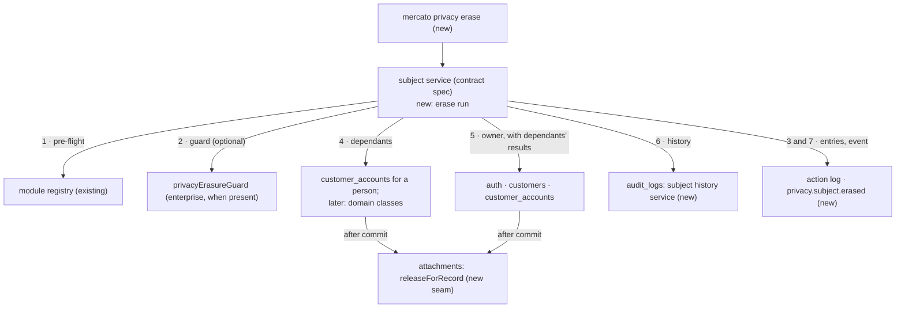

# Privacy subject erasure

> **Program:** packages C4 (first part) and C6 of [`2026-11-15-gdpr-ready-deployments-program.md`](2026-11-15-gdpr-ready-deployments-program.md) (tracker open-mercato/open-mercato#8593). The module-by-module roll-out that was drafted here now lives in the program spec as an unverified plan.
> **Builds on:** [`2026-11-16-privacy-data-class-contract.md`](2026-11-16-privacy-data-class-contract.md).
> **Verified at** `main` @ `08dada9624` by reading code, twice (author and independent reviewer); nothing was run.
> **Written autonomously.** No question was put to a person; the choices are listed under Resolved assumptions.
> **Status:** not approved for implementation. Assumption 3 decides whether this ships in OSS at all.

Extends: .ai/specs/2026-11-15-gdpr-ready-deployments-program.md
Extends: .ai/specs/2026-11-16-privacy-data-class-contract.md

## 📝 TLDR

The contract spec lets an operator export what three modules hold about a person. Nothing can remove it. Deleting a CRM person is refused when a deal is linked; deleting a staff user leaves their consents and MFA rows behind; a portal user is only soft-deleted, with email and name left in place; and the audit log keeps a full copy of every deleted record. **Proposed (future):** the contract gains one mutating operation, erase, in which each data class reports per section whether it deleted, anonymized or retained its rows and why. The three root subjects implement it, the audit history of an erased subject is stripped, and an operator runs it through a command that is a dry run by default.

**Not in this spec:** data classes for the other person-data modules (domain specs listed in the program); legal holds, retention policy and the admin UI (the enterprise engine); the coverage test and end-to-end suite; portal self-service; restriction of processing.

## 📝 Overview

> **Market reference.** WordPress core pairs each registered *exporter* with an *eraser* that returns items removed, items retained, and messages saying why something was kept. Discourse and GitLab anonymize an account whose content must survive instead of refusing to delete it. Adopted: one eraser per module that reports removed and retained with a reason; anonymize-in-place where links must survive. Rejected: GitLab's shared "ghost user" — it needs a reserved account in every tenant, and this codebase already renders a missing author as "Unknown user".

## 📝 Resolved assumptions (autonomous defaults)

| # | Question | Chosen | Rationale |
|---|---|---|---|
| 1 | One spec for the operation and the 25-module roll-out | Split. This spec is the operation, the run, the command, three roots and audit history | The reviewer's verdict. The roll-out rows were built from a column-name scan and several failed against the code. |
| 2 | Erase and anonymize as two operations, or one | One, `eraseSubject`, with a preference; the handler reports an outcome per section | Whether a row can be deleted depends on rules only its module knows, and one class often mixes outcomes. |
| 3 | Who calls it in OSS | `mercato privacy erase` | ⚠ NEEDS HUMAN CONFIRMATION — the program's DEC-2b, and it blocks approval. If maintainers keep mutation in Enterprise, the command is dropped and the handlers stay as the seam. |
| 4 | When is a subject kind erasable | Only when every registered class that declares the kind implements erase | Otherwise the root is removed while another module keeps data nothing can find again. |
| 5 | Order | Dependants, then the owner, then audit history | The owner needs the dependants' outcomes; history must be stripped after the last handler has logged. |
| 6 | A person linked to deals, or whose dependants retained something | Anonymized in place | The issue asks for it; a deleted root would orphan what was retained. |
| 7 | Related subjects | Never erased implicitly. Apply is refused while a related subject is neither named nor excluded | A portal account and the CRM person behind it are one human to the operator, but two decisions. |
| 8 | Audit history of the subject | Entries stay; snapshots, change set and replay payload are removed | That something happened is evidence; the content is the personal data. |
| 9 | Confirmation | A token printed by the dry run, bound to the tenant, the subject set and the dry-run report | A confirmation that can be typed from the command line alone confirms nothing. |
| 10 | Marker on anonymized rows | Nullable `anonymized_at` on CRM entities and portal users | Idempotence, and lets the UI and export say so. Staff users are always deleted, so they get none. |

## 📝 Problem Statement

**What deletion does today**

| Subject | Today | Left behind |
|---|---|---|
| Staff user | Hard delete of the user, roles, ACL, sessions, resets, sidebar rows (`packages/core/src/modules/auth/commands/users.ts:1088-1168`) | `user_consents` (no foreign key); MFA methods and recovery codes; SSO identity soft-deleted with email and name kept; team-member profile; conversations; devices |
| CRM person | Refused with 422 when a deal is linked (`customers/commands/people.ts:1327-1329`). Otherwise a hard delete of profile, addresses, comments, activities, interactions, tags, shares, custom fields | Attachments; the person's name and email inside other people's interaction `participants`; order snapshots; the full pre-delete snapshot in the audit log |
| Portal user | Soft delete; sessions revoked (`customer_accounts/services/customerUserService.ts:156-167`) | Email, lookup hash and display name; invitations; the deletion event, whose payload carries the email |

**Facts that shape the design**

- **Commands cannot simply be reused.** Delete commands open their own transaction, the person delete has the 422 built in, and portal users have no command at all — the route calls a service.
- **The protected-role floor does not apply to a system actor.** `auth/commands/users.ts:1936` returns early when `ctx.systemActor === true`, which is what a CLI context is.
- **Deleting a person triggers sales.** `sales/subscribers/reconcileOnCustomerDelete.ts:25-36` nulls `customerEntityId` on orders, after which their snapshots can no longer be found from the person.
- **The attachment seam is per attachment.** `attachmentService.releaseScoped` takes one attachment id, requires an organization, refuses a shared attachment, and inside a transaction returns a blob cleanup to run after commit (`attachments/lib/attachment-service.ts:426-499`). Nothing lists a record's attachments.
- **Audit rows are findable.** `resource_kind`, `resource_id` and `parent_resource_id` are stored in clear; the indexes lead with tenant and resource kind (`audit_logs/data/entities.ts:10-11`).
- **Unique indexes.** `customer_users (tenant_id, email_hash)` is unique among live rows and the hash is not nullable. `customer_entities.primary_email` is nullable.
- **Linking is automatic.** A new portal signup is linked to a CRM person with the same email (`customer_accounts/subscribers/autoLinkCrm.ts:94-117`).
- **An existing defect sits in the path.** `auth.user.deleted` carries `id`, but the SSO and channel cleanup subscribers read `payload.userId`. That is program package A9, and the staff-user erasure here must not depend on those subscribers.

## 📝 Proposed Solution

### The operation

A handler gains one optional method. Given a subject, a preference and the outcomes of the classes that ran before it, it changes only its own module's rows and reports per section.

| Outcome | Meaning |
|---|---|
| `deleted` | The rows are gone |
| `anonymized` | The rows remain; nothing in them identifies the person |
| `retained` | Unchanged, for a reason from a closed list |
| `refused` | The module will not act, with a code — for example the last administrator |
| `not_found` | Nothing held for this subject |

The preference is `delete` or `anonymize`. A handler honours `anonymize` always. Asked to `delete`, it may anonymize or retain when its rules require.

### Rules every handler follows

1. **Its own tables only, in one transaction.** It uses the module's own service or command where that can run without writing an undo snapshot and without its user-facing guards; otherwise the module adds an internal erasure function. Either way the module's normal delete and update events are emitted, so the query index and vector entries follow.
2. **Anonymize means: keep the row and its links; remove everything else.** Nullable identifying fields become null. A field that cannot be null gets the shared placeholder. Free text, addresses and contact points are deleted.
3. **Retain only with a reason from a closed list:** `legal_retention`, `evidence`, `other_party`.
4. **A class called for a kind it does not own never mutates another kind's root.** It reports that root as a related subject.
5. **Files.** Rows change in the transaction; stored files are removed after commit through a new attachments seam. A file that fails to delete is reported and removed by re-running.
6. **Idempotent, and dry-runnable.** A second run reports the standing outcome with zero rows affected.

### The run

1. **Pre-flight, no mutation.** For each subject kind in the request, every registered class that declares the kind must list the `erase` action; otherwise the run stops and names the class. A dry run builds the full report and the closure of related subjects.
2. **Guard.** An optional guard is asked once per subject; a refusal stops that subject.
3. **Started entry.** One audit entry per subject is written before anything changes.
4. **Dependants.** Every class that declares the kind and is not owned by the kind's module, in a fixed order. Any failure stops the subject before its owner.
5. **Owner.** The owner's class receives the dependants' results. If any section anywhere was retained or anonymized, the owner anonymizes instead of deleting.
6. **History.** The audit module strips the subject's history.
7. **Completed entry and event.** Written and emitted only when the run changed something.

The owner of a kind is the module named before the colon; a class may declare kinds it does not own.

### Design decisions

| Decision | Rationale |
|---|---|
| Results are per section, not per class | A sales class would report retained invoices beside anonymized quotes. Fixing the shape after release would be a breaking change. |
| The owner sees its dependants' outcomes | The customers module cannot read sales tables to learn whether a document was kept. |
| A started entry before the first change | A run that dies midway otherwise leaves destructive changes with no record. |
| Audit history is a step, not a data class | It applies to every kind, and the definition has no wildcard; it must also run last. |
| Staff-user erasure enforces the administrator floor itself | The command's guard is skipped for a system actor. |
| Events carry ids and outcomes only | They reach queues and webhook deliveries. |

### Alternatives considered

| Alternative | Why rejected |
|---|---|
| Erase the root first and let delete events cascade | Subscribers swallow errors; one of the existing cascades reads the wrong field. |
| One transaction across modules | Modules do not share transactions, and files are removed outside one. |
| Keep the 422 and ask the operator to unlink | An erasure request has a deadline, and unlinking leaves the person in the deal's history. |
| Erase related subjects automatically | Turns one confirmed decision into several unconfirmed ones. |
| A confirmation typed from the subject id | Derivable without having read the dry run. |

## 📝 Delta

### Capability: privacy-subject-erasure

#### ADDED Requirement: Subject erasure
The system SHALL remove, anonymize or retain-with-reason each registered data class's records about a named subject, and SHALL report the outcome per section.

##### Scenario: Person with no dependants
- WHEN an operator erases a CRM person who has no deals
- THEN the person, their profile, addresses, comments, activities, interactions and attachments are gone, and the report lists each section as deleted

##### Scenario: Dry run by default
- WHEN the command runs without the apply flag
- THEN it prints the outcome each section would report, the related subjects, and a confirmation token, and changes nothing

##### Scenario: Stale confirmation
- WHEN apply is given a token from a dry run of a different subject set
- THEN nothing is changed

##### Scenario: Kind not erasable
- WHEN a registered class declares the subject's kind and does not implement erase
- THEN the run stops before any change and names the class

##### Scenario: A dependant fails
- WHEN one handler fails during a run
- THEN the subject's own record is untouched, a started entry exists, and running again finishes the job

##### Scenario: Related subject
- WHEN a portal user linked to a CRM person is erased and the person is neither named nor excluded
- THEN apply is refused and the person is listed

#### MODIFIED Requirement: Deleting a person linked to a deal
The system SHALL anonymize a CRM person in place when they are erased while linked to a deal, instead of refusing.

##### Scenario: Linked deal
- WHEN an operator erases a person linked to a deal
- THEN the deal and the link still load, the person shows as anonymized, and their contact details, addresses, free text and attachments are gone

##### Scenario: Ordinary delete is unchanged
- WHEN a user deletes such a person from the CRM screen
- THEN the request is still refused with the existing message

Frozen by: `packages/core/src/modules/customers/commands/__tests__/people.delete-dependents.characterization.test.ts`

#### MODIFIED Requirement: Removing a portal user
The system SHALL leave no email, display name or usable lookup hash on an erased portal user.

##### Scenario: Erased portal user
- WHEN an operator erases a portal user
- THEN signing in with that email fails and the old row holds no contact detail

Frozen by: `packages/core/src/modules/customer_accounts/__tests__/customerUserService.softDelete.characterization.test.ts`

#### ADDED Requirement: Audit history of an erased subject
The system SHALL remove the stored content of audit entries about an erased subject while keeping the entries.

##### Scenario: History after erasure
- WHEN a person is erased
- THEN their audit entries still list who did what and when, with no snapshot, and none can be undone

#### ADDED Requirement: Erasure notification
The system SHALL emit one event per erased subject when a run changes something, carrying identifiers and outcomes and no personal data.

##### Scenario: Second run
- WHEN the same erasure is run again
- THEN nothing changes and no event is emitted

## 📝 Architecture



Takeaway: nothing is changed until the registry says the kind is erasable, the owner decides last with full knowledge, and the run is recorded before and after.

### Components

- **Contract** (`packages/shared/src/modules/privacy.ts`): `subjectActions` gains `erase`; the handler gains optional `eraseSubject`; result types. Additive to a contract not yet released.
- **`privacy` module**: the run in `lib/subjectService.ts`; the `erase` command with a zod argument schema; `events.ts`; the two audit entries; the confirmation token, an HMAC over tenant, subject set and report digest keyed by a per-process secret written into the dry-run output file. The run is also callable in process as `privacySubjectService.eraseSubjects`, taking the scope, the subjects, the excluded related subjects, a preference, an actor, a reference and a mode (`dry-run` or `apply`). The token belongs to the command, the only caller with a person at a terminal; an in-process caller must name or exclude every related subject the dry run reports, exactly as the command must.
- **Guard seam**: optional DI key `privacyErasureGuard`, with one method: `check({ scope, subject, dataClassIds, actor, origin })` returning `{ allowed: true }` or `{ allowed: false, code, message }`. It is called once per subject after pre-flight and before the started entry. A refusal stops that subject with exit code 2 and changes nothing. A guard that throws is treated as a refusal: when a guard is registered and cannot answer, the run does not proceed. The type lives beside the contract types.
- **Attachments**: a new `releaseForRecord(entityId, recordId, scope)` on the attachments service that lists a record's attachments, releases them, and returns the blob cleanup. Handlers call it; they do not read the attachments table.
- **`audit_logs`**: a `subjectHistoryService` resolved by DI key. Given a tenant, a subject id and the resource kinds the subject's classes declare, it clears snapshots, change set, replay payload and undo token on entries whose resource or parent resource is the subject.
- **Definition**: gains optional `auditResourceKinds`, the kinds a class's records are logged under.
- **Root handlers**: see below.
- **Placeholders** (`packages/shared/src/lib/privacy/placeholders.ts`): an email of the form `anonymized-<row id>@anonymized.invalid` and a lookup hash derived from the row id, used only where a column cannot be null.

### The three roots

| Class | On erase | Notes |
|---|---|---|
| `auth.users` | Deletes the user and, inside `auth`, what the command already deletes plus `user_consents` retained as `evidence` | Refuses the last holder of a protected role, by its own check. Does not rely on the `auth.user.deleted` subscribers |
| `customers.people` | Deletes; anonymizes when a deal is linked or when any dependant retained or anonymized something | Removes the person from other interactions' `participants` and `linked_entities`: a bounded scan within the tenant, matching the id and the exact stored email, read before the person is changed |
| `customer_accounts.users` | For its own kind: nulls or replaces email, hash and name, soft-deletes, deletes sessions, tokens and matching invitations. For a `customers:person` subject: reports linked portal users as related | The row keeps a placeholder hash so the live-row unique index holds and the email is free for a new account |

An anonymized person is excluded from duplicate detection and shown with a translated "Anonymized" label wherever a person is listed or picked.

### Coupling

| Touchpoint | Mechanism | Absent |
|---|---|---|
| `privacy` → handlers | DI key from the definition | Pre-flight stops the run |
| Handler → attachments | `attachmentService` by DI key, resolved softly | No attachments module: nothing to release |
| `privacy` → audit history | `subjectHistoryService` by DI key, resolved softly | No audit module: nothing to strip, and no entries |
| `privacy` → enterprise engine | `privacyErasureGuard`, resolved softly | No holds |
| Integrations → erasure | Subscribe to `privacy.subject.erased` | — |

## 📝 Data Models

| Entity | Change |
|---|---|
| `customer_entities`, `customer_users` | Add nullable `anonymized_at` (`timestamptz`) |

Additive columns with migrations and snapshots. Both entities' API responses gain `anonymizedAt`. No new entity; the `privacy` module still has none. The data-model graph is omitted: one nullable column on two existing tables.

## 📝 API Contracts

### Contract additions — `@open-mercato/shared/modules/privacy`

```ts
export type PrivacyErasurePreference = 'delete' | 'anonymize'
export type PrivacyErasureOutcome = 'deleted' | 'anonymized' | 'retained' | 'refused' | 'not_found'
export type PrivacyRetainReason = 'legal_retention' | 'evidence' | 'other_party'

export type PrivacyErasureSectionResult = {
  section: string
  outcome: PrivacyErasureOutcome
  affected: number
  retainReason?: PrivacyRetainReason
  refusalCode?: string
}

export type PrivacyDataClassHandler = {
  // …read methods from the contract spec…
  eraseSubject?: (input: {
    scope: PrivacyScope
    subject: PrivacySubjectReference
    prefer: PrivacyErasurePreference
    dryRun: boolean
    reference: string
    dependantResults: ReadonlyArray<{ dataClassId: string; sections: PrivacyErasureSectionResult[] }>
  }) => Promise<{
    sections: PrivacyErasureSectionResult[]
    filesPending: number
    relatedSubjects?: PrivacySubjectReference[]
  }>
}
```

The definition schema gains `auditResourceKinds: z.array(z.string()).optional()`, and `subjectActions` accepts `erase`.

### CLI

`mercato privacy erase --tenant <id> --subject <kind:id> [--subject …] [--exclude-related <kind:id> …] --reference <text> [--prefer anonymize] [--out <file>] [--apply --confirm <token>]`

- Subjects must be named; an identifier is not accepted.
- Without `--apply` it is a dry run: it prints the report and the related subjects and writes the confirmation token.
- `--apply` requires the token from a dry run of the same tenant, subjects and exclusions whose report still matches.

| Exit code | Meaning |
|---|---|
| 0 | Dry run completed, or every subject finished |
| 1 | Usage error, a stale or missing token, a kind that is not erasable, or an unnamed related subject |
| 2 | Incomplete: a class failed, a subject was refused or held, or files are pending |

### Event

`privacy.subject.erased` — `{ runId, tenantId, organizationId?, subject: { kind, id }, reference, origin, prefer, excludedRelated: [{ kind, id }], results: [{ dataClassId, sections }] }`. Persistent. No identifier value, no label.

- `runId` is the id of the run's completed audit entry. It is stable across redelivery, so a subscriber can use it to recognise an event it has already handled.
- `origin` is a short caller-supplied string: `cli`, `portal`, or one a caller defines. It lets a subscriber tell runs it started from runs it did not.
- `prefer` and `excludedRelated` are what the caller asked for, so the run can be repeated exactly.

### Audit entries

Through the action log, as in the contract spec: `resourceKind` `privacy.subject_erasure`, `resourceId` `<kind>:<id>`; one with state "started", one with the per-section outcomes.

### Changed event payload

`customer_accounts.user.deleted` carries the user's email today. The field stays for one minor, marked deprecated, and is empty when the deletion comes from an erasure. The ordinary admin delete keeps sending it until the field is removed.

## 📝 Addendum: what the coverage specs need from the run

Added on 2026-11-16, after the coverage specs' reviews. Additive.

- **History by record.** The history strip matches entries whose resource or parent resource is the subject. A module that logs under its own record's id — an order, a claim — is not reached that way. A handler's result may therefore list `historyRecords`, pairs of resource kind and record id, and the run passes them to the strip together with the subject.
- **Export and erase together.** A kind is erasable only when every class declaring it can erase. A class that shipped export first would make its kinds non-erasable until its erase arrived. Each coverage class therefore ships both methods in the same change.
- **A check before anything changes.** A handler may implement `checkErasable`, which reads and never writes. Pre-flight calls it on every class for every subject — the owner's included — and the run does not start for a subject that any class refuses. The owner's rule that a tenant keeps one administrator is such a check, and so is "this account belongs to an agent". Without it, dependants would have deleted a user's MFA methods, single-sign-on identity and API keys before the owner, which runs last, could say no — leaving a live administrator with no second factor. The owner's check also confirms that the subject exists in the tenant, so that no dependant acts on an id from another tenant.
- **Order.** The owner first locks the account — it can no longer sign in — without removing it. Then dependants run in two groups, each in order of class id: classes that hold records, then classes that hold credentials and sign-in material. Then the owner. A class says which group it is in. A failure in the first group therefore leaves the account locked and its credentials intact for a re-run.
- **Staff users are exempt from "the owner anonymizes".** A staff user is always deleted. Rule 5 of the run — anonymize the owner when a dependant kept something — applies to subjects whose row others must still find. Nothing in the database constrains a staff user's id, so a record a dependant keeps is left holding an id that no longer resolves, which is what "left as an id" means in the coverage specs. Such a section is reported as retained with the reason it has.
- **Reasons.** The closed list gains `shared_record`, for something several people made or use together — a document, a conversation — and `open_case`, for a record that is still being worked on and will be handled when it closes.
- **How a module blanks its own records.** Most records have no update command that could clear them — a placed order refuses customer edits, a sent message has no update at all. A handler uses an internal function of its module that writes through the entity and emits the module's index events. It does not go through the public update command, and it writes no undo snapshot.
- **When an erasure is complete.** The run reports completion when its database changes are committed. Copies in the token, vector and fulltext indexes are refreshed by the modules' own asynchronous indexing; the report says so, and the verification suite drains the queues before it scans.

## 📝 Edge Cases & Failure Scenarios

| Case | Behaviour |
|---|---|
| Subject already erased | Sections report their standing outcome with zero affected; no event |
| Crash after the owner succeeded, before the completed entry | The started entry exists; a re-run changes nothing, writes the completed entry, and emits no event. An integration that needs certainty reads the entries |
| A handler throws midway | Its transaction rolls back; the owner is not called; exit 2 |
| A file fails to delete after commit | Rows are already changed; the section reports files pending; a re-run removes them |
| Shared attachment | Released from the record; the blob stays for its other owners |
| Erasing the last administrator | Refused with the floor's code |
| New portal signup with an erased email | Succeeds. If a CRM person with that email still exists, the signup is linked to it automatically, as today |
| Person is the contact on an order | Sales has no data class yet, so nothing about the order changes and the delete would null the order's link. Until the commerce spec lands, the customers handler treats any order or quote that references the person as a reason to anonymize; it learns that from a count the sales module exposes through a small read seam |
| Free text in another person's record that mentions the subject | Not found. Stated in the operator documentation |
| Backups | Hold the data until they expire; restore replay is the enterprise engine's concern |

## 📝 Migration & Backward Compatibility

| Change | Class |
|---|---|
| `eraseSubject`, new types, `erase` action, `auditResourceKinds` | Additive to a contract not yet released |
| `privacy.subject.erased` | New event id; frozen once released |
| `anonymized_at` columns and `anonymizedAt` response fields | Additive schema and API |
| `releaseForRecord`, `subjectHistoryService`, `privacyErasureGuard` | New service members and DI keys; stable once released |
| `mercato privacy erase` | New command |
| Person linked to a deal is anonymized on erasure | A new path; the existing delete and its 422 are unchanged |
| `customer_accounts.user.deleted` payload | Deprecation over one minor, with an `UPGRADE_NOTES.md` entry and a dated compatibility entry |

**Prior specs.** `.ai/specs/2026-09-30-unified-crm-email-history-and-context.md` plans to refuse deleting a person while email history exists; that is not in code. When implemented it must exempt the erasure path.

## 📋 Phasing

| Phase | Outcome | Shippable alone |
|---|---|---|
| 1 | Contract additions, the run, the command, entries, event, guard seam | Yes — no kind is erasable until a class implements erase |
| 2 | Attachments seam; audit history service | Yes |
| 3 | The three roots | Yes — the first real erasure |

## 📋 Implementation Plan

### Phase 1 — The operation
1. Extend the contract types and the definition schema, with unit tests.
2. Add the run to the subject service: pre-flight, guard, started entry, dependant order, owner with results, history step, completed entry and event. Unit tests with fake handlers for each rule: a kind with a class lacking erase; a failing dependant; a refused owner; an owner that anonymizes because a dependant retained; a second run.
3. Add the command with its argument schema, the dry-run report, the related-subject closure and the confirmation token. Unit tests for a stale token, a changed subject set, an unnamed related subject, and exit codes.
4. Add the placeholder helper with tests for uniqueness and stability.

### Phase 2 — Seams
1. Attachments: `releaseForRecord`, with unit tests for a shared attachment, a missing organization, and a failing blob cleanup.
2. Audit: `subjectHistoryService`, with unit tests that only the subject's entries change, that undo is no longer offered for them, and that entries about other resources are untouched.

### Phase 3 — Roots
1. **Characterize** the 422 on a person with deals and the fields a soft-deleted portal user keeps. Commit alone.
2. Migrations for `anonymized_at`; add `anonymizedAt` to the two entities' API responses and OpenAPI.
3. `auth.users`, including its own administrator-floor check.
4. `customer_accounts.users`, for both kinds it declares; stop sending the email on an erasure.
5. `customers.people`: delete or anonymize; the participant cleanup; the read seam on sales for referencing documents; exclusion from duplicate detection.
6. UI: the anonymized label on person and portal-user lists, pickers and detail pages, with locale keys in every locale file.
7. Integration tests TC-PRIVACY-ERASE-001 to 006.
8. `UPGRADE_NOTES.md`, the dated compatibility entry, the operator page.
9. Archive this Delta into `.ai/specs/capabilities/privacy-subject-erasure.md` if that directory has been adopted by then; it does not exist today.

### File manifest

| File | Action |
|---|---|
| `packages/shared/src/modules/privacy.ts`, `packages/shared/src/lib/privacy/placeholders.ts` | Modify / create |
| `packages/core/src/modules/privacy/{cli.ts,events.ts,data/validators.ts,lib/subjectService.ts,lib/confirmation.ts}` | Modify / create |
| `packages/core/src/modules/attachments/lib/attachment-service.ts` | Modify — `releaseForRecord` |
| `packages/core/src/modules/audit_logs/{services/subjectHistoryService.ts,di.ts}` | Create / modify |
| `packages/core/src/modules/{auth,customers,customer_accounts}/{privacy.ts,lib/privacy/*,di.ts}` | Modify |
| `packages/core/src/modules/{customers,customer_accounts}/{data/entities.ts,migrations/*}` and their API routes and OpenAPI | Modify |
| `packages/core/src/modules/sales/…` read seam for referencing documents | Create |
| Person and portal-user list, picker and detail components; `i18n/*.json` in both modules | Modify |
| `packages/core/src/modules/privacy/__integration__/TC-PRIVACY-ERASE-00{1..6}.spec.ts` | Create |
| `UPGRADE_NOTES.md`, `BACKWARD_COMPATIBILITY.md`, `apps/docs/docs/framework/privacy/*` | Modify |

## 🧪 Integration Coverage

The surface is the CLI, the existing API routes used to create fixtures and observe the result, and two detail pages. Tests run the built CLI with the same encryption settings as the app, read exit codes through `spawnSync`, and remove what they create.

| Test | Covers |
|---|---|
| TC-PRIVACY-ERASE-001 | Dry run on a person: the report lists outcomes and a token; the person still loads through `GET /api/customers/people`; applying with a token from a different subject changes nothing |
| TC-PRIVACY-ERASE-002 | Person without dependants: after apply, the person, an address, a comment and an uploaded attachment are gone |
| TC-PRIVACY-ERASE-003 | Person linked to a deal: the deal loads through `GET /api/customers/deals`; the person's response carries `anonymizedAt` and no contact details; `DELETE /api/customers/people` for another linked person still returns 422; the person detail page renders the anonymized label |
| TC-PRIVACY-ERASE-004 | Portal user: apply is refused while the linked person is unnamed; with the person excluded it succeeds; login with the old email and password then fails; a new account with that email can log in |
| TC-PRIVACY-ERASE-005 | Staff user: gone; a direct query shows their consent row remains; the audit list shows their entries without snapshots and with a null `undoToken`; erasing the last administrator is refused |
| TC-PRIVACY-ERASE-006 | The same erase twice: the second run reports zero rows affected; one `privacy.subject.erased` event exists |

## 📝 Risks & Impact Review

#### The wrong person is erased
- **Scenario**: An operator passes the wrong id.
- **Severity**: Critical
- **Affected area**: all data of one person
- **Mitigation**: Named subjects only; dry run by default; a token bound to the report the operator saw; the export exists to check identity first.
- **Residual risk**: Irreversible. Recovery is from a backup.

#### Erasure is believed complete when modules are missing
- **Scenario**: Only the roots have classes; the operator tells the data subject everything is gone.
- **Severity**: High
- **Affected area**: every module without a data class
- **Mitigation**: The report lists the classes consulted; `mercato privacy classes` shows coverage; the operator page lists what is not covered; the program's coverage test fails for an uncovered module once it exists.
- **Residual risk**: Until the domain specs land, sales, messaging, forms and the rest are untouched by an erasure.

#### A partial run leaves the subject half-erased
- **Scenario**: A dependant succeeds, the next fails.
- **Severity**: High
- **Affected area**: cross-module consistency
- **Mitigation**: The owner is last; handlers are idempotent; the started entry records the attempt; exit code 2.
- **Residual risk**: Until the re-run, some data is gone and some is not.

#### An order loses its link to an anonymized-or-deleted person
- **Scenario**: The person is deleted and the sales subscriber nulls the order's customer.
- **Severity**: High
- **Affected area**: orders and quotes
- **Mitigation**: A referencing document forces anonymize-in-place, so the delete event never fires.
- **Residual risk**: The read seam on sales is a stop-gap until the commerce spec gives sales a data class.

#### Stripping history breaks a reader
- **Scenario**: A view treats a missing snapshot as "record created".
- **Severity**: Medium
- **Affected area**: version history, sales document history
- **Mitigation**: Only the erased subject's entries change; the reviewer found one reader with that behaviour, in sales, which this spec's entries do not reach.
- **Residual risk**: A reader found later; unit tests cover the audit list and version history.

#### The administrator floor is bypassed
- **Scenario**: Erasure runs as a system actor and removes the last administrator.
- **Severity**: High
- **Affected area**: tenant access
- **Mitigation**: The handler checks the floor itself and returns `refused`.
- **Residual risk**: Low once tested.

## Final Compliance Report — 2026-11-16

### AGENTS.md Files Reviewed
- `AGENTS.md` (root), `.ai/specs/AGENTS.md` — in full
- `BACKWARD_COMPATIBILITY.md` — §2, §5, §8, §9, §13
- `packages/core/AGENTS.md` — Encryption section
- Not reviewed: the `customers`, `auth`, `customer_accounts`, `sales` module guides and `packages/ui/AGENTS.md`. The implementer reads each before its step.

### Compliance Matrix

| Rule Source | Rule | Status | Notes |
|---|---|---|---|
| root AGENTS.md | No direct ORM relationships between modules | Compliant | Handlers touch their own tables; attachments, audit history and sales are reached through DI seams |
| root AGENTS.md | Never expose cross-tenant data | Compliant | Tenant scope on every call |
| root AGENTS.md | Never bypass mutation guards or command side effects | Partly | Erasure deliberately bypasses two user-facing guards (the 422, the system-actor skip of the role floor) and replaces the second with its own check. Module events are still emitted |
| root AGENTS.md | Optimistic locking on new editable entities | N/A | No new entity; `anonymized_at` is not user-editable |
| root AGENTS.md | Never hard-code user-facing strings | Compliant | Locale keys for the anonymized label |
| root AGENTS.md | Ask before touching multiple modules | Needs approval | `auth`, `customers`, `customer_accounts`, `attachments`, `audit_logs`, `sales`, `privacy` |
| `BACKWARD_COMPATIBILITY.md` | Event payloads frozen | Compliant | Deprecation path for the one changed payload |
| `.ai/qa/AGENTS.md` | Integration tests self-contained | Compliant | Fixtures created and removed per test |

### Internal Consistency Check

| Check | Status | Notes |
|---|---|---|
| Data models match API contracts | Pass | `anonymized_at` and `anonymizedAt` |
| Delta scenarios map to tests | Pass | TC-001 to 006 and unit tests |
| MODIFIED requirements have characterization tests | Pass | Phase 3 step 1 |
| Every step leaves the app working | Pass | Nothing is erasable until Phase 3 |

### Non-Compliant Items
- **Rule**: never bypass mutation guards. **Gap**: erasure bypasses two by design. **Recommendation**: accept, with the replacement check and the separate path.

### Verdict
**Not approved for implementation.** Assumption 3 must be confirmed first. The design is otherwise ready for a maintainer's review.

## Changelog

### 2026-11-16
- Written autonomously as "privacy data-class coverage", including a 25-module roll-out.
- Revised after independent review, which returned "resolve direction first" and "split". Renamed and narrowed to the operation, the run, the command, three roots and audit history; the roll-out moved to the program spec as an unverified plan. Run semantics fixed: a kind is erasable only when every class declaring it implements erase; the owner receives its dependants' outcomes; results are per section; related subjects must be named or excluded; a started entry precedes any change; audit history is a last step, not a data class. New seams: listing and releasing a record's attachments; the staff-user handler's own administrator-floor check. The confirmation is now a token bound to the dry run.

### Review — 2026-11-16
- **Reviewer**: Agent (fresh context, spec path only), then author revision
- **Security**: Administrator-floor bypass and weak confirmation corrected
- **Performance**: Participant cleanup is a bounded tenant scan; stated
- **Cache**: N/A
- **Commands**: The rule on reusing commands rewritten against what the code allows
- **Risks**: Order-link loss and floor bypass added
- **Verdict**: Revised; the revision has not been independently re-read

### 2026-11-16 — amendment
- Added the in-process entry point `eraseSubjects`, needed by the portal self-service spec's daily job. The confirmation token stays a property of the command.
- Defined the guard's method, its result and its fail-closed rule, and added `runId`, `origin`, `prefer` and `excludedRelated` to the completion event. The enterprise governance and restore-replay specs need all of them, and the event shape freezes on release.
- Amended: the audit-history strip is done by the audit module's `applyRetention` routine, shared with [`enterprise/2026-11-16-action-log-retention.md`](enterprise/2026-11-16-action-log-retention.md). It computes the names of changed fields before clearing values, reduces the context to the actor, and marks the entry with `stripped_at`.
- Added the addendum: history by record, export and erase shipping together, a "not erasable" answer, internal blanking functions, and what completion means. All were found missing by the reviews of the coverage specs.
- Extended the addendum after the review of the last three coverage specs: a read-only check on every class before anything changes, replacing the "not erasable" answer; the owner locks the account first and credential-holding classes run last; staff users are exempt from the rule that an owner is anonymized when a dependant keeps something; two reasons added to the closed list.
