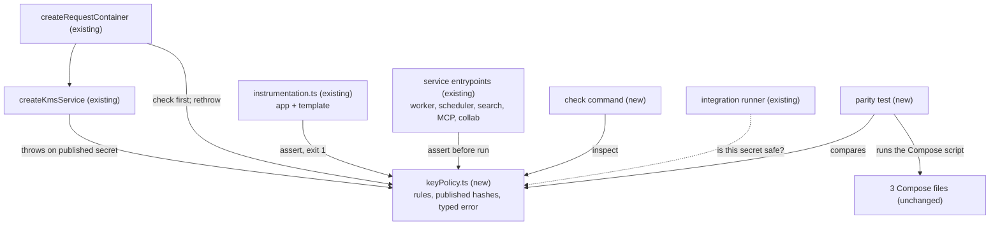

# Runtime encryption-key guard

> **Program:** packages A1 and A2 of [`2026-11-15-gdpr-ready-deployments-program.md`](2026-11-15-gdpr-ready-deployments-program.md) (tracker open-mercato/open-mercato#8593).
> **Verified at** `main` @ `08dada9624`; code references are inline.

Extends: .ai/specs/2026-11-15-gdpr-ready-deployments-program.md
Extends: .ai/specs/2026-11-01-7231-compose-encryption-key.md

## 📝 TLDR

An operator who deploys with Docker Compose is stopped before the app starts if the tenant encryption secret is one published in this repository, too weak, or absent. An operator who deploys any other way (Kubernetes, a bare `mercato server start`, a managed platform) gets no check: the runtime uses whatever is in the environment, and with nothing there it writes plaintext. **Proposed (future):** put the policy in shared code. A published encryption secret is refused by every production process. A weak secret, or encryption left unconfigured, stops a production *service* from starting — after one release in which it only warns. Development stacks keep working with a warning.

**Not in this spec:** what happens when a configured KMS becomes unreachable (program package A3); refusing an unsafe lookup secret, which waits for a rehash tool; any change to the Compose files; key rotation itself; the later flip of the default.

## 📝 Overview

This closes the gap #7231 left on purpose. That work removed the published key from the Compose files and added a preflight service, and stated "No changes to runtime cryptography, KMS interfaces…". The same rules now move into the runtime, as far as the existing migration tooling allows.

> **Market reference.** Rails refuses to boot in production without `secret_key_base`; Django's `check --deploy` flags a short or default `SECRET_KEY` but only warns. Adopted from Rails: a hard stop for material that is publicly known. Adopted from Django: a staged warning for weak-but-private configuration, and a check that runs without starting the server. Rejected: Django's choice to never refuse — a key anyone can read in this repository is not a configuration smell.

## 📝 Problem Statement

- **The runtime does not validate the secret.** `resolveDerivedKeySecret` takes `TENANT_DATA_ENCRYPTION_FALLBACK_KEY`, then `TENANT_DATA_ENCRYPTION_KEY`, and uses the first non-empty value (`packages/shared/src/lib/encryption/kms.ts:119-135`).
- **Nothing configured means plaintext.** With encryption on, no healthy Vault and no secret, `createKmsService` logs a warning and returns a no-op service (`kms.ts:455-461`). Encryption is on unless explicitly disabled (`packages/shared/src/lib/encryption/toggles.ts:3-9`).
- **The same secret keys lookup hashes.** `resolveLookupPepper` uses `LOOKUP_HASH_PEPPER`, then the two encryption variables; with none set, hashes are unkeyed (`packages/shared/src/lib/encryption/aes.ts:190-221`).
- **The policy exists in Compose only.** An inline script, copied into three Compose files, refuses a secret under 32 bytes, with fewer than 8 distinct characters, or whose SHA-256 is one of five published values. It also refuses "no secret and no Vault", an insecure Vault address, and a missing or unsafe lookup secret (`docker-compose.fullapp.yml:18-45`).
- **The five published values are repository test and development material:** the development Compose key, `om-ephemeral-integration-fallback-key`, `tc-customers-seed-001-derived-key`, `installation-pepper-secret-value` and `checkout-encryption-fallback-secret` (`scripts/__tests__/fullapp-compose-encryption.test.mjs:18-21`).
- **An error during bootstrap is swallowed.** `createRequestContainer` wraps bootstrap in `try { … } catch { /* optional */ }` (`packages/shared/src/lib/di/container.ts:278-284`). If `createKmsService` threw at `packages/core/src/bootstrap.ts:194`, the KMS service, the encryption service and its subscriber would silently go unregistered and the process would write plaintext. Tenant setup has the same shape: it catches and logs only in debug mode (`packages/core/src/modules/auth/lib/setup-app.ts:394-412`).
- **The KMS service is built in many places:** 18 call sites across `bootstrap.ts`, `api_keys`, `auth` (CLI and tenant setup), `entities` CLI, `integrations` (credentials and OAuth grants), `query_index`, and the `TenantDataEncryptionService` constructor default.
- **Migration tooling is incomplete.** The runbook says there is "no universal pepper-rotation/backfill CLI", that lookup candidates cover the current keyed hash and the legacy unkeyed hash but "not an old keyed pepper", and that rotation skips system-scoped maps (`starters/docker/encryption-migration.md:147-153`).
- **The repository's own test environments would be refused.** The ephemeral integration app runs with `NODE_ENV=production` and defaults to a published secret (`packages/cli/src/lib/testing/integration.ts:2196, 2282, 3693`). The standalone-app CI uses a 31-byte secret (`.github/workflows/snapshot.yml:232, 376`).
- **The development runner looks like production to its children.** `mercato server dev` starts Next.js in development mode but spawns workers and the scheduler through `buildServerProcessEnvironment`, which forces `NODE_ENV=production` (`packages/cli/src/mercato.ts:402-404, 2312, 2391`). The development Compose files default to a published key (`starters/docker/compose.fullapp.dev.yml:143`).
- **Services are more than the web server.** Long-running processes: the Next.js server, `queue worker`, `scheduler start`, `search worker`, `ai_assistant mcp:serve` and `mcp:serve-http`, and the documents collaboration server, which is a plain Node script outside the CLI dispatcher (`packages/documents/package.json:9-10`). A single-queue worker builds no container at start and fails per job instead (`packages/cli/src/lib/worker-job-handler.ts:33-34`); the local queue drops a job once its attempts are used up.
- **Three preflight scripts call `createKmsService` and replace any error with "restore the original keys"** (`packages/starter/src/encryption-preflight.mjs:38-44, 208`, with copies in `scripts/` and the create-app template). One runs in production through `docker/scripts/init-or-migrate.sh`.
- **A runtime precedent exists.** The JWT signing secret is checked on every read and eagerly at server start, where a violation exits the process (`packages/shared/src/lib/auth/jwt.ts:140-165`, `apps/mercato/src/instrumentation.ts:5-24`).

## 📝 Prior spec drift

- `.ai/specs/2026-11-01-7231-compose-encryption-key.md`: in sync with the code. Its status line reads "named maintainer security-waiver approval pending", so the precedent this spec uses for the published-secret case is not yet signed off.

## 📝 Decisions

Answered by the issue assignee on 2026-11-16. R1–R3 were raised by the independent review and change two earlier answers.

| # | Decision |
|---|---|
| Q1 | This spec owns everything decidable at boot from configuration. The fail-closed spec owns a configured KMS that becomes unreachable. |
| Q2 → R1 | Boot refusal covers the *encryption* secret and "nothing configured". **Every lookup-secret finding is a warning.** Refusing them waits for a rehash tool. |
| Q3 | A shared policy module. The Compose files are not edited; a test keeps them in step. |
| Q4 → R2 | A published encryption secret is refused wherever the KMS is built and at every service start. **Weak and unconfigured are refused only when a service starts.** Services are listed under Components. |
| Q5 | A `warn` / `enforce` setting bridges weak and unconfigured. |
| R3 | One spec, two PRs. The spec ends at the bridge; the later default flip is a tracked release task with stated gates. |

## 📝 Proposed Solution

One module decides whether the tenant-encryption configuration is safe and returns findings.

| Finding | Meaning | In production |
|---|---|---|
| `published_secret` | Encryption is on and the effective encryption secret hashes to a published value | Refused wherever the KMS is built, and at service start |
| `weak_secret` | Encryption is on and the effective encryption secret is under 32 UTF-8 bytes, or has fewer than 8 distinct characters | Bridged, at service start |
| `not_configured` | Encryption is on, no secret is set, and Vault address and token are not both set | Bridged, at service start |
| `published_lookup_secret`, `weak_lookup_secret`, `missing_lookup_secret` | The effective lookup secret is published, weak or absent | Warning |
| `insecure_vault_address` | Not HTTPS, except loopback; or carries credentials | Warning |

**Bridged** means governed by `TENANT_DATA_ENCRYPTION_KEY_POLICY`. In the release that ships this (target 0.11.0) the default is `warn`: the service starts and logs one loud warning. Set to `enforce`, the service refuses to start. One-off commands, builds and migrations never refuse on a bridged finding; they warn.

**Production** here means `NODE_ENV` is `production` and the process was not started by the development runner. `mercato server dev` marks the workers and scheduler it spawns with `OM_DEV_RUNTIME=1`; the policy treats a marked process as non-production. Outside production every finding is a single warning and nothing is refused. Under `NODE_ENV=test` the module is silent.

### Design decisions

| Decision | Rationale |
|---|---|
| A typed error that swallow sites rethrow | Without it the refusal turns into silent plaintext (see Problem Statement). |
| Inspect the *effective* secrets only | The runtime uses the first non-empty variable; Compose makes the same choice. |
| Lookup-secret findings only warn | Nothing rehashes lookup columns, so an installation leaving a weak or published pepper passes through a window the runbook manages by hand. Refusing during that window would block the maintenance itself. The runtime also tolerates *no* pepper, which is weaker than a published one, so a refusal could not be argued as closing the vulnerability. The runbook's rule — do not keep a published pepper in service — is unchanged; the runtime warns and `doctor` reports it. |
| Bridged findings stop services, not commands | Build stages and migrations run in production mode without secrets. Writes made by a one-off command on an unconfigured installation are the fail-closed spec's concern. |
| With encryption off, the secret is judged as a lookup secret | Switched off, the value encrypts nothing and only keys lookup hashes. Refusing it while a published `LOOKUP_HASH_PEPPER` merely warns would treat the same exposure two ways. |
| The check is the first statement of `createRequestContainer` | Bootstrap registers the event bus and subscribers before it reaches the KMS (`packages/core/src/bootstrap.ts:151-194`). Checking first means a refused process registers nothing. |
| The service-start check ships with the refusal, not with the bridge | A single-queue worker never builds a container at start. Without the start check it would stay up, reject every job and let the local queue discard them. |
| The development runner marks its children | They run in production mode for logging and performance reasons, on development secrets. Without the mark every development stack on the default key would lose its workers. |
| No override for a published encryption secret | The compatibility exception forbids a retained toggle. |
| The inspection result is memoized per process | Some call sites run per request. |
| A small command prints the findings | Operators need a check they can run before upgrading; `doctor` (program package G4) later aggregates it. |
| The repository's own test environments are fixed first | Otherwise the change breaks the integration suite it ships with. |

### Alternatives considered

| Alternative | Why rejected |
|---|---|
| Replace the Compose inline scripts with a call into the shared module | Reopens an artifact that shipped days ago under a waiver still pending. |
| Enforce only at server start | Workers and the scheduler never run the startup hook, and a published secret must not be usable by any process. |
| Return a refusing KMS service instead of throwing | Until the fail-closed spec lands, an unhealthy KMS means plaintext writes. |
| Refuse a weak secret immediately | A short private secret "merely makes an insecure usage possible"; the exception does not cover it. |
| Refuse an unsafe lookup secret | Strands operators; see above. |
| A fixed replacement secret for the test runner | Any constant in the repository is published material. |
| Two specs, one per compatibility route | Both stand on the same module and tests. Separate PRs keep the approvals apart. |
| Change the development Compose default instead of marking the runner's children | Invalidates the data of every existing development stack and edits three more Compose files. |
| Tell operators to run maintenance commands outside production mode | A non-production CLI writes a `.env` from the example file and fills unset variables with placeholders (`packages/cli/src/mercato.ts:358-366`); the Compose file records that it broke init and migrations in the production image. |

## 📝 Delta

### Capability: tenant-encryption-configuration

#### MODIFIED Requirement: Tenant encryption secret acceptance
In production, the system SHALL refuse to build its encryption service when the effective tenant encryption secret is a value published in this repository, and SHALL NOT continue without an encryption service as a result.

##### Scenario: Published secret in production
- WHEN any production process builds its encryption service with a published encryption secret
- THEN the process fails with a message naming the variable and the rotation procedure, the secret is not printed, and no request or job is handled without encryption

##### Scenario: Published secret outside production
- WHEN a development process starts with a published secret
- THEN it runs and logs one warning

##### Scenario: Development runner
- WHEN `mercato server dev` spawns a worker while a published secret is set
- THEN the worker runs and logs one warning

##### Scenario: Rotating away
- WHEN a production process runs with a new strong secret as current and the published value in the old-key variable
- THEN it is not refused

Frozen by: `packages/shared/src/lib/encryption/__tests__/kms.key-acceptance.characterization.test.ts`

#### MODIFIED Requirement: Unconfigured or weak tenant encryption
In production, the system SHALL warn when the effective encryption secret is weak or when encryption is on and neither a secret nor Vault is configured, and SHALL refuse to start a service when the key policy is `enforce`.

##### Scenario: Weak secret, default policy
- WHEN a production web server starts with a 20-byte secret and no policy set
- THEN it starts and logs one warning naming the release in which this will be refused

##### Scenario: Weak secret, enforce
- WHEN a production queue worker starts with the same secret and the policy set to `enforce`
- THEN it exits non-zero with a message naming the variable

##### Scenario: One-off command
- WHEN a one-off command runs in production with a weak secret and the policy set to `enforce`
- THEN it runs and logs one warning

Frozen by: `packages/shared/src/lib/encryption/__tests__/kms.key-acceptance.characterization.test.ts`

#### ADDED Requirement: Startup exit
The system SHALL exit the web server process with a non-zero code when the configuration is refused at startup.

##### Scenario: Server start
- WHEN the production server starts with a refused configuration
- THEN the process exits 1 after writing the reason to standard error, and serves no request

#### ADDED Requirement: Configuration check command
The system SHALL report the findings for the current environment without connecting to the database, and SHALL exit non-zero when a production service would be refused.

##### Scenario: Check before upgrade
- WHEN an operator runs the check with a published encryption secret and an HTTP Vault address
- THEN both findings are listed with their variable names, no secret value is shown, and the command exits 1

## 📝 Architecture



Takeaway: one module holds the rules. A published secret stops every process; weak and unconfigured stop services; nothing is swallowed.

### Components

- **`packages/shared/src/lib/encryption/keyPolicy.ts`** (new)
  - `inspectTenantEncryptionConfig(env)` returns findings: a code, a subject, the variable name and a disposition. It never returns a secret, a length or a hash. The result is memoized for `process.env`.
  - `enforceTenantEncryptionSecretPolicy()` throws `TenantEncryptionPolicyError` for a published encryption secret in production, and logs each other finding once.
  - `assertTenantEncryptionServicePolicy()` does the same and also throws for bridged findings when the policy is `enforce`. It is the service-start form.
  - `isTenantEncryptionPolicyError(err)` recognises the error by a `Symbol.for` brand, because `instanceof` fails across bundle copies.
  - `isUnsafeTenantEncryptionSecret(value)` is for tooling that launches the app.
  - Normalization matches `kms.ts` (trim, strip surrounding quotes).
- **`createRequestContainer`** calls the enforce function as its first statement, before any registrar or bootstrap runs, and its bootstrap `catch` rethrows the typed error.
- **`createKmsService`** calls the enforce function before it builds anything, for callers that never create a container.
- **Other swallow sites** rethrow the typed error: the DEK-provisioning `catch` in tenant setup, and the three preflight scripts, which today replace any error with advice to restore the original keys. Every other call site is audited in the same change; any `catch` that would hide the error rethrows it.
- **Web server.** `instrumentation.ts`, in the app and in the create-app template, calls the service-start assertion beside the JWT assertion, inside the same Node-only, not-during-build guard and the same exit-on-throw block.
- **Other services.** The CLI dispatcher in `packages/cli/src/mercato.ts` holds one list of service commands and calls the service-start assertion before it runs any of them: `queue worker`, `scheduler start`, `search worker`, `ai_assistant mcp:serve`, `ai_assistant mcp:serve-http`. A throw takes the dispatcher's existing failure path and exits 1, before the command consumes anything. Workers spawned by `server start` are separate `mercato` processes and pass through the same check. The documents collaboration server is not a CLI command, so its entry script calls the assertion itself before it listens.
- **Development runner.** `mercato server dev` adds `OM_DEV_RUNTIME=1` to the environment of the workers and scheduler it spawns. `server start` does not.
- **Check command.** `mercato entities check-encryption-config` prints the findings and exits 1 when a production service would be refused under the current policy. It reads the environment only, and is added to the dispatcher's list of commands that never create a `.env`.
- **Integration runner.** See Phase 2.

### What a refusal says

The message names the variable, states the reason in one line, and gives the exits that apply:

| Finding | Exits named |
|---|---|
| Published or weak secret, installation with data | The rotation runbook, by path; that the old secret is supplied through `TENANT_DATA_ENCRYPTION_OLD_KEY`; that lookup hashes need the runbook's backfill; do not generate a new secret over existing data |
| Published or weak secret, fresh installation | Generate a secret |
| Nothing configured | Set a secret, then encrypt existing rows with the rotation command; or state the intent by setting `TENANT_DATA_ENCRYPTION=false` |

It never includes the secret, its length or its hash.

### Rotation and maintenance

- Rotation runs with the new secret as current and the old one in `TENANT_DATA_ENCRYPTION_OLD_KEY`. Only the current secret is inspected, so a production process rotating *away* from a published secret passes.
- Lookup hashes are the runbook's concern. It requires them to be backfilled before traffic returns and says not to keep a published pepper in service; this spec does not change that. The runtime does not block the window in between: a lookup-secret finding warns.
- A command that needs the published secret as its *current* one, such as decrypting the database in place, is refused. The supported order is rotate first, then decrypt. The runbook gains that sentence.
- The guard has two conditions that are not production: a non-production `NODE_ENV`, and the development runner's mark. Neither is offered to operators as a way round the refusal. The PR that ships the refusal must argue why they are not a retained toggle: neither is a supported way to serve, and `doctor` (program package G4) reports a service running under either.

## 📝 Data Models

None. No entity, table, column or migration. The data-model graph is skipped for that reason.

## 📝 API Contracts

### Exports — `@open-mercato/shared/lib/encryption/keyPolicy`

```ts
export type TenantEncryptionConfigFindingCode =
  | 'published_secret' | 'weak_secret' | 'not_configured'
  | 'published_lookup_secret' | 'weak_lookup_secret' | 'missing_lookup_secret'
  | 'insecure_vault_address'

export type TenantEncryptionConfigFinding = {
  code: TenantEncryptionConfigFindingCode
  subject: 'encryption_secret' | 'lookup_secret' | 'kms' | 'vault_address'
  envName: string | null
  disposition: 'refuse' | 'bridge' | 'warn'
}

export function inspectTenantEncryptionConfig(env?: NodeJS.ProcessEnv): TenantEncryptionConfigFinding[]
export function enforceTenantEncryptionSecretPolicy(): void
export function assertTenantEncryptionServicePolicy(): void
export function isTenantEncryptionPolicyError(err: unknown): boolean
export function isUnsafeTenantEncryptionSecret(value: string | null | undefined): boolean
export function isTenantEncryptionProductionRuntime(): boolean
```

### Configuration

| Variable | Values | Default | Notes |
|---|---|---|---|
| `TENANT_DATA_ENCRYPTION_KEY_POLICY` | `warn`, `enforce` | `warn` | Normalized like the other encryption variables and compared case-insensitively. An unrecognised value falls back to the default and is reported once. No effect on a published secret, and none outside production |

Added to `apps/mercato/.env.example` and the create-app template's copy in the same change.

### CLI

`mercato entities check-encryption-config` — no flags. Prints one line per finding: code, variable, disposition. Exit 0 when a production service would start under the current policy, 1 otherwise.

### Behaviour change of existing functions

- `createKmsService()` keeps its signature. In production it can now throw `TenantEncryptionPolicyError`.
- `createRequestContainer()` rejects with that error instead of returning a container without encryption.

## 📝 Edge Cases & Failure Scenarios

| Case | Behaviour |
|---|---|
| Published value in `TENANT_DATA_ENCRYPTION_KEY` while `TENANT_DATA_ENCRYPTION_FALLBACK_KEY` holds a strong secret | No finding; the legacy variable is not effective |
| Strong encryption secret, published `LOOKUP_HASH_PEPPER` | Warning; processes run |
| Vault configured, no secret, no pepper | `missing_lookup_secret` warning |
| Vault configured but unreachable at boot | Not this spec |
| Encryption switched off, published secret still set | `published_lookup_secret` warning: the value only keys lookup hashes |
| Encryption switched off, nothing set | No finding. Compose refuses this case; the runtime does not, and the parity test does not compare it |
| `next build`, `generate`, migrations with no secret | Not refused; `not_configured` is a bridged finding and these are not services |
| `next build` with a published secret in the build environment | Refused if the build constructs a container |
| Refused configuration during a request in an app with no eager check | Container creation rejects; the request fails with the reason logged. Nothing is written |
| Worker spawned by `mercato server dev` on a published development key | Runs with one warning |
| Single-queue worker in production on a published secret | Refused by the dispatcher before it consumes a job |
| Compose deployment | Unchanged. Its preflight is stricter than the runtime on the lookup secret and on encryption-off; the runtime does not loosen it |
| Standalone app created before this change | Its own `instrumentation.ts` lacks the eager call, so a published secret fails requests instead of exiting, and bridged findings are not enforced for its web server. The upgrade note tells the author to add the call |
| Unknown policy value | Default applies; one warning names the accepted values |
| Multi-replica rollout with one replica misconfigured | That replica refuses or warns alone |

## 📝 Migration & Backward Compatibility

| Change | Route | Why |
|---|---|---|
| Published encryption secret refused in production | Emergency Security Exception | The accepted input is itself the vulnerability: the value is readable by anyone. Same class as the dated entry "Compose encryption (2026-11-01, #7231)" |
| Weak secret, nothing configured | Ordinary protocol, behind `TENANT_DATA_ENCRYPTION_KEY_POLICY` | A weak private secret makes insecure use possible but is not publicly known |
| `createKmsService()` and `createRequestContainer()` can throw a new typed error | Part of the change above; disclosed in the upgrade note | Third-party code that calls either must not swallow it |
| New variable, exports, CLI command | Additive | — |

**What the exception requires of the PR that ships the refusal**

- Argue the condition in the PR text: name the surface, the vulnerability, why a bridge would leave it exploitable, and why non-production mode is not a retained toggle.
- Keep no toggle for the published case, and let nothing else ride along. The bridge ships in a separate PR.
- Add a dated entry at the end of `BACKWARD_COMPATIBILITY.md`.
- Add the `UPGRADE_NOTES.md` entry below.
- Carry the `security` label and a named human maintainer approval that acknowledges the waiver.

**If a maintainer declines the exception** — including because #7231's own waiver is declined — the published case is bridged like the others. Nothing else changes.

**Ordinary-protocol schedule for the bridge**

| Release | Target | Default | `warn` |
|---|---|---|---|
| Ships the bridge | 0.11.0 | `warn` | Accepted |
| Flips the default | 0.12.0 at the earliest | `enforce` | Accepted, logged as deprecated with its removal version |
| Removes the value | One minor after the flip | `enforce` | Removed |

The flip and the removal are **not** phases of this spec. They are release tasks, tracked in an issue opened with the bridge PR, and the flip is gated on all of:

- at least one minor release has shipped the warning;
- rotation covers system-scoped maps, or the runbook's assisted path for them has been exercised end to end;
- the refusal message's exits have been verified on a weak-secret installation and on an unconfigured one.

The versions are targets, to be corrected at merge if the release train differs.

**`UPGRADE_NOTES.md` content**

- *Operators:* a production process now refuses a published tenant-encryption secret. What stops working: any deployment still using one of the repository's sample or test values. What to do: rotate following `starters/docker/encryption-migration.md`, including its lookup-hash backfill, or logins and other hash lookups stop matching; do not generate a new secret over existing data. Rotation does not cover system-scoped records; those need the assisted migration the runbook describes. Data sealed with a published secret remains suspect after rotation.
- *Operators:* weak or absent configuration now warns at service start and will be refused in a later minor; run `mercato entities check-encryption-config`, and set `TENANT_DATA_ENCRYPTION_KEY_POLICY=enforce` to adopt it early.
- *Standalone app authors:* add the service-start assertion to `src/instrumentation.ts`, and refresh the encryption preflight script.
- *Module authors:* `createKmsService()` and `createRequestContainer()` can throw `TenantEncryptionPolicyError` in production. Do not catch it; if a broad `catch` surrounds either call, rethrow when `isTenantEncryptionPolicyError(err)` is true.

**Backports.** None.

**Template sync.** `instrumentation.ts` and `.env.example` are mirrored into the create-app template in the same change; `packages/create-app/src/lib/template-instrumentation-runtime.test.ts` already asserts the two instrumentation files match.

## 📋 Phasing

| Phase | Outcome | PR | Behaviour change |
|---|---|---|---|
| 1 | Policy module, check command, parity test, characterization test | Any | None in services |
| 2 | Repository test environments use safe secrets | Any | None in production |
| 3 | Typed error rethrown; published secret refused everywhere, including at service start (A1) | Its own PR | Yes — exception route |
| 4 | Bridge for weak and unconfigured at service start (A2), default `warn` | Its own PR | Warnings only |

Phases 3 and 4 may land in the same release but never in the same PR.

## 📋 Implementation Plan

### Phase 1 — Policy, no behaviour change
1. **Characterize.** Add `kms.key-acceptance.characterization.test.ts` asserting today's behaviour under `NODE_ENV=production`: a published secret yields a working derived-key service; a 20-byte secret does too; nothing configured yields the no-op service. Commit it alone, green.
2. Add `keyPolicy.ts` with inspection, the typed error and the helper exports, wired to nothing. Unit tests: each finding code, effective-variable precedence, normalization, the distinct-character rule with multi-byte characters, policy-value parsing, memoization and its test reset, and that no secret, length or digest appears in any finding or message.
3. Add `mercato entities check-encryption-config`. Unit tests for output and exit codes.
4. Add the parity test. It reads each Compose file, slices the `encryption-preflight` command's block scalar out by indentation (no YAML dependency is added to `packages/shared`), runs that script with `node -e` under probe environments with a strong lookup pepper set so that only the encryption secret decides, and compares each verdict with `isUnsafeTenantEncryptionSecret`. Probes: the five published values, 31 and 32 bytes, 7 and 8 distinct characters, multi-byte characters, quoted and padded values. It needs no Docker. The test lists what it compares and what it deliberately does not (the toggle-off case, Vault address, lookup secret).

### Phase 2 — Test environments
1. Integration runner. Add an optional `tenantEncryptionKey` to `EphemeralEnvironmentState` and to `writeEphemeralEnvironmentState`. Add `resolveEphemeralTenantEncryptionKey`, called after the runner has decided whether it is reusing an environment. When reusing or attaching, the stored value wins, because the running app and its database already use it. When creating, a safe inherited value is used, otherwise a new random one. The result is assigned to the runner's own environment before either child environment is built, so the Playwright process and the app server (the two sites that default to the published value) read the same one. An existing environment whose state has no stored key was started on the published default and is treated as stale. The state file sits under `.ai/qa/`, which `.gitignore` already excludes; it now holds a throwaway secret for a throwaway database, and agents that read that file should know it. Unit tests cover reuse, attach, create with a safe inherited value, create with an unsafe one, and stale state.
2. Replace the 31-byte standalone CI secret, at every occurrence in `snapshot.yml`, `npm-snapshot-preview.yml` and `scripts/test-create-app-integration.ts`, with a value generated per run.
3. Search for the five published literals in tests that start the app or CLI in production mode (known: `TC-CUSTOMERS-SEED-001`) and switch them to a generated value. Leave the literals where they are inputs to refusal tests.
4. Run the full integration suite.

### Phase 3 — Refuse a published secret (PR A1)
1. Make the swallow sites rethrow the typed error: the container's bootstrap `catch`, tenant setup, and the three preflight scripts. Audit the remaining call sites. Add `OM_DEV_RUNTIME` to the children of `server dev` and teach the policy to read it. Add a test that a container created under a refused configuration rejects before anything is registered. Nothing throws the error yet, so behaviour is unchanged.
2. Call the enforce function first in `createRequestContainer` and in `createKmsService`. Update the characterization test's published-secret case to the new scenarios; adjust `kms.test.ts` cases that run in production mode.
3. Add the service-start assertion to every service entrypoint: `instrumentation.ts` in the app and the template, the dispatcher's service-command list, and the documents collaboration server. Extend `template-instrumentation-runtime.test.ts`, the instrumentation tests in both locations, and add a dispatcher test that each listed command is checked before it runs. At this point the assertion can only refuse a published secret.
4. `UPGRADE_NOTES.md`, the dated `BACKWARD_COMPATIBILITY.md` entry, the runbook's rotate-then-decrypt sentence and its note for deployments outside Compose, and the encryption pages in `apps/docs`.
5. Integration tests TC-ENCRYPTION-KEY-001 to 003.

### Phase 4 — Bridge (PR A2)
1. Add the policy setting. Make the service-start assertion, already in place at every service entrypoint, refuse bridged findings under `enforce`. Update the characterization test's weak and unconfigured cases. Unit tests for each policy value at each kind of entrypoint.
2. Add the variable to both `.env.example` files and the docs.
3. Integration tests TC-ENCRYPTION-KEY-004 and 005.
4. Open the tracking issue for the default flip with its three gates.
5. Archive this Delta into `.ai/specs/capabilities/tenant-encryption-configuration.md` if that directory has been adopted by then; it does not exist today and adding it is a taxonomy change.

### File manifest

| File | Action |
|---|---|
| `packages/shared/src/lib/encryption/keyPolicy.ts` | Create |
| `packages/shared/src/lib/encryption/kms.ts` | Modify — one call in `createKmsService` |
| `packages/shared/src/lib/di/container.ts` | Modify — check first; rethrow |
| `packages/core/src/modules/auth/lib/setup-app.ts` | Modify — rethrow |
| Other `createKmsService` callers (`api_keys`, `integrations`, `query_index`, `entities` and `auth` CLI, `tenantDataEncryptionService.ts`) | Audit; modify only where a `catch` would hide the error |
| `packages/shared/src/lib/encryption/__tests__/{keyPolicy,keyPolicy.compose-parity,kms.key-acceptance.characterization}.test.ts`, a container rejection test | Create |
| `packages/shared/src/lib/encryption/__tests__/kms.test.ts` | Modify |
| `packages/core/src/modules/entities/cli.ts` | Modify — check command |
| `packages/cli/src/mercato.ts` | Modify — service-command list and assertion; `OM_DEV_RUNTIME` for `server dev` children; check command in the no-`.env` list |
| `packages/documents/server/documents-collab-server.ts` | Modify — assertion before listen |
| `packages/starter/src/encryption-preflight.mjs`, `scripts/dev-encryption-preflight.mjs`, `packages/create-app/template/scripts/dev-encryption-preflight.mjs` | Modify — pass the policy error through (kept identical by template sync) |
| `packages/core/src/modules/entities/__integration__/TC-ENCRYPTION-KEY-00{1..5}.spec.ts` | Create |
| `apps/mercato/src/instrumentation.ts`, `packages/create-app/template/src/instrumentation.ts` and their tests | Modify |
| `packages/cli/src/lib/testing/integration.ts` | Modify — state field, resolver, two sites |
| `.github/workflows/snapshot.yml`, `.github/workflows/npm-snapshot-preview.yml`, `scripts/test-create-app-integration.ts` | Modify |
| `packages/core/src/modules/customers/__integration__/TC-CUSTOMERS-SEED-001.spec.ts` | Modify |
| `apps/mercato/.env.example`, `packages/create-app/template/.env.example` | Modify |
| `UPGRADE_NOTES.md`, `BACKWARD_COMPATIBILITY.md`, `starters/docker/encryption-migration.md`, `apps/docs/docs/user-guide/encryption.mdx`, `apps/docs/docs/architecture/data-encryption.mdx` | Modify |

Editing the CI workflows is a pipeline change; the repository rules ask for a maintainer's agreement before it.

## 🧪 Integration Coverage

No API or UI path changes. The observable surface is process start. Specs live in `packages/core/src/modules/entities/__integration__/`, run the built CLI as `packages/core/src/modules/auth/__integration__/TC-AUTH-033.spec.ts` does, and read exit codes through `spawnSync` with a timeout. Each test builds its child environment explicitly: `NODE_ENV=production`, and the three secret variables, the Vault variables and the policy variable each set to the value the case needs. A variable that must be absent is set to an empty string, never deleted, because the CLI refills unset variables from the app's `.env` (`packages/cli/src/lib/load-env.ts:17-20`). All tests run in production mode, so no `.env` is created. They create no records.

| Test | Command | Covers |
|---|---|---|
| TC-ENCRYPTION-KEY-001 | `mercato auth list-users` | Each of the five published values as the encryption secret: non-zero exit before any data is read, the variable is named, the value is absent from output. This exercises the real path: container creation, bootstrap, the rethrow |
| TC-ENCRYPTION-KEY-002 | `mercato entities check-encryption-config` | Production mode with a new strong secret current and a published value in the old-key variable: exit 0, no refusal finding. Production mode with encryption off and a published secret: exit 0, a lookup warning |
| TC-ENCRYPTION-KEY-003 | `mercato entities check-encryption-config` | Production mode, strong encryption secret, published `LOOKUP_HASH_PEPPER`: exit 0 with the lookup finding as a warning |
| TC-ENCRYPTION-KEY-004 | `mercato scheduler start`, `mercato queue worker <queue>` | Production mode, published secret: both exit non-zero promptly, before any job is taken. Production mode, 20-byte secret, policy `enforce`: same. Same with encryption on and nothing configured |
| TC-ENCRYPTION-KEY-005 | `mercato entities check-encryption-config` | Production mode, 20-byte secret: exit 0 under the default policy with a bridged finding; exit 1 under `enforce` |

Covered by unit tests instead, with the reason:

- **The web server's exit** — starting a second production server inside the suite is not practical; the instrumentation tests in the app and the template cover it.
- **Development-mode and development-runner behaviour** — a development-mode CLI run would write a `.env` into the app directory in CI; the policy's production test and the runner's mark are unit-tested.
- **"Starts and warns" for a long-running service** — a process that keeps running cannot be asserted by exit code; the dispatcher hook is unit-tested for each policy value.
- **"A one-off command still runs" with a weak secret** — the ephemeral database is sealed with the runner's key, so a data-reading command under a different secret would not behave representatively.
- **Container rejection never yields a container without the subscriber.**

The existing Docker-based `scripts/__tests__/fullapp-compose-encryption.test.mjs` continues to cover Compose.

## 📝 Risks & Impact Review

#### The refusal degrades into silent plaintext
- **Scenario**: A `catch` between the throw and the process boundary hides the error; the process continues with no encryption service.
- **Severity**: Critical
- **Affected area**: every production process
- **Mitigation**: A typed error with a brand; the check runs before the container registers anything; the known swallow sites rethrow; every call site is audited; every service entrypoint exits before doing work; a test asserts container creation rejects.
- **Residual risk**: A third-party module that wraps container creation in a broad `catch`. The upgrade note tells authors what to do; nothing can enforce it.

#### An operator on a published secret cannot fully migrate
- **Scenario**: Rotation re-encrypts tenant data, but system-scoped records and keyed lookup hashes are outside the tool.
- **Severity**: High
- **Affected area**: installations with data sealed under a published secret
- **Mitigation**: Lookup-secret findings only warn, so the runtime does not block the migration window. The message and the upgrade note state the limits and point to the runbook's backfill and assisted path. This is the position #7231 already took for Compose deployments.
- **Residual risk**: Such an installation stays in maintenance until the assisted migration is done. Accepted: the alternative is to keep serving on a public key.

#### A production instance stops at upgrade
- **Scenario**: A deployment on a repository sample value upgrades and refuses to start.
- **Severity**: High
- **Affected area**: non-Compose production deployments using published material
- **Mitigation**: The check command, the message and the upgrade note; the refusal is limited to five known public values.
- **Residual risk**: Downtime for an operator who upgrades without reading notes.

#### The change breaks the repository's own integration suite
- **Scenario**: The ephemeral app, which runs in production mode on a published default, is refused.
- **Severity**: High
- **Affected area**: CI
- **Mitigation**: Phase 2 lands before Phase 3 and ends with a full suite run.
- **Residual risk**: A test that builds its own environment outside the searched literals; it fails loudly.

#### An operator replaces the secret instead of rotating
- **Scenario**: Faced with a refusal, an operator sets a new secret over existing data; ciphertext becomes unreadable and keyed lookups, including login, stop matching.
- **Severity**: High
- **Affected area**: any installation with encrypted data
- **Mitigation**: The message and the upgrade note both say not to, and why.
- **Residual risk**: Recoverable only by restoring the old secret.

#### The Compose copy and the module drift apart
- **Scenario**: A sixth published value is added to one and not the other.
- **Severity**: Medium
- **Affected area**: the two enforcement points disagree
- **Mitigation**: The parity test runs the Compose script itself and compares verdicts.
- **Residual risk**: Rules the test deliberately does not compare, which it lists.

#### The exception is not granted
- **Scenario**: A maintainer declines the waiver.
- **Severity**: Medium
- **Affected area**: the published-secret case
- **Mitigation**: The fallback is stated: bridge it.
- **Residual risk**: A published secret stays usable outside Compose for longer.

#### Non-production mode is used to dodge the guard
- **Scenario**: An operator serves with `NODE_ENV=development`, or sets the development runner's mark, to keep a published secret.
- **Severity**: Medium
- **Affected area**: misconfigured deployments
- **Mitigation**: Neither is documented as an operator option; `doctor` (program package G4) reports a service running under either.
- **Residual risk**: The guard cannot detect intent.

## Final Compliance Report — 2026-11-16

### AGENTS.md Files Reviewed
- `AGENTS.md` (root), `.ai/specs/AGENTS.md` — in full
- `BACKWARD_COMPATIBILITY.md` — protocol, Emergency Security Exception, the #7231 dated entry
- `packages/core/AGENTS.md` — Encryption section
- `packages/create-app/AGENTS.md` — template-sync rules
- `.ai/qa/AGENTS.md` — test placement
- Not reviewed: `packages/shared/AGENTS.md` and `packages/cli/AGENTS.md` beyond what the code references show; the implementer reads both.

### Compliance Matrix

| Rule Source | Rule | Status | Notes |
|---|---|---|---|
| root AGENTS.md | Ask before changing public contracts | Compliant | Behaviour changes classified; exception conditions listed |
| root AGENTS.md | Ask before changing pipeline automation | Needs approval | Two workflow files and one script change |
| root AGENTS.md | No code under `apps/mercato/src/` except registries | Deviation | One call added to the existing `instrumentation.ts`, beside the JWT assertion already there |
| root AGENTS.md | Mirror `.env.example` and app files into the template | Compliant | Named in Phases 3 and 4 |
| root AGENTS.md | Never commit credentials | Compliant | The module holds hashes of already-published values |
| root AGENTS.md | A catch that records an error must also report it | Compliant | Rethrow sites do not record; warnings go through the structured logger |
| packages/core/AGENTS.md → Encryption | Never hand-roll AES or KMS | Compliant | No encryption code changes; SHA-256 is used only to compare against published values |
| `BACKWARD_COMPATIBILITY.md` | Protocol or argued exception | Compliant | Both routes specified, with fallback, target versions and gates |
| `.ai/qa/AGENTS.md` | Integration tests self-contained | Compliant | No fixtures; explicit environment per test |

### Internal Consistency Check

| Check | Status | Notes |
|---|---|---|
| Data models match API contracts | N/A | No data model |
| Findings table matches Delta scenarios | Pass | Each disposition has a scenario |
| Delta scenarios map to tests | Pass | Each has a TC or a named unit test, with the reason where unit-only |
| Every MODIFIED requirement has a characterization test | Pass | Phase 1 step 1 |
| Every step leaves the app working | Pass | The rethrow lands before anything throws; test environments are fixed before the refusal |

### Non-Compliant Items
- **Rule**: no code under `apps/mercato/src/` except generated registries. **Gap**: `instrumentation.ts` gains one call. **Recommendation**: accept by precedent, as for the JWT assertion; the alternative is to leave the web server without an eager exit.

Two items need a maintainer before merge: the security-exception waiver and the CI workflow edits.

### Verdict
**Approved for implementation**, subject to those two approvals and the stated deviation.

## Changelog

### 2026-11-16
- Skeleton with open questions; questions answered by the issue assignee; full specification written.
- Independent review returned "resolve direction first": the refusal would have been swallowed by container bootstrap, and lookup-secret refusals would have stranded operators.
- Added `isTenantEncryptionProductionRuntime()` to the exports; `2026-11-16-kms-fail-closed.md` reads it. The two specs keep separate settings.
- Second independent review returned "revise": the first five problems were closed in part, and it found that development stacks would lose their workers, that worker enforcement landed one PR too late, and that the service list was incomplete.
- Revised again: check moved to the first statement of container creation; service-start assertion extended to search worker, MCP servers and the collaboration server and moved into the refusal PR; development runner marks its children; preflight scripts pass the error through; encryption-off classified as a lookup finding; pin-the-pepper and run-outside-production advice removed in favour of the runbook; runner precedence and test environments corrected.
- First revision: typed error with rethrow at the swallow sites; lookup-secret findings downgraded to warnings (R1); weak and unconfigured enforced at service start only (R2); spec ends at the bridge, with the default flip as a gated release task (R3); check command added; runner change specified against the state file; parity test runs the Compose script; target versions named; integration tests name their commands.

### Review — 2026-11-16
- **Reviewer**: Agent (fresh context, spec path only), then author revision
- **Security**: Failed on first pass (fail-open refusal); corrected in the revision
- **Performance**: Inspection memoized per process
- **Cache**: N/A
- **Commands**: N/A — no domain mutation
- **Risks**: Fail-open, incomplete migration and non-production bypass added
- **Verdict**: Two review rounds, both followed by revision. The second revision has not been independently re-read
