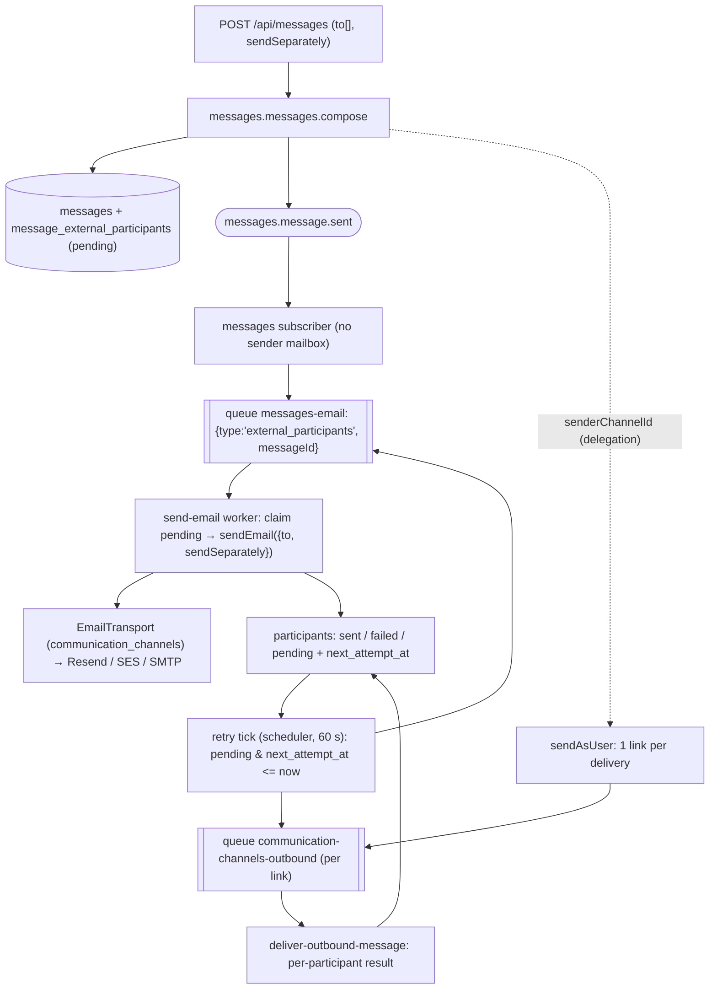
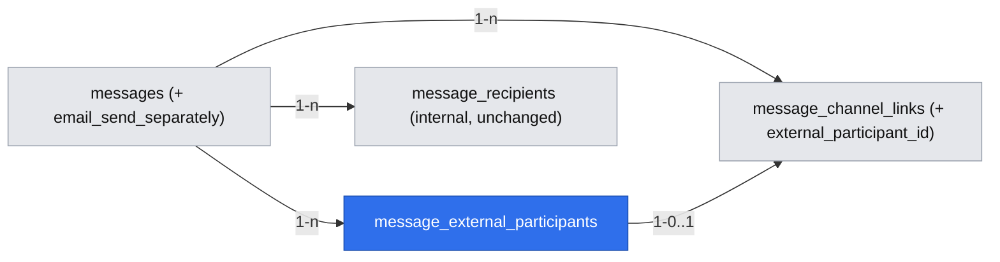

# Messages — Multiple External Recipients and "Send Separately"

## TLDR

**Key Points:**
- Messages → Compose (public/external messages) accepts **up to 50 addresses in "To"** instead of one, plus a **"Send separately"** switch that delivers one email per recipient so recipients never see each other.
- Every external recipient is stored in a new relation `message_external_participants` with its **own delivery status** (`pending | sent | failed`), automatic retries that honor provider `Retry-After`, and a "resend to failed" action. A partially rejected send is reported as **sent + list of failed addresses** instead of a whole-message failure.
- Works for both delivery paths: the **system transport** (`sendEmail()` → Resend/SES/SMTP) and the **user's own mailbox** (`sendAsUser` → Gmail/IMAP).

**Scope:**
- New table `message_external_participants`; new column `messages.email_send_separately`; new column `message_channel_links.external_participant_id` with a relaxed unique index.
- Compose, reply and forward API/UI for multiple "To" + "Send separately"; on `send-as-user` (the only API with external CC/BCC) 400 when "Send separately" is combined with CC/BCC.
- Additive `sendEmail()` contract: `to: string | string[]`, `sendSeparately?`, transport `recipients?` + `supportsMultipleRecipients?`, optional `EmailSendResult`.
- Per-recipient delivery status, retries, configurable retry window/delay, IMAP accepted/rejected fix, "resend to failed", failure notification.
- Inbound ingest records **extra** To/CC participants (not the sender) so CC'd people become searchable.

**Out of scope:** scheduling (see `2026-11-19-messages-scheduled-send.md`), CRM compose dialog (`ComposeEmailDialog`) changes, provider batch APIs, bounce (DSN) processing, throttling.

**Concerns:**
- Relaxing `message_channel_links_message_uq` changes an idempotency guarantee the outbound delivery command relies on today; it moves to per-participant level.
- `sendEmail()` / `EmailTransport` are public contracts implemented by third parties; every change below is additive.

## Overview

Operators use Messages → Compose to write to customers. Today one compose reaches exactly one external address, so writing to a small group means repeating the compose, and there is no way to email several people individually in one action. The feature targets employees sending tens (not hundreds) of emails per compose.

> **Market Reference**: Gmail (Workspace "mail merge"/individual sends) and Front ("send individually") deliver one copy per recipient from a single compose and track delivery per recipient. **Adopted:** single compose → per-recipient copies, per-recipient status. **Rejected:** template variables/personalization and unsubscribe handling (marketing-campaign scope), provider batch APIs (see Alternatives).

## Problem Statement

1. `messages.external_email` holds **one** address. For mailbox sends the full To/CC/BCC lists live only in `message_channel_links.channel_metadata` JSON (`send-as-user.ts:254`), which is not searchable and not linkable to CRM contacts. Search (`GET /api/messages?externalEmail=`, `messages/api/route.ts:250`) only matches `external_email_hash`, so a message to `a, b, c` is found by `a` only.
2. **Partial rejection is reported as total failure.** `channel-smtp` returns `failed` when the relay rejects some recipients; `deliver-outbound-message.ts:472` throws and the failure path (`:563`) stores only `lastError` — the accepted list is lost. `sendSystemEmail` throws the same way. Users then resend to everyone: accepted recipients get duplicates, rejected ones still get nothing.
3. **Retries cannot survive provider limits.** The outbound worker retries 3 times with 1/2/4 s backoff (`computeBackoffMs`, `OUTBOUND_DELIVERY_MAX_ATTEMPTS = 3`); a Gmail daily-limit 429 (blocked for hours) always ends in failure. `channel-imap/lib/smtp-client.ts` drops nodemailer's `accepted`/`rejected`, so IMAP partial rejections look like full success.
4. `sendEmail()` accepts a single `to: string`, so the system transport cannot address several recipients even though the Resend/SES/SMTP adapters already accept address lists (`toAddressList(meta.to)`).

## Proposed Solution

One `Message` remains the information carrier until it is handed to a transport. Its external recipients are rows in `message_external_participants`. At delivery time:

- **System transport** (no sender mailbox): the `messages-email` worker loads the message's `pending` participants and calls `sendEmail({ to: [...], sendSeparately })` once; the result is written back per participant.
- **User mailbox** (`senderChannelId` set): one `MessageChannelLink` per delivery — N links in "send separately" mode (one per participant), one link otherwise. Reply matching keeps working because `thread-matcher` resolves replies by each link's own `channel_metadata.messageId` (`thread-matcher.ts:305`).

A message counts as delivered when at least one participant is `sent`; participants that ended `failed` are listed in the UI with "Resend to failed".

### Design Decisions

| Decision | Rationale |
|----------|-----------|
| `external_email` stays the **primary counterpart** (sender for inbound, first "To" for outbound); not deprecated | Inbound pipelines (`ingest-inbound-message.ts:393`, `inbox_ops/lib/messagesIntegration.ts:130,192`) and every reader keep working; no row per inbound message |
| Participants table stores **all** outbound recipients (including the first) but only **extra** inbound To/CC (excluding sender and own mailbox) | Outbound needs per-recipient status for everyone; inbound rows only where they add information, bounding growth during history imports (up to 50 000 messages/channel) |
| One message, N deliveries (not N messages) in "send separately" mode | The message is the editable carrier; delivery fan-out happens only at hand-off |
| Link per participant, unique index relaxed | Each delivered email needs its own Message-ID, status and retry; matcher already resolves per link |
| Message `sent` when ≥ 1 participant accepted | Prevents "nothing arrived" misreading and duplicate resends |
| Resend creates a **new message in the same thread** addressed to `failed` participants only | Sent messages are immutable; history stays truthful |
| "Send separately" + CC/BCC → **400** | Each of N copies would carry the same CC/BCC, multiplying copies to CC/BCC recipients N-fold; irreversible once sent, so reject rather than guess |
| `sendEmail` keeps `ResolvedEmailPayload.to: string`; adds `recipients?` behind a transport flag | Widening a field third-party transports implement would break them (`BACKWARD_COMPATIBILITY.md` §2, cf. `TelemetryProvider`) |
| `sendSeparately` fan-out happens inside `sendEmail()` | Works with every transport, including third-party ones, with zero transport changes |

### Alternatives Considered

| Alternative | Why Rejected |
|-------------|-------------|
| N separate `Message` rows grouped by `send_batch_id` | Editing/cancelling/listing becomes batch logic; contradicts "message is the carrier" |
| Store inbound sender in the participants table (`role: from`) | One extra row per inbound message (import of 50 000) for no new information; `external_email` already holds it |
| Merge with internal `message_recipients` | Different state (inbox read/archive vs delivery), different keys (user id vs encrypted email), hot inbox index; 24 consumers incl. `communication_channels` |
| Widen `ResolvedEmailPayload.to` to `string \| string[]` | Breaks third-party transports at compile/run time |
| Provider batch APIs (Resend `/emails/batch`) now | Real gain only for Resend; atomic batch fails all on one bad address; SES bulk needs SES templates; tens of recipients fit the loop + retry. Extension point documented below |
| Force "send separately" when no sender mailbox | System transport is expected to be used often; multi-"To" there is a requirement |

## User Stories / Use Cases

- **Employee** sends one offer to 12 contacts **separately** so that no contact sees the others' addresses.
- **Employee** sends one message to 3 people **together** so that they can reply-all to each other.
- **Employee** sees that 2 of 12 addresses **failed** and resends only to those two, without duplicating to the other ten.
- **Employee** searches by an address that was only **CC'd** on an inbound email and finds the message.
- **Operator** configures how long delivery may keep retrying and the default retry delay without a rebuild.

## Architecture



**Takeaway:** compose and both delivery paths stay as they are; the new parts are the participants relation, per-participant results flowing back from transports, and a retry tick that re-enqueues due participants.

### Cross-module touchpoints

| Touchpoint | Mechanism | Owner of glue | Module absent |
|---|---|---|---|
| `messages` → `communication_channels` mailbox send | existing DI soft-resolve of `communicationChannelsSendAsUser` (`composeSenderDelegation.ts`) | `messages` | 422 as today when `senderChannelId` given without channels |
| `communication_channels` reads/writes participant rows by id | FK id `message_channel_links.external_participant_id`; reads via `findWithDecryption` on the `messages` entity, as `outbound-bridge` already does for `Message` | `communication_channels` | n/a (channels already depends on messages) |
| Ingest writes extra inbound participants | inside existing `messages.messages.compose` command input (`externalParticipants`), not a direct table write | `messages` command | n/a |
| CRM email interactions (`customers`) | unchanged event `communication_channels.message.sent`, emitted **once per link**; `customers/subscribers/link-channel-message-sent.ts` therefore creates **one CRM interaction per recipient** for a separate send (intended: each person got their own email) and one for a joint send. The thread join in `link-channel-message-handler.ts:298` (`mcl.message_id = thread_m.id`) must de-duplicate (`DISTINCT` / `EXISTS`) now that a message can have N links | `customers` (existing subscriber) | n/a |
| Retry tick | `@open-mercato/scheduler` schedule registered in `messages/setup.ts` (soft: `hasRegistration('schedulerService')`) | `messages` | delayed re-enqueue still retries; no recovery of jobs lost on restart |

### Commands & Events

- **Command** `messages.messages.compose` — input gains `externalEmails?: string[]`, `sendSeparately?: boolean`, `externalParticipants?` (ingest only). Undo: existing compose undo deletes the message; participants cascade with it (same command, same transaction).
- **Command** `messages.messages.resend_failed` (new) — creates a new message in the same thread addressed to the source message's `failed` participants. Undo: delete the created message (not reversible once delivered — documented).
- **Event** `messages.message.email_sent` / `messages.message.email_failed` (existing) — payload gains optional `participantId`, `email`, `role` (additive).
- **Event** `messages.message.delivery_finished` (new, `clientBroadcast: true`) — emitted once no participant of the message is `pending`; payload `{ messageId, sentCount, failedCount }`.
- **Notification type** `messages.delivery_failed` (new) — to the sender when `delivery_finished.failedCount > 0`; lists failed addresses, links to the message ("Resend to failed").

## Data Models

### MessageExternalParticipant — table `message_external_participants` (new, module `messages`)

| Column | Type | Notes |
|---|---|---|
| `id` | uuid PK | |
| `message_id` | uuid, not null | FK id → `messages.id` (same module; ON DELETE CASCADE) |
| `role` | text, not null | `to \| cc \| bcc` |
| `email` | text, not null | **encrypted** |
| `email_hash` | text, not null | blind index (`hashField`) |
| `name` | text, nullable | **encrypted** |
| `delivery_status` | text, nullable | `pending \| sent \| failed`; NULL for inbound rows |
| `delivery_error` | text, nullable | provider message, no credentials |
| `next_attempt_at` | timestamptz, nullable | retry/claim time |
| `sent_at` | timestamptz, nullable | provider acceptance time |
| `tenant_id`, `organization_id` | uuid | scoping |
| `created_at`, `updated_at` | timestamptz | |

Indexes: `(message_id)`; `(tenant_id, organization_id, email_hash)`; partial `(next_attempt_at) WHERE delivery_status = 'pending'`; unique `(message_id, role, email_hash)`. `email_hash` is always computed with the **current** hash version; search matches via `lookupHashCandidates` (all versions); backfill checks existence with the same candidate list before insert, so it stays idempotent across hash versions.

`messages/encryption.ts` gains `{ entityId: 'messages:message_external_participant', fields: [{ field: 'email', hashField: 'email_hash' }, { field: 'name' }] }`. All reads use `findWithDecryption`.

### Message — table `messages` (changed)
- `email_send_separately` boolean, not null, default `false`.
- `external_email` / `external_email_hash` — unchanged semantics: primary counterpart (inbound sender, outbound first "To").

### MessageChannelLink — table `message_channel_links` (changed, module `communication_channels`)
- `external_participant_id` uuid, nullable — FK id only (cross-module, no ORM relation). Set per link in "send separately" mode; NULL for a joint send and for legacy rows.
- Replace unique `message_channel_links_message_uq (message_id)` with two partial unique indexes: `(message_id) WHERE external_participant_id IS NULL` and `(message_id, external_participant_id) WHERE external_participant_id IS NOT NULL`.
- Participants are the **source of truth**. The delivery command builds `to/cc/bcc` from the participants of the link (all participants for a joint send, one for a separate send) and passes them to adapters (`convertOutbound`/`sendMessage` metadata, contract unchanged). It also keeps writing the **actual per-link `to` and `cc` (never `bcc`)** into `channel_metadata` as a derived snapshot, because `customers/data/enrichers.ts:440-441` reads `channel_metadata.to/cc` into `toAddresses`/`ccAddresses` of CRM email interactions.
- `messages.external_email_sent_at` / `external_email_failed_at` / `external_email_error` (read by existing code) are kept up to date as a summary: `sent_at` = first participant acceptance; `failed_at` + `error` only when **all** participants ended `failed`.



## API Contracts

### `POST /api/messages` (compose, changed — additive)
- New: `externalEmails?: string[]` (1..50, each `z.string().email()`), `sendSeparately?: boolean` (default `false`).
- Command-level (not HTTP) input `externalParticipants?: { email, name?, role: 'to' | 'cc' | 'bcc' }[]` used by `sendAsUser` (mailbox CC/BCC) and by inbound ingest. `externalEmails` maps to `role: 'to'`. Without it mailbox CC/BCC would never become participants and would be dropped at delivery.
- Messages → Compose has no external CC/BCC field, so the CC/BCC + "Send separately" rule cannot trigger here; it applies on `send-as-user`.
- Existing `externalEmail?: string` kept; when both are sent → 400 `fieldErrors.externalEmails`. `externalEmail` alone is treated as `externalEmails: [externalEmail]`.
- `visibility = 'public'` requires ≥ 1 external address (unchanged rule, now on the list); internal recipients must stay empty (unchanged).
- Response unchanged: `{ id, threadId }`.

### `POST /api/communication_channels/send-as-user` and the `sendAsUser` facade (changed — additive)
- New `sendSeparately?: boolean`.
- `superRefine`: `sendSeparately && to.length > 1 && (cc?.length || bcc?.length)` → **400** with `fieldErrors.cc` / `fieldErrors.bcc`, message key `messages.errors.sendSeparatelyWithCopies`.
- New facade input `messageId?` is **not** part of this spec (see scheduling spec).

### Reply and forward (`replySchema`, `forwardSchema` — `messages/data/validators.ts:258,294`, changed — additive)
- Same new fields as compose: `externalEmails?: string[]`, `sendSeparately?: boolean` (maintainer decision: "Send separately" is available in replies too).
- Reply default addressee: `external_email` (the counterpart). **Reply all** pre-fills `externalEmails` from the source message's participants with `role: 'to' | 'cc'` (never `bcc`) plus `external_email`, minus the sender's own mailbox.

### `GET /api/messages?externalEmail=` (changed semantics, same shape)
- Matches `messages.external_email_hash IN (...)` **OR** `EXISTS (participant with email_hash IN (...))`, scoped by `tenant_id` + `organization_id`.

### `GET /api/messages/[id]` (changed — additive)
- Response gains `externalParticipants: Array<{ id, role, email, name, deliveryStatus, deliveryError, sentAt }>` and `emailSendSeparately`.

### `POST /api/messages/[id]/resend-failed` (new)
- Guard: `requireAuth`, `requireFeatures: ['messages.compose']`; only the original sender.
- Request: `{ participantIds?: string[] }` (default: all `failed`); every id must be `failed` on this message → else 409.
- Effect: compose a new message in the same thread, same subject/body/sender channel/`sendSeparately`, `externalEmails` = selected failed addresses.
- Response: `{ id, threadId }`. Errors: 404, 403, 409 (nothing failed / ids not failed). `openApi` exported.

### Shared contract: `@open-mercato/shared/lib/email` (changed — additive)
```ts
type SendEmailOptions = { to: string | string[]; sendSeparately?: boolean; /* existing fields */ }
type ResolvedEmailPayload = { to: string; recipients?: string[]; /* existing */ } // to = first address
type EmailTransport = { id; send(p): Promise<void>; sendWithResult?(p): Promise<EmailSendResult>; isConfigured?; supportsMultipleRecipients?: boolean }
type EmailSendResult = { accepted: string[]; rejected: { address: string; error: string }[]; retryAt?: Date }
function sendEmail(o: SendEmailOptions): Promise<EmailSendResult> // was Promise<void>; callers ignoring it are unaffected
```
- `sendSeparately: true` → `sendEmail` loops, one transport call per address with `to: <address>`, results merged.
- More than one address, `sendSeparately` falsy, transport without `supportsMultipleRecipients` → throws `[internal] EMAIL_TRANSPORT_MULTI_RECIPIENT_UNSUPPORTED` (never silently sends to the first address only).
- `send()` keeps its published `Promise<void>` signature; a transport without `sendWithResult` is called through `send()` and a resolved call counts as all addresses accepted.
- **`sendEmail()` still throws when `accepted.length === 0`** (all rejected), preserving today's contract for its 17 existing callers (auth reset, invitations, notifications, …) that rely on an exception; only partial rejection returns normally. Unit test required.
- `communication_channels` transport sets `supportsMultipleRecipients: true`, passes `recipients` to `channelMetadata.to`, and returns accepted/rejected from `sendWithResult` instead of throwing on partial rejection; `retryAt` from HTTP `Retry-After` on 429.
- **Extension point (not implemented):** a future optional `sendBatch?(payloads): Promise<EmailSendResult[]>` + `maxBatchSize?` on `EmailTransport`, used by `sendSeparately` when present.

### Queue `messages-email` (changed — additive)
- New job `{ type: 'external_participants', messageId, tenantId, organizationId }`. The existing `external` job type stays handled for jobs enqueued before deploy; the subscriber stops creating it.

## Delivery, Status and Retry

- **Claim:** worker/command claims participants with `UPDATE ... SET next_attempt_at = now() + lock WHERE delivery_status = 'pending' AND (next_attempt_at IS NULL OR next_attempt_at <= now()) RETURNING ...` — same pattern as today's `claimExternalDelivery`.
- **Accepted** → `sent`, `sent_at`. **Rejected permanently** (5xx, address rejected) → `failed`, `delivery_error`. **Transient** (429, 4xx SMTP, 5xx HTTP, network) → stays `pending`, `next_attempt_at = retryAt ?? now + OM_EMAIL_DELIVERY_RETRY_DELAY_SECONDS`.
- **Window:** a participant still `pending` after `OM_EMAIL_DELIVERY_MAX_HOURS` from message `sent_at` → `failed` (`delivery_error = 'delivery window exceeded'`).
- **Reauth:** channel `requires_reauth` → all `pending` participants of that delivery → `failed` immediately (no self-recovery).
- **Link status:** `sent` when ≥ 1 of its participants `sent`; `failed` when all failed; otherwise `pending`. The in-worker 3× backoff stays for network flakes; longer waits go through `next_attempt_at` + retry tick.
- **Re-enqueue (primary):** after a transient outcome the worker re-enqueues its own job with `delayMs = next_attempt_at - now` (no coalescing key, per `packages/queue` guidance on `delayMs`).
- **Retry tick (safety net):** queue `messages-email-retry`, scheduler `interval 60s` per organization (registered in `messages/setup.ts` `seedDefaults` + upgrade action for existing tenants). It re-enqueues messages whose due `pending` participants have no live job (lost after restart) on the right path (system job or channel outbound job per link). With the `scheduler` module disabled, retries still run through re-enqueue; only lost-job recovery is missing.
- **Gmail:** sends the whole message, no per-address result — accepted/rejected applies to all its participants; parse the retry time from the 429 body in addition to `Retry-After` (`gmail-client.ts`).
- **IMAP:** `channel-imap/lib/smtp-client.ts` returns `accepted`/`rejected` like `channel-smtp`.

## Internationalization (i18n)

`messages.compose.to`, `messages.compose.toPlaceholder`, `messages.compose.toLimit`, `messages.compose.sendSeparately`, `messages.compose.sendSeparatelyHint`, `messages.errors.sendSeparatelyWithCopies`, `messages.errors.tooManyRecipients`, `messages.detail.participants`, `messages.detail.deliveryStatus.{pending,sent,failed}`, `messages.detail.failedAddresses`, `messages.actions.resendFailed`, `messages.notifications.deliveryFailed.{title,body}` — all locales (`en`, `pl`, `de`, `es`, `ko`).

## UI/UX

- **Compose (Messages → Compose, public visibility):** "External email" becomes **"To"** using `TagsInput` (`@open-mercato/ui/backend/inputs/TagsInput`) with email validation per chip and a counter (max 50). Below it a **"Send separately"** switch with hint "Each recipient gets their own copy and does not see the others". Field errors via `createCrudFormError` / `FormField`.
- **Message detail:** a "Recipients" section listing participants with `StatusBadge` (pending/sent/failed); when any `failed`, an `<Alert variant="warning">` "Not delivered to N addresses" with the list and a **"Resend to failed"** button (confirmation via `useConfirmDialog`, mutation through `useGuardedMutation`). Recipients of a separately sent message are shown as a list, not as a header line.
- Dialog shortcuts (`Cmd/Ctrl+Enter`, `Escape`) and `aria-label` on icon buttons as per DS rules; semantic status tokens only.
- CRM `ComposeEmailDialog` is unchanged.
- A separate send through a mailbox appends **N copies** to the mailbox's Sent folder (one per recipient) — expected, mentioned in the switch hint for mailbox senders.

## Configuration

| Env | Default | Meaning |
|---|---|---|
| `OM_EMAIL_DELIVERY_MAX_HOURS` | `24` | after this, `pending` participants become `failed` |
| `OM_EMAIL_DELIVERY_RETRY_DELAY_SECONDS` | `300` | retry delay when the server gave no `Retry-After` |

Read at call time with positive-int validation and built-in fallback (pattern: `communication_channels/lib/import-history-limits.ts`); documented as commented entries in `apps/mercato/.env.example`, mirrored to the create-app template (`yarn template:sync:fix`).

## Migration & Compatibility

- **Schema:** additive table + columns; unique index replaced by two partial unique indexes (relaxation, no data rewrite). Generated via `yarn db:generate`, unrelated output removed, snapshot updated for `messages` and `communication_channels`.
- **Backfill (upgrade action `messages.backfill-external-participants`, code not SQL — encryption and hashes are computed by the app):** for outbound messages, create participants from `message_channel_links.channel_metadata.to/cc/bcc` (status from link: `sent`/`delivered`/`read` → `sent`, `failed` → `failed`, else `NULL`) or, for system-path messages, from `external_email` (`external_email_sent_at` → `sent`, `external_email_failed_at` → `failed`). Batched (500/tx), idempotent via the unique index, resumable.
- **Contracts (BACKWARD_COMPATIBILITY.md):** `SendEmailOptions`, `ResolvedEmailPayload`, `EmailTransport`, `sendEmail` return type, compose/send-as-user schemas, `messages.message.email_*` payloads, `GET /api/messages/[id]` response — all additive. `messages-email` legacy job type still processed. Documented in `UPGRADE_NOTES.md` (custom transports: opt into `supportsMultipleRecipients` and read `recipients`; may return `EmailSendResult`).
- **Behavior change (intentional, documented):** SMTP/IMAP partial rejection now yields `sent` with failed participants instead of a failed message.

## Implementation Plan

### Phase 1 — Participants relation (no UI change)
1. Entity `MessageExternalParticipant`, encryption map, migration + snapshot; unit tests for encryption map registration.
2. Compose command writes participants for outbound (`externalEmails`, first → `external_email`); ingest passes extra inbound To/CC via `externalParticipants` (exclude sender and the channel's own address).
3. `GET /api/messages?externalEmail=` OR-EXISTS filter; `GET /api/messages/[id]` returns participants.
4. Backfill upgrade action. Integration: TC-API-MSG-033 (search finds CC'd inbound participant and 2nd outbound recipient).

### Phase 2 — Shared email contract
1. `SendEmailOptions`/`ResolvedEmailPayload`/`EmailTransport`/`EmailSendResult` changes + `sendSeparately` fan-out; unit tests incl. unsupported-transport error and `void` result.
2. `sendSystemEmail`: `supportsMultipleRecipients`, `recipients`, accepted/rejected result, `retryAt`. `UPGRADE_NOTES.md`.

### Phase 3 — Compose multi "To" + send separately (system path)
1. Compose schema (`externalEmails`, `sendSeparately`, limits, 400 rules); `messages-email` `external_participants` job; worker claim/write-back; legacy job kept.
2. UI: `TagsInput` "To", switch, detail "Recipients" section. Integration: TC-MSG-EMAIL-006 (joint send, one captured email with N "To"), TC-MSG-EMAIL-007 (separately: N captured emails, each one "To"), TC-API-MSG-034 (validation: >50, both `externalEmail` + `externalEmails`).

### Phase 4 — Mailbox path
1. `message_channel_links.external_participant_id`, partial unique indexes; `sendAsUser` creates N links in separate mode; `deliver-outbound-message` builds `to/cc/bcc` from participants, writes per-participant results, idempotency per link; `outbound-bridge` and other `findOne`-by-message callers handle multiple links.
2. `send-as-user` `sendSeparately` + 400 with CC/BCC. Integration (test-seed channel adapter): TC-CHANNEL-EMAIL-HUB-010 (separately → N links, N outbound sends, replies to 2nd recipient thread onto the message), TC-CHANNEL-EMAIL-HUB-011 (400 separately + CC), TC-CHANNEL-EMAIL-HUB-012 (joint send with CC through mailbox: CC delivered, participant `role: 'cc'`, CRM interaction `ccAddresses` filled; separate send to 2 people → 2 CRM interactions, thread view not duplicated).

### Phase 5 — Status, retries, resend
1. Partial result handling (SMTP/IMAP accepted/rejected, IMAP smtp-client fix), link status rule, Gmail 429 body parsing.
2. Retry tick schedule + upgrade action; env config + `.env.example` + template sync; window expiry; reauth → failed.
3. `messages.message.delivery_finished` event, `messages.delivery_failed` notification; `resend-failed` command + route + UI action.
4. Integration: TC-API-MSG-035 (partial rejection via test transport → message sent, 1 failed participant), TC-API-MSG-026 (resend-failed addresses only failed participants; 409 when none), TC-API-MSG-027 (transient 429 with `Retry-After` keeps `pending` and sets `next_attempt_at`).

### File Manifest (main)
| File | Action |
|---|---|
| `packages/core/src/modules/messages/data/entities.ts`, `encryption.ts`, `data/validators.ts`, `commands/messages.ts`, `api/route.ts`, `api/[id]/route.ts`, `api/[id]/resend-failed/route.ts`, `workers/send-email.worker.ts`, `subscribers/message-notification.ts`, `events.ts`, `notifications.ts`, `setup.ts`, `components/ComposeMessagePageClient.tsx`, message-detail panels, `i18n/*.json`, `migrations/*` | Modify / Create |
| `packages/shared/src/lib/email/{send,transport}.ts` | Modify |
| `packages/core/src/modules/communication_channels/{data/entities.ts,lib/system-email.ts,lib/send-as-user.ts,api/post/send-as-user/route.ts,commands/deliver-outbound-message.ts,commands/ingest-inbound-message.ts,subscribers/outbound-bridge.ts,migrations/*}` | Modify |
| `packages/channel-imap/src/modules/channel_imap/lib/smtp-client.ts`, `packages/channel-gmail/src/modules/channel_gmail/lib/gmail-client.ts` | Modify |
| `packages/core/src/modules/configs/lib/upgrade-actions.ts` | Modify (backfill + retry-tick registration) |
| `apps/mercato/.env.example` + create-app template | Modify |

### Testing Strategy
- Unit: `sendEmail` fan-out/flag/result merge; claim SQL; status transitions; 400 rules; backfill mapping.
- Integration (self-contained fixtures, cleanup in `finally`, email capture via `OM_TEST_MODE`, channel via test-seed adapter): TC-API-MSG-026, TC-API-MSG-027, TC-API-MSG-033…035, TC-MSG-EMAIL-006, TC-MSG-EMAIL-007, TC-CHANNEL-EMAIL-HUB-010/011.

## Risks & Impact Review

#### Duplicate delivery after relaxing the link unique index
- **Scenario**: a replayed `messages.message.sent` or worker retry creates a second link/send for the same participant.
- **Severity**: High
- **Affected area**: mailbox sends, recipients' inboxes
- **Mitigation**: partial unique `(message_id, external_participant_id)` and `(message_id) WHERE NULL`; `outbound-bridge` and the command skip in-flight/sent links per participant; atomic participant claim.
- **Residual risk**: provider accepted but our write-back failed (crash) → one retry may duplicate; same as today's at-least-once delivery.

#### Partial write between transport result and participant update
- **Scenario**: crash after provider acceptance, before status write.
- **Severity**: Medium
- **Affected area**: delivery status accuracy
- **Mitigation**: claim sets `next_attempt_at = now + lock`; on restart the participant is retried once; SMTP `messageId` stored for diagnosis.
- **Residual risk**: rare duplicate email; acceptable vs. lost email.

#### Third-party email transports
- **Scenario**: custom transport receives multi-recipient payload it cannot handle.
- **Severity**: Medium
- **Affected area**: installations with custom `registerEmailTransport`
- **Mitigation**: `to` stays `string`; multi only behind `supportsMultipleRecipients`; explicit error otherwise; `sendSeparately` works with any transport.
- **Residual risk**: such installations cannot do joint multi-"To" until they opt in (documented).

#### Retry storm on provider outage
- **Scenario**: provider down; every pending participant retried each tick.
- **Severity**: Medium
- **Affected area**: queues, provider rate limits
- **Mitigation**: `next_attempt_at` honors `Retry-After`/default delay; tick only picks due rows (partial index); window cap.
- **Residual risk**: bounded by `MAX_HOURS`.

#### Tenant isolation
- **Scenario**: search EXISTS or retry tick crosses tenants.
- **Severity**: Critical
- **Affected area**: all message reads
- **Mitigation**: participants carry `tenant_id`/`organization_id`; every query filters both; retry tick is per-organization schedule with scope payload.
- **Residual risk**: none known.

#### Backfill duration
- **Scenario**: large installs (history imports) take long to backfill.
- **Severity**: Low
- **Affected area**: upgrade window
- **Mitigation**: only outbound messages; batched, resumable, idempotent; app keeps working (search falls back to `external_email` for un-backfilled rows).
- **Residual risk**: old CC'd outbound recipients unsearchable until backfill completes.

#### Storage growth
- **Scenario**: inbound CC rows on large imports.
- **Severity**: Low
- **Mitigation**: inbound rows only for extra To/CC; no row for sender/own mailbox.
- **Residual risk**: proportional to CC usage.

#### Rolling back the channels migration drops separate-send links
- **Scenario**: `Migration20261119130000_communication_channels.down()` must restore the original unique `(message_id)` index, which cannot hold while a message has one link per recipient.
- **Severity**: Medium
- **Affected area**: `message_channel_links` rows created by "send separately" through a mailbox
- **Mitigation**: `down` deletes rows with `external_participant_id IS NOT NULL` before restoring the index; documented in the PR and `UPGRADE_NOTES.md`.
- **Residual risk**: after a rollback, reply threading and CRM interactions for those separate sends are lost. Rollback is a last resort.

#### Messages without an organization are not covered by the retry tick
- **Scenario**: the retry tick runs one schedule per organization; a message with `organization_id IS NULL` whose delayed re-enqueue job is lost (restart) is never picked up again.
- **Severity**: Low
- **Affected area**: external delivery of organization-less messages
- **Mitigation**: the worker's own delayed re-enqueue still retries them; only lost-job recovery is missing.
- **Residual risk**: such participants stay `pending` until the next delivery attempt for that message.

## Implementation decisions (2026-11-20)

Decisions taken while implementing, with their reasons. They refine the design above; where they differ, this section wins.

| Decision | Reason |
|---|---|
| A transient failure keeps the participant **`pending`** with `next_attempt_at`; it never goes back to a user-editable state | (Maintainer decision.) A "scheduled" state would let the user edit a message that is already partly delivered and would show an app-chosen send time as if the user picked it; per-recipient statuses would also lose track of who already received it |
| One function (`settleExternalParticipants`) writes every outcome under a per-message advisory lock; only the write that moves the last participant out of `pending` emits `messages.message.delivery_finished` | Several links of one message can finish concurrently; the event and the failure notification must fire exactly once |
| Both delivery paths **claim** participants (`next_attempt_at` lock) before sending; a job finding nothing due returns `not_due` and sends nothing | The retry tick and delayed re-enqueue can both enqueue the same delivery; claiming makes duplicate jobs harmless |
| Retry timing comes from the command: provider `retryAt` → else the worker's short backoff (`transientRetryDelayMs`, first attempts on the mailbox path) → else `OM_EMAIL_DELIVERY_RETRY_DELAY_SECONDS`, capped by the window; `OUTBOUND_DELIVERY_MAX_ATTEMPTS` applies only to legacy links without participants | Two independent retry loops (worker attempts and `next_attempt_at`) fought each other; one source of truth avoids premature failure and double sends |
| Retry-tick schedule is **module-owned** (`sourceType: 'module'`), not on the user-facing scheduler allowlist; registered in `seedDefaults`, `onOrganizationCreated` and an upgrade action | The scheduler dispatches module rows by queue ownership (`canDispatchScheduleQueueTarget`); allowlisting would let API users schedule the tick; `core` cannot depend on `@open-mercato/scheduler` |
| Mailbox jobs from the retry tick go through the DI facade `communicationChannelsEnqueueOutboundDelivery` | `messages` must not import `communication_channels` (module decoupling test) |
| `sendEmail()` reports per-address `transient`/`retryAt` through `EmailSendError` / `readEmailDeliveryErrorHints`; an error with no hint (custom transport) is treated as transient, bounded by the window | Lets the system path tell a 429 from a hard rejection without changing the transport contract; unknown errors must not fail recipients that could still succeed |
| Partial rejections inside an accepted SMTP/IMAP send are always permanent (`failed`) | SMTP gives no per-address retry hint after `DATA`; resending to the accepted addresses would duplicate |
| "Resend to failed" forces **send separately** when any failed address was BCC | A joint resend would expose the BCC addresses in the To header |
| `messages.delivery_failed` notification is deduplicated per message (`groupKey`) and lists at most 10 addresses | Avoids notification floods on large sends; the full list is on the message |
| Drafts store participants with `delivery_status = NULL`, flipped to `pending` on send | Prerequisite for scheduled send (a scheduled message is a draft) and keeps drafts out of retry/tick queries |
| `sendAsUser` passes recipients through the command-level `externalParticipants` (max 500), not `externalEmails` (max 50) | Mailbox CC/BCC must keep their role, and a long CC list must not fail compose |
| CRM thread inheritance ignores links with `external_participant_id` | A reply must not inherit every separately-addressed recipient's person record |
| Test-seed adapter: `+reject@` ⇒ partial rejection, `+ratelimit@` ⇒ transient 429 (`retryAt` +120 s) | `OM_TEST_MODE` accepts every system-transport send, so integration tests exercise failures through the mailbox path |

## Final Compliance Report — 2026-11-19

### AGENTS.md Files Reviewed
- `AGENTS.md` (root), `BACKWARD_COMPATIBILITY.md`, `.ai/specs/AGENTS.md`, `.ai/qa/AGENTS.md`, `packages/core/AGENTS.md` (API Routes, Events, Encryption, Cross-Module Coupling), `packages/ui/AGENTS.md`, `packages/queue/AGENTS.md`, `packages/shared/AGENTS.md`

### Compliance Matrix
| Rule Source | Rule | Status | Notes |
|---|---|---|---|
| root AGENTS.md | No direct ORM relationships between modules | Compliant | `external_participant_id` is an FK id |
| root AGENTS.md | Filter by organization_id | Compliant | all new queries scoped |
| root AGENTS.md | `findWithDecryption` for reads; encryption maps | Compliant | `messages/encryption.ts` entry with `hashField` |
| root AGENTS.md | zod validation in `data/validators.ts` | Compliant | compose/send-as-user/resend schemas |
| root AGENTS.md | Optimistic locking on new user-editable entities | N/A | participants are not user-edited; sent messages immutable |
| root AGENTS.md | Never hard-code user-facing strings | Compliant | i18n keys listed |
| packages/core AGENTS.md | API routes export `metadata` + `openApi` | Compliant | `resend-failed` route |
| packages/core AGENTS.md | Cross-module via events / DI soft-resolve | Compliant | existing delegation; no new direct imports into messages from channels beyond existing entity reads |
| BACKWARD_COMPATIBILITY.md | Types/signatures additive only | Compliant | see Migration & Compatibility |
| BACKWARD_COMPATIBILITY.md | DB schema: no narrowing | Compliant | unique index relaxed, columns added |
| .ai/qa AGENTS.md | Integration tests in same change, self-contained | Compliant | TC list per phase |
| DS rules | Status tokens, primitives | Compliant | `StatusBadge`, `Alert`, `TagsInput` |

### Internal Consistency Check
| Check | Status | Notes |
|---|---|---|
| Data models match API contracts | Pass | participants fields exposed in detail |
| API contracts match UI/UX | Pass | |
| Risks cover all write operations | Pass | compose, delivery, resend, backfill |
| Commands defined for all mutations | Pass | compose, resend_failed; status writes are worker side-effects |
| Cache strategy covers read APIs | N/A | messages list/detail are not cached today |

### Verdict
- **Compliant after review revision (2026-11-19).**

## Changelog
### 2026-11-19
- Initial specification (decision record: https://claude.ai/artifact/N1wktbwtGagsRac7C3ujfV, sections H–L).

### 2026-11-19 — Phase 4 implemented
- `message_channel_links.external_participant_id` + partial unique indexes; `sendAsUser` passes to/cc/bcc as participants, supports `sendSeparately` (N links, N outbound jobs, 400 with copies); `deliver-outbound-message` addresses from participants per link, writes per-participant results, treats SMTP/IMAP partial rejection as sent.
- Link lookups made N-link safe: outbound bridge (all links + per-participant fan-out for `email_send_separately`), outbound reply reference; CRM thread inheritance skips separate links; Person thread view shows a message once.
- Follow-up gaps for scheduling: drafts store participants (`delivery_status` NULL until sent) and draft PATCH replaces them; reply/forward accept `externalEmails` + `sendSeparately`; reply-all pre-fill in the composer.

### 2026-11-20 — Phase 5 implemented
- Transient vs permanent on both paths: shared `EmailSendError` / `readEmailDeliveryErrorHints` carry `transient` + `retryAt` (per address on separate sends); `sendSystemEmail` classifies with `error-classification.ts` (SMTP 4xx now transient); additive `SendMessageResult.transient` / `retryAt` (Gmail surfaces them, incl. "Retry after <timestamp>" from the 429 body); IMAP `smtp-client` returns `accepted`/`rejected` and the adapter reports partial rejection like `channel-smtp`.
- Both paths claim participants (`next_attempt_at` lock) and settle them via `settleExternalParticipants` under a per-message advisory lock, which emits `messages.message.delivery_finished` exactly once. Transient → `pending` + `next_attempt_at` (provider retry time, else the worker's short backoff for the first attempts on the mailbox path, else `OM_EMAIL_DELIVERY_RETRY_DELAY_SECONDS`), capped at the `OM_EMAIL_DELIVERY_MAX_HOURS` window, then `failed` with `delivery window exceeded`. Reauth: one forced-refresh retry, then all pending participants of the link `failed`. Workers re-enqueue at `next_attempt_at` (no coalescing); the outbound worker's `OUTBOUND_DELIVERY_MAX_ATTEMPTS` cap now applies only to legacy links without participants.
- Retry tick: queue `messages-email-retry`, 60 s per organization (`messages/setup.ts` + upgrade action `messages.register-email-retry-schedule`); re-enqueues due/lost deliveries (system job, or mailbox job per link through the new DI facade `communicationChannelsEnqueueOutboundDelivery`) and expires participants past the window. Not opted into the user-facing scheduler allowlist: module-authored rows dispatch by provenance, and `core` cannot import `@open-mercato/scheduler`.
- Notification `messages.delivery_failed` (deduped per message by `groupKey`); command `messages.messages.resend_failed` + `POST /api/messages/[id]/resend-failed` (a former BCC forces a separate send); detail returns `canResendFailed`; failed-delivery alert with "Resend to failed" on the message detail.
- Integration: TC-API-MSG-035/026/027 through the test-seed mailbox (`+reject@` / `+ratelimit@` fixture recipients).

### 2026-11-20 — Manual QA follow-ups
- Author list folders (`sent`, `drafts`, `scheduled`) show recipients comma-separated with "+N" instead of "(No recipient)": `GET /api/messages` returns an additive `recipientSummary: { labels, total }` for those folders (internal recipients first, then external addresses, to → cc → bcc; `externalEmail` fallback for legacy rows), built by `lib/recipientSummary.ts`.
- The retry tick no longer depends on the `messages.register-email-retry-schedule` upgrade action (its banner is hidden unless `NEXT_PUBLIC_UPGRADE_ACTIONS_ENABLED` is set): both delivery paths call `ensureMessagesEmailRetrySchedule` when a recipient is left pending — idempotent, once per organization per process, never fails the delivery.
- Compose UI: "Send separately" is a plain switch field placed after "Send from" (no bordered row, one-line hint "Each recipient gets a private copy."); without a mailbox selector it sits left-aligned.
- TC-CHANNEL-EMAIL-HUB-012 asserts the CC on the link snapshot: the interactions API loses `_integrations.email` because the `integrations.external-id-mapping` enricher (`*`, lower priority) overwrites `_integrations` with `{}` — pre-existing on `main`, reported separately.

### 2026-11-21 — Attachments through a user mailbox
- Mailbox sends carry attachments when the adapter can send files; every "send separately" copy gets them. Partially addresses upstream #6261 (attachments only). Details in `2026-11-19-messages-scheduled-send.md` → Changelog 2026-11-21 "Attachments through a user mailbox".

### Review — 2026-11-19
- **Reviewer**: Agent (fresh context)
- **Security**: Passed
- **Performance**: Passed
- **Cache**: Passed
- **Commands**: Passed after revision — role-bearing `externalParticipants` command input so mailbox CC/BCC are not lost.
- **Risks**: Passed after revision — CRM enricher keeps per-link `to/cc` snapshot in `channel_metadata`; N links → N CRM interactions documented, thread join de-duplicated; `sendEmail` keeps throwing when nothing is accepted; `external_email_*` summary mapping; reply/forward covered; `customer_entity_id` dropped (no consumer).
- **Scope**: reviewer suggested splitting durable retries (Phase 5) and inbound CC + backfill into follow-up specs; kept as separate phases here per maintainer decision (two specs), each phase = one PR. Retry tick kept per organization to follow the existing `communication_channels` poll-tick pattern.
- **Verdict**: Approved after revision
