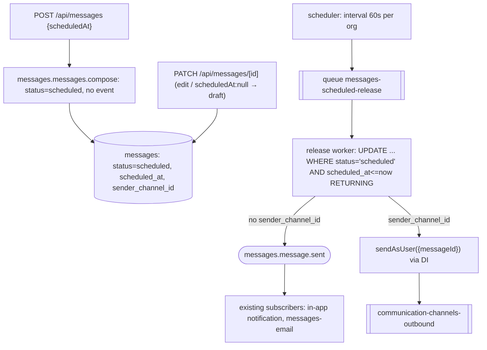
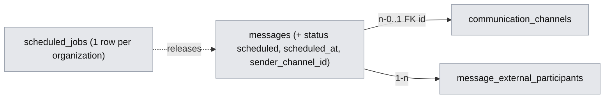

# Messages — Scheduled Send

## TLDR

**Key Points:**
- Messages → Compose gains **"Send later"**: pick a date and time (minute precision, in the user's browser timezone, at most 30 days ahead); the message is stored as **scheduled** and released automatically at that time.
- Until release the scheduled message is **one editable message** (content, recipients, time) protected by optimistic locking; **Cancel** turns it back into a **draft**. After release it can no longer be edited.
- Works for internal messages (scheduling only), external messages through the **system transport**, and external messages through the user's **own mailbox** — the latter by teaching `sendAsUser` to send an **existing** message, which also removes today's 422 for sending a saved draft through a mailbox.

**Scope:**
- `messages.status = 'scheduled'`, `messages.scheduled_at`, `messages.sender_channel_id`.
- Release sweeper on `@open-mercato/scheduler` (60 s), emitting the existing `messages.message.sent` at release.
- Compose/PATCH API for `scheduledAt`, edit and cancel; "Scheduled" folder; scheduled messages hidden from inbox and sent.
- `sendAsUser` "existing message" mode; wall-time helper moved to `@open-mercato/shared`; `OM_MESSAGES_SCHEDULE_MAX_DAYS`.

**Depends on:** `2026-11-19-messages-multiple-recipients.md` (participants and per-recipient status — a mailbox that needs re-authentication at release marks participants `failed`). Ship after its Phase 1.

**Out of scope:** recurring sends, provider-native scheduling (Resend `scheduled_at`), scheduling for non-message emails (password reset, notifications). The CRM compose dialog was out of scope originally and is now in scope — see "2026-11-21 — Send later in CRM and record dialogs".

## Overview

Employees want to prepare an email now and have it go out at a better time (customer's business hours, after a meeting). Open Mercato has no scheduling in any email path; `@open-mercato/scheduler` offers only cron/interval jobs.

> **Market Reference**: Gmail "Schedule send" — server-side hold, edit by cancelling, **cancel returns the message to drafts**; Outlook "Delay delivery". **Adopted:** server-side hold, cancel → draft, minute granularity, user's local time. **Rejected:** provider-native scheduling (only Resend supports it, up to 30 days; Gmail API, SES, SMTP, IMAP do not) — a single app-side mechanism covers every transport.

## Problem Statement

- No way to defer a send; users keep reminders and send manually.
- `sendAsUser` always composes a **new** message (`isDraft: false`, event emitted immediately), so an existing message — a saved draft today (`PATCH /api/messages/[id]` → 422 `senderDraftSendUnsupported`) or a scheduled one tomorrow — cannot be sent through a mailbox.
- `outbound-bridge` skips messages created by `sendAsUser` (`sourceEntityType === 'communication_channels.send_as_user'`), so emitting `messages.message.sent` later is not enough for the mailbox path.
- The DST-safe wall-time conversion (`calendarWallTimeToInstant`) lives in `customers/lib/calendar/timezone.ts`; `messages` must not import from `customers`.

## Proposed Solution

Scheduling lives on `messages` (the carrier), not on delivery records. Compose with `scheduledAt` stores the message as `scheduled`, writes no delivery records and emits no `sent` event. A per-organization sweeper releases due messages atomically (`scheduled → sent`, `sent_at = now`) and then hands them to the same paths as an immediate send:

- **Internal / system transport:** emit `messages.message.sent` → existing subscriber → `messages-email` queue.
- **Mailbox (`sender_channel_id` set):** call `sendAsUser` in **existing-message mode** (DI soft-resolve, as `composeSenderDelegation` does today) → thread mapping, link(s), outbound job.

### Design Decisions

| Decision | Rationale |
|----------|-----------|
| Schedule on `messages` (`status`, `scheduled_at`), not `message_channel_links` | One mechanism for internal, system and mailbox paths; edit stays in one module |
| New status value `'scheduled'` on `MessageStatus` (`'draft' \| 'sent'`); **a scheduled message stays a draft** (`is_draft = true`, `sent_at = NULL`) until release | Every read path that already hides drafts (inbox, sent, thread view `api/[id]/route.ts:172`) hides scheduled messages for free; editing reuses the draft-edit command. Recipient rows are created at compose today (`commands/messages.ts:365`), so `is_draft = false` would leak the message early |
| Release = flip to `sent` + emit `messages.message.sent` | Every existing subscriber (notifications, email, search) behaves exactly as for an immediate send |
| `sendAsUser` existing-message mode + `messages.sender_channel_id` | Channel artefacts are created only at release; also unblocks sending saved drafts through a mailbox |
| Cancel → draft | Nothing is lost; matches Gmail; user can edit and resend/reschedule |
| Minute granularity, ≤ `OM_MESSAGES_SCHEDULE_MAX_DAYS` (30) | Sweeper runs every 60 s; finer precision is not meaningful |
| Browser timezone, store UTC, DST via shared wall-time helper | Same as the rest of the app (no stored user timezone; `Intl…resolvedOptions().timeZone`) |
| No new ACL feature; `messages.compose` covers scheduling | ACL in the app is coarse (`view`/`manage` per entity); no module has a separate schedule feature |
| Only the author edits/cancels | Mirrors `canEditDraft` |

### Alternatives Considered

| Alternative | Why Rejected |
|-------------|-------------|
| Schedule on `message_channel_links` | Not created for system/internal paths; editing would have to update channel payloads |
| `sendAsUser` at compose with link status `scheduled` (variant A) | Edits must touch channel-owned rows; does not fix draft sending |
| Queue `delayMs` until `scheduled_at` | State only in the queue: not listable/editable/cancellable; long delays fragile |
| Provider-native scheduling | Resend only |
| One schedule per message in `scheduled_jobs` | Scheduler supports only cron/interval; thousands of rows for one-shot jobs |

## User Stories / Use Cases

- **Employee** schedules an email to a customer for 09:00 tomorrow so that it arrives in business hours.
- **Employee** opens "Scheduled", edits the text and the time of a pending message before it goes out.
- **Employee** cancels a scheduled message and finds it in drafts.
- **Employee** schedules an internal message to a colleague; the colleague sees nothing and gets no notification until release.
- **Admin** disables the `scheduler` module; users no longer see "Send later" and the API refuses `scheduledAt` with 422.

## Architecture

**Takeaway:** the only new runtime piece is the release worker; everything after release is the existing immediate-send pipeline.

### Cross-module touchpoints

| Touchpoint | Mechanism | Owner | Module absent |
|---|---|---|---|
| Release sweeper | `schedulerService.register` in `messages/setup.ts` `seedDefaults` + upgrade action `messages.register-scheduled-release` (soft: `hasRegistration('schedulerService')`) | `messages` | scheduling disabled: UI hides, API 422 |
| Mailbox release | DI soft-resolve `communicationChannelsSendAsUser` (existing pattern) | `messages` | release marks external participants `failed`, `delivery_error = 'mailbox unavailable'`, notification |
| Author deleted | subscriber `messages:cancel-scheduled-on-user-deleted` on `auth.user.deleted` | `messages` | n/a |
| Wall-time helper | `@open-mercato/shared/lib/time/wall-time` | `shared` | n/a |

### Commands & Events

- **Command** `messages.messages.compose` — input gains `scheduledAt?: Date`, `senderChannelId` stored instead of delegating when scheduled.
- **Command** `messages.messages.update` (existing draft edit) — allowed when `isDraft || status = 'scheduled'`; `scheduledAt: null` → draft. Undo: restore previous snapshot (existing command undo).
- **Command** `messages.messages.release_scheduled` (new, worker-only) — not user-undoable (release is the send).
- **Event** `messages.message.scheduled` (new, `clientBroadcast: true`) — `{ messageId, scheduledAt, recipientUserIds: [author], tenantId, organizationId }`; emitted on schedule and reschedule. The browser broadcast is limited to the author: without an audience it would reach the whole organization before the message is released.
- **Event** `messages.message.sent` (existing) — emitted at release, not at compose, for scheduled messages.

## Data Models

### Message — table `messages` (changed)
| Column | Type | Notes |
|---|---|---|
| `status` | text | adds value `scheduled` (`draft \| sent \| scheduled`) |
| `scheduled_at` | timestamptz, nullable | UTC; set only while `status = 'scheduled'` |
| `sender_channel_id` | uuid, nullable | FK id → communication channel (cross-module, no ORM relation); used when scheduled or draft is sent via a mailbox |
| `sender_delivery_options` | jsonb, nullable | `{ channelMetadata?, inReplyTo?, references? }` replayed by the mailbox hand-off at release (CRM person/visibility, reply threading headers). Server-only; written by `sendAsUser` scheduled compose |

| `scheduled_release_attempts` | int, not null, default 0 | hand-off attempts; capped (see release) |

Index: partial `(scheduled_at) WHERE status = 'scheduled'` (+ tenant/org leading columns). While scheduled: `is_draft = true`, `sent_at = NULL`.

**Read paths that must exclude drafts and scheduled messages** (some leak drafts today because they ignore `is_draft`): unread count `api/unread-count/route.ts:49-57` (cached — add `m.is_draft = false`), folders `archived` and `all` (`api/route.ts:215,233`), search (drafts stay in the token index so the author can search the `drafts`/`scheduled` folders; every folder query that serves recipients filters `is_draft = false`, and global message search is disabled, so the index itself does not leak them), reply/forward of a message (only `is_draft = false`). `drafts` folder excludes `status = 'scheduled'`; new `scheduled` folder shows them. Each path gets an integration assertion (TC-API-MSG-029).

**Columns required from `2026-11-19-messages-multiple-recipients.md`:** `message_external_participants` (Phase 1 of that spec) and `messages.email_send_separately`; per-participant `delivery_status` (its Phase 5) for the reauth-at-release failure path.

No new tables.

## API Contracts

### `POST /api/messages` (compose, changed — additive)
- New `scheduledAt?: string` (ISO 8601 UTC).
- Validation (zod `superRefine`): `scheduledAt > now`; `scheduledAt <= now + OM_MESSAGES_SCHEDULE_MAX_DAYS`; seconds and milliseconds = 0; not combined with `isDraft: true`. Errors → 400 `fieldErrors.scheduledAt` (`messages.errors.scheduleInPast`, `scheduleTooFar`, `scheduleNotMinute`).
- `scheduledAt` with `scheduler` module not registered → **422** `messages.errors.schedulingUnavailable`.
- `senderChannelId` + `scheduledAt`: ownership and `connected` status validated now (same checks as delegation, 409 when not connected); no channel artefacts created.
- Response unchanged `{ id, threadId }`.

### `PATCH /api/messages/[id]` (changed — additive)
- Allowed when `isDraft` **or** `status = 'scheduled'`, author only, `enforceCommandOptimisticLock` on `updated_at` (unchanged mechanism; 409 on conflict and when the message was already released).
- `scheduledAt: string` → (re)schedule (same validation); `scheduledAt: null` on a scheduled message → back to draft (`status = 'draft'`; `sender_channel_id` is **kept**).
- Sending a draft (also "Send now" on a scheduled one) uses `input.senderChannelId ?? message.sender_channel_id`; with a channel it goes through `sendAsUser` existing-message mode (today: 422 `senderDraftSendUnsupported`, `api/[id]/route.ts:405`).

### `GET /api/messages?folder=scheduled` (changed — additive)
- New folder value `scheduled`: sender's messages with `status = 'scheduled'`, ordered by `scheduled_at`. `inbox` and `sent` exclude `status = 'scheduled'`. `pageSize ≤ 100`.
- Detail response gains `scheduledAt`, `senderChannelId`.

### Compose capability
- `GET /api/messages/compose-capabilities` (new, `requireFeatures: ['messages.compose']`) returns `{ schedulingAvailable: boolean, scheduleMaxDays: number }`; `ComposeMessagePageClient` reads it. A messages-owned route instead of the sender-options payload, because sender options come from the optional `communication_channels` API and scheduling must stay discoverable without it.

### `sendAsUser` facade / `POST /api/communication_channels/send-as-user` (changed — additive)
- New `messageId?: string`. When set: load the message (scoped), require author = actor, `visibility = 'public'`, not already linked; build To/CC/BCC from its participants and `email_send_separately`; create thread mapping + link(s) + enqueue; **do not** call compose. Returns the same result shape. 409 when the message is already delivered/linked.

### Queue `messages-scheduled-release` (new)
- Module-owned schedule: registered with `sourceType: 'module'`, `sourceModule: 'messages'`; the scheduler dispatches it because `messages` owns the queue's worker (`scheduler/lib/safeQueueTargets.ts` `canDispatchScheduleQueueTarget`). It is deliberately **not** added to the user-facing safe-queue allowlist, so API users cannot schedule releases themselves. Schedule id via `stableScheduleUuid('messages:scheduled-release:<orgId>')`; registration follows `messages/lib/emailRetrySchedule.ts` (multiple-recipients spec, Phase 5) in `seedDefaults`, `onOrganizationCreated` and an upgrade action.
- The worker runs the command `messages.messages.release_scheduled` per organization:
  1. **Claim** ≤ 100 due messages: `UPDATE ... SET status='sent', is_draft=false, sent_at=now(), updated_at=now(), scheduled_release_attempts = scheduled_release_attempts + 1 WHERE status='scheduled' AND scheduled_at<=now() AND tenant_id=? AND organization_id=? RETURNING id`.
  2. **Side effects per message** (same as an immediate send): search index upsert, unread-count cache invalidation for internal recipients, audit entry, then hand-off — emit `messages.message.sent` (persistent; emitted last) or `sendAsUser({ messageId })`.
  3. **Hand-off failure:** `sendAsUser` returning 409 "already linked" counts as **success** (a previous attempt created the link). Any other exception reverts the message to `status='scheduled', is_draft=true, sent_at=NULL` for retry next tick. After `3` attempts the message goes back to **draft** with a `messages.scheduled_send_failed` notification to the author instead of reverting. The internal/system path emits the event as the last step and never reverts after a successful emit, so recipients are not notified twice.

## Shared wall-time helper

- Move to `packages/shared/src/lib/time/wall-time.ts`: `wallTimeToInstant(date, time, timezone)`, `instantToWallTime(instant, timezone)`, `isValidTimezone(value)`, `resolveBrowserTimezone()`.
- `customers/lib/calendar/timezone.ts` keeps `calendarWallTimeToInstant`, `calendarInstantToWallTime`, `isCalendarTimezone`, `defaultCalendarTimezone` as `@deprecated` re-exports (no behavior change in the CRM calendar).
- DST rules (unchanged): a non-existent local time (spring gap, e.g. 02:30 Europe/Warsaw on the last Sunday of March) → `null` → form error `messages.errors.scheduleTimeDoesNotExist`; an ambiguous time (autumn overlap) → the earlier instant (summer time).
- Client converts the `DatePicker withTime` value with `wallTimeToInstant` in the browser timezone and sends ISO UTC; the API validates the instant only.
- Observed in implementation: the date picker itself already moves a non-existent local time forward (browser `Date` behaviour), so the `scheduleTimeDoesNotExist` error is a safety net for manually typed values and rarely shows.
- Unit tests move with the helper, plus Europe/Warsaw gap and overlap cases.

## Internationalization (i18n)

`messages.compose.sendLater`, `messages.compose.scheduleAt`, `messages.compose.scheduleHint` (shows timezone), `messages.folders.scheduled`, `messages.detail.scheduledFor`, `messages.actions.cancelSchedule`, `messages.actions.sendNow`, `messages.errors.{scheduleInPast,scheduleTooFar,scheduleNotMinute,scheduleTimeDoesNotExist,schedulingUnavailable}` — all locales.

## UI/UX

- **Compose:** split send button — "Send" and "Send later…" (hidden when `schedulingAvailable = false`). "Send later" opens a dialog with `DatePicker withTime` (`@open-mercato/ui/primitives/date-picker`, `minuteStep = 1`), the timezone name as hint, min = now + 1 min, max = now + max days. `Cmd/Ctrl+Enter` submits, `Escape` cancels.
- **Scheduled folder:** list via existing messages list with `folder=scheduled`, column "Scheduled for" in the user's timezone.
- **Detail of a scheduled message:** `<Alert variant="info">` "Scheduled for {date time}" with actions **Edit**, **Change time**, **Cancel schedule** (→ draft, `useConfirmDialog`), **Send now** (one `PATCH { scheduledAt: null, isDraft: false }` — releases immediately through the existing draft-send path). All mutations through `useGuardedMutation`; conflicts surfaced with `surfaceRecordConflict`.
- Internal recipients see nothing until release.

## Configuration

| Env | Default | Meaning |
|---|---|---|
| `OM_MESSAGES_SCHEDULE_MAX_DAYS` | `30` | furthest allowed `scheduledAt` |

Same env pattern as `import-history-limits.ts`; commented entry in `apps/mercato/.env.example`, mirrored to the create-app template.

## Migration & Compatibility

- **Schema:** two nullable columns + partial index; `status` is `text`, the new value needs no DDL. Existing rows unaffected.
- **Contracts:** `MessageStatus` gains a value (additive; consumers that switch exhaustively on it — `api/route.ts` folder switch uses `never` checks — are updated in the same change). Compose/PATCH/list schemas additive; `sendAsUser` input additive; new event and queue.
- **Wall-time helper move:** old import paths kept as `@deprecated` re-exports for ≥ 1 minor; `UPGRADE_NOTES.md` entry.
- **Existing tenants:** upgrade action registers the release schedule per organization.

## Implementation Plan

### Phase 1 — Shared wall-time helper
1. Move helper + tests to `@open-mercato/shared`; deprecated re-exports in `customers`; CRM calendar tests stay green.

### Phase 2 — Scheduling for internal and system-transport messages
1. Columns, migration, `MessageStatus` value, validators (`scheduledAt`, limits, minute), 422 when scheduler absent.
2. Compose stores `scheduled` without event; `messages.message.scheduled`; list folders (`scheduled`, exclusions); PATCH edit/reschedule/cancel → draft with optimistic lock.
3. Release queue + worker + schedule registration (`setup.ts` + upgrade action); revert on hand-off failure.
4. Subscriber on `auth.user.deleted` → scheduled → draft.
5. UI: "Send later" dialog, Scheduled folder, detail actions.
6. Integration: TC-API-MSG-028 (schedule validation: past, > max days, seconds ≠ 0, 422 without scheduler), TC-API-MSG-029 (scheduled internal message absent from recipient inbox, unread count, `all`, `archived`, search and sender "sent"/"drafts"; present in "scheduled"; release makes it visible, increments unread count and notifies once), TC-API-MSG-030 (edit with stale `updated_at` → 409; cancel → draft keeping `senderChannelId`), TC-API-MSG-031 (hand-off failing 3× → draft + `scheduled_send_failed` notification), TC-API-MSG-032 (author deleted → scheduled message becomes draft and is not released), TC-MSG-EMAIL-005 (system path: no captured email before release, one after the release worker runs).
7. Scheduler disabled after scheduling: covered by unit test of the 422 guard plus TC-API-MSG-028; existing scheduled messages remain sendable via "Send now".

### Phase 3 — Mailbox path
1. `messages.sender_channel_id`; `sendAsUser` existing-message mode; release calls it; draft send via mailbox no longer 422.
2. Release with disconnected/reauth channel → participants `failed` + `messages.delivery_failed` notification.
3. Integration (test-seed channel adapter): TC-CHANNEL-EMAIL-HUB-013 (scheduled mailbox message: no link before release, link + outbound send after), TC-CHANNEL-EMAIL-HUB-014 (saved draft sent via mailbox succeeds), TC-CHANNEL-EMAIL-HUB-015 (channel requires reauth at release → participants failed).

### File Manifest (main)
| File | Action |
|---|---|
| `packages/shared/src/lib/time/wall-time.ts` (+ tests) | Create |
| `packages/core/src/modules/customers/lib/calendar/timezone.ts` | Modify (re-exports) |
| `packages/core/src/modules/messages/{data/entities.ts,data/validators.ts,commands/messages.ts,api/route.ts,api/[id]/route.ts,events.ts,setup.ts,workers/release-scheduled.worker.ts,subscribers/cancel-scheduled-on-user-deleted.ts,components/ComposeMessagePageClient.tsx,i18n/*.json,migrations/*}` | Modify / Create |
| `packages/core/src/modules/communication_channels/{lib/send-as-user.ts,api/post/send-as-user/route.ts}` | Modify |
| `packages/core/src/modules/messages/lib/composeSenderDelegation.ts` | Modify (store `senderChannelId` when scheduled) |
| `packages/core/src/modules/configs/lib/upgrade-actions.ts` | Modify |
| `apps/mercato/.env.example` + create-app template | Modify |

### Testing Strategy
- Unit: wall-time gap/overlap; schedule validation; release claim SQL (only due rows, scoped); revert on hand-off failure; status/folder filters.
- Integration (self-contained, cleanup in `finally`; release worker triggered directly in tests instead of waiting for the 60 s tick): TC-API-MSG-028…032, TC-MSG-EMAIL-005, TC-CHANNEL-EMAIL-HUB-013…015.

## Risks & Impact Review

#### Message released but never handed off
- **Scenario**: crash after the `scheduled → sent` commit, before the event/`sendAsUser` call.
- **Severity**: High
- **Affected area**: scheduled external emails
- **Mitigation**: hand-off failures (exceptions) revert to `scheduled`; external participants stay `pending`, so the retry safety net of the multiple-recipients spec re-enqueues them; `OM_EMAIL_DELIVERY_MAX_HOURS` finally marks them `failed` with a notification.
- **Residual risk**: internal-only message released without its `sent` event after a hard crash → no in-app notification (message is still visible in inbox). Acceptable.

#### Double release
- **Scenario**: two workers/instances release the same message.
- **Severity**: High
- **Mitigation**: single atomic `UPDATE ... WHERE status='scheduled' RETURNING`; only the returning worker hands off; `sendAsUser` existing-message mode refuses already-linked messages (409).
- **Residual risk**: none known.

#### Edit racing release
- **Scenario**: user saves an edit while the sweeper releases.
- **Severity**: Medium
- **Mitigation**: release bumps `updated_at`; PATCH uses `enforceCommandOptimisticLock` and requires `status = 'scheduled'` → 409, surfaced via `surfaceRecordConflict`.
- **Residual risk**: user must re-open the (now sent) message.

#### Scheduler disabled after messages were scheduled
- **Scenario**: module disabled with pending scheduled messages.
- **Severity**: Medium
- **Mitigation**: API 422 for new schedules; existing scheduled messages remain listed in "Scheduled" with "Send now"/"Cancel" available.
- **Residual risk**: they do not go out automatically until the module is re-enabled (documented).

#### Wrong send time around DST
- **Scenario**: user picks a non-existent or ambiguous local time.
- **Severity**: Low
- **Mitigation**: shared helper rejects gaps, resolves overlaps to the earlier instant; timezone shown in the dialog.
- **Residual risk**: user in a different timezone than intended (browser timezone assumption).

#### Tenant isolation
- **Scenario**: release worker processes another organization's messages.
- **Severity**: Critical
- **Mitigation**: one schedule per organization with scope payload; claim query filters `tenant_id` and `organization_id`.
- **Residual risk**: none known.

#### Release burst
- **Scenario**: many messages scheduled for the same minute.
- **Severity**: Low
- **Mitigation**: ≤ 100 per run per organization, remainder next tick; delivery retries handle provider 429.
- **Residual risk**: up to a few minutes of delay for large bursts.

#### Concurrent existing-message hand-offs
- **Scenario**: two `sendAsUser({ messageId })` calls for the same message pass the "no outbound link" check at the same moment.
- **Severity**: Low
- **Mitigation**: the release claim is atomic and draft send holds the optimistic lock, so two callers are unlikely; the partial unique indexes on `message_channel_links` still block a duplicate link.
- **Residual risk**: the losing call fails with a database unique-violation error instead of a clean 409.

## Implementation decisions (2026-11-20)

Decisions taken while implementing, with their reasons. Where they differ from the design above, this section wins.

| Decision | Reason |
|---|---|
| Release-schedule is **module-owned** (`sourceType: 'module'`), not on the user-facing scheduler allowlist; registered in `seedDefaults`, `onOrganizationCreated` and upgrade action `messages.register-scheduled-release` | The scheduler dispatches module rows by queue ownership; allowlisting would let API users schedule releases |
| `sendAsUser` existing-message mode refuses a draft (409) and returns explicit codes `already_linked` / `channel_unavailable` | Status codes alone cannot tell "already linked" (success at release) from "mailbox not connected" (fail recipients); a draft must never be delivered through the HTTP route |
| Existing-message mode stamps `sourceEntityType = communication_channels.send_as_user` / `sourceEntityId = channelId` on the message, also when the mailbox is unavailable at release | Outbound bridge, platform email job, retry tick and "Resend to failed" all decide the path from these fields; without the stamp a failed mailbox send could silently fall back to the system sender |
| `messages.message.sent` is emitted **once**, by the messages side, after the hand-off | Mirrors the immediate mailbox send, whose compose emits it once; emitting before the stamp would let the platform sender deliver it too |
| A refused draft/"Send now" hand-off restores the previous state (draft or scheduled with its `scheduledAt`) and returns `fieldErrors.senderChannelId` | The user keeps the message and sees why the mailbox refused it |
| Reply/forward of a draft or scheduled message returns 404 | Recipients must not see or act on a message before it is released |
| Drafts and scheduled messages stay in the search token index (reverted after integration run, 2026-11-20) | Skipping them broke the author's search in the `drafts` folder (TC-API-MSG-008); recipients cannot find them anyway because every recipient-facing folder filters `is_draft = false` and global message search is disabled |
| Folder label key is `messages.folder.scheduled` (existing `messages.folder.*` prefix) | Consistency with the current i18n keys |
| `cancel-scheduled-on-user-deleted` uses a scoped `nativeUpdate`, not a command; the release revert is internal to the release command | System-initiated state changes with no user to undo them |
| The external email budget is charged **at release**, not when scheduling or rescheduling (decision 2026-11-21) | A message that is rescheduled or unscheduled must not use the daily budget; the charge happens once, for all external addressees, before any delivery or mailbox hand-off. A refusal (429) is not retried: the message returns to drafts and the author gets `messages.scheduled_send_failed` with the `budgetExceeded` body. An unavailable budget (503) reverts the release for the next tick. |
| TC-API-MSG-031's 3×-failure path is `test.fixme`; covered by `commands/__tests__/messages.scheduled-send.test.ts` | No fault-injection seam in a running app |

**Known limits:** attachments already stored on a draft are only refused for a mailbox send when they come in the request's `attachmentIds`; the message-detail edit dialog has no sender picker, so a draft saved with a mailbox cannot be switched back to the system sender there.

## Final Compliance Report — 2026-11-19

### AGENTS.md Files Reviewed
- `AGENTS.md` (root), `BACKWARD_COMPATIBILITY.md`, `.ai/specs/AGENTS.md`, `.ai/qa/AGENTS.md`, `packages/core/AGENTS.md`, `packages/ui/AGENTS.md`, `packages/queue/AGENTS.md`, `packages/shared/AGENTS.md`, `packages/core/src/modules/customers/AGENTS.md`

### Compliance Matrix
| Rule Source | Rule | Status | Notes |
|---|---|---|---|
| root AGENTS.md | No direct ORM relationships between modules | Compliant | `sender_channel_id` is an FK id |
| root AGENTS.md | Filter by organization_id | Compliant | release claim and folders scoped |
| root AGENTS.md | Optimistic locking on edit/delete | Compliant | existing `enforceCommandOptimisticLock` reused |
| root AGENTS.md | Never import across modules for helpers | Compliant | wall-time helper moved to `shared` |
| root AGENTS.md | Env vars mirrored into create-app template | Compliant | Configuration section |
| packages/core AGENTS.md | Cross-module coupling via DI soft-resolve / events | Compliant | `sendAsUser` soft-resolve; `auth.user.deleted` subscriber |
| packages/queue AGENTS.md | Idempotent workers | Compliant | atomic claim + revert |
| BACKWARD_COMPATIBILITY.md | Additive changes; deprecated re-exports for moved imports | Compliant | |
| .ai/qa AGENTS.md | Integration tests in same change | Compliant | TC list per phase |
| DS rules | Primitives, status tokens, dialog shortcuts | Compliant | |

### Internal Consistency Check
| Check | Status | Notes |
|---|---|---|
| Data models match API contracts | Pass | |
| API contracts match UI/UX | Pass | |
| Risks cover all write operations | Pass | schedule, edit, cancel, release, author deletion |
| Commands defined for all mutations | Pass | |
| Cache strategy covers read APIs | Pass | unread count is cached (`unread-count/route.ts:42`); release invalidates it per internal recipient, scheduled messages never enter it |

### Verdict
- **Compliant after review revision (2026-11-19)** — depends on `2026-11-19-messages-multiple-recipients.md` (participants table, `email_send_separately`, participant `delivery_status`).

## Changelog
### 2026-11-19
- Initial specification (decision record: https://claude.ai/artifact/N1wktbwtGagsRac7C3ujfV, sections H–L).

### Review — 2026-11-19
- **Reviewer**: Agent (fresh context)
- **Security**: Passed after revision — scheduled message leaked through unread count / `all` / `archived` / search because recipient rows exist at compose; fixed by keeping scheduled messages as drafts and closing draft leaks on those paths.
- **Performance**: Passed
- **Cache**: Passed after revision — unread-count invalidation at release.
- **Commands**: Passed after revision — release runs as `messages.messages.release_scheduled` with side effects; 409 "already linked" = success; attempt cap.
- **Risks**: Passed after revision — revert loop, double notification, scheduler registration (module-owned queue; corrected 2026-11-20: no user-facing allowlist opt-in).
- **Scope**: reviewer suggested shipping `sendAsUser` existing-message mode (Phase 3.1) and the wall-time move (Phase 1) as separate PRs ahead of scheduling; kept in this spec as separate phases per maintainer decision (two specs), each phase = one PR.
- **Verdict**: Approved after revision

### 2026-11-20 — Phases 1–2 implemented
- Phase 1: `@open-mercato/shared/lib/time/wall-time` (`wallTimeToInstant`, `instantToWallTime`, `isValidTimezone`, `resolveBrowserTimezone`); `customers/lib/calendar/timezone.ts` keeps the old names as `@deprecated` aliases; Warsaw gap/overlap tests; `UPGRADE_NOTES.md`.
- Phase 2: migration `Migration20261120120000` adds `scheduled_at`, `scheduled_release_attempts` and `sender_channel_id` (column only — used from Phase 3) plus the partial release index; compose/PATCH `scheduledAt` (400 `fieldErrors.scheduledAt`, 422 `schedulingUnavailable`, 422 `senderScheduleUnsupported` for a mailbox sender until Phase 3); `messages.message.scheduled` (audience: author); `scheduled` folder; drafts excluded from unread count, `all`, `archived` and reply/forward (search results follow the folder filter); queue `messages-scheduled-release` + command `messages.messages.release_scheduled` (claim ≤ 100, revert, cap 3 → draft + `messages.scheduled_send_failed`); upgrade action `messages.register-scheduled-release`; subscriber `messages:cancel-scheduled-on-user-deleted`.
- Compose capability is served by `GET /api/messages/compose-capabilities` (`schedulingAvailable`, `scheduleMaxDays`) instead of the sender-options list, which comes from the optional `communication_channels` API.
- i18n: the folder label uses the existing `messages.folder.*` prefix (`messages.folder.scheduled`).
- TC-API-MSG-031: the 3×-failure path has no fault-injection seam in a running app; the spec asserts attempt counting and keeps the failure scenario as `test.fixme`, covered by `commands/__tests__/messages.scheduled-send.test.ts`.

### 2026-11-20 — Phase 3 implemented
- `sendAsUser` existing-message mode (`{ userChannelId, messageId }`, DI facade and `POST /api/communication_channels/send-as-user`): author = actor, `visibility = 'public'`, already sent (a draft answers 409), no outbound link yet (409 `code: 'already_linked'`); same channel checks as compose (failures carry `code: 'channel_unavailable'`); To/CC/BCC and "send separately" from the message's participants (one link per "to" in separate mode, CC/BCC rule kept); stamps the message `sourceEntityType = communication_channels.send_as_user` / `sourceEntityId = channelId` (as a composed send-as-user message, so the outbound bridge, platform email path, retry tick and "resend to failed" treat it as mailbox-routed) and marks NULL participants `pending`; no compose, no event.
- New DI service `communicationChannelsValidateSenderChannel` for the up-front check; compose with `senderChannelId` + `scheduledAt` stores `sender_channel_id` (also for a draft saved with a sender) and creates no channel rows.
- Draft PATCH: `senderChannelId` is stored on the draft; sending uses `input.senderChannelId ?? sender_channel_id`, checks the mailbox in the route, flips the draft to sent, hands off via `sendAsUser({ messageId })` and only then emits `messages.message.sent` (once, like the immediate mailbox path whose compose emits it once). A refused hand-off restores the previous status (draft or scheduled) and returns the error as `fieldErrors.senderChannelId`.
- Release: after the claim, index upsert and cache invalidation, a message with `sender_channel_id` is handed off via `sendAsUser({ messageId })`, then `messages.message.sent` is emitted last. `already_linked` = success; `channel_unavailable` or module absent → message stamped mailbox-routed, pending participants `failed` (`mailbox unavailable`) through `settleExternalParticipants` → `messages.delivery_finished` → `messages.delivery_failed`; anything else → existing revert/attempt cap.
- UI: "Send later" offered with a mailbox sender; a saved draft keeps the chosen mailbox; participant error `mailbox unavailable` has a translated label (`messages.detail.deliveryError.mailboxUnavailable`).
- Integration specs TC-CHANNEL-EMAIL-HUB-013…015 (release driven through the release queue like the Phase 2 fixtures; HUB-015 sets `requires_reauth` in the DB because no API does).

### 2026-11-20 — Manual QA follow-ups
- Release tick registers itself: a persistent `messages.message.scheduled` subscriber (`messages:ensure-scheduled-release-schedule`) calls `ensureMessagesScheduledReleaseSchedule` — existing tenants no longer need the hidden `messages.register-scheduled-release` upgrade action, so a scheduled message cannot wait forever.
- "Send later" runs the send validation (recipients, subject, body) before opening the time picker.
- Message detail header: the date slot shows "Scheduled for …" / "Draft" instead of "—"; a "To:" line lists external to/cc addresses (BCC never shown), up to three with "+N".
- The list folder lives in the URL (`/backend/messages?folder=scheduled`); rows open `/backend/messages/<id>?folder=<folder>` and back / "Back to messages" / delete / mark-unread return to it (inbox when absent).
- Clicking a scheduled message opens the detail view (same as drafts), not the editor.

### 2026-11-21 — Send later in CRM and record dialogs
- **Reversed decision:** the CRM "Compose email" dialog (`customers/components/detail/ComposeEmailDialog.tsx` — Emails tab "New email", Reply, Reply all, Forward) is now in scope. It gains "+ Bcc" (same reveal as "+ Cc") and "Send later", offered when `GET /api/messages/compose-capabilities` reports scheduling; the button is disabled until To, subject and body are filled, like Send. Scheduled CRM emails are managed in Messages → Scheduled (success flash points there); the Emails tab shows them after release.
- Record "Compose message" dialogs (`SendObjectMessageDialog`) load the same capability through the new `useComposeScheduling(enabled)` hook (`@open-mercato/ui/backend/messages`) and offer Send later; no sender selector there. With no sender options, "Send separately" sits left-aligned.
- `POST /api/customers/people/[id]/emails` accepts `scheduledAt` (ISO); the response carries `scheduledAt` instead of `queuedAt` when scheduled; facade field errors are returned as `fieldErrors` (400 for an invalid send time, 422 when scheduling is unavailable).
- `sendAsUser` compose mode accepts `scheduledAt: Date`: refuses with 422 `code: 'scheduling_unavailable'` without the scheduler; composes with `scheduledAt`, `senderChannelId` and `senderDeliveryOptions` (`channelMetadata`, `inReplyTo`, `references`); creates no link and enqueues nothing; returns `scheduledAt` (ISO). Compose validation errors on `scheduledAt` map to `fieldErrors.scheduledAt` (400).
- New column `messages.sender_delivery_options` (`Migration20261121120000`). Existing-message mode uses it when the caller passes no `channelMetadata` — so the release keeps `crmPersonId`, `crmVisibility` and reply threading. The compose command accepts `senderDeliveryOptions` as a server-only field; `POST /api/messages` strips it from request bodies. A draft PATCH that changes `senderChannelId` keeps it (it describes the CRM context, not the mailbox).
- Integration spec TC-CHANNEL-EMAIL-HUB-016 (schedule via the CRM route with cc + bcc + shared visibility → release → link metadata and CRM interaction visibility).
- The messages compose dialog footer offers "Send later…" next to Send (in addition to the header action), and the success flash reads "Message scheduled for {date}. You will find it in Messages → Scheduled." (`messages.flash.scheduledInFolder`).
- Verified: targeted integration run (`TC-API-MSG|TC-MSG|TC-CHANNEL|TC-CRM-EMAIL|TC-ATT-02[45]|TC-INBOX`) — 251 passed, 0 failed, 21 skipped (IMAP live-server, inbox_ops, TC-API-MSG-031 fixme).

### 2026-11-21 — External email budget charged at release
- **Decision:** scheduling (compose with `scheduledAt`, `update_draft` scheduling/rescheduling, `sendAsUser` with `scheduledAt`) no longer charges the external email budget. Immediate send, draft "Send now" and "Resend to failed" are unchanged.
- `messages.messages.release_scheduled` charges once per message, for the message's `externalEmail` plus every external participant (to/cc/bcc, so every "send separately" copy), before the participants are marked pending and before any mailbox hand-off or `messages.message.sent`. Non-email addresses (non-email CRM channels) are not charged.
- Budget refused (429): the claimed message returns to a plain draft (`status 'draft'`, `is_draft true`, `scheduled_at null`; content, participants, `sender_channel_id` and `sender_delivery_options` kept), nothing is emitted or handed off, and the author is notified (`messages.notifications.scheduledSendFailed.budgetExceeded`). Not retried.
- Ordering: the charge is the first step of the release, so a refusal has nothing to undo. It runs in its own advisory-lock transaction (the budget helper owns it) and is not refunded. If a later step fails and the release is reverted for retry, the next attempt charges again: recipient-day rows are idempotent per UTC day, so only one point of the per-user and per-tenant fixed windows is spent per extra attempt (at most `MAX_SCHEDULED_RELEASE_ATTEMPTS - 1`). Accepted instead of a refund path.
- Unit tests in `commands/__tests__/messages.scheduled-send.test.ts`.
