# Row-Aware Search Authorization for Polymorphic and Participant-Scoped Entities

> **Issue**: [#5183](https://github.com/open-mercato/open-mercato/issues/5183) (follow-up from [#5167](https://github.com/open-mercato/open-mercato/pull/5167))
> **Status**: Proposed
> **Scope**: OSS (`@open-mercato/shared`, `@open-mercato/search`, `@open-mercato/core` — `messages`, `sales`)

## 📝 TLDR

Global search (`GET /api/search/search/global`), hybrid search (`GET /api/search/search`), and search AI tools currently disable `messages:message`, `sales:sales_note`, and `sales:sales_document_address` (`enabled: false`) because static `aclFeatures` cannot represent participant-scoped or polymorphic document-kind read rules. This specification adds an additive `aclFeaturesMode?: 'all' | 'any'` option to `SearchEntityConfig` (paired with a fail-closed requirement that `'any'` mode declare `filterResults`), wires the existing per-record `SearchEntityConfig.filterResults` visibility hook on those three entities so search visibility matches their module APIs across every HTTP and AI search entry point, documents the additive search extension contract in `BACKWARD_COMPATIBILITY.md`, and re-enables all three entities gated by unit and integration tests.

## Resolved assumptions (autonomous defaults)

| # | Question | Applied default | Rationale | Confirm? |
|---|----------|-----------------|-----------|----------|
| Q1 | Issue `#5183` carries an `enterprise` label (from when platform-wide query-engine row-level ACLs were discussed in closed PRs `#6968`/`#9608`), while `SearchEntityConfig.filterResults` already shipped in OSS (`e888688839`). Where should this land? | Implement in OSS (`packages/shared`, `packages/search`, `packages/core`) using the existing `SearchEntityConfig.filterResults` hook rather than building a platform-wide query-engine Record Scope Resolver. | Smallest surface, zero schema changes, zero conflict with the separate Enterprise row-level permissions roadmap, and `messages`/`sales` search configs already live in `packages/core`. Reversible per entity via `enabled: false`. | Reversible |
| Q2 | How should polymorphic entities (`sales:sales_note`, `sales:sales_document_address`) pass the coarse entity-type gate when a caller holds only one document kind's view feature (e.g. `sales.quotes.view` without `sales.orders.view`)? | Add optional `aclFeaturesMode?: 'all' \| 'any'` (default `'all'`) to `SearchEntityConfig`, evaluated in `canReadSearchEntity()` and reused by `packages/search` AI tools. Require `typeof config.filterResults === 'function'` whenever `aclFeaturesMode === 'any'` (fail closed otherwise). | Preserves existing AND-semantics for every current entity (100% backward compatible), prevents any future `'any'`-mode entity from widening coarse access without row-level filtering, and narrows coarse search queries cleanly before `filterResults` enforces exact per-row document-kind features. | Reversible |
| Q3 | Should `messages:message` search visibility allow superadmins to read other users' private messages, or mirror `GET /api/messages/[id]`? | Mirror `GET /api/messages/[id]` strictly across all search endpoints and AI tools: only the sender, a non-deleted recipient (for non-draft messages), or a caller granted channel-thread access for an explicitly `public`, non-draft channel message. API-key callers (non-user subjects) receive no message hits. | Search MUST NEVER widen read access beyond the owning module's detail API (`resolveMessageReadAccess`). | Reversible |
| Q4 | Should `sales:sales_document_address` authorize all four `SalesDocumentKind` values (`order`, `quote`, `invoice`, `credit_memo`) or only `order`/`quote`? | Map all four `SalesDocumentKind` values (`order` → `sales.orders.view`, `quote` → `sales.quotes.view`, `invoice` → `sales.invoices.manage`, `credit_memo` → `sales.credit_memos.manage`) identically across `sales:sales_note` and `sales:sales_document_address`; fail closed on any unknown kind. | Matches `SalesDocumentKind` on both entities (`packages/core/src/modules/sales/data/entities.ts`), matches `sales/api/notes/route.ts`, and satisfies `#5183` acceptance criterion #3 verbatim. | Reversible |
| Q5 | Should `SearchService.search()` over-fetch results to compensate when `filterResults` drops hits? | Do not add over-fetching; preserve the documented `filterResults` contract where filtering runs after strategy `limit`. | Lowest blast radius across fulltext/vector/token strategies and consistent with `attachments:document_section` (`packages/search/AGENTS.md`). | Reversible |

## 📝 Problem Statement

PR `#5167` added per-entity `aclFeatures` filtering to global search and disabled three entities (`messages:message`, `sales:sales_note`, and `sales:sales_document_address`) with `enabled: false` because static entity-level `aclFeatures` cannot express their actual read rules:

1. **`messages:message`**: Holding `messages.view` does not grant access to every message in the organization. `GET /api/messages` and `GET /api/messages/[id]` restrict access to the sender, non-deleted recipients, or (for explicitly `public` channel-linked threads) callers authorized by the communication-channels hub.
2. **`sales:sales_note`**: A single table stores notes for four document kinds (`contextType`: `order`, `quote`, `invoice`, `credit_memo`), each governed by a different ACL feature (`sales.orders.view`, `sales.quotes.view`, `sales.invoices.manage`, `sales.credit_memos.manage`).
3. **`sales:sales_document_address`**: A single table stores addresses polymorphic across `documentKind` (`order`, `quote`, `invoice`, `credit_memo`), governed by the same document-kind read features.

Today, two concrete gaps prevent re-enabling these entities safely:

- **Coarse entity-type gate only supports AND-semantics**: `canReadSearchEntity()` in `packages/shared/src/lib/search/entityAccess.ts` calls `authorizeFeatures(required, ...)`, requiring **all** listed `aclFeatures`. A polymorphic entity cannot list all four sales document features without denying callers who only hold `sales.quotes.view`, and listing only `sales.orders.view` denies quote/invoice/credit-memo readers while letting order-only readers query quote hits.
- **No per-record visibility filters on the three entities**: Although `SearchEntityConfig.filterResults` and `SearchOptions.viewer` shipped in `@open-mercato/shared` and `@open-mercato/search` (commit `e888688839` for `attachments:document_section`), neither `messages:message`, `sales:sales_note`, nor `sales:sales_document_address` implements `filterResults`. In addition, `packages/search/src/modules/search/ai-tools.ts` duplicates `authorizeFeatures()` instead of delegating to `canReadSearchEntity()`, so `search_get` and `search_aggregate` would drift from the shared entity-access rule.

## 📝 Proposed Solution

Build directly on the existing `SearchEntityConfig.filterResults` + `SearchOptions.viewer` pipeline and close the remaining coarse-gate and module-filter gaps:

1. **Additive `aclFeaturesMode?: 'all' | 'any'` on `SearchEntityConfig`**:
   - Default remains `'all'` (exact current behavior).
   - `aclFeatures` absent or empty always fails closed (`'no-acl-features'`) regardless of mode.
   - Any unrecognized runtime `aclFeaturesMode` value fails closed (`'insufficient-features'`).
   - When `'any'`:
     - Fail closed if `typeof config.filterResults !== 'function'` (prevents any module from widening coarse search access without row-level filtering).
     - Pass if the caller is authorized for at least one feature in `aclFeatures`, evaluating each feature individually via `authorizeFeatures([feature], { grantedFeatures: subject.grantedFeatures, unrestricted: false })` so disabled modules and removed ACL overrides are still enforced per feature.
   - Unify `authorizeEntityAccess()` in `packages/search/src/modules/search/ai-tools.ts` to delegate to `canReadSearchEntity()`, keeping HTTP search routes and every AI search tool on one single source of truth.
2. **Participant- and channel-aware `filterVisibleMessages` on `messages:message`**:
   - Validates `ctx.viewer.container` (throws if missing → fail closed).
   - Denies API-key callers (`auth.isApiKey === true`, non-empty `auth.keyId`, or `auth.sub.startsWith('api_key:')`) and any subject whose resolved user ID (`auth.userId ?? auth.sub`) is not a valid UUID.
   - Sanitizes candidate `recordId`s against `UUID_PATTERN` before querying Postgres (dropping malformed IDs individually rather than causing a batch-wide UUID cast error).
   - Batch loads matching `Message` rows via `findWithDecryption` with `{ id: { $in: validIds }, tenantId: ctx.tenantId, deletedAt: null }` and explicit projection fields, then checks the **DB row's** `organizationId` against `ctx.organizationId` / `ctx.organizationIds` (empty `organizationIds` denies all).
   - Batch loads non-deleted `MessageRecipient` rows for those candidate IDs and `recipientUserId: userId`.
   - Keeps a message if and only if:
     - `message.senderUserId === userId`, OR
     - `!message.isDraft` and caller has a non-deleted `MessageRecipient` row, OR
     - `!message.isDraft`, `message.visibility === 'public'`, `message.sourceEntityType === EXTERNAL_CONVERSATION_SOURCE_ENTITY_TYPE`, and caller satisfies `canUseChannelThreadFallback` + `resolveMessageChannelThreadAccess` (using `message.threadId ?? message.id`).
   - All memoization maps (`channelFallbackByOrg`, `channelThreadByKey`) are strictly per-invocation (local variables inside `filterVisibleMessages`). Channel-hub lookup errors are caught per thread (logged via `createLogger('messages')` and reported via `getTelemetryRuntime()?.reportError`) and fail closed for that thread only, preserving the caller's own sender/recipient hits; if `communication_channels` is not installed, `resolveMessageChannelThreadAccess` returns `null` (soft-optional degradation).
3. **Document-kind-aware `filterVisibleSalesNotes` and `filterVisibleSalesDocumentAddresses` on `sales`**:
   - Shared helper mapping `SalesDocumentKind` (`order`, `quote`, `invoice`, `credit_memo`) → required read feature (`sales.orders.view`, `sales.quotes.view`, `sales.invoices.manage`, `sales.credit_memos.manage`); unknown/missing kind fails closed.
   - Sanitizes candidate `recordId`s against `UUID_PATTERN` before querying Postgres.
   - Batch loads `SalesNote` or `SalesDocumentAddress` rows via `findWithDecryption` with `{ id: { $in: validIds }, tenantId: ctx.tenantId, deletedAt: null }` and explicit projection fields (`['id', 'tenantId', 'organizationId', 'contextType']` / `'documentKind'`).
   - Checks the **DB row's** non-null `organizationId` against `ctx.organizationId` / `ctx.organizationIds` (missing/null `organizationId` or empty `organizationIds` fails closed).
   - Evaluates **live** RBAC ACL via `rbacService.loadAcl(auth.sub, { tenantId: ctx.tenantId, organizationId: row.organizationId })` (memoized in a request-local `Map` keyed by `organizationId` for the duration of the single `filterResults` call). This handles both platform users and `api_key:<id>` subjects, enforces live `acl.isSuperAdmin` and live `acl.organizations` grants (never trusting stale JWT `isSuperAdmin` or absent JWT `features`), and checks `authorizeFeatures([requiredFeature], { grantedFeatures: acl.features, unrestricted: acl.isSuperAdmin })`.
4. **Re-enable entities and harden guards/tests**:
   - Flip `enabled: true` on `messages:message`, `sales:sales_note`, and `sales:sales_document_address` once unit and integration tests prove denied titles/snippets never leave the API.
   - Update `packages/search/src/modules/search/__tests__/global-search-acl.test.ts` to assert both a general invariant (every enabled entity declaring `aclFeaturesMode: 'any'` must declare `filterResults`) and entity-specific guards for `messages:message`, `sales:sales_note`, and `sales:sales_document_address`.
   - Document `SearchEntityConfig.aclFeaturesMode`, `SearchEntityConfig.filterResults`, and `SearchOptions.viewer` in `BACKWARD_COMPATIBILITY.md` and `packages/search/AGENTS.md`.

### Alternatives Considered

- **Platform-wide Query Engine Record Scope Resolver (closed PRs `#6968` / `#9608`)**: Rejected for this issue because platform-wide query-engine row-level permissions are part of the broader Enterprise permissions roadmap (`#9608` closure note), and global search routes do not execute through the query engine anyway.
- **Pre-filtered strategy queries per entity (`indexDocFilter`)**: Rejected as the primary mechanism because `messages` participant membership lives in a join table (`message_recipients`) and dynamic channel-thread hub grants cannot be reliably denormalized into static `entity_indexes.doc` snapshots without staleness risks. `filterResults` already runs after strategy merging and **before** presenter enrichment, guaranteeing denied titles/snippets never leave the API.

## 📝 Architecture

```mermaid
flowchart LR
  Caller["HTTP Routes & AI Search Tools"] --> CoarseGate["canReadSearchEntity() / resolveReadableEntityTypes()\n(aclFeatures + aclFeaturesMode: all|any)"]
  CoarseGate -->|"Search paths"| SearchSvc["SearchService.search()\n(fulltext / vector / tokens)"]
  CoarseGate -->|"Direct record tools\n(search_get / search_aggregate)"| QueryEng["queryEngine.query()"]
  SearchSvc --> OrgFilter["filterResultsByOrganizationScope()"]
  OrgFilter --> Merge["mergeAndRankResults()"]
  Merge --> RowFilter["filterResultsByVisibility()\n(entity.filterResults + viewer)"]
  QueryEng --> DirectFilter["filterRecordsByVisibility()\n(entity.filterResults + viewer)"]
  RowFilter -->|"messages:message"| MsgFilter["filterVisibleMessages()"]
  RowFilter -->|"sales:sales_note\nsales:sales_document_address"| SalesFilter["filterVisibleSales*()"]
  DirectFilter -->|"messages / sales"| MsgFilter
  DirectFilter -->|"messages / sales"| SalesFilter
  MsgFilter --> Enrich["enrichResultsWithPresenter() / stripSensitiveFields() / aggregate"]
  SalesFilter --> Enrich
  Enrich --> Response["API / Tool Response"]
```



*Takeaway: Every search entry point — HTTP routes and AI tools alike — applies both the coarse entity-ACL gate and the per-record `filterResults` hook before presenter enrichment, record serialization, or aggregation, so unauthorized titles, snippets, and counts never leave the API.*

### Search Entry-Point Audit Matrix

Every search surface in the repository must enforce both coarse ACL (`canReadSearchEntity`) and row-level visibility (`filterResults`) with a valid `viewer` (or fail closed when no principal exists):

| Entry point | File | Coarse gate | Row-level `filterResults` path | `viewer` passed | Superadmin behavior on `filterResults` |
|---|---|---|---|---|---|
| `GET /api/search/search/global` | `packages/search/src/modules/search/api/search/global/route.ts` | `resolveReadableEntityTypes` + `filterSearchResultsByEntityAccess` | `SearchService.filterResultsByVisibility` (before presenter enrichment) | `{ auth, container }` | Always runs `filterResults` (messages stay participant-scoped) |
| `GET /api/search/search` | `packages/search/src/modules/search/api/search/route.ts` | `resolveReadableEntityTypes` + `filterSearchResultsByEntityAccess` | `SearchService.filterResultsByVisibility` (before presenter enrichment) | `{ auth, container }` | Always runs `filterResults` |
| `search_query` AI tool | `packages/search/src/modules/search/ai-tools.ts` | `resolveReadableEntityTypes` + `filterSearchResultsByEntityAccess` | `SearchService.filterResultsByVisibility` | `buildSearchViewer(ctx, orgScope.organizationId)` | Always runs `filterResults` |
| `search_get` AI tool | `packages/search/src/modules/search/ai-tools.ts` | `authorizeEntityAccess` → `canReadSearchEntity` | `filterRecordsByVisibility` (before `stripSensitiveFields` / return) | `buildSearchViewer(ctx, orgScope.organizationId)` | Always runs `filterResults` (even when `isSuperAdmin: true`) |
| `search_aggregate` AI tool | `packages/search/src/modules/search/ai-tools.ts` | `authorizeEntityAccess` → `canReadSearchEntity` | `filterRecordsByVisibility` **before** counting/grouping buckets | `buildSearchViewer(ctx, orgScope.organizationId)` | Always runs `filterResults` before computing `total` / `buckets` |
| `search.hybrid_search` AI tool | `packages/ai-assistant/src/modules/ai_assistant/ai-tools/search-pack.ts` | `resolveReadableEntityTypes` + `filterSearchResultsByEntityAccess` | `SearchService.filterResultsByVisibility` | `buildSearchViewer(ctx, orgScope.organizationId)` | Always runs `filterResults` |
| `search.get_record_context` AI tool | `packages/ai-assistant/src/modules/ai_assistant/ai-tools/search-pack.ts` | `authorizeEntityAccess` → `canReadSearchEntity` | `SearchService.filterResultsByVisibility` | `buildSearchViewer(ctx, orgScope.organizationId)` | Always runs `filterResults` |
| CLI `search query` & background retrieval | `packages/search/src/modules/search/cli.ts`, agent retrieval | No user principal | `SearchService.filterResultsByVisibility` drops all hits (no `viewer`) | None (fail closed) | Drops all `filterResults` entity hits |

### Boundaries & Reused Primitives

- **`@open-mercato/shared`**: Owns `SearchEntityConfig`, `SearchAclFeaturesMode`, `SearchResultVisibilityContext`, `SearchViewer`, and `canReadSearchEntity()` / `resolveReadableEntityTypes()` / `filterSearchResultsByEntityAccess()`. No module-specific logic enters `shared`.
- **`@open-mercato/search`**: Owns `SearchService.filterResultsByVisibility()` (already implemented) and `ai-tools.ts` (`search_query`, `search_get`, `search_aggregate`). No direct imports of `messages` or `sales`.
- **`@open-mercato/core` (`messages` & `sales`)**: Each module owns its own `filterResults` implementation in `search.ts` (using dynamic `import('./data/entities')` to keep module boot graphs acyclic, mirroring `attachments/search.ts`).
- **Fail-closed invariants**:
  - Missing `viewer` or missing `viewer.container` → drop all results for that entity.
  - Missing `rbacService` or DB error / thrown exception → `SearchService.filterResultsByVisibility()` (or `filterRecordsByVisibility()`) logs and drops all results for that entity.
  - Tenant mismatch (`!auth.isSuperAdmin && auth.tenantId !== ctx.tenantId`), empty `organizationIds` (`[]`), or DB row `organizationId` outside allowed scope → drop hit.
  - Unknown `contextType` / `documentKind` → drop hit.
  - Soft-deleted row (`deletedAt != null`) or missing DB row → drop hit.

## 📝 Data Model

No new tables, columns, indexes, or migrations are required. Existing indexed columns cover all batch visibility lookups:

- `messages` (`id`, `tenant_id`, `organization_id`, `sender_user_id`, `is_draft`, `visibility`, `thread_id`, `source_entity_type`, `deleted_at`)
- `message_recipients` (`message_id`, `recipient_user_id`, `deleted_at`)
- `sales_notes` (`id`, `tenant_id`, `organization_id`, `context_type`, `deleted_at`)
- `sales_document_addresses` (`id`, `tenant_id`, `organization_id`, `document_kind`, `deleted_at`)

All reads route through `findWithDecryption` with explicit projection fields (`fields: [...]`) so encryption conventions are upheld without decrypting unused text blobs.

## 📝 API Contracts

No HTTP endpoint routes or response JSON schemas change. Additive TypeScript contracts in `@open-mercato/shared/modules/search`:

```ts
export type SearchAclFeaturesMode = 'all' | 'any'

export type SearchEntityConfig = {
  // ...existing fields unchanged...
  aclFeatures?: string[]
  /**
   * How `aclFeatures` are evaluated at the entity-type gate (additive, 2026-11-21).
   * - `'all'` (default): caller must hold every listed feature.
   * - `'any'`: caller must hold at least one listed feature; requires `filterResults`
   *   to be declared on the entity (otherwise `canReadSearchEntity` fails closed).
   */
  aclFeaturesMode?: SearchAclFeaturesMode
  filterResults?: (ctx: SearchResultVisibilityContext) => Promise<SearchResult[]> | SearchResult[]
}
```

`BACKWARD_COMPATIBILITY.md` §2 (`SearchModuleConfig` / `SearchEntityConfig`) is updated to document the additive optional fields `aclFeaturesMode`, `filterResults`, and `SearchOptions.viewer` and their fail-closed guarantees.

## 📝 UI/UX

No new UI screens, dialogs, or components are introduced. The existing Cmd+K global search palette (`TopbarSearchInline`) and search playground consume `/api/search/search/global` and `/api/search/search` respectively and automatically render only authorized results returned by the API.

## 📝 Edge Cases & Failure Scenarios

| Scenario | Expected behavior |
|----------|-------------------|
| `aclFeatures` is `undefined` or `[]` (under `'all'` or `'any'`) | Fails closed (`'no-acl-features'`) in `canReadSearchEntity()`. |
| `aclFeaturesMode` is an unrecognized runtime value | Fails closed (`'insufficient-features'`) in `canReadSearchEntity()`. |
| `aclFeaturesMode: 'any'` is declared without `filterResults` | Fails closed in `canReadSearchEntity()` at runtime AND fails CI in `global-search-acl.test.ts`. |
| Caller holds `sales.quotes.view` only (not `sales.orders.view`) and searches a shared term present on both a quote note and an order note in the same org | `resolveReadableEntityTypes` includes `sales:sales_note` via `aclFeaturesMode: 'any'`; `filterVisibleSalesNotes` keeps the quote note and drops the order note before presenter enrichment. |
| Caller holds `sales.orders.view` only and searches a shared term present on both an order address and a quote address | `filterVisibleSalesDocumentAddresses` keeps the order address and drops the quote address. |
| Caller holds `sales.invoices.manage` or `sales.credit_memos.manage` only | `filterVisibleSalesNotes` and `filterVisibleSalesDocumentAddresses` keep only matching invoice / credit-memo rows. |
| Caller holds `messages.view` and searches a term present in two same-org messages: one where they are sender/recipient, one between two other users | `filterVisibleMessages` keeps only the participant message; the private message's subject/body snippet never leaves the API. |
| Recipient soft-deleted their `MessageRecipient` row (`deleted_at IS NOT NULL`) | Message is dropped from search results (mirrors `applyMessageParticipantScope` and `GET /api/messages/[id]`). |
| Sender has a draft (`is_draft = true`) that has a recipient row | Visible only to `senderUserId`, never to recipients or channel operators. |
| Channel-linked `public` message vs channel-linked `internal` (or `null` visibility) note; channel hub absent or throws | Authorized channel operator sees the `public` non-draft message; `internal`/`null` message remains participant-only. Absent hub degrades to participant-only; a per-thread hub error fails closed for that thread without dropping the caller's own sender/recipient hits. |
| Superadmin searches messages they are not a participant in (via HTTP, `search_query`, `search_get`, or `search_aggregate`) | Mirrors `GET /api/messages/[id]`: non-participant private messages remain hidden and excluded from aggregate counts/buckets. |
| API-key caller invokes `search_query` / `search_get` / `search_aggregate` | `messages:message` returns no hits (`auth.isApiKey === true` / `auth.keyId` / `api_key:` prefix fails closed). `sales:sales_note` / `sales:sales_document_address` evaluate live `rbacService.loadAcl('api_key:<id>', ...)` so delegated key ACLs are honored. |
| Stale index contains a non-UUID `recordId` alongside valid UUID hits | Non-UUID `recordId` is dropped individually before Postgres `IN (...)` lookup; valid hits are still evaluated normally. |
| Caller has `organizationIds: []` or DB row `organizationId` is null/outside allowed orgs | Treated as deny-all / out-of-scope; row is dropped based on authoritative DB `organizationId`, never stale index metadata. |
| Record soft-deleted in DB while still stale in fulltext/vector index | Batch lookup filters `deletedAt: null`, dropping stale index hits immediately. |
| DB or RBAC service throws inside `filterResults` | Exception propagates to `SearchService.filterResultsByVisibility` / `filterRecordsByVisibility`, which logs and drops every hit of that entity (fail closed). |
| Caller has `aclFeaturesMode: 'any'` with a feature whose owning module is disabled or removed via override | `canReadSearchEntity` evaluates each feature individually via `authorizeFeatures([feature], ...)`, ignoring disabled/removed features and passing only if an enabled, non-removed feature is granted. |

## 📝 Risks & Impact Review

| Risk | Severity | Mitigation & Detection |
|---|---|---|
| Existing tenant records created while entities were `enabled: false` may be missing from fulltext/vector indexes until reindexed | Low | Document operational reindex (`mercato search reindex` or Search Settings UI) for existing deployments; new/updated records index immediately via subscribers, and `TC-SEARCH-019.spec.ts` seeds fresh fixtures and polls index readiness deterministically. |
| Post-`limit` filtering can return fewer than `limit` items when many hits are denied | Low | Matches shipped `attachments:document_section` behavior and documented `SearchEntityConfig.filterResults` contract (`packages/search/AGENTS.md`). |
| Unexpected DB or RBAC failure inside `filterResults` hides all results for that entity | Medium | Intentional fail-closed security guarantee; `SearchService.filterResultsByVisibility` logs via `searchError('SearchService', 'Result visibility filter failed', ...)` and channel-thread errors report via `getTelemetryRuntime()?.reportError`. |
| Future polymorphic entity sets `aclFeaturesMode: 'any'` without `filterResults` | High | Blocked at runtime by `canReadSearchEntity()` (fail closed) and in CI by the static drift guard in `global-search-acl.test.ts`. |
| Rollback need on any single entity | Low | Each of the three entities can be reverted to `enabled: false` independently in `search.ts` with zero database rollback required. |

## 📋 Phasing

- **Phase 1: Shared Polymorphic Entity-ACL Contract & Documentation** — Add `aclFeaturesMode?: 'all' | 'any'` (with fail-closed `filterResults` requirement) to `SearchEntityConfig`, update `canReadSearchEntity()` and `search/ai-tools.ts`, update `BACKWARD_COMPATIBILITY.md` and `packages/search/AGENTS.md`, and add unit tests across HTTP/entity-access and AI tools (`search_get` / `search_aggregate`).
- **Phase 2: Row-Aware Visibility Filter for `messages:message`** — Implement `filterVisibleMessages` in `packages/core/src/modules/messages/search.ts` and add thorough unit tests.
- **Phase 3: Row-Aware Visibility Filters for `sales:sales_note` & `sales:sales_document_address`** — Implement shared sales document-kind visibility filtering in `packages/core/src/modules/sales/search.ts` and add thorough unit tests.
- **Phase 4: Re-Enable Entities, Update Drift Guards, and Ship Integration Coverage** — Re-enable all three entities (`enabled: true`), update `global-search-acl.test.ts` (including the general `'any'` → `filterResults` invariant), and add self-contained Playwright integration coverage (`TC-SEARCH-019.spec.ts`) proving allowed vs denied same-organization records never leak titles or snippets from global/hybrid search APIs.

## 📋 Implementation Plan

### Phase 1: Shared Polymorphic Entity-ACL Contract & Documentation
1. **Step 1.1**: Add `SearchAclFeaturesMode` and optional `aclFeaturesMode?: SearchAclFeaturesMode` to `SearchEntityConfig` in `packages/shared/src/modules/search.ts`, and update `canReadSearchEntity()` in `packages/shared/src/lib/search/entityAccess.ts` to support `'any'` mode (requiring `typeof config.filterResults === 'function'`, evaluating each feature via `authorizeFeatures([feature], ...)`, failing closed on empty `aclFeatures` or unknown mode, preserving `'all'` as default).
2. **Step 1.2**: Refactor `authorizeEntityAccess()` in `packages/search/src/modules/search/ai-tools.ts` to delegate to `canReadSearchEntity()` (preserving its exact error messages and superadmin behavior while ensuring `filterRecordsByVisibility()` always runs on `search_get` and `search_aggregate`), and audit `viewer` propagation across `/api/search/search/global`, `/api/search/search`, `ai-tools.ts`, and `search-pack.ts`.
3. **Step 1.3**: Add unit tests in `packages/search/src/modules/search/__tests__/entity-access.test.ts` and `packages/search/src/modules/search/__tests__/ai-tools.visibility-filter.test.ts` covering `'all'` vs `'any'`, missing `filterResults` with `'any'`, unknown mode, empty `aclFeatures`, removed/disabled features, and `search_get` / `search_aggregate` row-level filtering (including superadmin and API-key subjects).
4. **Step 1.4**: Document the additive search contracts (`SearchEntityConfig.aclFeaturesMode`, `SearchEntityConfig.filterResults`, `SearchOptions.viewer`) in `BACKWARD_COMPATIBILITY.md` and `packages/search/AGENTS.md`.

### Phase 2: Row-Aware Visibility Filter for `messages:message`
5. **Step 2.1**: Implement and export `filterVisibleMessages` in `packages/core/src/modules/messages/search.ts` (UUID `recordId` sanitization, batched `Message` + `MessageRecipient` lookups via `findWithDecryption`, DB-row org visibility check with deny-all on empty `organizationIds`, sender / non-deleted recipient / draft / public channel-thread fallback rules with per-invocation memoization and per-thread error isolation, API-key & non-UUID fail-closed), and wire `filterResults: filterVisibleMessages` on `messages:message`.
6. **Step 2.2**: Add comprehensive unit tests in `packages/core/src/modules/messages/__tests__/search.test.ts` covering sender, active recipient, soft-deleted recipient, non-participant, draft visibility, public vs internal channel threads, channel-hub error isolation, superadmin non-participant denial, API-key denial, non-UUID `recordId` sanitization, deleted message, org-scope mismatch / empty `organizationIds`, and fail-closed on missing container/error.

### Phase 3: Row-Aware Visibility Filters for `sales:sales_note` and `sales:sales_document_address`
7. **Step 3.1**: Implement and export `filterVisibleSalesNotes` and `filterVisibleSalesDocumentAddresses` in `packages/core/src/modules/sales/search.ts` (UUID `recordId` sanitization, shared `SalesDocumentKind` → view feature map for `order`, `quote`, `invoice`, `credit_memo`, batched `findWithDecryption`, DB-row org visibility check, per-invocation memoized `rbacService.loadAcl` + live `isSuperAdmin` / live `organizations` + `authorizeFeatures` check), and wire `aclFeatures`, `aclFeaturesMode: 'any'`, and `filterResults` on both entities.
8. **Step 3.2**: Add unit tests in `packages/core/src/modules/sales/__tests__/search.test.ts` covering each document kind (`order`, `quote`, `invoice`, `credit_memo`), partial permissions (e.g. `sales.quotes.view` only), live superadmin & live org-grant enforcement, API-key subject, unknown kind fail-closed, non-UUID `recordId` sanitization, soft-deleted rows, org-scope mismatch / empty `organizationIds`, and missing container/RBAC fail-closed.

### Phase 4: Re-Enable Entities, Update Drift Guards, and Add Integration Tests
9. **Step 4.1**: Flip `enabled: true` on `messages:message`, `sales:sales_note`, and `sales:sales_document_address`, and update `packages/search/src/modules/search/__tests__/global-search-acl.test.ts` to assert (a) every enabled entity declaring `aclFeaturesMode: 'any'` also declares `filterResults`, and (b) `messages:message`, `sales:sales_note`, and `sales:sales_document_address` declare `filterResults` (and the two polymorphic sales entities declare `aclFeaturesMode: 'any'` with all four document-kind features).
10. **Step 4.2**: Add self-contained Playwright integration test `packages/search/src/modules/search/__integration__/TC-SEARCH-019.spec.ts` creating same-organization allowed and denied fixtures for `messages:message`, `sales:sales_note`, and `sales:sales_document_address` (with restricted custom roles holding `search.global` + narrow module features), asserting allowed records are returned and denied titles/snippets never leave `GET /api/search/search/global` and `GET /api/search/search`, with full fixture cleanup in `finally`.
