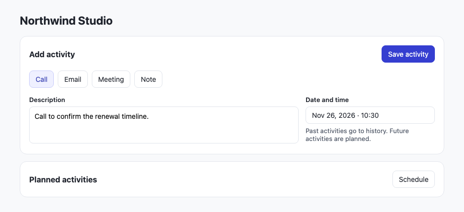

# CRM activity creation from one date and time

Supersedes: .ai/specs/2026-04-06-crm-detail-pages-ux-enhancements.md — sections: Enhancement 2, inline composer creation fields

Issue: #5108

## TLDR

Sales teams will create an activity from one composer on person, company, and deal detail pages. A visible date and time picker will send past activities to history and future activities to Planned activities.

## Resolved assumptions (autonomous defaults)

| Decision | Default | Rationale |
| --- | --- | --- |
| Advanced scheduling entry point | Keep the scheduling editor available from Planned activities. | Duration, guests, location, and reminders remain accessible when a user needs them. |
| Default timestamp | Display Now until a time is explicitly selected. Record the submit instant when the user leaves Now selected. | An open tab can sit idle without backdating the next activity. |
| Clock and boundary | Interpret the selection in the browser time zone and compare instants at submit. An equal timestamp is historical. | This matches the existing date picker and avoids storing local wall time as UTC. |

## Problem Statement

The activity composer shows a date badge with a visually hidden native input and a separate Schedule action. A user logging Tuesday's meeting or planning Friday's callback has to find the correct entry point before choosing a date. The same composer is used for person, company, and deal detail.

## Prior spec drift

The CRM detail-page spec describes an optional scheduled date in Enhancement 2. The scheduled field in `InlineActivityComposer` renders only after its own state has a value, and nothing sets that state from the visible controls. Scheduling starts in a separate dialog.

## Proposed Solution

Show a labeled Date and time control next to the description in an Add activity composer. One Save activity action uses the selected instant to choose the existing interaction status and timestamp fields. Supporting text explains that past activities are logged and future activities are planned.

[Odoo's activity workflow](https://www.odoo.com/documentation/master/applications/essentials/activities.html) keeps a planned list on the record and lets users complete activities into history. [Pipedrive's activity guidance](https://support.pipedrive.com/en/article/activities) supports focused date and time entry with extra scheduling fields available on demand. Reuse the CRM's existing lists and detailed editor for those two needs.

## 📝 Delta

### Capability: crm-activity-creation

#### MODIFIED Requirement: Create an activity from CRM record detail

The activity composer SHALL let the user choose one date and time to create a logged or planned activity.

##### Scenario: Historical meeting

- WHEN a user selects a meeting time two days ago and saves
- THEN the interaction is done and appears in history with that occurrence time

##### Scenario: Future callback

- WHEN a user selects a call time in the future and saves
- THEN the interaction is planned with that scheduled time and is visible in Planned activities

##### Scenario: Log now

- WHEN a user saves with the date and time at its default
- THEN the interaction is done and records the submit instant

Frozen by: `packages/core/src/modules/customers/components/detail/__tests__/InlineActivityComposer.test.tsx`

## Architecture

The existing client composer owns the draft and classifies the selected instant on submit. Use the shared DatePicker with time enabled and existing Button and Textarea primitives. Keep the current guarded mutation and the refresh callbacks for history, Planned activities, and the week preview. The deal host continues to associate the activity with its selected person or company and the deal.

The existing client boundary and page layout are sufficient. The picker opens on demand. The change requires no new provider, asynchronous read, or dependency. The initial Now label is stable across server rendering and hydration.

## Data Model and API Contracts

Use the existing scoped `POST /api/customers/interactions` interaction create command.

| Selection at submit | Status | occurredAt | scheduledAt |
| --- | --- | --- | --- |
| Default, past, or equal | `done` | Submit or selected instant in ISO 8601 UTC | `null` |
| Future | `planned` | `null` | Selected instant in ISO 8601 UTC |

The existing route, response, ACL, organization scope, undo, and interaction events apply. A manual save recomputes status from the current clock. Retrying the same guarded operation reuses its already-classified payload. Planned activities continues to show records with planned status, including overdue records. A planned record keeps its status until the existing completion flow runs. The person, company, and deal timelines retain their existing filters and ordering, including planned rows where those filters include them.

## UI/UX

The Add activity card contains the activity types, description, visible Date and time picker, and a single Save activity action. The picker opens by pointer or keyboard, with Apply and Cancel. The composer keeps Cmd/Ctrl+Enter to save outside the picker and wraps controls on narrow screens. Success returns the composer to Now and refreshes the surrounding lists.

The Planned activities section remains the entry point to the full scheduling editor, including when the list is empty. Show its header and Schedule action when the user can schedule; preserve the existing empty behavior for read-only users. Record editing, calendar creation, and task creation use their existing flows.

## Risks & Impact Review

| Failure scenario | Impact | Mitigation |
| --- | --- | --- |
| An activity is open while its selected time passes | Wrong classification if the status was computed earlier | Compare the selected instant with a fresh clock reading when saving |
| Local time is converted twice | Wrong history or schedule time outside UTC | Submit the picker Date as UTC once and cover a non-UTC browser |
| A save fails | User might lose the entered date or description | Keep the draft on failure and use existing error feedback |
| The existing picker normalizes a daylight-saving transition | Ambiguous or skipped wall times follow browser behavior | Use the shared picker semantics and display the applied local value |

## Implementation Plan

### Phase 1 — Unified composer and verification

1. Characterize the existing composer POST and refresh behavior in its component test.
2. Update the composer and its person, company, and deal hosts. Keep the existing detailed scheduling entry point, use localized strings, and update activity layout and picker assertions.
3. Exercise a meeting from two days ago and a future call in the same composer using a non-UTC Playwright browser. Verify the status and both timestamp fields through the interactions API. Confirm the historical meeting appears in the timeline and the future call appears in Planned activities. With timeline filters that include the call, confirm it still appears in the timeline with planned status. Confirm all three hosts render the composer and preserve their record context. Open the detailed scheduling editor from an empty Planned activities list.
4. Archive the Delta in `.ai/specs/capabilities/crm-activity-creation.md`.

## Final Compliance Report

The design reuses the current interaction command, guard, UI primitives, and scoped refresh. The implementation must verify both timestamp branches and phone-width keyboard access.

## Changelog

| Date | Change |
| --- | --- |
| 2026-11-22 | Propose timestamp-driven CRM activity creation for #5108 and specify how planned rows appear in the existing timeline. |
