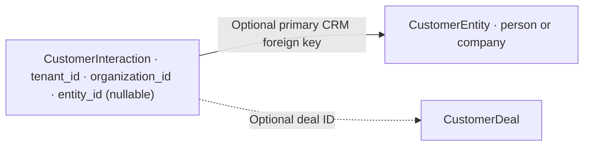

# Internal activities in CRM Calendar

Source: [Issue #5935](https://github.com/open-mercato/open-mercato/issues/5935)

Extends: .ai/specs/2026-06-11-crm-calendar.md
Extends: .ai/specs/2026-11-07-private-next-interaction-projections.md

## TLDR

Staff can create and manage a meeting, task, or other native calendar activity without attaching a CRM record. It uses the existing customer interaction store, Calendar, Tasks, permissions, and history.

## Overview and problem statement

Scheduling a team standup or assigning an internal task currently requires a placeholder person or company. This puts operational work on CRM profiles and makes reporting harder. `interactionCreateSchema` requires an `entityId`, `CustomerInteraction.entity` maps to a non-null foreign key, and `CalendarEventEditor` requires a selection. The interactions list and Calendar item schemas already admit a null parent. Existing relinking updates the projections of both CRM records. [Relinking PR](https://github.com/open-mercato/open-mercato/pull/6050)

Nextcloud Calendar creates events in a selected calendar and treats attendee details separately. Odoo supports internal meetings and scheduling from CRM records. Open Mercato can offer both entry points through its existing interaction model. [Nextcloud event editor](https://docs.nextcloud.com/server/stable/user_manual/en/groupware/calendar.html) · [Odoo Calendar](https://www.odoo.com/documentation/master/applications/productivity/calendar.html)

## Resolved assumptions (autonomous defaults)

| Question | Decision | Rationale |
| --- | --- | --- |
| What happens to an existing deal when only the primary CRM parent is cleared? | The API treats both links independently. Calendar's existing Clear related record action requests that both links be cleared. | Existing omission semantics preserve an independent link and avoid unrequested data loss. |
| Which writers can omit the primary parent? | Native non-email interactions use the canonical API and Calendar. Email rows always require a person or company. The legacy activity and todo write adapters keep their current contracts. | Existing email deduplication, sharing, and contact-history policy rely on the primary parent. |

## Proposed solution and architecture

- Keep one `CustomerInteraction` row with the existing id, author, assignee, organization, tenant, visibility, schedule, recurrence, and custom fields. Normalize absent relation references when taking command snapshots and hydrating rows, and keep the access checks on the interaction itself.
- For a parentless create, validate the target organization against the tenant and confirm both are authorized by the command context. Use that verified scope for people, deals, activity type rules, and custom fields. Every supplied primary record still passes the existing scoped person/company lookup, and every supplied deal passes the existing scoped deal lookup.
- The create, update, complete, cancel, delete, and replay handlers accept a persisted null parent. Preserve activity indexing, lifecycle notifications and events, and optimistic version enforcement. Changes to a relationship recalculate and publish next-interaction updates for every distinct involved non-null parent, including on undo and redo. Treat the before and after entity links independently: update without an `entityId` keeps the stored value.
- A native non-email activity with neither link belongs to the organization and can appear in the Calendar and global Tasks under their existing filters. An entity-scoped read or direct deal-filtered read only returns rows matching the requested CRM link. Existing organization, user, visibility, and pagination filters apply before the result is returned. Unified legacy list adapters handle canonical rows without a parent. Compatibility mode continues returning its existing legacy and bridge records, and does not gain a new source of native records.
- Keep the linked-email contract across create, update, and replay. Reject an email with a missing primary parent, a request to detach a linked email, and a type change to email on an unlinked row. Existing email grants, deduplication and linked historical reads use their current paths.
- Check direct consumers of the entity and replay/event payloads, including the standalone app's example customer sync mapping. Make null handling explicit before dereferencing and preserve existing linked mappings. Deal and customer profile forms remain contextual and continue populating their CRM relationships.

## Data model

`customer_interactions.entity_id` changes from UUID `NOT NULL` to nullable UUID. The migration and ORM mapping preserve the current foreign key target, delete rule, and existing indexes. Existing rows retain their values. Record the new nullability in the migration snapshot. Use PostgreSQL `DROP NOT NULL` and leave the other columns and constraints in place.

## API contracts

| Surface | Behavior |
| --- | --- |
| `POST /api/customers/interactions` | Omit `entityId` or send `null` for non-email. A supplied UUID still resolves to a person or company in scope. Response remains `201` with the interaction id. |
| `PUT /api/customers/interactions` | Omitted `entityId` preserves the existing link. A UUID attaches or relinks. `null` clears it on an eligible activity. For email, reject an unlinked resulting state with a field error. Deal omission and clearing remain independent. |
| `GET /api/customers/interactions` | The existing nullable `entityId` response can be `null`. Existing `entityId` and `dealId` filters remain equality filters. Decrypted hydration, sorting, and recurrence masters handle both cases. |
| `GET /api/customers/interactions/tasks`, `/conflicts` | Native rows with no primary parent participate under their existing scope and filters. The task display has no customer link for those rows. |
| `GET /api/customers/interactions/counts` | Retains its required CRM entity filter. Unlinked rows never count toward an entity. |
| `GET /api/customers/activities` and `/api/customers/todos` | Unified mode supports nullable canonical rows. Compatibility mode keeps its existing sources and historical CRM associations. Legacy write schemas stay parent-bound. |
| `POST /api/customers/interactions/complete`, `/cancel`, and canonical `DELETE` | Continue to work on unlinked rows with existing access, conflict, status, and replay rules. |

## UI and UX

Use the existing Calendar event editor and Related to picker. A blank picker is valid for a native non-email activity. Users can add a CRM link later or clear it with the existing action. Keep an independently linked deal visible and clearable through the same picker. Keep the current workflow for selecting a deal. Keep the existing title, schedule, assignee, permissions, and optimistic-lock behavior. Users can reopen an unlinked item in Calendar and recognize an unlinked task in the existing customer column. Use existing localized labels or the locale files for any new text.

## Delta

### Capability: internal-crm-activities

#### MODIFIED Requirement: Calendar activities and canonical interaction creation accept a CRM relationship

The system SHALL create native non-email activities from Calendar or the canonical interactions API with or without a primary CRM link.

##### Scenario: Schedule an internal standup

- WHEN a staff member with manage permission saves an event with no related record
- THEN the event is in their scoped Calendar and absent from CRM profiles and deal-filtered reads.

##### Scenario: Keep an activity on a CRM profile

- WHEN a staff member supplies a scoped person or company when creating an activity
- THEN that relationship is stored and its CRM projection includes the activity under the existing projection rules.

Frozen by: `packages/core/src/modules/customers/data/__tests__/interactionSchemas.test.ts`

#### MODIFIED Requirement: An interaction can be relinked to another CRM record

The system SHALL support attaching and clearing an eligible activity's primary CRM link while preserving its identity and updating the affected projections.

##### Scenario: Remove a primary link

- WHEN a staff member clears the primary record on an existing activity
- THEN its UUID, fields and history are preserved, its former parent projection is refreshed, and undo can restore the link under the existing rules.

Frozen by: `packages/core/src/modules/customers/__integration__/TC-CRM-088-interaction-entity-relink.spec.ts`

## Integration and verification coverage

- Extend the canonical schema and command tests for omitted and null create/update, scoped or invalid ids, linked and deal-only activities, email restrictions, old snapshots, complete/cancel/delete and undo/redo, projection refreshes, and interaction lifecycle delivery.
- Exercise canonical POST, PUT and GET end to end with a self-created person/company and two isolated organization contexts. Test organization and tenant visibility, scope checks for supplied ids, scoped-list exclusion, stale PUT and DELETE, and current-version deletion. Cover Complete and Cancel on unlinked rows and verify scoped Counts, Conflicts, Tasks, and legacy read adapters include or exclude those rows as specified for each mode. Use unique fixtures and tear down by id.
- Extend the Calendar browser coverage around `TC-CAL-005`. Create an internal meeting with the Related to picker empty, reopen it, attach and clear a self-created CRM record, and verify the same activity persists. Verify an unlinked task in global Tasks and exclusion from the CRM profile. Preserve the existing linked, deal, and recurrence scenarios.

## Risks and impact review

| Scenario | Severity | Mitigation |
| --- | --- | --- |
| An unlinked activity lands in the wrong organization | High | Validate its tenant/organization pair independently and retain row-level scope and filters on every read and write. |
| An email loses the parent used by visibility or dedupe | High | Enforce the linked-email invariant using the resulting state and retain existing viewer predicates. |
| A CRM profile continues to show a detached next activity | Medium | Recompute both involved parents after writing the change and on replay. Skip null inputs and publish only concrete CRM ids. |
| A nullable entity reaches a consumer that assumes a UUID | Medium | Audit direct references, keep existing linked fields and events intact, and exercise nullable reads and downstream mappings. |

## Migration & backward compatibility

Widen nullability for an existing foreign-key column. Keep the existing foreign key, indexes, paths, identifiers, and linked payloads. The main list response already documents a nullable `entityId`; consumers should use their already-declared null check before following the CRM link. The exported ORM relation becomes nullable because native records can be unlinked. Downstream code that dereferences it should narrow first. Rolling back the code after standalone rows exist requires first relinking or archiving those rows, so an automatic down migration must never silently discard or reassign records.

## Final compliance report

Uses the Customers API, transaction and command lifecycle and existing Calendar/Tasks components. The design requires explicit scope enforcement on parentless rows and preserves optimistic writes and email privacy. Runtime validation belongs to the implementation PR.

## Implementation Plan

### Phase 1 — scoped native interactions

1. Freeze current linked create, canonical null rejection and relink/projection behavior in the existing schema and integration tests.
2. Add the nullable relation and migration and implement canonical writes, existing command replay and linked-email safeguards. Keep API/hydrator and actual consumers null-safe in this step. Verify scoped list/read behavior and mutation paths with the integration cases above.

### Phase 2 — Calendar and Tasks workflow

3. Allow the existing Calendar picker to stay blank and support clearing existing links. Keep contextual CRM forms working. Run Calendar create/edit/attach/clear and scoped Tasks browser coverage against the implementation.
4. Run generator and focused compatibility, test, typecheck, and application gates. Archive the Delta in `.ai/specs/capabilities/internal-crm-activities.md` with pointers to characterization coverage.

## Changelog

- 2026-11-22 — Initial proposal for issue #5935.
