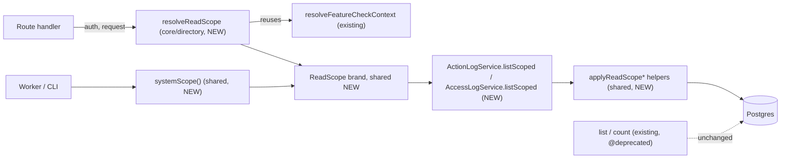

# Fail-Closed Service Read Scope

Extends: `.ai/specs/2026-07-28-audit-log-read-tenant-scope-fail-closed.md` (its "Follow-up" asks for a spec for the shared root cause)
Extends: `.ai/specs/implemented/2026-05-29-org-scope-fail-open-authorization-hardening.md` (keeps its route-level deny helpers; adds the service-level counterpart it deferred)

## TLDR

**Key Points:**
- Today, read services such as `ActionLogService.list` and `AccessLogService.list` take `tenantId` / `organizationId` as **optional** filters and treat a missing value as "no restriction". Safety depends on every route remembering to deny an empty scope first; three leaks in one module came from routes that did not.
- Proposed (future behavior): services take a **required, branded `ReadScope`** that says explicitly *all tenants*, *one tenant with all / some / no organizations*, or *nothing*. "Forgot to scope" can no longer look like "superadmin".

**Scope:**
- A `ReadScope` type plus query helpers in `@open-mercato/shared`.
- A `resolveReadScope` resolver in `core/directory` that also applies the `?organizationId=` narrowing, and a named `systemScope()` for workers/CLI.
- Pilot in `audit_logs`: `ActionLogService` and `AccessLogService` gain `listScoped` / `countScoped`; their three routes migrate; `list` / `count` are deprecated. The pilot covers `list` / `count` only; the services' other read methods stay as they are (see Follow-ups).
- Three deliberate HTTP behavior changes, all tightenings (see 📝 Delta): two on the `access` route for an explicitly empty organization scope, and one that closes a tenant-wide read reachable today on all three routes. Everything else is behavior-preserving.
- Out of scope, tracked as follow-ups: the cross-repo inventory, migrating callers in other modules, and removing the deprecated methods.

**Concerns:**
- Public service signatures change, so the deprecation protocol in `BACKWARD_COMPATIBILITY.md` applies.
- TypeScript branding can be bypassed by casts. A small CI check restricts who may import the low-level constructor and the test constructor; it covers this monorepo only.

## Overview

Open Mercato enforces tenant and organization isolation mostly at the route layer: a route resolves the caller's scope (`resolveFeatureCheckContext`, `resolveOrganizationScopeForRequest`), denies empty or invalid scopes (`requireResolvedTenantScope`, `resolveSingleOrganizationIdOrDeny`), then calls a service with plain optional ids. The service has no way to tell an unrestricted caller from one that forgot to scope, because both arrive as `undefined`.

This spec moves the decision into a value the service requires. Audience: platform and module developers who write custom (non-`makeCrudRoute`) read paths. Benefit: a missing or empty scope fails closed by construction, not by convention.

> **Market Reference**: Django's per-request tenant managers (`django-tenants`, `django-scopes`) make unscoped queries raise unless code explicitly enters `scopes_disabled()`; Rails' `acts_as_tenant` raises `ActsAsTenant::Errors::NoTenantSet` when `require_tenant` is on. **Adopted:** the explicit, named opt-out (`systemScope()` ≈ `scopes_disabled()`) and failing closed when scope is missing. **Rejected:** ambient/thread-local scope (Node request scoping is already handled by DI containers, and implicit global state hides which call sites are unrestricted) and ORM-global filters for now (124 files use raw Kysely, which bypasses them; see Alternatives).

## Problem Statement

`ActionLogService.buildListQuery` (`packages/core/src/modules/audit_logs/services/actionLogService.ts:496-497`) adds predicates only when values are truthy:

```ts
if (parsed.tenantId) query = query.where('action_logs.tenant_id', '=', parsed.tenantId)
if (parsed.organizationId) query = query.where('action_logs.organization_id', '=', parsed.organizationId)
```

`AccessLogService.list` (`accessLogService.ts:418-425`) does the same for tenant, and returns an empty page only when a caller explicitly passes `organizationIds: []`.

Evidence that the convention "routes deny first" keeps failing:

| Incident | Missing value | What leaked | Fixed by |
|---|---|---|---|
| #3817 / #3818 | `tenantId` (tenant-less principal with `view_tenant`) | Decrypted action logs of **every tenant** | Route guard `requireResolvedTenantScope` (spec 2026-07-28) |
| #10432 | `organizationId` (explicitly empty org scope with `view_tenant`) | Every organization's action logs incl. snapshots, list + CSV export | Route guard `resolveSingleOrganizationIdOrDeny` |
| `record_locks` follow-up | `organizationId` (null passed to `findLatestActionLogWithScopeFallback`) | Latest action log id + conflict data for a known resource id | Route guard, PR #10448 (open, not merged) |

The #6932 hardening (2026-10-07) recorded the intended invariant: "`organizationId: undefined` remains exclusive to unrestricted scope". Nothing enforces it. #10432 slipped through because those routes obtained the fallback indirectly (`resolveFeatureCheckContext().organizationId`), which the pattern-based audit did not match.

## Proposed Solution

1. **`ReadScope` (shared).** A branded, discriminated union describing exactly what a caller may read, plus helpers that turn it into Kysely and MikroORM predicates. `none` compiles to a no-row predicate.
2. **One resolver (core/directory).** `resolveReadScope({ container, auth, request, requestedOrganizationId })` derives the scope from the same inputs routes use today. It applies today's "`?organizationId=` narrows only within the caller's visibility set" itself, because the finished `ReadScope` no longer holds that set. It reproduces the routes' current decisions except for the cases listed in 📝 Delta.
3. **Named system scope.** `systemScope({ tenantId })` and `systemScope.allTenants()` for workers, CLI and other code with no request principal: greppable and visible in review.
4. **Scoped service methods.** New `listScoped(scope, filters)` / `countScoped(scope, filters)` where `filters` no longer accepts `tenantId` / `organizationId`. Old `list` / `count` stay, unchanged and `@deprecated`, for at least one minor version.
5. **Pilot only.** Migrate `audit_logs` (both services, three routes). The inventory of other services, other-module callers, and removal of the deprecated methods are follow-ups.

### Design Decisions

| Decision | Rationale |
|---|---|
| Scope covers **tenant and organization** | Both fail-open paths exist in the same service (#3817 tenant, #10432 org). Covering one leaves the other class open. |
| `orgs` **excludes** tenant-level rows (`organization_id IS NULL`) | Matches today: `organization_id = X` and `$in` never match null, so scoped users already do not see them. Zero visible change. |
| Branded type; constructors are `resolveReadScope`, `systemScope`, `testScope` | A hand-written `{ kind: 'all' }` does not compile. The brand follows the existing `unique symbol` precedent in `packages/shared/src/lib/commands/transaction-lifetime.ts`. |
| Low-level constructor `unsafeCreateReadScope` exported from a separate subpath and allowlisted in CI | `resolveReadScope` lives in `core`, the brand in `shared`, so one constructor must cross the package boundary. A seconds-long grep check restricts its importers. |
| New `listScoped` method instead of changing `list` | Additive; existing callers, including third-party modules, keep working through the deprecation window. |
| Actor narrowing (`actorSubject`, `actorUserId`) stays a **filter**, not scope | It is a per-feature visibility rule (`view_self` vs `view_tenant`), not isolation; mixing them would bloat the type. |
| Resolver preserves current single-org narrowing (restricted user with no selection reads `allowedIds[0]`, per `resolveFeatureCheckOrganizationId`) | Widening to all allowed orgs would be a behavior change. It is tracked by #6337 and stays out of this spec. |
| `?organizationId=` narrowing happens **inside** `resolveReadScope`, against `scope.allowedIds` | The routes narrow against the visibility set (`allowedIds`), which can hold more orgs than the effective one. A `narrowReadScope(scope, id)` applied afterwards would see only `some [effectiveOrg]` and silently ignore valid requests (review finding M1). There is no separate `narrowReadScope`. |
| `allTenants` carries an `organizations` part too | A tenant-less superadmin with a selected or requested org is read today as `organization_id = X` with no tenant predicate. Without this, the resolver would widen that caller to every organization of every tenant. |
| The tenant predicate comes from `auth.tenantId`, as today | The routes pass `auth.tenantId`, not `scope.tenantId`. Keeping the same source avoids a second, untested way to pick the tenant. |
| An explicitly empty org scope is `none` on **all three** routes, including `access` | Today `access` has no empty-scope guard: a self-read drops the org predicate, and an unrestricted caller with a dead home org still reads by organization id. Preserving that would need a way to hand an organization scope to a caller who can see none, which is the pattern this spec removes. Accepted as behavior changes D1 and D2; see 📝 Delta. |
| Type named `ReadScope` | `OrganizationScope` already names two different types (`shared/lib/auth/principal-service.ts:57`, `shared/lib/search/availability.ts:4`) plus the directory one; a fourth meaning would confuse. |

### Alternatives Considered

| Alternative | Why Rejected |
|---|---|
| Keep the route-level convention and audit harder | Three incidents show audits miss indirect forms; it keeps safety dependent on memory. |
| Make `tenantId` / `organizationId` required strings on `list` | Cannot express "all organizations" or "all tenants" without a sentinel; superadmin and workers would break or invent magic values. |
| MikroORM global filters / Postgres row-level security | Defense in depth worth a later spec, but 124 non-test files use raw Kysely (bypasses ORM filters) and RLS needs per-connection session variables across web, workers, CLI and migrations. Far larger blast radius. |
| Plain (unbranded) union + review | Anyone can write `{ kind: 'all' }` to silence a 403 — the same convention problem in a new shape. |
| Change `list` in place (breaking) | Violates the deprecation protocol; third-party callers break in one release. |

## User Stories / Use Cases

- **A module developer** writes a custom list route and **cannot call the audit-log service without a scope**, so they cannot accidentally ship a tenant-wide read.
- **A worker author** needs a tenant-wide read and **writes `systemScope({ tenantId })`**, which reviewers see and can question.
- **A security reviewer** **greps for `systemScope` / `unsafeCreateReadScope`** to list every unrestricted read path, instead of auditing every call site.
- **A restricted employee** with an emptied organization visibility list **gets no rows** (or the 403 a route already documents), whatever route they hit, without each route needing its own guard.

## Architecture



Takeaway: the scope decision is made once (resolver or `systemScope`), carried as a value the compiler requires, and applied by one helper. The deprecated path is untouched until removal.

### `ReadScope` shape (`packages/shared/src/lib/auth/readScope.ts`)

```ts
declare const readScopeBrand: unique symbol

export type ReadScopeData =
  | { kind: 'allTenants'; organizations: OrganizationReadScope }
  | { kind: 'tenant'; tenantId: string; organizations: OrganizationReadScope }
  | { kind: 'none' }

export type OrganizationReadScope =
  | { kind: 'all' }
  | { kind: 'some'; ids: readonly [string, ...string[]] }

export type ReadScope = ReadScopeData & { readonly [readScopeBrand]: true }
```

- An empty organization set is not representable as `some`; it normalizes to top-level `none`.
- `systemScope` has no production caller in the pilot (the three migrated routes all use the resolver); it ships with unit tests so follow-up migrations of workers and CLI can use it.
- `allTenants` + `some [X]` compiles to the organization predicate alone (no tenant predicate). Organization ids are UUIDs, so this reads one organization; it exists only to reproduce today's tenant-less superadmin read. `systemScope.allTenants()` always returns `allTenants` + `all`.
- Exported helpers: `systemScope({ tenantId })`, `systemScope.allTenants()`, `isNoneScope(scope)`, `applyReadScopeToKysely(query, scope, { tenantColumn, organizationColumn })`, `readScopeToMikroFilter(scope, { tenantField, organizationField })`.
- `none` → Kysely `where(sql\`false\`)`, MikroORM `{ id: { $in: [] } }`. Callers may also short-circuit with `isNoneScope` to skip the query (as `AccessLogService` already does).
- The helpers always produce the WHERE predicate. The scope passed to `findWithDecryption` is not a filter and must not stand in for it (lesson `decryption-scope-argument-is-not-a-where-filter`).
- Subpath `@open-mercato/shared/lib/auth/readScope/unsafe` exports `unsafeCreateReadScope(data)`; allowlisted importers: `shared/lib/auth/readScope.ts` (`systemScope`), `core/directory/utils/readScope.ts`, `shared/lib/testing/readScope.ts` (`testScope`).
- `testScope` may be imported from test files only; the same CI check enforces it (see Phase 1.3).

### Resolver (`packages/core/src/modules/directory/utils/readScope.ts`)

Code references in this section are to `main` @ `a433fc7e8d`, which includes #10432. The PR branch is based on an older commit that does not.

```ts
export type ResolvedReadScope = {
  scope: ReadScope
  organizationId: string | null
  featureContext: FeatureCheckContext
}

export function deriveReadScope(input: {
  auth: AuthContext
  featureContext: FeatureCheckContext
  requestedOrganizationId?: string | null
}): ResolvedReadScope

export async function resolveReadScope(input: {
  container: AwilixContainer
  auth: AuthContext
  request: Request
  requestedOrganizationId?: string | null
}): Promise<ResolvedReadScope>
```

- `resolveReadScope` calls the existing `resolveFeatureCheckContext` once, then `deriveReadScope`. `deriveReadScope` is pure and synchronous, so the truth table is tested without a container.
- `organizationId` is the effective single organization (`O` below), or `null`. Routes keep using it where they use `organizationId` today: the `canViewTenant` RBAC check in `access`, redaction context, and the response body. `featureContext.organizationId` is the pre-narrowing default that `actions` and `actions/export` pass to their `canViewTenant` check. Neither changes.

**Inputs.** `V` = `featureContext.scope.allowedIds` (the visibility set; `null` means unrestricted). `E` = `featureContext.organizationId`, which `resolveFeatureCheckOrganizationId` computes as `scope.selectedId`, else `auth.orgId` when `V` is `null` or contains it, else `V[0]`, else `null`. `Q` = `requestedOrganizationId`.

**Step 1: effective organization `O`.** Same expression as `actions/route.ts:203-208`, `actions/export/route.ts:159-164` and `access/route.ts:104-109`:

```ts
const O = Q && (V === null || V.includes(Q)) ? Q : E
```

| `V` | `E` | `Q` | `O` | Note |
|---|---|---|---|---|
| any | `E` | absent | `E` | No request, default org |
| `null` | `A` | `B` | `B` | Unrestricted caller switches org |
| `null` | `null` | `B` | `B` | Unrestricted caller, no default |
| `[A, B]` | `A` | `B` | `B` | Requested org inside visibility |
| `[A]` | `A` | `B` | `A` | Requested org outside visibility: ignored, no error (as today) |

**Step 2: scope.** Rules are evaluated in order; the first match wins.

| # | Caller state | Today: `actions`, `actions/export` | Today: `access` | `ReadScope` |
|---|---|---|---|---|
| R1 | No auth (on `actions` / `actions/export` also: no canonical auth subject) | 401 | 401 | `none` (routes answer 401 first) |
| R2 | `auth.tenantId` falsy, not superadmin | 403 (`requireResolvedTenantScope`) | 403 (same) | `none` |
| R3a | `scope.allowedIds` is `[]` (restricted caller who can see no organization) | 403 (`resolveSingleOrganizationIdOrDeny`, since #10432) | 200. Other actors: empty page. Self-read: the caller's rows from **every organization of the tenant** | `none` (**changes the `access` self-read**, Delta D1) |
| R3b | `scope.filterIds` is `[]` and `allowedIds` is `null` (unrestricted caller whose home org no longer exists) | 403 (same) | 200 with `tenant_id = T AND organization_id = O`, where `O` is the dead home org or an honored `Q` | `none` (**changes `access`**, Delta D2) |
| R4a | Tenant `T`, `V` is an array, `O` is `null` | `tenant_id = T`, no org predicate (**tenant-wide for a restricted caller**) | Self-read: no org predicate. Other actors: `organization_id IN V` | `tenant T` + `some V` (**changes**, Delta D3) |
| R4b | `V` is an array and `O` is not in `V` | Not reachable in the shapes tested (dispatcher answers 403) | Same | `none` |
| R5 | `auth.tenantId` falsy, superadmin, `O` is `null` | All rows of all tenants | Same | `allTenants` + `all` |
| R6 | `auth.tenantId` falsy, superadmin, `O` = `X` | `organization_id = X`, no tenant predicate | Same | `allTenants` + `some [X]` |
| R7 | Tenant `T`, `V` is `null`, `O` is `null` | `tenant_id = T`, no org predicate | Same | `tenant T` + `all` |
| R8 | Tenant `T`, `O` = `X` | `tenant_id = T AND organization_id = X` | Same | `tenant T` + `some [X]` |

Notes on the rows:

- **R3a and R3b are one check** (`isExplicitlyEmptyOrganizationScope`), split here because `access` treats them differently today. R3b arises when `resolveOrganizationScope` drops a home org that no longer resolves and the fallback set comes back empty (`organizationScope.ts:357-391`).
- **R4 covers a restricted caller without a usable single organization.** `resolveOrganizationScope` only returns a `selectedId` inside the allowed set, `E` checks `auth.orgId` against `V`, and `Q` is checked in Step 1, so a scope that comes straight from it always has `O` inside `V`. The exception is the dispatcher: it calls `resolveFeatureCheckContext` with the route's `requiredFeatures` and binds the result to the request. When no org is selected and the caller's feature access is limited to some organizations, it replaces `allowedIds` with the feature-approved set **after** computing `E` (`organizationScope.ts:587-634`), and the route receives that binding. **R4a is reachable** this way by an API key with no organization (Delta D3): `V` is `[A]` and `O` is `null`. The resolver returns `some V`, so the caller reads exactly the organizations its feature grant covers; this is what `access` already does for other-actor reads (`access/route.ts:125-127`). **R4b** (an effective org outside `V`) was stopped by the dispatcher with 403 in every shape tested; it stays `none` as the fail-closed default. A restricted caller (`V` is an array) can never receive `all`.
- **R7 is narrower than "unrestricted caller with no selection".** `E` falls back to `auth.orgId`, so an unrestricted non-superadmin with a home org lands in R8 with their home org, even after choosing "All organizations". R7 is reached only when `scope.selectedId` and `auth.orgId` are both `null` and no `Q` is honored: a superadmin viewing all organizations (the org cookie override clears `auth.orgId`), or a principal with no home org.
- **R5 / R6**: a superadmin reaches the routes without a tenant only as an API key with a null tenant or through a trusted auth envelope; a blank tenant cookie is not applied. "All rows" is still subject to the actor filters the routes add (`access` defaults to the caller's own rows).
- **R6**: `Q` is honored for an unrestricted caller without checking which tenant the org belongs to, as today. With a tenant (R8) a foreign org id matches no rows; without one (R6) it reads that org. Only a superadmin reaches R6.
- **R3 and R2 keep their 403 on the routes that return one today.** The services return empty results for `none`.
- **UUID validation stays.** Today a non-UUID tenant or organization id reaches `actionLogListSchema` / `accessLogListSchema`, fails zod, and the routes answer 400 (a superadmin's `om_selected_org` cookie and an honored `Q` are not validated earlier). `listScoped` / `countScoped` validate the ids inside the scope with the same `z.string().uuid()` rule and throw the same `ZodError`, so the routes' existing 400 handler keeps working.

**Per-route result after migration.**

| Route | R2 | R3a | R3b | R4a | R4b | R5–R8 |
|---|---|---|---|---|---|---|
| `actions`, `actions/export` | 403, unchanged | 403, unchanged | 403, unchanged | Rows of `allowedIds` only (**changes**, D3) | 200 empty (not reachable in the shapes tested) | Unchanged |
| `access` | 403, unchanged | 200 empty page (**self-read changes**, D1) | 200 empty page (**changes**, D2) | Rows of `allowedIds` only (**self-read changes**, D3) | 200 empty (not reachable in the shapes tested) | Unchanged |

### Commands & Events

None. Read-path only.

## Data Models

No schema, entity or migration changes.

## API Contracts

Same routes, query parameters, response shapes and status codes as after #10432. Response bodies change on the `access` route for an explicitly empty organization scope (📝 Delta D1, D2). The contract changes are TypeScript:

| Surface | Change | BC class |
|---|---|---|
| `ActionLogService.listScoped(scope: ReadScope, filters: ActionLogScopedFilters)` | New | Additive |
| `ActionLogService.countScoped(scope, filters)` | New | Additive |
| `AccessLogService.listScoped(scope, filters: AccessLogScopedFilters)` | New | Additive |
| `ActionLogService.list` / `count`, `AccessLogService.list` | `@deprecated`, behavior unchanged | Deprecation (removal ≥1 minor later) |
| `ActionLogScopedFilters` = `actionLogListSchema.omit({ tenantId, organizationId })`; `AccessLogScopedFilters` likewise (also omits `organizationIds`) | New exported types | Additive |
| `@open-mercato/shared/lib/auth/readScope`, `/readScope/unsafe`, `@open-mercato/shared/lib/testing/readScope` | New import paths | Additive |
| `@open-mercato/core/modules/directory/utils/readScope` (`resolveReadScope`, `deriveReadScope`, `ResolvedReadScope`) | New import path | Additive |
| `isSuperAdminAuth` exported from `@open-mercato/shared/lib/auth/server` | Existing private function becomes an export | Additive |

DI keys `actionLogService` / `accessLogService` are unchanged.

## 📝 Delta

Three HTTP behavior changes, all tightenings. D1 and D2 are on the `access` route for a caller whose organization scope is explicitly empty. D3 closes a tenant-wide read that is live today on all three routes. Everything else is frozen by characterization tests.

| # | Route | Caller state | Today | After |
|---|---|---|---|---|
| D1 | `GET /api/audit_logs/audit-logs/access` | `allowedIds: []`, reading own rows (`actorUserId === auth.sub`) | 200 with the caller's access-log rows from every organization of the tenant (the route passes `organizationIds: undefined`, so the service adds no org predicate) | 200 with an empty page (`items: []`, `total: 0`) |
| D2 | `GET /api/audit_logs/audit-logs/access` | `filterIds: []` with `allowedIds: null` (unrestricted caller whose home org no longer exists) | 200 with rows of the dead home org, or of any org named in `?organizationId=`, for self-reads and other-actor reads | 200 with an empty page |
| D3 | `actions`, `actions/export`, `access` | Rule R4a: restricted `allowedIds` with no effective org. Reachable by an API key with no organization whose audit-log features come from an organization-restricted role | `actions`, `actions/export`: every action log of the tenant. `access` self-read: the caller's rows from every organization. `access` other-actor reads: `organization_id IN allowedIds` | All three: `organization_id IN allowedIds`. The `access` other-actor read is unchanged |

Why D1 and D2 are accepted instead of preserved: an explicitly empty scope means "this principal can see no organization" (#10432, lesson `empty-collection-scopes-need-an-explicit-semantic-predicate`). `actions` and `actions/export` already answer 403 for both states. D1 returns resource kinds and ids from organizations the caller can no longer see. Preserving either would need the resolver to hand an organization scope to a caller whose scope is empty. The status stays 200 so the route's documented contract does not change; aligning it with the 403 of `actions` is not part of this spec.

D3 was an open question in the previous revision and is now confirmed. A regular API key can be created with no organization. Give it one role with unrestricted organization visibility and one role limited to organization A that holds `audit_logs.view_self` and `audit_logs.view_tenant`. The dispatcher's feature check runs with `organizationId: null`, where organization-restricted roles all apply, so it passes; `resolveFeatureCheckContext` narrows `allowedIds` to `[A]` but leaves `organizationId` null; the routes then add no organization predicate. `resolveSingleOrganizationIdOrDeny` does not stop it, because `[A]` is not empty. A regular user cannot reach this state through product paths, because users must have a home organization. Evidence: a unit test on `main` @ `a433fc7e8d` with the real `RbacService`, scope resolution and route handlers; database data and the log services are mocked, and it was not run against a live app. With `?organizationId=A` the same key already reads A only (R8), today and after.

Not changed: a caller with `allowedIds: []` reading other actors on `access` already gets an empty page, and `actions` / `actions/export` already return 403 (only those two got the #10432 guard; `access` never did).

### Depends on merge order

The table above is written against `main` @ `a433fc7e8d`. Two open security PRs change what "Today" means for some of its rows. #10629 is stacked on #10503, so #10503 lands first.

| PR | What it does | Effect on this spec once merged |
|---|---|---|
| #10503 `security(auth): deny an explicitly empty organization scope without an organization context` | The API dispatcher answers 403 when the resolved `allowedIds` is `[]`, before the feature check and before any route runs. RBAC also denies an empty organization list when no organization is given. | **D1 disappears.** The `access` route answers 403 for the R3a caller before and after the pilot, so "the status stays 200" no longer applies to it. R3a still resolves to `none`, as a backstop the routes cannot reach. The 403 on `actions` / `actions/export` for that caller comes from the dispatcher instead of the route's own guard. **D2 is not affected**: its caller has `allowedIds: null`, which #10503 does not look at. |
| #10629 `security(directory): anchor a null-organization feature check to an approved organization` | `resolveFeatureCheckContext` recomputes a null `organizationId` from the feature-narrowed scope: it becomes the first approved organization (sorted by id). A narrowing that approves no organization gives `allowedIds: []`, which #10503 answers with 403. | **D3 is no longer a change this pilot makes.** The D3 principal reaches the three routes with an effective organization and falls under R8, today and after. A key approved in several organizations reads the first approved one, not `some allowedIds`; `?organizationId=` selects another approved one. R4a stays in the resolver as a guard with no known way to trigger it. The Phase 3.1 tests for the D3 principal assert the R8 outcome instead of today's tenant-wide query; #10629 already ships regression tests for it (`audit_logs/api/__tests__/null-org-feature-scope.test.ts`). |

| Merged before the pilot | Delta rows that remain |
|---|---|
| Neither | D1, D2, D3 |
| #10503 only | D2, D3 |
| #10503 and #10629 | D2 |

The implementer re-checks this at the start of Phase 3, rewrites the Delta table, the "Today" columns of R3a and R4a and the `UPGRADE_NOTES.md` entry for the state of `main` at that point, and records the change in the changelog.
Phase 3 begins with characterization tests that freeze current route behavior (status codes and the service predicates for every row of both resolver tables) before the routes switch to `listScoped`. The same tests must pass after the switch, except D1 and D2, which are each written as a pair: the pre-switch expectation and the post-switch expectation, with the change made in the same commit as the route migration.

## Internationalization (i18n)

None. No user-facing strings; errors keep their existing messages.

## UI/UX

None.

## Migration & Compatibility

- **Deprecation protocol** (`BACKWARD_COMPATIBILITY.md`): `list` / `count` keep working with identical behavior, carry `@deprecated` JSDoc pointing to `listScoped`, and are listed in `UPGRADE_NOTES.md` with a before/after snippet. Removal is a follow-up (see Follow-ups), no earlier than one minor release after the pilot ships, and only once no in-repo callers remain.
- **In-repo callers outside `audit_logs`** keep calling the deprecated `list` during the pilot: `sales/api/document-history/route.ts:98`, `customers/api/deals/[id]/route.ts:186`, `warranty_claims/lib/replacementOrderUndo.ts:28`. They migrate in follow-up PRs, one module per PR (see Follow-ups).
- **Third-party modules** see deprecation warnings only (TypeScript `@deprecated` strike-through), no runtime change.
- **Backports:** none. This is a forward-looking hardening; the route-level fixes (#10432 and earlier) are what release lines receive.

## Implementation Plan

### Phase 1: `ReadScope` primitives in shared
1. Add `packages/shared/src/lib/auth/readScope.ts` (type, `systemScope`, `isNoneScope`, `readScopeToMikroFilter`, `applyReadScopeToKysely`) and `readScope/unsafe.ts`. Unit tests: every variant produces the expected predicate; `none` yields no rows; a hand-built literal fails to type-check (`// @ts-expect-error` test).
2. Add `packages/shared/src/lib/testing/readScope.ts` with `testScope(data)`.
3. Add `scripts/check-read-scope-constructor.mjs`. It scans `packages/**`, `apps/**` and `external/official-modules/**` when present, and fails on any of:
   - `readScope/unsafe` imported outside the three allowlisted files;
   - `lib/testing/readScope` imported from a non-test file (anything outside `__tests__/**`, `__integration__/**`, `*.test.ts(x)`, `*.spec.ts(x)`);
   - `systemScope` imported in an API route file (`**/api/**/route.ts`). A request handler has a principal and must use the resolver.

   Wire it as its own step in the `lint` job of `.github/workflows/ci.yml` (`node scripts/check-read-scope-constructor.mjs`, next to `yarn lint:check-graph`), following the `check-oauth-publish-shape.mjs` precedent, plus a root script alias `lint:check-read-scope` for local runs. The root `lint` script (`turbo run lint`) is not changed. Runs in seconds.

### Phase 2: resolver in core/directory
1. Export `isSuperAdminAuth` from `packages/shared/src/lib/auth/server.ts` (it is module-private today at line 155). `audit_logs/api/audit-logs/readScope.ts` drops its private copy and imports it. `core/directory` imports nothing from `audit_logs`.
2. Add `deriveReadScope` and `resolveReadScope` in `packages/core/src/modules/directory/utils/readScope.ts`, built on `resolveFeatureCheckContext`, `isExplicitlyEmptyOrganizationScope` and `isSuperAdminAuth`.
3. Table-driven unit test of `deriveReadScope`: every row of the Step 1 table (requested org inside and outside visibility, with `allowedIds` both `null` and an array) and every rule R1–R8, including R4a (restricted caller with no effective org → `some allowedIds`) and R4b with a hand-built inconsistent context (effective org outside `allowedIds` → `none`).

### Phase 3: `audit_logs` pilot
1. Characterization tests first: for `actions`, `actions/export`, `access` routes, assert status and the service query for every row of both resolver tables (extending `api/__tests__/{actions,export,access}.route.test.ts`). They must pass on the unchanged code. The `access` tests cover both empty-scope shapes (R3a, R3b) for a self-read and an other-actor read. The D3 tests build the R4a principal with the real `RbacService` and the real `resolveFeatureCheckContext` (the dispatcher call with `requiredFeatures`, then the route's own call on the same request), not a hand-built scope, and assert today's tenant-wide query.
2. Add `listScoped` / `countScoped` to `ActionLogService`; `buildListQuery` takes the scope through `applyReadScopeToKysely`; `list` / `count` map their optional ids onto the same builder, unchanged in behavior. Service unit tests for every scope kind, including `allTenants` + `some` and `none` returning no rows without decrypting anything.
3. Add `AccessLogService.listScoped`; same approach.
4. Migrate the three routes to `resolveReadScope({ ..., requestedOrganizationId })` + `listScoped`. Keep `requireResolvedTenantScope` and the #10432 403 responses on `actions` / `actions/export`. Characterization tests stay green; the D1 and D2 expectations flip in this commit. Non-UUID ids still produce 400.
5. Mark `list` / `count` `@deprecated`; add the `UPGRADE_NOTES.md` entry, which also records D1, D2 and D3; update the `packages/core/AGENTS.md` "Access Control" section with a one-line rule: "read services take a `ReadScope`".

**Pilot boundary.** "The pilot services fail closed" applies to `list` / `count` only. These `ActionLogService` reads keep an optional or truthiness-gated scope, or none at all, and are not touched: `latestUndoableForActor`, `latestUndoneForActor`, `latestUndoableForResource`, `findById`, `findByUndoToken`, and the related-entries query (`actionLogService.ts:911-912`). They belong to Follow-ups 2 (single-record loads) and 4 (inventory).

### File Manifest

| File | Action | Purpose |
|---|---|---|
| `packages/shared/src/lib/auth/readScope.ts` | Create | Type, system scope, predicate helpers |
| `packages/shared/src/lib/auth/readScope/unsafe.ts` | Create | Allowlisted constructor |
| `packages/shared/src/lib/testing/readScope.ts` | Create | `testScope` for tests |
| `scripts/check-read-scope-constructor.mjs` | Create | CI allowlist check |
| `packages/core/src/modules/directory/utils/readScope.ts` | Create | `resolveReadScope`, `deriveReadScope` |
| `packages/shared/src/lib/auth/server.ts` | Modify | Export `isSuperAdminAuth` |
| `packages/core/src/modules/audit_logs/api/audit-logs/readScope.ts` | Modify | Use the shared `isSuperAdminAuth` |
| `packages/core/src/modules/audit_logs/services/actionLogService.ts` | Modify | `listScoped`, `countScoped`, deprecate `list`/`count` |
| `packages/core/src/modules/audit_logs/services/accessLogService.ts` | Modify | `listScoped`, deprecate `list` |
| `packages/core/src/modules/audit_logs/data/validators.ts` | Modify | Scoped filter schemas |
| `packages/core/src/modules/audit_logs/api/audit-logs/{actions,actions/export,access}/route.ts` | Modify | Use resolver + `listScoped` |
| `UPGRADE_NOTES.md` | Modify | Deprecation entry and the Delta rows |
| `.github/workflows/ci.yml` | Modify | Dedicated step in the `lint` job |
| `package.json` (root) | Modify | Add the `lint:check-read-scope` alias (root `lint` unchanged) |
| `packages/core/AGENTS.md` | Modify | One-line rule: read services take a `ReadScope` |
| `packages/shared/src/lib/auth/__tests__/readScope.test.ts` | Create | Predicate and brand tests |
| `packages/core/src/modules/directory/utils/__tests__/readScope.test.ts` | Create | Resolver truth table |
| `packages/core/src/modules/audit_logs/api/__tests__/{actions,export,access}.route.test.ts` | Modify | Characterization tests |
| `packages/core/src/modules/audit_logs/services/__tests__/` | Modify/Create | `listScoped` / `countScoped` per scope kind |

### Testing Strategy

- Unit: shared helpers (predicates per variant, brand type test), resolver truth table, service methods per scope kind.
- Characterization: route-level tests written before the switch and kept green after it.
- Integration: existing audit-log integration specs must stay green. New cross-route empty-scope coverage belongs to the separate manifest-driven test spec (see Follow-ups).

## Risks & Impact Review

### Tenant & Data Isolation Risks

#### Resolver diverges from today's route logic
- **Scenario**: `resolveReadScope` maps a caller state differently than the routes did, widening or narrowing reads. The first draft of this spec did exactly that in three places (narrowing after the visibility set was lost, the `access` empty scope, the tenant-less superadmin with an org).
- **Severity**: High
- **Affected area**: The three audit-log routes, later every migrated route.
- **Mitigation**: Truth-table unit test (Phase 2) plus route characterization tests written before the switch (Phase 3.1), both covering the narrowing table and R1–R8. Rule R4 is implemented and tested: a restricted caller with no effective org reads only its `allowedIds`, one whose effective org lies outside `allowedIds` gets `none`, and a restricted caller can never get `all`.
- **Residual risk**: A state that is wrong for an unrestricted caller (`allowedIds: null`) cannot be caught by R4, because nothing bounds that caller's organization. Accepted; it equals today's behavior.

#### The pilot closes D3 on three routes only
- **Scenario**: The D3 principal (an API key with no organization and organization-restricted feature grants) passes the dispatcher's feature check on any route. Other custom read routes that filter by organization only when one is set, and ignore `scope.filterIds`, have the same exposure. `makeCrudRoute` reads are not affected: the factory filters by `filterIds`.
- **Severity**: High
- **Affected area**: Custom (non-`makeCrudRoute`) read routes outside `audit_logs`.
- **Mitigation**: Out of scope here. A separate security fix, #10629, changes the point where the feature-check context is built (`resolveFeatureCheckContext` left `organizationId` null after narrowing `allowedIds`; it now anchors it to the first approved organization) and scopes three further routes directly: custom-entity records, the `agent_orchestrator` by-instigator audit route and the search vector index listing. It is independent of this spec's timeline; see "Depends on merge order" in 📝 Delta for what it changes here.
- **Residual risk**: Until that fix ships, only the three pilot routes are protected, and only once the pilot itself ships.

#### Brand bypass through casts
- **Scenario**: Code writes `{ kind: 'allTenants' } as unknown as ReadScope`, or imports `unsafeCreateReadScope` outside the allowlist.
- **Severity**: Medium
- **Affected area**: Any migrated service.
- **Mitigation**: CI allowlist for the unsafe import; `as unknown as ReadScope` is a visible code smell and greppable; reviewers check for it.
- **Residual risk**: A deliberate cast survives review. Accepted; it is no worse than today and far more visible.

#### Public constructors reachable through wildcard exports
- **Scenario**: `@open-mercato/shared` exports `./*/*/*` and `./*/*/*/*`, so `lib/testing/readScope` (`testScope`) and `lib/auth/readScope/unsafe` resolve for any importer. Production code calls `testScope({ kind: 'allTenants', ... })`, or a route calls `systemScope`, and gets an unrestricted scope that passes the type check.
- **Severity**: Medium
- **Affected area**: Any migrated service.
- **Mitigation**: `check-read-scope-constructor.mjs` fails on `testScope` outside test files, on `systemScope` in API route files, and on `/unsafe` outside the allowlist.
- **Residual risk**: The check runs in this monorepo's CI only. A third-party module or a standalone app can still import all three. Accepted; closing it needs a `package.json` exports change, which is a contract change for a later spec.

#### `access` returns fewer rows for an empty organization scope (D1, D2)
- **Scenario**: A user whose organization visibility was emptied, or whose home org was deleted, opens the access log and sees nothing, where they used to see rows.
- **Severity**: Low
- **Affected area**: `GET /api/audit_logs/audit-logs/access`, empty-scope principals only.
- **Mitigation**: Intended; documented in 📝 Delta and `UPGRADE_NOTES.md`, covered by characterization test pairs.
- **Residual risk**: An integration relying on the old rows. Accepted; such a principal already gets 403 on the two action-log routes.

#### Deprecated `list` keeps the fail-open behavior
- **Scenario**: A new or third-party caller uses `list` during the deprecation window and forgets to deny an empty scope.
- **Severity**: Medium
- **Affected area**: Callers of the deprecated methods.
- **Mitigation**: `@deprecated` strike-through, `UPGRADE_NOTES.md`, follow-up migrations and removal; the separate manifest-driven test catches leaks on any path.
- **Residual risk**: Window lasts at least one minor release. Accepted as the cost of the deprecation protocol.

### Migration & Deployment Risks

#### Public service contract churn
- **Scenario**: Third-party modules depend on `list` signatures.
- **Severity**: Low
- **Affected area**: External modules using `actionLogService` / `accessLogService`.
- **Mitigation**: Additive methods only; the follow-up removal follows the deprecation protocol.
- **Residual risk**: None beyond the planned removal.

### Operational Risks

#### Query cost
- **Scenario**: `organization_id IN (...)` with many ids is slightly heavier than `=`.
- **Severity**: Low
- **Affected area**: Tenants with many organizations, once multi-org `some` scopes are used.
- **Mitigation**: The pilot keeps single-org narrowing (one id) everywhere except rule R4a, where the list is the caller's feature-approved organizations; existing indexes on `organization_id` apply.
- **Residual risk**: Negligible.

### Data Integrity / Cascading Failures

Not applicable: read-only change, no writes, events or external calls.

## Follow-ups (out of scope, linked)

1. **Manifest-driven empty-scope test** — separate spec: run every `GET` route from the generated API manifest as an empty-scope principal and as an org-A principal; assert no org-B data. Catches leaks on paths this spec does not migrate.
2. **Single-record load scoping** (deferred Q2-b of the 2026-05-29 spec) — separate spec: `findOne({ id })` / `findOneWithDecryption` take a `ReadScope`.
3. **`record_locks`** — PR #10448 (open): deny lock routes on an empty organization scope. `findLatestActionLogWithScopeFallback` re-queries tenant-wide on a null organization; moving it to `ReadScope` comes with the inventory.
4. **Inventory of optional-scope services** — tracking issue, not filed yet: ledger of every service method under `packages/**` (and `external/official-modules/**` when present) whose tenant/organization predicate is optional or truthiness-gated, classified migrate / safe-by-construction / system-only, with one issue per module to migrate. It starts with the `ActionLogService` reads named under "Pilot boundary".
5. **Migrate the other `ActionLogService.list` callers** — one issue each, not filed yet: `sales/api/document-history/route.ts`, `customers/api/deals/[id]/route.ts`, `warranty_claims/lib/replacementOrderUndo.ts`.
6. **Remove deprecated `list` / `count`** — issue, not filed yet, gated on one minor release after the pilot and zero in-repo callers; note it in `UPGRADE_NOTES.md`.
7. **Multi-org reads** (#6337) — once `some` scopes exist, restricted multi-org users could read all allowed orgs instead of `allowedIds[0]`; product decision, separate change.

Items 4–6 have no issue numbers because none exist yet. File them when the pilot PR opens and replace "not filed yet" with the numbers.

## Final Compliance Report — 2026-11-24

### AGENTS.md Files Reviewed
- `AGENTS.md` (root)
- `packages/core/AGENTS.md`
- `packages/shared/AGENTS.md`
- `.ai/specs/AGENTS.md`
- `BACKWARD_COMPATIBILITY.md`: Deprecation Protocol, §2 Type Definitions, §3 Function Signatures, §4 Import Paths, §7 API Route URLs, §9 DI Service Names
- `.ai/lessons.md`: `empty-collection-scopes-need-an-explicit-semantic-predicate`, `decryption-scope-argument-is-not-a-where-filter`

### Compliance Matrix

| Rule Source | Rule | Status | Notes |
|---|---|---|---|
| root AGENTS.md | Never expose cross-tenant data / always filter by `organization_id` | Compliant | The purpose of the spec; `none` is no-row by construction |
| root AGENTS.md | Follow `BACKWARD_COMPATIBILITY.md` before touching contract surfaces | Compliant | §2 new exported types only; §3 `list` / `count` signatures unchanged, `@deprecated` + bridge ≥1 minor, `UPGRADE_NOTES.md`; §4 new import paths and one new export, resolved by the existing wildcard exports; §7 routes, parameters and status codes unchanged; §9 DI names unchanged |
| root AGENTS.md | Preserve behavior unless a spec explicitly asks for a change | Compliant | D1, D2 and D3 stated in 📝 Delta with their reason |
| packages/core/AGENTS.md | No module depends on another module's internals | Compliant | `isSuperAdminAuth` moves to shared; `directory` does not import from `audit_logs` |
| root AGENTS.md | No `any`; derive types from zod | Compliant | Scoped filter types via `.omit` on existing schemas; `ReadScope` is a precise union |
| root AGENTS.md | Ask before changing public contracts / touching multiple modules | Compliant | Architect green light obtained; pilot limited to `audit_logs` + shared + directory helper; other modules in follow-up PRs, one per module |
| packages/shared/AGENTS.md | Shared has zero domain dependencies | Compliant | `ReadScope` and helpers are infrastructure; the resolver that reads directory scope lives in `core/directory` |
| packages/shared/AGENTS.md | Check for existing utilities before adding helpers | Compliant | Reuses `resolveFeatureCheckContext`, `isExplicitlyEmptyOrganizationScope` semantics; distinct name avoids the existing `OrganizationScope` collisions |
| packages/core/AGENTS.md | Use `findWithDecryption` for encrypted entities | Compliant | Unchanged; services keep their decryption paths |
| packages/core/AGENTS.md | API routes export `openApi` | Compliant | No route contract change |
| .ai/specs/AGENTS.md | Required sections and changelog | Compliant | All present |

### Internal Consistency Check

| Check | Status | Notes |
|---|---|---|
| Data models match API contracts | Pass | No data model change |
| API contracts match UI/UX section | Pass | No UI change; response-body changes (D1, D2) listed in API Contracts and 📝 Delta |
| Risks cover all write operations | Pass | No writes |
| Resolver truth table matches Problem Statement incidents | Pass | #3817/#3818 → R2 `none`; #10432 → R3 `none` |
| Resolver tables match the routes on `main` @ `a433fc7e8d` | Pass | Narrowing expression, default-org fallback, empty-scope handling per route and the tenant-less superadmin read re-checked against the three route files and `directory/utils/organizationScope.ts`, then by a fresh-context review that found R3b and the bound-feature-scope path (now D2, D3) |
| Every phase leaves the app working | Pass | Phases 1–2 add code not yet called by routes; Phase 3 is behavior-preserving behind characterization tests, except D1 and D2. Phases 1–3 ship together as one capability |
| Scope cohesion | Pass | Fresh-context review: inventory, other-module migrations and removal moved to Follow-ups |

### Non-Compliant Items

None.

### Verdict

- **Fully compliant**: Approved — ready for implementation.

## Changelog

### 2026-11-23
- Initial specification. Decisions agreed with the requester: tenant and organization in one scope; `orgs` excludes tenant-level rows; branded type with allowlisted constructor; manifest-driven test and single-record loads as separate linked specs; pilot limited to `ActionLogService` + `AccessLogService`. Architect approved the direction.
- Applied fresh-context scope-cohesion review: moved the cross-repo inventory, other-module migrations and deprecated-method removal to Follow-ups; completed the File Manifest; noted `systemScope` has no production caller in the pilot.

### 2026-11-24
- Revised after a readiness audit of the first draft. Code references re-checked against `main` @ `a433fc7e8d`.
- M1: removed `narrowReadScope`. `resolveReadScope` takes `requestedOrganizationId` and narrows against `scope.allowedIds` before building the scope; added the narrowing table.
- M2: the `access` route never had the #10432 guard. An explicitly empty scope now gives an empty page there; recorded as Delta D1 (`allowedIds: []` self-read) and D2 (`filterIds: []` with unrestricted visibility) with a risk entry, and corrected the claim that all three routes return 403.
- M3: split the "whole tenant" row (it needs `selectedId` and `auth.orgId` both null); `allTenants` now carries an organization part so the tenant-less superadmin read stays `organization_id = X`; added rule R4 (restricted caller with a missing or out-of-visibility org gets `none`) as an implemented, tested rule.
- Fresh-context check of the tables against the code: added R3b / D2, the bound-feature-scope path behind R4 as open gate D3, the canonical-subject 401, and the rule that `listScoped` keeps the UUID validation that yields today's 400.
- m1: the CI check also restricts `testScope` to test files and `systemScope` out of API route files; the wildcard-export limit is a documented residual risk.
- m2: `isSuperAdminAuth` is exported from shared, so `core/directory` does not depend on `audit_logs`.
- m3: stated the pilot boundary and named the `ActionLogService` reads left out.
- n1 / n2: named the CI wiring (own step in the `lint` job); linked PR #10448 for `record_locks`, marked the unfiled follow-up issues as such, and cited the `BACKWARD_COMPATIBILITY.md` sections checked.

### 2026-11-24 (D3 settled)
- D3 is confirmed reachable on `main` @ `a433fc7e8d`, by a unit test that runs the real `RbacService`, the real scope resolution and the real route handlers (database data and log services mocked; not run against a live app). The principal is a regular API key with no organization, one role with unrestricted organization visibility and one organization-restricted role holding the audit-log features.
- Split R4. R4a (restricted caller, no effective org) now resolves to `tenant` + `some allowedIds` instead of `none`: the caller reads exactly the organizations its feature grant covers, which is what the `access` route already does for other-actor reads. R4b (effective org outside `allowedIds`) stays `none`; the shapes tested for it are stopped by the dispatcher with 403.
- D3 is now an accepted change, with the before / after per route. Phase 3.1 keeps the reproduction as a characterization pair.
- Noted that the cause is not specific to audit logs and that this pilot closes only its three routes.
- Linked the separate fix for the D3 principal (#10629) from the risk entry.

### 2026-11-25
- Added "Depends on merge order" to 📝 Delta: #10503 removes D1, #10629 (stacked on #10503) removes D3 as a change made by this pilot. The Delta table itself stays written against `main` @ `a433fc7e8d`, where neither is merged.
- Risk entry for the non-pilot routes now describes #10629 as it was opened upstream.

### Review — 2026-11-24
- **Reviewer**: Agent
- **Security**: Passed. Three intended tightenings (D1, D2, D3); no widening. D3 closes a read that is live on `main` for the three pilot routes only.
- **Performance**: Passed. No new queries; the resolver reuses the one `resolveFeatureCheckContext` call the routes already make.
- **Cache**: N/A
- **Commands**: N/A (read-only)
- **Risks**: Passed. Three risks added (wildcard-export constructors, D1/D2, D3 beyond the pilot routes).
- **Verdict**: Approved
