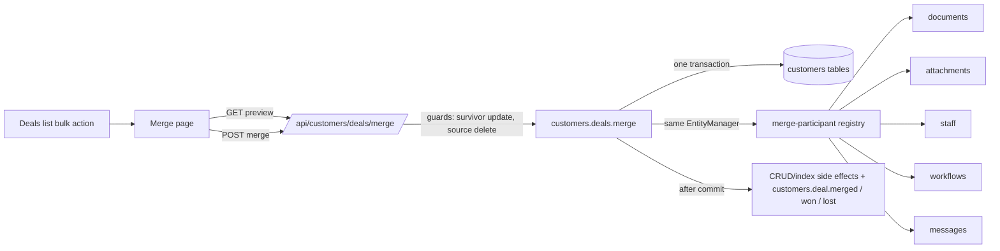

# Deal merge

**Status:** Implemented

## TLDR

Users with `customers.deals.manage` can select two duplicate Deals, compare them side by side, choose the survivor, set every field to the left value, the right value or a new value, choose how people and companies combine, and merge atomically. Core references and every reference owned by a registered merge participant move to the survivor; the other Deal is deleted.

## Overview

Duplicate Deals appear in Open Mercato through imports, parallel data entry and integrations. Today the only remedy is to delete one Deal and lose its history. Deal merge adds a guided, non-undoable merge flow in the customers module: a bulk action on the Deals list, a comparison page, a `customers.deals.merge` command, and an additive shared seam that lets other modules move the references they own.

Primary user: a sales operations user or admin who maintains CRM data quality (`customers.deals.manage`).

## Problem Statement

- Duplicate Deals split activities, comments, interactions, documents, attachments, tasks and time entries across two records, so pipeline reporting and forecasting double-count.
- Deleting a duplicate silently orphans or cascades the references other modules keep, because modules store Deal IDs without ORM relations (FK-by-value).
- Users must decide field by field which value wins, and sometimes need a value neither Deal has.

## Proposed Solution

### Product contract

- The Deals list exposes a host-owned **Merge deals** bulk action. It validates exactly two selected rows without changing the shared `DataTable` API.
- `/backend/customers/deals/merge?left=<uuid>&right=<uuid>` loads a scoped comparison. The survivor picker and column headers show title, creation date and owner, plus a link to each Deal.
- Differing rows are highlighted; a "show only differences" toggle (default on) collapses identical rows. Owner, pipeline, stage, status, source, loss reason, dates and amounts render as human-readable values (tenant dictionary label, then the module default label, then the raw value), never raw IDs.
- Every scalar field offers left, right or a custom value through the same controls as the Deal form: pipeline + stage (stage filtered by pipeline), status (with loss reason and notes only for lost statuses), owner, currency, expected close date, probability, amount, title, description and source. Custom fields offer left, right or a typed custom value.
- People and companies offer left, right, union or a custom set, with at most one primary person.
- Historical activities, comments, interactions (including `linked_entities` chips), stage transitions and registered cross-module references are moved automatically; the page lists every participant the caller may see with its translated label and counts.
- Escape cancels and Cmd/Ctrl+Enter submits only when no dialog, popover or select handled the key; neither fires while the confirmation dialog is open.
- A 409 is surfaced through the shared conflict bar (`surfaceRecordConflict`). Refreshing the comparison keeps the user's choices for fields that still differ.
- Merge is intentionally non-undoable. Existing audit records keep their original resource IDs; the merge creates a new action log on the survivor.

### Non-goals

- Automatic duplicate detection.
- Merging more than two Deals.
- Generic record merging for other entity types.
- Rewriting historical audit entries, notifications or free-form workflow instance data.
- Full undo/redo of a completed merge.

## Architecture

The merge page, route and command live in the customers module. Other modules never import customers code: each registers a participant with `registerEntityMergeParticipant` from `@open-mercato/shared/lib/entities/merge-participants` at module load (`di.ts`) and refers to the Deal by the string entity id `customers:customer_deal`.

Command phases (`withAtomicFlush`, `{ transaction: true }`, label `customers.deals.merge`), each flushed before the next query:

1. Take the shared per-Deal advisory locks (`lockEntityReferences`, keys sorted) and `PESSIMISTIC_WRITE` row locks on both Deals in id order; enforce both optimistic-lock tokens; validate references.
2. Write survivor scalar fields.
3. Reconcile people, then companies (dedupe, single primary).
4. Move activities, comments and interactions; rewrite interaction `linked_entities`.
5. Reconcile stage transitions, including soft-deleted rows.
6. Write custom fields through the data engine.
7. Run every registered participant's `merge` with the transaction-scoped EntityManager.
8. Delete the source Deal.

Side effects run only after commit: CRUD/index side effects for the survivor, the source and every moved activity, comment and interaction, then best-effort `customers.deal.merged` and `customers.deal.won` / `customers.deal.lost` when the survivor's closure outcome changed.

Writers that attach records to a Deal (`documents` links incl. restore, `customers` interaction create/update) take the same per-Deal advisory lock and re-check that the Deal still exists, so they cannot attach to a Deal a concurrent merge removes.

## Data Models

No entity or schema change; no migration.

- Reads and writes: `customer_deals`, `customer_deal_people`, `customer_deal_companies`, `customer_deal_stage_transitions`, `customer_activities.deal_id`, `customer_comments.deal_id`, `customer_interactions.deal_id` and `linked_entities`, custom field values of `customers:customer_deal`.
- Participants (FK-by-value references owned by other modules):

| Participant | Module | Moves | `previewFeatures` |
|---|---|---|---|
| `documents.deal-links` | documents | Document links (active and soft-deleted), deduplicated per document | `documents.view` |
| `attachments.deal-records` | attachments | Attachment records and `storage_metadata.assignments` deal entries | `attachments.view` |
| `staff.deal-time-entries` | staff | `staff_time_entries.deal_id` | `staff.timesheets.manage_all` (counts span every employee's entries) |
| `workflows.deal-task-bindings` | workflows | `user_tasks.entity_bindings`, recomputing `entity_types` | `workflows.tasks.view_all` (counts span every user's tasks) |
| `messages.deal-objects` | messages | Message objects linked to the Deal, deduplicated per message | `messages.manage` (counts span every user's messages) |

- References intentionally not moved (stay on the removed Deal ID): notifications (`source_entity_id`, `link_href`), free-form workflow instance context/input/output JSON, messages without an organization, enterprise `agent_orchestrator` process `subject_id`, enterprise `record_locks.resource_id`, and audit log `resource_id`.

### Data rules

- IDs, tenant/organization scope and timestamps are never user-selected values.
- The stage must belong to the pipeline; pipeline, stage, loss reason (`sales.deal_loss_reason` dictionary) and owner must be in scope. Values already stored on either Deal are always accepted without a lookup — for pipeline and stage this applies to the stored pair, whose stage label is kept — so legacy data can be merged.
- `values.closureOutcome` is ignored: the server derives it from the chosen status (won → `won`, lost → `lost`, otherwise `null`) and clears loss reason and notes for non-lost outcomes.
- People and companies are deduplicated. At most one selected person is primary.
- Stage transitions, including soft-deleted rows, are deduplicated by stage ID; the earliest live transition metadata wins deterministically.
- Custom fields are read normalized and written through the data engine so validation and encryption remain authoritative.

## API Contracts

- `GET /api/customers/deals/merge?left=<uuid>&right=<uuid>` requires `customers.deals.view` and returns `{ left, right, participants }`: both normalized Deal previews (including `createdAt` and `updatedAt`) plus participant summaries. A participant summary is included only when the caller holds that participant's `previewFeatures` in the selected organization (checked through `rbacService.userHasAllFeatures`, wildcard-aware); otherwise it is omitted, so the preview never discloses another module's record counts to a caller without that module's view right.
- `POST /api/customers/deals/merge` requires `customers.deals.manage`, runs route mutation guards for the survivor with operation `custom` (mapped to registry `update`) and for the source with operation `delete`, validates the canonical final state and executes `customers.deals.merge`. Body: `survivorId`, `sourceId`, `survivorUpdatedAt`, `sourceUpdatedAt`, `values`, `customFields`, `personIds`, `companyIds`, `primaryPersonEntityId`. Success: `{ ok: true, survivorId, sourceId }`.
- A stale token or a Deal deleted after the preview returns 409 with the standard optimistic-lock body before any write. A record in another organization or tenant gets exactly the response of a missing id: 404 on `GET`, and on `POST` the same optimistic-lock 409 (the body carries no record id or scope).
- Command interceptor rejections map to their own HTTP status and body. Validation errors return 400 with `error` = translated `customers.deals.merge.errors.validation_failed` and zod `details` whose messages are i18n keys. Unexpected failures are logged and reported, then return a generic translated 500.
- Event `customers.deal.merged` (`lifecycle`, persistent, `clientBroadcast`): `{ id, survivorId, sourceId, tenantId, organizationId }`.
- Participant contract (`@open-mercato/shared/lib/entities/merge-participants`), all additions optional and backward compatible:
  - `registerEntityMergeParticipant({ id, entityId, preview?, merge, previewFeatures? })`, `listEntityMergeParticipants(entityId)`.
  - `EntityMergeParticipant.previewFeatures?: readonly string[]` — features the caller needs to see this participant's preview counts. Omitted or empty means the preview is shown to every caller of the preview route.
  - `EntityMergeParticipantInput.callerHasFeatures?: (required: readonly string[]) => Promise<boolean>` — supplied by the preview route. `collectEntityMergeParticipantPreviews(input)` (and `canPreviewEntityMergeParticipant`) skip a gated participant when the check is absent or denies, so gating fails closed.
  - `merge` ignores caller rights: the merge is authorized by `customers.deals.manage` and must move every reference, including rows the caller cannot see in their owning module.
- `lockEntityReferences(em, inputs)` / `entityReferenceLockKey(input)` (`@open-mercato/shared/lib/entities/reference-lock`): transaction-scoped Postgres advisory locks keyed by entity id, tenant, organization and record id.

## Risks & Impact Review

| Risk | Severity | Affected area | Mitigation | Residual |
|---|---|---|---|---|
| A module stores a Deal ID without registering a participant | Medium | Notifications, workflow instance JSON, enterprise `agent_orchestrator` and `record_locks`, third-party modules | Participants for documents, attachments, staff, workflows and messages; unmoved references listed under Data Models | Those references point at the removed Deal (notification links 404, stale process subjects and lock rows) |
| Writers in staff (time entries), attachments, messages and workflows, and customers interaction undo/redo, do not take the per-Deal advisory lock | Medium | Concurrent writes during a merge | Documents links and interaction create/update lock and re-check; the merge locks both Deal rows | A concurrent write that attaches a record to the source Deal can commit after the participant moved references, leaving a dangling Deal ID |
| Participant rows changed with `nativeUpdate` are not reindexed | Low | Search and query index for participant-owned rows | Participants touch rows whose list views query the database | Search hits for those rows may show the old Deal until reindexed |
| Participants update rows one statement at a time while both Deal locks are held | Low | Merge latency for Deals with many references | Bounded by two Deals; merge is rare and user-initiated | Long lock hold for Deals with very many attachments, tasks or messages |
| Preview counts disclose other modules' data | Low | GET preview | Participants declare `previewFeatures`; the route omits a participant the caller cannot view | A participant registered without `previewFeatures` is shown to every `customers.deals.view` caller |
| Documents re-checks Deal existence with raw SQL on `customer_deals` | Low | Coupling between documents and customers | Read-only, scoped, string table name, no import of customers code | A customers table rename must update `documents/lib/dealReferenceGuard.ts` |
| Merge is irreversible | Medium | Data loss on a wrong survivor choice | Side-by-side comparison, explicit confirmation dialog, `customers.deals.manage` only | No undo; recovery requires a backup |

## Migration & Backward Compatibility

No database migration is required. The API route, command ID, event ID, hidden backend page and participant registry are additive. Existing Deal CRUD routes, command IDs, event IDs and `DataTable` contracts are unchanged. Existing modules are unaffected unless they opt into the new participant registry. A module that stores an undeclared Deal ID remains outside the supported merge boundary and must register a participant before claiming merge compatibility. Once released, the participant registry and the reference-lock key format are stable cross-module contracts.

## Integration coverage

`TC-CRM-DEAL-MERGE` creates its own Deals, custom-field definition and dependencies; verifies stale survivor and source tokens return 409 and roll back; retries with a fresh preview; verifies resolved fields, custom-field values, people and company reconciliation; checks interaction/activity/comment moves and document-link deduplication (and that an admin preview carries the documents participant counts); and confirms the source disappears from detail and list APIs. Two further self-contained scenarios:

- View-only caller: a role with `customers.deals.view` but not `customers.deals.manage` gets a 200 preview without the documents participant (no `documents.view`), a 403 on `POST`, and both Deals keep their title and `updatedAt`.
- Cross-scope: a user restricted to the home organization merges a home Deal with a Deal in a second organization of the same tenant and with a Deal in a second tenant (created by a user of that tenant). `GET` (either side) and `POST` (as source and as survivor) return the same status and body as a random missing id, and all three Deals stay unchanged.

Every scenario creates its Deals, roles, users, organizations and tenant through the API and removes them in `finally`.

Unit coverage: merge-participant registry, preview feature gating (`collectEntityMergeParticipantPreviews`, fail-closed without a check); every participant (preview, merge, scoping, dedupe; attachments additionally gated preview vs. unconditional merge); document-link lock and re-check; command flush discipline, reconciliation, transition dedupe, closure derivation and events, stored pipeline/stage pair acceptance, best-effort `customers.deal.merged` emit, `linked_entities` rewrite, reindex side effects, rollback and 409 paths; route guards for both Deals with the per-Deal operation (survivor `update`, source `delete`), interceptor rejection mapping, preview participant gating and out-of-scope 404, and error reporting; merge page keyboard handling, conflict handling with preserved choices, custom values, readable labels and the differences toggle.

Not covered live: the attachments, staff, workflows and messages participants are unit-tested with mocked EntityManagers only.

## Final Compliance Report

| Rule | Status | Evidence |
|---|---|---|
| Tenant/organization scoping on every read and write | Compliant | Command, route and participants filter by tenant and organization; cross-org and cross-tenant integration scenario |
| No direct ORM relations between modules | Compliant | Participants refer to `customers:customer_deal` by string and import no customers code |
| Mutation guards on custom write routes | Compliant | `runRouteMutationGuards` for survivor (`update`) and source (`delete`) |
| `withAtomicFlush` / no query between mutation and flush | Compliant | Phased command; unit test fails on any query while tracked entities have unflushed changes |
| Side effects after commit | Compliant | CRUD/index side effects and events emitted after the transaction |
| `findWithDecryption` for encrypted reads; custom fields through the data engine | Compliant | Command, route and participants |
| Optimistic locking | Compliant | Both tokens enforced before writes; 409 in the standard body |
| i18n, no hard-coded user-facing strings | Compliant | `customers.deals.merge.*` keys in en, pl, de, es, ko; participant labels in their module locales |
| Design-system tokens | Compliant | Status tokens for difference highlighting; no arbitrary values |
| Integration tests ship with the feature | Compliant | `TC-CRM-DEAL-MERGE` (3 scenarios) |
| Backward compatibility | Compliant | Additive route, command, event, page and shared seam; no schema change |
| Undoable commands | Accepted deviation | Merge is a documented non-goal for undo; confirmation dialog and `customers.deals.manage` gate |

## Changelog

- 2026-11-24: Initial implementation.
- 2026-11-25: Review fixes. Flush ordering in the command, derived closure outcome, scope validation, won/lost events, reindexing of moved rows, `linked_entities` rewrite, soft-deleted transitions, guards for both Deals, 409 for Deals deleted after preview, error reporting. New participants for attachments, staff, workflows and messages; document-link lock fix and re-check. Merge page: custom values for every field, readable values, differences toggle, safe keyboard handling, shared conflict bar, complete translations.
- 2026-11-25: Second review round. Source Deal guard runs as `delete`; best-effort `customers.deal.merged` emit; optional `previewFeatures` / `callerHasFeatures` participant contract with fail-closed preview gating; integration scenarios for a view-only caller and for cross-organization and cross-tenant Deals; residual risk of unlocked writers documented.
- 2026-11-25: Third review round. A pipeline and stage pair already stored on either Deal is accepted without a lookup, matching the data rule for owner and loss reason. Spec restructured to the required sections (Overview, Problem Statement, Architecture, Data Models, API Contracts, Risks & Impact Review, Final Compliance Report); unmoved references (enterprise `agent_orchestrator`, `record_locks`) listed.
