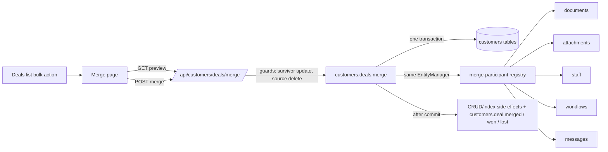

# Deal merge

**Status:** Implemented

## TLDR

Users with `customers.deals.manage` can select two duplicate Deals, compare them side by side, choose the survivor, set every field to the left value, the right value or a new value, choose how people and companies combine, and merge atomically. Core references and every reference owned by a registered merge participant move to the survivor; the other Deal is deleted.

## Overview

Duplicate Deals appear in Open Mercato through imports, parallel data entry and integrations. Today the only remedy is to delete one Deal and lose its history. Deal merge adds a guided, non-undoable merge flow in the customers module: a bulk action on the Deals list, a comparison page, a `customers.deals.merge` command, and an additive shared seam that lets other modules move the references they own.

Primary user: a sales operations user or admin who maintains CRM data quality (`customers.deals.manage`).

## Problem Statement

- Duplicate Deals split activities, comments, interactions, documents, attachments, tasks and time entries across two records, so pipeline reporting and forecasting double-count.
- Deleting a duplicate silently orphans or cascades the references other modules keep, because modules store Deal IDs without ORM relations (FK-by-value).
- Users must decide field by field which value wins, and sometimes need a value neither Deal has.

## Proposed Solution

### Product contract

- The Deals list exposes a host-owned **Merge deals** bulk action. It validates exactly two selected rows without changing the shared `DataTable` API.
- `/backend/customers/deals/merge?left=<uuid>&right=<uuid>` loads a scoped comparison. The survivor picker and column headers show title, creation date and owner, plus a link to each Deal.
- Differing rows are highlighted; a "show only differences" toggle (default on) collapses identical rows. Owner, pipeline, stage, status, source, loss reason, dates and amounts render as human-readable values (tenant dictionary label, then the module default label, then the raw value), never raw IDs.
- Every scalar field offers left, right or a custom value through the same controls as the Deal form: pipeline + stage (stage filtered by pipeline), status (with loss reason and notes only for lost statuses), owner, currency, expected close date, probability, amount, title, description and source. Custom fields offer left, right or a typed custom value.
- People and companies offer left, right, union or a custom set, with at most one primary person.
- Historical activities, comments, interactions (including `linked_entities` chips), stage transitions and registered cross-module references are moved automatically; the page lists every participant the caller may see with its translated label and counts.
- Escape cancels and Cmd/Ctrl+Enter submits only when no dialog, popover or select handled the key; neither fires while the confirmation dialog is open.
- A 409 is surfaced through the shared conflict bar (`surfaceRecordConflict`). Refreshing the comparison keeps the user's choices for fields that still differ.
- Merge is intentionally non-undoable. Existing audit records keep their original resource IDs; the merge creates a new action log on the survivor.

### Non-goals

- Automatic duplicate detection.
- Merging more than two Deals.
- Generic record merging for other entity types.
- Rewriting historical audit entries, notifications or free-form workflow instance data.
- Full undo/redo of a completed merge.

## Architecture

The merge page, route and command live in the customers module. Other modules never import customers code: each registers a participant with `registerEntityMergeParticipant` from `@open-mercato/shared/lib/entities/merge-participants` at module load (`di.ts`) and refers to the Deal by the string entity id `customers:customer_deal`.

Command phases (`withAtomicFlush`, `{ transaction: true }`, label `customers.deals.merge`), each flushed before the next query:

1. Take the shared per-Deal advisory locks (`lockEntityReferences`, keys sorted) and `PESSIMISTIC_WRITE` row locks on both Deals in id order; enforce both optimistic-lock tokens; validate references. Lock every interaction that references the source Deal by `deal_id` or by a chip (`order by id for update`; the chip predicate is one case-insensitive `exists (… jsonb_array_elements(linked_entities) … lower(chip->>'id') = lower(?))`, shared by this lock and by the rewrite selection) before any interaction is written, so two merges touching overlapping interactions serialize instead of deadlocking.
2. Write survivor scalar fields.
3. Reconcile people, then companies (dedupe, single primary).
4. Move activities, comments and interactions; rewrite interaction `linked_entities` (rows selected `for update`, one `update … from jsonb_to_recordset(…)` statement for all of them). Every direct move and the chip rewrite set `updated_at = now()` (the transaction clock), so an edit token issued before the merge no longer matches and the edit returns 409.
5. Reconcile stage transitions, including soft-deleted rows.
6. Write custom fields through the data engine.
7. Run every registered participant's `merge` with the transaction-scoped EntityManager. Each participant writes with a constant number of statements (set-based `nativeUpdate`/`nativeDelete` with `$in`, or `update … from (values …)` in chunks of 500 rows), so the time both Deal locks are held does not grow by one round trip per row.
8. Delete the source Deal.

Side effects run after commit. The request runs the survivor and source CRUD/index effects and emits the best-effort `customers.deal.merged` and closure events. When more than 32 live activities, comments or interactions need CRUD/index effects and the CLI manages the `customers-deal-merge-effects` worker, the request enqueues one scoped job on that queue. The job carries each moved record's ID, the snapshot written at move time, and `movedVersion`. `movedVersion` is an equality token, not an ordering key: it is the merge transaction's `now()`, stored in `updated_at` by the direct moves and chip rewrites and read as a microsecond UTC string. The worker processes at most 100 records per transaction. It locks current rows in the global order interactions → activities → comments, with IDs ordered inside each table and tenant/organization scope on every query. It then re-reads the same rows under those locks, skipping soft-deleted rows and comparing `updated_at = movedVersion::timestamptz` in SQL. The payload columns (`entity_id`, `deal_id`, `interaction_type`, `status`, `source`) are not encrypted. Matching rows publish their CRUD event from the current row while the locks are still held; only then does the lock-only transaction commit. A concurrent writer therefore either committed before the lock and makes the row superseded, or waits and publishes after the merge event has been durably enqueued. This is the narrow exception to the normal enqueue-after-commit rule: the transaction writes no application state and validates state already committed by the merge. Superseded rows publish no CRUD event. After commit, both matching and superseded rows receive query-index upserts, which re-read by ID; a row deleted after the merge gets neither because its delete effects already ran. A legacy job without `movedVersion` publishes from the current row, never from the stale snapshot. A retry can repeat a matching event and index upsert. The guarantee assumes the default FIFO events worker (`concurrency: 1`) and no retry reordering, as does ordinary CRUD event publication. The inline path keeps normal post-commit ordering. Smaller merges, deployments without the CLI-managed worker, bulk imports, always-consistent cache mode and enqueue failures run the per-record effects in the request.

A legacy activity and its bridged canonical interaction share a primary key. The data engine buffers side effects by action, record id and scope, and also by declared entity identity (an explicit `indexer.entityType` or the `events` module/entity), so records of different types that share an id each keep their own CRUD event and query-index upsert on both the inline and the worker path. Repeat marks of the same record still collapse into one.

Every writer that attaches a record to a Deal takes the same per-Deal advisory lock inside its transaction and then re-checks that the Deal is still live (`lockLiveEntityReferences` + `scopedLiveRecordCheck('customer_deals')`), so it either commits before the merge moves its reference or is refused after it. Lock keys lower-case the tenant, organization and record ids, so a UUID sent in upper case takes the same lock; a record id that is not a UUID is reported as missing without querying the table. Interaction chips are matched case-insensitively both when the merge selects and locks the rows (SQL compares `lower()` of the stored chip id, so a mixed-case id such as `aBcD…` is found, not only the fully lower- or upper-case spelling) and when it rewrites them. The attachments participant locks the attachment rows it rewrites (`order by id for update`) before reading their metadata, so a concurrent tag edit is not overwritten:

| Writer | Deal references locked | Refusal |
|---|---|---|
| customers interaction create, update, undo/redo | `dealId` and every `type: 'deal'` entry of `linkedEntities`; on update only chips the stored row does not already hold (read after the lock) are re-checked; undo keeps an unchanged stored `dealId` | 400 `Deal not found` |
| customers comment create, update (any `dealId` in the payload, including relink), undo of update/delete, redo of create | `dealId` (`lockDealInScope`: lock, live check and write in one `withAtomicFlush` transaction; the comment row is read inside it) | 400 `Deal not found` |
| customers person/company undo of deletion | Deal IDs on restored activities, comments and interactions, including interaction chips, in the same transaction as restoration | Missing or deleted Deals are dropped from restored records. Live Deal and unrelated links are preserved. |
| customers company undo of update | No Deal-link writes: the company and person update commands never change Deal links, so their undo restores only the fields, profile, tags, custom fields and members they changed and leaves every Deal link as it is | A difference between the logged `before`/`after` link sets can only come from a concurrent writer (for example a merge committing between the two snapshots), so it is never replayed |
| documents links (create, restore) | linked Deal | 404 `documents.links.notFound` |
| attachments upload, `createAttachmentFromBuffer`, scoped upload, library assignment update, transfer | owning Deal record and Deal assignments; update re-checks only added assignments | 404 `attachments.errors.dealNotFound` |
| messages compose, draft update, forward, snapshot restore | `customers`/`deal` message objects; draft update and restore re-check only added objects; forward re-reads the original objects after the lock | 404 `messages.errors.dealNotFound` |
| staff time entry create, update, undo/redo | `dealId` | 404 `staff.timesheets.errors.dealNotFound` |
| workflows user-task creation (step handler) | Deal entity bindings (all alias spellings) | A missing Deal fails task creation through the workflow engine's step error handling. The transaction persists no task. |

## Data Models

No entity or schema change; no migration.

- Reads and writes: `customer_deals`, `customer_deal_people`, `customer_deal_companies`, `customer_deal_stage_transitions`, `customer_activities.deal_id`, `customer_comments.deal_id`, `customer_interactions.deal_id` and `linked_entities`, custom field values of `customers:customer_deal`.
- Participants (FK-by-value references owned by other modules):

| Participant | Module | Moves | `previewFeatures` |
|---|---|---|---|
| `documents.deal-links` | documents | Document links (active and soft-deleted), deduplicated per document | `documents.view` |
| `attachments.deal-records` | attachments | Attachment records and `storage_metadata.assignments` deal entries | `attachments.view` |
| `staff.deal-time-entries` | staff | `staff_time_entries.deal_id` | `staff.timesheets.manage_all` (counts span every employee's entries) |
| `workflows.deal-task-bindings` | workflows | `user_tasks.entity_bindings`, recomputing `entity_types` | `workflows.tasks.view_all` (counts span every user's tasks) |
| `messages.deal-objects` | messages | Message objects linked to the Deal, deduplicated per message | `messages.manage` (counts span every user's messages) |

- References intentionally not moved (stay on the removed Deal ID): notifications (`source_entity_id`, `link_href`), free-form workflow instance context/input/output JSON, messages without an organization, enterprise `agent_orchestrator` process `subject_id`, enterprise `record_locks.resource_id`, and audit log `resource_id`.

### Data rules

- IDs, tenant/organization scope and timestamps are never user-selected values.
- The stage must belong to the pipeline; pipeline, stage, loss reason (`sales.deal_loss_reason` dictionary) and owner must be in scope. Values already stored on either Deal are always accepted without a lookup — for pipeline and stage this applies to the stored pair, whose stage label is kept — so legacy data can be merged.
- `values.closureOutcome` is ignored: the server derives it from the chosen status (won → `won`, lost → `lost`, otherwise `null`) and clears loss reason and notes for non-lost outcomes.
- People and companies are deduplicated. At most one selected person is primary.
- Stage transitions, including soft-deleted rows, are deduplicated by stage ID; the earliest live transition metadata wins deterministically.
- Custom fields are read normalized and written through the data engine so validation and encryption remain authoritative.

## API Contracts

- `GET /api/customers/deals/merge?left=<uuid>&right=<uuid>` requires `customers.deals.view` and returns `{ left, right, participants }` with both normalized Deal previews and the summaries available to the caller. Counts use the corresponding CRM read features and return zero when the caller lacks the feature. Interaction counts also use CRM email visibility. Interaction and comment counts exclude soft-deleted rows. Participant summaries require the configured features in the selected organization. Document summaries require both `documents.view` and `documents.manage`, the document list's owner/share override, and count live documents. Attachment summaries are omitted when attachment access rules require a per-record check.
- `POST /api/customers/deals/merge` requires `customers.deals.manage`, runs route mutation guards for the survivor with operation `custom` (mapped to registry `update`) and for the source with operation `delete`, validates the canonical final state and executes `customers.deals.merge`. A guard may rewrite the payload (merged over the validated input and re-validated) but not the Deal IDs: a rewrite that changes `survivorId` or `sourceId` returns 422 `{ error, code: 'guard_retarget_rejected' }` before the command runs, and the command and success response always use the IDs the guards evaluated. Body: `survivorId`, `sourceId`, `survivorUpdatedAt`, `sourceUpdatedAt`, `values`, `customFields`, `personIds`, `companyIds`, `primaryPersonEntityId`. Success: `{ ok: true, survivorId, sourceId }`.
- Amounts are exact decimals end to end: the preview returns `valueAmount` as a decimal string (`decimalToString`, never a JS number), the form keeps and submits strings, and `values.valueAmount` accepts a non-negative decimal string or number (`nonNegativeDecimalStringSchema`, blank → `null`) normalized to a string, so digits beyond float precision survive preview → form → command.
- A stale token or a Deal deleted after the preview returns 409 with the standard optimistic-lock body before any write. A record in another organization or tenant gets exactly the response of a missing id: 404 on `GET`, and on `POST` the same optimistic-lock 409 (the body carries no record id or scope).
- Command interceptor rejections map to their own HTTP status and body. Validation errors return 400 with `error` = translated `customers.deals.merge.errors.validation_failed` and zod `details` whose messages are i18n keys. Unexpected failures are logged and reported, then return a generic translated 500.
- Event `customers.deal.merged` (`lifecycle`, persistent, `clientBroadcast`): `{ id, survivorId, sourceId, tenantId, organizationId }`.
- Participant contract (`@open-mercato/shared/lib/entities/merge-participants`), all additions optional and backward compatible:
  - `registerEntityMergeParticipant({ id, entityId, preview?, merge, previewFeatures? })`, `listEntityMergeParticipants(entityId)`.
  - `EntityMergeParticipant.previewFeatures?: readonly string[]` — features the caller needs to see this participant's preview counts. Omitted or empty means there is no feature requirement for that participant.
  - `EntityMergeParticipant.previewAvailable?` — optional eligibility check that runs after the feature check and can withhold the summary under restricted module access policies.
  - `EntityMergeParticipantInput.callerHasFeatures?: (required: readonly string[]) => Promise<boolean>` — supplied by the preview route. `collectEntityMergeParticipantPreviews(input)` (and `canPreviewEntityMergeParticipant`) skip a gated participant when the check is absent or denies, so gating fails closed.
  - `merge` ignores caller rights: the merge is authorized by `customers.deals.manage` and must move every reference, including rows the caller cannot see in their owning module.
- `lockEntityReferences(em, inputs)` / `entityReferenceLockKey(input)` (`@open-mercato/shared/lib/entities/reference-lock`): transaction-scoped Postgres advisory locks keyed by entity id, tenant, organization and record id. Additive helpers: `lockLiveEntityReferences(em, inputs, isLive)` (locks all keys in sorted order, then checks each distinct reference once and returns the missing ones), `lockLiveEntityReference(em, input, isLive)` and `scopedLiveRecordCheck(tableName)` (tenant/org-scoped, non-deleted row check; table name restricted to a plain identifier).

## Risks & Impact Review

| Risk | Severity | Affected area | Mitigation | Residual |
|---|---|---|---|---|
| An interaction edit that loaded a pre-merge version commits after the merge | High (before this fix) | Interaction edits racing a merge, including title-only edits that take no Deal lock | The version is re-read and checked under the interaction row lock, which the merge also takes (Deal locks → row lock in both); unit test `interactions.versionLock` and `TC-CRM-DEAL-MERGE-EDIT-RACE` | A versioned edit returns 409 instead of overwriting; an unversioned edit stays last-writer-wins but serializes with the merge and keeps the merged Deal references |
| Shared `DataEngine` side-effect buffering now keeps declared entity identity | Low | Every caller of `markOrmEntityChange` (CRUD factory, `emitCrudSideEffects` / `emitCrudUndoSideEffects`, ecommerce binding cascades, Deal merge effects) | Marks of the same record with the same or partially declared identity merge exactly as before; only marks that declare a different entity type under the same id are emitted separately instead of one being dropped; no public type or signature changed; shared tests pin both behaviours | A caller that relied on a second, different entity's mark silently replacing the first now emits both effects |
| A module stores a Deal ID without registering a participant | Medium | Notifications, workflow instance JSON, enterprise `agent_orchestrator` and `record_locks`, third-party modules | Participants for documents, attachments, staff, workflows and messages; unmoved references listed under Data Models | Those references point at the removed Deal (notification links 404, stale process subjects and lock rows) |
| A writer attaches a record to the source Deal while the merge runs | Medium | Concurrent writes during a merge | Every participant-owned writer, interaction create/update/undo (including `linkedEntities` chips) and comment create/relink/undo/redo plus person/company delete-undo take the per-Deal advisory lock and re-checks that the Deal is live in the same transaction as the write (table under Architecture); PostgreSQL race scenarios for interactions and comments in `TC-CRM-DEAL-MERGE` | A third-party module that stores a Deal ID without taking the lock can still leave a dangling reference. If the merge finishes first, person/company undo restores the child records with the missing Deal reference removed |
| A comment committed between the bulk move and the source delete loses its Deal link (`customer_comments.deal_id` is `ON DELETE SET NULL`) | High (before this fix) | Comment create, relink, undo/redo | Comment writers take the per-Deal lock, re-check the Deal and write in one transaction, so they serialize with the merge: either the comment exists before the move and is moved, or the write is refused with 400 | None known for comment commands |
| An interaction chip stored with a mixed-case Deal id is not moved | Medium (before this fix) | Interactions created through the API with mixed-case UUIDs | Selection, row locks and rewrite all compare `lower(id)`; unit test and `TC-CRM-DEAL-MERGE` mixed-case scenario | Chip matching scans the tenant/organization's interaction rows (no GIN index on `linked_entities`; the previous `@>` predicate scanned too) |
| Undoing an earlier company edit deletes the Deal link a merge moved to the survivor | High (before this fix) | Company update undo after a merge | Update undo no longer writes Deal links at all, because the update command never changes them; this also covers a merge that commits between the edit's `before` and `after` snapshots; unit tests and `TC-CRM-DEAL-MERGE-HISTORY` | None for merges. Before this PR the undo deleted and rebuilt every company Deal link from the snapshot, which could also revert unrelated link changes made after the edit |
| An edit token issued before a merge still authorizes a write to a moved record | Medium (before this fix) | Interaction, comment and activity edits after a direct-link-only move | Direct moves write `updated_at = now()` with the new Deal ID; unit test and `TC-CRM-DEAL-MERGE-HISTORY` | Open edit forms on moved records must reload after a merge |
| Lock-order inversions in rare writer paths | Low | Attachment PATCH/transfer when a mutation guard adds a Deal assignment after the row lock; message forward when the copied objects changed between the first lock and the re-read | Both paths lock the requested Deals before the row lock and re-read after it | PostgreSQL detects the deadlock and aborts one transaction (an error response, no partial write) |
| A workflow user task loses an access restriction when its Deal disappears | High (before this fix) | Workflow step handler | The liveness check fails task creation while the Deal lock is held. The workflow engine handles the step error without persisting an unbound task. | A step referencing a retired Deal requires a live binding before it can create the task |
| Interaction Deal chips are now validated | Low | Interaction create/update API | Only newly added chips must reference a live in-scope Deal; existing stale chips do not block edits | A client that creates chips to non-existent Deals now gets 400 |
| Participant rows changed with `nativeUpdate` are not reindexed | Low | Search and query index for participant-owned rows | Participants touch rows whose list views query the database | Search hits for those rows may show the old Deal until reindexed |
| Reference rewrites run while both Deal locks are held | Low | Merge latency for Deals with many references | Interaction chips and every participant write set-based; the statement count is constant in the number of rows (unit tests compare 1 vs 250 rows; PostgreSQL query log with 1 and 25 rows of every kind: preview 67 statements, merge transaction 46 statements, both unchanged). Verified with the deferred effects: the whole merge request issues 192 statements at 1 row of every kind (effects inline, below the 32-record threshold) and 127 at 25 rows (down from 1717), while the worker runs the remaining 1613 statements after the response and every moved comment projection points at the survivor | Very large Deals still pay for row volume, not for round trips. Per-record effects still grow with the number of moved rows. A large merge returns after enqueue, before worker effects become visible. Strict consistency, deployments without the CLI-managed worker and enqueue failures retain the inline cost |
| A deferred merge-effects job publishes a superseded Deal link after a newer move | High (before this fix) | Persistent `customers.activity/comment/interaction.updated` consumers (webhooks, workflows, sync) when a large merge's worker overlaps a later edit or merge | In chunks of 100, the worker locks rows in table and ID order, re-reads versions, and enqueues matching events before releasing the locks. Superseded rows get only the post-commit index refresh. Unit ordering/rollback/chunking coverage and `TC-CRM-DEAL-MERGE-EVENT-ORDER` pause the worker between lock acquisition and publication | Consumer order follows publication order only with the default single-concurrency FIFO events worker and no retry reordering; retries may duplicate an event |
| Deferred effects hold row locks while event jobs are enqueued | Medium | Writers of moved interactions, activities and comments; database and events queue availability | Chunks are capped at 100; every path locks interactions → activities → comments and rows by ID; the merge command uses the same table/ID order | A slow or unavailable events queue extends writer latency until the worker transaction fails or finishes |
| A deferred event enqueue error is swallowed by the shared data engine | Low | Persistent consumers of moved-record CRUD events | Queue failures are logged and reported for operational detection | The current shared flush contract can resolve after an individual enqueue failure, so a missing event may require operational replay |
| Preview counts disclose records hidden by access policy | High (before this fix) | GET preview | Apply CRM email visibility before aggregating, restrict document counts to document managers, and omit attachment counts when record-level policy applies | The preview can omit summaries for actors who can see only a subset of the participant records |
| Participant modules re-check Deal existence with raw SQL on `customer_deals` | Low | Coupling between documents, attachments, messages, staff, workflows and customers | Read-only, scoped, shared `scopedLiveRecordCheck('customer_deals')`, no import of customers code | A customers table rename must update each module's `dealReferenceGuard.ts` |
| Merge is irreversible | Medium | Data loss on a wrong survivor choice | Side-by-side comparison, explicit confirmation dialog, `customers.deals.manage` only | No undo; recovery requires a backup |

## Migration & Backward Compatibility

No database migration is required. The API route, command ID, event ID, hidden backend page and participant registry are additive. Existing Deal CRUD routes, command IDs, event IDs and `DataTable` contracts are unchanged. Existing modules are unaffected unless they opt into the new participant registry. A module that stores an undeclared Deal ID remains outside the supported merge boundary and must register a participant before claiming merge compatibility. Once released, the participant registry and the reference-lock key format are stable cross-module contracts.

## Integration coverage

`TC-CRM-DEAL-MERGE` creates its own Deals, custom-field definition and dependencies; verifies stale survivor and source tokens return 409 and roll back; retries with a fresh preview; verifies resolved fields, custom-field values, people and company reconciliation; checks interaction/activity/comment moves and document-link deduplication (and that an admin preview carries the documents participant counts); and confirms the source disappears from detail and list APIs. Two further self-contained scenarios:

- View-only caller: a role with `customers.deals.view`, `customers.interactions.view` and `documents.view` gets a 200 preview that counts the shared interaction and omits the owner's private interaction and document summary. The owner preview counts both interactions and shows the document summary. The limited caller gets a 403 on `POST`, and both Deals keep their title and `updatedAt`.
- Exact amount: a survivor amount of `12345678901234567.89` comes back as that string from the preview and stays on the survivor after a merge that keeps it.
- Concurrent writers (PostgreSQL): in three rounds a merge races six interaction creates with `dealId`, six with a source Deal chip and six updates pointing existing interactions at the source. Every write gets 201/200 or 400, the merge returns 200, later writes get 400, and no interaction keeps the source Deal as `dealId` or chip.
- Concurrent comment writers (PostgreSQL): in three rounds a merge races six comment creates with the source `dealId` and six relinks of existing comments to the source. Every write gets 201/200 or 400, the merge returns 200, later writes get 400, no comment keeps the source Deal, and every comment whose write succeeded ends on the survivor. At least one successful source write must have a request interval overlapping the merge.
- Person and company delete-undo: after their source Deal is merged, the undo restores comments and interactions, removes references to the deleted Deal and preserves references to the live Deal.
- Mixed-case chip: an interaction whose `linkedEntities` Deal id mixes letter case is moved to the survivor.
- Cross-scope: a user restricted to the home organization merges a home Deal with a Deal in a second organization of the same tenant and with a Deal in a second tenant (created by a user of that tenant). `GET` (either side) and `POST` (as source and as survivor) return the same status and body as a random missing id, and all three Deals stay unchanged.

`TC-CRM-DEAL-MERGE-HISTORY` covers merges that follow earlier edits:

- Company edit, then merge of the Deal it links to, then undo of the edit through `POST /api/audit_logs/audit-logs/actions/undo`: the survivor keeps the company link, the source Deal stays gone and the company name is restored.
- Interaction linked to the source only by `dealId`: after the merge its `updatedAt` changed, a `PUT` with the pre-merge optimistic-lock header returns 409 `optimistic_lock_conflict`, and a `PUT` with the fresh version succeeds.

`TC-CRM-DEAL-MERGE-EVENT-ORDER` covers a writer overlapping deferred publication:

- A merges into B with 32 comments and 1 interaction, so the effects are deferred. After the original B delivery, the test holds an ACCESS EXCLUSIVE lock on `customer_comments` and replays the complete job. PostgreSQL proves the worker has already locked the interaction row before it waits on comments. A concurrent `PUT` relinking that interaction to D must then wait on the worker row lock, not the comments table. Releasing the pause lets the worker publish B before the edit publishes; no B delivery may follow the edit delivery. The projection and list API show the interaction only under D. The old implementation fails because it reads the interaction before the pause without holding its lock, allowing the edit to publish before the replayed B event.

The scenarios create and clean up their own fixtures. The event-order scenario bulk-inserts comments in PostgreSQL to reach the deferred threshold in one statement.

Unit coverage: merge-participant registry, preview feature gating (`collectEntityMergeParticipantPreviews`, fail-closed without a check); every participant (preview, merge, scoping, dedupe; attachments additionally gated preview vs. unconditional merge); document-link lock and re-check; command flush discipline, reconciliation, transition dedupe, closure derivation and events, stored pipeline/stage pair acceptance, best-effort `customers.deal.merged` emit, `linked_entities` rewrite, reindex side effects, rollback and 409 paths; route guards for both Deals with the per-Deal operation (survivor `update`, source `delete`), interceptor rejection mapping, preview participant gating and out-of-scope 404, and error reporting; merge page keyboard handling, conflict handling with preserved choices, custom values, readable labels and the differences toggle.

Additional unit coverage: guard retarget rejection (survivor, source, swapped) and an ID-preserving rewrite; exact amount through route, validator, command and form; constant statement count for interaction chips and every participant; reference-lock helpers; per-module lock and re-check for interactions, comments (create, relink, undo, redo), attachments, messages, staff and workflows; case-insensitive chip predicate and mixed-case rewrite; `updated_at` on every direct move; company update undo (no Deal-link writes or locks, survivor link preserved including a merge between the edit's snapshots); deferred merge effects (`dealMergeEffects.version.test.ts`):
- A superseded version gets no event but still gets an index upsert.
- A matching version publishes the current row, not the snapshot.
- A legacy job without a version never publishes the stale snapshot.
- A deleted row is skipped.
- A retry still skips deleted rows and safely repeats query-index upserts.
- The last published Deal is C when the worker drains after a later move.
- The command reads `movedVersion` after the moves and before commit, and enqueues it.
- The worker orders begin → interaction/activity/comment locks by ID → version read → event flush → commit → index-only flush, rolls back on failure, skips superseded events and processes 250 records in three transactions.

The attachment, staff, workflow and message participant rewrites are covered by unit tests with mocked EntityManagers. The live merge-race scenarios cover interactions and comments.

`TC-WF-076` starts a workflow with a resolved binding to a retired Deal, verifies that its user-task step fails, and checks that PostgreSQL contains no task for the workflow run. Unit tests exercise the workflow failure path, CRM feature and email visibility, document manager scope, and attachment access policies.

## Final Compliance Report

| Rule | Status | Evidence |
|---|---|---|
| Tenant/organization scoping on every read and write | Compliant | Command, route and participants filter by tenant and organization; cross-org and cross-tenant integration scenario |
| No direct ORM relations between modules | Compliant | Participants refer to `customers:customer_deal` by string and import no customers code |
| Mutation guards on custom write routes | Compliant | `runRouteMutationGuards` for survivor (`update`) and source (`delete`); guard rewrites of either Deal ID rejected |
| `withAtomicFlush` / no query between mutation and flush | Compliant | Phased command; unit test fails on any query while tracked entities have unflushed changes |
| Side effects after commit | Compliant | CRUD/index side effects and events emitted after the transaction |
| `findWithDecryption` for encrypted reads; custom fields through the data engine | Compliant | Command, route and participants |
| Optimistic locking | Compliant | Both tokens enforced before writes; 409 in the standard body |
| i18n, no hard-coded user-facing strings | Compliant | `customers.deals.merge.*` keys in en, pl, de, es, ko; participant labels in their module locales |
| Design-system tokens | Compliant | Status tokens for difference highlighting; no arbitrary values |
| Integration tests ship with the feature | Compliant | `TC-CRM-DEAL-MERGE` and `TC-CRM-DEAL-MERGE-RESTORE` |
| Backward compatibility | Compliant | Additive route, command, event, page and shared seam; no schema change |
| Undoable commands | Accepted deviation | Merge is a documented non-goal for undo; confirmation dialog and `customers.deals.manage` gate |

## Changelog

- 2026-11-27: PR re-review round 6. Deferred merge effects now lock each bounded record chunk in deterministic table/ID order, re-read versions and enqueue matching CRUD events before releasing row locks; index refresh remains after commit. The event-order integration test pauses the worker between interaction lock and publication and proves a later edit cannot publish first.

- 2026-11-26: Applied CRM read and record visibility to preview counts, restricted document and attachment summaries using their own access policies, and made task creation fail when a resolved Deal binding is no longer live.

- 2026-11-24: Initial implementation.
- 2026-11-25: Review fixes. Flush ordering in the command, derived closure outcome, scope validation, won/lost events, reindexing of moved rows, `linked_entities` rewrite, soft-deleted transitions, guards for both Deals, 409 for Deals deleted after preview, error reporting. New participants for attachments, staff, workflows and messages; document-link lock fix and re-check. Merge page: custom values for every field, readable values, differences toggle, safe keyboard handling, shared conflict bar, complete translations.
- 2026-11-25: Second review round. Source Deal guard runs as `delete`; best-effort `customers.deal.merged` emit; optional `previewFeatures` / `callerHasFeatures` participant contract with fail-closed preview gating; integration scenarios for a view-only caller and for cross-organization and cross-tenant Deals; residual risk of unlocked writers documented.
- 2026-11-25: Third review round. A pipeline and stage pair already stored on either Deal is accepted without a lookup, matching the data rule for owner and loss reason. Spec restructured to the required sections (Overview, Problem Statement, Architecture, Data Models, API Contracts, Risks & Impact Review, Final Compliance Report); unmoved references (enterprise `agent_orchestrator`, `record_locks`) listed.
- 2026-11-26: Fourth review round. Exact decimal amounts through preview, form, validator and command; guard rewrites of `survivorId`/`sourceId` rejected with 422; per-Deal lock and live re-check for interaction `linkedEntities` chips, interaction undo/redo and every participant-owned writer (attachments, messages, staff, workflows); set-based reference rewrites with constant statement counts; integration scenarios for exact amounts and concurrent interaction writers. Independent review follow-ups: case-insensitive lock keys and chip matching, non-UUID record ids reported as missing, attachment rows locked before the metadata rewrite, interaction rows locked in id order before the move, storage compensation in `createAttachmentFromBuffer`, a client-side error instead of a silent `null` for an invalid custom amount, translated chip error.
- 2026-11-26: PR re-review. Comment create, relink, undo and redo join the merge lock protocol (`lockDealInScope`: per-Deal lock, live check and write in one transaction), closing the `ON DELETE SET NULL` window; one case-insensitive chip predicate for interaction selection and row locking, so mixed-case chip ids are moved; PostgreSQL race scenario for comments and a mixed-case chip scenario in `TC-CRM-DEAL-MERGE`; preview and merge statement counts measured from the PostgreSQL query log (preview and the locked merge transaction are constant; only post-commit per-record CRUD/index side effects grow).
- 2026-11-26: Person/company delete-undo joins the Deal lock protocol, the comment race requires an overlapping successful source write, and large merges defer moved-record effects to the queue.
- 2026-11-26: Verified on a live PostgreSQL stack: `TC-CRM-DEAL-MERGE` and `TC-CRM-DEAL-MERGE-RESTORE` pass (8 scenarios); query log shows preview 67 and merge transaction 46 statements at 1 and 25 rows, the merge request 192 → 127 statements at 25 rows with 1613 statements moved to the `customers-deal-merge-effects` worker, and 25/25 moved comment projections on the survivor.
- 2026-11-26: PR re-review round 4. Bridged legacy activities: a merge now updates both the legacy activity and its shared-id canonical interaction (CRUD events and query-index projections) on the inline and worker paths, because `DefaultDataEngine` keeps declared entity identity when buffering side effects (no public type or signature change; same-entity marks still collapse); regression tests in shared `engine.side-effect-identity.test.ts`, customers `dealMergeEffects.bridge.test.ts` and integration `TC-CRM-DEAL-MERGE-BRIDGE`. Company update undo no longer writes Deal links (the update command never changes them), so a link moved to the survivor by a merge survives the undo even when the merge committed between the edit's snapshots; person update undo never touched Deal links. Direct activity, comment and interaction moves write `updated_at = now()`, so pre-merge edit tokens get 409. New `TC-CRM-DEAL-MERGE-HISTORY` scenarios for both.
- 2026-11-26: PR re-review round 5. Interaction edit version check: Interaction update, complete, cancel and delete re-read `updated_at` under a tenant-scoped row lock (`select … for update`) and enforce the optimistic-lock token there, after any Deal-reference locks (matching the merge lock order), so an edit that loaded its version before a merge committed returns 409 instead of writing; unit test `interactions.versionLock` and PostgreSQL scenario `TC-CRM-DEAL-MERGE-EDIT-RACE`, which pauses a title-only edit after it loaded the interaction by holding an ACCESS EXCLUSIVE lock on `customer_dictionary_entries`, commits the merge and asserts 409. Deferred merge effects skip Deal links superseded before the worker reads them. The queued job carries `movedVersion`, the merge transaction's `updated_at` for the moved rows. The worker re-reads each moved row with tenant/organization scope. It publishes the CRUD event from the current row only while `updated_at` still equals that version. Superseded rows get only the query-index refresh. Legacy jobs without a version publish from the current row, never from the queued snapshot. Unit tests in `dealMergeEffects.version.test.ts`; new integration `TC-CRM-DEAL-MERGE-EVENT-ORDER` observes published events through webhook deliveries. Interaction update, complete, cancel and delete without an optimistic-lock token take the undo `before` snapshot under the interaction row lock, recorded on the command result (and forwarded by the `customers.activities.update`/`delete` and `customers.todos.unlink` bridges, so the AI activities tool path is covered); update also re-derives every value that depends on the stored row (type-change clears, linked chips, re-link) after that lock, while Deal advisory locks are still taken before the row lock and Deal references are validated under it, so an edit raced by a merge applies to the survivor instead of failing with "Deal not found". This costs about two extra reads per interaction write.
