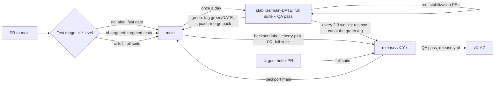
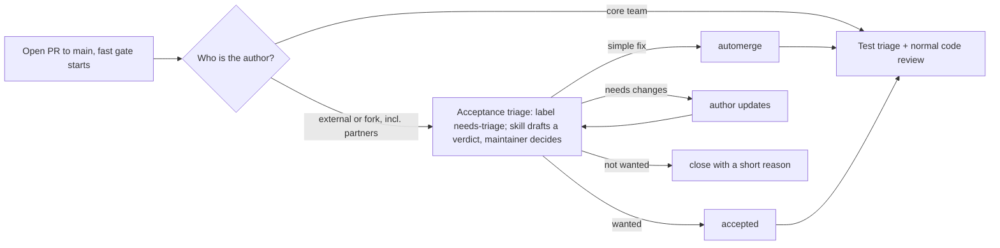
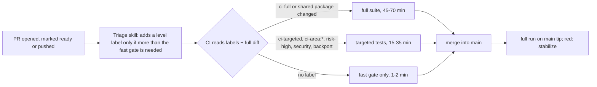
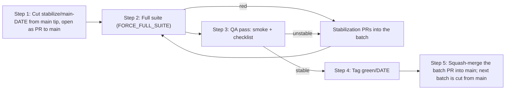
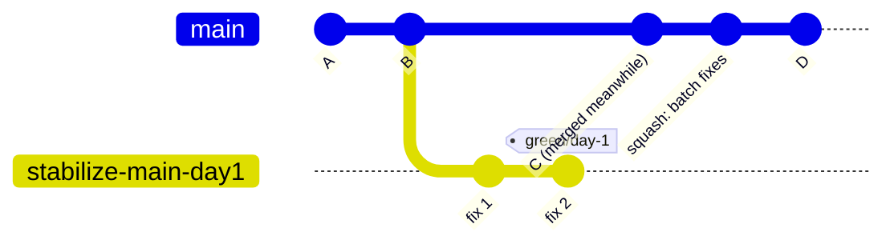
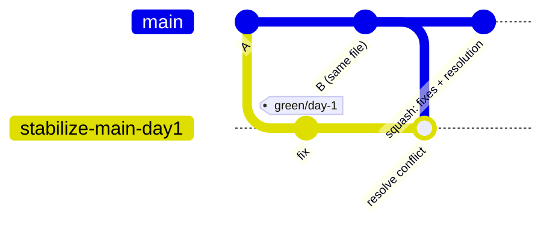
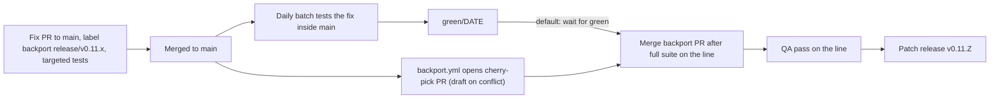
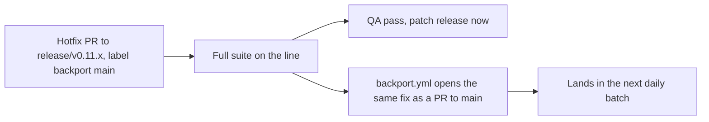
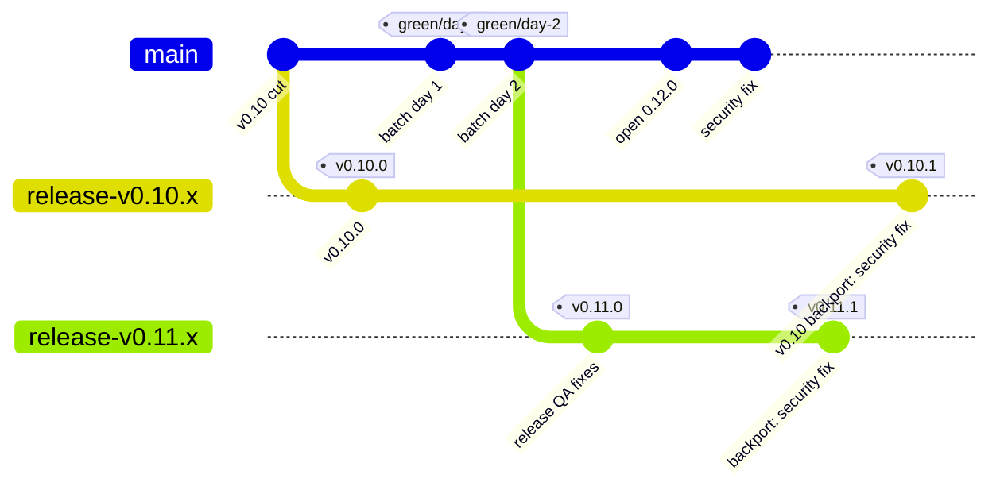
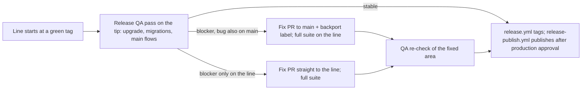

# Batch Merge and Green-Tag Release Process

**Date:** 2026-11-25 (updated 2026-11-26)
**Status:** Approved shape, ready for development (phased)
**Scope:** OSS repository process: CI workflows, PR labels, review/QA skills, GitHub rulesets, release-line tooling
**Related:** [Phased Integration CI](2026-06-05-phased-integration-ci.md) (draft), [CI/CD Performance](implemented/2026-04-10-ci-cd-performance.md), PR #10434 and PR #10457 (closed as superseded by this spec); QA lanes and batch QA: [open-mercato/skills#210](https://github.com/open-mercato/skills/pull/210) and PR #10712 (draft, `.ai/docs/pr-workflow.md` → QA meta labels, Daily batch QA)

---

## Contents

- [TLDR](#tldr)
- [Terms](#terms)
- [Current vs target](#current-vs-target)
- [Overview](#overview)
- [Problem Statement](#problem-statement)
- [Proposed Solution](#proposed-solution)
  - [Kinds of checks](#kinds-of-checks)
  - [The big picture](#the-big-picture)
  - [Acceptance for external PRs](#acceptance-for-external-prs)
  - [Test triage: how much testing a PR gets](#test-triage-how-much-testing-a-pr-gets)
  - [CI labels and the scope file](#ci-labels-and-the-scope-file)
  - [When CI runs again](#when-ci-runs-again)
  - [Docs-only PRs](#docs-only-prs)
  - [QA lanes](#qa-lanes)
  - [Merge-ready rule](#merge-ready-rule)
  - [Keeping main green](#keeping-main-green)
  - [The daily batch](#the-daily-batch)
  - [QA on the batch](#qa-on-the-batch)
  - [What happens to a green batch](#what-happens-to-a-green-batch)
  - [Merge-back conflicts](#merge-back-conflicts)
  - [Backporting](#backporting)
  - [Releases](#releases)
  - [Stabilizing a release line](#stabilizing-a-release-line)
  - [What runs where](#what-runs-where)
  - [Labels](#labels)
  - [Trade-offs](#trade-offs)
- [Implementation plan](#implementation-plan) ([Phase 0](#phase-0-daily-batch-by-hand), [1](#phase-1-spec-and-decisions), [2](#phase-2-ci-scope-engine-default-unchanged), [3](#phase-3-ci-triage-skill-in-shadow-mode), [4](#phase-4-fast-gate-as-the-default), [5](#phase-5-acceptance-for-external-prs), [6](#phase-6-release-lines-from-green-tags), [Later](#later-optional))
- [What exists and what is needed](#what-exists-and-what-is-needed)
- [Architecture](#architecture), [Data Models](#data-models), [API Contracts](#api-contracts)
- [Decisions](#decisions)
- [Risks & Impact Review](#risks--impact-review), [Final Compliance Report](#final-compliance-report), [Changelog](#changelog)

## TLDR

PRs keep targeting `main`, but merge on checks sized to their risk: a 1–2 minute fast gate by default, more tests only when triage (a skill first, a human on top) adds a `ci-*` label. Once a day the stabilizer cuts `main` into `stabilize/main-<date>` (the batch), which runs the full suite and one manual QA pass. Problems are fixed forward on the batch; a green batch is tagged `green/<date>` and merged back into `main`. Every 2–3 weeks a release line is cut from a green tag instead of from `main`'s untested tip. Backports keep using the existing labels.

Target: about 80 merged PRs a day without paying for the full test suite on every PR. For contributors nothing changes: every PR still targets `main`.

The plan is ordered so every safety net (daily batch, QA, label-driven scope, triage) runs before the per-PR default drops to the fast gate, which is where the CI-minute savings come from and where the risk is.

## Terms

- **Daily cut, batch** (team chat: *paczka*): the `stabilize/main-<date>` branch made from `main` once a day and opened as one PR back to `main`.
- **Stabilizer:** the person who owns the day's batch: cuts it, fixes blockers with small PRs into it, tags it and merges it back.
- **Green tag:** `green/<date>` on the batch tip that passed the full suite and QA.
- **Core team:** PR authors whose GitHub `author_association` is `MEMBER`, `OWNER` or `COLLABORATOR`.

## Current vs target

| Area | Current (2026-11-25) | Target |
|---|---|---|
| PR to `main` | Scoped CI on every PR: affected-module integration tests, unit tests, build; 13–43 min. Full suite when `FULL_SUITE_PATTERN` matches or `ci-full` is set | Fast gate (changed-package typecheck, lint, related unit tests, guard, CLA) by default, 1–2 min. `ci-targeted` / `ci-area:*` / `ci-full` add tests. `FULL_SUITE_PATTERN` stays as a floor |
| Who decides test scope | Nobody; CI derives it from paths. `ci-full` only applies from the next push | Triage skill sets labels on open and each push (raise only); humans can add. CI re-runs on label change |
| Docs-only PRs | Install, build, lint and unit tests still run | Docs lane: guard, CLA, docs-specific checks only, under 1 minute; docs site built on `apps/docs` PRs |
| External PRs | Same path as core PRs | Acceptance triage (`needs-triage` → `accepted`, automerge for simple fixes, or decline) |
| Stabilization | `stabilize/main-<date>` cut by hand, sometimes 2–3 a day, squash-merged back | One batch a day with a named stabilizer, full suite + QA pass, `green/<date>` tag, merged back |
| QA | `needs-qa` is formally a merge gate on most PRs; weekly pass of `main` (`weekly-qa`); per-PR `ready-for-qa` queue | Only `needs-human-qa` without `qa-approved` blocks a merge; `needs-qa` = automatic QA, not blocking; `qa-batch-check` = merge, check in the batch. One daily pass on the batch with `om-qa-batch` (smoke + checklist); bugs `daily-qa`, blockers `qa-blocker`. `weekly-qa` and `ready-for-qa` retired |
| `main` safety net | Full suite on every push to `main` | Unchanged; an agent opens a stabilization PR when it goes red |
| Release cut | `release-cut.yml` cuts `release/vX.Y.x` at `main`'s tip | Cut at a chosen `green/<date>` tag; changelog split at that commit |
| Merge methods on `main` | Ruleset allows squash only | Squash stays; the green tag preserves the tested commit (see [Decisions](#decisions)) |

## Overview

This spec describes the process and turns it into implementable phases. Each step in the [Implementation plan](#implementation-plan) is sized to be one task or one PR. Owners:

- **Maintainers**: `.github/workflows/**`, `scripts/**` (covered by `CODEOWNERS`).
- **Skills repo**: `om-*` pipeline skills live in [open-mercato/skills](https://github.com/open-mercato/skills) and are installed into `.agents/skills/`; repo-local overrides go in `.ai/skills/<name>/`.
- **QA**: label rules for QA, checklists, verdicts.
- **Admin**: GitHub rulesets (required checks, merge methods) and label creation where no workflow does it.

## Problem Statement

The team targets about 80 merged PRs a day. Running scoped or full integration CI on every PR costs 13–70 minutes and many runner minutes per PR, which caps merge throughput. Stabilization already happens on ad-hoc `stabilize/` branches, QA tests `main` weekly, and release lines are cut from an untested `main` tip. The process needs to: merge faster, spend full-suite and QA time once per day instead of per PR, keep `main` releasable through daily green points, and keep contributors' workflow unchanged (PRs still target `main`).

## Proposed Solution

### Kinds of checks

| Check | Time | What it runs | Where |
|---|---|---|---|
| Fast gate | 1–2 min | Typecheck of the changed packages, lint, related unit tests, enterprise guard, CLA | Every PR with code changes. Docs-only PRs run even less ([Docs-only PRs](#docs-only-prs)) |
| Targeted tests | ~15–35 min | Integration tests of the affected modules only, on one runner. CI picks modules from changed paths; labels add more | Exists today on every PR; here only on PRs that need it |
| Full suite | ~45–70 min | Everything `ci.yml` runs: all unit tests, build, all integration tests in 15 shards | Shared packages, the daily batch, `main`, release lines |
| QA pass (by hand) | as long as it takes | A tester uses the running app on a QA slot (`qa-deploy.yml`, `qa1`–`qa4`): smoke of main flows, then a checklist of the day's PRs that need a human eye; verdict stable or unstable | Once per batch (one build, all of the day's PRs) plus retests of fixed areas; once on a release line before each release. Only `needs-human-qa` PRs are tested before merge |

Times are wall clock from green CI runs on 2026-11-23 and 2026-11-24, queueing included.

### The big picture

Three kinds of branches. Code enters through `main` (or, for urgent hotfixes, a release line). External PRs are accepted first; then every PR is triaged for tests.



A PR answers two questions, in order: **do we want this change at all?** ([Acceptance](#acceptance-for-external-prs), depends on who wrote it) and **how much testing does it need?** ([Test triage](#test-triage-how-much-testing-a-pr-gets), sized to the change). Every PR targets `main` and always runs the fast gate.

### Acceptance for external PRs



- **Who counts as core team:** read from GitHub (`author_association` `MEMBER`, `OWNER`, `COLLABORATOR`); nobody keeps a list. "Accepted" is not "approved": core PRs still get code review and test triage.
- **What acceptance triage asks:** do we want this in the product; is there an agreed issue or spec; is the size right; does it touch `packages/enterprise/` (closed to external contributions by policy) or CI and release files (`CODEOWNERS` already requires a maintainer); is the CLA signed. The skill answers in one comment. A simple, low-risk fix (typo, small bug fix with a test, no new feature) can be qualified for `automerge`; anything else waits for a maintainer.
- **Certified partners:** their PRs already get `partner-request` automatically (`partner-request-label.yml`, list in `.github/certified-partners.yml`). Same triage, first in the queue. Whether they skip acceptance is open.
- **How it blocks the merge:** the `ci-triage` check is green only when the author is core or the PR carries `accepted` (or `automerge`). The fast gate still runs before acceptance, so the author gets feedback early.
- **Forks:** fork PRs keep normal CI scope even with `ci-full` (`CONTRIBUTING.md`); an accepted fork PR that needs the full suite is re-pushed to a same-repo branch by a maintainer.

### Test triage: how much testing a PR gets



| Step | Who | What it does | Status |
|---|---|---|---|
| 1. Triage | Skill (part of `om-auto-review-pr`, or a small `om-ci-triage`) | Reads the diff and PR text, adds `ci-targeted` or `ci-full` and any `ci-area:*` labels only when needed, posts one line why, and sets the `ci-triage` check. It already infers `risk-*` labels today | new |
| 2. Adjust | Human: reviewer or author | Adds a higher level or another area. Removing a label a human set needs a human | new |
| 3. Re-triage | Skill, on every push | Looks at the new diff; may raise the level or add areas, never lower | new |
| Floor | CI | Shared-package diff (`FULL_SUITE_PATTERN`) means at least `ci-full`; `risk-high`, `security`, `backport …` mean at least `ci-targeted`; a PR not yet triaged (no `ci-triage`) cannot merge | `FULL_SUITE_PATTERN`, `ci-full` exist; rest new |

"Shared package" means the paths in `FULL_SUITE_PATTERN` (`ci.yml`): `packages/shared`, `ui`, `events`, `queue`, `cache`, `search`, `onboarding`, `webhooks`, core / enterprise / cli-testing `lib`, the app shell, and `ci.yml` itself. A change there can break any module, so a targeted run cannot cover it. A backported fix gets the full suite on its cherry-pick PR to the release line, so `ci-targeted` is enough on its way into `main`.

### CI labels and the scope file

One prefix, `ci-`, steers CI. There is no label per module: about 60 modules map onto a few areas. Ten labels in total (2 levels + 8 areas). No label means the fast gate, so most PRs carry none.

| Label | Effect |
|---|---|
| *(no label)* | Fast gate only (default) |
| `ci-targeted` | + integration tests of the affected modules |
| `ci-full` | + the full suite (exists today) |
| `ci-area:commerce` | sales, catalog, cart, checkout, promotions, payments, shipping, currencies, wms |
| `ci-area:crm` | customers, customer groups, messages, inbox, channels, phone calls, planner |
| `ci-area:platform` | auth, directory, entities, configs, feature toggles, api keys, audit logs, query index, attachments, dashboards |
| `ci-area:integrations` | integrations, data sync, webhooks, notifications, provider packages |
| `ci-area:portal` | portal, customer accounts |
| `ci-area:workflows` | workflows, business rules, forms, resources, staff, availability |
| `ci-area:ai` | ai-assistant, agent orchestrator, web research |
| `ci-area:enterprise` | sso, security, record locks, other enterprise modules |

An area label implies `ci-targeted`. The grouping is a first sketch (see [Decisions](#decisions)).

How CI understands them:

- **One file is the source of truth**, `.github/ci-scope.json`: levels, each area's modules, labels that imply a level, and the docs-only path allow-list. Adding a module to an area is a one-line PR.
- **Labels are generated from the file** by a sync job; a check fails on an unknown `ci-*` label (a typo).
- **CI computes the scope** in the `prepare` job: level = highest of the path-based floor, the level label and implied labels; modules = affected modules ∪ modules of every `ci-area:*` label.
- **CI says what it runs** in one job-summary line, e.g. "targeted · sales, catalog (changed) + crm area (label)".

Sketch of the file (format for the team to decide):

```json
{
  "levels": ["ci-targeted", "ci-full"],
  "implies": { "risk-high": "ci-targeted", "security": "ci-targeted", "backport *": "ci-targeted" },
  "areas": {
    "commerce": ["sales", "catalog", "cart", "checkout", "promotions", "payment_gateways", "shipping_carriers", "currencies", "wms"],
    "crm": ["customers", "customer_groups", "messages", "inbox_ops", "communication_channels", "phone_calls", "planner"]
  },
  "docsOnly": [".ai/specs/**", ".ai/docs/**", "**/*.md"]
}
```

### When CI runs again

Labels stay on the PR. Every run reads the PR's current labels and its whole diff (base to head) again, so a level chosen once applies to every later commit.

| Event | What CI does | Status |
|---|---|---|
| PR opened, reopened, marked ready | Fast gate at once; triage sets labels; tests for that level start | runs today; triage new |
| New commit pushed | Cancels the run for the old commit, starts a new one with current labels and full diff; the skill re-triages (raise only) | exists (`synchronize`, `cancel-in-progress`) |
| Level or area label added | New run with the new scope; the old, smaller run no longer counts | new: `labeled` trigger |
| Level label removed | New run with the lower scope; the floor still applies | new: `unlabeled` trigger |
| Other labels (priority, QA …) | Nothing, except `risk-high`, `security` and `backport …` | new filter |
| Merge button | Required check `ci-scope` is green only if a passed run covered the current head commit and current labels | new required check |

Today `FORCE_FULL_SUITE` already reads labels on every `pull_request` event, so `ci-full` holds for later pushes; what is missing is a run when the label itself is added.

### Docs-only PRs

CI sees from the changed paths that no code changed and picks a docs lane itself. No label is needed and CI sets `ci-triage` itself. Typecheck, build and tests are skipped.

| Changed files | Checks | Status |
|---|---|---|
| Any docs-only PR | CLA, enterprise guard; optional markdown lint and link check | CLA, guard exist; lint/link new |
| `AGENTS.md` / `CLAUDE.md` | `yarn agents:check-budget` | exists, today inside the lint job |
| `.ai/skills/**` | Skills tiers lint | exists (`skills-tiers-lint.yml`) |
| `apps/docs/**` | Build the docs site | new for PRs |
| Other `*.md` / `*.mdx` (specs, `.ai/docs`, READMEs, changelog) | Nothing more | - |

- **Time:** under a minute. Today a docs-only PR still installs, builds packages and runs lint and unit tests.
- **Markdown that is really code is not docs-only:** anything a package ships or a generator reads (for example the `packages/create-app` templates). The lane is an allow-list in `ci-scope.json`; any other file means the normal path.
- **Gap today:** as far as `ci.yml` shows, a PR that changes only `apps/docs` skips the Docker job, which is where the docs site is built, so a broken docs build is only seen on `main`.

### QA lanes

Rules from QA, source of truth `.ai/docs/pr-workflow.md` → "QA meta labels and the merge gate" (draft PR #10712), implemented in skills by open-mercato/skills#210. QA triage (`om-auto-review-pr`, rules in `.ai/agentic.config.json` → `humanQaPolicy`) puts every PR in one lane, judging the change, not the author. Fix forward works for bugs, not for a change that is wrong in itself, so only that waits for a tester.

| Lane | When | Effect |
|---|---|---|
| `needs-human-qa` | New feature or visible UX change without an approved design (a merged spec with mockups); money or payments; lowered security, widened access or tenant scoping; removed fields, tables, API fields or routes without a simple upgrade path; destructive migrations; installation and default credentials; external systems automation cannot reach; architecture or backward-incompatible contracts; global styles (`globals.css`). Tightening security or fixing a scoping leak does not count | Tester before merge. **The only QA label that blocks a merge**, until `qa-approved` |
| `qa-batch-check` (next to `needs-qa`) | UX with an approved design; customer-facing paths (portal pages of any module, customer accounts, login, checkout, onboarding); drag and drop, keyboard, focus, responsive layout, printing; more than 10 changed UI files; user-visible changes triage is unsure about | Merge freely; checked in the next batch |
| `needs-qa` | Anything else user-visible | Automatic QA (`om-auto-qa-pr`); does not block |
| `skip-qa` | Nothing user-visible: docs, dependencies, CI, tests, typos, or the automated-verification exemption | None |

The triage skill sets lanes first; a reviewer, the author or a tester may add `needs-human-qa` or `qa-batch-check` by hand; automation never removes either.

### Merge-ready rule

A PR to `main` is ready to merge when:

| Rule | Enforced by |
|---|---|
| 1. Every required check green on the head commit: today `scope`, `guard`, `prepare`, `lint`, `ds-lint`, `test`, `audit-scope`, `documents-multi-instance`; plus `ci-scope` ([Phase 2](#phase-2-ci-scope-engine-default-unchanged)) and `ci-triage` ([Phase 4](#phase-4-fast-gate-as-the-default)) | GitHub (`main` ruleset) |
| 2. One approving review | GitHub (ruleset requires 1) |
| 3. No blocking label: `needs-human-qa` without `qa-approved`, `qa-failed`, `changes-requested`, `blocked`, `do-not-merge` | Today: skills and reviewers. From Phase 4: `ci-triage` fails, so GitHub refuses the merge |

`merge-queue` is the routing label ("all gates passed"). Guardrail ([Phase 0](#phase-0-daily-batch-by-hand), step 11): a workflow takes `merge-queue` off with a one-line comment when a blocking label is added, when `qa-approved` is removed from a `needs-human-qa` PR, or when `merge-queue` is added while a blocker is already on. It reads labels only (no PR code is checked out) and never removes the blocking labels.

### Keeping main green

With fast merges, integration failures will reach `main`. With 30 PRs merged between two runs the culprit is often unclear, so the approach is to fix forward, not hunt and revert.

- **Nothing merges red.** Each PR passes its own gate: fast gate, plus targeted tests or the full suite when required.
- **Risk is paid at review.** Triage raises the gate for risky changes, so most breakages are caught before merge.
- **`main` is tested all the time.** Every push to `main` runs the full suite, so a red run shows within about an hour.
- **Fix forward with stabilization PRs.** The stabilizer opens a small fix PR; work keeps merging.
- **An agent tries first.** When the full run on `main` fails an integration test, an automated fixer opens a stabilization PR; the stabilizer reviews or takes over.
- **Where the fix goes:** a broken build or typecheck on `main` fails every PR's fast gate, so it is fixed on `main` at once. Any other failure is fixed on the open batch, which merges back.
- **Revert only as a last resort**, as the team's call: when the change is no longer wanted, or it blocks a release and no fix is near.
- **"Green" is a tag.** The guaranteed-green points are `green/<date>` tags; each green batch merges back, so `main` returns to a known-green base at least once a day.

Accepted limit (discussion of 2026-11-25): an integration failure can stay on `main` for up to a day. Nothing is ever released from `main` directly; releases start only from a green batch.

### The daily batch

Once a day `main` is cut into `stabilize/main-<date>`: whatever merged since the last batch, 30, 50 or 80 PRs. `main` keeps moving. A batch normally goes back into `main` stabilized; every 2–3 weeks a release line is cut from it instead.



This is close to today: `stabilize/main-<date>` branches are already cut by hand, fixed on the branch and merged back as PRs. The change is once a day, a named stabilizer, the green tag, and one open batch at a time. A branch without a PR runs no CI, so the batch must stay a PR. The stabilizer starts it by hand at first; automating it comes later.

### QA on the batch

Rules from QA, source of truth `.ai/docs/pr-workflow.md` → "Daily batch QA" (draft PR #10712). One build holds every PR of the day, so QA does not switch branches or rebuild per PR. The `om-qa-batch` skill (skills #210) turns the batch into a short checklist and records the verdict.

1. **Checklist.** `om-qa-batch` lists the batch's PRs from the commit range and picks those that need a human eye: PRs labelled `qa-batch-check`; PRs that reached `main` with `needs-human-qa` but no `qa-approved`; customer-facing or visibly changed PRs with no QA evidence. Plus open blockers and the fixed smoke in `.ai/qa/batch-smoke.md` (about 30 min, risk first). Trial on 55 PRs merged 23–25.11: smoke + 6 PRs to check by hand; single days of 17–41 PRs gave 2–5. At 80 PRs a day this is one session.
2. **Deploy and start.** `qa-deploy.yml` deploys the batch branch to a QA slot. `om-qa-batch --start` assigns the tester and adds `qa-in-progress` to the batch PR. While it is on, the batch is not refreshed with newer `main` commits; an untouched batch may be refreshed.
3. **What blocks the batch:** a user cannot finish a main task. A main screen does not load or a main path returns a server error; signing in, saving or creating a basic record fails; data is lost, saved wrong or shown to another organization or tenant; a migration fails or the app does not start. Cosmetics, translations and small UX issues never block.
4. **Reporting.** Blocker: issue with `bug` + `daily-qa` + `qa-blocker`, plus a comment on the batch PR mentioning the stabilizer; open `qa-blocker` issues are listed at the start of the next batch. Anything else: issue with `bug` + `daily-qa`.
5. **Verdict.** On the batch PR: `qa-approved` = stable for the tested head; `qa-failed` = unstable (at least one open blocker), frozen until the retest. The verdict comment carries `QA verdict: STABLE|UNSTABLE`, `QA head: <sha>` and the range. A new head needs a new verdict; retests cover only the fixed area. `om-qa-batch` refuses `stable` while a blocker is open, and a bot identity cannot give a verdict. QA judges quality; the stabilizer owns the branch, tags `green/<date>` and merges back.
6. **Daily report.** The same verdict, with blockers when unstable, as a short message on the team's QA channel. Replaces the weekly QA pass.

**A day with no tester:** no new batch is cut while one is open. The open batch grows with `main` until a tester claims it with `qa-in-progress`; open blockers stay listed. It delays the green tag, not the merges.

### What happens to a green batch

Nothing is rebased. The green tag stays on the commit that passed the full suite and QA.



- **The batch is a branch, not a copy.** It starts at `main`'s tip at cut time.
- **Stabilization happens on the batch**, so its tip is what passed the full suite and QA.
- **Green = tag the tip.** `green/<date>` points at that exact commit.
- **Merge back** is a squash merge, the only method the `main` ruleset allows: `main` gets the fixes in one commit; the tested commit stays reachable through its tag.
- **Release from this tag** (some days): `release-cut` creates `release/vX.Y.x` at the green commit. On other days the tag is a marker for bisecting and expires later (for example, keep the last 14).

### Merge-back conflicts

PRs keep landing on `main` while the batch is stabilized, sometimes in the same files. Rule: **the green tag never moves**; only the merge back is adjusted.



- **Tag first**, before touching the conflict. Releases and bisects use the tag, so they never see the conflict fix.
- **The stabilizer merges `main` into the batch** (GitHub's "Update branch") and resolves it, with the author of the conflicting PR if needed.
- **CI re-runs on the batch PR**, sized to the resolution: fast gate plus targeted tests of the touched modules. The full suite and QA are not repeated; the next batch and the full run on `main` cover the result.
- **If it would take long**, cherry-pick only the stabilization commits into a PR to `main` and close the batch PR. The tag is unaffected.
- **Fewer conflicts by design:** one open batch at a time, merged back the day it goes green, small stabilization PRs.

### Backporting

A fix does not reach an older release through the daily batch. The backport label acts when the fix merges to `main`: `backport.yml` opens a separate cherry-pick PR to the release line, tested on the line's own code. A normal backported fix is tested three times: targeted tests before it merges to `main` (required by the backport label), the full suite on the cherry-pick PR, and a QA pass on the line before the patch release.

**A. Normal fix: `main` first, then the release line**



- **Two separate tests, one fix:** the batch tests it inside `main`, the backport PR inside the old line.
- **Default wait for the green batch**, so the line gets the corrected version if the fix needed a follow-up. Urgent fixes skip the wait (owner's call) or use path B.
- **Follow-ups** to the fix get the same backport label; if the team drops the fix, close the backport PR.
- **Patch releases batch fixes:** several backports can land before one QA pass and one `release.yml` run.

**B. Urgent hotfix (security, outage): release line first, then `main`**



`backport.yml` today: the label can be added before or after the merge; each label opens one PR, opened by the release app so CI runs. Category, priority, risk and QA labels are copied, `qa-approved` is not. PRs from forks are skipped and must be ported by hand.

### Releases

Today's tools stay: `release-cut.yml` creates `release/vX.Y.x`, `release.yml` tags `vX.Y.Z`, `release-publish.yml` publishes to npm after `production` approval. One rule changes: a new minor line is cut from the **latest green tag**, never from the untested `main` tip.



Green tags are drawn on `main` for simplicity; they sit on the batch tip ([What happens to a green batch](#what-happens-to-a-green-batch)).

1. **Cut:** run `release-cut.yml` at the chosen green tag. It creates `release/v0.11.x` and both backport labels, and opens the PR moving `main` on.
2. **Ship the minor:** [stabilize the line](#stabilizing-a-release-line), then `release.yml` from the line tags `v0.11.0`; `release-publish.yml` publishes it.
3. **Move `main` on:** merge the auto PR, so `main` becomes 0.12.0.
4. **Patch releases:** fixes reach the line only by backport. Ship `v0.11.Z` when fixes have piled up or one is urgent.
5. **Previous line:** `release/v0.10.x` gets only critical or security backports, then retires. A security fix carries both labels; `backport.yml` opens one cherry-pick PR per line, each with its own full suite.

Where each version comes from:

- **A green tag on a normal day** is only a marker: "this commit passed the full suite and QA". Nothing is built or published from it; the newest is the candidate if a minor is cut that day.
- **`v0.10.1`** does not touch `main` or green tags: it is the tip of `release/v0.10.x` (`v0.10.0` plus backports), after one QA pass on the line.
- **`v0.11.0` after `main` moved on:** the team picks a green tag (normally the latest) and runs `release-cut` at it. Everything merged to `main` after the tag goes into 0.12.0 unless backported to `release/v0.11.x`.

Needs changes ([Phase 6](#phase-6-release-lines-from-green-tags)): `release-cut.yml` runs only on `main` and always cuts at its tip; and `release-line.mts cut` hands all of `main`'s `# Unreleased` changelog to the new line, while entries for PRs merged after the tag must stay on `main`. Cadence is the team's call (about every 2–3 weeks; v0.9.0 to v0.10.0 took about 6 weeks). `snapshot.yml` already publishes a `develop` snapshot on every push to `main`.

### Stabilizing a release line

Same as a daily batch, except only fixes enter the line. Each release (the minor and every patch) gets a release QA pass on the line's tip; problems are fixed forward, and the release is tagged only when the line is green.



- **A blocker stops the release, not the line.** The release owner decides if it blocks or ships and is fixed in the next patch.
- **Bug only on the line** (code already changed on `main`): fix PR to the line, `backport main` only if `main` needs it too.
- **Between releases** backports land one by one, each with its own full suite, so the line stays green.
- No separate stabilize branch is needed for a release line: every PR into it is a fix and runs the full suite.

### What runs where

| Event | Checks (proposed) | Approx. time | Required to merge | Today |
|---|---|---|---|---|
| PR → `main`, docs only (from paths) | CLA, enterprise guard, plus checks for the docs touched | <1 min | Yes | Install, build, lint, unit tests still run |
| PR → `main` (regular) | Fast gate, enterprise guard, CLA | 1–2 min | Yes, plus review | Scoped CI on every PR (13–43 min) |
| PR → `main` raised by triage (`ci-targeted`, `ci-area:*`, `risk-high`, `security`, `backport …`) | Fast gate + targeted tests | ~15–35 min | Yes | Targeted tests exist; the labels that require them are new |
| PR → `main` touching shared packages, or `ci-full` | Full suite | 45–70 min | Yes | Already forced by `FULL_SUITE_PATTERN` and `ci-full` |
| Push to `main` (safety net) | Full suite on the tip | 45–70 min | No; red means a stabilization PR | Runs on every push, one at a time |
| Daily `stabilize/main-<date>` and its stabilization PRs | Full suite + QA pass, retests of fixed areas | 45–70 min + QA | Gate for the green tag and merge back | Full suite already forced for `stabilize/` PRs |
| PR → `release/v*` (backports, hotfixes) | Full suite | 45–70 min | Yes; normal backports also wait for a green batch | Same checks as PRs to `main` |
| Release (minor or patch) | QA pass on the line, `release.yml`, `release-publish.yml` | — | `production` environment approval | Tools unchanged; the QA pass on the line is new |

### Labels

Skills set labels first; a human can always add one. `ci-triage` and `ci-scope` are required checks, not labels.

| Label | Meaning / effect | Set by | When | Status |
|---|---|---|---|---|
| **Acceptance** | | | | |
| `needs-triage` | External PR waiting for a maintainer's decision; keeps `ci-triage` red | Workflow, on non-core authors | PR opened | new |
| `accepted` | The team wants this change; turns `ci-triage` green for an external PR | Maintainer (or review skill for a simple fix) | After acceptance triage | new |
| `automerge` | Simple external fix qualified by review; merges once checks pass | Review skill or maintainer | After review | exists (automerge buddy); new use |
| `partner-request` | Certified partner PR; triaged first | `partner-request-label.yml` | PR opened | exists |
| **CI scope** | | | | |
| `ci-targeted` | + integration tests of affected modules | Triage skill; humans may add | Open and each push; raise only | new |
| `ci-full` | + full suite; also forced by CI for shared packages | Triage skill or human | Same | exists (today from the next push; not on forks) |
| `ci-area:<area>` | + modules of an area (8 labels); implies `ci-targeted` | Triage skill or human | Same | new |
| `risk-high` | Existing risk label; new effect: counts as `ci-targeted` | Review skills or human | At review | exists; new effect |
| `security` | Existing category label; new effect: counts as `ci-targeted` | Author, reviewer, review skills | At review | exists; new effect |
| **QA on PRs** | | | | |
| `needs-human-qa` | Tester before merge; the only QA label that blocks a merge, until `qa-approved` | QA triage skill; reviewer, author or tester may add; automation never removes | At review | exists; becomes the gate (PR #10712) |
| `qa-batch-check` | Merge freely; checked in the next batch; set next to `needs-qa` | QA triage skill; humans may add | At review | exists |
| `needs-qa` | Automatic QA is enough; no longer blocks | QA triage skill | At review | exists; stops being a gate |
| `skip-qa` | Nothing user-visible to exercise | QA triage skill | At review | exists |
| `qa-approved` | On a `needs-human-qa` PR: QA passed. On the batch PR: stable for the tested head | QA | After testing | exists |
| `qa-failed` | On a PR: hard merge block. On the batch PR: unstable, frozen until retest | QA | After testing | exists |
| **QA on the batch** | | | | |
| `qa-in-progress` | On the batch PR, with the tester as assignee: testing, do not refresh | Tester (`om-qa-batch --start`) | Start of the pass | exists |
| `daily-qa` | On issues: bug found in the daily batch, with `bug` | QA | During the pass | exists; replaces `weekly-qa` |
| `qa-blocker` | On issues: the bug blocks the batch; with `bug` + `daily-qa` and a batch-PR comment | QA | During the pass | exists |
| **Merge routing** | | | | |
| `merge-queue` | All gates passed; taken off automatically when a blocking label appears | Review and merge skills, maintainers | After review and checks | exists; guard new |
| **Backport and release** | | | | |
| `backport release/vX.Y.x` | After merge to `main`, `backport.yml` opens a cherry-pick PR to the line; new effect: counts as `ci-targeted` | Author, reviewer, triage skill | PR opened | exists (created by `release-cut`); new effect |
| `backport main` | On a hotfix to a line: after merge, opens the fix as a PR to `main` | Author or maintainer | Hotfix PR opened | exists |
| **To retire** | | | | |
| `weekly-qa` | Replaced by `daily-qa` | - | - | retire |
| `ready-for-qa` | Per-PR queue, replaced by the `om-qa-batch` search and the daily batch (PR #10712 supersedes #9864) | - | - | retire |

Unchanged and still used: the pipeline labels (`review`, `changes-requested`, `merge-queue`, `blocked`, `do-not-merge`), the category labels, and the `priority-*` and `risk-*` labels (`.ai/docs/pr-workflow.md`).

### Trade-offs

**Gains**
- 1–2 minute merges for most PRs; more testing only where triage says it is needed.
- No separate batch branch to retarget or bypass.
- Full suite and QA once per batch, not once per PR: one build holds all of the day's PRs.
- For contributors nothing changes: PRs still go to `main`.
- Work is not reverted or stopped: problems are fixed forward.
- Builds on what the team already does with `stabilize/main-*` branches.

**Costs**
- An integration failure can stay on `main` for up to a day (accepted: no release is made from `main` directly).
- A stabilizer must own the batch every day.
- QA is not there every day; an untested batch rolls over and the green tag comes later.
- The daily QA pass is only as good as the checklist skill.
- Triage must judge test scope; a wrong call shows up later, in the batch.
- Releases and normal backports wait for a green tag.

**Guardrails**
- Full suite before merge for shared packages; targeted tests for risky PRs; a tester before merge for `needs-human-qa`.
- Full suite on every push to `main`; build or typecheck breaks are fixed on `main` at once.
- One open batch at a time; green batches merge back daily.
- `merge-queue` guard and, from Phase 4, `ci-triage` failing on blocking labels.
- Release lines always run the full suite and a QA pass before shipping.

---

## Implementation plan

Phases 0–6 plus optional follow-ups. The order is deliberate:

1. Phase 0 runs the daily batch and QA by hand, on today's tooling, so the team learns real QA time and failure rates before anything changes in CI.
2. Phase 1 records the decisions.
3. Phases 2–3 build the label-driven scope engine and the CI triage skill while today's default CI stays in place (no risk to `main`).
4. Phase 4 flips the default to the fast gate only after those nets work.
5. Phases 5–6 add acceptance and green-tag releases, which depend on the labels and green tags already existing.

| Phase | Owner | Size | Rollback |
|---|---|---|---|
| [0: daily batch by hand](#phase-0-daily-batch-by-hand) | Maintainers (stabilizer), QA | 2–3 days setup, 2 weeks running | Stop cutting batches |
| [1: spec and decisions](#phase-1-spec-and-decisions) | Maintainers, QA | 1–2 days | None (docs only) |
| [2: CI scope engine](#phase-2-ci-scope-engine-default-unchanged) | Maintainers; admin for the ruleset | 1–2 weeks, 6–7 PRs | Revert the `ci.yml` PRs; drop `ci-scope` from required checks |
| [3: CI triage skill (shadow)](#phase-3-ci-triage-skill-in-shadow-mode) | Skills repo | 1–2 weeks build + 1–2 weeks shadow | Disable the skill trigger |
| [4: fast gate as the default](#phase-4-fast-gate-as-the-default) | Maintainers; admin for the ruleset | 2–3 days + 2 weeks watching | One line: default back to `targeted` |
| [5: acceptance for external PRs](#phase-5-acceptance-for-external-prs) | Maintainers, skills repo, admin | 3–5 days | Disable the workflow |
| [6: release lines from green tags](#phase-6-release-lines-from-green-tags) | Maintainers; QA for the checklist | 3–5 days | Run `release-cut` without the input |
| [Later, optional](#later-optional) | Maintainers, QA | - | - |

### Phase 0: daily batch by hand

**Goal.** Run one batch a day with today's tools: cut, full suite, QA pass, fix forward, tag, merge back. Learn the real QA time per batch and how often batches go red.
**Why first.** Everything later assumes a working daily batch. It needs no code: `FORCE_FULL_SUITE` already covers `stabilize/` PRs and `qa-deploy.yml` already takes any branch.
**Owner.** Maintainers (stabilizer rotation), QA.
**Size.** 2–3 days to set up, then 2 weeks of running it.

**Entry criteria.** Team agreed on this spec's process. A stabilizer rotation exists.

**Steps.**
1. **Stabilizer rotation.** Publish who owns each day's batch (team calendar or pinned issue). No files.
2. **Daily cut.** The stabilizer branches `stabilize/main-<date>` from `main` and opens it as a PR to `main` (a branch without a PR runs no CI). Full suite runs through `FORCE_FULL_SUITE` in `.github/workflows/ci.yml`. No changes.
3. **QA deploy.** QA runs `qa-deploy.yml` with `branch: stabilize/main-<date>` on a free slot (`qa1`–`qa4`). No changes.
4. **Labels.** Already exist: `qa-batch-check`, `daily-qa`, `qa-blocker`. The batch PR uses `qa-in-progress`, `qa-approved`, `qa-failed`. No action.
5. **QA pass and reporting.** Smoke from `.ai/qa/batch-smoke.md` plus a checklist (by hand until `om-qa-batch` is deployed), reported as in [QA on the batch](#qa-on-the-batch).
6. **QA lanes rollout (parallel; QA + maintainers).** Merge open-mercato/skills#210 and make sure review and merge workers run it; then follow PR #10712's rollout: re-triage open PRs carrying `needs-qa` while the old gate holds, clean the open `needs-human-qa` queue against the new rules, pause merges, cut over the gate (`qaGateLabel: needs-human-qa`), verify a queued `needs-human-qa` PR is refused, resume. Touches: skills repo, `.ai/agentic.config.json`, `.ai/docs/pr-workflow.md`, `.ai/qa/batch-smoke.md`, `AGENTS.md`, `SDLC.md`, PR template.
7. **Fix forward.** Stabilization PRs target `stabilize/main-<date>`; QA retests only the fixed area. Revert only as a last resort and as the team's call.
8. **Green tag and merge back.** When the full suite is green and QA says stable, the stabilizer tags the batch tip `green/<date>` (`git tag green/<date> <sha> && git push origin green/<date>`) and squash-merges the batch PR into `main`. The tag keeps the tested commit reachable.
9. **No-tester days.** No new batch while one is open. The open batch grows with `main` until a tester claims it with `qa-in-progress`; open `qa-blocker` issues are listed at the start of the next pass.
10. **Record metrics** (see [Phase 4](#phase-4-fast-gate-as-the-default)) in a pinned issue: QA time per batch, red batches, time to green.
11. **`merge-queue` label guard.** New workflow `.github/workflows/merge-queue-guard.yml` on `pull_request_target` (`labeled`, `unlabeled`; no checkout of PR code, label API only, same pattern as `partner-request-label.yml`). It removes `merge-queue` and posts a one-line rationale comment (auto-skill protocol) when:
    - a blocking label is added: `qa-failed`, `changes-requested`, `blocked`, `do-not-merge`, or `needs-human-qa` while `qa-approved` is absent;
    - `qa-approved` is removed while `needs-human-qa` is present;
    - `merge-queue` is added while any of the above is already true (the label is taken off at once).

    It never adds labels and never removes the blocking ones. Unit-test the decision function (`scripts/ci/merge-queue-guard.mts`: labels before/after → remove or keep). Touches: new workflow, new script and test. Owner: maintainers. Independent of the CI phases, so it can land now and protects the QA cut-over in step 6.

**Exit criteria.** 10 batches run. QA time per batch and red-batch rate are known. Skills #210 and PR #10712 merged, so only `needs-human-qa` gates merges. No CI changes yet.
**Rollback.** Stop cutting daily batches; nothing else changed.

### Phase 1: spec and decisions

**Goal.** Agree on this spec, resolve the open decisions that block Phases 2–4, and carry over what is reusable from the superseded PRs #10434 and #10457.
**Why now.** Phase 0 data informs the decisions (QA capacity, batch cadence). Phase 2 needs the scope file format and label names fixed.
**Owner.** Maintainers, QA.
**Size.** 1–2 days.

**Entry criteria.** At least one week of Phase 0 data.

**Steps.**
1. **Review and approve this spec.**
2. **Decide the open decisions** marked "blocks Phases 2–4" in [Decisions](#decisions); record answers in the [Changelog](#changelog).
3. **PR #10457** (fast gate for batch candidates) is closed as superseded by this spec. Its fast-gate job definition is the starting point for Phase 4 step 1.
4. **PR #10434** (fast CI for daily batch branches + separate batch branch) is closed as superseded: the separate batch branch is replaced by cutting the daily batch from `main`. Carry over any reusable docs into the stabilizer runbook.
5. **Stabilizer runbook.** Add a short section to `CONTRIBUTING.md` → Stabilization CI describing Phase 0 steps 2–9.

**Exit criteria.** Spec merged. Decisions recorded.
**Rollback.** None needed (docs only).

### Phase 2: CI scope engine, default unchanged

**Goal.** Make `ci-*` labels and a scope file drive what CI runs, while the default for an unlabelled PR stays today's scoped CI.
**Why now.** Labels must work, re-run on change and be enforced before triage can rely on them, and before the default can be lowered.
**Owner.** Maintainers (all files are under `CODEOWNERS`). Admin for step 9.
**Size.** 1–2 weeks, 6–7 PRs.

**Entry criteria.** Phase 1 done. Label names and area grouping decided.

**Steps.**
1. **Scope file.** Add `.github/ci-scope.json` ([sketch](#ci-labels-and-the-scope-file)): `levels`, `areas` → module directories, `implies` (`risk-high`, `security`, `backport *` → `targeted`), `docsOnly` path allow-list. Plus a JSON schema and a unit-tested resolver `scripts/ci/resolve-ci-scope.mts` that, given changed files and labels, returns level, modules and lane. Touches: `.github/ci-scope.json`, `scripts/ci/resolve-ci-scope.mts`, its tests.
2. **Use the resolver in `prepare`.** Replace the inline `FULL_SUITE_PATTERN` / `FORCE_FULL_SUITE` logic in the `prepare` job of `ci.yml` with the resolver. Keep `FULL_SUITE_PATTERN` semantics as the floor and `stabilize/` → full. The unlabelled default remains today's scoped run. Write a one-line job summary. Touches: `ci.yml`.
3. **Re-run on label change.** Add `labeled`, `unlabeled` to `pull_request.types` in `ci.yml`; skip early (a cheap filter job) when the changed label is not `ci-*`, `risk-high`, `security` or `backport *`. Concurrency already cancels the stale PR run. Touches: `ci.yml`.
4. **Label sync.** New workflow `.github/workflows/ci-labels-sync.yml` (push to `main` touching `ci-scope.json`, plus `workflow_dispatch`) that creates or updates every `ci-*` label from the scope file. Touches: new workflow.
5. **Unknown-label check.** In the resolver step, fail with a clear message on a `ci-*` label not in the scope file. Touches: `ci.yml`, resolver.
6. **`ci-scope` check.** A job named `ci-scope` that passes only if the run covers the PR's head SHA and its current labels (compare the event payload labels with a fresh API read at job time; fail if they differ, so the label-change run is the one that counts). Touches: `ci.yml`.
7. **Docs lane.** When every changed path matches `docsOnly`, skip install/build/tests and run only guard, CLA, `agents:check-budget` (for `AGENTS.md`/`CLAUDE.md`), and the docs site build for `apps/docs/**`. Keep the required check names reporting success (skipped jobs count as passing for rulesets). Touches: `ci.yml`.
8. **Fork behavior.** Document and keep: fork PRs keep normal scope even with `ci-full`. Touches: `CONTRIBUTING.md`.
9. **Required checks.** Admin adds `ci-scope` to the `main` ruleset's required status checks. Touches: GitHub ruleset `main`.

**Exit criteria.** On real PRs: adding `ci-targeted`, `ci-area:*` or `ci-full` changes the run within a minute without a push; removing a label re-runs; an unknown `ci-*` label fails; docs-only PRs finish under 1 minute; the job summary states the scope. No regression in failure detection on `main` for two weeks.
**Rollback.** Revert the `ci.yml` PRs (each step is separate). Remove `ci-scope` from required checks. Labels can stay; they are inert without the resolver.

### Phase 3: CI triage skill in shadow mode

**Goal.** The triage skill sets the `ci-*` level and areas. Run it in shadow mode first: it comments, CI does not depend on it yet. The QA half (lanes in `om-auto-review-pr`, `om-qa-batch`) is delivered by skills #210 and PR #10712 in Phase 0.
**Why now.** Phase 4 lowers the default to the fast gate; that is only safe once triage reliably raises risky PRs. Shadow mode measures that.
**Owner.** Skills repo (with repo-local overrides in `.ai/skills/` where the rules are repo-specific).
**Size.** 1–2 weeks build, 1–2 weeks shadow.

**Entry criteria.** Phase 2 merged (labels exist and drive CI). Skills #210 merged.

**Steps.**
1. **CI triage rules.** Add the CI level rules (when to set `ci-targeted` / `ci-full`, area mapping from `.github/ci-scope.json`) to `.ai/agentic.config.json` next to `humanQaPolicy`, so one triage pass sets both QA lane and CI level. Touches: `.ai/agentic.config.json`.
2. **Triage skill.** Either extend `om-auto-review-pr` with a triage step, or add `om-ci-triage` (see [Decisions](#decisions)). It runs on PR open, ready-for-review and each push; it can only raise the level; it posts one comment with its reasoning. Touches: skills repo; `.ai/skills/tiers.json` if new.
3. **`ci-triage` check.** The skill (or a small workflow reacting to it) sets a `ci-triage` commit status: success when triage ran on the head SHA. In shadow mode it is not required. Touches: skill, optional `.github/workflows/ci-triage-status.yml`.
4. **QA checklist.** Done by `om-qa-batch` (skills #210). Only confirm it reads the batch range from the previous `green/*` tag once tags exist.
5. **Shadow run.** For 1–2 weeks, compare triage calls with what each batch actually broke. Track "missed" (batch failure caused by a PR triage left at fast gate) and "over" (PRs raised without need).

**Exit criteria.** CI triage runs on 100% of PRs. Missed rate below the threshold agreed in Phase 1 (proposal: at most 1 batch failure per week traced to an under-triaged PR).
**Rollback.** Disable the skill trigger; labels stay manual.

### Phase 4: fast gate as the default

**Goal.** An unlabelled PR runs only the fast gate. Triage and `ci-scope` become required.
**Why now.** All nets are in place: the daily batch with full suite and QA (Phase 0), label-driven scope (Phase 2), triage with a measured miss rate (Phase 3), full suite on every push to `main` (exists).
**Owner.** Maintainers; admin for the ruleset.
**Size.** 2–3 days of work, then 2 weeks of watching.

**Entry criteria.** Phase 3 exit criteria met. Stabilizer rotation stable for 2+ weeks.

**Steps.**
1. **Fast gate job.** Starting from the job in the closed PR #10457: typecheck of changed packages, lint, related unit tests, enterprise guard, CLA. Touches: `ci.yml`.
2. **Flip the default.** In `.github/ci-scope.json` set the unlabelled default to `fast`; integration jobs are skipped unless the resolver says `targeted` or `full`. Required check names keep reporting. Touches: `ci-scope.json`, `ci.yml`.
3. **Require `ci-triage`, and make it the merge-ready check.** `ci-triage` also fails while the PR carries a blocking label (same rule as the `merge-queue` guard), and it re-evaluates on `labeled`/`unlabeled`. Admin adds `ci-triage` to the `main` ruleset. Then "all required checks green + one approval" is the full, GitHub-enforced [merge-ready rule](#merge-ready-rule), and `merge-queue` is routing only. Touches: GitHub ruleset `main`.
4. **Auto-fix on red `main`.** When the push run on `main` fails an integration test, trigger the fixer (e.g. `om-auto-fix-pr --ci-only` against a new `stabilize/` branch) and notify the stabilizer. Touches: new workflow `.github/workflows/main-red-autofix.yml` or a scheduled agent.
5. **Metrics dashboard.** Weekly job or issue comment with the metrics below.

**Metrics (watch for 2 weeks, then monthly).**
- Red batches per week (target: at most 2).
- Time from batch cut to green tag (target: same day on QA days).
- CI runner minutes per merged PR (baseline from Phase 0; target: at least 50% lower).
- Median PR time from approval to merge (target: under 10 minutes).
- Triage misses: batch failures traced to a PR left at fast gate (target: at most 1 per week).
- Red time on `main`: hours per week the latest push run on `main` is red.
- QA time per batch and number of untested days.

**Exit criteria.** Two weeks within targets.
**Rollback.** One-line change: set the unlabelled default in `ci-scope.json` back to `targeted` (today's behavior). Remove `ci-triage` from required checks if the skill is down.

### Phase 5: acceptance for external PRs

**Goal.** Decide whether an external PR is wanted before spending review and CI on it; let review qualify simple external fixes for automerge ([Acceptance](#acceptance-for-external-prs)).
**Why now.** It reuses the `ci-triage` check (Phases 3–4) and the triage skill. Doing it earlier would add a merge gate before the core flow is stable.
**Owner.** Maintainers (workflow), skills repo (skill), admin (labels).
**Size.** 3–5 days.

**Entry criteria.** Phase 4 stable.

**Steps.**
1. **Labels.** Create `needs-triage` and `accepted`. Touches: labels.
2. **Workflow.** `.github/workflows/acceptance-triage.yml` on `pull_request_target` (opened, reopened): if `author_association` is not `MEMBER`, `OWNER` or `COLLABORATOR`, add `needs-triage`. No checkout of PR code (same pattern as `partner-request-label.yml`). Touches: new workflow.
3. **Gate.** `ci-triage` is green for an external PR only when it carries `accepted` (or `automerge`). Touches: the `ci-triage` status logic from Phase 3.
4. **Acceptance skill step.** Extend the triage skill: for `needs-triage` PRs post a summary and a draft verdict (accept / needs changes / decline, with reasons). For simple, low-risk fixes it may set `automerge` (the existing automerge buddy handles the merge). Touches: skills repo.
5. **Partners.** Certified partners (`partner-request`) go first in the triage queue; whether they skip acceptance is an open decision.

**Exit criteria.** Every external PR gets a verdict comment within the agreed response time; no external PR merges without `accepted` or `automerge`.
**Rollback.** Disable the workflow; remove the `accepted` condition from `ci-triage`.

### Phase 6: release lines from green tags

**Goal.** `release-cut` starts `release/vX.Y.x` at a chosen `green/<date>` tag instead of `main`'s tip, and the line gets a release QA pass before each release ([Releases](#releases)).
**Why now.** Needs green tags (Phase 0) and a working daily batch. Should land before the next minor release.
**Owner.** Maintainers (`CODEOWNERS` covers both files); QA for the checklist.
**Size.** 3–5 days.

**Entry criteria.** At least 5 `green/*` tags exist. Next minor release planned.

**Steps.**
1. **Workflow input.** Add a `green_tag` input to `.github/workflows/release-cut.yml` (default: the newest `green/*` tag); validate it exists and is reachable from `main` or from a merged `stabilize/` PR. Touches: `release-cut.yml`.
2. **Cut at a commit.** In `scripts/release-line.mts` `cut()`, accept `--at <ref>` and create the branch at that ref instead of `main`'s tip; keep the guard that the workflow runs from `main`. Touches: `scripts/release-line.mts`.
3. **Changelog split.** In `scripts/lib/release-line.mts`, split `main`'s leading `# Unreleased` section: entries whose PRs are contained in the cut ref go to the line; the rest stay on `main` for the next minor. Unit tests for the split (PR in tag, PR after tag, entry without PR number). Touches: `scripts/lib/release-line.mts` and its tests.
4. **Release QA checklist.** QA writes the release checklist (upgrade from the previous version, migrations, main flows) in `.ai/qa/release-checklist.md`; the release owner records go/no-go on the release PR. Touches: `.ai/qa/release-checklist.md`.
5. **Docs.** Update `CONTRIBUTING.md` → Releasing (release cut row) to say "at a green tag". Touches: `CONTRIBUTING.md`.

**Exit criteria.** One minor release cut from a green tag with a correct changelog on both the line and `main`.
**Rollback.** Run `release-cut` without the input (falls back to `main`'s tip, today's behavior).

### Later, optional

1. **Automatic batch.** A scheduled workflow cuts the daily batch and opens its PR; refreshes an untested batch with no fixes to `main`'s tip. Touches: new workflow. Owner: maintainers.
2. **Full suite on `main`: per push or nightly.** Decide with Phase 4 metrics; a nightly run frees runners. Touches: `ci.yml`. Owner: maintainers.
3. **npm snapshot per green tag.** In addition to today's per-push `develop` snapshot. Touches: `snapshot.yml`. Owner: maintainers.
4. **Retire `weekly-qa` and `ready-for-qa`.** Once PR #10712 is live. Owner: QA.
5. **Better automatic module detection.** Follow events, subscribers and extensions when selecting targeted modules. Touches: resolver. Owner: maintainers.
6. **Backports wait for a green batch.** Turn the team rule into a check on `release/v*` PRs. Touches: `backport.yml` or a new check. Owner: maintainers.

## What exists and what is needed

| Piece | Status |
|---|---|
| `stabilize/main-<date>` cuts with a forced full suite, merged back as PRs | exists: cut by hand; `FORCE_FULL_SUITE` in `ci.yml` |
| Affected-module (targeted) integration tests | exists: `prepare` job in `ci.yml`, on every PR |
| Full suite on every push to `main` | exists: the safety net |
| `release-cut.yml`, `release.yml`, `release-publish.yml`, `backport.yml` | exists: `release/v0.9.x` and `release/v0.10.x` are live and get backports |
| Deploy any branch to a QA slot | exists: `qa-deploy.yml` takes a branch input |
| QA labels `needs-human-qa`, `qa-batch-check`, `daily-qa`, `qa-blocker`, `qa-in-progress` | exist; the gate moves from `needs-qa` to `needs-human-qa` in PR #10712 |
| QA triage lanes in `om-auto-review-pr` and the `om-qa-batch` skill | in review: skills #210, then PR #10712 (rules, `.ai/qa/batch-smoke.md`) |
| `merge-queue` guard workflow | new (Phase 0) |
| Docs-only lane and docs site build on `apps/docs` PRs | new (Phase 2) |
| `ci-*` labels, `ci-scope.json`, label sync, CI re-runs on `labeled`, `ci-scope` check | new (Phase 2) |
| CI triage skill and `ci-triage` check | new (Phases 3–4) |
| Fast gate as the default merge check | new (Phase 4), starting from the closed PR #10457 |
| Agent that fixes a red integration run on `main` | new (Phase 4) |
| Acceptance triage: `needs-triage` / `accepted`, `author_association` check, automerge of simple external fixes | new (Phase 5); partner detection exists (`partner-request-label.yml`) |
| `green/<date>` tags; batch PR squash-merged back | new (Phase 0); no such tags exist yet |
| Release cut from a green tag; changelog split | new (Phase 6) |
| Release QA checklist | new (Phase 6) |
| Daily stabilizer role; fix forward, revert as a last resort | new: team agreement, no tooling |
| Backport PRs wait for a green batch | new: team rule; could become a check later |

## Architecture

Contracts this plan introduces or changes (no application code, data model or API changes):

| Surface | Kind | Change |
|---|---|---|
| `.github/ci-scope.json` | New config | Levels, areas, level-implying labels, docs-only paths |
| `scripts/ci/resolve-ci-scope.mts` | New script | Pure function: changed files + labels → level, modules, lane |
| `ci.yml` `prepare` job | Changed | Uses the resolver; triggers on `labeled`/`unlabeled`; new jobs `ci-scope`, fast gate, docs lane |
| `ci-scope`, `ci-triage` | New required checks | Added to the `main` ruleset in Phases 2 and 4; `ci-triage` also fails on blocking labels |
| `merge-queue-guard.yml` | New workflow | Removes `merge-queue` when a blocking label is present (Phase 0) |
| Labels | New | `ci-targeted`, `ci-area:*` (8), `needs-triage`, `accepted`; QA labels `qa-batch-check`, `daily-qa`, `qa-blocker` already exist |
| Labels | Changed meaning | `needs-qa` no longer gates the merge; `needs-human-qa` is the QA gate (PR #10712) |
| Labels | Retired | `weekly-qa`, `ready-for-qa` |
| Labels | New meaning | `risk-high`, `security`, `backport release/vX.Y.x` imply `ci-targeted` |
| Tags | New | `green/<YYYY-MM-DD>` on the batch tip |
| `release-cut.yml` | Changed | `green_tag` input |
| `scripts/release-line.mts`, `scripts/lib/release-line.mts` | Changed | `cut --at <ref>`; changelog split by contained PRs |

## Data Models

None. No database or entity changes.

## API Contracts

None. No HTTP API changes. The contract surfaces are CI check names, labels and workflow inputs listed above. Existing required check names (`scope`, `guard`, `prepare`, `lint`, `ds-lint`, `test`, `audit-scope`, `documents-multi-instance`) keep reporting so the `main` ruleset keeps working.

## Decisions

### Agreed (2026-11-25 and 2026-11-26)

- **PRs keep going to `main`**, faster: minimal CI by default; review (a person or the triage skill) adds labels for more checks.
- **Core team PRs are accepted by default.** External PRs: review can qualify a simple fix for automerge; otherwise a person decides.
- **One batch a day from `main`**, full suite plus a QA pass. Normally it goes back to `main` stabilized; every 2–3 weeks a release line is cut from it.
- **The batch is started by hand at first.** Automating it is decided later.
- **A bug can stay on `main` for up to a day.** Acceptable, because no release is made from `main`; an agent tries to fix integration failures at once.
- **Go/no-go comes from the manual pass:** QA gives stable or unstable; the stabilizer decides the fixes are in and tags green.
- **QA time:** a batch takes as long as it takes, plus retests of fixed areas; one pass a day, not one per PR.
- **QA lanes (from QA, 2026-11-26):** only `needs-human-qa` without `qa-approved` blocks a merge; `needs-qa` is automatic QA and does not block; `qa-batch-check`, `daily-qa`, `qa-blocker`; the batch PR uses existing labels; retire `weekly-qa` and `ready-for-qa`.
- **PRs #10434 and #10457** are closed as superseded by this spec.

### Open

Blocks Phases 2–4:
- Area grouping for `ci-area:*` (sketch in [CI labels and the scope file](#ci-labels-and-the-scope-file)), and whether to improve automatic module detection later.
- Triage: extend `om-auto-review-pr` or add `om-ci-triage`; may it raise the level on later pushes without asking.
- Triage miss threshold for leaving shadow mode.
- Labels that imply `ci-targeted` (proposed: `risk-high`, `security`, `backport …`).

QA, reconstructed from skills #210 and PR #10712; QA (Alina) still has to confirm them:
1. The name `qa-batch-check`.
2. `qa-in-progress` + assignee as the "testing, do not refresh" signal on the batch PR.
3. Merge order: skills #210 before PR #10712 (the current loader rejects `whenUnsure: "batch"`).
4. Cut-over: re-triage of about 219 open `needs-qa` PRs and cleanup of 111 old-rule `needs-human-qa` PRs before the gate moves, with merges paused.
5. Release-line QA: backports copy only `needs-qa`/`skip-qa` and rely on the release QA pass.

Other:
- **Merge back: squash or merge commit.** The `main` ruleset allows squash only. Proposed: keep squash; `green/<date>` tags keep tested commits reachable and release cuts use the tag. Alternative: admin enables merge commits on `main` for batch PRs only by convention.
- Acceptance: who answers external PRs and how fast, what counts as a "simple fix" for automerge, whether certified partners skip acceptance.
- Stabilizer rotation and the daily cut time (judgement call at first); whether the batch later starts and refreshes itself.
- Who owns the release QA checklist and the go/no-go.
- Whether normal backports wait for a green batch (proposed default) or merge once their full suite passes.
- Full suite on every push to `main` vs nightly.
- npm snapshot per green tag.

## Risks & Impact Review

| Risk | Severity | Area | Mitigation | Residual |
|---|---|---|---|---|
| Fast gate lets an integration break into `main`; it stays up to a day | Medium | All modules | Phases 0–3 before Phase 4; triage raises risky PRs; full suite on every `main` push; auto-fix PR; no release from `main` | Accepted by the team: `main` can be red for up to a day |
| Triage skill under-scores PRs | Medium | CI | Shadow mode with a miss threshold; `FULL_SUITE_PATTERN` floor; raise-only | Some misses surface in the batch |
| Label-change runs flood runners | Low | CI cost | Early filter job ignores non-scope labels; concurrency cancels stale PR runs | Small |
| A PR stays in `merge-queue` after a blocking label is added and is merged by hand or by automation | High | Merging | `merge-queue` guard (Phase 0); `ci-triage` fails on blocking labels (Phase 4) | Low |
| Required check names disappear when jobs are skipped | High | Merging | Keep job names; skipped jobs report success; verify on a test PR before changing rulesets | Low |
| No tester on some days | Medium | QA | Batch grows with `main` until claimed; `qa-blocker` issues stay listed; green tag waits | Releases may wait a day |
| QA gate cut-over lets a PR that needs a tester merge without one | High | Merging | Re-triage and queue cleanup before the switch, merges paused, refusal verified on a queued `needs-human-qa` PR (PR #10712 rollout) | Low |
| Squash merge-back drops the green commit from `main` history | Low | Bisect, releases | Tags keep commits; release cut uses the tag | Low |
| Changelog split misattributes entries | Medium | Release notes | Unit tests; dry run of `release-cut` | Low |
| Fork PRs cannot run `ci-full` | Low | External PRs | Maintainer re-pushes to a same-repo branch when needed | Low |

## Final Compliance Report

- Spec location and name follow `.ai/specs/AGENTS.md` (OSS, `{date}-{title}.md`).
- The spec is self-contained: process description, diagrams (Mermaid), label reference and plan all live in this file.
- No application code, data model, API, event, ACL or DI changes. Backward-compatibility surfaces touched: CI check names and labels only; existing required check names are preserved.
- `CODEOWNERS`-covered files (`.github/workflows/**`, `scripts/release-line.mts`, `scripts/lib/release-line.mts`) are owned by maintainers in every phase.
- Ruleset changes (required checks, merge methods) are admin actions and listed explicitly.
- Integration tests: not applicable to application paths; CI changes are verified by unit tests of the resolver, the `merge-queue` guard and the changelog split, plus observed runs on real PRs (exit criteria per phase).

## Changelog

- 2026-11-26: Made the spec self-contained: moved in the process description (kinds of checks, big picture, acceptance, test triage, CI labels and scope file, CI re-runs, docs lane, QA lanes, merge-ready rule, keeping `main` green, daily batch, batch QA, green batch, merge-back conflicts, backporting, releases, release-line stabilization), flow diagrams as Mermaid, what runs where, the full labels table, trade-offs, what exists and what is needed, and agreed and open decisions. Phase 0 steps renumbered (QA lanes rollout is step 6, `merge-queue` guard step 11).
- 2026-11-26: Added merge guardrails: `merge-queue-guard.yml` removes `merge-queue` when a blocking label is present (Phase 0), and `ci-triage` fails on blocking labels so the ruleset enforces the QA gate (Phase 4).
- 2026-11-26: Adopted the QA rules from QA (draft PR #10712, open-mercato/skills#210): `needs-human-qa` as the only QA merge gate, `qa-batch-check` lane, `daily-qa` / `qa-blocker`, batch PR verdict labels, `om-qa-batch` checklist; retired `weekly-qa` and `ready-for-qa`. Phase 0 gains the QA lanes rollout; Phase 3 keeps only CI triage.
- 2026-11-25: Initial spec from the approved process and team discussion (QA feedback, acceptance triage, label set). Found that the `main` ruleset allows squash merges only; plan adapted to squash merge-back with green tags.
