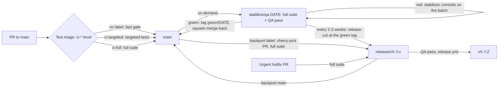
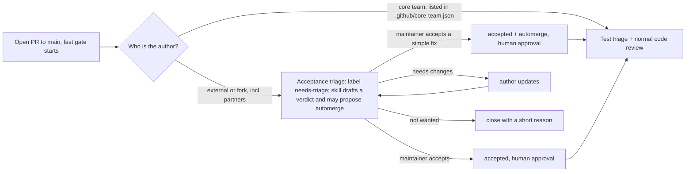
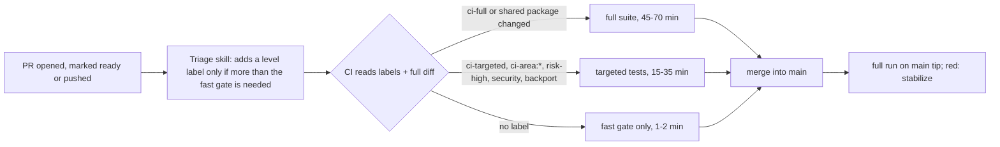
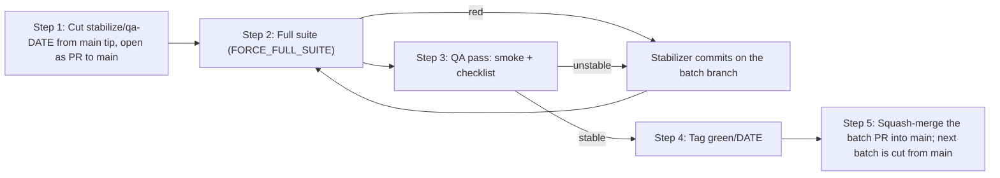
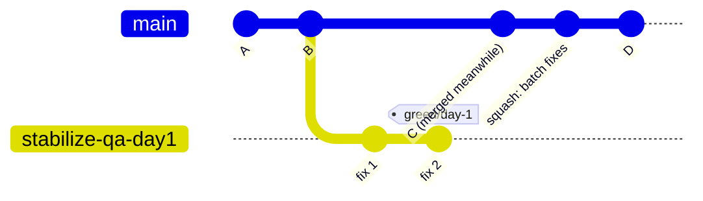
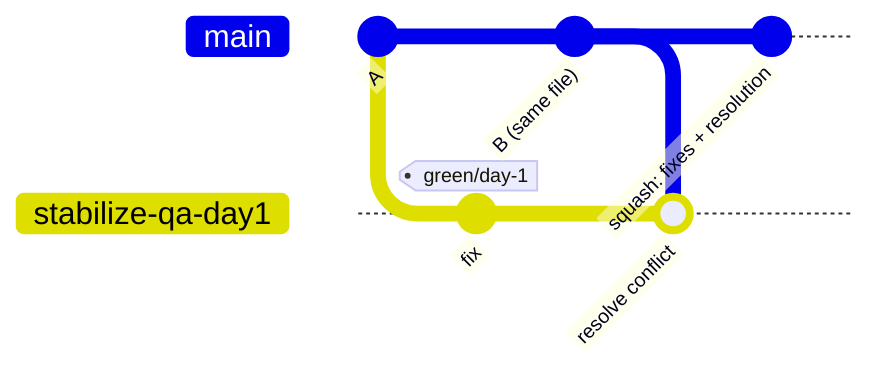
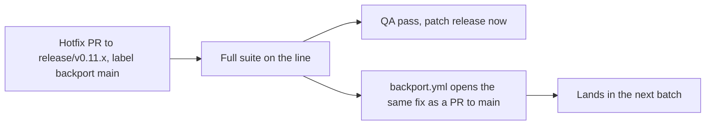
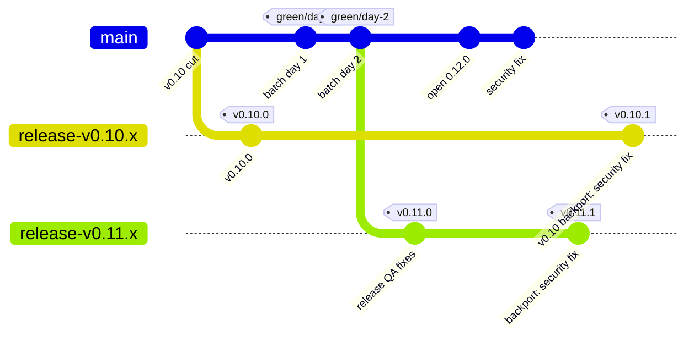
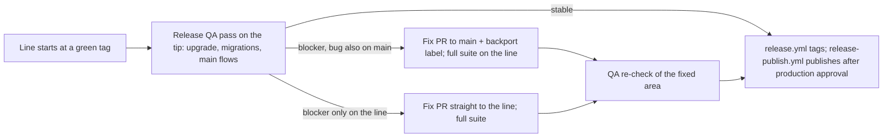

# Batch Merge and Green-Tag Release Process

**Date:** 2026-11-25 (updated 2026-11-26)
**Status:** Approved shape, ready for development (phased)
**Scope:** OSS repository process: CI workflows, PR labels, review/QA skills, GitHub rulesets, release-line tooling
**Related:** [Phased Integration CI](2026-06-05-phased-integration-ci.md) (draft), [CI/CD Performance](implemented/2026-04-10-ci-cd-performance.md), PR #10434 and PR #10457 (closed as superseded by this spec); QA lanes and batch QA: [open-mercato/skills#210](https://github.com/open-mercato/skills/pull/210) and PR #10712 (draft; now `.ai/docs/pr-workflow.md` → QA meta labels, Batch QA)

---

## Contents

- [TLDR](#tldr)
- [Terms](#terms)
- [Current vs target](#current-vs-target)
- [Overview](#overview)
- [Problem Statement](#problem-statement)
- [Proposed Solution](#proposed-solution)
  - [Kinds of checks](#kinds-of-checks)
  - [The big picture](#the-big-picture)
  - [Acceptance for external PRs](#acceptance-for-external-prs)
  - [Test triage: how much testing a PR gets](#test-triage-how-much-testing-a-pr-gets)
  - [CI labels and the scope file](#ci-labels-and-the-scope-file)
  - [When CI runs again](#when-ci-runs-again)
  - [Docs-only PRs](#docs-only-prs)
  - [QA lanes](#qa-lanes)
  - [Merge-ready rule](#merge-ready-rule)
  - [Keeping main green](#keeping-main-green)
  - [The batch](#the-batch)
  - [QA on the batch](#qa-on-the-batch)
  - [What happens to a green batch](#what-happens-to-a-green-batch)
  - [Merge-back conflicts](#merge-back-conflicts)
  - [Backporting](#backporting)
  - [Releases](#releases)
  - [Stabilizing a release line](#stabilizing-a-release-line)
  - [What runs where](#what-runs-where)
  - [Labels](#labels)
  - [Trade-offs](#trade-offs)
- [Implementation plan](#implementation-plan) ([Phase 0](#phase-0-batch-by-hand), [1](#phase-1-spec-and-decisions), [2](#phase-2-ci-scope-engine-default-unchanged), [3](#phase-3-ci-triage-skill-in-shadow-mode), [4](#phase-4-fast-gate-as-the-default), [5](#phase-5-acceptance-for-external-prs), [6](#phase-6-release-lines-from-green-tags), [Later](#later-optional))
- [What exists and what is needed](#what-exists-and-what-is-needed)
- [Architecture](#architecture), [Data Models](#data-models), [API Contracts](#api-contracts)
- [Decisions](#decisions)
- [Risks & Impact Review](#risks--impact-review), [Final Compliance Report](#final-compliance-report), [Changelog](#changelog)

## TLDR

PRs keep targeting `main`, but merge on checks sized to their risk: a 1–2 minute fast gate by default, more tests only when triage (a skill first, a human on top) adds a `ci-*` label. On demand a maintainer (the stabilizer) cuts `main` into `stabilize/qa-<date>` (the batch), which runs the full suite and one manual QA pass. Problems are fixed forward by the stabilizer with commits on the batch branch; a green batch is tagged `green/<date>` and merged back into `main`. Every 2–3 weeks a release line is cut from a green tag instead of from `main`'s untested tip. Backports keep using the existing labels.

Target: about 80 merged PRs a day without paying for the full test suite on every PR. For contributors nothing changes: every PR still targets `main`.

The plan is ordered so every safety net (batch, QA, label-driven scope, triage) runs before the per-PR default drops to the fast gate, which is where the CI-minute savings come from and where the risk is.

## Terms

- **Cut, batch** (team chat: *paczka*): the `stabilize/qa-<YYYY-MM-DD>` branch made from `main` on demand (not daily, not automatically) and opened as one PR back to `main`, the batch PR. No PR ever merges into it. Other `stabilize/` branches (for example the maintenance bot's CI-fix PRs such as #10850 and #10474) are stabilization PRs, not batches.
- **Stabilizer:** the maintainer who cuts and owns a batch: the only person who fixes its blockers, with commits pushed directly onto the batch branch; tags it and merges it back.
- **Green tag:** `green/<date>` on the batch tip that passed the full suite and QA.
- **Core team:** PR authors listed in `.github/core-team.json`, the single source of the core-team list (the members of the GitHub team `open-mercato/core-team` plus `matgren` and `tkarwatka`; logins compared case-insensitively). `author_association` is not used: `COLLABORATOR` includes outside collaborators with only `read` or `triage`, and `MEMBER` includes org members whose base permission is `read`.
- **Automation identity:** any account or GitHub App the `om-*` agents act as. Labels and approvals from these identities never count as the human decision for external PRs.

## Current vs target

| Area | Current (2026-11-25) | Target |
|---|---|---|
| PR to `main` | Scoped CI on every PR: affected-module integration tests, unit tests, build; 13–43 min. Full suite when `FULL_SUITE_PATTERN` matches or `ci-full` is set | Fast gate (changed-package typecheck, lint, related unit tests, guard, CLA) by default, 1–2 min. `ci-targeted` / `ci-area:*` / `ci-full` add tests. `FULL_SUITE_PATTERN` stays as a floor |
| Who decides test scope | Nobody; CI derives it from paths. `ci-full` only applies from the next push | Triage skill sets labels on open and each push (raise only); humans can add. CI re-runs on label change |
| Docs-only PRs | Install, build, lint and unit tests still run | Docs lane: guard, CLA, docs-specific checks only, under 1 minute; docs site built on `apps/docs` PRs |
| External PRs | Same path as core PRs | Acceptance triage: `needs-triage` until a human maintainer adds `accepted` and approves; the skill only drafts a verdict and may propose `automerge` |
| Stabilization | `stabilize/qa-<date>` cut by hand, sometimes 2–3 a day, squash-merged back | One batch at a time, cut on demand by a stabilizer, full suite + one QA pass, `green/<date>` tag, squash-merged back |
| QA | `needs-qa` is formally a merge gate on most PRs; weekly pass of `main` (`weekly-qa`); per-PR `ready-for-qa` queue | No QA label blocks a merge into `main` (only `qa-failed`); `needs-human-qa` = a tester looks at it in the batch first; `needs-qa` = automatic QA, not blocking; `qa-batch-check` = merge, check in the batch. One pass per batch with `om-qa-batch` (smoke + checklist); bugs `daily-qa`, blockers `qa-blocker`. `weekly-qa` and `ready-for-qa` retired |
| `main` safety net | Full suite on every push to `main` | Unchanged; an agent proposes a fix when it goes red |
| Release cut | `release-cut.yml` cuts `release/vX.Y.x` at `main`'s tip | Cut at a chosen `green/<date>` tag; changelog split at that commit |
| Merge methods on `main` | Ruleset allows squash only | Squash stays; the green tag preserves the tested commit (see [Decisions](#decisions)) |

## Overview

This spec describes the process and turns it into implementable phases. Each step in the [Implementation plan](#implementation-plan) is sized to be one task or one PR. Owners:

- **Maintainers**: `.github/workflows/**` and the release scripts. `CODEOWNERS` lists `.github/workflows/`, `scripts/release-line.mts`, `scripts/lib/release-line.mts` and `scripts/lib/github-api.mts` for `@open-mercato/maintainers`; other `scripts/**` files are not listed. The `main` ruleset has `require_code_owner_review: false`, so today `CODEOWNERS` requests a review but does not enforce it ([Phase 2](#phase-2-ci-scope-engine-default-unchanged) step 2 changes that for the CI scope files).
- **Skills repo**: `om-*` pipeline skills live in [open-mercato/skills](https://github.com/open-mercato/skills) and are installed into `.agents/skills/`; repo-local overrides go in `.ai/skills/<name>/`.
- **QA**: label rules for QA, checklists, verdicts.
- **Admin**: GitHub rulesets (required checks, merge methods) and label creation where no workflow does it.

## Problem Statement

The team targets about 80 merged PRs a day. Running scoped or full integration CI on every PR costs 13–70 minutes and many runner minutes per PR, which caps merge throughput. Stabilization already happens on ad-hoc `stabilize/` branches, QA tests `main` weekly, and release lines are cut from an untested `main` tip. The process needs to: merge faster, spend full-suite and QA time once per batch instead of per PR, keep `main` releasable through green points from each batch, and keep contributors' workflow unchanged (PRs still target `main`).

## Proposed Solution

### Kinds of checks

| Check | Time | What it runs | Where |
|---|---|---|---|
| Fast gate | 1–2 min | Typecheck of the changed packages, lint, related unit tests, enterprise guard, CLA | Every PR with code changes. Docs-only PRs run even less ([Docs-only PRs](#docs-only-prs)) |
| Targeted tests | ~15–35 min | Integration tests of the affected modules only, on one runner. CI picks modules from changed paths; labels add more | Exists today on every PR; here only on PRs that need it |
| Full suite | ~45–70 min | Everything `ci.yml` runs: all unit tests, build, all integration tests in 15 shards | Shared packages, the batch PR, pushes to `main` (latest commit, see [Keeping main green](#keeping-main-green)), release lines |
| QA pass (by hand) | as long as it takes | A tester uses the running app on a QA slot (`qa-deploy.yml`, `qa1`–`qa4`): smoke of main flows, then a checklist of the batch's PRs that need a human eye; verdict stable or unstable | Once per batch (one build, all PRs since the last batch) plus retests of fixed areas; once on a release line before each release. No PR waits for QA before merge |

Times are wall clock from green CI runs on 2026-11-23 and 2026-11-24, queueing included.

### The big picture

Three kinds of branches. Code enters through `main` (or, for urgent hotfixes, a release line). External PRs are accepted first; then every PR is triaged for tests.



A PR answers two questions, in order: **do we want this change at all?** ([Acceptance](#acceptance-for-external-prs), depends on who wrote it) and **how much testing does it need?** ([Test triage](#test-triage-how-much-testing-a-pr-gets), sized to the change). Every PR targets `main` and always runs the fast gate.

### Acceptance for external PRs



- **Who counts as core team:** the logins in `.github/core-team.json`, read from the base branch at check time; that file is the only list, and scripts and skills read it rather than keeping their own (see [Terms](#terms) for why not `author_association`). "Accepted" is not "approved": core PRs still get code review and test triage.
- **What acceptance triage asks:** do we want this in the product; is there an agreed issue or spec; is the size right; does it touch `packages/enterprise/` (closed to external contributions by policy) or CI and release files (`CODEOWNERS` already requires a maintainer); is the CLA signed. The skill answers in one comment and may propose `automerge` for a simple, low-risk fix (typo, small bug fix with a test, no new feature). It only proposes.
- **Certified partners:** their PRs already get `partner-request` automatically (`partner-request-label.yml`, list in `.github/certified-partners.yml`). Same triage, first in the queue. Whether they skip acceptance is open.
- **AI is never the only path to merge.** For an external author, `ci-triage` is green only when (a) `accepted` was added by a human with `write` permission or higher who is not an [automation identity](#terms), checked from the label's timeline event, and (b) the PR has an approving review from such a human on the current head. `automerge` set by a skill only queues the merge; it never satisfies (a) or (b). Labels set by automation identities are ignored for both.
- **How it blocks the merge:** through the `ci-triage` check (above). The fast gate still runs before acceptance, so the author gets feedback early.
- **Forks:** fork PRs keep normal CI scope even with `ci-full` (`CONTRIBUTING.md`); an accepted fork PR that needs the full suite is re-pushed to a same-repo branch by a maintainer.

### Test triage: how much testing a PR gets



| Step | Who | What it does | Status |
|---|---|---|---|
| 1. Triage | Skill `om-triage-pr` (open-mercato/skills#211); `om-review-pr` raises routing labels triage missed | Reads the diff and PR text and sets the routing labels: category and priority only when missing; risk, the QA lane, `ci-targeted` or `ci-full` and any `ci-area:*` labels only when needed, raise-only. Posts one comment why, with a `CI-Triage-Head: <sha>` marker. It never posts a status itself; the `ci-triage` check run comes from a workflow ([Phase 3](#phase-3-ci-triage-skill-in-shadow-mode)) | new |
| 2. Adjust | Human: reviewer or author | Adds a higher level or another area. Removing a label a human set needs a human | new |
| 3. Re-triage | Skill, on every push | Looks at the new diff; may raise the level or add areas, never lower | new |
| Floor | CI | Shared-package diff (`FULL_SUITE_PATTERN`) means at least `ci-full`; `risk-high`, `security`, `backport …` mean at least `ci-targeted`; a PR not yet triaged (no `ci-triage`) cannot merge | `FULL_SUITE_PATTERN`, `ci-full` exist; rest new |

"Shared package" means the paths in `FULL_SUITE_PATTERN` (`ci.yml`): `packages/shared`, `ui`, `events`, `queue`, `cache`, `search`, `onboarding`, `webhooks`, core / enterprise / cli-testing `lib`, the app shell, and `ci.yml` itself. A change there can break any module, so a targeted run cannot cover it. A backported fix gets the full suite on its cherry-pick PR to the release line, so `ci-targeted` is enough on its way into `main`.

### CI labels and the scope file

One prefix, `ci-`, steers CI. There is no label per module: about 60 modules map onto a few areas. Ten labels in total (2 levels + 8 areas). No label means the fast gate, so most PRs carry none.

| Label | Effect |
|---|---|
| *(no label)* | Fast gate only (default) |
| `ci-targeted` | + integration tests of the affected modules |
| `ci-full` | + the full suite (exists today) |
| `ci-area:commerce` | sales, catalog, cart, checkout, promotions, payments, shipping, currencies, wms |
| `ci-area:crm` | customers, customer groups, messages, inbox, channels, phone calls, planner |
| `ci-area:platform` | auth, directory, entities, configs, feature toggles, api keys, audit logs, query index, attachments, dashboards |
| `ci-area:integrations` | integrations, data sync, webhooks, notifications, provider packages |
| `ci-area:portal` | portal, customer accounts |
| `ci-area:workflows` | workflows, business rules, forms, resources, staff, availability |
| `ci-area:ai` | ai-assistant, agent orchestrator, web research |
| `ci-area:enterprise` | sso, security, record locks, other enterprise modules |

An area label implies `ci-targeted`. The grouping is a first sketch (see [Decisions](#decisions)).

How CI understands them:

- **One file is the source of truth**, `.github/ci-scope.json`: levels, each area's modules, labels that imply a level, the docs-only path allow-list, and `packageScopedJobs` (required jobs that do real work only when turbo's `[HEAD^1]...` affected set contains one of their packages, or a listed path changed; otherwise they finish green as "out of scope"). Adding a module to an area is a one-line PR.
- **Read from the base branch, protected by maintainers.** CI loads `.github/ci-scope.json` and `scripts/ci/resolve-ci-scope.mts` from the PR's base commit (`git show <base_sha>:<path>`), never from the PR checkout, so a PR cannot narrow its own scope. Both paths go into `CODEOWNERS` for `@open-mercato/maintainers`, and a PR that changes either one gets the full suite (part of the floor).
- **Labels are generated from the file** by a sync job; a check fails on an unknown `ci-*` label (a typo).
- **CI computes the scope** in the `prepare` job: level = highest of the path-based floor, the level label and implied labels; modules = affected modules ∪ modules of every `ci-area:*` label.
- **CI says what it runs** in one job-summary line, e.g. "targeted · sales, catalog (changed) + crm area (label)".

Sketch of the file (format for the team to decide):

```json
{
  "levels": ["ci-targeted", "ci-full"],
  "implies": { "risk-high": "ci-targeted", "security": "ci-targeted", "backport *": "ci-targeted" },
  "areas": {
    "commerce": ["sales", "catalog", "cart", "checkout", "promotions", "payment_gateways", "shipping_carriers", "currencies", "wms"],
    "crm": ["customers", "customer_groups", "messages", "inbox_ops", "communication_channels", "phone_calls", "planner"]
  },
  "docsOnly": [".ai/specs/**/*.md", ".ai/docs/**/*.md", "apps/docs/**", "README.md", "CONTRIBUTING.md", "AGENTS.md", "CLAUDE.md"]
}
```

### When CI runs again

Labels stay on the PR. The resolver reads the PR's current labels through the API at job time (not from the event payload) and the whole diff (base to head), so a level chosen once applies to every later commit.

**Label changes must not cancel a running suite or leave skipped-equals-passing checks.** `ci.yml` uses `concurrency: ci-${{ github.ref }}` with `cancel-in-progress` for PRs, and a skipped job counts as passing for a ruleset. Adding `labeled` / `unlabeled` to `ci.yml` itself would let any label (priority, QA …) cancel a running full suite, and a no-op label run could report the required check names as skipped. So:

1. **`ci.yml` keeps its triggers** (`opened`, `synchronize`, `reopened`, plus `ready_for_review`). Label events never start or cancel `ci.yml`.
2. **A separate workflow, `ci-scope-labels.yml`** (`pull_request_target`, `labeled` / `unlabeled`, base-branch code, no PR checkout, its own concurrency group), runs the base-branch resolver. If the label is not scope-relevant, or the resolved level and modules did not change, it does nothing. If the scope grew, it re-runs the latest `ci.yml` run for the head SHA (`gh run rerun`; the rerun reads labels from the API, so it gets the new scope). If a run is in progress it waits for it to finish, then re-runs, so nothing is cancelled half-way.
3. **A required aggregator job `ci-scope`** in `ci.yml` (`needs:` every test job, `if: always()`) fails when any needed job failed or was cancelled, when a job was skipped although the resolved scope required it, or when the PR's labels read at the end of the run resolve to a larger scope than at the start. A run without a valid scope can never look green.

| Event | What happens | Status |
|---|---|---|
| PR opened, reopened, marked ready | `ci.yml` runs: fast gate, plus the tests for the resolved level; triage sets labels | runs today (`ready_for_review` new) |
| New commit pushed | `ci.yml` cancels the run for the old commit and starts one with current labels and full diff; the skill re-triages (raise only) | exists (`synchronize`, `cancel-in-progress`) |
| Scope label added (level, area, `risk-high`, `security`, `backport …`) | `ci-scope-labels.yml` re-runs `ci.yml` for the head SHA after any running run finishes | new |
| Scope label removed | Same; the floor still applies; a smaller scope never invalidates a passing larger run | new |
| Other labels (priority, QA …) | Nothing in CI | new filter |
| Merge button | Required `ci-scope` is green only for a completed run on the current head whose scope covers the current labels | new required check |

Today `FORCE_FULL_SUITE` reads `ci-full` from the event payload, so it applies from the next push; the API read and the re-run fix that.

### Docs-only PRs

CI sees from the changed paths that no code changed and picks a docs lane itself. No label is needed and CI sets `ci-triage` itself. Typecheck, build and tests are skipped.

| Changed files | Checks | Status |
|---|---|---|
| Any docs-only PR | CLA, enterprise guard; optional markdown lint and link check | CLA, guard exist; lint/link new |
| `AGENTS.md` / `CLAUDE.md` | `yarn agents:check-budget` | exists, today inside the lint job |
| `.ai/skills/**` | Skills tiers lint | exists (`skills-tiers-lint.yml`) |
| `apps/docs/**` | Build the docs site | new for PRs |
| Other `*.md` / `*.mdx` (specs, `.ai/docs`, READMEs, changelog) | Nothing more | - |

- **Time:** under a minute. Today a docs-only PR still installs, builds packages and runs lint and unit tests.
- **Allow-list, not a pattern for all markdown.** The lane applies only when every changed path matches `docsOnly` in `ci-scope.json` ([sketch](#ci-labels-and-the-scope-file)): `.ai/specs/**/*.md`, `.ai/docs/**/*.md`, `apps/docs/**` (including `*.mdx`, which gets the docs site build), and named root files (`README.md`, `CONTRIBUTING.md`, `AGENTS.md`, `CLAUDE.md`). There is no `**/*.md`, and package `AGENTS.md` files are not included because some ship (for example in `packages/create-app`): package READMEs, `packages/create-app` templates, skill files and anything a package ships or a generator reads take the normal path. Any file outside the list means the normal path.
- **Gap today:** as far as `ci.yml` shows, a PR that changes only `apps/docs` skips the Docker job, which is where the docs site is built, so a broken docs build is only seen on `main`.

### QA lanes

Rules from QA, source of truth `.ai/docs/pr-workflow.md` → "QA meta labels" and "Batch QA", implemented in skills by open-mercato/skills#210 and #211. QA triage (`om-auto-review-pr` today, `om-triage-pr` from skills #211 with the same rules; rules in `.ai/agentic.config.json` → `humanQaPolicy`) puts every PR in one lane, judging the change, not the author. Under the ready-to-merge rule no lane holds the merge; lanes decide what the tester looks at in the batch.

| Lane | When | Effect |
|---|---|---|
| `needs-human-qa` | New feature or visible UX change without an approved design (a merged spec with mockups); money or payments; lowered security, widened access or tenant scoping; removed fields, tables, API fields or routes without a simple upgrade path; destructive migrations; installation and default credentials; external systems automation cannot reach; architecture or backward-incompatible contracts; global styles (`globals.css`). Tightening security or fixing a scoping leak does not count | Tester looks at it first in the next batch (or before merge, if one is free). Does not block the merge |
| `qa-batch-check` (next to `needs-qa`) | UX with an approved design; customer-facing paths (portal pages of any module, customer accounts, login, checkout, onboarding); drag and drop, keyboard, focus, responsive layout, printing; more than 10 changed UI files; user-visible changes triage is unsure about | Merge freely; checked in the next batch |
| `needs-qa` | Anything else user-visible | Automatic QA (`om-auto-qa-pr`); does not block |
| `skip-qa` | Nothing user-visible: docs, dependencies, CI, tests, typos, or the automated-verification exemption | None |

The triage skill sets lanes first; a reviewer, the author or a tester may add `needs-human-qa` or `qa-batch-check` by hand; automation never removes either.

### Merge-ready rule

A PR to `main` is ready to merge when:

| Rule | Enforced by |
|---|---|
| 1. Every required check green on the head commit: today `scope`, `guard`, `prepare`, `lint`, `ds-lint`, `test`, `audit-scope`, `documents-multi-instance`; plus `ci-scope` ([Phase 2](#phase-2-ci-scope-engine-default-unchanged)) and `ci-triage` ([Phase 4](#phase-4-fast-gate-as-the-default)) | GitHub (`main` ruleset) |
| 2. One approving review | GitHub (ruleset requires 1) |
| 3. No blocking label: `qa-failed`, `changes-requested`, `blocked`, `do-not-merge`. A missing `qa-approved`, `needs-qa`, `needs-human-qa` and `review` instead of `merge-queue` never block; `in-progress` is not a block, but merge automation waits until it is released | Today: skills and reviewers. From Phase 4: `ci-triage` fails, so GitHub refuses the merge. `ci-triage` imports `blockingLabels()` / `decide()` from `scripts/ci/merge-queue-guard.mts` (PR #10757) instead of keeping its own copy |
| 4. External author only: human acceptance and a human approval on the current head ([Acceptance](#acceptance-for-external-prs)) | From Phase 5: `ci-triage` |

`ci-triage` and `ci-scope` are check runs from named workflows (GitHub Actions jobs, required in the ruleset with the GitHub Actions app pinned), not commit statuses: see [Phase 3](#phase-3-ci-triage-skill-in-shadow-mode) step 3.

`merge-queue` is an optional routing label ("all gates passed"); an approved PR still on `review` is mergeable. Guardrail ([Phase 0](#phase-0-batch-by-hand), step 12, implemented in PR #10757): a workflow takes `merge-queue` off with a one-line comment when a blocking label is added or when `merge-queue` is added while a blocker is already on. It reads labels only (no PR code is checked out) and never removes the blocking labels.

### Keeping main green

With fast merges, integration failures will reach `main`. With 30 PRs merged between two runs the culprit is often unclear, so the approach is to fix forward, not hunt and revert.

- **Nothing merges red.** Each PR passes its own gate: fast gate, plus targeted tests or the full suite when required.
- **Risk is paid at review.** Triage raises the gate for risky changes, so most breakages are caught before merge.
- **`main` is tested, but not every commit.** Pushes to `main` trigger the full suite, but `ci.yml` never cancels a running branch suite and GitHub keeps only one pending run per group, replaced by the newest push. So the latest `main` tip is always tested within about two run lengths, while intermediate commits between two runs are not tested on their own. What is guaranteed to have passed the full suite: every batch PR head (forced full suite) and so every `green/<date>` tag, and every release-line commit pushed while no newer one was pending.
- **Fix forward on the batch.** The stabilizer pushes fix commits onto the batch branch; work keeps merging into `main`.
- **An agent tries first.** When the full run on `main` fails an integration test, an automated fixer proposes a fix; the stabilizer applies it to the batch or takes over.
- **Where the fix goes:** a broken build or typecheck on `main` fails every PR's fast gate, so it is fixed on `main` at once. Any other failure is fixed on the open batch, which merges back.
- **Revert only as a last resort**, as the team's call: when the change is no longer wanted, or it blocks a release and no fix is near.
- **"Green" is a tag.** The guaranteed-green points are `green/<date>` tags; each green batch merges back, so `main` returns to a known-green base after every batch.

Accepted limit (discussion of 2026-11-25): an integration failure can stay on `main` for up to a day, and a failing intermediate commit may never be tested on its own (bisect starts from the last green tag). Nothing is ever released from `main` directly; releases start only from a green batch.

### The batch

On demand (not daily, not automatically) `main` is cut into `stabilize/qa-<date>`: whatever merged since the last batch, 30, 50 or 80 PRs. PRs keep merging into `main`; none merges into the batch. `main` keeps moving. A batch normally goes back into `main` stabilized; every 2–3 weeks a release line is cut from it instead.



This is close to today: `stabilize/` branches are already cut by hand, fixed on the branch and merged back as PRs. The change is a reserved name (`stabilize/qa-<YYYY-MM-DD>`, record file `.ai/runs/<YYYY-MM-DD>-qa-batch.md`), a named stabilizer, one QA pass, the green tag, and one open batch at a time, meaning one open PR whose head starts with `stabilize/qa-`. Opening the batch PR into `main` is part of cutting the batch: `ci.yml` runs on push only for `main`, `release/v*` and `feat/wms`, and the Enterprise guard runs only on PRs, so the batch gets its forced full suite and the guard only through the batch PR, which also carries the QA verdict and is what merges back. Keeping the `stabilize/` prefix keeps the forced full suite (`FORCE_FULL_SUITE`, `resolve-ci-scope.mts`) and the green-tag check in `release-line.mts` working without a CI change.

**Range.** The batch range runs from the previous `green/*` tag to the batch head. For the first batch, when no `green/*` tag exists, it starts at the merge-base of `main` with the newest `release/v*` branch, or at a start commit the stabilizer states in the batch PR; the start commit is written in the batch PR description and the record file, and `om-qa-batch` runs with `--range <start>..<batch-head>`. A very large batch is not split into several batches: the must-test list is split across QA sessions on the same batch, and the record file notes what each session covered. Only the stabilizer fixes blockers, with commits pushed directly onto the batch branch; no PR targets the batch, and the fixes reach `main` through the merge-back. Every push re-runs the full suite on the batch PR (`synchronize` on a `stabilize/` head is forced full). Batches are cut by hand, on demand.

### QA on the batch

Rules from QA, source of truth `.ai/docs/pr-workflow.md` → "Batch QA". One build holds every PR since the last batch, so QA does not switch branches or rebuild per PR. The `om-qa-batch` skill (skills #210) turns the batch into a short checklist and records the verdict.

1. **Checklist.** `om-qa-batch` lists the batch's PRs from the commit range and picks those that need a human eye: PRs labelled `qa-batch-check`; PRs that reached `main` with `needs-human-qa` but no human `qa-approved`; customer-facing or visibly changed PRs with no human QA evidence. A `qa-approved` counts as human QA only when a human from `qaBatch.testers` or `.github/core-team.json` applied it with a `QA head: <sha>` evidence comment; one applied by an agent or automation account, or backed only by an agent comment, counts as not covered and the PR is tested again. Plus open blockers and the fixed smoke in `.ai/qa/batch-smoke.md` (about 30 min, risk first). Trial on 55 PRs merged 23–25.11: smoke + 6 PRs to check by hand; single days of 17–41 PRs gave 2–5. At 80 PRs a day this is one session.
2. **Deploy and start.** `qa-deploy.yml` deploys the batch branch to a QA slot. `om-qa-batch --start` assigns the tester and adds `qa-in-progress` to the batch PR. While it is on, the batch is not refreshed with newer `main` commits; an untouched batch may be refreshed.
3. **What blocks the batch:** a user cannot finish a main task. A main screen does not load or a main path returns a server error; signing in, saving or creating a basic record fails; data is lost, saved wrong or shown to another organization or tenant; a migration fails or the app does not start. Cosmetics, translations and small UX issues never block.
4. **Reporting.** Blocker: issue with `bug` + `daily-qa` + `qa-blocker`, plus a comment on the batch PR mentioning the stabilizer; open `qa-blocker` issues are listed at the start of the next batch. After a passing retest of the fix, QA (or the stabilizer) closes the `qa-blocker` issue by hand; `Fixes #N` on the batch PR is traceability only, since it closes nothing until the batch merges. Anything else: issue with `bug` + `daily-qa`.
5. **Verdict.** On the batch PR: `qa-approved` = stable for the tested head; `qa-failed` = unstable (at least one open blocker), frozen until the retest. The verdict comment carries `QA verdict: STABLE|UNSTABLE`, `QA head: <sha>` and the range. A new head needs a new verdict, except the merge-back conflict fix after the green tag ([Merge-back conflicts](#merge-back-conflicts)); retests cover only the fixed area. `om-qa-batch` refuses `stable` while a blocker is open, and a bot identity cannot give a verdict. It trusts verdicts and checklists only from `qaBatch.testers` plus the current user; with an empty list one tester's write action treats another's verdict as untrusted and withdraws a valid `qa-approved`, so teams with more than one tester set `qaBatch.testers`. QA judges quality; the stabilizer owns the branch, tags `green/<date>` and merges back.
6. **Batch report.** The same verdict, with blockers when unstable, as a short message on the team's QA channel. Replaces the weekly QA pass.

**No tester available:** no new batch is cut while one is open. The open batch grows with `main` until a tester claims it with `qa-in-progress`; open blockers stay listed. It delays the green tag, not the merges.

### What happens to a green batch

Nothing is rebased. The green tag stays on the commit that passed the full suite and QA.



- **The batch is a branch, not a copy.** It starts at `main`'s tip at cut time.
- **Stabilization happens on the batch**, so its tip is what passed the full suite and QA.
- **Green = tag the tip.** `green/<date>` points at that exact commit.
- **Merge back** is a squash merge, the only method the `main` ruleset allows: `main` gets the fixes in one commit; the tested commit stays reachable through its tag. The merge is pinned to the QA-approved head (`gh pr merge --squash --match-head-commit <sha>`); a push after the verdict needs a new verdict, except a merge-back conflict resolution (see below).
- **Release from this tag** (some days): `release-cut` creates `release/vX.Y.x` at the green commit. On other days the tag is a marker for bisecting and expires later (for example, keep the last 14).

### Merge-back conflicts

PRs keep landing on `main` while the batch is stabilized, sometimes in the same files. Rule: **the green tag never moves**; only the merge back is adjusted.



- **Tag first**, before touching the conflict. Releases and bisects use the tag, so they never see the conflict fix.
- **The stabilizer merges `main` into the batch** (GitHub's "Update branch") and resolves it, with the author of the conflicting PR if needed.
- **CI re-runs the full suite on the batch PR.** The batch PR's head is a `stabilize/` branch, so `FORCE_FULL_SUITE` applies to every push to it, including the conflict resolution. This is deliberate: one more 45–70 minute run on the batch, rarely needed.
- **The verdict stays on the tagged commit.** The stable verdict covers its `QA head:`, which the green tag pins; the batch is not re-tested before the merge back. The merge back is pinned to the resolved head once the full suite is green on it. `om-qa-batch` reports `qa-approved` on the moved head as stale, so the stabilizer merges without it. The `main` PRs the conflict fix merged into the batch are not covered by this verdict: the next batch's range starts at the previous green tag, so they are tested in the next batch.
- **If it would take long**, cherry-pick only the stabilization commits into a PR to `main` and close the batch PR. The tag is unaffected.
- **Fewer conflicts by design:** one open batch at a time, merged back as soon as it goes green, small stabilizer fix commits.

### Backporting

A fix does not reach an older release through the batch. The backport label acts when the fix merges to `main`: `backport.yml` opens a separate cherry-pick PR to the release line, tested on the line's own code. A normal backported fix is tested three times: targeted tests before it merges to `main` (required by the backport label), the full suite on the cherry-pick PR, and a QA pass on the line before the patch release.

**A. Normal fix: `main` first, then the release line**


- **Two separate tests, one fix:** the batch tests it inside `main`, the backport PR inside the old line.
- **Default wait for the green batch**, so the line gets the corrected version if the fix needed a follow-up. Urgent fixes skip the wait (owner's call) or use path B.
- **Follow-ups** to the fix get the same backport label; if the team drops the fix, close the backport PR.
- **Patch releases batch fixes:** several backports can land before one QA pass and one `release.yml` run.
- **QA labels on backports.** `backport.yml` copies `needs-qa` / `skip-qa` but not `needs-human-qa` or `qa-approved`: `needs-human-qa` is a batch-checklist lane, not a merge gate, and the release QA pass on the line covers every backport. The release waits for that pass to be green. A backport whose cherry-pick conflict was resolved by hand is no longer the code the tester saw, so the reviewer adds `needs-human-qa` by hand so a tester checks it in the release QA pass; it does not block the merge.

**B. Urgent hotfix (security, outage): release line first, then `main`**



`backport.yml` today: the label can be added before or after the merge; each label opens one PR, opened by the release app so CI runs. Category, priority, risk and QA labels are copied, `qa-approved` is not. PRs from forks are skipped and must be ported by hand.

### Releases

Today's tools stay: `release-cut.yml` creates `release/vX.Y.x`, `release.yml` tags `vX.Y.Z`, `release-publish.yml` publishes to npm after `production` approval. One rule changes: a new minor line is cut from the **latest green tag**, never from the untested `main` tip.



Green tags are drawn on `main` for simplicity; they sit on the batch tip ([What happens to a green batch](#what-happens-to-a-green-batch)).

1. **Cut:** run `release-cut.yml` at the chosen green tag. It creates `release/v0.11.x` and both backport labels, and opens the PR moving `main` on.
2. **Ship the minor:** [stabilize the line](#stabilizing-a-release-line), then `release.yml` from the line tags `v0.11.0`; `release-publish.yml` publishes it.
3. **Move `main` on:** merge the auto PR, so `main` becomes 0.12.0.
4. **Patch releases:** fixes reach the line only by backport. Ship `v0.11.Z` when fixes have piled up or one is urgent.
5. **Previous line:** `release/v0.10.x` gets only critical or security backports, then retires. A security fix carries both labels; `backport.yml` opens one cherry-pick PR per line, each with its own full suite.

Where each version comes from:

- **A green tag on a normal day** is only a marker: "this commit passed the full suite and QA". Nothing is built or published from it; the newest is the candidate if a minor is cut that day.
- **`v0.10.1`** does not touch `main` or green tags: it is the tip of `release/v0.10.x` (`v0.10.0` plus backports), after one QA pass on the line.
- **`v0.11.0` after `main` moved on:** the team picks a green tag (normally the latest) and runs `release-cut` at it. Everything merged to `main` after the tag goes into 0.12.0 unless backported to `release/v0.11.x`.

Needs changes ([Phase 6](#phase-6-release-lines-from-green-tags)): `release-cut.yml` runs only on `main` and always cuts at its tip; and `release-line.mts cut` hands all of `main`'s `# Unreleased` changelog to the new line, while entries for PRs merged after the tag must stay on `main`. Cadence is the team's call (about every 2–3 weeks; v0.9.0 to v0.10.0 took about 6 weeks). `snapshot.yml` already publishes a `develop` snapshot on every push to `main`.

### Stabilizing a release line

Same as a batch, except only fixes enter the line. Each release (the minor and every patch) gets a release QA pass on the line's tip; problems are fixed forward, and the release is tagged only when the line is green.



- **A blocker stops the release, not the line.** The release owner decides if it blocks or ships and is fixed in the next patch.
- **Bug only on the line** (code already changed on `main`): fix PR to the line, `backport main` only if `main` needs it too.
- **Between releases** backports land one by one, each with its own full suite, so the line stays green.
- No separate stabilize branch is needed for a release line: every PR into it is a fix and runs the full suite.

### What runs where

| Event | Checks (proposed) | Approx. time | Required to merge | Today |
|---|---|---|---|---|
| PR → `main`, docs only (from paths) | CLA, enterprise guard, plus checks for the docs touched | <1 min | Yes | Install, build, lint, unit tests still run |
| PR → `main` (regular) | Fast gate, enterprise guard, CLA | 1–2 min | Yes, plus review | Scoped CI on every PR (13–43 min) |
| PR → `main` raised by triage (`ci-targeted`, `ci-area:*`, `risk-high`, `security`, `backport …`) | Fast gate + targeted tests | ~15–35 min | Yes | Targeted tests exist; the labels that require them are new |
| PR → `main` touching shared packages, or `ci-full` | Full suite | 45–70 min | Yes | Already forced by `FULL_SUITE_PATTERN` and `ci-full` |
| Push to `main` (safety net) | Full suite on the latest tip; intermediate commits are skipped while a run is in progress | 45–70 min | No; red means a fix (on `main` for build/typecheck, else on the open batch) | Same today: one running, one pending (newest) per group |
| Batch PR (`stabilize/qa-<date>` → `main`) | Full suite on every push to it + QA pass, retests of fixed areas | 45–70 min + QA | Gate for the green tag and merge back | Full suite already forced for `stabilize/` heads |
| PR into the batch (base `stabilize/qa-<date>`) | Not used: blockers are fixed by stabilizer commits on the batch branch | — | — | `ci.yml` still accepts `stabilize/**` as a base (Phase 0 step 1) |
| PR → `release/v*` (backports, hotfixes) | Full suite | 45–70 min | Yes; normal backports also wait for a green batch | Same checks as PRs to `main` |
| Release (minor or patch) | QA pass on the line, `release.yml`, `release-publish.yml` | — | `production` environment approval | Tools unchanged; the QA pass on the line is new |

### Labels

Skills set labels first; a human can always add one. `ci-triage` and `ci-scope` are required checks, not labels.

| Label | Meaning / effect | Set by | When | Status |
|---|---|---|---|---|
| **Acceptance** | | | | |
| `needs-triage` | External PR waiting for a maintainer's decision; keeps `ci-triage` red | Workflow, on authors not listed in `.github/core-team.json` | PR opened | new |
| `accepted` | The team wants this change. Counts only when added by a human with `write` permission or higher who is not an automation identity; together with a human approval it turns `ci-triage` green for an external PR | Maintainer (human only) | After acceptance triage | new |
| `automerge` | Queues the merge once every gate passes; for an external PR it never replaces `accepted` or the human approval | Review skill (proposal) or maintainer | After review | exists (automerge buddy); new use |
| `partner-request` | Certified partner PR; triaged first | `partner-request-label.yml` | PR opened | exists |
| **CI scope** | | | | |
| `ci-targeted` | + integration tests of affected modules | Triage skill; humans may add | Open and each push; raise only | new |
| `ci-full` | + full suite; also forced by CI for shared packages | Triage skill or human | Same | exists (today from the next push; not on forks) |
| `ci-area:<area>` | + modules of an area (8 labels); implies `ci-targeted` | Triage skill or human | Same | new |
| `risk-high` | Existing risk label; new effect: counts as `ci-targeted` | Review skills or human | At review | exists; new effect |
| `security` | Existing category label; new effect: counts as `ci-targeted` | Author, reviewer, review skills | At review | exists; new effect |
| **QA on PRs** | | | | |
| `needs-human-qa` | A tester looks at it first in the next batch; does not block the merge | QA triage skill; reviewer, author or tester may add; automation never removes | At review | exists; not a merge gate |
| `qa-batch-check` | Merge freely; checked in the next batch; set next to `needs-qa` | QA triage skill; humans may add | At review | exists |
| `needs-qa` | Automatic QA is enough; no longer blocks | QA triage skill | At review | exists; stops being a gate |
| `skip-qa` | Nothing user-visible to exercise | QA triage skill | At review | exists |
| `qa-approved` | On a PR: QA passed (evidence, not a merge gate). On the batch PR: stable for the tested head | QA | After testing | exists |
| `qa-failed` | On a PR: hard merge block. On the batch PR: unstable, frozen until retest | QA | After testing | exists |
| **QA on the batch** | | | | |
| `qa-in-progress` | On the batch PR, with the tester as assignee: testing, do not refresh | Tester (`om-qa-batch --start`) | Start of the pass | exists |
| `daily-qa` | On issues: bug found in a batch, with `bug` | QA | During the pass | exists; replaces `weekly-qa` |
| `qa-blocker` | On issues: the bug blocks the batch; with `bug` + `daily-qa` and a batch-PR comment | QA | During the pass | exists |
| **Merge routing** | | | | |
| `merge-queue` | All gates passed; taken off automatically when a blocking label appears | Review and merge skills, maintainers | After review and checks | exists; guard new |
| **Backport and release** | | | | |
| `backport release/vX.Y.x` | After merge to `main`, `backport.yml` opens a cherry-pick PR to the line; new effect: counts as `ci-targeted` | Author, reviewer, triage skill | PR opened | exists (created by `release-cut`); new effect |
| `backport main` | On a hotfix to a line: after merge, opens the fix as a PR to `main` | Author or maintainer | Hotfix PR opened | exists |
| **To retire** | | | | |
| `weekly-qa` | Replaced by `daily-qa` | - | - | retire |
| `ready-for-qa` | Per-PR queue, replaced by the `om-qa-batch` search and the batch (PR #10712 supersedes #9864) | - | - | retire |

Unchanged and still used: the pipeline labels (`review`, `changes-requested`, `merge-queue`, `blocked`, `do-not-merge`), the category labels, and the `priority-*` and `risk-*` labels (`.ai/docs/pr-workflow.md`).

### Trade-offs

**Gains**
- 1–2 minute merges for most PRs; more testing only where triage says it is needed.
- No separate batch branch to retarget or bypass.
- Full suite and QA once per batch, not once per PR: one build holds all PRs merged since the last batch.
- For contributors nothing changes: PRs still go to `main`.
- Work is not reverted or stopped: problems are fixed forward.
- Builds on what the team already does with `stabilize/main-*` branches.

**Costs**
- An integration failure can stay on `main` for up to a day (accepted: no release is made from `main` directly).
- A stabilizer must own each batch from cut to merge-back.
- QA is not there every day; an untested batch rolls over and the green tag comes later.
- The batch QA pass is only as good as the checklist skill.
- Triage must judge test scope; a wrong call shows up later, in the batch.
- Releases and normal backports wait for a green tag.

**Guardrails**
- Full suite before merge for shared packages; targeted tests for risky PRs; `needs-human-qa` PRs first on the batch checklist.
- Full suite on the latest `main` tip and on every batch PR head; build or typecheck breaks are fixed on `main` at once.
- One open batch at a time; green batches merge back.
- `merge-queue` guard and, from Phase 4, `ci-triage` failing on blocking labels.
- Release lines always run the full suite and a QA pass before shipping.

---

## Implementation plan

Phases 0–6 plus optional follow-ups. The order is deliberate:

1. Phase 0 trials the batch and QA on the current draft of this spec, with today's tooling plus one small `ci.yml` change, so the team learns real QA time and failure rates before the default CI changes.
2. Phase 1 agrees the final spec using that data and records the decisions.
3. Phases 2–3 build the label-driven scope engine and the CI triage skill while today's default CI stays in place (no risk to `main`).
4. Phase 4 flips the default to the fast gate only after those nets work.
5. Phases 5–6 add acceptance and green-tag releases, which depend on the labels and green tags already existing.

| Phase | Owner | Size | Rollback |
|---|---|---|---|
| [0: batch by hand (trial)](#phase-0-batch-by-hand) | Maintainers (stabilizer), QA | 2–3 days setup, 2 weeks running | Stop cutting batches |
| [1: spec and decisions](#phase-1-spec-and-decisions) | Maintainers, QA | 1–2 days | None (docs only) |
| [2: CI scope engine](#phase-2-ci-scope-engine-default-unchanged) | Maintainers; admin for the ruleset | 1–2 weeks, 7–8 PRs | Revert the `ci.yml` PRs; drop `ci-scope` from required checks |
| [3: CI triage skill (shadow)](#phase-3-ci-triage-skill-in-shadow-mode) | Skills repo | 1–2 weeks build + 1–2 weeks shadow | Disable the skill trigger |
| [4: fast gate as the default](#phase-4-fast-gate-as-the-default) | Maintainers; admin for the ruleset | 2–3 days + 2 weeks watching | One line: default back to `targeted` |
| [5: acceptance for external PRs](#phase-5-acceptance-for-external-prs) | Maintainers, skills repo, admin | 3–5 days | Disable the workflow |
| [6: release lines from green tags](#phase-6-release-lines-from-green-tags) | Maintainers; QA for the checklist | 3–5 days | Run `release-cut` without the input |
| [Later, optional](#later-optional) | Maintainers, QA | - | - |

### Phase 0: batch by hand

**Goal.** Trial the process on the current draft of this spec: batches cut on demand, full suite, one QA pass, stabilizer fixes on the batch branch, tag, merge back. Learn the real QA time per batch and how often batches go red. The data feeds [Phase 1](#phase-1-spec-and-decisions), which agrees the final spec.
**Why first.** Everything later assumes a working batch, and it needs only one small CI change: `FORCE_FULL_SUITE` already forces the full suite on the batch PR (`stabilize/` head) and `qa-deploy.yml` already takes any branch.
**Owner.** Maintainers (the stabilizer who cuts each batch), QA.
**Size.** 2–3 days to set up, then 2 weeks of running it.

**Entry criteria.** This spec is open as a draft PR and the team agreed to trial it.

**Steps.**
1. **CI for PRs into the batch.** Add `'stabilize/**'` to `pull_request.branches` in `.github/workflows/ci.yml`, so a PR with a `stabilize/qa-<date>` base would get today's scoped CI. Superseded: batch fixes are stabilizer commits on the batch branch, not PRs. `FORCE_FULL_SUITE` stays keyed on `head_ref`, so the batch PR (head `stabilize/…`) runs the full suite on every push. Touches: `ci.yml`. Owner: maintainers.
2. **Stabilizer.** The maintainer who cuts a batch owns it and names themselves in the batch PR. No rotation, no files.
3. **Cut on demand.** The stabilizer branches `stabilize/qa-<YYYY-MM-DD>` from `main` and opens the batch PR into `main` as part of the cut: the batch gets its full suite (`FORCE_FULL_SUITE`) and the Enterprise guard only through that PR.
4. **QA deploy.** QA runs `qa-deploy.yml` with `branch: stabilize/qa-<date>` on a free slot (`qa1`–`qa4`). No changes.
5. **Labels.** Already exist: `qa-batch-check`, `daily-qa`, `qa-blocker`. The batch PR uses `qa-in-progress`, `qa-approved`, `qa-failed`. No action.
6. **QA pass and reporting.** Smoke from `.ai/qa/batch-smoke.md` plus a checklist (by hand until `om-qa-batch` is deployed), reported as in [QA on the batch](#qa-on-the-batch).
7. **QA lanes rollout (parallel; QA + maintainers).** Merge open-mercato/skills#210 and make sure review and merge workers run it; then follow PR #10712's rollout: re-triage open PRs carrying `needs-qa` while the old gate holds, clean the open `needs-human-qa` queue against the new rules, pause merges, then drop the per-PR QA gate (`qaGate: false`; done on `main` 2026-11-27, no label is a QA merge gate), resume. Touches: skills repo, `.ai/agentic.config.json`, `.ai/docs/pr-workflow.md`, `.ai/qa/batch-smoke.md`, `AGENTS.md`, `SDLC.md`, PR template.
8. **Fix forward.** Only the stabilizer fixes blockers, with commits pushed directly onto `stabilize/qa-<date>`; no PR targets the batch. QA retests only the fixed area. Revert only as a last resort and as the team's call.
9. **Green tag and merge back.** When the full suite is green on the batch PR head and QA says stable, the stabilizer tags that head `green/<date>` (`git tag green/<date> <sha> && git push origin green/<date>`) and squash-merges the batch PR into `main`. The tag keeps the tested commit reachable.
10. **No tester available.** No new batch while one is open. The open batch grows with `main` until a tester claims it with `qa-in-progress`; open `qa-blocker` issues are listed at the start of the next pass.
11. **Record metrics** (see [Phase 4](#phase-4-fast-gate-as-the-default)) in a pinned issue: QA time per batch, red batches, time to green.
12. **`merge-queue` label guard** (PR #10757). Workflow `.github/workflows/merge-queue-guard.yml` on `pull_request_target` (`labeled`, `unlabeled`; no checkout of PR code, label API only). It removes `merge-queue` and posts a one-line rationale comment (auto-skill protocol) when:
    - a blocking label is added: `qa-failed`, `changes-requested`, `blocked`, `do-not-merge` (a missing `qa-approved` never blocks, 2026-11-27);
    - `merge-queue` is added while any of the above is already true (the label is taken off at once).

    It never adds labels and never removes the blocking ones. The decision lives in `scripts/ci/merge-queue-guard.mts` (`blockingLabels()`, `decide()`), unit-tested in `scripts/__tests__/merge-queue-guard.test.ts`; Phase 4 reuses it. Independent of the CI phases, so it lands now and protects the QA cut-over in step 7.

    Every run writes a job summary (step "Check merge-queue against blocking labels"): PR number and link, the event (`labeled`/`unlabeled`, label, actor), the decision (removed / stays / already gone / not relevant) and the reason, so removals are visible without reading logs. When someone other than the guard (a person or a skill such as `om-auto-fix-pr`) removes `merge-queue`, the run records who removed it and when the run saw the event (label events carry no timestamp of their own) in the summary and log only; a run that fails still writes a short failure summary before going red: no comment, and the label is never re-added.

**Exit criteria.** 10 batches run. QA time per batch and red-batch rate are known. Skills #210 merged; no QA label gates merges into `main`.
**Rollback.** Stop cutting batches; revert step 1 if needed (it only adds CI).

### Phase 1: spec and decisions

**Goal.** Agree the final spec using the Phase 0 trial data, resolve the open decisions that block Phases 2–4, and carry over what is reusable from the superseded PRs #10434 and #10457.
**Why now.** Phase 0 is a trial of the draft; its data (QA capacity, red-batch rate, batch cadence) decides the open points. Phase 2 needs the scope file format and label names fixed.
**Owner.** Maintainers, QA.
**Size.** 1–2 days.

**Entry criteria.** At least one week of Phase 0 trial data.

**Steps.**
1. **Update this spec with the trial data and approve it.**
2. **Decide the open decisions** marked "blocks Phases 2–4" in [Decisions](#decisions); record answers in the [Changelog](#changelog).
3. **PR #10457** (fast gate for batch candidates) is closed as superseded by this spec. Its fast-gate job definition is the starting point for Phase 4 step 1.
4. **PR #10434** (fast CI for daily batch branches + separate batch branch) is closed as superseded: the separate batch branch is replaced by cutting the batch from `main`. Carry over any reusable docs into the stabilizer runbook.
5. **Stabilizer runbook.** Add a short section to `CONTRIBUTING.md` → Stabilization CI describing Phase 0 steps 3–10.

**Exit criteria.** Spec merged. Decisions recorded.
**Rollback.** None needed (docs only).

### Phase 2: CI scope engine, default unchanged

**Goal.** Make `ci-*` labels and a scope file drive what CI runs, while the default for an unlabelled PR stays today's scoped CI.
**Why now.** Labels must work, re-run safely on change and be enforced before triage can rely on them, and before the default can be lowered.
**Owner.** Maintainers. Admin for steps 2 and 10.
**Size.** 1–2 weeks, 7–8 PRs.

**Entry criteria.** Phase 1 done. Label names and area grouping decided.

**Steps.**
1. **Scope file and resolver.** Add `.github/ci-scope.json` ([sketch](#ci-labels-and-the-scope-file)): `levels`, `areas` → module directories, `implies` (`risk-high`, `security`, `backport *` → `targeted`), `docsOnly` allow-list. Plus a JSON schema and a pure resolver `scripts/ci/resolve-ci-scope.mts`: changed files + labels → level, modules, lane. Changes to either file resolve to `full`. Touches: `.github/ci-scope.json`, `scripts/ci/resolve-ci-scope.mts`.
2. **Protect the scope files.** Add `.github/ci-scope.json`, `scripts/ci/` and `scripts/__tests__/*ci-scope*` to `.github/CODEOWNERS` for `@open-mercato/maintainers`. Admin turns on `require_code_owner_review` in the `main` ruleset (today `false`), or adds an equivalent ruleset rule scoped to these paths, so the entry is enforced and not only a review request. Touches: `.github/CODEOWNERS`, ruleset.
3. **Parity tests.** `scripts/__tests__/resolve-ci-scope.test.ts`: table-driven cases proving the resolver gives the same result as today's logic for unlabelled PRs: `FULL_SUITE_PATTERN` matches → full; `stabilize/` head → full; `ci-full` on a same-repo PR → full; fork PR with `ci-full` → not forced; otherwise the same affected modules as the current `prepare` step. Include file lists from recent real PRs. Plus cases for the new rules (areas, implied labels, docs lane, scope-file changes → full, unknown `ci-*` label → error). Touches: new test.
4. **Use the resolver in `prepare`, from the base branch.** Replace the inline `FULL_SUITE_PATTERN` / `FORCE_FULL_SUITE` logic in the `prepare` job of `ci.yml` with the resolver, loading the resolver and `ci-scope.json` from the PR's base SHA (`git show <base_sha>:<path>`), not from the PR checkout. Labels are read from the API at job time. The unlabelled default remains today's scoped run. Write a one-line job summary. Touches: `ci.yml`.
5. **Label events in a separate workflow.** New `.github/workflows/ci-scope-labels.yml` on `pull_request_target` (`labeled`, `unlabeled`), base-branch code only, own concurrency group. It ignores labels that are not scope-relevant; when the resolved scope grows it waits for any running `ci.yml` run on the head SHA and then re-runs it (`gh run rerun`). `ci.yml` itself gets no label triggers, so a label can never cancel a running suite. Touches: new workflow.
6. **`ci-scope` aggregator.** A required job `ci-scope` in `ci.yml` with `needs:` on every test job and `if: always()`. It fails when a needed job failed or was cancelled, when a job was skipped although the resolved scope required it, or when the labels read at the end resolve to a larger scope than at the start. Touches: `ci.yml`.
7. **`ci-scope` tests.** Unit tests for the aggregator decision (`scripts/ci/ci-scope-verdict.mts`): all passed → pass; required job skipped → fail; job cancelled → fail; labels grew during the run → fail; labels shrank → pass. Then a check on a scratch PR: add a scope label mid-run and confirm the run is not cancelled and the re-run replaces it. Touches: new script and test.
8. **Label sync and unknown labels.** New workflow `.github/workflows/ci-labels-sync.yml` (push to `main` touching `ci-scope.json`, plus `workflow_dispatch`) creates or updates every `ci-*` label. The resolver fails with a clear message on a `ci-*` label not in the file. Touches: new workflow, resolver.
9. **Docs lane.** When every changed path matches the `docsOnly` allow-list, skip install/build/tests and run only guard, CLA, `agents:check-budget` (for `AGENTS.md`/`CLAUDE.md`), and the docs site build for `apps/docs/**` (including `*.mdx`). `ci-scope` accepts the skipped jobs because the resolved lane is `docs`. Touches: `ci.yml`.
10. **Required checks.** Admin adds `ci-scope` to the `main` ruleset's required status checks with the GitHub Actions app pinned (`integration_id` 15368, as for the existing required checks). Touches: ruleset `main`.
11. **Fork behavior.** Document and keep: fork PRs keep normal scope even with `ci-full`. Touches: `CONTRIBUTING.md`.

**Exit criteria.** Parity tests pass. On real PRs: adding a scope label re-runs CI without a push and never cancels a running suite; non-scope labels do nothing; an unknown `ci-*` label fails; a PR changing `ci-scope.json` gets the full suite and needs a maintainer review; docs-only PRs finish under 1 minute; the job summary states the scope. No regression in failure detection for two weeks.
**Rollback.** Revert the `ci.yml` and workflow PRs (each step is separate). Remove `ci-scope` from required checks. Labels can stay; they are inert without the resolver.

### Phase 3: CI triage skill in shadow mode

**Goal.** The triage skill sets the `ci-*` level and areas. Run it in shadow mode first: it comments, CI does not depend on it yet. The QA half (lanes in `om-auto-review-pr`, `om-qa-batch`) is delivered by skills #210 and PR #10712 in Phase 0.
**Why now.** Phase 4 lowers the default to the fast gate; that is only safe once triage reliably raises risky PRs. Shadow mode measures that.
**Owner.** Skills repo (with repo-local overrides in `.ai/skills/` where the rules are repo-specific); maintainers for the workflow in step 3.
**Size.** 1–2 weeks build, 1–2 weeks shadow.

**Entry criteria.** Phase 2 merged (labels exist and drive CI). Skills #210 and #211 merged.

**Steps.**
1. **CI triage rules.** The CI level rules (levels, area mapping, level-implying labels, docs-only paths) stay in `.github/ci-scope.json`, the file CI reads. `.ai/agentic.config.json` gets a `prTriage` key next to `humanQaPolicy`: `ciScopeFile: ".github/ci-scope.json"` (always read from the PR's base branch), `areaLabelPrefix: "ci-area:"`, and `acceptanceLabel` (Phase 5). One triage pass then sets both QA lane and CI level from one source. Touches: `.ai/agentic.config.json`.
2. **Triage skill.** `om-triage-pr` (open-mercato/skills#211; see [Decisions](#decisions)) sets the routing labels: category and priority only when missing; risk, the QA lane, the CI level and areas raise-only. `om-review-pr` (same PR) makes the merge decision and raises routing labels triage missed. Triage runs on PR open, ready-for-review and each push; it posts one comment with its reasoning and a `CI-Triage-Head: <sha>` marker. It never posts a commit status. Touches: skills repo; `.ai/skills/tiers.json`.
3. **`ci-triage` check run from a named workflow.** New `.github/workflows/ci-triage.yml` on `pull_request_target` (`opened`, `synchronize`, `reopened`, `ready_for_review`, `labeled`, `unlabeled`) and `issue_comment`, base-branch code only, no PR checkout. Its job `ci-triage` produces a GitHub Actions check run: success when a triage marker for the head SHA exists from an allowed identity. No skill, token or person posts a `ci-triage` status: a plain commit status can be set by anyone with `statuses: write`, so the ruleset must require the check from the GitHub Actions app (Phase 4 step 3). A PR that adds another workflow with a job named `ci-triage` is a `.github/workflows/` change that needs a maintainer review once code-owner review is enforced (Phase 2 step 2). Touches: new workflow.
4. **QA checklist.** Done by `om-qa-batch` (skills #210). Only confirm it reads the batch range from the previous `green/*` tag once tags exist.
5. **Shadow run.** For 1–2 weeks, compare triage calls with what each batch actually broke. Track "missed" (batch failure caused by a PR triage left at fast gate) and "over" (PRs raised without need).

**Exit criteria.** CI triage runs on 100% of PRs. Missed rate below the threshold agreed in Phase 1 (proposal: at most 1 batch failure per week traced to an under-triaged PR).
**Rollback.** Disable the skill trigger and the workflow; labels stay manual.

### Phase 4: fast gate as the default

**Goal.** An unlabelled PR runs only the fast gate. Triage and `ci-scope` become required.
**Why now.** All nets are in place: the batch with full suite and QA (Phase 0), label-driven scope with a safe re-run path (Phase 2), triage with a measured miss rate (Phase 3), and the full suite on the latest `main` tip (exists).
**Owner.** Maintainers; admin for the ruleset.
**Size.** 2–3 days of work, then 2 weeks of watching.

**Entry criteria.** Phase 3 exit criteria met. Batches cut and merged back reliably for 2+ weeks.

**Steps.**
1. **Fast gate job.** Starting from the job in the closed PR #10457: typecheck of changed packages, lint, related unit tests, enterprise guard, CLA. Touches: `ci.yml`.
2. **Flip the default.** In `.github/ci-scope.json` set the unlabelled default to `fast`; integration jobs are skipped unless the resolver says `targeted` or `full`. `ci-scope` accepts those skips only because the resolved scope is `fast`. Touches: `ci-scope.json`, `ci.yml`.
3. **Require `ci-triage`, and make it the merge-ready check.** The `ci-triage` job also fails while the PR carries a blocking label. It imports `blockingLabels()` / `decide()` from `scripts/ci/merge-queue-guard.mts` (PR #10757), so the guard and the check cannot drift. Admin adds `ci-triage` to the `main` ruleset's required checks with the GitHub Actions app pinned (`integration_id` 15368). Where the plan allows it, also require the workflow itself (ruleset "require workflows" rule pinned to `.github/workflows/ci-triage.yml` on `main`). Then the [merge-ready rule](#merge-ready-rule) is GitHub-enforced and `merge-queue` is routing only. Touches: `ci-triage.yml`, ruleset `main`.
4. **`ci-triage` tests.** Unit tests for the `ci-triage` decision: marker for head present → pass; marker for an old SHA → fail; each blocking label → fail (cases shared with the guard tests); external author rules from Phase 5 once they land. Touches: new test.
5. **Auto-fix on red `main`.** When the push run on `main` fails an integration test, trigger the fixer (e.g. `om-auto-fix-pr --ci-only` against a new `stabilize/` branch) and notify the stabilizer. Touches: new workflow `.github/workflows/main-red-autofix.yml` or a scheduled agent.
6. **Metrics dashboard.** Weekly job or issue comment with the metrics below.

**Metrics (watch for 2 weeks, then monthly).**
- Red batches per week (target: at most 2).
- Time from batch cut to green tag (target: same day on QA days).
- CI runner minutes per merged PR (baseline from Phase 0; target: at least 50% lower).
- Median PR time from approval to merge (target: under 10 minutes).
- Triage misses: batch failures traced to a PR left at fast gate (target: at most 1 per week).
- Red time on `main`: hours per week the latest completed push run on `main` is red.
- QA time per batch and number of untested days.

**Exit criteria.** Two weeks within targets.
**Rollback.** One-line change: set the unlabelled default in `ci-scope.json` back to `targeted` (today's behavior). Remove `ci-triage` from required checks if the workflow is down.

### Phase 5: acceptance for external PRs

**Goal.** Decide whether an external PR is wanted before spending review and CI on it, with a human always making the call ([Acceptance](#acceptance-for-external-prs)).
**Why now.** It reuses the `ci-triage` workflow (Phases 3–4) and the triage skill. Doing it earlier would add a merge gate before the core flow is stable.
**Owner.** Maintainers (workflow), skills repo (skill), admin (labels).
**Size.** 3–5 days.

**Entry criteria.** Phase 4 stable. The list of automation identities is agreed.

**Steps.**
1. **Labels and identities.** Create `needs-triage` and `accepted`. Add an `automationIdentities` list (accounts and GitHub Apps the agents act as) to `.github/ci-scope.json`. Touches: labels, `ci-scope.json`.
2. **Workflow.** `.github/workflows/acceptance-triage.yml` on `pull_request_target` (opened, reopened): read `.github/core-team.json` from the base branch; for an author not listed there, add `needs-triage`. No checkout of PR code (same pattern as `partner-request-label.yml`). Touches: new workflow.
3. **Gate in `ci-triage`.** For an author not listed in `.github/core-team.json`, `ci-triage` passes only when (a) the timeline shows `accepted` added by a user with `write` or higher who is not in `automationIdentities`, and (b) there is an approving review on the head SHA from such a user. `automerge` alone, or labels and approvals from automation identities, never pass it. Touches: `ci-triage.yml` and its decision module.
4. **Tests.** Unit tests for the gate: human `accepted` + human approval → pass; `accepted` by an automation identity → fail; `automerge` only → fail; approval on an old head → fail; author not in `.github/core-team.json` → treated as external, whatever their repository permission; listed author (any letter case) → core. Touches: new test.
5. **Acceptance skill step.** Extend the triage skill: for `needs-triage` PRs post a summary and a draft verdict (accept / needs changes / decline, with reasons), and propose `automerge` for simple, low-risk fixes. The maintainer decides. Touches: skills repo.
6. **Partners.** Certified partners (`partner-request`) go first in the triage queue; whether they skip acceptance is an open decision.

**Exit criteria.** Every external PR gets a verdict comment within the agreed response time; no external PR merges without a human `accepted` and a human approval.
**Rollback.** Disable the workflow; remove the external-author condition from `ci-triage`.

### Phase 6: release lines from green tags

**Goal.** `release-cut` starts `release/vX.Y.x` at a chosen `green/<date>` tag instead of `main`'s tip, and the line gets a release QA pass before each release ([Releases](#releases)).
**Why now.** Needs green tags (Phase 0) and a working batch. Should land before the next minor release.
**Owner.** Maintainers (`CODEOWNERS` lists `.github/workflows/` and both release-line scripts); QA for the checklist.
**Size.** 3–5 days.

**Entry criteria.** At least 5 `green/*` tags exist. Next minor release planned.

**Steps.**
1. **Workflow input.** Add a `green_tag` input to `.github/workflows/release-cut.yml` (default: the newest `green/*` tag); validate that the tag exists, matches `green/YYYY-MM-DD`, and points to the head commit of a `stabilize/` PR that was merged into `main` (squash merges mean the tagged commit itself is not an ancestor of `main`). Touches: `release-cut.yml`.
2. **Cut at a commit.** In `scripts/release-line.mts` `cut()`, accept `--at <ref>` and create the branch at that ref instead of `main`'s tip; keep the guard that the workflow runs from `main`. Touches: `scripts/release-line.mts`.
3. **Changelog split.** In `scripts/lib/release-line.mts`, split `main`'s leading `# Unreleased` section: entries whose PRs are contained in the cut ref go to the line; the rest stay on `main` for the next minor. Touches: `scripts/lib/release-line.mts`.
4. **Tests.** Unit tests in the existing release-line test suite for: `cut --at <ref>` (branch created at the ref, not the tip; refuses a ref that is not a green tag; idempotent re-run from the same ref); the `green_tag` validation (missing tag, wrong name, tag on a commit of an unmerged or closed batch PR → refuse; valid tag → accept); the changelog split (PR in tag, PR after tag, entry without PR number). Plus a `dry_run` of `release-cut.yml` at a real green tag. Touches: release-line tests.
5. **Release QA checklist.** QA writes the release checklist (upgrade from the previous version, migrations, main flows) in `.ai/qa/release-checklist.md`; the release owner records go/no-go on the release PR. Touches: `.ai/qa/release-checklist.md`.
6. **Docs.** Update `CONTRIBUTING.md` → Releasing (release cut row) to say "at a green tag". Touches: `CONTRIBUTING.md`.

**Exit criteria.** Tests pass. One minor release cut from a green tag with a correct changelog on both the line and `main`.
**Rollback.** Run `release-cut` without the input (falls back to `main`'s tip, today's behavior).

### Later, optional

1. **Automatic batch.** Not planned (2026-11-27): batches are cut on demand by hand.
2. **Full suite on `main`: per push or nightly.** Decide with Phase 4 metrics; a nightly run frees runners. Touches: `ci.yml`. Owner: maintainers.
3. **npm snapshot per green tag.** In addition to today's per-push `develop` snapshot. Touches: `snapshot.yml`. Owner: maintainers.
4. **Retire `weekly-qa` and `ready-for-qa`.** Once PR #10712 is live. Owner: QA.
5. **Better automatic module detection.** Follow events, subscribers and extensions when selecting targeted modules. Touches: resolver. Owner: maintainers.
6. **Backports wait for a green batch.** Turn the team rule into a check on `release/v*` PRs. Touches: `backport.yml` or a new check. Owner: maintainers.

## What exists and what is needed

| Piece | Status |
|---|---|
| `stabilize/qa-<date>` cuts with a forced full suite, merged back as PRs | exists: cut by hand; `FORCE_FULL_SUITE` in `ci.yml` |
| Affected-module (targeted) integration tests | exists: `prepare` job in `ci.yml`, on every PR |
| Full suite on every push to `main` | exists: the safety net |
| `release-cut.yml`, `release.yml`, `release-publish.yml`, `backport.yml` | exists: `release/v0.9.x` and `release/v0.10.x` are live and get backports |
| Deploy any branch to a QA slot | exists: `qa-deploy.yml` takes a branch input |
| QA labels `needs-human-qa`, `qa-batch-check`, `daily-qa`, `qa-blocker`, `qa-in-progress` | exist; no QA label gates the merge (`qaGate: false`, 2026-11-27) |
| QA triage lanes in `om-auto-review-pr` and the `om-qa-batch` skill | in review: skills #210, then PR #10712 (rules, `.ai/qa/batch-smoke.md`) |
| `merge-queue` guard workflow (`decide()` in `scripts/ci/merge-queue-guard.mts`) | in review: PR #10757 (Phase 0) |
| CI for PRs into the batch (`stabilize/**` base) | exists (Phase 0 step 1); unused, since batch fixes are stabilizer commits |
| Docs-only lane and docs site build on `apps/docs` PRs | new (Phase 2) |
| `ci-*` labels, `ci-scope.json` read from the base branch, label sync, `ci-scope-labels.yml` re-run path, `ci-scope` aggregator, parity tests | new (Phase 2) |
| Enforced code-owner review for the CI scope files | new (Phase 2): `require_code_owner_review` is `false` in the `main` ruleset today |
| CI triage skill; `ci-triage` check run from `ci-triage.yml` (GitHub Actions, pinned) | new (Phases 3–4) |
| Fast gate as the default merge check | new (Phase 4), starting from the closed PR #10457 |
| Agent that fixes a red integration run on `main` | new (Phase 4) |
| Acceptance triage: `needs-triage` / `accepted` by a human, core check against `.github/core-team.json`, automation identity list | new (Phase 5); partner detection exists (`partner-request-label.yml`) |
| `green/<date>` tags; batch PR squash-merged back | new (Phase 0); no such tags exist yet |
| Release cut from a green tag; changelog split | new (Phase 6) |
| Release QA checklist | new (Phase 6) |
| Stabilizer role per batch; fix forward on the batch branch, revert as a last resort | new: team agreement, no tooling |
| Backport PRs wait for a green batch | new: team rule; could become a check later |

## Architecture

Contracts this plan introduces or changes (no application code, data model or API changes):

| Surface | Kind | Change |
|---|---|---|
| `.github/ci-scope.json` | New config | Levels, areas, level-implying labels, docs-only paths |
| `scripts/ci/resolve-ci-scope.mts` | New script | Pure function: changed files + labels → level, modules, lane |
| `ci.yml` | Changed | `pull_request` base `stabilize/**` (Phase 0); `prepare` uses the base-branch resolver; new jobs `ci-scope` (aggregator), fast gate, docs lane; no label triggers |
| `ci-scope-labels.yml` | New workflow | `pull_request_target` on label changes; re-runs `ci.yml` when the scope grows, never cancels |
| `ci-triage.yml` | New workflow | `pull_request_target`; job `ci-triage` is a GitHub Actions check run; reuses `decide()` from `merge-queue-guard.mts` |
| `acceptance-triage.yml` | New workflow | Adds `needs-triage` for authors not listed in `.github/core-team.json` (read from the base branch) |
| `.github/CODEOWNERS`, `main` ruleset | Changed | Scope files owned by maintainers; code-owner review enforced; `ci-scope` / `ci-triage` required with the Actions app pinned |
| `ci-scope`, `ci-triage` | New required checks | Check runs from named workflows, added to the `main` ruleset in Phases 2 and 4; `ci-triage` also fails on blocking labels and enforces human acceptance for external authors |
| `merge-queue-guard.yml`, `scripts/ci/merge-queue-guard.mts` | New workflow and module (PR #10757) | Removes `merge-queue` when a blocking label is present; `decide()` reused by `ci-triage` |
| Labels | New | `ci-targeted`, `ci-area:*` (8), `needs-triage`, `accepted`; QA labels `qa-batch-check`, `daily-qa`, `qa-blocker` already exist |
| Labels | Changed meaning | `needs-qa` no longer gates the merge; neither does `needs-human-qa` (2026-11-27) |
| Labels | Retired | `weekly-qa`, `ready-for-qa` |
| Labels | New meaning | `risk-high`, `security`, `backport release/vX.Y.x` imply `ci-targeted` |
| Tags | New | `green/<YYYY-MM-DD>` on the batch tip |
| `release-cut.yml` | Changed | `green_tag` input |
| `scripts/release-line.mts`, `scripts/lib/release-line.mts` | Changed | `cut --at <ref>`; changelog split by contained PRs |

## Data Models

None. No database or entity changes.

## API Contracts

None. No HTTP API changes. The contract surfaces are CI check names, labels and workflow inputs listed above. Existing required check names (`scope`, `guard`, `prepare`, `lint`, `ds-lint`, `test`, `audit-scope`, `documents-multi-instance`) keep reporting so the `main` ruleset keeps working.

## Decisions

### Agreed (2026-11-25 and 2026-11-26)

- **PRs keep going to `main`**, faster: minimal CI by default; review (a person or the triage skill) adds labels for more checks.
- **Core team PRs are accepted by default.** External PRs: review can qualify a simple fix for automerge, and a human maintainer confirms it with `accepted` and an approval; AI triage alone never merges an external PR.
- **One batch at a time, cut from `main` on demand**, full suite plus one QA pass. Normally it goes back to `main` stabilized; every 2–3 weeks a release line is cut from it.
- **The batch is cut by hand, on demand** (2026-11-27): not daily, not automatic.
- **A bug can stay on `main` for up to a day.** Acceptable, because no release is made from `main`; an agent tries to fix integration failures at once.
- **Go/no-go comes from the manual pass:** QA gives stable or unstable; the stabilizer decides the fixes are in and tags green.
- **QA time:** a batch takes as long as it takes, plus retests of fixed areas; one pass per batch, not one per PR.
- **QA lanes (from QA, 2026-11-26; revised 2026-11-27):** no QA label blocks a merge into `main`; `needs-human-qa` is checked first in the batch; `needs-qa` is automatic QA and does not block; `qa-batch-check`, `daily-qa`, `qa-blocker`; the batch PR uses existing labels; retire `weekly-qa` and `ready-for-qa`.
- **Draft PRs get no CI (2026-11-26).** `ci.yml` and `mutation-tests.yml` skip their work on drafts and re-run on `ready_for_review`. `audit-scope` reads the draft state live; on a draft the required `test` check fails instead of skipping, so skipped draft results can never leave every required check green after the PR is marked ready. No ruleset change. The enterprise guard keeps running on drafts.
- **PRs #10434 and #10457** are closed as superseded by this spec.
- **Triage skills (2026-11-27, open-mercato/skills#211):** a separate `om-triage-pr` sets the routing labels (category and priority only when missing; risk, QA lane, CI level and areas raise-only, without asking on later pushes) and `om-review-pr` makes the merge decision. CI rules stay in `.github/ci-scope.json`; the skills find it through `prTriage.ciScopeFile` in `.ai/agentic.config.json`.
- **Merge-back conflict and the verdict (2026-11-27, open-mercato/skills#210):** the stable verdict stays on the green-tagged commit; the batch is not re-tested after a conflict fix, and the `main` PRs it brings in are tested in the next batch, whose range starts at the previous green tag.
- **Batch fixes (2026-11-27).** Only the stabilizer fixes QA blockers, with commits pushed directly onto the batch branch; no PR merges into a batch.

### Open

Blocks Phases 2–4:
- Area grouping for `ci-area:*` (sketch in [CI labels and the scope file](#ci-labels-and-the-scope-file)), and whether to improve automatic module detection later.
- Triage miss threshold for leaving shadow mode.
- Labels that imply `ci-targeted` (proposed: `risk-high`, `security`, `backport …`).

QA, reconstructed from skills #210 and PR #10712; QA (Alina) still has to confirm them:
1. The name `qa-batch-check`.
2. `qa-in-progress` + assignee as the "testing, do not refresh" signal on the batch PR.
3. Merge order: skills #210 before PR #10712 (the current loader rejects `whenUnsure: "batch"`).
4. Cut-over: superseded (2026-11-27). No QA label gates the merge, so open `needs-qa` and `needs-human-qa` PRs need no re-triage before merging.
5. Release-line QA: backports copy only `needs-qa`/`skip-qa` and rely on the release QA pass, which must be green before the release; a hand-resolved cherry-pick conflict gets `needs-human-qa` from the reviewer ([Backporting](#backporting)).

Other:
- **Merge back: squash or merge commit.** The `main` ruleset allows squash only. Proposed: keep squash; `green/<date>` tags keep tested commits reachable and release cuts use the tag. Alternative: admin enables merge commits on `main` for batch PRs only by convention.
- Acceptance: who answers external PRs and how fast, what counts as a "simple fix" for automerge, whether certified partners skip acceptance.
- **Automation identities.** Which accounts and apps the agents act as. Agents that run under a maintainer's personal account make that account an automation identity, so its labels and approvals stop counting for external PRs; the recommended fix is a dedicated bot account or GitHub App for agents.
- **Code-owner enforcement:** turn on `require_code_owner_review` for the whole `main` ruleset, or only for the CI scope paths.
- When to cut a batch (on demand; judgement call).
- Who owns the release QA checklist and the go/no-go.
- Whether normal backports wait for a green batch (proposed default) or merge once their full suite passes.
- Full suite on every push to `main` vs nightly.
- npm snapshot per green tag.

## Risks & Impact Review

| Risk | Severity | Area | Mitigation | Residual |
|---|---|---|---|---|
| Fast gate lets an integration break into `main`; it stays up to a day | Medium | All modules | Phases 0–3 before Phase 4; triage raises risky PRs; full suite on every `main` push; auto-fix PR; no release from `main` | Accepted by the team: `main` can be red for up to a day |
| Triage skill under-scores PRs | Medium | CI | Shadow mode with a miss threshold; `FULL_SUITE_PATTERN` floor; raise-only | Some misses surface in the batch |
| A label change cancels a running full suite and leaves skipped-equals-passing required checks | High | Merging | Label events never trigger `ci.yml`; `ci-scope-labels.yml` waits and re-runs; required `ci-scope` aggregator fails on skipped-but-required or cancelled jobs and on stale labels | Low |
| Label-change re-runs flood runners | Low | CI cost | Re-run only when the resolved scope grows; non-scope labels ignored | Small |
| A PR narrows its own scope by editing `ci-scope.json` or the resolver | High | CI | Resolver and file read from the base SHA; changes force the full suite; enforced code-owner review | Low |
| A spoofed `ci-triage` / `ci-scope` result | High | Merging | Check runs from named `pull_request_target` workflows, required with the Actions app pinned; no commit statuses; workflow changes need code-owner review | Low: a same-repo PR adding a job with the same name still needs maintainer review |
| AI triage alone lets an external PR merge | High | Merging | `accepted` and an approval must come from a human with `write` or higher who is not an automation identity, checked by `ci-triage` | Low |
| Intermediate `main` commits are never tested on their own | Medium | Bisect | Batch PR heads and green tags are always tested; bisect from the last green tag | Accepted |
| A PR stays in `merge-queue` after a blocking label is added and is merged by hand or by automation | High | Merging | `merge-queue` guard (Phase 0); `ci-triage` fails on blocking labels (Phase 4) | Low |
| Required check names disappear when jobs are skipped | High | Merging | Keep job names; skipped jobs report success; verify on a test PR before changing rulesets | Low |
| No tester on some days | Medium | QA | Batch grows with `main` until claimed; `qa-blocker` issues stay listed; green tag waits | Releases may wait a day |
| A PR that needs a tester merges before one sees it | Medium | Merging | No QA merge gate by design: `needs-human-qa` PRs lead the batch checklist, blockers are fixed on the batch before the green tag, nothing is released from `main` | Accepted |
| Squash merge-back drops the green commit from `main` history | Low | Bisect, releases | Tags keep commits; release cut uses the tag | Low |
| Changelog split misattributes entries | Medium | Release notes | Unit tests; dry run of `release-cut` | Low |
| Fork PRs cannot run `ci-full` | Low | External PRs | Maintainer re-pushes to a same-repo branch when needed | Low |

## Final Compliance Report

- Spec location and name follow `.ai/specs/AGENTS.md` (OSS, `{date}-{title}.md`).
- The spec is self-contained: process description, diagrams (Mermaid), label reference and plan all live in this file.
- No application code, data model, API, event, ACL or DI changes. Backward-compatibility surfaces touched: CI check names and labels only; existing required check names are preserved.
- `CODEOWNERS`-covered files (`.github/workflows/**`, `scripts/release-line.mts`, `scripts/lib/release-line.mts`) are owned by maintainers in every phase.
- Ruleset changes (required checks, merge methods) are admin actions and listed explicitly.
- Integration tests: not applicable to application paths. `scripts/__tests__/ci-stabilization-batch.test.mjs` covers the Phase 0 CI base filter and executes the merge-back runbook, including failed fetch, tag creation and tag publication. Each remaining phase lists the tests it must add: `merge-queue` guard tests (PR #10757, Phase 0), resolver parity and `ci-scope` aggregator tests (Phase 2), `ci-triage` decision tests (Phases 4–5), and `cut --at`, `green_tag` validation and changelog split tests (Phase 6). Exit criteria also require observed runs on real PRs.

## Changelog

- 2026-11-27: Phase 2 step 4 implemented: the `prepare` job's `integration-scope` step runs `resolve-ci-scope.mts` and `ci-scope.json` loaded with `git show` from the PR's base SHA (a base that predates them, e.g. an older release line, uses the default branch's copy), reads labels through the API at job time (`pull-requests: read`), writes one `CI scope: …` job-summary line, and fails on an unknown `ci-*` label. Push events still run the full suite without the resolver. The workflow-level `FORCE_FULL_SUITE` (unit typecheck/test gates in the `test` job) is unchanged. The pre-resolver script is frozen as a test fixture and the parity tests now run both it and the new step.
- 2026-11-27: First-batch fixes: QA batches use the reserved branch `stabilize/qa-<YYYY-MM-DD>` and record file `.ai/runs/<YYYY-MM-DD>-qa-batch.md`, so the maintenance bot's `stabilize/` CI-fix PRs never count as the open batch; opening the batch PR into `main` is part of the cut (only that PR gets the full suite and the Enterprise guard); the first batch's range starts at the merge-base of `main` with the newest release line (or a stated commit); a large batch is split across QA sessions, not into several batches; only a human `qa-approved` from `qaBatch.testers` or `.github/core-team.json` counts as QA coverage.
- 2026-11-27: Aligned with open-mercato/skills#210 and #211: triage is `om-triage-pr` plus `om-review-pr` (open question closed); CI rules stay in `.github/ci-scope.json`, referenced by `prTriage.ciScopeFile`; `qaBatch.testers` documented; the merge-back conflict rule now says the verdict stays on the green-tagged commit and the PRs the fix brings in are tested in the next batch (fixes the contradiction with "a new head needs a new verdict"); backports do not copy `needs-human-qa`, a release waits for the green release QA pass, a hand-resolved backport conflict gets `needs-human-qa`.
- 2026-11-28: Package-scoped jobs review fixes (PR #11043): turbo is called as `./node_modules/.bin/turbo` (no `yarn turbo` shadowing); a `node_modules` cache miss runs both jobs in full because install ran PR code; root manifests, `.yarnrc.yml`, `yarn.lock` and the jest resolver/transformer scripts are in both jobs' `paths`.
- 2026-11-28: Package-scoped required jobs: `packageScopedJobs` in `ci-scope.json` plus `resolveJobScope` in the resolver; a `prepare` job-scope step feeds it `turbo ls --filter='[HEAD^1]...'` and exposes `run_<job>`/`<job>_reason` outputs. `core-timezone` and `documents-multi-instance` become green no-ops ("out of scope" summary, no sidecars) when unaffected; the full level, a missing base commit, a turbo error or a base resolver without `resolveJobScope` run them in full. Audit gates unchanged. CodeQL is GitHub default setup, so its languages are not configured in the repo.
- 2026-11-27: Review fixes: acceptance rows read `.github/core-team.json`; no per-day batch wording left; the batch is not re-tested after a merge-back conflict fix (verdict stays on the green tag, the fix's `main` PRs go to the next batch).
- 2026-11-27: Core team is the login list in `.github/core-team.json` (GitHub team `open-mercato/core-team` plus `matgren` and `tkarwatka`), replacing the "write permission or higher" rule; Phase 5 acceptance reads that file.
- 2026-11-27: Aligned with the current PR process: batches are cut on demand (no daily cut, no rotation, no automation); only the stabilizer fixes blockers, with commits on the batch branch (no PRs into a batch); one QA pass per batch; no QA label gates a merge into `main` (`needs-human-qa` dropped from the merge-ready rule and the `merge-queue` guard; `qaGate: false`); `merge-queue` is optional routing.

- 2026-11-26: Phase 6 review fixes: a green-tag cut rerun accepts only a direct child changing `CHANGELOG.md` alone (added/modified, never renamed/deleted) with the expected contents, including when no entries need carrying; regression tests reject code-changing children and mismatched notes, and cover version mismatch before writes.

- 2026-11-26: Phase 6 steps 1–4 and 6 implemented: `release-cut.yml` takes an optional `green_tag` input (empty still cuts at `main`'s tip — no default to the newest tag until green tags exist), `release-line.mts cut --at <green tag>` validates the tag (name, existence, version, in the history of a merged `stabilize/` PR — its head, or an earlier commit when `main` was merged into the batch after tagging — via `GET /commits/{sha}/pulls` and `GET /compare`) and creates the line there, `splitUnreleased` hands the line only the `# Unreleased` entries for PRs the tag contains (carried as a `docs(changelog)` commit on top of the tag; entries naming no PR stay on `main` and are logged), plus tests and the `CONTRIBUTING.md` release-cut docs. Step 5 (release QA checklist) is left to QA.
- 2026-11-26: `merge-queue` guard writes a job summary for every run (PR, event, decision, reason) and records `merge-queue` removals by anyone other than the guard; step renamed to "Check merge-queue against blocking labels".
- 2026-11-26: Audit gate: a failed or cancelled `audit` makes the required `test` and `documents-multi-instance` checks fail instead of skipping (a skip reads as passing); `audit` succeeded or not needed keeps the normal path.
- 2026-11-26: Draft PRs get no CI: `ready_for_review` trigger plus a live draft lookup in `audit-scope` (`ci.yml`) and `scope` (`mutation-tests.yml`); the required `test` check fails on drafts so no merge window opens after marking ready; enterprise guard unchanged. Documented in CONTRIBUTING.md → Stabilization CI.
- 2026-11-26: Review round (read-only review of PR #10756): label events moved out of `ci.yml` into `ci-scope-labels.yml` plus a required `ci-scope` aggregator, so a label can never cancel a suite or leave skipped-equals-passing checks; Phase 0 adds `stabilize/**` as a `pull_request` base; external PRs need a human `accepted` and a human approval, AI labels never pass `ci-triage`; `ci-triage` / `ci-scope` are pinned GitHub Actions check runs, not statuses; scope file and resolver read from the base branch, owned by maintainers with enforced code-owner review, and force the full suite when changed; merge-back conflicts re-run the full suite (forced for `stabilize/` heads); `docsOnly` is an explicit allow-list including `apps/docs/**`; planned parity, `ci-scope`, `ci-triage`, `cut --at` and `green_tag` tests, with `ci-triage` reusing `decide()` from PR #10757; corrected what the `main` push suite guarantees; core team by permission level instead of `author_association`; Phase 0 is a trial on the draft and Phase 1 agrees the spec.
- 2026-11-26: Made the spec self-contained: moved in the process description (kinds of checks, big picture, acceptance, test triage, CI labels and scope file, CI re-runs, docs lane, QA lanes, merge-ready rule, keeping `main` green, daily batch, batch QA, green batch, merge-back conflicts, backporting, releases, release-line stabilization), flow diagrams as Mermaid, what runs where, the full labels table, trade-offs, what exists and what is needed, and agreed and open decisions. Phase 0 steps renumbered (QA lanes rollout is step 6, `merge-queue` guard step 11).
- 2026-11-26: Added merge guardrails: `merge-queue-guard.yml` removes `merge-queue` when a blocking label is present (Phase 0), and `ci-triage` fails on blocking labels so the ruleset enforces the QA gate (Phase 4).
- 2026-11-26: Adopted the QA rules from QA (draft PR #10712, open-mercato/skills#210): `needs-human-qa` as the only QA merge gate, `qa-batch-check` lane, `daily-qa` / `qa-blocker`, batch PR verdict labels, `om-qa-batch` checklist; retired `weekly-qa` and `ready-for-qa`. Phase 0 gains the QA lanes rollout; Phase 3 keeps only CI triage.
- 2026-11-26: Runbook autofix (PR #10764): chain fetch, tag creation, tag publication and merge so a failed prerequisite stops the merge; add regression tests for the stabilization CI base filter and merge-back success/failure paths.
- 2026-11-26: Runbook review (PR #10764): `qa-blocker` issues are closed by hand after a passing retest (`Fixes #N` on the batch PR is traceability only), and the merge back is pinned to the QA-approved head with `--match-head-commit`.
- 2026-11-25: Initial spec from the approved process and team discussion (QA feedback, acceptance triage, label set). Found that the `main` ruleset allows squash merges only; plan adapted to squash merge-back with green tags.
