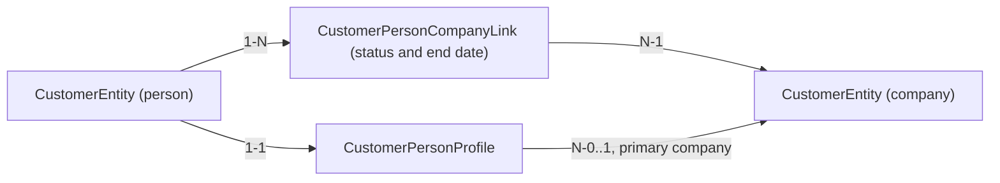

# End a person–company link and retain employment history

Extends: .ai/specs/2026-10-07-person-company-multi-select.md

## TLDR

CRM users need to see who previously worked at a company. Ending a person–company link will record the departure date and move the person from the active People list to Former employees on the company detail. When revisiting a past deal, staff can follow its company to see that list.

## Problem Statement

The current Remove action soft-deletes the association. Company detail consequently loses visibility of the relationship when someone leaves. This matters to the B2B account-history workflow described in [#8390](https://github.com/open-mercato/open-mercato/issues/8390).

## Proposed Solution

Add End employment to the company detail People tab. Record the date the relationship ended and show the person under Former employees, with a link to their CRM record. Keep Remove link available for correcting an erroneous association.

CiviCRM also keeps ended relationships in an inactive list and supports calendar dates. Open Mercato can apply that pattern to its existing company link and primary-company projection without introducing relationship types, a scheduler, or changes to deal attribution. [CiviCRM relationships guide](https://docs.civicrm.org/user/en/latest/organising-your-data/relationships/)

## Resolved assumptions (autonomous defaults)

| Question | Default | Rationale |
| --- | --- | --- |
| How does a person rejoin the same company? | Link existing person reactivates the same row and preserves the most recent departure date. The command log captures each transition. | Preserves the existing one-row-per-pair contract and lets staff use the familiar linking flow. An employment-period ledger is outside this scope. |
| How should imported and primary assignments work? | Materialize a profile-only assignment when ending it. Ending a primary link promotes the existing fallback if present, otherwise it clears the primary company. | An imported assignment offers the same action. Every active projection agrees on the new state. |
| What date is required? | Collect a calendar date on the company People tab. Apply the transition immediately and accept today or earlier, including dates before CRM import. | A departure date describes a prior event independent of the time zone used to display it. |

## 📝 Delta

### Capability: crm-employment-history

#### ADDED Requirement: End employment and retain the link

The system SHALL retain a dated, ended association when a permitted user ends an active person–company link, including a legacy profile assignment.

##### Scenario: Primary departure

- WHEN a user ends a person's primary association with a valid departure date
- THEN company detail shows that person under Former employees with the date, the company is absent from the person's active links, and the next eligible active link becomes primary if available

##### Scenario: Concurrent edit

- WHEN a user submits an end action against a version superseded by another link mutation
- THEN the system returns a record conflict and preserves the newer state

#### ADDED Requirement: Reactivate a former employee

The system SHALL reactivate the existing association when a user links the person to that company again.

##### Scenario: Rejoin a company

- WHEN a user links a person who previously left the company
- THEN the person appears once in the active list and is absent from Former employees, with the last departure date retained on the association

## Architecture

The `customers` module owns the relationship and its history. Reuse the person/company scope, the primary fallback helper, and the person-company-link side-effect and change-notification path. End, undo, and reactivation serialize changes on the same person row and apply the link and profile mirror in one transaction. End emits the existing link-updated event after commit. The company People tab refreshes the active list, former list, and company detail count after a successful write.

Audit snapshots distinguish active and ended links and retain the date when replay restores data. Any command that rebuilds the associations for a person retains ended rows through delete and undo. A company with retained history uses the existing dependent-record deletion guard. Related deal and interaction records continue to use the customer entities they already reference.

## Data Model

`customer_person_company_links` adds `employment_status` with default `active` and nullable `employment_ended_on` as a PostgreSQL `date`. A link with `employment_status = ended` has an end date and `is_primary = false`. `deleted_at` continues to mark a removed association. An active link may retain its latest end date after reactivation. The existing unique index still permits at most one non-deleted row per person–company pair. The existing `updated_at` remains the write version. No new contact fields are collected or copied to the association.

## API Contracts

| Interface | Behavior |
| --- | --- |
| `GET /api/customers/companies/{id}/people` | Existing active view by default. Optional `employmentStatus=ended` uses the same company authorization and pagination, orders recent requests by departure date, and returns the date with each row. Active rows expose the link ID and write version when available, or the profile version for imported assignments. |
| `POST /api/customers/people/{id}/companies/{companyId}/end` | Requires `customers.people.manage` and scoped access to the person and company. Accepts `{ endedOn: "YYYY-MM-DD" }` and the normal expected-version header. Returns `{ ok: true }` and operation metadata. Missing and out-of-scope associations return 404. Stale writes use the shared conflict response. |
| Existing person link create, update and delete routes | Link create reactivates an ended link. Primary changes apply to active links. Remove keeps its existing unlink behavior. Legacy IDs and response fields stay available. |

Use the standard mutation guard registry and command bus for the end action. Compare the expected version inside the transaction after locking the parent and loading the matching link or legacy profile record. Revalidate both customer kinds and tenant and organization ownership before changing either. Undo restores the active or legacy assignment and reconciles primary state only when the affected records still match the recorded transition.

## UI/UX

The active People table adds End employment to its row menu for users with manage permission. Its dialog identifies the person, requires a departure date, supports Escape and Cmd/Ctrl+Enter, and uses the shared conflict UI. The history section below the current list is read-only, with pagination, a linked person name, and the localized end date. It displays a state for failure and retry and omits the section when no history exists. The active People badge and decision-maker controls continue to count current links.

| Surface | Client boundary | Data owner |
| --- | --- | --- |
| Company detail People tab | Existing `CompanyPeopleSection` hosts the row action. Narrow dialog and history components own local form and pagination state. | Existing company-people API and the scoped end command. |

The budget is zero new page roots, providers, or heavy dependencies. Verify route hydration and the dialog interaction in Playwright and run the client-boundary check.

## Migration & Backward Compatibility

The migration adds columns with defaults for existing data and preserves the existing unique index. Current non-deleted rows begin active and previously removed links retain their removal status. No historical end date is inferred from soft-deletion. Active-only reads include the employment predicate across the linked lists, badge, selectors and legacy fallback paths. Consumers that inspect raw link rows can use `employment_status` to distinguish the states. An application rollback should retain the columns while data contains recorded departures.

## Risks & Impact Review

| Risk | Mitigation |
| --- | --- |
| High · Concurrent end, relink, or primary change leaves inconsistent current company data | Use the same person lock and transactional projection update. Compare the write version with the locked row. Exercise conflicts before and after primary promotion. |
| High · A list fallback or replay loses history or resurfaces a former employee as current | Exclude ended rows from the active readers, test profile-only transitions, and preserve dated links in delete/undo snapshots. |
| Medium · Formatting shifts a recorded date by a day | Store a date-only value and format it as a calendar date regardless of user time zone. |

## Implementation Plan

### Phase 1 · Store and transition employment status

1. Add the entity fields, migration and snapshot. Update the active predicates and protect history in snapshots used to rebuild person links.
2. Add the end command, route, side effects and undo. Reuse link create and existing person edit flows to reactivate the association. Cover valid and invalid dates, primary fallback, legacy assignments, scopes, stale versions, replay, and dated history retention.

### Phase 2 · Surface former employees

3. Add the paginated ended projection. Verify the existing active query, the ended query, company scope, reactivation and the active People count in API integration tests.
4. Add the row action, date dialog and history table. Add a self-contained Playwright test that creates person and company fixtures, ends the relationship, reloads the company and verifies both lists, then re-links the person and verifies both lists again. Clean up data in teardown.
5. Archive the Delta in `.ai/specs/capabilities/crm-employment-history.md` and run the configured validation, migrations diff and UI evidence checks.

## Final Compliance Report

The design uses the existing scoped link model, permissions, lock/version infrastructure, mutation guards, event path and UI components. The API changes are additive. Runtime validation is tracked in the implementation PR.

## Changelog

- 2026-11-25 · Proposed departure recording and a Former employees section for CRM company detail.
