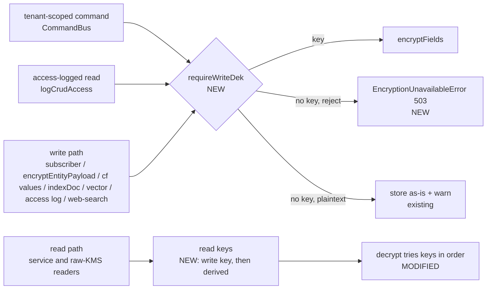

# Tenant data encryption when the KMS is unavailable

Extends: .ai/specs/implemented/2026-05-29-integrations-credentials-encryption-fail-closed.md
Extends: .ai/specs/2026-11-01-7231-compose-encryption-key.md
Extends: .ai/specs/2026-11-06-setup-encryption-preflight.md

## 📝 TLDR

**Key Points:**
- Today, when tenant data encryption is on (the default) but no data key (DEK) is reachable, every module silently writes encrypted-by-contract fields (names, e-mails, addresses, notes, messages…) as **plaintext**, and nothing re-encrypts them later. When Vault and an env fallback key are both configured, an outage instead seals rows with the **fallback-derived key**, which Vault-backed reads never open again: customers become unreadable and admins are locked out after recovery (reproduced live).
- Proposed (future behaviour): one platform policy `OM_ENCRYPTION_UNAVAILABLE_POLICY=reject|plaintext`, **default `reject`** — a write that must be encrypted fails with a typed, translated HTTP 503 instead of landing as plaintext. When Vault is configured the fallback key is **never used to write**; it is tried as a second key on **read**, so existing fallback-sealed data becomes readable again.
- The key is treated as a hard dependency, like the database: a tenant-scoped command and an access-logged read check for the key **up front**, so nothing is committed or returned when the key is missing.

**Scope:**
- Policy env var + resolver (`packages/shared/src/lib/encryption/`).
- Dual-key read, including the callers that read the KMS directly; the derived key never replaces a Vault key in any cache.
- One enforcement point applied to every fail-open encrypt path (ORM subscriber, `encryptEntityPayload`, custom field values, query-index docs, vector index, web-search secrets, access log).
- Key pre-check at the start of every tenant-scoped command and before every access-logged CRUD read.
- Typed `EncryptionUnavailableError` → 503 + `Retry-After` + i18n message.
- Boot banner naming the active key mode; `mercato init` fails fast before any write when no key is usable.
- Web-search secret storage resolves the right DI key (it never encrypts today).
- `.env.example` (+ create-app template sync), Compose env mapping, user docs, `UPGRADE_NOTES.md`.

**Out of scope (explicit):**
- Extending the cached DEK lifetime during outages (rejected: ignores revocation/rotation).
- One process-wide KMS instance / breaker-aware `getDek` (fast-fail, list latency) — separate task; may run in parallel, see Risks.
- Repair CLI that re-seals fallback-sealed rows under Vault (separate ticket; rows re-seal on their next write).
- Queue retry semantics for `EncryptionUnavailableError` (documented here, fixed with the KMS-unification task).
- **SSO client secrets.** `ssoConfigService.ts:143,203` and `sso/setup.ts:32` call `encryptEntityPayload('SsoConfig', …)`, but no module declares an encryption map for `SsoConfig`, so the call returns the payload unchanged and the secret is stored in plaintext **today, with a healthy KMS**. This is an existing defect independent of this spec (separate ticket: add the map, fix the decrypt entity id at `ssoService.ts:179`, decide how existing rows are re-sealed). When that ticket lands, the SSO write passes `secret: true` (see Proposed Solution 5).
- **A key for mapped rows that carry no tenant id** (known case: `customer_accounts:customer_user_session`). Those rows stay plaintext as today (see Proposed Solution 3); giving them a `system:` key is a separate ticket.
- **Writers that bypass the ORM hooks** (`em.upsert`/`upsertMany` — the subscriber has no `beforeUpsert` handler, so upserts are not encrypted even with a key — `em.insert`/`insertMany`, `em.nativeUpdate`, raw Kysely). Listed in Phase 2 Step 6; fixing them is a separate ticket.
- A marker secret that detects `VAULT_KV_PATH` pointing at a different, existing mount (see Risks).
- Small tickets found during verification: search-token guard instance, `messages.external_email_hash`, noop-KMS log spam.
- A key-id marker in the ciphertext envelope.

**Decisions (maintainer + task owner, 2026-11-24/25):** env-configurable policy with a secure default; the default install must keep working through the env fallback key (verified true for `yarn dev`, create-app, Railway, CI; Docker fullapp refuses a keyless config); the startup flow must not break; security wins over availability. When Vault is configured and down, apply the policy — never write with the derived key. One spec, three phases (Q1). Dual-key read only, no migration command (Q2). `mercato init` aborts before any write when no key is configured **or** a configured Vault is unreachable (Q3). Queues: document only (Q5). Repair CLI: separate ticket (Q6).

**Decisions proposed by the task owner after the pre-implementation audit (2026-11-25) — awaiting maintainer confirmation:**
- **D1 — key pre-check and key pin per command.** Every tenant-scoped command resolves the write key before it starts and uses that same key for all of its writes. This widens the outage impact: a command on an entity with *no* encrypted fields is also refused, because its audit row (`ActionLog`) and custom fields are encrypted and are written after the domain transaction commits.
- **D2 — access-logged reads fail without a key.** This replaces the earlier answer to Q4 ("reads stay non-blocking"): a CRUD read that must write an access-log row returns 503 when the key check fails at admission. D2 is two checks: a successful key check when the read is admitted, and fail-closed encryption when the row is persisted. It does not make the access-log row durable (see Proposed Solution 8).

**Decisions taken by the task owner (2026-11-25):** mapped secret fields in ordinary encryption maps follow the policy and are not changed (D3); tenant-less mapped rows are exempt and documented (D4); SSO secrets are a separate ticket (D5); the Compose preflight keeps refusing a keyless config under either policy (D6).

## 📝 Overview

Tenant data encryption is shared infrastructure: 25 modules under `packages/` declare encrypted fields in `<module>/encryption.ts`, and a single MikroORM subscriber plus `TenantDataEncryptionService` seal/open them (`packages/shared/src/lib/encryption/`). Key material comes from `createKmsService()` (`kms.ts:443`): HashiCorp Vault when `VAULT_ADDR`+`VAULT_TOKEN` are set, an env-derived key from `TENANT_DATA_ENCRYPTION_FALLBACK_KEY` (or legacy `TENANT_DATA_ENCRYPTION_KEY`), both (Vault primary, env fallback), or nothing (`NoopKmsService`). Outside production, `ALLOW_DERIVED_KMS_FALLBACK=true` with no key set supplies a built-in development key (`kms.ts:128-133`); it counts as an env key throughout this spec. This spec defines what happens to writes and reads when the configured source cannot supply a key.

> **Market reference.** Rails Active Record Encryption: encrypt with the current key, decrypt by trying `previous` keys in order (adopted: dual-key read); `support_unencrypted_data` is off by default and must be opted into (adopted: `plaintext` is an explicit opt-in, `reject` the default). Python `MultiFernet` / Laravel `APP_PREVIOUS_KEYS`: same encrypt-with-first, decrypt-with-any rule. AWS Encryption SDK caching keyring: cached data keys have a hard max age (adopted: we do NOT extend the cache lifetime on error). Rejected from those libraries: embedding a key id in the ciphertext — useful but a format change (out of scope; GCM authentication already tells us when a key does not fit).

## 📝 Problem Statement

Verified on `main` @ `2033c3605c` by code reading and a live run on a disposable stack (pg17 + Vault 2.2.2 dev mode, Vault paused with `docker pause`):

| Configuration | Behaviour in an outage today | Evidence |
|---|---|---|
| Vault only, DEK cached | Writes stay encrypted; outages up to 15 min are invisible | live S1.2b |
| Vault only, cold cache / new tenant / cache expired | **Plaintext written** (`subscriber.ts:290`, `tenantDataEncryptionService.ts:620,634`) | live S1.2 |
| Vault + env fallback key | Rows sealed with the derived key; the derived DEK is cached 15 min (`tenantDataEncryptionService.ts:307`) and still used **after** recovery; those rows then read back as raw ciphertext (`:593`), edits fail with `WRONG_KEY` → 500, users whose e-mail was re-sealed cannot log in | live S3 |
| Vault + env fallback key, Vault healthy, tenant has no Vault DEK | Every write uses the derived key permanently (`kms.ts:65-75` falls through to the derived key; a Vault 404 counts as healthy, `kms.ts:265-271`) — the same mixing, without any outage | code |
| Neither Vault nor key (custom deploys, host-run, old `.env`) | `NoopKmsService` for the process lifetime (`kms.ts:455-461`) → everything plaintext | live S2 |

Other fail-open writers: `encryptEntityPayload` callers (setup `setup-app.ts:454`), `customFieldValues.ts:64,169-174`, `indexDoc.ts:94` (`entity_indexes.doc`; also reached from `reindexer.ts:644` and `query_index/cli.ts:206`), `packages/search/.../vector-index.service.ts:257`, the access log (`audit_logs/services/accessLogService.ts:238-251,317-330`, raw insert afterwards), `agent_orchestrator/lib/webSearch/secretStorage.ts:67` (which additionally resolves the wrong DI key at `:55`, so it never encrypts). Already fail-closed (kept): integrations credentials, api_keys session secrets, OAuth DEK pin, custom-entity docs (`customEntityDoc.ts:29-35`), agent artifacts, forms (own master key).

Two orderings make a per-field rejection unsafe on its own (code reading; the first was not run):
- **Audit row after commit.** The command bus runs the handler (`command-bus.ts:404`) and only then persists the `ActionLog` row (`:466`); `audit_logs:action_log` has seven encrypted fields. A rejection there happens after the domain write is committed.
- **Custom fields after commit.** `runCrudCommandWrite.ts:50-71` and `customers/commands/people.ts:783-788` commit the entity transaction, then write custom fields, then emit side effects.

The Vault health state is **per `KmsService` instance** (`kms.ts:179-187`); `core/src/bootstrap.ts:216` creates one per container. It is process-wide only when the process container root or the bootstrap cache is enabled. Within one instance, a single tenant's cold miss marks the instance unhealthy and every tenant served by it then skips encryption, even with a cached DEK.

## 📝 Prior spec drift

- `.ai/specs/implemented/2026-05-29-integrations-credentials-encryption-fail-closed.md` → API Contracts: `PUT /api/integrations/:id/credentials` returns 503 when no DEK is available. The route maps `CredentialsEncryptionUnavailableError` to 503 on every path that raises it (`integrations/api/[id]/credentials/route.ts:209-211,253-254`), and its unit tests pass. A live run with Vault paused and no fallback key nevertheless returned **500 with an empty body** for `webhook_custom` and `channel_discord`. Likely cause (code reading, not reproduced): `isCredentialsEncryptionUnavailableError` uses `instanceof` (`credentials-service.ts:58-59`), which fails when the DI-provided service comes from a different bundled copy of the module, unlike `isCrudHttpError`'s `Symbol.for` marker. Tracked as a separate ticket; this spec does not change that route. The new `EncryptionUnavailableError` avoids the problem by extending `CrudHttpError`.
- `.ai/specs/2026-11-06-setup-encryption-preflight.md` (dev setup, starter, Docker `init-or-migrate.sh`; exit 78 in containers) reads `getTenantDek` for every scope of a populated database and decrypts sampled ciphertext (`scripts/dev-encryption-preflight.mjs:91,185-188`). It therefore already blocks setup when Vault is down for a populated Vault-only database, and for any database holding Vault-sealed ciphertext. It does not cover an empty or new database, a plaintext-only database when an env fallback key is configured, a direct `mercato init`, or CI. This spec adds an explicit reachability and token check to `mercato init` for those cases (Phase 2).

## 📝 Proposed Solution

1. **Policy.** `resolveEncryptionUnavailablePolicy(): 'reject' | 'plaintext'` in `toggles.ts`, reading `OM_ENCRYPTION_UNAVAILABLE_POLICY`; unset/blank/invalid → `reject` (invalid values warn once). Only meaningful when `isTenantDataEncryptionEnabled()`.
2. **Read keys vs write key.** A write uses exactly one key: Vault's when Vault is configured, the derived key only when Vault is not configured. Two new methods carry this: `getWriteDek()` (the one key a write may use) and `getReadDeks()` (the ordered list: write key, then the derived key when one exists). All in-repo code moves to them: every caller that decrypts uses the read keys, both the `getDek()` callers and the callers that read `KmsService.getTenantDek()` directly (lists in Phase 1 Step 3). **The existing `getDek()` and the built-in `KmsService.getTenantDek()`/`createTenantDek()` keep today's results and are marked `@deprecated`** (the bridge for out-of-tree callers, see Migration & BC). The derived key is never stored in the write-key cache; `TenantDek` gains an optional `source: 'vault' | 'derived'` so the service can tell them apart, and `DerivedKmsService` memoizes its PBKDF2 result per key id (it currently runs 310k iterations synchronously per call, `kms.ts:154-157`).
   - **Reads follow the cache, not the health flag.** Today most decrypt paths skip when `isEnabled()` is false, and `isEnabled()` is false for every tenant of a `KmsService` instance once one tenant's cold miss marks it unhealthy (Vault-only; with an env fallback key the instance stays healthy, `kms.ts:46-47`). Left alone, the write-side rule in point 3 would let a tenant with a cached key keep writing ciphertext while its reads return that ciphertext undecrypted. Therefore decrypt paths gate on the encryption toggle (`isTenantDataEncryptionEnabled()`), not on `isEnabled()`, and resolve their keys with `getReadDeks(keyId)` after the row's scope is known. While the instance is unhealthy `getReadDeks` answers **from the DEK cache only** and makes no KMS call: a cached key (plus the derived key when one exists) is returned, a miss returns no Vault key and the value is returned as stored. This keeps a Vault timeout (`VAULT_REQUEST_TIMEOUT_MS`, default 1 s, no negative cache, `tenantDataEncryptionService.ts:296-309`) off every row read of a tenant without a cached key. When the instance is healthy, or the recovery cooldown lets a probe through, the lookup is today's. `isEnabled()` and `getDek()` keep their meaning.
3. **One enforcement point.** `TenantDataEncryptionService.requireWriteDek(keyId, opts)` is the only place that decides "no key → reject or plaintext".
   - It consults the DEK cache **before** KMS health, so a tenant with a cached DEK keeps encrypting while the instance is marked unhealthy. The `isEnabled()` early returns at `subscriber.ts:290` and `tenantDataEncryptionService.ts:620` are removed from the write path.
   - Every encrypt path calls it **after** resolving the encrypted fields, so entities with no encrypted fields (tenant, organization, staff session…) are never blocked by the field-level rule.
   - **Null key id.** A mapped row with no tenant id and no `system` key scope has no key id (`tenantDataEncryptionService.ts:296-297` returns `null`). `requireWriteDek(null)` returns `null` under either policy and the row is stored as today. This is a documented exemption, not a fix (known case: portal sessions' `ip_address`/`user_agent`).
   - **Preview.** `requireWriteDek(keyId, { createIfMissing: false })` never throws and never provisions a key; it returns `null` so `encryptEntityPayload(…, { createMissingDek: false })` keeps its dry-run contract (#5950). No persisting path may pass this option.
4. **Subscriber rule, stated against the real hook order.** `beforeUpdate` today decrypts the whole entity and then encrypts it (`subscriber.ts:554-557`), and MikroORM merges every field the hook changed into the UPDATE (`UnitOfWork.js` `runHooks`: snapshot, hook, snapshot, diff → `changeSet.payload`). Verified by a characterization run against MikroORM 7.1.14: an entity loaded with no key and flushed with a read key but no write key writes the untouched encrypted field **as plaintext**. Therefore, when no write key is available:
   - `beforeUpdate` **skips its decrypt step** and leaves every encrypted field untouched;
   - an update is rejected when the change set at hook entry contains an encrypted field with a non-null value (the user changed it); setting an encrypted field to `null` is allowed;
   - a create is rejected when any encrypted field is non-null;
   - no client value is trusted as "already encrypted": an envelope-shaped string in the change set is rejected like any other value (the #2720 forgery guard, `tenantDataEncryptionService.ts:128-142`, is unchanged). `__originalEntityData` is not used as evidence of ciphertext — after a keyed load it holds decrypted values (`subscriber.ts:221`).
5. **Typed error.** `EncryptionUnavailableError` (code `ENCRYPTION_UNAVAILABLE`) extends `CrudHttpError` with status 503. Its body is `{ error: 'api.errors.encryptionUnavailable', code: 'ENCRYPTION_UNAVAILABLE' }`; the factory already translates `body.error` (`factory.ts:666`). `CrudHttpError` gains an optional `headers` field which the factory forwards, carrying `Retry-After`.
6. **Explicitly flagged secrets always fail closed.** A path that passes `secret: true` rejects regardless of the policy. In this spec that is web-search secret storage; integrations credentials and api_keys already fail closed through their own code. **Secret fields declared in ordinary encryption maps follow the policy and are not changed by this spec** — under `plaintext` they are stored in the clear when no key is available, exactly as today: `webhooks:webhook_entity.secret`/`previous_secret`, `inbox_ops:inbox_settings.webhook_secret`, `payment_gateways:gateway_transaction.client_secret`, `devices:user_device.push_token`, `onboarding:onboarding_request.password_hash`. Under the default `reject` they are protected like every other encrypted field.
7. **Key pre-check and key pin per command (D1).** `CommandBus` wraps each command whose context carries a tenant id in `runWithPinnedWriteDek(tenantId, …)`. The wrapper calls `requireWriteDek(tenantId)` once, before snapshots and the handler, and holds the result in an `AsyncLocalStorage` scope until `execute()` returns. That includes `ActionLog` persistence and the post-commit work that runs before the return (`command-bus.ts:536-565`: after-execute interceptors, cache invalidation, `flushCrudSideEffects`). Inside the scope `requireWriteDek` for that key id answers from the pin and makes no cache or KMS lookup.
   - Under `reject` with no key the command fails with `EncryptionUnavailableError` before anything is written.
   - Once the command has started, the entity, its custom fields, its `ActionLog` row and the encrypted writes of its post-commit work are all sealed with the pinned key, even if the cached DEK expires or Vault goes down meanwhile. A command therefore cannot commit its domain write and then fail for lack of a key.
   - **Why the pin does not end at `persistLog`.** After `persistLog` the command still writes encrypted data in the same process: `flushCrudSideEffects` emits `query_index.upsert_one` and awaits it (`data/engine.ts:846-852`), and that subscriber is not persistent (`query_index/subscribers/upsert_one.ts:11`), so it writes the encrypted `entity_indexes.doc` inline. Other non-persistent subscribers on CRUD events write mapped entities the same way (for example `staff/subscribers/support-portal-task-updated.ts`). By default a failure there is swallowed and the record is missing from list reads until a reindex; with `OM_CACHE_SAFETY_ALWAYS_CONSISTENT=true` it is rethrown (`engine.ts:847,943-944`) after the domain row and the audit row are committed.
   - Under `plaintext` with no key the pin holds "no key" and every write of the command is stored as-is, consistently.
   - The pin lives for one command only. It is not a cache extension: no later request sees it. The pin is a holder that the wrapper **revokes when the command returns**. This matters because an `AsyncLocalStorage` scope is inherited by promises started inside it and not awaited (for example the deferred token reindex in `upsert_one.ts`): such work finds the pin revoked and resolves its own key. Subscribers the command awaits run inside the pin. Queue jobs and persistent subscribers run in worker processes and never see it.
   - **Ambient atomic replay.** When a replay joins an outer transaction, post-commit work runs from a completion callback after `execute()` or `undo()` has returned (`command-bus.ts:576-580,760-763`). That callback must re-enter the pin, so `runWithPinnedWriteDek` has a form that takes an existing pin. No production caller uses this path today (only `TC-AUTH-066` and a unit test); the rule is for future callers.
   - Commands with no tenant in context are not wrapped. A `system:` key scope is not pinned by a tenant pin and goes through the normal lookup.
   - **Not changed:** the audit row and custom fields are still written after the domain commit, so a failure with another cause (database error, validation in a side effect) can still leave the domain write committed, exactly as today. This spec removes key unavailability as a cause of that state and does not define new retry semantics for the others.
8. **Key pre-check per access-logged read (D2).** `logCrudAccess` (`factory.ts`) calls `requireWriteDek(tenantId)` after its existing skip conditions (no auth, no items, no access-log service) and before it dispatches the log write. Under `reject` with no key the read fails with 503. Under `plaintext` it behaves as today. A read that is not access-logged is not blocked. Without a key such a read could only return ciphertext for encrypted fields anyway. A read that returns no items is not access-logged (`factory.ts:976,1023`), so it is served without a key check.
   - **D2, defined exactly, under `reject`:**
     - **At admission** — the read is served only if `requireWriteDek(tenantId)` succeeds at that moment. Otherwise it fails with 503 and nothing is returned.
     - **At persistence** — the access-log write encrypts through `requireWriteDek` again. If no key is available then, the write throws and **no row is stored**; a row is never written in plaintext.
   - **What D2 does not guarantee:** that a row exists for every served read. The two checks happen at different times: `logCrudAccess` dispatches the write in the background unless blocking mode is on, so the read is admitted and answered before the row is persisted. If the key disappears between admission and the background write, the read has already been served and the row is dropped (the failure is logged). The same holds for the gaps that exist today and are unchanged: `dropped: true` when the backlog is full, and caught write errors of any cause. Durable access logging (block the response on the write, define backpressure) is a separate decision and is out of scope.
9. **Operator signal.** One boot banner per process naming the key mode (`vault` / `vault+env-fallback(read-only)` / `env-key` / `none`) and the policy; `mercato init` aborts before any write when no key is usable.

### Design Decisions

| Decision | Rationale |
|---|---|
| Default `reject` | Maintainer: security first; the default installs always have a key, so only misconfigured or Vault-outage setups are affected — exactly the ones writing plaintext today |
| No derived-key writes when Vault is configured | Otherwise the policy never triggers for Vault+fallback setups, and mixed-key data is the most damaging failure observed |
| Dual-key read instead of a key-id marker | Fixes reading existing mixed data without a ciphertext format change; AES-GCM authentication already rejects a wrong key |
| Key pre-check and pin per command (D1) | The audit row and custom fields are written after the domain commit; rejecting there leaves a committed row plus a 503, and a retry duplicates it. Resolving the key once and pinning it is one seam instead of moving those writes into every command's transaction. The repo already pins a DEK per operation for OAuth grants (`oauth/pin-tenant-dek.ts`) |
| Pin instead of a time margin | A margin still fails for a command slower than the margin; a pin has no such case. Using a key for the remainder of one command is bounded and is not the rejected "extend the cache during an outage" |
| Field-level rule kept in the subscriber | Services, workers, CLIs and subscribers write outside the command bus and still need the guarantee |
| Access-logged reads fail without a key (D2) | Admitting a read while the key is known to be missing means its audit row cannot be written at all, and a plaintext audit row is not acceptable; the key is a hard dependency. D2 is a key check at admission plus fail-closed encryption at persistence, not a promise of a row per read: durability of the row is deliberately left as it is |
| New `getWriteDek`/`getReadDeks` instead of redefining `getDek` | Out-of-tree modules call `getDek()` and `getTenantDek()` to decrypt; changing what those return would cut them off from legacy ciphertext with no transition. New names make the change additive and give a deprecation window |
| Mapped secret fields follow the policy (D3) | No behaviour is made worse; `reject` protects them; changing them would make `plaintext` unusable for webhooks and payment gateways |
| Compose keeps refusing a keyless config (D6) | In Docker, `plaintext` is an outage escape hatch for Vault installs, not a way to run with no key |
| Reuse `CrudHttpError` | Existing factory/route handling already translates `body.error` and returns the status; MikroORM, `withAtomicFlush` and the command bus rethrow it unwrapped |

### Alternatives Considered

| Alternative | Why rejected |
|---|---|
| Extend the cached DEK lifetime while Vault is down | Ignores revocation and rotation; cache already hides outages up to 15 min |
| Third policy value `fallback` (write with derived key during outage) | Needs dual-key read everywhere plus later re-sealing; can be added later as an additive enum value |
| Encrypt-later queue for plaintext rows | Plaintext still lands in the DB, backups and replicas |
| A selector env (`OM_KMS_PROVIDER=vault|env`) | Not needed; the "Vault if configured, else env key" rule is clear and changing it risks existing installs |
| Move `ActionLog` and custom-field writes inside each command's transaction | Correct, but a refactor across every command handler; the pre-check gives the same guarantee at one seam |
| Exempt `ActionLog` / access log from the policy | Drops audit rows or stores them in plaintext during an outage |
| Give tenant-less mapped rows a `system:` key in this spec | Starts encrypting data that is plaintext today and needs a read path for old rows; separate ticket |

## 📝 Delta

### Capability: tenant-data-encryption-unavailable

**ADDED — Policy env var.** WHEN `OM_ENCRYPTION_UNAVAILABLE_POLICY` is unset, blank or invalid THEN the policy is `reject` (invalid → one warning). WHEN it is `plaintext` THEN the pre-change write behaviour applies to tenant data, including secret fields declared in ordinary encryption maps (not to explicitly flagged secrets).

**MODIFIED — Write to an encrypted field with no usable key.** Previously: stored as plaintext. WHEN encryption is enabled, the entity has encrypted fields and a key id, at least one would be persisted as plaintext, no write key is available AND the policy is `reject` THEN the write fails with `EncryptionUnavailableError` (HTTP 503, `code: ENCRYPTION_UNAVAILABLE`) and the transaction rolls back. Frozen by: `packages/shared/src/lib/encryption/__tests__/subscriber.kms-recovery.test.ts`, `customFieldValues.plaintext-fallback.test.ts`.

**ADDED — Tenant-scoped command with no usable key.** WHEN a command runs with a tenant id, no write key is available AND the policy is `reject` THEN the command fails with `EncryptionUnavailableError` before its handler runs; no row, custom field, audit row, event or index update is written.

**ADDED — Key pinned for the command.** WHEN a tenant-scoped command has started with a write key THEN every encrypted write of that command for that tenant, up to the return of `execute()` or `undo()` and including awaited post-commit side effects, uses the same key, whether or not the key is still cached or the KMS still reachable.

**MODIFIED — Access-logged CRUD read with no usable key at admission.** Previously: the read succeeded and the access-log row was stored as plaintext. WHEN the read is access-logged, the key check at admission fails AND the policy is `reject` THEN the read fails with `EncryptionUnavailableError` (503).

**MODIFIED — Access-log row persisted with no usable key.** Previously: stored as plaintext. WHEN the access-log write runs, no write key is available AND the policy is `reject` THEN the write fails and no row is stored; the failure is logged. A read admitted earlier is not recalled.

**UNCHANGED — Access-log durability.** A served read may still have no access-log row (background dispatch, backlog drop, caught write error, or key loss between admission and persistence), as today.

**MODIFIED — Update of a row while no write key is available.** Previously: `beforeUpdate` decrypted every encrypted field it could and wrote whatever it could not re-seal. THEN encrypted fields absent from the change set are left untouched in the database, whatever key was available when the row was loaded.

**MODIFIED — Vault configured and unavailable, env fallback key present.** Previously: writes sealed with the derived key. WHEN Vault is configured THEN writes never use the derived key; the policy applies. Frozen by: `packages/shared/src/lib/encryption/__tests__/kms.test.ts`.

**MODIFIED — Vault configured and healthy, tenant has no Vault DEK, env fallback key present.** Previously: derived key used for writes indefinitely. THEN a Vault DEK is created and used for writes; older derived-sealed values stay readable via dual-key read. Frozen by: `kms.test.ts` (new characterization case, Phase 3 Step 1).

**ADDED — Dual-key read.** WHEN a value has the envelope shape, does not open with the write key, and a derived key exists THEN the derived key is tried; on success the value is returned decrypted and is re-sealed under the write key on the next write of that row. Plaintext (non-envelope) values are never tried against a second key. This applies equally to integration credentials, API-key session secrets and OAuth grants, which read the KMS directly.

**MODIFIED — Cached DEK while the KMS instance is unhealthy.** Previously: one tenant's cold miss marked the `KmsService` instance unhealthy and every tenant served by it then wrote plaintext, cached DEK or not. THEN a tenant whose write DEK is cached keeps encrypting with it. Frozen by: `subscriber.kms-recovery.test.ts` (new two-tenant characterization case on one service instance, Phase 2 Step 1).

**MODIFIED — Read with a cached DEK while the KMS instance is unhealthy (Vault-only).** Previously: ORM loads, `findWithDecryption`, custom field values, index docs, action-log entries and vector results returned ciphertext for every tenant of the instance, cached DEK or not, while `decryptEntityPayload` and the query engines still decrypted (inconsistent). THEN a tenant whose DEK is cached reads decrypted values on every path; a tenant without a cached DEK gets the stored value and no KMS call is made while the instance is unhealthy. Frozen by: `subscriber.test.ts` ("skips decryption entirely when the service is disabled") and `customFieldValues.test.ts`, rewritten in Phase 1 Step 3.

**ADDED — Flagged secrets fail closed.** WHEN a write passes `secret: true` (web-search secret storage) and cannot be encrypted THEN it fails with `EncryptionUnavailableError` under either policy.

**MODIFIED — Web-search secret storage.** Previously: resolved a DI key that is not registered, so secrets were never encrypted. THEN it resolves `tenantEncryptionService` and encrypts.

**ADDED — `mercato init` key preflight.** WHEN encryption is enabled and (no Vault config and no usable key: neither an env key nor the non-production development key) OR (Vault configured but unreachable, sealed, or refusing the token) THEN under `reject` init aborts before any database write with an actionable message and exit status 78 — deliberately reusing the meaning `*encryption-preflight.mjs` / `init-or-migrate` already give it ("encryption configuration rejected"); under `plaintext` it warns and continues.

**UNCHANGED — Reads that are not access-logged, with no key,** return the stored value (ciphertext or plaintext).

**UNCHANGED — Mapped rows with no key id** (no tenant id, no `system` key scope) are stored as today under either policy.

## 📝 Architecture

All changes live in `packages/shared/src/lib/encryption/` plus thin call-site edits; no cross-module imports are added.



Takeaway: one decision point for writes, reached first by the command and the read, then by each encrypt path; one ordered key list for reads.

Components:
- `toggles.ts` — `resolveEncryptionUnavailablePolicy()` (NEW).
- `kms.ts` — `KmsService` gains **optional** `getTenantReadDeks?(keyId): Promise<TenantDek[]>`, `resolveTenantWriteDek?(keyId, { createIfMissing }): Promise<TenantDek | null>` and `describeMode?(): KmsMode` (additive). New exported helpers for callers that hold a raw `KmsService`: `resolveReadDeks(kms, keyId)` returns `getTenantReadDeks?.()` or `[getTenantDek()]`; `resolveWriteDek(kms, keyId, opts)` returns `resolveTenantWriteDek?.()` or falls back to `getTenantDek()`/`createTenantDek()` for a custom KMS that does not implement it. Internal `FallbackKmsService`: `resolveTenantWriteDek` uses the primary only when the primary is configured (Phase 3); `getTenantReadDeks` returns `[primary?, derived]`; **`getTenantDek`/`createTenantDek` keep today's primary-then-derived behaviour and are `@deprecated`**, logging one deprecation warning per process when the derived key is returned while Vault is configured. `createKmsService()` signature unchanged.
- `kms.ts` — `HashicorpVaultKmsService` gains `isConfigured()` and `probe()` (used by init only). `probe()` runs three calls with the request timeout: `GET /v1/sys/health` (reachable, initialised, unsealed; needs no token), `GET /v1/auth/token/lookup-self` (token accepted), and `POST /v1/sys/capabilities-self` for `<VAULT_KV_PATH>/tenant_key_<probe>` (requires `read` and `create`). `sys/health` alone cannot detect a bad token: it answers 200 with no token, a wrong token and an expired token (verified live on Vault 2.2.2).
- `kms.ts` — `HashicorpVaultKmsService.readVault` returns a classified status instead of `null`, read from the status **and the body** (verified live on Vault 2.2.2):

  | Result | Vault response | Next step |
  |---|---|---|
  | `found` | 200 with the key | use it |
  | `absent` | 404 with an empty `errors` array | the only case that may create a DEK |
  | `denied` | 401 / 403 (bad, expired or revoked token; path outside the token's policy) | unavailable |
  | `bad-route` | 404 whose `errors` contains `no handler for route`, or a 404 with the `Invalid path for a versioned K/V secrets engine` warning | unavailable |
  | `unavailable` | 5xx, timeout, network error | unavailable |

  `denied` and `bad-route` no longer mark the instance healthy (today every non-5xx response does, `kms.ts:265-272`).
- `tenantDataEncryptionService.ts` — `requireWriteDek(keyId, { secret?, createIfMissing? })` (NEW): returns a DEK, or `null` (null key id; `plaintext` for non-secrets; `createIfMissing: false`), or throws; it answers from the command pin when one is active for the key id. `getWriteDek()`, `getReadDeks()` and `runWithPinnedWriteDek(keyId, fn)` (NEW). `getDek()` is `@deprecated` and keeps today's result: the write key when one is available, otherwise the derived key when one exists. Write cache stores only write-key results. `decryptFields` iterates read keys. `encryptEntityPayload` uses `requireWriteDek` and gains an optional `secret` option; `isEnabled()` semantics unchanged (BC).
- `subscriber.ts` — `encrypt()` resolves encrypted fields with `ignoreRuntimeHealth: true` first, then calls `requireWriteDek`; `beforeUpdate` skips its decrypt step when no write key is available (Proposed Solution 4); the throttled "persist as plaintext" warning stays only on the `plaintext` branch.
- `packages/shared/src/lib/commands/command-bus.ts` — wraps a tenant-scoped command, from before snapshots until `execute()` returns (post-commit work included), in `runWithPinnedWriteDek`, and revokes the pin on return (soft-resolves `tenantEncryptionService`; skipped when it is not registered or the context has no tenant). Redo runs through `execute` and is covered by the same wrapper. `undo()` is a separate method with no snapshots and no `persistLog`: it writes its trace row through `markUndone` (`command-bus.ts:660-665`). Its post-commit flush runs after that (`:753`). It gets its own wrap, from before the undo claim until `undo()` returns, keyed by the tenant of the source log (`log.tenantId ?? ctx.auth?.tenantId`, `:786`).
- `packages/shared/src/lib/crud/factory.ts` — `logCrudAccess` key pre-check; `handleError` forwards `CrudHttpError.headers`.
- `packages/shared/src/lib/crud/errors.ts` — `CrudHttpError` gains optional `headers?: Record<string, string>` (additive).
- `customFieldValues.ts`, `indexDoc.ts`, `packages/search/.../vector-index.service.ts`, `audit_logs/services/accessLogService.ts` — replace their own `isEnabled()` skip with `requireWriteDek`. An index-doc write that throws is rethrown by the indexer (`indexer.ts:275-290`) and recorded per record (`upsert_one.ts:203-216`); a vector write is refused at `vector-index.service.ts:295-304`. The record is reindexed on its next change or by `query_index` reindex after recovery.
- `packages/enterprise/.../webSearch/secretStorage.ts` — resolve `tenantEncryptionService` (the registered key, `core/src/bootstrap.ts:239,355`) and pass `secret: true`; update the unit test that pins the wrong name.
- Raw-KMS callers: decrypt moves to `resolveReadDeks` in `integrations/lib/credentials-service.ts:290`, `api_keys/services/apiKeyService.ts:96`, `entities/cli.ts:953`; their write side (`credentials-service.ts:196`, `apiKeyService.ts:55`, `oauth/pin-tenant-dek.ts:34-36`) moves to `resolveWriteDek` in Phase 3, so in-repo code never writes with the derived key under Vault. `pin-tenant-dek.ts:62-66` wraps a `KmsService` and must forward the optional methods. These callers already refuse to write without a key; that is unchanged.
- `packages/shared/src/lib/encryption/encryptionUnavailableError.ts` (NEW file) — `EncryptionUnavailableError extends CrudHttpError` (`CrudHttpError` is marker-detected by `isCrudHttpError` via `Symbol.for`, `crud/errors.ts` has no imports, so no cycle). Kept separate from `TenantDataEncryptionError` in `aes.ts`.
- `packages/core/src/bootstrap.ts` — boot banner (once per process) from `describeMode()` + policy.
- `packages/cli/src/mercato.ts` `init` — key preflight **after** the `.env` bootstrap (which generates a key on a fresh non-production environment, `mercato.ts:362-371`) and **before** the reinstall table drop (`:1110-1145`) and `dbMigrate` (`:1255`). Exit 78 lives here only.
- `packages/core/src/modules/auth/lib/setup-app.ts` — `setupInitialTenant` **throws** `EncryptionUnavailableError`; it never exits the process, because it also runs inside an HTTP request (`onboarding/api/get/onboarding/verify.ts:209`).
- Preflight scripts (`scripts/dev-encryption-preflight.mjs` and its byte-identical copies `packages/create-app/template/scripts/dev-encryption-preflight.mjs` and `packages/starter/src/encryption-preflight.mjs`) — try the read keys when they verify existing ciphertext (`:91,187`), so a scope sealed only with the derived key passes.
- Compose — add `OM_ENCRYPTION_UNAVAILABLE_POLICY` to the `x-tenant-encryption-environment` mapping in `starters/docker/compose.fullapp.yml`, its root copy `docker-compose.fullapp.yml` (same content plus a 4-line header) and the create-app template copy, and to the explicit per-service environment lists in the three `fullapp.dev.yml` copies. Compose passes variables through these allowlists only, so without this the value never reaches the containers. The `encryption-preflight` service is **unchanged**: it keeps refusing a config with neither a key nor Vault under either policy, and whatever `TENANT_DATA_ENCRYPTION` says (D6).

Relationship to the existing preflights: they keep their checks (configuration, unsafe keys, ciphertext compatibility, a DEK for every scope of a populated database). The new `init` check adds reachability and token validity for the cases they do not cover (see Prior spec drift). Both use exit 78 for the same meaning. Note for operators: on a fresh non-production environment `mercato` writes a generated `TENANT_DATA_ENCRYPTION_FALLBACK_KEY` into the new `.env` even when Vault is configured through the process environment (`packages/cli/src/lib/env-example.ts:9-26`), which yields the Vault + fallback mode; after Phase 3 that key is read-only.

Dependency on future work: the separate KMS-unification task changes which `KmsService` instance call sites use and adds breaker checks in `getTenantDek`/`getDek`. It overlaps this spec in `kms.ts`, `tenantDataEncryptionService.ts`, `customFieldValues.ts`, `subscriber.ts`, `indexDoc.ts`; land this spec first or coordinate (see Risks).

## 📝 Data Model

No schema change, no migration. Ciphertext format unchanged (`iv:ct:tag:v1`). Encryption maps unchanged.

## 📝 API Contracts

No new endpoints. Behavioural contract added to every endpoint that runs a tenant-scoped command, persists an entity with encrypted fields, or serves an access-logged CRUD read:

```json
HTTP/1.1 503 Service Unavailable
Retry-After: 30
{ "error": "<translated api.errors.encryptionUnavailable>", "code": "ENCRYPTION_UNAVAILABLE" }
```

- `makeCrudRoute` routes: produced by the factory's `CrudHttpError` handling, which now also forwards `CrudHttpError.headers`. `Retry-After` (value = `VAULT_RECOVERY_COOLDOWN_MS` in seconds, default 30) is set by `requireWriteDek` on the error **only** when Vault is configured and unavailable; in the `none` mode (misconfiguration) it is omitted so clients do not retry uselessly.
- The 503 response is an ADDITIVE change to those endpoints, for `GET` as well as for writes.
- Custom routes that already map `CrudHttpError` get the same status and body; they return the header only if they forward `error.headers`. A route that lets the error escape is answered by the app dispatcher, which maps any `CrudHttpError` to its status and body (`apps/mercato/src/app/api/[...slug]/route.ts:631-642`) but does not translate `body.error` (only the factory does, `factory.ts:664-666`) and does not forward headers: the client gets 503 with the raw key `api.errors.encryptionUnavailable` and no `Retry-After`. This is a known limitation of this spec; translating and forwarding headers in the dispatcher is a separate follow-up. A route with its own catch that does not map `CrudHttpError` still returns its generic 500 (listed per route in Phase 2 Step 6, fixed where the route is in a core write flow; `auth/api/routeError.ts:29` is one).
- OpenAPI: `createCrudOpenApiFactory` documents a 503 response for list/create/update/delete (the factory has no separate detail operation).
- i18n key `api.errors.encryptionUnavailable` in `apps/mercato/src/i18n/{en,pl,de,es,ko}.json` + `yarn template:sync:fix`. A missing dictionary key would render the literal key, so the key ships in the same change as the error.
- Env (new, additive): `OM_ENCRYPTION_UNAVAILABLE_POLICY=reject|plaintext` documented in `apps/mercato/.env.example`, the create-app template, and the Compose env mapping.

## 📝 UI/UX

No new screen. The 503 reaches the backend UI through the existing error handling: `CrudForm` and `apiCall` surface the translated `error` as the form or flash error, and `DataTable` shows its existing error state for a failed list read. No retry button is added.

## 📝 Edge Cases & Failure Scenarios

| Scenario | Behaviour after change | User sees |
|---|---|---|
| Vault-only, outage, key cached | Writes keep encrypting with the cached key (Phase 2, cache before health); reads decrypt with it (Phase 1, cache-only read keys). Today, once another tenant's cold miss marks the instance unhealthy, this tenant's ORM, custom-field, index-doc and vector reads return ciphertext | Nothing |
| Vault-only, outage, no cached key, read that is not access-logged | Stored value returned; no KMS call while the instance is unhealthy | Ciphertext in encrypted fields, as today |
| Vault-only, outage, cold / new tenant, `reject` | Command refused before it starts; access-logged reads refused | 503 "encryption temporarily unavailable" |
| Vault+fallback, outage, `reject` | Same (no derived write) | 503 |
| Vault+fallback, healthy, tenant had only derived data | New Vault DEK created; old rows readable via derived key; re-sealed on next write | Nothing |
| No Vault, no key, `reject` | Boot banner error; commands and access-logged reads refused; `init` aborts (exit 78) | 503 / clear CLI message |
| Command on an entity with no encrypted fields, no key, `reject` | Refused by the pre-check (its audit row is encrypted) | 503 |
| Non-command write of an entity with no encrypted fields (service, worker) | Never blocked | Nothing |
| Edit unrelated field on a row whose encrypted fields could not be decrypted (non-command write, or `plaintext`) | `beforeUpdate` skips decrypt; encrypted fields stay out of the UPDATE; stored ciphertext untouched | Save succeeds |
| Row loaded with no key, flushed with a read key but no write key | Encrypted fields stay out of the UPDATE (today: written as plaintext) | Save succeeds or 503, never plaintext |
| Client submits an envelope-shaped string into an encrypted field with no write key | In the change set → rejected (no forgery pass-through, #2720) | 503 |
| Staff login during outage | Lookup by `email_hash` needs no DEK; `lastLoginAt` uses `nativeUpdate` (`authService.ts:71`), which bypasses the subscriber; the staff `Session` entity has no encryption map. Verified by test (Phase 2 Step 7) | Login works |
| Portal login during outage | `customer_user_session` has mapped fields but no tenant id → null key id → stored as today | Login works |
| Vault token expired / revoked (403), path outside policy (403), wrong mount (404 `no handler for route`), KV v2 path without `/data` | Treated as unavailable (not "no DEK yet"); no new Vault DEK is minted | 503 under `reject` |
| `VAULT_KV_PATH` points at a different existing mount the token can use | Not detectable from Vault's answer (404, empty `errors`); a new DEK is minted there (as today for Vault-only installs) | Existing rows unreadable until the path is fixed |
| Rolling deploy across Phase 3 | Old replicas may still write with the derived key; new replicas read it via dual-key read | Nothing |
| Key expires or Vault goes down between the start of a command and its last write | The command keeps using the key pinned at its start; entity, custom fields, `ActionLog`, the index document and other awaited post-commit writes are all sealed | Nothing |
| Work started inside a command and not awaited, still running after the command returned | The pin is revoked; the work resolves its own key and follows the policy | Nothing, or a logged failure of that side effect |
| Audit-row or custom-field write fails for a reason other than the key (database error) | Unchanged from today: the domain write is already committed | Error after a committed write, as today |
| List read that returns no items, no key, `reject` | Not access-logged, so no key check | Empty list |
| Access-logged read admitted with a key; key lost before the background log write | The read has been served; the write fails closed: no row, never a plaintext row; failure logged | Nothing; audit row missing |
| Access-logged read served, log write dropped (backlog full) or failed for another cause | Unchanged from today: no row; the failure is logged | Nothing; audit row missing |
| Background job writes during outage | Throws; queue retries (~3 s) exhaust → BullMQ failed set / local strategy drops the job (documented, fixed in KMS-unification task) | Missing side effects; retry from failed set |
| Index doc / vector write during outage | Refused (no plaintext index doc); an indexer error row is recorded per record; record stale in search until reindex | Search may miss the record until reindex |
| Access log written outside `logCrudAccess` | `accessLogService` throws; a fire-and-forget caller logs the failure and no row is written (callers listed in Phase 2 Step 6) | Nothing; audit row missing |
| `plaintext` policy chosen | Today's behaviour for tenant data, including mapped secret fields; flagged secrets still rejected | Warning in logs |
| `plaintext` in Docker fullapp with no key and no Vault | Compose preflight still refuses to start | Container exits |
| Invalid policy value | Treated as `reject`, warns once | Nothing |

## 📝 Risks & Impact Review

| Risk | Severity | Area | Mitigation | Residual |
|---|---|---|---|---|
| Existing installs without any key stop accepting commands and access-logged reads after upgrade | High | custom deploys, old `.env` | Boot banner + init abort explain the remedy; `UPGRADE_NOTES.md`: set `TENANT_DATA_ENCRYPTION_FALLBACK_KEY` or `OM_ENCRYPTION_UNAVAILABLE_POLICY=plaintext` | Operators who ignore notes see 503s |
| A Vault outage past the cache lifetime makes the backend unusable for affected tenants (commands and logged reads) | High | Vault users | Intended (D1, D2); cached key covers ≤15 min outages; documented; `plaintext` is the opt-out | Longer outages are downtime for tenants with a cold cache |
| Vault+fallback installs relying on derived writes as HA get 503 during long outages | Medium | Vault users | Documented; cached key covers ≤15 min outages | Longer outages reject writes (intended) |
| Field-level reject placed before field lookup blocks every entity | High | all modules | Enforcement only after `getEncryptedFieldNames({ ignoreRuntimeHealth: true })`; test with tenant/org creation | — |
| A missed fail-open path keeps writing plaintext | Medium | modules outside subscriber | Inventory in Problem Statement; grep gate in Phase 2 for `isEnabled()` skips in encrypt paths | Future paths must use `requireWriteDek` (AGENTS.md note) |
| Writers that bypass the ORM hooks (`upsert`, `insert`, `nativeUpdate`, raw Kysely) are outside the enforcement point | Medium | all modules | Phase 2 Step 6 lists every such writer that touches a mapped entity; separate ticket for `beforeUpsert` | Those writers keep today's behaviour |
| `beforeUpdate` decrypt writes untouched fields as plaintext when only a read key exists | High | all encrypted entities | Skip the decrypt step without a write key; characterization test in Phase 2 Step 5 | — |
| A command outlives its cached key | Low | commands | Key pinned for the command (Proposed Solution 7); regression test where the key becomes unavailable between the start and the last write | — |
| The pin keeps using a key that was revoked or rotated mid-command | Low | commands | Bounded by one command; the next command resolves the key again | A command already running finishes on the old key |
| D2 is read as a durable-audit guarantee | Medium | compliance | D2 is defined as admission check + fail-closed persistence in the TLDR, Proposed Solution 8, the Delta and the user docs | A served read can lack a row: existing gaps, plus key loss between admission and persistence |
| Out-of-tree code on the deprecated getters keeps writing with the derived key during a Vault outage | Medium | third-party modules | `@deprecated` JSDoc, one runtime warning per process, `UPGRADE_NOTES.md` migration steps; dual-key read keeps that data readable | Mixed-key rows from such modules until they migrate |
| Dual-key read cost | Low | reads | Second attempt only for envelope-shaped values after a GCM failure | — |
| Removing the health short-circuit on reads adds a Vault timeout to every row read of a tenant without a cached key | High | all reads, Vault-only | `getReadDeks` is cache-only while the instance is unhealthy; test asserts no KMS request | — |
| Test doubles that implement only `isEnabled()` break on the new decrypt gates | Medium | CI | Gates fall back to `isEnabled()` when `getReadDeks` is absent; full suite run in Phase 1 | — |
| A cached key stays usable for decryption until its 15 min lifetime ends during an outage | Low | reads | Already true for writes and for the ungated readers; the lifetime is not extended | — |
| PBKDF2 (310k iterations, sync) blocks the event loop when the derived key is no longer cached as write key | Medium | all requests | Memoize the derived key per key id inside `DerivedKmsService` (Phase 1 Step 2) | — |
| Pre-check cost on every command and logged read | Low | all requests | Cache lookup only on a warm cache; no extra statement | One KMS call per tenant per cache lifetime |
| Envelope pass-through reopens forgery (#2720) | High | all encrypted entities | No pass-through: an encrypted field in the change set is rejected without a write key; test with a forged envelope | — |
| Phase 3 mints a Vault DEK on a misconfiguration, orphaning Vault-sealed rows | High | Vault installs | `readVault` classifies by status and body; only `absent` creates a key | A path pointing at another real mount is not detectable; marker secret is a follow-up. Expired-token installs that silently ran on the derived key now get 503 (documented in `UPGRADE_NOTES.md`) |
| Raw-KMS readers lose access to derived-sealed credentials after Phase 3 | High | integrations, api_keys, OAuth | Moved to read keys in Phase 1 Step 3; test per reader | — |
| Rotation/rehash CLIs are single-key | Medium | ops | Phase 1 Step 3 makes `rotate-encryption-key`, `rotate-custom-entity-documents`, `rehash-lookup-columns` dual-key aware or documents the limitation | — |
| Unit tests without a key fail under default `reject` (unit CI sets no key; by grep about 35 test files persist encrypted fields without one, 12 assert plaintext) | Medium | CI | Phase 2 Step 2 sets a test key in the shared jest setup; tests that assert plaintext set the policy explicitly; full suite run | — |
| The dated `BACKWARD_COMPATIBILITY.md` entries overflow the standalone harness context budget together with other pending entries | Low | release | Measure the union of pending disclosures (lesson: check pending compatibility disclosures as a union); keep the entry compact and link `UPGRADE_NOTES.md` | — |
| Merge conflicts with KMS-unification task | Medium | shared/encryption | Land this spec first; unification puts its process getter in a new file | — |
| Queue jobs lost (local strategy) during outage | Medium | workers | Documented; follow-up in unification task | Possible until then |

## 📝 Migration & Backward Compatibility

- **Contract surfaces (per `BACKWARD_COMPATIBILITY.md`):** `KmsService`, `TenantDek` and `CrudHttpError` gain optional members only (ADDITIVE). `createKmsService()`, `resolveEncryptionMode()`, `TenantDataEncryptionService.isEnabled()` keep their signatures and meaning. New env var (ADDITIVE). Endpoints may return 503 (ADDITIVE response). No event IDs, DI keys, ACL features, routes or schema change.
- **Behaviour changes to public methods** (signatures unchanged):
  - `TenantDataEncryptionService.getDek()` and the built-in `KmsService.getTenantDek()`/`createTenantDek()` are **not** changed: they keep today's results (Vault key, else derived key) and are deprecated. See the bridge below.
  - A custom `KmsService` that does not implement `resolveTenantWriteDek` keeps working through the `resolveWriteDek` helper's fallback.
  - `TenantDataEncryptionService.encryptEntityPayload()` throws `EncryptionUnavailableError` where it returned the payload unchanged (under `reject`, with mapped fields, a key id and no key). `createMissingDek: false` keeps returning the payload unchanged.
  - `CommandBus.execute()` rejects a tenant-scoped command up front when no key is available under `reject`, and pins the key for the command.
  - Access-logged CRUD `GET` handlers can answer 503.
  - A custom `KmsService` wrapper that does not forward `getTenantReadDeks` degrades to single-key read.
- **Bridge for the key getters (Deprecation Protocol steps 1–4).** The `plaintext` policy is the bridge for the *write default*; it does not help a caller that decrypts with `getDek()` or `getTenantDek()`. Those callers get their own bridge: the methods keep their current results for at least one minor version, carry `@deprecated` JSDoc naming `getWriteDek()`/`getReadDeks()` and `resolveWriteDek()`/`resolveReadDeks()` as replacements and the target removal version, and log one warning per process when they hand out the derived key while Vault is configured. `UPGRADE_NOTES.md` gives the migration: decrypt with the read keys, encrypt with the write key. Removal of the legacy results is a later change with its own dated entry. Until an out-of-tree module migrates, its writes can still use the derived key during a Vault outage; dual-key read keeps that data readable.
- **Behaviour change:** the default for "encryption on, no usable key" flips from silent plaintext to `reject`. This is not an Emergency Security Exception (the old behaviour stays available via `OM_ENCRYPTION_UNAVAILABLE_POLICY=plaintext`, which is the bridge); it follows the ordinary protocol with that opt-out as the bridge, a dated entry appended to `BACKWARD_COMPATIBILITY.md`, and an `UPGRADE_NOTES.md` entry stating who is affected (installs with no key; Vault installs during outages; Vault installs with an expired token that silently ran on the derived key) and what to do (set `TENANT_DATA_ENCRYPTION_FALLBACK_KEY`, fix Vault, or opt into `plaintext`). The entry also states that under `plaintext` the mapped secret fields listed in Proposed Solution 6 are stored in the clear when no key is available, as before the upgrade. Maintainer (Piotr Karwatka) chose the secure default on 2026-11-24; the PR carries the `security` label and needs his named approval. D1 and D2 widen that change and need the same approval.
- **Data:** no migration. Fallback-sealed rows become readable in Phase 1 and are re-sealed under the write key on their next write; a bulk repair CLI is a separate ticket.
- **Rollback:** revert per phase; Phase 3 rollback restores derived writes (data written meanwhile stays readable because Phase 1 remains).

## 📋 Phasing

- **Phase 1 — Dual-key read.** No behaviour change for healthy setups; existing fallback-sealed rows become readable, for service readers and raw-KMS readers; derived key never cached as write key; during a Vault-only outage a tenant with a cached key keeps reading decrypted values. Independently shippable.
- **Phase 2 — Policy + enforcement on all paths + pre-checks + 503 + init preflight + docs.** Default `reject`. Vault+fallback outages still write with the derived key in this phase (now readable thanks to Phase 1).
- **Phase 3 — No derived-key writes when Vault is configured** (+ `readVault` classification + upgrade note). After this phase a Vault outage always goes through the policy.

## 📋 Implementation Plan

### Phase 1 — Dual-key read
1. Characterization tests: current single-key decrypt (wrong key → ciphertext returned, `tenantDataEncryptionService.ts:593`); derived DEK cached after an outage (`:307`).
2. Add optional `getTenantReadDeks` to `KmsService` and optional `source` to `TenantDek`; implement in `FallbackKmsService` (`[primary DEK?, derived DEK]`), `DerivedKmsService` (memoized PBKDF2 per key id) and `HashicorpVaultKmsService` (single key). Export `resolveReadDeks(kms, keyId)`. Update the other `KmsService` implementations (`entities/cli.ts:365`, `auth/cli.ts:139`, the `pin-tenant-dek.ts` wrapper, test doubles).
3. `TenantDataEncryptionService`: new `getWriteDek` and `getReadDeks`; `getDek` unchanged and `@deprecated`; read-key cache separate from write-key cache; `decryptFields` and `decryptEntityPayload` iterate read keys (second key only for envelope-shaped values); before `assertNotSealedUnderAnotherKey` runs, an envelope-shaped value that does not open under the write key is tried against the other read keys; on a match it is decrypted and then sealed under the write key (the guard itself only throws, `tenantDataEncryptionService.ts:158-169`), and it still throws when no read key opens the value. A test pins the legacy `getDek()`/`getTenantDek()` results.
   - Move every decrypting `getDek()` caller to `getReadDeks()`: `audit_logs/services/actionLogService.ts`, `dashboards/services/widgetDataService.ts`, `agent_orchestrator/lib/webSearch/secretStorage.ts`, `entities/cli.ts`, `rotate-custom-entity-documents.ts`, `rehash-lookup-columns.ts`, `auth/cli.ts` (re-grep `getDek(` at implementation time). `customEntityDoc.ts:32` is a write path (`getDek ?? createDek`) and moves to `getWriteDek`. `customFieldValues.ts:66` (`resolveDekKey`) serves both the decrypt path and the encrypt path (`:168`, `createIfMissing`): it is split into a read variant on `getReadDeks()` and a write variant on `getWriteDek()`, and its per-call cache keeps the two apart. After this step no in-repo code calls `getDek()`; a lint or grep gate keeps it that way.
   - Move every raw-KMS decrypting caller to `resolveReadDeks`: `integrations/lib/credentials-service.ts:290`, `api_keys/services/apiKeyService.ts:96`, `entities/cli.ts:953`, the preflight scripts (`scripts/dev-encryption-preflight.mjs:91,187` and its starter and template copies). `oauth/pin-tenant-dek.ts` forwards the optional methods (re-grep `getTenantDek(` at implementation time).
   - `getReadDeks` is cache-only while the instance is unhealthy (Proposed Solution 2). Replace the `isEnabled()` decrypt gates with the toggle check plus `getReadDeks`: `subscriber.ts:429` (the gate moves after scope resolution, it exits today before the tenant is known) and `:618`, `indexDoc.ts:64`, `customFieldValues.ts:64` (read variant of `resolveDekKey`), `audit_logs/services/actionLogService.ts:188,672`, `auth/lib/userEmail.ts:12`, `dashboards/services/widgetDataService.ts:810,866,871`, `packages/search/src/vector/lib/result-decryption.ts:24`, `packages/search/src/lib/presenter-enricher.ts:415`, `packages/search/src/strategies/vector.strategy.ts:140`, `agent_orchestrator/lib/webSearch/secretStorage.ts:67` (split into read and write variants) — re-grep `isEnabled` at implementation time. Read-side callers of `getEncryptedFieldNames` pass `ignoreRuntimeHealth: true` where an empty field list would hide ciphertext (`shared/query/encrypted-sort.ts:62`, `shared/query/ciphertext-search-warning.ts:94`; check `customers/api/interactions/route.ts:709` and the agent `contextResolver.ts:247` before changing them). Write gates and the ops CLIs that abort when unhealthy are not touched in this phase. A gate keeps working with a service double that only implements `isEnabled()` (fallback when `getReadDeks` is absent).
4. Do not cache a derived DEK in the write-key cache when the primary is configured.
5. Tests: Vault-sealed and derived-sealed values both read back, for an entity field, integration credentials and an API-key secret; editing a derived-sealed row succeeds and re-seals with the current write key; healthy single-key setups unchanged. Vault-only outage on one service instance with two tenants: tenant A (DEK cached) reads decrypted values through an ORM load, `findWithDecryption`, a custom field value, an index doc and a vector result; tenant B (cold miss) gets the stored value and no KMS request is made while the instance is unhealthy (asserted with a `fetch` spy); a DEK that expires during the outage becomes a cache-only miss; after the recovery cooldown one probe is let through.
6. Integration test with the fake Vault HTTP fixture: a customer and an integration credential sealed with the derived key read back through the API after Vault recovers.

### Phase 2 — Policy and enforcement
1. Characterization tests freezing today's plaintext-on-no-key behaviour (subscriber, `encryptEntityPayload`, custom field values, access log), including the two-tenant case on one service instance: tenant B's cold miss marks the instance unhealthy and tenant A (DEK cached) then writes plaintext. Add the update case verified during the audit: load with no key, flush with a read key and no write key, edit an unrelated field → the encrypted field is written as plaintext.
2. `resolveEncryptionUnavailablePolicy()` in `toggles.ts` + tests (unset/blank/invalid → `reject`). Set a test encryption key in the shared jest setup; tests that assert plaintext set the policy explicitly.
3. `EncryptionUnavailableError` (extends `CrudHttpError`, 503, code, raw i18n key as `body.error`) + optional `CrudHttpError.headers` forwarded by the factory + i18n key in all app locales + template sync.
4. `requireWriteDek` in `TenantDataEncryptionService` (cache before health; null key id; `createIfMissing: false`; `secret`); remove the `isEnabled()` early return from the write path of `encryptEntityPayload`; tests for both policies, the secret flag, the preview option, a null key id, and the two-tenant cached-DEK case (tenant A keeps encrypting).
5. Subscriber: remove the `isEnabled()` early return from `encrypt()`; field lookup first, then `requireWriteDek`; without a write key `beforeUpdate` skips decrypt, an encrypted field in the change set (update) or non-null (create) is rejected, nothing is passed through. Tests: tenant/org creation never blocked; unrelated edit leaves encrypted fields out of the UPDATE in all five load/flush key combinations; forged envelope rejected; new plaintext rejected with rollback.
6. Remaining paths: `customFieldValues.ts`, `indexDoc.ts`, vector index, access log, web-search secrets (DI key fix + `secret` flag + updated test). Audit and list in the PR: custom write routes in core flows without `CrudHttpError` mapping; access-log callers outside `logCrudAccess`; writers on mapped entities that bypass the hooks (`upsert`, `insert`, `nativeUpdate`, raw Kysely; known: `customers/cli.ts:2071,2959`). Grep gate proving no encrypt path skips on `isEnabled()` alone.
7. Pre-check and pin: `runWithPinnedWriteDek` in `TenantDataEncryptionService`, used by `CommandBus` (execute and redo: from before snapshots until `execute()` returns, post-commit work included; undo: its own wrap until `undo()` returns, keyed by the source log's tenant; the pin is revoked on return); pre-check in `logCrudAccess`. Tests: a command on an entity with no encrypted fields is refused with no row, no custom field, no `ActionLog`, no event; **regression: the key becomes unavailable (cache cleared, KMS failing) after the command has started and before its custom-field and `ActionLog` writes → the command succeeds and all three are sealed with the pinned key**; the pin is not visible to a concurrent or later command; **the key becomes unavailable after `persistLog` → the index document written by `flushCrudSideEffects` is sealed with the pinned key, with `OM_CACHE_SAFETY_ALWAYS_CONSISTENT` on and off**; a promise started inside the command and not awaited does not see the pin after the command returned; undo seals its post-commit index write the same way; a list and a detail read are refused; all pass under `plaintext`; a command with no tenant in context is not wrapped; **D2 regression: an access-logged read is admitted with a key, the key becomes unavailable before the background log write → the read is served, the write throws, no row is stored, no plaintext row exists in `access_logs`, and the failure is logged**; the same read in blocking mode with the key missing at admission → 503; a background log write that fails for another cause is still served and logged (documents the unchanged gap).
8. Integration test with the fake Vault HTTP fixture (toggle: healthy / hanging / 5xx / 403), real Postgres, through a command-based `makeCrudRoute` (customers people): create customer during outage → 503 with `code: ENCRYPTION_UNAVAILABLE`, `Retry-After`, and no row; `GET` list during outage with a cold cache → 503; recovery → 201 ciphertext; staff login and portal login during outage work; tenant creation during outage follows the pre-check.
9. Boot banner (`describeMode()` + policy, once per process); replace the misleading "resumes automatically" text for the `none` mode.
10. `mercato init` preflight after the `.env` bootstrap and before the reinstall drop: no key config → abort; Vault configured → `probe()`; under `reject` exit 78, under `plaintext` warn. `setupInitialTenant` throws instead of exiting. Tests for both, including the HTTP onboarding path returning 503 with the server still running.
11. Compose: add the env var to the mapping in the canonical fullapp file, the root duplicate and the template, and to the service lists in the three `fullapp.dev.yml` copies; keep `root-compose-backcompat.test.mjs` and `fullapp-compose-encryption.test.mjs` green.
12. Docs: `.env.example` (app + template), `apps/docs/docs/user-guide/encryption.mdx` (modes table, policy, outage behaviour for commands and logged reads, mapped secret fields under `plaintext`, tenant-less rows, minimum Vault policy, queue caveat), `UPGRADE_NOTES.md`, dated `BACKWARD_COMPATIBILITY.md` entry (measured against the harness budget), `starters/docker/encryption-migration.md` cross-link; root/`packages/shared/AGENTS.md` one-line rule "new encrypt paths MUST call `requireWriteDek`".

### Phase 3 — No derived-key writes when Vault is configured
1. Characterization test: Vault+fallback outage writes with derived key; Vault healthy + tenant without Vault DEK writes with derived key.
2. `HashicorpVaultKmsService.readVault` returns the classified status (fixtures taken from the recorded Vault 2.2.2 responses); `denied`/`bad-route` do not mark the instance healthy; `FallbackKmsService.resolveTenantWriteDek`: primary only when `primary.isConfigured()`; only `absent` → create on Vault (CAS path unchanged); derived stays in `getTenantReadDeks`. `getWriteDek`/`requireWriteDek` and the in-repo raw-KMS writers (`credentials-service.ts:196`, `apiKeyService.ts:55`, `pin-tenant-dek.ts:34-36`) switch to `resolveWriteDek`. Legacy `getTenantDek`/`createTenantDek` unchanged, with the deprecation warning.
3. Tests: outage under `reject` → 503; outage under `plaintext` → plaintext (not derived); 403 and `no handler for route` → unavailable, no key minted; tenant with old derived data gets a Vault DEK, old rows readable, re-sealed on next write; integration credentials and API-key secrets sealed with the derived key still read, and are not written with it; `system:*` keys (onboarding) follow the same rule; `rotate-encryption-key` run on mixed-key data; legacy `getDek()`/`getTenantDek()` still return the derived key during an outage and warn once.
4. Integration test with the fake Vault fixture: Vault+fallback outage → 503 and no derived-sealed row.
5. `UPGRADE_NOTES.md` entry for Vault+fallback installs; boot banner shows `vault+env-fallback(read-only)`.
6. Re-run the live QA scenarios (S1–S6 from the verification report) on a disposable stack; attach evidence to the PR.

## Final Compliance Report — 2026-11-25

### AGENTS.md Files Reviewed
- `AGENTS.md` (root), `packages/shared/AGENTS.md`, `packages/core/AGENTS.md` (Encryption, API Routes), `packages/create-app/AGENTS.md` (template sync), `.ai/specs/AGENTS.md`, `BACKWARD_COMPATIBILITY.md`.

### Compliance Matrix

| Rule Source | Rule | Status | Notes |
|---|---|---|---|
| root AGENTS.md | Never bypass encryption helpers / hand-roll crypto | Compliant | All changes inside `TenantDataEncryptionService` / `kms.ts` |
| root AGENTS.md | Never expose cross-tenant data | Compliant | Key ids unchanged (tenant / `system:<entityId>`); dual-key read uses the same key id |
| root AGENTS.md | No hard-coded user-facing strings | Compliant | `api.errors.encryptionUnavailable` in all locales; CLI messages are operator output |
| root AGENTS.md | `apps/mercato/src/i18n` + `.env.example` edits mirrored to create-app | Compliant | Phase 2 Steps 3, 11, 12 |
| root AGENTS.md | Preserve behaviour unless the spec asks for a change | Compliant | Mapped secret fields, tenant-less rows and the Compose preflight are explicitly unchanged |
| BACKWARD_COMPATIBILITY.md | Types/signatures additive only | Compliant | `KmsService`, `TenantDek`, `CrudHttpError` gain optional members; new `getWriteDek`/`getReadDeks`; `getDek`, `getTenantDek`, `createKmsService`, `isEnabled()`, `resolveEncryptionMode()` unchanged |
| BACKWARD_COMPATIBILITY.md | Deprecate first, bridge ≥1 minor | Compliant | Legacy key getters keep their results, `@deprecated` + runtime warning + `UPGRADE_NOTES.md` |
| BACKWARD_COMPATIBILITY.md | Behaviour change documented | Compliant | Migration & BC section lists each public-method change; dated `BACKWARD_COMPATIBILITY.md` entry + `UPGRADE_NOTES.md` in Phases 2 and 3; `plaintext` opt-out is the bridge |
| BACKWARD_COMPATIBILITY.md | DB schema | N/A | No schema change |
| packages/core/AGENTS.md | Use `findWithDecryption`; never bypass `TenantDataEncryptionService` | Compliant | Reads unchanged in shape |
| packages/shared/AGENTS.md | No domain imports in shared | Compliant | Error + policy live in shared; call sites in modules import shared |
| packages/shared/AGENTS.md | Use shared CRUD error helpers | Compliant | `EncryptionUnavailableError extends CrudHttpError` |
| root AGENTS.md | Integration coverage for affected API paths | Compliant | Phase 1 Step 6, Phase 2 Step 8, Phase 3 Step 4 (fake Vault fixture) |
| root AGENTS.md | Structured logging | Compliant | `createLogger`, no secrets logged |
| lessons | Request-path work runs per call | Compliant | Pre-checks are a cache lookup on a warm cache; PBKDF2 memoized |

### Internal Consistency Check
- Phase order keeps the app working and never widens plaintext: Phase 2 rejects what was plaintext; Phase 3 removes derived writes only after Phase 1 made derived data readable for every reader.
- Out-of-scope items are referenced, not designed.

## Changelog
- 2026-11-25: Skeleton with Open Questions Q1–Q6; answers recorded (one spec/three phases, dual-key read only, init aborts for missing key and unreachable Vault, reads non-blocking, queues documented, repair CLI separate). Full design, phases and compliance report written.
- 2026-11-25: Revised after fresh-context review: change-set-based reject rule, byte-equal pass-through (no #2720 regression), full list of direct `getDek` readers, cache-before-health for writes, PBKDF2 memoization + `TenantDek.source`, `readVault` status (no key minted on 401/403/wrong path), `Retry-After` only for Vault outages, camelCase i18n key, Migration & BC section, line-reference fixes.
- 2026-11-25: Revised after the pre-implementation audit (no-go). Added: key pre-check per tenant-scoped command (D1) and per access-logged read (D2, replaces Q4), both awaiting maintainer confirmation; raw-KMS readers in dual-key read; null-key-id exemption; subscriber rule rewritten against the real hook order (skip decrypt without a write key, no pass-through); `CrudHttpError.headers` for `Retry-After`; three-call Vault probe and body-based `readVault` classification (recorded on Vault 2.2.2); init check placement and `setupInitialTenant` throwing; Compose env mapping with the preflight unchanged; web-search DI-key fix in scope; preview option; public-method behaviour changes in Migration & BC; UI/UX note; integration coverage for Phases 1 and 3. Moved out of scope: SSO client secrets (unmapped today), a key for tenant-less rows, hook-bypassing writers. Corrected: breaker is per `KmsService` instance; mapped secret fields follow the policy; both prior-spec-drift statements; line references.
- 2026-11-26: Revised after the PR review (changes requested). (1) The 60 s margin is replaced by a key pinned for the whole command, so a command cannot commit and then fail for lack of a key; partial success for other causes is stated as unchanged; regression test added. (2) D2 is stated as a key-availability gate only; existing access-log durability gaps are documented as unchanged. Second review round: D2 is defined exactly as a key check at admission plus fail-closed encryption at persistence, with a regression test for key loss between the two. (3) D1 and D2 still await the maintainer's decision. (4) `getDek()` and the built-in `getTenantDek()`/`createTenantDek()` keep their results and are deprecated; new `getWriteDek`/`getReadDeks`/`resolveWriteDek` carry the new behaviour, with a deprecation bridge.
- 2026-11-26: Text corrections after code review, no design change: Vault-404 citation; root Compose copy is not byte-equal; no detail operation in the OpenAPI factory; routes that let the error escape get the dispatcher's untranslated 503 without `Retry-After` (known limitation, dispatcher change is a follow-up); empty reads are not key-checked; non-production development key listed as a key source; `resolveDekKey` split into read and write variants; dual-key handling before `assertNotSealedUnderAnotherKey` worded as decrypt then re-seal; undo gets its own wrap.
- 2026-11-26: Read side follows the cached key (code review finding). The write-side "cache before health" rule left decrypt paths gated on `isEnabled()`, so during a Vault-only outage a tenant with a cached key would write ciphertext and read it back undecrypted. Added to Phase 1: decrypt gates use the encryption toggle plus `getReadDeks`, which is cache-only while the instance is unhealthy; gate list, tests, Delta item, edge cases and risks updated.
- 2026-11-26: Pin extent defined (code review finding). The spec gave two extents ("through `persistLog`" and "until the command returns") and said handed-off work runs outside the scope. Now: the pin spans `execute()` and `undo()` until they return, post-commit work included, because the index document and other non-persistent subscribers write encrypted data after `persistLog`; the pin is revoked on return so un-awaited work does not keep it; ambient replay re-enters the pin (no production caller today). Tests added to Phase 2 Step 7.

### Review — 2026-11-25
- **Reviewer**: Agent (fresh context, Opus 5.5)
- **Scope cohesion**: KEEP — one seam (key selection in `FallbackKmsService` / `TenantDataEncryptionService`); Phase 3 unsafe without Phase 1; one PR per phase.
- **Security**: 4 High findings (change-set rule, forgery pass-through, missed read paths, process-wide breaker) — addressed in this revision.
- **Performance**: PBKDF2 per call — addressed (memoization).
- **Cache**: derived key in write cache — addressed (Phase 1 Step 4, `source`).
- **Commands**: rollback + post-commit side effects documented (Edge Cases).
- **Risks**: expired token, rolling deploy, rotation CLIs added.
- **Verdict**: Approved after revision (re-review recommended at implementation PR).

### Pre-implementation audit — 2026-11-25
- **Verdict**: no-go on the previous revision (4 Critical, 5 High, 11 Medium, 4 Low); report in the PR #10648 comment.
- **Verified by execution**: the `beforeUpdate` plaintext write (characterization run on MikroORM 7.1.14); Vault response codes and bodies (Vault 2.2.2 dev container).
- **Verified by reading only**: `ActionLog` and custom-field ordering, raw-KMS readers, portal session scope, hook-bypassing writers.
- **Not re-run**: live scenarios S1–S6; the 500 on the credentials route (its cause is a hypothesis).
- **PR review 2026-11-25 (changes requested)**: points 1, 2 and 4 addressed in the 2026-11-26 revision; point 3 (maintainer decision on D1 and D2) is open.
- Re-audit required after maintainer confirmation of D1 and D2.
