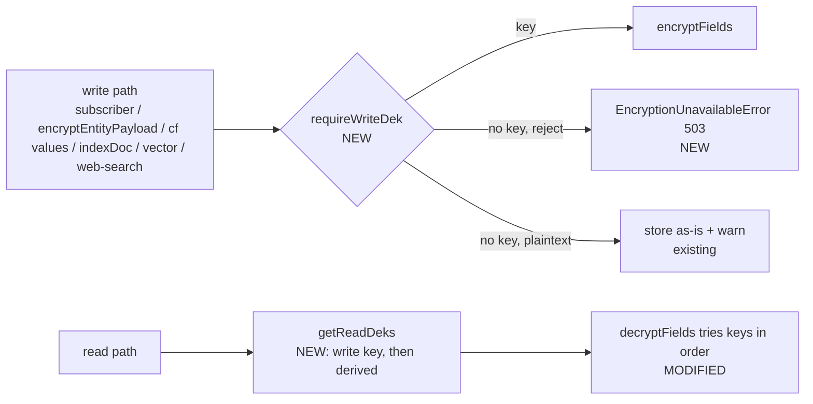

# Tenant data encryption when the KMS is unavailable

Extends: .ai/specs/implemented/2026-05-29-integrations-credentials-encryption-fail-closed.md
Extends: .ai/specs/2026-11-01-7231-compose-encryption-key.md
Extends: .ai/specs/2026-11-06-setup-encryption-preflight.md

## 📝 TLDR

**Key Points:**
- Today, when tenant data encryption is on (the default) but no data key (DEK) is reachable, every module silently writes encrypted-by-contract fields (names, e-mails, addresses, notes, messages…) as **plaintext**, and nothing re-encrypts them later. When Vault and an env fallback key are both configured, an outage instead seals rows with the **fallback-derived key**, which Vault-backed reads never open again: customers become unreadable and admins are locked out after recovery (reproduced live).
- Proposed (future behaviour): one platform policy `OM_ENCRYPTION_UNAVAILABLE_POLICY=reject|plaintext`, **default `reject`** — a write that must be encrypted fails with a typed, translated HTTP 503 instead of landing as plaintext. When Vault is configured the fallback key is **never used to write**; it is tried as a second key on **read**, so existing fallback-sealed data becomes readable again.

**Scope:**
- Policy env var + resolver (`packages/shared/src/lib/encryption/`).
- Dual-key read; the derived key never replaces a Vault key in any cache.
- One enforcement point applied to every fail-open encrypt path (ORM subscriber, `encryptEntityPayload`, custom field values, query-index docs, vector index, web-search secrets).
- Typed `EncryptionUnavailableError` → 503 + `Retry-After` + i18n message.
- Boot banner naming the active key mode; `mercato init` fails fast before any write when no key is usable.
- `.env.example` (+ create-app template sync), user docs, `UPGRADE_NOTES.md`.

**Out of scope (explicit):**
- Extending the cached DEK lifetime during outages (rejected: ignores revocation/rotation).
- One process-wide KMS instance / breaker-aware `getDek` (fast-fail, list latency) — separate task; may run in parallel, see Risks.
- Repair CLI that re-seals fallback-sealed rows under Vault (separate ticket; rows re-seal on their next write).
- Queue retry semantics for `EncryptionUnavailableError` (documented here, fixed with the KMS-unification task).
- Small tickets found during verification: web-search secret DI name bug, credentials 500-vs-503, search-token guard instance, `messages.external_email_hash`, noop-KMS log spam.
- A key-id marker in the ciphertext envelope.

**Decisions (maintainer + task owner, 2026-11-24/25):** env-configurable policy with a secure default; the default install must keep working through the env fallback key (verified true for `yarn dev`, create-app, Railway, CI; Docker fullapp refuses a keyless config); the startup flow must not break; security wins over availability. When Vault is configured and down, apply the policy — never write with the derived key. One spec, three phases (Q1). Dual-key read only, no migration command (Q2). `mercato init` aborts before any write when no key is configured **or** a configured Vault is unreachable (Q3). Reads stay non-blocking (Q4). Queues: document only (Q5). Repair CLI: separate ticket (Q6).

## 📝 Overview

Tenant data encryption is shared infrastructure: 25 modules declare encrypted fields in `<module>/encryption.ts`, and a single MikroORM subscriber plus `TenantDataEncryptionService` seal/open them (`packages/shared/src/lib/encryption/`). Key material comes from `createKmsService()` (`kms.ts:449`): HashiCorp Vault when `VAULT_ADDR`+`VAULT_TOKEN` are set, an env-derived key from `TENANT_DATA_ENCRYPTION_FALLBACK_KEY` (or legacy `TENANT_DATA_ENCRYPTION_KEY`), both (Vault primary, env fallback), or nothing (`NoopKmsService`). This spec defines what happens to writes and reads when the configured source cannot supply a key.

> **Market reference.** Rails Active Record Encryption: encrypt with the current key, decrypt by trying `previous` keys in order (adopted: dual-key read); `support_unencrypted_data` is off by default and must be opted into (adopted: `plaintext` is an explicit opt-in, `reject` the default). Python `MultiFernet` / Laravel `APP_PREVIOUS_KEYS`: same encrypt-with-first, decrypt-with-any rule. AWS Encryption SDK caching keyring: cached data keys have a hard max age (adopted: we do NOT extend the cache lifetime on error). Rejected from those libraries: embedding a key id in the ciphertext — useful but a format change (out of scope; GCM authentication already tells us when a key does not fit).

## 📝 Problem Statement

Verified on `main` @ `2033c3605c` by code reading and a live run on a disposable stack (pg17 + Vault 2.2.2 dev mode, Vault paused with `docker pause`):

| Configuration | Behaviour in an outage today | Evidence |
|---|---|---|
| Vault only, DEK cached | Writes stay encrypted; outages up to 15 min are invisible | live S1.2b |
| Vault only, cold cache / new tenant / cache expired | **Plaintext written** (`subscriber.ts:290`, `tenantDataEncryptionService.ts:620,634`), one throttled warning | live S1.2 |
| Vault + env fallback key | Rows sealed with the derived key; the derived DEK is cached 15 min (`tenantDataEncryptionService.ts:307`) and still used **after** recovery; those rows then read back as raw ciphertext (`:593`), edits fail with `WRONG_KEY` → 500, users whose e-mail was re-sealed cannot log in | live S3 |
| Vault + env fallback key, Vault healthy, tenant has no Vault DEK | Every write uses the derived key permanently (`kms.ts:65-75`, Vault 404 counts as healthy) — the same mixing, without any outage | code |
| Neither Vault nor key (custom deploys, host-run, old `.env`) | `NoopKmsService` for the process lifetime (`kms.ts:455-461`) → everything plaintext | live S2 |

Other fail-open writers: `encryptEntityPayload` (SSO client secrets `ssoConfigService.ts:143,203`, setup `setup-app.ts:454`), `customFieldValues.ts:64,166`, `indexDoc.ts:94` (`entity_indexes.doc`), `packages/search/.../vector-index.service.ts:256`, `agent_orchestrator/lib/webSearch/secretStorage.ts:67`. Already fail-closed (kept): integrations credentials, api_keys session secrets, OAuth DEK pin, custom-entity docs (`customEntityDoc.ts:29-35`), agent artifacts, forms (own master key).

## 📝 Prior spec drift

- `.ai/specs/implemented/2026-05-29-integrations-credentials-encryption-fail-closed.md` → API Contracts: `PUT /api/integrations/:id/credentials` returns 503 when no DEK is available. Live run: `PUT /api/integrations/webhook_custom/credentials` and `…/channel_discord/credentials` returned **500 with an empty body** (unhandled `CredentialsEncryptionUnavailableError`). Tracked as a separate ticket; this spec does not change that route.
- `.ai/specs/2026-11-06-setup-encryption-preflight.md` checks configuration and ciphertext compatibility, not Vault reachability. This spec adds the reachability check to `mercato init` (Phase 2).

## 📝 Proposed Solution

1. **Policy.** `resolveEncryptionUnavailablePolicy(): 'reject' | 'plaintext'` in `toggles.ts`, reading `OM_ENCRYPTION_UNAVAILABLE_POLICY`; unset/blank/invalid → `reject` (invalid values warn once). Only meaningful when `isTenantDataEncryptionEnabled()`.
2. **Read keys vs write key.** A write uses exactly one key: Vault's when Vault is configured, the derived key only when Vault is not configured. `getDek()` is redefined as "the write key" and a new `getReadDeks()` returns the ordered list (write key, then the derived key when one exists). Every direct `getDek()` caller that decrypts moves to `getReadDeks()` (list in Phase 1 Step 3). The derived key is never stored in the write-key cache; `TenantDek` gains an optional `source: 'vault' | 'derived'` so the service can tell them apart, and `DerivedKmsService` memoizes its PBKDF2 result per key id (it currently runs 310k iterations synchronously per call, `kms.ts:153`).
3. **One enforcement point.** `TenantDataEncryptionService.requireWriteDek(...)` is the only place that decides "no key → reject or plaintext". It consults the DEK cache **before** KMS health (today a single tenant's cold miss opens the process-wide Vault breaker and every tenant then skips encryption, even with a cached DEK — the `isEnabled()` early returns at `subscriber.ts:290` and `tenantDataEncryptionService.ts:620` are removed from the write path). Every encrypt path calls it **after** resolving the encrypted fields, so entities with no encrypted fields (tenant, organization, session…) are never blocked. "Would persist plaintext" is judged on what is actually written: on update, only encrypted fields present in the change set; on create, any non-null encrypted field. An encrypted field may pass through without a key only when its value is byte-equal to the value loaded from the database (`__originalEntityData`) — an envelope-*shaped* client value is never trusted (the #2720 forgery guard, `tenantDataEncryptionService.ts:145-157`).
4. **Typed error.** `EncryptionUnavailableError` (code `ENCRYPTION_UNAVAILABLE`) extends `CrudHttpError` with status 503, so existing route error handling returns 503 + translated message.
5. **Secrets always fail closed.** Paths that store secrets (SSO client secrets, web-search secrets; credentials and api_keys already do) reject regardless of the policy: `plaintext` is a tenant-data availability escape hatch, never a way to store secrets in the clear.
6. **Operator signal.** One boot banner per process naming the key mode (`vault` / `vault+env-fallback(read-only)` / `env-key` / `none`) and the policy; `mercato init` aborts before any write when no key is usable.

### Design Decisions

| Decision | Rationale |
|---|---|
| Default `reject` | Maintainer: security first; the default installs always have a key, so only misconfigured or Vault-outage setups are affected — exactly the ones writing plaintext today |
| No derived-key writes when Vault is configured | Otherwise the policy never triggers for Vault+fallback setups, and mixed-key data is the most damaging failure observed |
| Dual-key read instead of a key-id marker | Fixes reading existing mixed data without a ciphertext format change; AES-GCM authentication already rejects a wrong key |
| Reject only when plaintext would be persisted (change set, not entity) | Unrelated edits (e.g. `lastLoginAt` on login) and edits of rows whose encrypted fields are unchanged from the database still save; changed or new encrypted values without a key are rejected |
| Reads stay non-blocking | An outage must not take browsing down; reads return what is stored (as today) |
| Reuse `CrudHttpError` | Existing factory/route handling already translates `body.error` and returns the status |

### Alternatives Considered

| Alternative | Why rejected |
|---|---|
| Extend the cached DEK lifetime while Vault is down | Ignores revocation and rotation; cache already hides outages up to 15 min |
| Third policy value `fallback` (write with derived key during outage) | Needs dual-key read everywhere plus later re-sealing; can be added later as an additive enum value |
| Encrypt-later queue for plaintext rows | Plaintext still lands in the DB, backups and replicas |
| A selector env (`OM_KMS_PROVIDER=vault|env`) | Not needed; the "Vault if configured, else env key" rule is clear and changing it risks existing installs |

## 📝 Delta

### Capability: tenant-data-encryption-unavailable

**ADDED — Policy env var.** WHEN `OM_ENCRYPTION_UNAVAILABLE_POLICY` is unset, blank or invalid THEN the policy is `reject` (invalid → one warning). WHEN it is `plaintext` THEN the pre-change write behaviour applies to tenant data (not to secrets).

**MODIFIED — Write to an encrypted field with no usable key.** Previously: stored as plaintext with a throttled warning. WHEN encryption is enabled, the entity has encrypted fields, at least one would be persisted as non-envelope plaintext, no write key is available AND the policy is `reject` THEN the write fails with `EncryptionUnavailableError` (HTTP 503, `code: ENCRYPTION_UNAVAILABLE`) and the transaction rolls back. Frozen by: `packages/shared/src/lib/encryption/__tests__/subscriber.kms-recovery.test.ts`, `customFieldValues.plaintext-fallback.test.ts`.

**MODIFIED — Vault configured and unavailable, env fallback key present.** Previously: writes sealed with the derived key. WHEN Vault is configured THEN writes never use the derived key; the policy applies. Frozen by: `packages/shared/src/lib/encryption/__tests__/kms.test.ts`.

**MODIFIED — Vault configured and healthy, tenant has no Vault DEK, env fallback key present.** Previously: derived key used for writes indefinitely. THEN a Vault DEK is created and used for writes; older derived-sealed values stay readable via dual-key read. Frozen by: `kms.test.ts` (new characterization case, Phase 3 Step 1).

**ADDED — Dual-key read.** WHEN a value has the envelope shape, does not open with the write key, and a derived key exists THEN the derived key is tried; on success the value is returned decrypted and is re-sealed under the write key on the next write of that row. Plaintext (non-envelope) values are never tried against a second key.

**MODIFIED — Cached DEK during an outage.** Previously: one tenant's cold miss opened the process-wide Vault breaker and every tenant then wrote plaintext, cached DEK or not. THEN a tenant whose write DEK is cached keeps encrypting with it while the breaker is open. Frozen by: `subscriber.kms-recovery.test.ts` (new two-tenant characterization case, Phase 2 Step 1).

**ADDED — Secrets fail closed.** WHEN a secret field (SSO client secret, web-search secret) cannot be encrypted THEN the write fails with `EncryptionUnavailableError` under either policy.

**ADDED — `mercato init` key preflight.** WHEN encryption is enabled and (no Vault config and no env key) OR (Vault configured but unreachable or refusing the token) THEN under `reject` init aborts before any database write with an actionable message and exit status 78 — deliberately reusing the meaning `*encryption-preflight.mjs` / `init-or-migrate` already give it ("encryption configuration rejected"); under `plaintext` it warns and continues.

**UNCHANGED — Reads with no key** return the stored value (ciphertext or plaintext), non-blocking.

## 📝 Architecture

All changes live in `packages/shared/src/lib/encryption/` plus thin call-site edits; no cross-module imports are added.



Takeaway: one decision point for writes, one ordered key list for reads; every other path delegates.

Components:
- `toggles.ts` — `resolveEncryptionUnavailablePolicy()` (NEW).
- `kms.ts` — `KmsService` gains **optional** `getTenantReadDeks?(keyId): Promise<TenantDek[]>` and `describeMode?(): KmsMode` (additive). `HashicorpVaultKmsService` gains `isConfigured()` and `probe()` (GET `/v1/sys/health` with the request timeout; used by init only). Internal `FallbackKmsService`: `getTenantDek`/`createTenantDek` use the primary only when the primary is configured; `getTenantReadDeks` returns `[primary?, derived]`. `createKmsService()` signature unchanged.
- `tenantDataEncryptionService.ts` — `requireWriteDek(keyId, { secret })` (NEW): returns a DEK, or `null` under `plaintext` for non-secrets, or throws. Write cache stores only write-key results. `decryptFields` iterates read keys. `encryptEntityPayload` uses `requireWriteDek`; `isEnabled()` semantics unchanged (BC).
- `subscriber.ts` — `encrypt()` resolves encrypted fields with `ignoreRuntimeHealth: true` first, then calls `requireWriteDek`; the throttled "persist as plaintext" warning stays only on the `plaintext` branch.
- `customFieldValues.ts`, `indexDoc.ts`, `packages/search/.../vector-index.service.ts`, `packages/enterprise/.../webSearch/secretStorage.ts` — replace their own `isEnabled()` skip with `requireWriteDek`. Index doc / vector writes that throw are already refused by the indexer (`indexer.ts:268`); the record is reindexed on its next change or by `query_index` reindex after recovery.
- `packages/shared/src/lib/encryption/encryptionUnavailableError.ts` (NEW file) — `EncryptionUnavailableError extends CrudHttpError` (`CrudHttpError` is marker-detected by `isCrudHttpError`, and the factory's `handleError` already returns its status, `factory.ts:662-667`; no command-bus wrapping was found). Kept separate from `TenantDataEncryptionError` in `aes.ts`.
- `HashicorpVaultKmsService.readVault` returns a status instead of `null`: only a genuine 404 means "no DEK yet"; 401/403 (expired/revoked token) and a wrong `VAULT_KV_PATH` count as **unavailable**, so Phase 3 never mints a Vault DEK on a misconfiguration.
- `packages/core/src/bootstrap.ts` — boot banner (once per process) from `describeMode()` + policy.
- `packages/cli/src/mercato.ts` `init` and `packages/core/src/modules/auth/lib/setup-app.ts` — key preflight before the first write.

Dependency on future work: the separate KMS-unification task changes which `KmsService` instance call sites use and adds breaker checks in `getTenantDek`/`getDek`. It overlaps this spec in `kms.ts`, `tenantDataEncryptionService.ts`, `customFieldValues.ts`, `subscriber.ts`, `indexDoc.ts`; land this spec first or coordinate (see Risks).

## 📝 Data Model

No schema change, no migration. Ciphertext format unchanged (`iv:ct:tag:v1`). Encryption maps unchanged.

## 📝 API Contracts

No new endpoints. Behavioural contract added to every write endpoint that persists an entity with encrypted fields:

```json
HTTP/1.1 503 Service Unavailable
Retry-After: 30
{ "error": "<translated api.errors.encryptionUnavailable>", "code": "ENCRYPTION_UNAVAILABLE" }
```

- `makeCrudRoute` routes: produced by the factory's `CrudHttpError` handling. `Retry-After` (value = `VAULT_RECOVERY_COOLDOWN_MS` in seconds, default 30) is sent **only** when Vault is configured and unavailable; in the `none` mode (misconfiguration) it is omitted so clients do not retry uselessly.
- The 503 response is an ADDITIVE change to every write endpoint of an entity with encrypted fields.
- Custom routes that already map `CrudHttpError` get the same status/body; routes that do not will return their generic 500 (listed per route in Phase 2 Step 6, fixed where the route is in a core write flow).
- OpenAPI: `createCrudOpenApiFactory` documents a 503 response for create/update/delete.
- i18n key `api.errors.encryptionUnavailable` in `apps/mercato/src/i18n/{en,pl,de,es,ko}.json` + `yarn template:sync:fix`.
- Env (new, additive): `OM_ENCRYPTION_UNAVAILABLE_POLICY=reject|plaintext` documented in `apps/mercato/.env.example` and the create-app template.

## 📝 Edge Cases & Failure Scenarios

| Scenario | Behaviour after change | User sees |
|---|---|---|
| Vault-only, outage, key cached | Unchanged: encrypted | Nothing |
| Vault-only, outage, cold / new tenant, `reject` | Write rejected, rollback | 503 "encryption temporarily unavailable" |
| Vault+fallback, outage, `reject` | Write rejected (no derived write) | 503 |
| Vault+fallback, healthy, tenant had only derived data | New Vault DEK created; old rows readable via derived key; re-sealed on next write | Nothing |
| No Vault, no key, `reject` | Boot banner error; writes to encrypted fields rejected; `init` aborts (exit 78) | 503 / clear CLI message |
| Edit unrelated field on a row whose encrypted fields could not be decrypted | Encrypted fields absent from the change set → write allowed; stored ciphertext untouched | Save succeeds |
| Client submits an envelope-shaped string into an encrypted field during an outage | Not byte-equal to the loaded value → rejected (no forgery pass-through, #2720) | 503 |
| Entity with no encrypted fields (tenant, org, session) | Never blocked | Nothing |
| Login during outage | Lookup by `email_hash` needs no DEK; `lastLoginAt`/session writes carry no encrypted field in the change set → allowed. Verified by test (Phase 2 Step 5, 7) | Login works |
| Vault token expired / revoked (401/403) or wrong `VAULT_KV_PATH` | Treated as unavailable (not "no DEK yet"); no new Vault DEK is minted | 503 under `reject` |
| Rolling deploy across Phase 3 | Old replicas may still write with the derived key; new replicas read it via dual-key read | Nothing |
| Rejected write inside a command | `withAtomicFlush` rolls back; events, indexer and custom-field side effects run only after commit, so none fire | 503, no partial side effects |
| Background job writes during outage | Throws; queue retries (~3 s) exhaust → BullMQ failed set / local strategy drops the job (documented, fixed in KMS-unification task) | Missing side effects; retry from failed set |
| Index doc / vector write during outage | Refused (no plaintext index doc); record stale in search until reindex | Search may miss the record until reindex |
| `plaintext` policy chosen | Today's behaviour for tenant data; secrets still rejected | Warning in logs |
| Invalid policy value | Treated as `reject`, warns once | Nothing |

## 📝 Risks & Impact Review

| Risk | Severity | Area | Mitigation | Residual |
|---|---|---|---|---|
| Existing installs without any key start rejecting writes after upgrade | High | custom deploys, old `.env` | Boot banner + init abort explain the remedy; `UPGRADE_NOTES.md`: set `TENANT_DATA_ENCRYPTION_FALLBACK_KEY` or `OM_ENCRYPTION_UNAVAILABLE_POLICY=plaintext` | Operators who ignore notes see 503s |
| Vault+fallback installs relying on derived writes as HA get 503 during long outages | Medium | Vault users | Documented; cached key covers ≤15 min outages | Longer outages reject writes (intended) |
| Reject placed before field lookup blocks every entity | High | all modules | Enforcement only after `getEncryptedFieldNames({ ignoreRuntimeHealth: true })`; test with tenant/org creation | — |
| A missed fail-open path keeps writing plaintext | Medium | modules outside subscriber | Inventory in Problem Statement; grep gate in Phase 2 for `isEnabled()` skips in encrypt paths | Future paths must use `requireWriteDek` (AGENTS.md note) |
| Dual-key read cost | Low | reads | Second attempt only for envelope-shaped values after a GCM failure | — |
| PBKDF2 (310k iterations, sync) blocks the event loop when the derived key is no longer cached as write key | Medium | all requests | Memoize the derived key per key id inside `DerivedKmsService` (Phase 1 Step 2) | — |
| Envelope pass-through reopens forgery (#2720) | High | all encrypted entities | Pass through only values byte-equal to the loaded original; test with a forged envelope | — |
| Phase 3 mints a Vault DEK on a misconfiguration (403, wrong KV path), orphaning Vault-sealed rows | High | Vault installs | `readVault` returns a status; only a real 404 creates a key; 401/403 → unavailable | Expired-token installs that silently ran on the derived key now get 503 (documented in `UPGRADE_NOTES.md`) |
| Rotation/rehash CLIs are single-key | Medium | ops | Phase 1 Step 3 makes `rotate-encryption-key`, `rotate-custom-entity-documents`, `rehash-lookup-columns` dual-key aware or documents the limitation | — |
| Unit tests without a key fail under default `reject` (encryption on by default) | Medium | CI | Phase 2 runs the full suite; tests that need plaintext set the policy explicitly or inject a KMS | — |
| Merge conflicts with KMS-unification task | Medium | shared/encryption | Land this spec first; unification puts its process getter in a new file | — |
| Queue jobs lost (local strategy) during outage | Medium | workers | Documented; follow-up in unification task | Possible until then |

## 📝 Migration & Backward Compatibility

- **Contract surfaces (per `BACKWARD_COMPATIBILITY.md`):** `KmsService` and `TenantDek` gain optional members only (ADDITIVE). `createKmsService()`, `resolveEncryptionMode()`, `TenantDataEncryptionService.isEnabled()` keep their signatures and meaning. New env var (ADDITIVE). Every write endpoint of an entity with encrypted fields may return 503 (ADDITIVE response). No event IDs, DI keys, ACL features, routes or schema change.
- **Behaviour change:** the default for "encryption on, no usable key" flips from silent plaintext to `reject`. This is not an Emergency Security Exception (the old behaviour stays available via `OM_ENCRYPTION_UNAVAILABLE_POLICY=plaintext`, which is the bridge); it follows the ordinary protocol with that opt-out as the bridge, a dated entry appended to `BACKWARD_COMPATIBILITY.md`, and an `UPGRADE_NOTES.md` entry stating who is affected (installs with no key; Vault installs during outages; Vault installs with an expired token that silently ran on the derived key) and what to do (set `TENANT_DATA_ENCRYPTION_FALLBACK_KEY`, fix Vault, or opt into `plaintext`). Maintainer (Piotr Karwatka) chose the secure default on 2026-11-24; the PR carries the `security` label and needs his named approval.
- **Data:** no migration. Fallback-sealed rows become readable in Phase 1 and are re-sealed under the write key on their next write; a bulk repair CLI is a separate ticket.
- **Rollback:** revert per phase; Phase 3 rollback restores derived writes (data written meanwhile stays readable because Phase 1 remains).

## 📋 Phasing

- **Phase 1 — Dual-key read.** No behaviour change for healthy setups; existing fallback-sealed rows become readable; derived key never cached as write key. Independently shippable.
- **Phase 2 — Policy + enforcement on all paths + 503 + init preflight + docs.** Default `reject`. Vault+fallback outages still write with the derived key in this phase (now readable thanks to Phase 1).
- **Phase 3 — No derived-key writes when Vault is configured** (+ upgrade note). After this phase a Vault outage always goes through the policy.

## 📋 Implementation Plan

### Phase 1 — Dual-key read
1. Characterization tests: current single-key decrypt (wrong key → ciphertext returned, `tenantDataEncryptionService.ts:593`); derived DEK cached after an outage (`:307`).
2. Add optional `getTenantReadDeks` to `KmsService` and optional `source` to `TenantDek`; implement in `FallbackKmsService` (`[primary DEK?, derived DEK]`), `DerivedKmsService` (memoized PBKDF2 per key id) and `HashicorpVaultKmsService` (single key).
3. `TenantDataEncryptionService`: `getDek` = write key; new `getReadDeks`; read-key cache separate from write-key cache; `decryptFields` and `decryptEntityPayload` iterate read keys (second key only for envelope-shaped values); `assertNotSealedUnderAnotherKey` accepts any read key. Move every direct decrypting `getDek()` caller to `getReadDeks()`: `customFieldValues.ts:66`, `customEntityDoc.ts:32`, `audit_logs/services/actionLogService.ts`, `dashboards/services/widgetDataService.ts`, `agent_orchestrator/lib/webSearch/secretStorage.ts`, `entities/cli.ts`, `rotate-custom-entity-documents.ts`, `rehash-lookup-columns.ts`, `auth/cli.ts` (re-grep `getDek(` at implementation time).
4. Do not cache a derived DEK in the write-key cache when the primary is configured.
5. Tests: Vault-sealed and derived-sealed values both read back; editing a derived-sealed row succeeds and re-seals with the current write key; healthy single-key setups unchanged.

### Phase 2 — Policy and enforcement
1. Characterization tests freezing today's plaintext-on-no-key behaviour (subscriber, `encryptEntityPayload`, custom field values), including the two-tenant case: tenant B's cold miss opens the breaker and tenant A (DEK cached) then writes plaintext.
2. `resolveEncryptionUnavailablePolicy()` in `toggles.ts` + tests (unset/blank/invalid → `reject`).
3. `EncryptionUnavailableError` (extends `CrudHttpError`, 503, code) + factory `Retry-After` + i18n key in all app locales + template sync.
4. `requireWriteDek` in `TenantDataEncryptionService` (cache before health); remove the `isEnabled()` early return from the write path of `encryptEntityPayload`; tests for both policies, the secret flag, and the two-tenant cached-DEK case (tenant A keeps encrypting).
5. Subscriber `encrypt()`: remove the `isEnabled()` early return; field lookup first, then `requireWriteDek`; "would persist plaintext" judged on the change set (update) / non-null fields (create); pass-through only for values byte-equal to `__originalEntityData`. Tests: tenant/org creation never blocked; unrelated edit (`lastLoginAt`) allowed; forged envelope rejected; new plaintext rejected with rollback and no post-commit side effects.
6. Remaining paths: `customFieldValues.ts`, `indexDoc.ts`, vector index, web-search secrets (secret flag), SSO secrets (secret flag); audit custom write routes in core flows for `CrudHttpError` mapping; grep gate proving no encrypt path skips on `isEnabled()` alone.
7. Integration test with a fake Vault HTTP fixture (toggle: healthy / hanging / 5xx / 403), real Postgres, through a command-based `makeCrudRoute` (customers people): create customer during outage → 503 with `code: ENCRYPTION_UNAVAILABLE` and no row; recovery → 201 ciphertext; login during outage works; tenant creation during outage works.
8. Boot banner (`describeMode()` + policy, once per process); replace the misleading "resumes automatically" text for the `none` mode.
9. `mercato init` / `setup-app.ts` preflight: no key config → abort; Vault configured → `probe()`; under `reject` exit 78 before any write, under `plaintext` warn. Tests for both.
10. Docs: `.env.example` (app + template), `apps/docs/docs/user-guide/encryption.mdx` (modes table, policy, outage behaviour, queue caveat), `UPGRADE_NOTES.md`, `starters/docker/encryption-migration.md` cross-link; root/`packages/shared/AGENTS.md` one-line rule "new encrypt paths MUST call `requireWriteDek`".

### Phase 3 — No derived-key writes when Vault is configured
1. Characterization test: Vault+fallback outage writes with derived key; Vault healthy + tenant without Vault DEK writes with derived key.
2. `HashicorpVaultKmsService.readVault` returns a status; `FallbackKmsService.getTenantDek`/`createTenantDek`: primary only when `primary.isConfigured()`; only a genuine 404 → `createTenantDek` on Vault (CAS path unchanged); 401/403/other → unavailable; derived stays in `getTenantReadDeks`.
3. Tests: outage under `reject` → 503; outage under `plaintext` → plaintext (not derived); 403 → unavailable, no key minted; tenant with old derived data gets a Vault DEK, old rows readable, re-sealed on next write; `system:*` keys (onboarding) follow the same rule; `rotate-encryption-key` run on mixed-key data.
4. `UPGRADE_NOTES.md` entry for Vault+fallback installs; boot banner shows `vault+env-fallback(read-only)`.
5. Re-run the live QA scenarios (S1–S6 from the verification report) on a disposable stack; attach evidence to the PR.

## Final Compliance Report — 2026-11-25

### AGENTS.md Files Reviewed
- `AGENTS.md` (root), `packages/shared/AGENTS.md`, `packages/core/AGENTS.md` (Encryption, API Routes), `packages/create-app/AGENTS.md` (template sync), `.ai/specs/AGENTS.md`, `BACKWARD_COMPATIBILITY.md`.

### Compliance Matrix

| Rule Source | Rule | Status | Notes |
|---|---|---|---|
| root AGENTS.md | Never bypass encryption helpers / hand-roll crypto | Compliant | All changes inside `TenantDataEncryptionService` / `kms.ts` |
| root AGENTS.md | Never expose cross-tenant data | Compliant | Key ids unchanged (tenant / `system:<entityId>`); dual-key read uses the same key id |
| root AGENTS.md | No hard-coded user-facing strings | Compliant | `api.errors.encryptionUnavailable` in all locales; CLI messages are operator output |
| root AGENTS.md | `apps/mercato/src/i18n` + `.env.example` edits mirrored to create-app | Compliant | Phase 2 Steps 3, 10 |
| BACKWARD_COMPATIBILITY.md | Types/signatures additive only | Compliant | `KmsService` gains optional methods; `createKmsService`, `isEnabled()`, `resolveEncryptionMode()` unchanged |
| BACKWARD_COMPATIBILITY.md | Behaviour change documented | Compliant | Migration & BC section; dated `BACKWARD_COMPATIBILITY.md` entry + `UPGRADE_NOTES.md` in Phases 2 and 3; `plaintext` opt-out is the bridge |
| BACKWARD_COMPATIBILITY.md | DB schema | N/A | No schema change |
| packages/core/AGENTS.md | Use `findWithDecryption`; never bypass `TenantDataEncryptionService` | Compliant | Reads unchanged in shape |
| packages/shared/AGENTS.md | No domain imports in shared | Compliant | Error + policy live in shared; call sites in modules import shared |
| packages/shared/AGENTS.md | Use shared CRUD error helpers | Compliant | `EncryptionUnavailableError extends CrudHttpError` |
| root AGENTS.md | Integration coverage for affected API paths | Compliant | Phase 2 Step 7 (fake Vault fixture) |
| root AGENTS.md | Structured logging | Compliant | `createLogger`, no secrets logged |

### Internal Consistency Check
- Phase order keeps the app working and never widens plaintext: Phase 2 rejects what was plaintext; Phase 3 removes derived writes only after Phase 1 made derived data readable.
- Out-of-scope items are referenced, not designed.

## Changelog
- 2026-11-25: Skeleton with Open Questions Q1–Q6; answers recorded (one spec/three phases, dual-key read only, init aborts for missing key and unreachable Vault, reads non-blocking, queues documented, repair CLI separate). Full design, phases and compliance report written.
- 2026-11-25: Revised after fresh-context review: change-set-based reject rule, byte-equal pass-through (no #2720 regression), full list of direct `getDek` readers, cache-before-health for writes, PBKDF2 memoization + `TenantDek.source`, `readVault` status (no key minted on 401/403/wrong path), `Retry-After` only for Vault outages, camelCase i18n key, Migration & BC section, line-reference fixes.

### Review — 2026-11-25
- **Reviewer**: Agent (fresh context, Opus 5.5)
- **Scope cohesion**: KEEP — one seam (key selection in `FallbackKmsService` / `TenantDataEncryptionService`); Phase 3 unsafe without Phase 1; one PR per phase.
- **Security**: 4 High findings (change-set rule, forgery pass-through, missed read paths, process-wide breaker) — addressed in this revision.
- **Performance**: PBKDF2 per call — addressed (memoization).
- **Cache**: derived key in write cache — addressed (Phase 1 Step 4, `source`).
- **Commands**: rollback + post-commit side effects documented (Edge Cases).
- **Risks**: expired token, rolling deploy, rotation CLIs added.
- **Verdict**: Approved after revision (re-review recommended at implementation PR).
