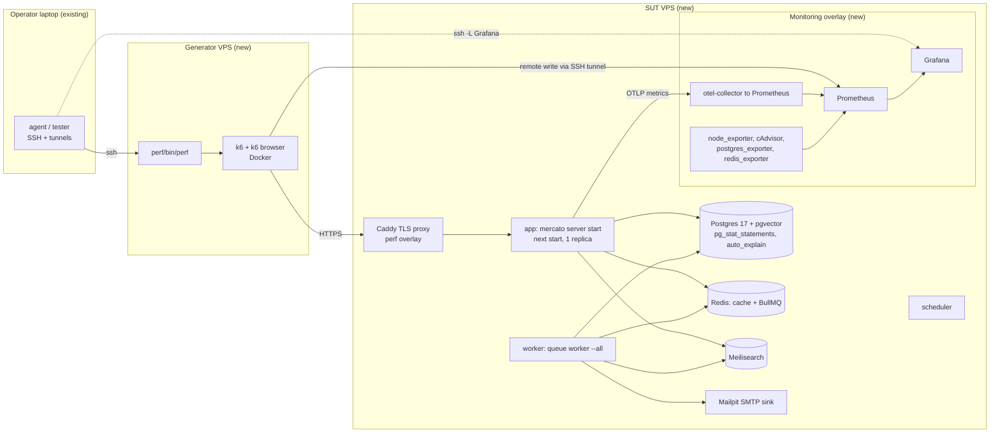

# CRM Performance Test Plan

Extends: `.ai/specs/2026-06-03-enterprise-performance-stability-hardening.md` (its open items, chiefly the 2026-08 benchmark findings, are re-measured here on a reproducible harness)
Related: `.ai/specs/2026-05-24-crud-api-performance-quick-wins.md`; open PR #10145 (`.ai/specs/2026-11-08-backend-request-cost-benchmark.md` on that branch, not on `main`)

**Status:** draft — plan agreed, tooling not yet built
**Owner:** core / customers
**Date:** 2026-11-26

## TLDR

**Key points:**
- This is a repeatable, agent-executable performance test program for the CRM (the `customers` module) and the modules every CRM request also exercises. The CRM is early-stage and has no SLA, so the goal is **exploration and a baseline**, not pass/fail: find the saturation point, rank the bottlenecks, and keep comparable numbers over time.
- It is delivered as a `perf/` directory and one additive CLI command (`mercato customers seed-perf`). The `perf/` directory holds:
  - k6 protocol and browser scenarios,
  - a compose overlay for the system under test,
  - a Prometheus + Grafana monitoring stack,
  - an orchestration CLI,
  - a report generator.
- A team member, or an agent they launch, runs it phase by phase from `perf/README.md` (the runbook). Phase 2 is a local validation on a laptop, run by the plan's authors before anything goes to a VPS.

**Scope:**
- CRM lists, search and filtering on large data.
- The customer 360 cards (person and company).
- Writes: people, companies, interactions, notes, tasks, deals and stage moves.
- The deals pipeline, its KPI/aggregate endpoints and the dashboard widgets.
- Login and sessions.
- Global search.
- Browser page-load metrics (Web Vitals).
- Bulk deal owner and stage updates.

**Concerns:**
- **Dataset fidelity.** Encryption, entity indexes and search tokens must exist the way production writes them, otherwise query plans lie.
- **Comparability across rounds.** Results only compare if the same dataset snapshot, configuration and generator location are used every time.

## Overview

The audience is the team that develops the CRM and the platform. Each round answers three questions:
1. What does the current build sustain on a defined machine?
2. Where does it break first, and why?
3. Did the last change make it better or worse?

Industry reference points are recorded but never used to fail a run:
- p95 < 500 ms for simple reads,
- error rate < 1%,
- under ~100 ms feels instant, up to ~1 s feels smooth,
- Core Web Vitals "good": LCP < 2.5 s, INP < 200 ms, CLS < 0.1.

> **Market reference.** The method follows the usual k6 / Grafana practice: a closed workload model with think time for user-driven apps, ramping steps to find the knee, a separate interference test, a stress test with recovery, and a soak test. Two things are adopted from the earlier 2026-08 benchmark described in the extended spec: protocol and browser journeys run side by side, and the data is seeded at production-like volume. We reject an open arrival-rate model for the main test. CRM traffic is bounded by a small number of human users, so a fixed request rate would overstate concurrency. The baseline uses a single sequential VU (`constant-vus: 1`, no think time). A fixed-rate executor (`constant-arrival-rate`) is used only for the heavy-operation injector in the interference test, where a fixed rate is the point.

### Goals

- Per-endpoint and per-journey latency distributions (p50/p95/p99), throughput and error rate on a fixed dataset.
- The user count at which degradation starts (the saturation point), and how the system behaves past it and after recovery.
- The impact of heavy operations (aggregates, maps, bulk updates, encrypted-column sorts) on ordinary users working at the same time.
- Resource attribution for every run: app, worker and Postgres CPU and memory, the DB connection pool, locks, slow statements with plans, the Node event loop and heap, and queue depth.
- A ranked list of bottlenecks with `file:line` evidence and fix recommendations after every round.

### Non-goals

- Verifying an SLA or business requirement. Thresholds are reference lines only.
- Production data. Everything is synthetic and deterministic.
- Fixing the bottlenecks inside this plan. Fixes ship as separate PRs and are then re-measured with the same harness.
- Filing GitHub issues automatically. The agent files issues only when a human asks it to.
- Horizontal scale-out (more than one app replica). It is listed under optional experiments.
- CSV import (`sync_excel`) and CSV export. They are deferred by decision and are easy to add later as heavy journeys.

## Problem Statement

1. **No repeatable load harness exists in the repo.**
   - The 2026-08 benchmark found a sharp knee near ~50 HTTP req/s (p95 3.2 s, p99 14.9 s) while the app sat at ~40% CPU and Postgres at ~25%. Its scripts are not in the repository.
   - Open PR #10145 measures the SQL cost of single requests (`pg_stat_statements`, five company scenarios), but it explicitly leaves throughput and load testing out of scope.
   - Nobody can reproduce or compare load numbers today.
2. **The existing fast seeder does not produce production-shaped data.** `customers seed-stresstest` (`packages/core/src/modules/customers/cli.ts:1691`) bulk-writes through Kysely, which bypasses the ORM encryption subscriber (`packages/shared/src/lib/encryption/subscriber.ts:148`). As a result:
   - It writes plaintext, although `TENANT_DATA_ENCRYPTION` defaults to on.
   - It creates no `search_tokens`.
   - It writes legacy `customer_activities` instead of `customer_interactions`.
   - It sets no pipeline or stage on deals, and no owners, addresses or tags.
   - Every row lands in one organization.

   Query plans and code paths on such data differ from production. In particular, encrypted-column sorting and token search would never be exercised.
3. **Generating 1M records through the HTTP API takes 6–14 h** at 20–50 writes/s, and it must be repeated whenever the dataset changes.
4. **CRM traffic touches far more than `customers`** (see [System under test](#system-under-test)). A plan that only looks at `customers` code would misattribute cost.

## System under test

The default `apps/mercato` module set is tested **exactly as shipped**, including the demo `example` module. That module adds an interceptor on `GET /api/customers/people` and enrichers on people, companies and deals. This is the out-of-the-box install, and the environment report lists the enabled modules for every run.

| Layer | Modules and code exercised by CRM traffic |
|---|---|
| Every API request | `auth`: session re-validated against the DB on every request, RBAC features (`packages/shared/src/lib/auth/server.ts:425`, `:508`). `directory`: organization scope. `query_index`: `HybridQueryEngine`, `entity_indexes`, `search_tokens`. `entities`: custom field definitions and values. Tenant encryption (decryption on read). `cache` (Redis). `audit_logs`: `access_logs`, asynchronous by default. |
| CRM writes | `customers` commands, each with an undo snapshot and an `action_logs` row (`packages/shared/src/lib/commands/command-bus.ts`, execute path around `:1005`/`:1073`). In-request `query_index.upsert_one` (`packages/core/src/modules/query_index/subscribers/upsert_one.ts`). Deferred search-token rebuild and fulltext/vector enqueue. Wildcard persistent subscribers: `workflows`, `business_rules`, `webhooks` outbound dispatch. `notifications` on deal won/lost. `customer_accounts` and `sales` subscribers. |
| Response enrichment | `customer_accounts`, `warranty_claims`, `example`, `example_customers_sync`, and the `customers` enrichers (`packages/core/src/modules/customers/data/enrichers.ts`). |
| Backend shell, on every page view | `auth` nav and feature checks, `notifications`, `messages`, `progress`, `directory` organization switcher, `ai_assistant` pending actions, the `staff` timer, the `events` SSE stream. |
| 360 card tabs | `attachments`, `audit_logs` (changelog), `customer_groups`, `workflows`, `documents`, `eudr`, `warranty_claims`, `customer_accounts`, `communication_channels`, `staff` (assignable owners), `dictionaries`, `perspectives`. |
| Pipeline and bulk | `currencies` (summary exchange rates), `progress` and the queue (`bulk-update-owner`/`bulk-update-stage`, `packages/core/src/modules/customers/lib/bulkDeals.ts`). |
| Global search | The `search` package (`/api/search/search/global`): fulltext through Meilisearch, plus tokens. Vector search is disabled (see [External dependencies](#external-dependencies-mocked-or-disabled)). |

The customer 360 card has **no order-history tab**. `sales` is reached only through quote lookups and delete reconciliation, so `sales` orders are out of scope. There is also **no bulk tagging endpoint**. Tagging is measured as the UI performs it, one `tags/assign` call per record.

## Proposed Solution

### Design decisions

| Decision | Rationale |
|---|---|
| **k6** for protocol load, **k6 browser** (`k6/browser`) for page-level Web Vitals | One tool, one Docker image (`grafana/k6:<pinned>-with-browser`), one metrics pipeline. The browser API mirrors Playwright (`page.goto`, `page.locator`), so the team's Playwright knowledge carries over. Playwright itself cannot generate realistic concurrent load. |
| **Generator on a dedicated VPS in the same datacenter/region** as the system under test. The laptop only drives it over SSH. | Removes home-network RTT and jitter from every sample, and keeps runs from different testers comparable. Every run still records generator RTT, measured as calibration requests to `/api/healthz`. |
| **Hybrid seeding** through a new additive CLI command, `mercato customers seed-perf` | Ships in the production image and has the full DI container. It encrypts each row with `TenantDataEncryptionService.encryptEntityPayload` (`packages/shared/src/lib/encryption/tenantDataEncryptionService.ts:613`) before Kysely bulk inserts, then builds indexes through the existing `query_index reindex` and `search reindex` commands. It takes minutes to hours where the API path takes days, and it follows the `seed-stresstest` precedent. |
| **Dataset tiers S / M / L** (50k / 250k / 1M customer entities) | S runs locally for validation. M and L run on the VPS, so the report shows how latency scales with volume. The 2026-08 run suggested the knee does not depend on volume, and this re-tests that claim. |
| **Snapshot via a Postgres template database**, restored before every load phase | Test writes mutate data, so every run must start from an identical state. `CREATE DATABASE … TEMPLATE … STRATEGY FILE_COPY` is much faster than `pg_restore` at the L tier. The default strategy on PG15+ is `WAL_LOG`, so `FILE_COPY` must be named explicitly. The Meilisearch data volume is copied alongside while Meilisearch is stopped, and Redis is flushed. See [Snapshot and restore](#snapshot-and-restore). |
| **Encryption ON** (production default) | Exercises the decrypt-on-read and encrypted-sort paths. An encryption-off comparison is an optional experiment. |
| **Exactly the default module set** | Agreed scope: measure what installs out of the box. |
| **Queue `async` (BullMQ)**, workers and scheduler as **separate containers** | The production recommendation (`packages/queue/AGENTS.md`). The local file queue takes a global lock on every enqueue and would distort write latency. |
| **Prometheus + Grafana** as a compose overlay, plus a **Markdown report per run** | Grafana is for watching a run live. The report is for comparing runs and is generated without the UI. |
| **TLS on the SUT** through a small Caddy service (`tls`) in `perf/sut/compose.perf.yml`: `tls internal` (self-signed) by default, or a real domain through `PERF_TLS_DOMAIN`. The stock Traefik overlay is not used. It requires Let's Encrypt, and it adds a customer-domain forward-auth request per request on its catch-all router. | In production mode the login cookies are `Secure` (`packages/core/src/modules/auth/api/login.ts:317`), so Chromium drops them on a non-localhost `http://` origin and browser VUs could not log in. Browser VUs use `ignoreHTTPSErrors` with a self-signed certificate. Protocol VUs authenticate with `Authorization: Bearer <token>` (`packages/shared/src/lib/auth/server.ts:438-441`), not cookies. |
| **Reference thresholds are non-failing.** Only safety aborts stop a run. | Exploratory program. Safety aborts: error rate > 20% for 2 min, or p95 > 30 s. |
| Findings go into a **ranked report**, not issues | Agreed: issues and fix PRs only on human request. |

### Alternatives considered

| Alternative | Why rejected |
|---|---|
| Locust / JMeter | k6 scripts are JavaScript and sit naturally in a TS monorepo. k6 has built-in browser Web Vitals and native Prometheus remote write. JMeter's GUI workflow does not suit agent execution. |
| Seeding only through the HTTP API | Most faithful write path, but 6–14 h per 1M entities. API writes are still measured: the write journeys keep creating real history during every run. |
| Plain SQL seeding with encryption off | Fastest, but it measures a configuration no default install uses. |
| A seeder script in `perf/` with a derived image | Keeps product code untouched, but bootstrapping the app's generated registries and DI outside the CLI is fragile. A module CLI command is the established pattern. |
| A reverse proxy for server-side timing | Unnecessary once the generator sits in the same datacenter (sub-millisecond RTT). The app does not emit `Server-Timing`. Caddy is present only for TLS. |
| `xk6-sse` for SSE connections in protocol VUs | Needs a custom k6 build. The plan keeps the stock pinned image, and browser VUs hold real SSE connections instead. |
| Extending `seed-stresstest` in place | Its users and its plaintext/legacy semantics would change. A new command is additive and leaves `seed-stresstest` alone. |

## Architecture



Takeaway: the system under test is the stock `docker-compose.fullapp.yml` stack plus two new overlays (`perf/sut` with the Caddy TLS proxy, worker, scheduler and Mailpit; `perf/monitoring`). All load comes from a separate machine. `perf/bin/perf` runs on the generator and drives SUT-side actions (up, seed, snapshot, restore, metrics) over SSH, using `SUT_SSH` from `target.local.env`. Prometheus is the single sink for k6, host, container, Postgres, Redis and app runtime metrics, and the report generator reads from it.

### `perf/` layout

```
perf/
  README.md                      runbook: prerequisites, phase-by-phase commands, exit criteria, troubleshooting
  AGENTS.md                      short agent rules (link to README; serial execution; safety rules)
  bin/perf                       entrypoint: up | down | users | seed | snapshot | restore | run <phase> | report | compare
  config/
    target.example.env           SUT host, generator host, ports, credentials file path (copy to target.local.env, gitignored)
    sut.example.env              app/env overrides for the SUT (secrets live in sut.local.env, gitignored)
    hardware.md                  machine profiles and the derived settings table (Phase 0)
    tiers.json                   S/M/L volumes and distributions (perf-v1 profile)
    workload.json                journey mix, think time, step/stress/soak profiles
  sut/compose.perf.yml           overlay on docker-compose.fullapp.yml (queue async, worker/scheduler, Postgres flags, Mailpit)
  monitoring/
    compose.monitoring.yml       prometheus, grafana, node-exporter, cadvisor, postgres-exporter, redis-exporter, otel-collector
    prometheus.yml               scrape configs, remote-write receiver enabled
    otel-collector.yml           OTLP in, Prometheus exporter out
    grafana/provisioning/...     datasource + dashboards (Node Exporter Full, cAdvisor, PostgreSQL, Redis, k6, OM runtime)
                                 queue depth: redis_exporter key checks on the BullMQ wait/active/delayed/failed keys
                                 (the app emits no queue-depth metric)
  generator/compose.generator.yml  pinned k6 image, mounts perf/k6 and perf/data
  k6/
    lib/        auth.js (login once per VU, token reuse, refresh), catalog.js (SharedArray of seeded ids/terms),
                bundles.js (per-page request bundles, http.batch), think.js (seeded 5–30 s), tags.js, checks.js
    journeys/   read-*.js, write-*.js, heavy-*.js, browser-*.js
    scenarios/  smoke.js, baseline.js, mixed.js (step | stress | soak profiles), interference.js
  scripts/
    provision-users.mjs          creates the staff account pool + staff team members, writes credentials to the gitignored pool file
    calibrate.mjs                RTT/health calibration, written into run metadata
    pg-snapshot.mjs              pg_stat_statements reset/snapshot, top-N, scripted EXPLAIN (ANALYZE, BUFFERS) for SELECTs
    report.mjs                   k6 summary JSON + Prometheus range queries + pg snapshot → report.md
    compare.mjs                  two run folders → delta table
  data/                          generated catalogs per tier (gitignored)
  results/
    README.md
    <YYYY-MM-DD>-<tier>-<phase>-<label>/   report.md + run.json committed; raw/ gitignored
```

### SUT configuration (`perf/sut/compose.perf.yml`)

Overrides on top of `docker-compose.fullapp.yml`. Each one is documented in `sut.example.env` together with its reason.

| Setting | Value | Why |
|---|---|---|
| `QUEUE_STRATEGY` / `QUEUE_REDIS_URL` | `async` / redis | Production queue. The compose default is `local`. |
| `AUTO_SPAWN_WORKERS`, `AUTO_SPAWN_SCHEDULER` | `false` | Workers and the scheduler run as their own `worker` and `scheduler` services, so their CPU is attributable. |
| `OM_EVENTS_EXTERNAL_WORKER` | `true` | Required when workers run outside the app process (`apps/mercato/.env.example:233-246`). |
| `TENANT_DATA_ENCRYPTION`, `TENANT_DATA_ENCRYPTION_FALLBACK_KEY`, `LOOKUP_HASH_PEPPER` | on, keys generated once with `openssl rand -hex 32` into `sut.local.env` | Production default without Vault (`apps/mercato/.env.example:596-612`). The keys are part of the snapshot: a snapshot cannot be read without the keys it was seeded with. They are stored outside the repo next to the snapshot manifest, and `snapshot` refuses to run if they are missing. |
| Default secrets: `JWT_SECRET`, `OM_INIT_SUPERADMIN_PASSWORD`, the Postgres password, the Meilisearch master key | **mandatory overrides** in `sut.local.env` | The compose defaults (`password`, `postgres`, `meilisearch-dev-key`) must never reach a VPS. `perf/bin/perf up` refuses to start if any of them is unset or still equals the compose default. |
| `opencode`, `mcp`, `documents-collab` services | disabled in the overlay (assigned to an unused profile) | They are not CRM traffic but take CPU, RAM and DB connections. The environment report lists the running services. |
| Redis `maxmemory` | from the hardware table (compose default 512 MB, `noeviction`) | Cache and BullMQ share one Redis. With `noeviction`, a full Redis fails writes, so it is sized for the soak test and its memory is watched. |
| `OM_DISABLE_VECTOR_SEARCH_AUTOINDEXING` | `true` | Embeddings would call an external LLM provider. |
| `RATE_LIMIT_LOGIN_IP_POINTS` | raised (e.g. 10000) | All VUs log in from one generator IP. Other rate limits stay at defaults, and no customers route declares one. |
| `DEMO_MODE` | `false` | Not part of a real install. |
| `NEW_RELIC_LICENSE_KEY`, AI/embedding keys, email providers | unset | No external calls (see below). |
| `SMTP_*` | Mailpit | Any email path, such as notification delivery, runs end to end into a local sink. |
| `OTEL_EXPORTER_OTLP_ENDPOINT`, `TELEMETRY_BACKEND=otlp`, `TELEMETRY_SAMPLING_RATIO` | the stock `otel-collector` service (profile `telemetry`), with its config overridden to export to Prometheus instead of its debug exporter | Brings the `om.db.pool.*` metrics (connections, pending requests, wait time; `packages/shared/src/lib/db/mikro.ts:245-291`), event-loop utilization and heap into Prometheus. |
| `DB_POOL_MAX`, `NODE_OPTIONS`, Postgres memory settings | from the Phase 0 derived-settings table | Sized to the confirmed hardware and recorded in `run.json`. |
| Postgres flags | `shared_preload_libraries=pg_stat_statements,auto_explain`, `track_io_timing=on`, `log_min_duration_statement=500`, `auto_explain.log_min_duration=1000`, `auto_explain.log_analyze=on`, `log_lock_waits=on` | Slow-statement evidence and plans. |
| Everything else | compose defaults, including `CACHE_STRATEGY=redis` and `ENABLE_CRUD_API_CACHE=true` | Measure what ships, and record the effective env hash per run. |

**Network exposure.** Published Docker ports bypass host firewalls such as `ufw`, because Docker writes its own iptables rules. So the access rules are enforced in one of three ways: the provider's cloud firewall (preferred), `DOCKER-USER` iptables rules, or binding the published ports to the private network IP shared with the generator. Only the HTTPS port is reachable, and only from the generator.
- Grafana and Prometheus bind to `127.0.0.1`.
- The operator reaches Grafana through `ssh -L`.
- k6 remote write goes through an SSH tunnel from the generator, because the Prometheus remote-write receiver has no authentication.

Phase 3 exit criterion: a port probe from a third host reaches nothing.

### External dependencies (mocked or disabled)

| Integration | Treatment | Verified by |
|---|---|---|
| Email (system mail, notification delivery, `people/[id]/emails`) | SMTP to Mailpit. The send-email endpoint is not part of the journeys. | Mailpit message count in the report |
| LLM / embeddings / AI assistant | No keys. Vector autoindexing is off, and global search uses fulltext + tokens. | App logs show no provider calls |
| Outbound webhooks | No subscriptions configured. The wildcard dispatcher still runs and is measured. | Webhook delivery table empty |
| Meilisearch | Real and local (it is part of the product, not an external integration) | Index stats in the report |
| Telemetry vendors | Local collector only | — |

### Run metadata (`run.json`)

Every run records:
- git SHA and image digest,
- database migration head (the last applied migration per module),
- dataset anchor date and dataset age (run date − anchor),
- enabled module list and effective env (secrets redacted, hash of the full set),
- tier, profile, seed and dataset manifest checksum,
- hardware profile, as reported by `nproc`, `free` and disk type,
- k6 version, generator location and RTT calibration,
- start and end timestamps (the report generator uses them to query Prometheus),
- the phase parameters.

Two runs are comparable only when tier, profile, hardware profile, generator location and module set match. `compare.mjs` refuses otherwise unless forced. Two further differences are allowed, but flagged in the comparison:
- **Migration head.** This is expected when a fix PR adds indexes.
- **Dataset age over 7 days.** Several endpoints are time-relative, so their result sets drift with the wall clock even on an identical snapshot:
  - stuck deals cut off at `Date.now()` (`packages/core/src/modules/customers/lib/stuckDeals.ts:50`),
  - `needsAttention` uses `CURRENT_DATE`,
  - the dashboard widgets, planned-interaction windows, summary ranges and calendar.

  Time-relative tags are marked "not comparable" when the age differs by more than 7 days. The remedy is to re-seed with a new anchor.

## Data Models

There are no application schema changes.
- The new seeder writes the existing `customers` tables directly, plus `custom_field_values` (owned by `entities`).
- `query_index` and `search` state is built only by invoking their own commands and APIs.
- Users and staff team members are not written by the seeder. `provision-users.mjs` creates them through the public APIs beforehand, and the seeder reads their ids from `--owners-file`.

### Dataset profile `perf-v1`

| Item | S | M | L | Shape |
|---|---|---|---|---|
| Customer entities | 50k | 250k | 1M | 75% people / 25% companies, ~3 people per company, ~10% of people without a company |
| Interactions (`customer_interactions`) | ~500k | ~2.5M | ~10M | Power law per entity: 60% have 1–5, 30% have 6–20, 9% have 21–100, 1% have 100–1000. Types: call/email/meeting/note/task. ~70% done, ~30% planned (dates spread across −3 y … +3 months). |
| Deals | ~25k | ~125k | ~500k | ~0.5 per entity. 2 pipelines × 6 stages. Status open/win/lost per stage, values in 3 currencies, owners from the staff pool, ~3 stage transitions each (`customer_deal_stage_transitions`), ~15% "stuck" (no transition beyond the threshold). |
| Deal comments | ~50k | ~250k | ~1M | ~2 per deal |
| Addresses | ~20k | ~100k | ~400k | 1 per company, 0.3 per person, ~60% geocoded (feeds `deals/map`) |
| Tags | 50 tags | 50 | 50 | 0–3 per entity (Zipf over tags) |
| Person–company links and roles | — | — | — | From the company assignment; ~5% of people have multiple companies |
| Custom field values | — | — | — | All `customFieldDefaults.ts` fields, ~60% fill rate |
| Dictionaries | — | — | — | status / lifecycle / source / temperature values with a realistic skew |
| Owners | 200 staff users | 200 | 200 | Every entity and deal has an owner |
| Background tenants | 2 × 5% | 4 × 5% | 4 × 5% | Separate tenants and orgs, so indexes and planner statistics see multi-tenant data |

- All dates are generated relative to an **anchor date** (`--anchor`, default today), which is recorded in the manifest.
- Shape constants live in `perf/config/tiers.json`. Changing them requires a new profile name (`perf-v2`), never an edit to `perf-v1`.
- All text is synthetic, from a seeded PRNG with fixed word lists, the same approach as `scripts/bench/lib/generator.mjs` in PR #10145. There is no Faker dependency and no real personal data.

### Seeder: `mercato customers seed-perf`

```
mercato customers seed-perf --tenant <id> --org <id> --tier S|M|L [--profile perf-v1] [--seed 42] [--anchor YYYY-MM-DD]
                            --owners-file <path> [--batch 1000] [--resume] [--catalog-out <path>] [--dry-run]
```

The seeder itself covers steps 1–3 and 6. `perf/bin/perf seed` wraps it and runs steps 4–5.

1. **Generate in memory.** Records are a pure function of (profile, seed, anchor, index).
2. **Encrypt.** Each row's payload goes through `TenantDataEncryptionService.encryptEntityPayload` for the target tenant/org, the same rules the ORM subscriber applies. Custom field values go through the encryption helper for custom field values (`packages/shared/src/lib/encryption/customFieldValues.ts`). Lookup-hash columns such as `email_hash` are computed with the same helper the write path uses.
3. **Insert.** Kysely bulk inserts with a transaction per batch, all parents before children. Progress is checkpointed to a state file, so `--resume` continues after a crash.
4. **Index.**
   - `mercato search reindex --tenant --org --force --partitions N`, which builds `entity_indexes` and `search_tokens` (equivalently, `query_index reindex` per customers entity type).
   - The Meilisearch fulltext index **is not built by any CLI command** (`packages/search/src/modules/search/cli.ts:741-746`). It needs `POST /api/search/reindex` (feature `search.reindex`, called as the perf admin user) with the `worker` service running the fulltext-indexing queue. The wrapper waits until the Meilisearch document count matches the manifest.
   - Finally `VACUUM (ANALYZE)` the touched tables.
5. **Verify.** All of these must pass:
   - row counts per table match the manifest,
   - a sample of 100 records decrypts back to the generated plaintext,
   - index coverage is complete for every entity type,
   - Meilisearch document counts match,
   - one known search term resolves through tokens and through `/api/search/search/global`.

   A snapshot can only be taken from a dataset that passed verification.
6. **Write the catalog** (`perf/data/<tier>/catalog.json`) and the manifest (counts, seed, anchor, checksum) for k6 (see below).

The catalog is needed because stored values are encrypted, so k6 cannot discover search terms from the database. It holds:
- entity ids per interaction-volume bucket (light / medium / heavy / extreme),
- deal ids per pipeline and stage,
- the pipeline and stage ids,
- tag ids,
- plaintext search terms with their expected hit counts (unique, common, prefix, no-hit),
- email prefixes,
- owner ids.

Known limitation: seeded records have **no `action_logs` history**, so the changelog tab is sparse for them. The write journeys create real history during every run, and the 360 journeys sample a share of records created by earlier write traffic. The dataset is not run through events, so workflows, business rules and webhooks do not fire during seeding. That is intended.

### Snapshot and restore

`perf/bin/perf snapshot --tier <T>`, run after a verified seed:
1. Stop the `app`, `worker` and `scheduler` services. Postgres refuses to use a template that has open connections.
2. Run `CREATE DATABASE perf_<tier>_template TEMPLATE <db> STRATEGY FILE_COPY`.
3. Stop Meilisearch and copy its data volume to `meili_<tier>_template`.
4. Write `snapshot.json`: tier, manifest checksum, anchor, migration head, key fingerprint (never the key itself) and duration.

`perf/bin/perf restore --tier <T>`, run before every load phase:
1. Stop the app, worker and scheduler.
2. Drop the database and recreate it from the template with `STRATEGY FILE_COPY`.
3. Restore the Meilisearch volume from its copy, and run `FLUSHALL` on Redis.
4. Start the services. The app container applies pending migrations on start (`init-or-migrate.sh`). Then run `ANALYZE`.
5. Reset `pg_stat_statements`.
6. Write the restore marker `perf/.state/last-restore.json` on the SUT (gitignored): snapshot id, time and migration head.

`run` reads this marker over SSH and refuses to start if a load phase has run since the last restore.

Restore durations per tier are measured in Phase 2 (S) and Phase 3 (M, L), then recorded in `perf/config/hardware.md`.

## API Contracts

There are no new or changed HTTP APIs. The one contract addition is the CLI command above, an additive `cli.ts` entry. The endpoints below are what the journeys call. Bundles mirror what the backend UI requests on each screen (sources: `packages/core/src/modules/customers/backend/**`, `packages/ui/src/backend/**`). Requests within a bundle are sent with `http.batch`, the way a browser fires them.

| Tag | Bundle |
|---|---|
| `shell` | Sent with every page view:<br>• `GET /api/notifications?pageSize=50`<br>• `GET /api/notifications/unread-count`<br>• `GET /api/messages/unread-count`<br>• `GET /api/progress/active`<br>• `GET /api/directory/organization-switcher`<br>• `POST /api/auth/feature-check`<br>• `GET /api/ai_assistant/ai/actions?status=pending&pageSize=1` |
| `people.list` | • `GET /api/customers/people?page&pageSize=20&sortField&sortDir&search&<filters>`<br>• `GET /api/entities/definitions?entityId=…`<br>• `GET /api/customers/dictionaries/{statuses,sources,lifecycle-stages}`<br>• `GET /api/staff/team-members/assignable?pageSize=100`<br>• `GET /api/perspectives/customers.people.list` |
| `companies.list` | Same shape as `people.list`, on `/api/customers/companies` |
| `person.360` | • `GET /api/customers/people/{id}`<br>• header dictionaries<br>• `GET /api/customers/people/{id}/roles`<br>• planned interactions (`/api/customers/interactions?entityId&limit=100&sortField=scheduledAt…`)<br>• timeline (`…&limit=50&sortField=activityDate&sortDir=desc`, then cursor pages)<br>• `GET /api/customers/interactions/counts?entityId`<br><br>Then 2 random lazy tabs from:<br>• deals<br>• companies (`people/{id}/companies/enriched`)<br>• addresses<br>• tasks (`interactions/tasks`)<br>• files (`/api/attachments`)<br>• changelog (`/api/audit_logs/audit-logs/actions`)<br>• customer_groups<br>• warranty_claims<br>• customer_accounts |
| `company.360` | • `GET /api/customers/companies/{id}`<br>• `GET /api/customers/companies/{id}/people`<br>• lazy tabs as for `person.360`, plus eudr |
| `deals.pipeline` | • `GET /api/customers/pipelines`<br>• `GET /api/customers/pipeline-stages?pipelineId`<br>• `GET /api/customers/deals/aggregate?pipelineId`<br>• one `GET /api/customers/deals?pageSize=25&pipelineId&pipelineStageId&sortField=updatedAt` per stage<br>• `GET /api/customers/companies?pageSize=100&sortField=display_name`<br>• currency dictionary |
| `deals.list` | • `GET /api/customers/deals?page&pageSize&sort&order&<filters>`, exactly as the UI sends it (`backend/customers/deals/page.tsx:368-369`). The route validates `sortField`/`sortDir` (`api/deals/route.ts:72-73`), so smoke must check whether `sort`/`order` is honored. If it is not, that is a functional finding for the report.<br>• `GET /api/customers/deals/summary?range`<br>• pipelines<br>• definitions |
| `deal.detail` | • `GET /api/customers/deals/{id}?include=stages&view=lite`<br>• the deal's interactions<br>• `deals/{id}/people`<br>• `deals/{id}/companies`<br>• `GET /api/customers/comments?dealId` |
| `dashboard` | • `GET /api/dashboards/layout`<br>• `GET /api/customers/dashboard/widgets/{new-customers,new-deals,customer-todos,next-interactions}?limit=5` |
| `search.list` | `GET /api/customers/people?search=<term>` with unique, common, prefix and no-hit terms (the no-hit term forces the `ILIKE` fallback) |
| `search.global` | `GET /api/search/search/global?q=<term>&limit=10` |
| `calendar` | `GET /api/customers/interactions?from&to&limit=100&cursor…` (follows the cursor) |
| `login` | `POST /api/auth/login` (form-urlencoded `email`, `password`; no `Origin`/`Sec-Fetch-Site` headers, so the cross-site check passes), `POST /api/auth/session/refresh`. Protocol VUs then send `Authorization: Bearer <token>`. |
| Writes | • `POST /api/customers/people` (+ `POST /api/customers/addresses`)<br>• `POST /api/customers/companies`<br>• `PUT /api/customers/people` with header `x-om-ext-optimistic-lock-expected-updated-at` taken from the fetched `updatedAt`<br>• `POST /api/customers/interactions` (note, call, task)<br>• `POST /api/customers/interactions/complete`<br>• `POST /api/customers/deals`<br>• `PUT /api/customers/deals {id, pipelineStageId}`<br>• `POST /api/customers/comments`<br>• `POST /api/customers/tags/assign` |
| Heavy | • `deals/summary`<br>• `deals/map`<br>• `deals?isStuck=true` / `needsAttention=true`<br>• list sorted by an encrypted column (`sortField=name`, `primaryEmail`, deal `title`)<br>• `bulk-update-owner` / `bulk-update-stage` on 100 / 1000 deals (polls `progress` until done)<br>• calendar month range on a heavy owner |

- **Bulk jobs in the mixed load are fire-and-forget.** The VU records the `POST` latency and moves on, because bulk workers run at `concurrency: 1` (`packages/core/src/modules/customers/workers/deals-bulk-update-owner.ts:13`), and polling to completion would stall VUs and lower the offered load. Job completion time and queue backlog are measured only in the interference phase, at a fixed injection rate.
- Any 409 on an optimistic-lock write is counted separately as `conflict`, not as an error, because it is expected under concurrent edits of shared records.
- All non-2xx/3xx responses are errors.
- The k6 checks also assert response shape: an `items` array, or the expected id.

## Workload model

**Users.** One VU equals one staff user from a pool of 200 accounts: 20 `admin`, 180 `employee`. Each VU logs in once at start and reuses its token, refreshing before the 8 h JWT expiry. A separate small scenario measures login itself.

**Journey mix** per protocol VU iteration (`perf/config/workload.json`, kept identical across rounds):

| Group | Share | Journeys and weights |
|---|---|---|
| Read | 70% | people.list + paging/filters (20) · person.360 (20) · companies.list (8) · company.360 (8) · deals.pipeline (6) · deals.list (3) · dashboard (3) · search.list (1) · search.global (1) |
| Write | 20% | log interaction/note (7) · edit person (4) · move deal stage (3) · create person + address (2) · create deal (1) · complete task (1) · deal comment (1) · tag assign (1) |
| Heavy | 10% | deals.summary + needsAttention (3) · encrypted-sort list (3) · calendar month (2) · deals.map (1) · bulk-update-owner on 100 deals (1) |

- **Sampling.** 360 journeys sample entities 80% light/medium, 15% heavy and 5% extreme, so the tail is always exercised.
- **Think time.** A seeded uniform 5–30 s between page actions.
- **Write isolation.** 90% of writes touch records in the VU's own partition of the catalog, which avoids artificial lock storms. The other 10% edit a shared "hot set" of 50 records (popular accounts several reps work on), so optimistic-lock conflicts and row-lock waits are actually exercised and reported as a conflict rate.
- **Warmup.** Every load phase starts with 3 min at 10 VUs after the restore, and those samples are excluded from all statistics. Caches and the Postgres buffer pool are cold after a restore, so without the warmup the 10-VU reference step, and with it saturation criterion 1, would be anchored to a cold start.
- **Browser VUs.** 2–5 k6 browser VUs run real page loads alongside protocol load: people list → person 360 → deals pipeline → dashboard. They record LCP, FCP, CLS and TTFB. Each journey also includes real interactions (switching tabs on the 360 card, typing in the list search, opening a kanban card), because INP is only reported for pages with interactions. Browser VUs also hold real SSE connections. The protocol VUs cannot, because core k6 has no EventSource (see Alternatives on `xk6-sse`), and this limitation is noted in every report.

**Saturation point.** It is the first load step where any of these holds:
- read-group p95 exceeds 2× the read-group p95 of the 10-VU step,
- the error rate exceeds 1%,
- throughput grows by less than 80% of the VU growth.

## Phasing

| Phase | What | Where | Exit criteria |
|---|---|---|---|
| 0 | Prerequisites and hardware confirmation | — | Hardware profile confirmed and the derived-settings table filled in |
| 1 | Build the tooling | repo | All Phase 1 steps merged on the branch with unit tests green |
| 2 | **Local validation** (tier S, run by the plan authors) | laptop | Smoke, mini-baseline and a mini step test (10→25 VUs) run end to end. Dashboards show data. A report is generated. Runbook fixes applied. |
| 3 | VPS provisioning and datasets M, L + template snapshots | VPS | Seeder verification passes. Snapshots restore in under the documented time. |
| 4 | Smoke on VPS | VPS | 2 VUs × 5 min. 0 unexpected errors. Every journey and tag produces samples. |
| 5 | Baseline: single operations, no concurrency | VPS, M and L | ≥ 50 samples per tag after warmup at 1 VU, zero think time. pg top-N and EXPLAIN captured. Runs twice, and the p50 of the two runs differs by ≤ 10%. |
| 6 | Step load: 10 → 25 → 50 → 100 → 200 VUs, 2 min ramp + 10 min hold each | VPS, L (M optional) | Saturation point identified, or 200 VUs reached without it |
| 7 | Heavy-operation interference | VPS, L | 50 VUs mixed load **with the heavy group removed** for 30 min (or 50% of the knee VUs, if the knee is below 50):<br>• a 10 min control window,<br>• 10 min with a `constant-arrival-rate` heavy injector,<br>• 10 min recovery.<br><br>Injector rate: 6 heavy ops/min, rotating summary + needsAttention, deals.map, encrypted-sort list and calendar month, plus one `bulk-update-owner` on 1000 deals at minute 0 and minute 5, polled to completion.<br><br>Reported: read-group p95 delta against the control window, bulk completion time and queue backlog. |
| 8 | Stress and recovery | VPS, L | Ramp past saturation: ×1.5, ×2 and ×3 of the knee VUs, 5 min each. If Phase 6 found no knee, use 300 → 400 → 600 VUs. Then return to 25 VUs for 10 min.<br><br>Reported: whether latency and error rate return to the Phase 6 25-VU values within 5 min, plus any crash, OOM or pool exhaustion. Safety aborts still apply. |
| 9 | Soak (later stage) | VPS, L | 4–8 h at ~50% of the saturation VUs. Heap/RSS, connection count, queue depth and Redis memory trends are flat, or the leak is quantified. |
| 10 | Round analysis | repo | Round report committed, with ranked bottlenecks and recommendations. Fix PRs (separate) are re-measured with phases 5–7 on the same snapshot. |

Phases 4–9 always restore the snapshot first and never run concurrently with each other. Only one load phase may run against a SUT at a time.

`perf/bin/perf run <scenario>` takes scenario names, not phase numbers:

| Phase | Scenario |
|---|---|
| 4 | `smoke` |
| 5 | `baseline` |
| 6 | `step` |
| 7 | `interference` |
| 8 | `stress` |
| 9 | `soak` |

Phase 2 uses `step --profile mini`.

**Delivery.** Everything ships on a single branch and draft PR (#10747): this spec, the seeder CLI (Phase 1.2) and the `perf/` harness. That PR is **not intended to be merged**. It is the working base the performance tests run from. Implement the seeder first, because the harness consumes its `catalog.json` and manifest format. Any product fix found during the rounds goes to its own separate PR.

## Implementation Plan

### Phase 0 — Prerequisites and hardware confirmation (gate)

The VPS hardware is **not yet decided**. The developer who starts the plan confirms it before Phase 3.

1. Choose the machines. Recommended profile, to be confirmed or replaced:
   - **SUT:** 8 dedicated vCPU, 32 GB RAM, NVMe, Ubuntu 24.04 LTS, Docker Engine + compose plugin.
   - **Generator:** 4 vCPU, 8 GB RAM, same provider and region.

   Shared-vCPU plans are discouraged because steal time adds run-to-run noise. If one is used, the report records `steal` from node_exporter.
2. Fill in the hardware profile in `perf/config/hardware.md`, and derive the settings from it:
   - `DB_POOL_MAX` (web) + worker budget + headroom ≤ `max_connections`,
   - `shared_buffers` ≈ 25% RAM,
   - `effective_cache_size` ≈ 60–70% RAM,
   - `work_mem`,
   - `NODE_OPTIONS=--max-old-space-size`,
   - Redis `maxmemory`.

   The derivation table is part of `hardware.md`, so the same profile always yields the same settings.
3. Confirm network access: the SUT accepts the app port and Prometheus remote write only from the generator, and both machines are reachable over SSH from the operator.

### Phase 1 — Build the tooling

The steps are independent enough for an implementing agent to delegate 1.2, 1.3, 1.4 and 1.5 to parallel subagents once 1.1 has landed. Every step ends with a working repository.

**1.1 Skeleton and configuration**
- Create:
  - `perf/README.md`, a runbook stub with the phase table,
  - `perf/AGENTS.md`,
  - `perf/config/*.example.*`, `tiers.json`, `workload.json`, `hardware.md`,
  - `perf/results/README.md`.
- Add `.gitignore` entries: `perf/config/*.local.env`, `perf/data/`, `perf/results/**/raw/`, the user-pool credentials file.
- Run `yarn agents:check-budget`.
- Test: a JSON schema check of `tiers.json` and `workload.json` in `scripts/__tests__/` or `perf/__tests__/`, wired into `yarn test:scripts`.

**1.2 Seeder CLI (`mercato customers seed-perf`)**
- Implement it under `packages/core/src/modules/customers/lib/perfSeed/` (generator, encrypt-and-insert, catalog writer, verify) and register it in `cli.ts`. It reuses `seedCustomerStressTest` helpers where they fit, but `seed-stresstest` behavior stays unchanged.
- Unit tests:
  - the first records of `perf-v1` are pinned (determinism),
  - a 10k-sample test asserts the distribution buckets within tolerance,
  - an encrypt-then-decrypt round trip through the encryption service mock,
  - `--resume` resumes from the checkpoint.
- Integration check: run tier S locally and verify against the manifest, then run `yarn build:packages && yarn typecheck`.
- Add an entry to `packages/core/src/modules/customers/AGENTS.md` (CLI list).

**1.3 SUT and monitoring overlays**
- Write:
  - `perf/sut/compose.perf.yml`: worker and scheduler services from the app image, Postgres flags, Mailpit, env overrides,
  - `perf/monitoring/*`: compose file, Prometheus scrape plus remote-write receiver, OTLP→Prometheus collector, Grafana provisioning with pinned community dashboards plus an "OM runtime" dashboard for pool wait, event loop, heap and queue depth.
- Test: `docker compose -f docker-compose.fullapp.yml -f perf/sut/compose.perf.yml -f perf/monitoring/compose.monitoring.yml config` validates. Locally, `perf/bin/perf up` brings the stack healthy (`/api/healthz` green, every Prometheus target `up`).

**1.4 k6 library, journeys and scenarios**
- Write:
  - `perf/k6/lib/*` and journeys per the [API Contracts](#api-contracts) table,
  - scenarios `smoke`, `baseline`, `mixed` (profiles `step`/`stress`/`soak` from `workload.json`), `interference`, `browser`,
  - `handleSummary` that writes `summary.json`,
  - Prometheus remote-write output with tags `journey`, `tag`, `group`, `phase` and `step`.
- Test: `perf/bin/perf lint` runs `docker run --rm -v "$PWD/perf:/perf" grafana/k6:<pinned> inspect /perf/k6/scenarios/<file>.js` for every scenario and must exit 0. Pure helpers (`think.js`, `catalog.js` sampling, bundle builders) get unit tests in `yarn test:scripts`. Then a smoke run against the local stack.

**1.5 Orchestration and reporting**
- Implement:
  - `perf/bin/perf` (bash or Node), with subcommands `up`, `down`, `users`, `seed`, `snapshot`, `restore`, `run <phase>`, `report`, `compare`,
  - `provision-users.mjs`: runs on the generator. It creates 200 users through `POST /api/auth/users`, as the perf admin, rather than 200 `mercato auth add-user` calls that each boot a full container. It then creates staff team members through `POST /api/staff/team-members` (staff has no CLI), links them to the users, and writes the gitignored pool file (mode 600, deleted by `perf/bin/perf down --purge-secrets`) and the `--owners-file` for the seeder,
  - `calibrate.mjs`,
  - `pg-snapshot.mjs`, which runs EXPLAIN only on SELECT statements,
  - `report.mjs`, which builds the report from the template below,
  - `compare.mjs`.
- `run` refuses to start unless the target host matches `target.local.env` and the snapshot was restored since the last load phase. It writes `run.json` before starting k6.
- Unit tests: the report and compare generators on fixture summaries, and the comparability guard.

**1.6 Runbook completion**
- Finish `perf/README.md` with exact commands, expected durations per tier, exit criteria and troubleshooting:
  - login rate limit,
  - generator saturation (k6 `dropped_iterations` or generator CPU > 70% invalidates a step),
  - pool exhaustion,
  - snapshot restore with active connections.
- Add the agent rules to `perf/AGENTS.md`:
  - phases run serially,
  - never target a host that is not in `target.local.env`,
  - never commit secrets or raw data,
  - never file issues or open fix PRs unless asked,
  - stop and report on safety aborts.

### Phase 2 — Local validation (tier S, laptop)

The plan authors run this phase together before any VPS work. There is no separate generator machine here: k6 runs locally in Docker. That is acceptable for validating scripts, but these numbers are **not** baseline numbers, and the report marks them `local-validation`.

1. Set up the local target and seed the dataset:
   1. `perf/bin/perf up` (local target). Then `perf/bin/perf tenant` runs `mercato auth setup` for the measured tenant/org, then `mercato seed:defaults` (module reference data such as the currency dictionary, which `auth setup` does not create), and writes the ids to the state file.
   2. `perf/bin/perf users`.
   3. `perf/bin/perf seed --background`.
   4. `perf/bin/perf seed --tier S`.
   5. `perf/bin/perf snapshot --tier S`.

   Record the seed and restore durations.
2. `perf/bin/perf run smoke`. Every tag has samples, and there are 0 unexpected errors.
3. `perf/bin/perf restore && perf/bin/perf run baseline --samples 20`.
4. `perf/bin/perf restore && perf/bin/perf run step --profile mini`: 10 → 25 VUs, 5 min holds.
5. `perf/bin/perf report` on each run. Grafana shows k6, host, containers, Postgres and OM runtime for the window.
6. Fix whatever broke in the scripts or runbook, and commit the runbook corrections. Exit when an agent can repeat steps 1–5 from the README alone.

### Phase 3 — VPS provisioning and datasets

1. Provision both machines per Phase 0, and apply the firewall rules (see Network exposure). Clone the repo at the chosen commit, then build the app image on the SUT:

   ```
   docker compose -p om-perf -f docker-compose.fullapp.yml -f perf/sut/compose.perf.yml build app
   ```

   `perf/bin/perf up` uses the same file list.
2. `perf/bin/perf up`. The measured tenant and org come from `mercato auth setup` followed by `mercato seed:defaults`. Background tenants are created by `perf/bin/perf seed --background`.
3. Run `users`, then `seed --tier M`, then `snapshot --tier M`, then the same for L. Record the seeding duration and dataset size in the report.
4. Verify that a snapshot restore round trip leaves row counts and the catalog unchanged. Record the restore durations in `hardware.md`.
5. Run the network exposure check: from a third host (or the operator laptop), a port scan of the SUT reaches nothing. From the generator, only HTTPS is reachable. Grafana and Prometheus are reachable only through SSH tunnels.

### Phases 4–9 — Measurement runs

Each phase is a single `perf/bin/perf run <phase> [--tier L]` after a `restore`. Parameters live in `workload.json`. Exit criteria are in the [Phasing](#phasing) table. Every run produces a result folder and a report.

### Phase 10 — Round analysis

1. `perf/bin/perf report --round <name>` aggregates the round's runs into `perf/results/<date>-round-<n>/report.md`.
2. The agent ranks bottlenecks by user impact, which is latency share × traffic share. For each one it adds:
   - evidence: the tag, the pg statement and plan, and the resource graph,
   - the code location (`file:line`),
   - the suspected mechanism,
   - a recommendation with priority P1/P2/P3.
3. A human decides which items become issues or fix PRs. After a fix merges:
   1. Rebuild the image at the new SHA.
   2. Restore the same snapshot. The app applies the fix's migrations on start, then `ANALYZE` runs, and the new migration head is recorded.
   3. Re-run phases 5–7.
   4. `compare` produces the delta and flags the migration-head difference.

### Report template (per run and per round)

1. Environment:
   - SHA and image,
   - modules,
   - env hash and notable overrides,
   - hardware,
   - tier and profile,
   - generator location and RTT.
2. Summary: saturation point, worst three endpoints, error budget, and comparison with the previous comparable run.
3. Per-tag latency table (p50/p95/p99/max, count, error %, conflict %) by load step, with reference lines.
4. Journeys: durations, plus browser Web Vitals (LCP/FCP/CLS/INP/TTFB).
5. Resources by step:
   - app, worker and Postgres CPU and RSS,
   - DB connections in use, pool wait,
   - event-loop utilization, heap,
   - queue depth,
   - Redis memory,
   - disk I/O, steal.
6. Database:
   - top 10 statements by total and by mean time with calls per request,
   - EXPLAIN plans,
   - lock waits,
   - temp files,
   - cache hit ratio.
7. Findings: ranked, with `file:line` and recommendations.
8. Limitations of this run.

### Suspected hotspots to confirm or refute

These are hypotheses from static analysis. Each one is tied to the journey that exercises it, and the round report states for each whether it was confirmed, refuted or not observed.

| # | Hypothesis | Evidence | Exercised by |
|---|---|---|---|
| H1 | Sorting by an encrypted column fetches and decrypts every matching row (no cap unless `OM_ENCRYPTED_SORT_MAX_ROWS` is set) | `packages/shared/src/lib/query/encrypted-sort.ts:39`, `packages/core/src/modules/query_index/lib/engine.ts:1588-1620` | heavy: encrypted-sort list |
| H2 | `isStuck`/`needsAttention` and `deals/summary` collect deal ids into `id IN (…)`. Above 65,535 ids this hits the Postgres bind-parameter limit, which is likely at tier L. | `packages/core/src/modules/customers/lib/stuckDeals.ts:41-87`, `api/deals/route.ts:180-200`, `lib/dealsSummaryQueries.ts:86-240` | heavy: deals.summary + needsAttention |
| H3 | `deals/map` loads all geocoded addresses and their deal links without a limit | `api/deals/map/route.ts:266-300` | heavy: deals.map |
| H4 | When search tokens find no match, search falls back to `ILIKE '%x%'` without a trigram index | `api/people/route.ts:137-194` | search.list (no-hit term) |
| H5 | The 360 detail runs ~15 queries per view, loads deals per entity unbounded, and runs a serial enricher chain across 4+ modules | `api/people/[id]/route.ts:784-795`, `packages/shared/src/lib/crud/enricher-runner.ts:341` | person.360 / company.360 (extreme bucket) |
| H6 | Per-request framework overhead: ~4 request-container builds and duplicate auth resolution per request | extended spec, 2026-08 empirical section; issues #2958, #2977, #8989; open PRs #10479, #9717 | all; visible as the knee at low DB CPU |
| H7 | Missing indexes: `customer_entities` owner/status/lifecycle_stage/created_at/next_interaction_at, `customer_deals` stage/pipeline/owner/status/expected_close_at, `deal_id` on interactions and comments, stage transitions `(deal_id, transitioned_at)` | `packages/core/src/modules/customers/data/entities.ts` | filters and sorts in the list journeys, kanban lanes, dashboard widgets |
| H8 | Write path: in-request query-index upsert, wildcard fan-out (workflows, business rules, webhooks), an action log per command | `packages/core/src/modules/query_index/subscribers/upsert_one.ts`, `packages/shared/src/lib/commands/command-bus.ts:508` | all writes; worker CPU and queue depth |
| H9 | Bulk owner/stage update runs one command per deal at worker concurrency 1 | `packages/core/src/modules/customers/lib/bulkDeals.ts:156-195` | heavy: bulk-update-owner |
| H10 | Interaction search/sort on encrypted fields scans and decrypts up to 5000 candidates | `api/interactions/route.ts:560-600` | timeline search; calendar |

Paths in H2–H5 and H10 are relative to `packages/core/src/modules/customers/`.

### Optional experiments (after round 1)

Each experiment is a single-variable change against the round-1 snapshot, reported with `compare`:
- encryption off,
- `OM_ENCRYPTED_SORT_MAX_ROWS` set,
- `OM_ORG_SCOPE_CACHE_TTL_MS` > 0,
- `OM_BOOTSTRAP_CACHE=1` (known to be unsafe under `next start` per `packages/shared/src/lib/di/container.ts:57-69`, so diagnostic only),
- `ENABLE_CRUD_API_CACHE=false`,
- 2 app replicas behind a load balancer (needs `OM_MULTI_INSTANCE` and Redis rate limiting),
- PR #10145 `request-cost` on the same snapshot, for per-request SQL counts, if that PR has merged.

## Risks & Impact Review

| Risk | Severity | Mitigation | Residual |
|---|---|---|---|
| The harness is pointed at a shared or production environment and seeds or mutates it | High | `perf/bin/perf` refuses targets not in `target.local.env` and requires an explicit `--yes-this-is-a-perf-target` the first time. The seeder refuses to run when the tenant already has non-perf customers data (unless `--force`). The runbook warns against it. | Deliberate misuse remains possible |
| The seeded dataset diverges from what the write path produces (encryption rules, index docs, tokens) | High | Encryption goes through the same service and rules. Indexes are built by the product's own reindex commands. Verification decrypts samples and checks coverage. A small API-created share exists through the write journeys. | Seeded records lack `action_logs` and event side effects (documented) |
| Seeder bugs leave a partial dataset | Medium | Checkpointed batches with `--resume`. Verification is required before a snapshot is taken. Snapshots are only taken from verified datasets. | — |
| VPS noise (steal, noisy neighbors) makes rounds incomparable | Medium | Dedicated vCPU recommended. Steal is recorded. Baseline runs twice with a ≤ 10% p50 agreement rule. `compare` refuses mismatched hardware profiles. | Provider-side variance |
| The generator becomes the bottleneck | Medium | Generator CPU and k6 `dropped_iterations` are monitored, and a step exceeding the limits is marked invalid | — |
| Test writes accumulate and drift the dataset | Medium | Restore from the template before every load phase, enforced by `run` | — |
| k6 protocol VUs do not hold SSE connections, so server SSE fan-out is under-represented | Low | Browser VUs hold real SSE connections. The limitation is noted in every report. | SSE fan-out is under-represented at high VU counts |
| Encryption keys are lost, making every snapshot unreadable | High | Keys are generated once per SUT and stored outside the repo next to the snapshot manifest. `snapshot.json` records a key fingerprint, and `restore` refuses to run on a mismatch. | Re-seeding (hours at L) if the keys are lost anyway |
| The SUT is reachable from the internet with default credentials | High | Default secrets are mandatory overrides, enforced by `up`. Access is enforced by the cloud firewall, `DOCKER-USER` rules or a private IP, because Docker bypasses `ufw`. Remote write goes over an SSH tunnel. The Phase 3 port-probe exit criterion checks all of this. | Misconfigured provider firewall (caught by the probe) |
| Time-relative endpoints drift on an aging snapshot | Medium | An anchor date in the manifest, dataset age recorded per run, and `compare` flags time-relative tags when ages differ by more than 7 days | Re-seed needed for long-running comparisons |
| Secrets (JWT secret, encryption key, user pool passwords) leak into the repo | Medium | All secrets live in gitignored `*.local.env` and pool files. The report redacts env values and prints only their hash. | — |
| Monitoring overhead skews results | Low | ~0.5 vCPU and ~1 GB, constant across runs and recorded | Comparable within the harness, not against monitoring-free numbers |
| Contract surfaces (`BACKWARD_COMPATIBILITY.md`) | Low | The only addition is a new CLI command (additive). No API, event, schema, DI or ACL change. `seed-stresstest` is unchanged. | — |

## Final Compliance Report

- **Backward compatibility.** Additive only: a new CLI command (`customers seed-perf`), a new `perf/` directory, `.gitignore` entries and optional root `package.json` scripts (`perf:*`). No frozen or stable surface changes.
- **Module boundaries.** The seeder lives in `customers` and writes `customers` tables plus `custom_field_values`. It encrypts the custom field values through the shared encryption helpers. `query_index`/`search` state is built only through their public CLI command and API. Users and staff are created through public APIs by `provision-users.mjs`, never by direct table writes.
- **Tenancy.** The seeder requires explicit `--tenant`/`--org` and writes only into that scope. Background tenants are separate scopes.
- **Encryption.** It uses `TenantDataEncryptionService`. There is no hand-rolled crypto and no plaintext in encrypted columns.
- **Code under `apps/mercato/src/`.** None.
- **Generated files.** None edited. `yarn generate` is needed only if the CLI registration requires it.
- **Secrets.** None committed. Reports redact them.
- **i18n.** The CLI output is operator-facing and internal-only. It uses plain strings, following the existing `seed-stresstest` precedent.

## Changelog

- **2026-11-26** — initial plan. Agreed decisions:
  - hybrid seeder as a new customers CLI command,
  - generator on a dedicated VPS in the same region,
  - Prometheus + Grafana monitoring,
  - exactly the default module set,
  - dataset tiers S/M/L,
  - global search and browser Web Vitals in scope; CSV import/export out of scope,
  - k6 + k6 browser,
  - findings reported, not auto-filed,
  - VPS hardware to be confirmed in Phase 0.
- **2026-11-26 (review round)** — applied the fresh-context review:
  - The Meilisearch fulltext index is built through `POST /api/search/reindex` plus the worker; there is no CLI path.
  - Network exposure is enforced outside `ufw` (Docker bypasses it), default secrets are mandatory overrides, and remote write goes over an SSH tunnel.
  - TLS on the SUT, so browser VUs keep their `Secure` cookies (later switched from the stock Traefik overlay to a Caddy service in the perf overlay). Protocol VUs use Bearer auth.
  - Corrected the encryption variables to `TENANT_DATA_ENCRYPTION_FALLBACK_KEY` and `LOOKUP_HASH_PEPPER`, and made the keys part of the snapshot.
  - Dataset anchor date and age guard for time-relative endpoints; migration head recorded in `run.json`.
  - Restore mechanics: `STRATEGY FILE_COPY`, stopped services, warmup excluded.
  - Bulk jobs are fire-and-forget in the mixed load; a shared hot set exercises lock conflicts.
  - Users and staff are created through the APIs.
  - Fixed the interference injector rate and the no-knee stress fallback.
  - Delivery on a single, non-merged working PR (#10747).
  - Corrected citations.
- **2026-11-26 (Phase 2 local run, in progress)** — fixes found while running tier S locally:
  - `perf tenant` now runs `mercato seed:defaults` after `mercato auth setup`; without it the tenant had no currency dictionary and the pipeline journey got 404s.
  - The seeder makes its first perf pipeline the tenant's default, so the kanban opens on the seeded pipeline rather than the empty "Default Pipeline" that `seed:defaults` creates.
  - The Meilisearch settle check ignores BullMQ repeatable jobs that are not yet due.
