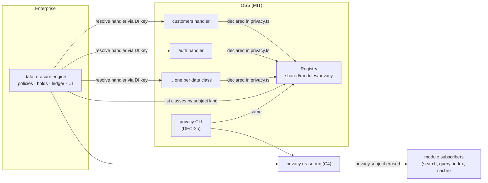

# GDPR-ready deployments — program spec

> **Tracker:** open-mercato/open-mercato#8593
> **Baseline:** The Problem Statement and the carriers' inline code references capture the checks against `main` at `08dada9624`. Tracker and unmerged-branch states are dated observations.
> **Kind:** program spec. It orders work, fixes cross-cutting rules and names the spec that carries each design. It orders carrier work rather than defining an independently buildable feature; no package may be implemented from this file alone. A9’s section records acceptance requirements that its issue carrier must carry.
> **Status:** program design with upstream edition and issue-scope dispositions outstanding. Phasing and the carrier gates govern implementation.

Extends: .ai/specs/2026-08-18-tenant-legal-documents-and-consent-versioning.md
Extends: .ai/specs/2026-10-22-crm-contact-permissions-and-consent-history.md
Extends: .ai/specs/2026-10-09-eu-transactional-email-providers.md
Extends: .ai/specs/2026-10-29-production-content-security-policy.md
Extends: .ai/specs/2026-11-06-setup-encryption-preflight.md
Extends: .ai/specs/enterprise/2026-11-13-sign-in-activity.md

## 📝 TLDR

Operators who run Open Mercato on EU personal data cannot today answer a data-subject request, bound how long data is kept, or name their sub-processors from the product alone. Issue #8593 proposes a seven-phase umbrella to fix that. **Proposed (future):** deliver it across seven tracks, 41 child specs and the existing carriers. The [PR rollout](#pr-rollout) governs the bounded implementation slices and records the phase amendments for shared contracts. Designs that so far existed only on the unmerged PR #5557 branch are re-specified in our own child specs; that branch is reference only. The issue's audit was re-verified first; about a third of its claims were stale, wrong or narrower than stated, and this plan uses the corrected baseline.

**Out of scope:** legal work that stays with the controller (lawful-basis assessment, DPAs, DPIA content, review of the Art. 30 register, age verification and parental consent, an in-product breach register). The platform supplies mechanisms and generated drafts, not legal conclusions.

## 📝 Overview

The proposed deployment path combines product mechanisms, documented operator procedures, privacy-preserving production defaults, a list of data flows and a command that reports remaining gaps. The [Known limits](#known-limits) list the rights covered by procedures and defaults that remain on compatibility bridges. The issue's original product requirements remain the closure baseline until the upstream disposition required by DEC-14 is recorded.

> **Market reference.**
> - **WordPress core** (4.9.6+) and **Frappe/ERPNext** both solve cross-module erasure with a *registry*: each plugin or app declares the personal data it holds and supplies its own exporter and eraser; the core only orchestrates. Adopted — this is the data-class contract (Track C). Rejected: a generic SQL deletion engine, which bypasses module rules and side effects.
> - **Discourse** and **GitLab** *anonymize* accounts linked to records that must survive (posts, commits) instead of refusing deletion. Adopted for people linked to deals and sales documents.
> - **Matomo** ships scheduled retention with instance defaults an operator can tighten. Adopted for operational tables (Track D).
> - Not adopted: a built-in cookie-consent manager. The core app sets only first-party functional cookies, so the program ships a consent *gate* for apps that add trackers.

## 📝 Problem Statement

**What is true today**

- **No data-subject tooling outside `forms`.** There is no export for a CRM person, portal user or staff user. Deleting a person is refused when deals are linked, and nothing anonymizes. Undo snapshots keep the full deleted record indefinitely; the staff-user snapshot includes `passwordHash`. Attachments, messages, AI chats and notifications are untouched by any subject delete.
- **Retention is mostly absent.** Five pruners exist and nothing schedules them. Action logs, staff sessions, webhook deliveries, messages, AI chats and soft-deleted rows are never pruned. An admin cannot wire the pruners by hand, because the scheduler UI only targets `schedulerSafe` workers and none of them is.
- **Encryption has holes.** With no Vault and no fallback key, mapped writes land as plaintext and the only signal is a log line. Nine column groups the issue names are unmapped, and a second tier it does not name (documents, staff HR data, workflow context, integration logs) has no coverage either.
- **Transparency is vendor-specific.** `/privacy` and `/terms` name the vendor as controller. There is no consent history for CRM contacts or visitors, no suppression list and no unsubscribe. The staff consent ledger in `auth` is outside E5 (see Track E).
- **No accountability surface.** Auth events are ephemeral and carry no IP, there is no deployment or sub-processor documentation, and no `mercato` doctor or privacy command. The starter has a separate environment audit, `yarn om doctor`.

**Corrections to the issue's audit**

| Issue says | Verified |
|---|---|
| Published fallback key in production Compose | Fixed (#7231). The refusal lives only in the Compose preflight; the runtime accepts any key |
| `sendEmail` is Resend-only | Stale. SES and SMTP transports ship; Brevo and Mailjet do not exist |
| No access-log retention | Wrong. Rotation runs inline at 7 days / 8 hours |
| 27 modules ship encryption maps | 25 definition files: 24 packaged module sources plus the create-app example template |
| Defaulting `SEARCH_EXCLUDE_ENCRYPTED_FIELDS` to on closes the search leak | It covers Meilisearch only, not the token index, vector text or `search_text` |
| Moderation is hard-coded to `api.openai.com` | It is a fallback URL; moderation is off by default |
| #5557 has no CI on head | CI runs and fails |

**Gaps the issue does not list**

- Attachment OCR is hard-wired to OpenAI.
- AI tools return decrypted CRM data to the LLM with no masking.
- About fifteen person-data modules are missing from the erasure list.
- Production Compose defaults Meilisearch to a development key.
- The `auth.user.deleted` event carries `id`, but two cascade subscribers read `userId`. The channel cascade returns early; the SSO cleanup has no guard and supplies an undefined id to its statements. This is verified by reading; its SQL and runtime result are not reproduced in this record.
- The issue asks for a working product mechanism for each right but has no delivery carrier for technical restriction of processing or objection outside marketing. It explicitly asks to exclude or mask protected fields in AI tool results. DEC-8 and DEC-11 propose alternatives, and DEC-14 governs their disposition.

## 📝 Prior spec drift

- `.ai/specs/enterprise/2026-07-08-gdpr-data-erasure.md` → Data Model, API Contracts: specifies an `erasure_request` ledger and `POST /api/data_erasure/requests`. No code exists on `main`. The implementation on `upstream/feat/security-readiness` uses `privacy_operations` and `/api/data_erasure/subjects` and brings anonymization in scope; the PR itself annotates the older file as design history. The older spec is now annotated as superseded by `privacy-subject-erasure` for the operation and `privacy-dsr-engine` for governance. Its earlier design is history, not an implementation order.
- `.ai/specs/2026-09-30-unified-crm-email-history-and-context.md`: specifies refusing person and company DELETE while email history exists. That refusal is not in code; today the delete removes those interactions. When it is implemented it must exempt the erasure path (recorded in C4's spec).
- `.ai/specs/2026-10-22-crm-contact-permissions-and-consent-history.md`: the issue cites it for unsubscribe links and `List-Unsubscribe`. The spec covers consent history and suppression only; it names public preference centres as a non-goal and never mentions the header. Its tracker #7700 covers CRM field-model Phase 1 only (#8779 confirms), so the consent work has no tracking issue.
- `.ai/specs/2026-10-09-eu-transactional-email-providers.md`: keeps Resend as the runtime default. The issue's "EU-first default providers" would contradict it (DEC-6).
- `.ai/specs/2026-08-18-tenant-legal-documents-and-consent-versioning.md`: designs tenant legal documents in the OSS directory while its tracker #5423 is labelled `enterprise`; DEC-2 proposes its written placement pending the #5423 maintainer disposition. This cross-edition program only references enterprise designs by carrier.
- `.ai/specs/enterprise/2026-11-13-sign-in-activity.md`: rejects persisting sign-in events in OSS because its tracker #8106 is labelled `enterprise`. The issue cites #7972 for the audit trail, but #7972 is a separate Job Inspector access-log defect.
- `upstream/feat/security-readiness:.ai/specs/2026-08-21-access-log-durability-retention.md`: proposes blocking access-log writes with a 90-day default. `main` rotates inline at 7 days / 8 hours, and PR #8472 bounds writes differently. **Recorded status, 2026-11-15:** QA-approved with automerge; implementation checks that it has landed before using it. This is the single status record referenced by D4.
- Backups: #4030 (open) says backups belong at the infra layer. PR #9333, which builds an enterprise `backups` module, is in the merge queue with automerge.

## 📝 Resolved assumptions (autonomous defaults)

### Decisions

The edition, issue scope, store-coverage and release-line decisions in DEC-2, DEC-2b and DEC-14–DEC-16 are open until their required upstream evidence is linked. The decision ids use the `DEC-` prefix. `D1`–`D6` elsewhere in this file are Track D packages.

| # | Decision | Rationale and process gate |
|---|---|---|
| DEC-1 | This file is a program spec. Missing designs are child specs, one independently deployable capability each, written as follow-ups. | None |
| DEC-2 | **Edition authority.** The recorded Enterprise direction governs #8593. The Ed. column proposes OSS placement for independently accepted security fixes, MIT contracts and owner-local handlers. It proposes Enterprise placement for tenant policies, holds, the operation ledger, privacy admin UI, restore replay and alerting. The Ed. column grants no OSS implementation authorization. DEC-2b governs the proposed OSS invokers. E1 retains its separate #5423 carrier and requires its own recorded edition disposition where its tracker and spec disagree. | The [maintainer direction on #8593](https://github.com/open-mercato/open-mercato/issues/8593#issuecomment-6824616353) reserves this umbrella for Enterprise and declines OSS implementations of the capability. Record the maintainer permalink and approved edition beside each affected carrier before implementation or OSS submission. A missing disposition keeps that carrier and its dependent slices gated. For an Enterprise disposition, reconcile the carrier path, dependency direction, integration lanes and roll-out prerequisites before implementation. Module ownership motivates additive owner-local seams and independently approved security fixes can proceed on their own carriers. The assignee’s Enterprise permission and normal PR review do not satisfy this gate. |
| DEC-2b | **Proposed OSS invokers.** C1 subject export, C4/C6 subject erasure, and C7 portal download, deletion and verified email change. The proposed CLI invokes the owner-local handlers for one subject; Enterprise C3 adds the governance layer. | Record explicit upstream approval for each invoker carrier before implementing or submitting it as OSS. If approval is withheld, return a revised placement and dependency plan for maintainer approval, with Enterprise invokers calling the same owner-local seams. Gate the relevant phases, edition matrix and #8593 closure on that disposition. |
| DEC-3 | **We write our own specs; PR #5557 is reference only.** The seven designs that exist only on its branch are re-specified in our own child specs (table below). Where its design is sound we keep the same contract and event names so the two can converge, and credit it. | None to proceed. If #5557 or a slice of it lands on `main` first, the matching child spec is rebased onto it or withdrawn. |
| DEC-4 | **Backups.** Erasure replay also works for a restore performed outside the product (infra-level point-in-time recovery). C9 uses an external manifest independent of the backup module. | Infra-level recovery is the usual restore path; replay tied to a product backup module would leave it unprotected. Recorded 2026-11-15: #9333 was in the merge queue with automerge, while #4030 opposed an app module. The decision holds under either outcome, because the manifest does not depend on the backup module. |
| DEC-5 | **Breaking defaults** follow `BACKWARD_COMPATIBILITY.md` as set out under Migration: the exception only where the accepted input is itself the vulnerability, the ordinary protocol everywhere else. | Process gate: each exception PR carries the named maintainer approval that `BACKWARD_COMPATIBILITY.md` requires. |
| DEC-6 | **MFA and default providers.** Staff TOTP moves to OSS (E7); enforcement policy and SSO assurance stay Enterprise. The runtime email default stays as the 10-09 spec has it. The create-app template's `.env.example` leaves the email and AI provider for the operator to choose (F4); docs list EU options first; `doctor` warns on a non-EU choice. | A second factor on staff accounts that reach personal data is a baseline Art. 32 control and should not be paid-only; requiring it by policy is governance and stays Enterprise. Changing the runtime default would break existing installations with no security gain; the template choice and the doctor warning steer new ones. |
| DEC-7 | The audit file cited by the issue was never committed. The dated Problem Statement and carrier code references record the baseline used for the program. | Recheck dated observations when preparing the relevant implementation. |
| DEC-8 | **Proposed restriction and objection procedure.** C10 option A documents existing controls for Art. 18 restriction and non-marketing Art. 21 objection. G5 publishes the procedure and its limits. DEC-14 governs whether it satisfies the umbrella's delivery scope. | A record freeze (option B) leaves reads, reporting, automation and disclosures active. Technical restriction (option C) requires inventory and enforcement across read, write and sender paths. |
| DEC-9 | **Tenant reader ownership: module-owned readers.** C8 and G6 share the DEC-G export/scan reader API (C8 assumption 1). Each owning module reads its own tables with the shared helper and registers its reader through DI. No generic cross-module reader is built. | It keeps the no-cross-module-table-access rule with no exception. The cost is one registration per module, which the C5 census already enumerates. C8 Phase 2 ships the shared helper and the readers of modules without a domain coverage carrier (C8 "Reader delivery"); each domain coverage carrier registers its modules' readers in its own phase, and Enterprise readers ship in the Enterprise package. A missing reader is a named `reader_unavailable` gap. A complete C8 handover requires evidence for attributable tables and files within its declared export scope. Nonempty disabled or unknown tables are gaps. G6 independently checks the required erasure stores under DEC-15. Unresolved tenant-less attribution is a named `orphaned_attribution` gap. |
| DEC-10 | **Module id.** G4 creates the module id `privacy`, shared by C1 and later packages. | `privacy` is a mass noun with no plural, like the existing `security`, `content`, `progress` and `availability` ids. A module id is frozen once shipped, so it is settled before the G4 scaffold. |
| DEC-11 | **Proposed model-input disclosure.** F1 Q1 option B delivers provider policy, and G5 ships **What the assistant sends to a model** in `impact-assessment-notes.mdx`. DEC-14 governs whether the disclosure can replace the requested masking or exclusion in AI tool results. | A narrow withholding filter would cover typed tool output while page context, search text, attachments and user input continue to reach models. Provider policy and the disclosure address those flows as described under Known limits. |
| DEC-12 | **Later published lookup-secret refusal.** A2 opens the separately tracked release task **Refuse unsafe lookup secrets after B1 Phase D**. It ships under its own Emergency Security Exception once the B1/B4 repair gates pass. Weak/missing lookup findings always receive their own warning minor, and explicit deprecated `warn` remains supported. That warning minor governs the key guard's lookup-secret findings, not R5-4's module-declared `sso.scim_lookup_secret_missing` doctor error, which is the doctor's single named exception to its warning rule. | A published lookup secret is itself the vulnerability, as with A1's published key: anyone can compute the lookup hashes. Process gate: that PR carries its own named security-maintainer approval; neither A1 nor #7231 grants it. |
| DEC-13 | **C7 existing-write compatibility.** C7 narrows existing profile/password-change/reset-confirm behavior, and `portal-email-change` narrows magic-link verify (its credential fence, including the generic refusal when a `customerTokenService` override stores tokens outside `customer_user_email_verifications`/`customer_user_password_resets`) and login, magic-link request/verify, password-reset request/confirm, session creation (invitation acceptance included), password change (409) and the profile write (409) (refusal while staff identity recovery is live), in three separable ways: registry and cross-site checks, credential fences (the identity-recovery refusals included), and the shared re-authentication throttle (429 while locked). The C7 or email-change PR argues each narrowing on its own. A narrowing takes an Emergency Security Exception, separate from A1 and C2, only where the PR shows that the old accepted shape is itself the exploit; every other narrowing follows the ordinary protocol. The re-authentication throttle is not pre-settled under the exception: it ships under the ordinary protocol with an upgrade note unless its PR argues it separately. The profile write's identity-recovery 409 likewise follows the ordinary protocol with a one-minor bridge, because a display name is not a credential. No registry-bypass toggle ships. | `BACKWARD_COMPATIBILITY.md` allows the exception only where continued acceptance of the old shape is the exploit, and lets no unrelated tightening ride along. An accepted cross-site request is that case; a missing throttle may not be. Process gate: each excepted narrowing carries the qualifying argument, a dated `BACKWARD_COMPATIBILITY.md` entry, client/operator `UPGRADE_NOTES.md` notes, the `security` label and the named security-maintainer approval. |
| DEC-14 | **Upstream disposition for two changes to #8593.** Record two independent decisions on #8593. The first covers G5’s procedure for technical restriction and non-marketing objection under DEC-8. The second covers G5’s disclosure in place of masking or excluding protected fields from AI tool results under DEC-11. | Keep each original requirement open until the maintainer explicitly accepts the narrower outcome and its limits ship, or its owner links a tracker, delivery spec and shipped acceptance evidence in Phase 7. The technical restriction lane must cover permitted preservation and denied reads, writes, automations and disclosures in its approved scope. The technical tool-data lane must inspect actual model-bound tool results, including every supported dispatch path in its approved scope, using positive and negative protected-field witnesses. |
| DEC-15 | **Closure evidence for tables, indexes, caches and queues.** Ship B9 at-rest protection. For every in-scope deployed store, record owner, supported backend and topology, exact read/write surface, positive fixture, post-erasure read and raw-content result, backlog or failure outcome, and delayed-writer result where applicable. For fills sourced from asynchronous projections or replicas, prove current source reads after invalidation or bypass the protected cache until source freshness is verified. | PR-197 requires independent owner evidence of the requested outcome on the release candidate and representative deployed configurations. An unscanned store, accessible residual, or test that observes only ordinary HTTP or test-only queue drainage keeps closure open unless the issue contains written upstream acceptance naming that exact narrower outcome and its limits. C4 operation completion describes its narrower verified boundary and does not discharge this gate. |
| DEC-16 | **Phase 0 backport dispositions.** #8593 keeps the requested security defaults for `release/v0.9.x` open per control: A1/#7231 published tenant key refusal, A3/#2241 unavailable-KMS behavior, A5 production HTTPS headers, B4 encrypted-field fulltext exclusion, and each affected A8 auth fix (#7216, #7530, #7239, #7549). | For each control, link release-line reproduction or version evidence. Record a reviewed, tested and released compatible backport (or equivalent shipped control), a verified affectedness disposition, or a written release-maintainer decision on #8593 accepting the proposed alternative or deferral and its operator path. Keep the mainline compatibility gates and named security exceptions. Phase 7 requires a disposition per item. |

**Enterprise ownership.** Enterprise packages (C3, C9, C10, D5, D6, E4, E6, G1, G2) can only be shipped upstream by a contributor on the allowlist. **Resolved 2026-11-16:** the issue assignee is a core member authorized to change enterprise modules and owns them. DEC-2 and DEC-2b separately govern upstream approval of the proposed OSS placement.

**Packages re-specified in our own child specs instead of taken from #5557**

| Package | Our child spec | Reference on the branch |
|---|---|---|
| A3 | `kms-fail-closed` | `2026-08-20-production-encryption-fail-closed.md` |
| C1 | `privacy-data-class-contract` | `enterprise/2026-08-21-privacy-retention-dsr-engine.md`, `packages/shared/src/lib/privacy/contracts.ts` |
| C2 | `audit-snapshot-redaction` | `2026-08-20-command-audit-sensitive-data-redaction.md` |
| C3, D5 | `privacy-dsr-engine` (enterprise) | `enterprise/2026-08-21-privacy-retention-dsr-engine.md` |
| C8 | `tenant-exit-export` | `2026-08-24-tenant-exit-export.md` |
| C9 | `erasure-restore-replay` (enterprise) | the same DSR engine spec |
| D4 | `access-log-retention` | `2026-08-21-access-log-durability-retention.md` |

## ⚠️ Council-review cross-spec decisions

Fixing the four-model council reviews of this spec set required decisions that span several child specs. Child specs cite them by id: `DEC-A`–`DEC-C`, `DEC-E`–`DEC-J`, `R3-1`–`R3-14`, `R4-1`–`R4-14` and `R5-1`–`R5-11`. `DEC-D` was retired during revision and is not used. This section is the index of record.
- **Ownership.** Each decision names exactly one owning spec, which carries the normative design, and lists the specs that cite it. Where one part of a decision is carried by another spec, that bullet names its own single owner. **Shared decisions carried elsewhere**, under Architecture, is the owner map for every id.
- **Program decisions.** DEC-1 through DEC-14 are listed under Decisions above.
- **Precedence.** When a later decision refines an earlier one, the later one wins. R5-1 refines R4-2. R5-2 refines R3-11, which refines DEC-E: the dev-mark binding check applies only to a `NODE_ENV=production` process.

### Round one (after the first council)

#### DEC-A — Subjects known only by an identifier (`privacy:identifier`) — issues g2-03, g3-03, g4-04
Owner: `privacy-data-class-contract`. Cites: `privacy-subject-erasure`, `privacy-dsr-engine`, `erasure-restore-replay`, `inactive-subject-retention`, `action-log-retention`, `portal-email-change`, `email-unsubscribe-headers` and the coverage specs.
- **Deterministic id.** The subject id is derived as a keyed digest of the tenant id, the identifier type (`email` | `phone`) and the normalized identifier, under a key separated by purpose: the label `privacy-subject-id`, derived from the installation's lookup secret material. It is stable across processes and runs while that secret is unchanged. It is never equal to a stored lookup hash, so it matches no column. Format: `idv1_<base32 digest>`. `privacy-data-class-contract` defines the normalization and the derivation; the others only rely on these properties.
- **Erase by identifier** (owner: `privacy-subject-erasure`). `mercato privacy erase` accepts `--email <address>` and `--phone <number>`. The dry run reports the derived id. `--apply --confirm <token>` must be given the same identifier flags again: the run recomputes the id and the aliases, and refuses on any mismatch. The CLI dispatcher redacts these values in its banner and logs.
- **The event** (owner: `privacy-subject-erasure`). `privacy.subject.erased` carries the derived id with kind `privacy:identifier`, and never the alias hashes.
- **Holds** (owner: `privacy-dsr-engine`, "How a hold matches").
  - A hold may be placed on a `privacy:identifier` subject: the administrator types the identifier and the engine stores the derived id.
  - A hold on a person or portal user also stores the derived identifier ids of that subject's current email addresses and phone numbers, in clear with the hold (they are keyed digests that match no column). They are computed when the hold is created and on every extend, and refreshed at the guard: before matching an erasure or answering retention, the engine resolves current ids for every initialized active hold and appends new ones. A contact point added after the hold was created is therefore covered at the next guard check.
  - The erasure guard refuses an identifier subject whose id equals any id held by an active hold.
  - Remaining boundary: a contact point committed after an already-running guard's final read is not covered by that run, and one added and removed entirely between two checks cannot be recovered. The holds page states this; operators extend the hold after changing contact points and keep former identifiers in their case records.
- **Replay** stays manual for identifier subjects. Under C9’s acknowledgement contract, `--acknowledge <runId>` requires completed proof for the same derived id and the original scope, preference and exclusions. Its verified recovery-time evidence must establish a strictly later completion than the manifest’s original bound. Missing or ambiguous evidence leaves the file pending.

#### DEC-B — The audit-history strip routine — issues g2-06, g5-09, g5-10
Owner: `privacy-subject-erasure`. Cites: `action-log-retention`, `privacy-dsr-engine`, `privacy-record-retention` and the coverage specs.
- **OSS ownership.** OSS owns `actionLogService.applyRetention` together with the `action_logs.stripped_at` column, its partial index and migration, the list-response fields `strippedAt` and `changedFields`, and redo returning 410 for a stripped entry.
  - The OSS erasure spec, `privacy-subject-erasure`, specifies them normatively, in its Data Models, API Contracts, Phase 2, file manifest and unit tests (which assert context reduction).
  - `subjectHistoryService` becomes a thin by-subject wrapper over `applyRetention`.
  - The enterprise action-log retention spec, `action-log-retention`, consumes them as provided by the OSS erasure spec, removes its own normative definition of them, and keeps policies, scheduling, settings and the enterprise sets.
- **The signature.** Both specs cite it exactly:
```ts
applyRetention(input: {
  tenantId: string | null
  organizationId?: string
  olderThan?: Date
  mode: 'strip' | 'delete'
  limit: number
  after?: string
  includeResourceKinds?: string[]
  excludeResourceKindPrefixes?: string[]
  includeRecords?: Array<{ resourceKind: string; resourceId: string }>
  excludeRecords?: Array<{ resourceKind: string; resourceId: string }>
  includeSubjects?: PrivacySubjectReference[]
  excludeSubjects?: PrivacySubjectReference[]
  dryRun: boolean
}, options?: { em: EntityManager }): Promise<{ matched: number; changed: number; skipped: number; next?: string; done: boolean }>
```
- **Transaction boundaries.** C4’s orchestration calls the audit owner in bounded standalone transactions. All planned pre-strips commit before dependent writes and survive an abandoned run. The post-strip runs separately. A retention owner stripping exact records within its own bounded mutation batch passes its scoped transaction manager before and after its mutation. Any failed or skipped strip rolls that owner batch back. Both modes take the audit replay try-lock.
- **The matching rule.** An entry matches a record when the record equals the entry's (`resource_kind`, `resource_id`), (`parent_resource_kind`, `parent_resource_id`) or (`related_resource_kind`, `related_resource_id`).
  - A subject matches through its root record and through the `historyRecords` its classes return.
  - `organizationId` limits the run to that organization plus entries with no organization.
- **Holds** (owner: `action-log-retention`; the `allowUnmatchedHolds` flag is owned by `privacy-dsr-engine`). `excludeSubjects` and `excludeRecords` use the same three-column rule and take precedence over inclusion. Age-based stripping fails closed: a change-history set is skipped for a tenant that has an active subject hold whose subject could appear in that set's entries only inside snapshots. The skip is recorded as a skipped pass with reason `hold_not_honourable`. The only opt-out is a per-policy flag in the DSR engine spec, `allowUnmatchedHolds`, default `false`.

#### DEC-C — Retention sets and holds — issues g5-08, g4-05, g3-04, g3-11
Owner: `privacy-record-retention`. Cites: `privacy-dsr-engine`, `action-log-retention`, `forms-retention-scheduling`, `inactive-subject-retention` and the coverage specs that declare sets.
- **The declaration.** A retention set declaration (`privacy-record-retention`) gains `excludableSubjectKinds: string[]`: the subject kinds whose records its handler can leave out when given `excludeSubjects`.
- **The command.** `mercato privacy retention` gains a repeatable `--exclude-subject <kind:id>`.
- **The guard.** The command consults an optional DI key `privacyRetentionGuard`, method `excludedSubjects({ scope, setId })`, which returns `{ subjects: PrivacySubjectReference[] }` or throws. The enterprise DSR engine registers it from active holds. All destructive consumers first resolve protection through the OSS tenant-owned `privacyHoldProtectionService`. Its durable `privacy.holdProtectionRequired` latch survives Enterprise disablement and guard registration loss. A required or unknown guard failure refuses; a positively verified clear OSS tenant retains the manual controls.
  - A guard that is registered and fails makes the run refuse.
  - A held subject whose kind is not in the set's `excludableSubjectKinds` makes the set skip, with reason `hold_not_honourable`. This fails closed.
- **The engine** (owner: `privacy-dsr-engine`). The DSR engine's record-mode retention applies the same rule.
- **Coverage sets.** Coverage specs that add retention sets (`sales` and `checkout` in `privacy-coverage-commerce`, `staff` in `privacy-coverage-people-ops`, and every set another coverage spec declares) declare `excludableSubjectKinds`, and run their sets through the record-retention command or the engine.

#### DEC-E — The dev-runtime mark — issues g1-03, g7-07
Owner: `runtime-encryption-key-guard`. Cites: `kms-fail-closed`, `privacy-doctor-cli`, `privacy-verification-suite`. Refined by R3-11 (IPC delivery) and R5-2 (development processes).
- **Bound to the runner.** The exemption from the production refusal is bound to the live dev runner, not to a bare variable. The runner generates a per-run nonce and passes it to its children, as `scripts/dev-runtime-supervisor.mjs` already does with `OM_DEV_RUNTIME_TOKEN`. A process honours the dev mark only when that binding is valid.
- **Without a valid binding** a `NODE_ENV=production` process that sees the mark treats itself as production, so the refusal applies, and it logs once at error level. A process whose `NODE_ENV` is not `production` is never forced onto production rules (R5-2). `runtime-encryption-key-guard` specifies the mechanism and its tests.
- **The doctor cannot see other processes' modes, and says so** (owner: `privacy-doctor-cli`).
- **The program** (owner: this program) replaces "the doctor reports services running outside production" with a reference to the key guard's runtime check.

#### DEC-F — The B1 hand-offs — issues g0-03, g1-04
Owner: `encryption-map-coverage-and-backfill`. Cites: `runtime-encryption-key-guard`, `key-rotation-data-verification`, `search-index-pii-protection` and the coverage specs that write hashes.

`encryption-map-coverage-and-backfill` gains **"Phase D — Lookup hashes and system-scope rotation"** with three items:
1. `customers` email and phone lookup-hash columns. The module writes them whatever the encryption state, and a fill command populates existing rows.
2. `mercato entities rehash-lookups --tenant <id> [--apply]`. It is scoped and resumable, handles the old and current secret, and covers every mapped `*_hash` lookup column.
3. Rotation of system-scoped records, extending the existing `mercato entities backfill-system-encryption`.

The key guard's flip gates and refusal exits (`runtime-encryption-key-guard`) point at Phase D. The program's B1 row and constraints (this program) point at "B1 Phase D".

#### DEC-G — The tenant-export reader and its declarations — issues g3-12, g7-12
Owner: `tenant-exit-export`. Cites: `privacy-table-coverage`, `privacy-verification-suite`, `email-unsubscribe-headers` and the coverage specs that declare `tableExports`.
- **Where declarations live.** Export declarations move out of the per-table `tables` coverage map into a separate member of the `privacy.ts` default export, `tableExports`, keyed by table name and independent of where coverage places the table. `privacy-table-coverage` is amended in the same change, so an export-only entry does not count as a coverage declaration.
- **A scan mode for the reader.** The reader gains `mode: 'export' | 'scan'`. `scan` ignores `exclude` and `redact`, decrypts in memory, never writes values, and reports every table it cannot read as not scanned. `tenant-exit-export` specifies it; `privacy-verification-suite` uses it.

#### DEC-H — The counting-period bridge — issue g5-06
History deletion in the operational pruners and in forms retention ships **opt-in for one minor**: off by default, with a warning at start and in `doctor` that names the next minor's default. It is on by default from the next minor. Deleting expired rows (not history) is unaffected.

Owner: `operational-retention-pruners`. Cites: `forms-retention-scheduling`, which applies the same bridge to forms history with its own `OM_FORMS_RETENTION_MODE`; `privacy-doctor-cli`, which carries the warning.

#### DEC-I — The doctor's extension point — issue g7-02
The `privacy.ts` default export gains an optional member, `doctorChecks`, validated by the shared collector. No generator change is needed. This is consistent with the contract spec's "later specs add optional members".

Owner: `privacy-doctor-cli`, which defines the check shape. Cites: `privacy-data-class-contract`, whose `getPrivacyDoctorChecks` collector carries it under R3-2, and every spec whose module declares checks.

#### DEC-J — Modules with no coverage owner — issue g0-04
Owner: this program (the assignment). Cites: the three domain specs below, which carry each module's design.

| Module | Assigned to |
|---|---|
| `workflows` | `privacy-coverage-content-ai` |
| `shipping_carriers`, `promotions`, `customer_groups` | `privacy-coverage-commerce` |
| `packages/carrier-*` | `privacy-coverage-commerce` |
| `packages/channel-*` | `privacy-coverage-communication` |
| `packages/tillio` | `privacy-coverage-communication` |

- **In each domain spec** a subsection is added, "Modules assigned after the council review". For each module it records the person data found in the module's entities (by reading code), and then gives either a class design (find, export, erase) or an explicit, reasoned exemption, or a backlog entry naming what is missing.
- **In the program** the roll-out table records the assignment.

### Round three (fixing round-two findings)

#### R3-1 — The audit-history rule for every erasure
Owner: `privacy-subject-erasure`. Cites: `action-log-retention`, `audit-snapshot-redaction` and every coverage spec, each of which lists its history records.
Issues: r3e-01, r3e-02, r6-01, r5-06.

1. **Every edited record is a history record.** Every class's `eraseSubject` returns, as `historyRecords`, every record it changes, deletes, anonymizes or blanks. That includes records owned by OTHER people that it edits, for example an interaction whose participant list loses the subject. Coverage specs MUST list their history records per class.
2. **The history strip runs twice.**
   - **Before the first change.** It runs right after the owner locks the account and before the first dependant writes. Existing entries lose their undo and redo payloads before anything changes, so undo and redo are blocked from the run's first write.
   - **After the owner.** It runs again after the owner, to catch entries written during the run.
   - **Idempotent.** Both passes use standalone bounded audit-owned calls to `applyRetention` with `includeSubjects` and `includeRecords`. Standing verification reuses their scope and strip eligibility. Recovery preserves committed pre-strips and restarts only unsettled work.
3. **Undo and redo refuse a stripped entry.** An undo or redo that already loaded an entry before the strip is refused at execution, because the command re-checks `stripped_at` under the row lock (redo already returns 410; undo gains the same check).
4. **Internal blanking functions write no snapshot.** They also log no audit entry carrying the cleared values.

#### R3-2 — The registry carries the whole `privacy.ts` default export
Owner: `privacy-data-class-contract`. Cites: `privacy-table-coverage`, `privacy-doctor-cli`, `privacy-record-retention`, `tenant-exit-export` and every spec that adds a `privacy.ts` member.
Issue: r4-02.
- **The registry member.** The generated module registry exposes the validated default export object of `privacy.ts` as `privacy` on the module's entry.
- **Collectors.** `getPrivacyDataClasses`, `getPrivacyDoctorChecks`, `getTableExports`, `getRetentionSets` and `getPrivacyTables` read members from that object. One validation step runs per member.
- **Additive members.** Later specs add optional members without touching the generators.
- **The old field.** `privacyDataClasses` on the registry entry is kept, derived from `privacy.dataClasses`, so nothing that already reads it breaks.

#### R3-3 — Tenant privacy settings live in `module_configs`
Owner: `privacy-data-class-contract`. Cites: `privacy-dsr-engine` (settings page), `privacy-doctor-cli` and every spec that declares a setting.
Issues: r5-04, r5-05 and every other "age that cannot be set".
- **Where they are stored.** Tenant privacy settings are rows in the existing tenant-scoped `module_configs` table (unique per module, name and tenant), with `module_id = 'privacy'` and names under `retention.<area>.<setting>`. Examples: `retention.sales.orderAgeYears`, `retention.checkout.paymentAgeYears`, `retention.staff.employmentRecordAgeYears`, `retention.eudr.recordAgeYears`. No new table.
- **Reading and setting.** The `privacy` module reads them through `privacySettingsService.get(scope, name)`. They are set with `mercato privacy settings set --tenant <id> <name> <value>` and listed with `mercato privacy settings list --tenant <id>`. The enterprise privacy page edits them too.
- **Declaration.** A coverage spec that needs a setting declares its name, type, unit, minimum and default (usually none: unset means the set refuses).

#### R3-4 — An opt-in database tier for the doctor
Owner: `privacy-doctor-cli`. Cites: `privacy-verification-suite`, `search-index-pii-protection` and every spec that declares a database-tier check.
Issues: r2iqa-02, r5-04.
- **The default run** stays configuration-only.
- **The database tier.** `mercato privacy doctor --database` also runs checks declared with `needs: 'database'`. Such a check receives a read-only `EntityManager` and the tenant list, and may run counting queries only. It never returns personal data.
- **Consumers.** Search-index token counts, unset retention settings and similar checks declare `needs: 'database'`.

#### R3-5 — Holds, honestly
Owner: this program (Known limits). The forms half is owned by `forms-retention-scheduling`. Cites: `privacy-record-retention`, `operational-retention-pruners`, `gdpr-deployment-docs`, `processing-restriction-and-objection`.
Issues: r0-02, r8-03.
- **The program's Known limits** say that legal holds exist only with the enterprise engine. OSS has `--exclude-subject` for the record-retention command and nothing else. Operational pruners delete rows that are not about a subject (expired tokens, logs by age), and holds do not apply to them.
- **Forms retention** resolves protection through DEC-C’s tenant-scoped `privacyHoldProtectionService.requirePrivacyHoldProtection({ tenantId })` before anonymizing. With a valid guard, exclude held subjects or skip with `hold_not_honourable`. Positively identified ordinary OSS uses its manual controls. A durable protection latch, expected guard or unreadable protection state with no valid guard refuses before deletion.

#### R3-6 — The form-to-deals reason set
Owner: `privacy-coverage-content-ai`. Cites: `2026-06-17-form-to-deals`, `forms-retention-scheduling`.
Issues: r0-01, r6-07.
The form-to-deals erasure subscriber acts on `reason` in {`request`, `erasure`}: both are subject-driven. It acknowledges `retention`, or a missing reason, with no writes. The `forms.submission.anonymized` payload’s optional `reason` enum is exactly `request | erasure | retention`. Forms retention Phase 1 delivers the additive event contract and its request/retention emitters. Content-AI Phase 1 consumes that seam and owns the erasure emitter. The connector can stage inert projections in Phase 2 and activates write paths in Phase 3, after both cleanup routes and their tests are present and the emitters have shipped in an earlier release. Forms retention Phase 2 enables destructive scheduling after the Content-AI emitter and, where projections are active, tested connector cleanup.

#### R3-7 — Chat file release honours other conversations
Owner: `privacy-record-retention`. Cites: `privacy-coverage-content-ai`.
Issue: r6-02.
The ids come from the client. So before releasing an id, the assistant handler reads `attachment_ids` on the tenant's other conversations' messages and pending actions, which are its own tables. An id that another conversation not being deleted in the same batch still lists is dropped from the deleted rows only, and reported. It is never released.

#### R3-8 — Retention drains its own pending file deletions
Owner: `privacy-record-retention`. Cites: `privacy-dsr-engine`, `action-log-retention`, `privacy-subject-erasure`.
Issue: r6-05.
`privacyRetentionService.run` calls `drainPendingDeletions(scope, { origin })` for the set's origin after every committed batch, whoever called it: the command or the enterprise engine. `privacy-dsr-engine` cites this and adds no drain of its own.

#### R3-9 — Organization-scope guard on every DSR route
Owner: `privacy-dsr-engine`. Cites: `erasure-restore-replay`, `inactive-subject-retention`.
Issue: r7-02, which is round one's g4-01, marked incomplete.
- **No factory hook.** Do not rely on a `makeCrudRoute` hook.
- **A wrapper on every export.** Each route file wraps every exported method (`GET`, `POST`, `PUT`, `DELETE`, including those `makeCrudRoute` returns) in a module helper, `withTenantWideScope(handler)`. It resolves the auth scope, returns 403 when `isUnrestrictedOrganizationScope` is false, and only then calls the handler.
- **Coverage.** Policy delete and the holds command path are covered by construction.
- **Tests.** A unit test enumerates the module's route files and fails on any exported method that is not wrapped.

#### R3-10 — One definition of a stale hold
Owner: `privacy-dsr-engine`. Cites: `privacy-data-class-contract`, `privacy-record-retention`, `portal-email-change`.
Issue: r7-01, which is round one's g4-04, marked incomplete.
- **The rule.** A hold is stale when it carries any derived id, whether a `privacy:identifier` subject id or a non-empty `identifier_subject_ids`, and its `identifier_key_check` is missing or differs from the current one.
- **Person and portal-user holds** also store `identifier_ids_computed_at`.
- **Without a lookup secret**, identifier holds cannot be created (refused with a reason), and person holds store no identifier ids. Erasure by identifier is already refused then (contract spec), so nothing is unprotected.

#### R3-11 — The dev-runner binding is delivered over IPC
Owner: `runtime-encryption-key-guard`. Cites: `kms-fail-closed`, `privacy-doctor-cli`, `gdpr-deployment-docs`. Refined by R5-2.
Issue: r1kk-04, which is round one's g1-03, marked incomplete.
- **Delivery.** The key-guard carrier’s Phase 1 wires the production predicate and development IPC without enabling key refusal. `mercato server dev` sends the nonce to its children over IPC. A3 Phases 1–3 consume that early seam, and B4 Phase 2 follows A3 with active-vector coverage and reseal. A1’s refusal release waits for the B4 reseal and B1 repair evidence.
- **Honouring the mark.** A child honours the dev mark only when all three hold: it received that message from its parent; the parent is alive; and `.mercato/dev-runtime-mark.json`, at a fixed path in the project and never taken from the environment, holds the same nonce and the parent's PID.
- **Without the binding** the process treats itself as production and logs once at error level.
- **Threat model.** The spec states the threat model: this stops accidental or copy-pasted bypasses. Someone with shell access who deliberately forges a parent process is out of scope, and the docs say so.

#### R3-12 — Fill commands for module-written hashes
Owner: `encryption-map-coverage-and-backfill`. Cites: `runtime-encryption-key-guard`, `key-rotation-data-verification`, `search-index-pii-protection` and the coverage specs that write hashes.
Issue: r1kk-02, which is round one's g1-04, marked incomplete.
- **What Phase D specifies.** Phase D names and specifies a fill command for each module-written hash:
  - `mercato customers fill-lookup-hashes`, which does NOT exist in the code today: it is a new command that Phase D item 1 specifies, together with the `customer_entities.primary_email_hash` and `primary_phone_hash` columns;
  - one for the SSO hashes and one for the inbound-sender hashes that Phase C adds, named after their real modules, read from Phase C.
- **The key guard** (`runtime-encryption-key-guard`) lists exactly these commands.

#### R3-13 — No `related_subjects: include` anywhere
Owner: `privacy-dsr-engine`. Cites: `inactive-subject-retention`, `privacy-record-retention`.
Issues: r7-04, r8-04 (round one's g5-05, marked incomplete).
DSR policies offer `skip` (the default) and `exclude` only. An included related subject would be erased without being on a reviewed list. `inactive-subject-retention` states that the engine follows the same rule.

#### R3-14 — The `eraseSubjects` entry point
Owner: `privacy-subject-erasure`. Cites: `portal-privacy-self-service`, `inactive-subject-retention`, `privacy-dsr-engine`, `erasure-restore-replay`.
Issue: r3e-03.
The [erasure carrier](2026-11-16-privacy-subject-erasure.md#the-erasesubjects-entry-point-r3-14) owns `eraseSubjects` and its optional `PrivacyReviewedApplyOptions`, the `PrivacyErasureRunResult` shape and the closed origin enum. Enterprise reviewed apply consumes the owner’s expected report digest. The ordinary entry point refuses `engine:replay`; the separate authenticated C9 transport preserves original authority. The inactive-subject coordinator consumes C4’s retention-specific resume seam before filtering candidates.
- **Status for a subject with no record.** `not_found` is reported, not refused, when a subject with a record no longer exists.
- **Replay** leaves a record’s `not_found` result pending as `absent_root_unverified`. C9’s acknowledgement contract allows a fresh C4 dependant-clearance acknowledgement for an eligible non-portal record in its original scope. A portal record requires authenticated replay with its original account authority and verified remaining scope. There is no automatic applied row on `not_found`.
- **The event** carries no free-text `reference` (r3e-04): the reference stays in the audit entry only.

### Round four (closing gaps left by the fixes)

#### R4-1 — Per-user credential deletion has one owner
Owner: `privacy-coverage-people-ops`. Cites: `privacy-coverage-communication`, and this program's A9.
- `integrations.user_credentials` (people-ops spec) is the only class that deletes per-user credential rows for a subject.
- The communication class disconnects the subject's channels and clears their credential pointers in the records group. In a DSR run it makes no credential call: `integrations.user_credentials` deletes the user's credentials in the credentials group. A9's channel cascade calls `deleteUserCredential`. Communication declares no credential class of its own.
- The A9 cascade calls the same integrations method.

#### R4-2 — Authority for a portal-initiated erasure
Owner: `privacy-subject-erasure`. Cites: `portal-privacy-self-service`, `gdpr-deployment-docs`. Refined by R5-1.
- **Who may run.** The erasure run accepts origin `portal` only from the portal deletion worker, with actor `{ kind: 'system', worker: 'portal-self-service' }`.
- **What it may touch.** The run is limited to exactly one subject, the requesting `customer_accounts:user`, with every related subject excluded. Its scope is the account's tenant.
- **The authority boundary.** The data subject’s verified request authorizes the worker. C4 checks that request and applies exact immutable account attribution to every mutation. C9 restore transport uses signed v2 authority and C4’s internal replay method to preserve the same bound. An older file with ambiguous authority remains pending.

#### R4-3 — Tenant-export evidence always carries its tenant
Owner: `tenant-exit-export`. Cites: `privacy-record-retention`, `action-log-retention`, `privacy-dsr-engine`, `gdpr-deployment-docs`, `privacy-verification-suite`.
- **The invariant.** Every `privacy.tenant_export` audit entry (started, completed, acknowledgement, reconciliation, refusal) is written with the exported tenant id. `action_logs` has no foreign key to `tenants`, and tenant deletion is a soft delete (`directory/commands/tenants.ts`), so no null-tenant tenant-export evidence exists.
- **A soft-deleted tenant.** Its evidence expires through the ordinary tenant-scoped `privacy.tenant_export_evidence` run naming that tenant id. Record retention's `run` validates the tenant id's format and scope, not that the tenant is active. Operators and policies keep that run scheduled for the deleted tenant until its evidence is gone.
- **No installation scope.** There is no installation-scope run, no `OM_PRIVACY_INSTALLATION_EVIDENCE_AGE_DAYS` setting and no `installationScope`, `runInstallation` or `--installation` surface. `PrivacyScope` stays tenant-required.

#### R4-4 — Erasure-evidence expiry waits on owner signals
Owner: `privacy-subject-erasure`. Cites: `privacy-dsr-engine` and `erasure-restore-replay`, which implement providers.
- **The seam.** The erasure spec defines an optional DI seam, `privacyErasureEvidenceHold`, with one method: `isPending({ scope, runId }): Promise<boolean>`.
- **How expiry uses it.** The OSS privacy owner persists the monotonic setting `privacy.erasureEvidenceOwnerRequired` through `privacyErasureEvidenceRequirements.requireDataErasureOwner` in the transaction accepting the first C3 operation. Protected C9 activation or recorded capture also requires the owner check. Under the shared D3 tenant fence and C4 run lease, any required missing provider, unreadable requirement, true result or error leaves the evidence `held_by_owner` for retry. Ordinary absence is allowed only when the owner requirement is positively absent.
- **Implementations.**
  - The DSR engine returns true while the run has an unresolved operation or reconciliation, and for every run in a tenant while an accepted erasure there has no saved run id.
  - Restore replay holds exact scoped runs for unresolved capture, acknowledgement or retirement and missing, invalid or mismatched inventory members. Inventory-based pending state uses the authenticated inventory identity and the pending source `inventory`. Expiry also checks live membership, so a failed or missing refresh cannot clear a run.
  - C3 resolves its own operation state. C9 resolves its own rows and authenticated inventory. The audit owner uses the shared requirement reader and owner DI contract.
- **This replaces every "proof contract" handoff.**

#### R4-5 — Attachment pending-deletion rows
Owner: `privacy-subject-erasure`. Cites: `privacy-table-coverage` (the classification), `privacy-doctor-cli`.
- **Classification.** `attachment_pending_deletions` is classified `runtime_state` under the table-coverage rules. A successful drain deletes the row.
- **Doctor check.** A row older than 7 days surfaces through a database-tier doctor check, `attachments.pending_deletions_stale`, declared in the attachments module's `privacy.ts` `doctorChecks` with `needs: 'database'`.
- **No history identities.** Pending-deletion rows are not audited records and write no action-log entries, so they need no planned history identities. The erasure spec says so.

#### R4-6 — Incomplete export-evidence expiry
Owner: `privacy-data-class-contract`. Cites: none beyond this index.
The export-evidence expiry adapter maps entries skipped because a replay is live, or a lock is unresolved, to `incompleteReason: 'history_replay_pending'`. It retries them on the next run. Add that value to the reason enum in the contract.

#### R4-7 — Doctor database tier and settings
Owner: `privacy-doctor-cli`. Cites: `privacy-data-class-contract`, `privacy-verification-suite`.
Database-tier doctor checks may read tenant privacy settings through C1's `createReadOnlyPrivacySettingsService`, in addition to counting queries. `privacy.retention_settings_unset` uses it, and reports counts only.

#### R4-8 — The workflow privacy read result
Owner: `privacy-coverage-content-ai`. Cites: `privacy-coverage-enterprise`, which maps the result.
- **The method.** `workflowPrivacyRetentionService.readInstanceGraphForPrivacy({ scope, instanceId })` returns a flat array, `Array<{ table: string; rowId: string; columns: string[]; reason: PrivacyRetainReason | 'deleted' }>`.
- **Enterprise mapping.** Enterprise coverage maps each `table` to its agent section with a fixed table-to-section map. It declares retained entries for `workflow_instances`, `step_instances`, `workflow_branch_instances`, `workflow_events` and `user_tasks` (enterprise coverage assumption 11) of process-linked graphs whose metadata does not name the customer.

#### R4-9 — Suppression state in a tenant export
Owner: `tenant-exit-export`. Cites: `privacy-table-coverage`, `privacy-coverage-content-ai`, `email-unsubscribe-headers`, `privacy-verification-suite`.
- **What the export writes.** The tenant export writes `forms_invitation_suppressions` with `recipient_hash` and `key_id` redacted, plus a row count.
- **Delivery.** C8 Phase 2 supplies the generic guard and count behavior and proves it on a synthetic fixture. E3 Phase 2 owns the real forms table, declaration, export reader and row tests, and depends only on that C8 base. The exported metadata cannot rebuild opt-outs on the receiving system.
- **Remove the exception.** Table coverage removes the `recipient_hash` / `key_id` reviewed-checksum exception (SUPPRESSION-EXPORT). Content-ai and unsubscribe cite this decision.

#### R4-10 — Binding vector maintenance to a rotation
Owner: `search-index-pii-protection`. Cites: `key-rotation-data-verification`, `runtime-encryption-key-guard`, `encryption-map-coverage-and-backfill`. Refined by R5-3.
- **A new optional pin.** `searchVectorDisplayMaintenance.run` gains `pin?: { providerId: string; dekVersion: string }`.
- **Behaviour.** When a pin is given, the run refuses with `pin_mismatch` if the active provider or DEK version differs, so enterprise rotation can bind the run to its frozen target.
- **Additive.**

#### R4-11 — `reference_only` uses the declared members
Owner: `privacy-coverage-content-ai`. Cites: `privacy-table-coverage`.
Content-ai declares `reference_only` with `note` and `reviewedColumns`, exactly as the table-coverage spec's API defines them. It uses no `columns` member.

#### R4-12 — `linkedSubjects` in the activity input
Owner: `inactive-subject-retention`. Cites: `privacy-data-class-contract`.
The activity-source input adds `linkedSubjects?: readonly PrivacyLinkedSubject[]`, imported from C1, to each subject. Forms activity matches by the supplied linked portal-user ids. This is the consumer adopting a member C1 already defines.

#### R4-13 — Operational retention bounds
Owner: `privacy-table-coverage`. Cites: `operational-retention-pruners`, which declares the bounds, and `privacy-verification-suite`.
- **A new bound kind.** Table coverage extends the `retention_bounded.boundedBy` union with `{ kind: 'operational_pruner', prunerId: string }`. Such a bound resolves against the operational-pruners registry; fixture evaluation is done by the pruner owner's `evaluateFixtureRow`.
- **Pruner declarations.** The operational-pruners spec declares one such bound per pruned table or subset. It drops its separate `operationalRetentionBounds` shape where that duplicates this.

#### R4-14 — Staff records and an anonymize request
Owner: `privacy-coverage-people-ops`. Cites: `privacy-subject-erasure` (assumption 18), `privacy-verification-suite`.
- **The flag.** `staff.team_members` declares `anonymizeOwnerWhenRetained: false`.
- **Explicit `--prefer anonymize`.** When legal retention keeps an identified employment record, pre-flight refuses with `STAFF_EMPLOYMENT_RETENTION_REQUIRES_REVIEW`. That code tells the operator to run with `--prefer delete`, which deletes everything not under legal retention and keeps the identified employment root, reported as retained `legal_retention` with its `retainedUntil`.
- **Assumption 2.** People-ops assumption 2 is restated to match.

### Round five (closing verifier findings)

#### R5-1 — Recovering a portal erasure that ran out of retries
Owner: `privacy-subject-erasure`. Cites: `portal-privacy-self-service`, `gdpr-deployment-docs`.
- **The handoff state.** After the portal worker's seventh failed attempt, the open portal-origin journal enters `failed_handoff`. The worker clears the request marks as before.
- **Resuming it.** An operator may then resume that journal with `mercato privacy erase --resume-run <runId>`, or through the enterprise page with `data_erasure.subjects.erase`. The resumed run keeps origin `portal` and the original single subject and exclusions. It records the operator as `resumedBy` in the audit entries.
- **Scope of the exception.** This is the only exception to R4-2's worker-only rule, and it applies only to a journal in `failed_handoff`.

#### R5-2 — Development processes are never forced onto production rules
Owner: `runtime-encryption-key-guard`. Cites: `kms-fail-closed`, `gdpr-deployment-docs`.
- **Development processes.** A process whose `NODE_ENV` is not `production` is a development process. It never needs the dev mark and is never forced onto production rules, whatever mark file exists.
- **Where the binding check applies.** The R3-11 binding check runs only in a process with `NODE_ENV=production` that carries the dev mark. Without a valid binding, that process treats itself as production and logs once at error level.

#### R5-3 — The source of the rotation pin
Owner: `search-index-pii-protection`. Cites: `key-rotation-data-verification`, `runtime-encryption-key-guard`, `encryption-map-coverage-and-backfill`.
- **The fields.** R4-10's pin is `{ providerIdentity: string; wrappedDekFingerprint: string }`.
  - `providerIdentity` is `VectorDisplayMaintenanceKeyPin.providerIdentity`, a type that B4 specifies and that does not exist in code yet.
  - `wrappedDekFingerprint` is the SHA-256 of the tenant's provider key check, defined in B4's **Rotation pin source** and read fresh through `readTenantKeyPin`; the caller never receives key bytes, and the value changes on every rotation. The field name does not mean a wrapped DEK is stored: neither built-in provider stores one, and the value is a key-check digest only.
- **They replace the earlier fields.** These replace `providerId` and `dekVersion`, since the DEK has no version.
- **Behaviour.** A mismatched pin yields `pin_mismatch`. The tenant-wide OSS facade stays separate from Enterprise protected verification. Enterprise freezes the exact rotation scope and derives baseline, reseal and proof from the scope-bound adapter, including the final persisted scan.

#### R5-4 — SCIM email filters without a lookup secret
Owner: `encryption-map-coverage-and-backfill`. Cites: `privacy-doctor-cli`, `gdpr-deployment-docs`.
- **The response.** With no lookup secret configured, a SCIM `userName` or email filter keeps SQL equality on plaintext stored values with no limit, so installations with encryption off are unaffected. Identities whose stored email is ciphertext are answered from a bounded decrypting scan of at most 100; above that the filter returns 400 with `scimFilter.lookupSecretRequired`, not 503. `displayName` filters follow the same no-secret rule on `idp_name`. The only 503 these filters return is the configured-secret null-hash fallback above 100 candidates, which `mercato sso fill-lookup-hashes` clears.
- **Bridge (DEC-5, ordinary protocol).** The 400 is reachable only after one warning minor: minor N ships the hash columns, fill, `sso.scim_lookup_secret_missing` doctor error and a runtime warning of the same name with `idp_email`/`idp_name` still unmapped; minor N+1 at the earliest maps them.
- **The doctor check.** A configuration-tier doctor error check, `sso.scim_lookup_secret_missing`, is raised from minor N when all three hold: `moduleIds` includes `sso`, which carries SCIM; tenant data encryption is enabled (read through `isTenantDataEncryptionEnabled()`: `TENANT_DATA_ENCRYPTION` unset, empty, unparseable or true means on), so identities are stored as ciphertext; and no lookup secret is set. With encryption off it is not raised. It is the doctor's single named exception to its warning rule for tolerated states (privacy-doctor-cli assumption 5): an enabled module whose own operation the runtime refuses, or will refuse from the next minor, above a bound because a required secret is absent. A new member of that class needs a program decision. DEC-12's warning minor governs the key guard's lookup-secret findings, not this module-declared check.
- **The fill command.** It refuses without a secret, as today. The docs tell operators to set the secret before enabling SCIM at scale.

#### R5-5 — Enqueuing while sealing is off
Owner: `queue-payload-minimization`. Cites: `gdpr-deployment-docs`.
- **Sealing off.** Enqueue never waits for, or refuses on, the sealed-queue registry.
- **Sealing on.** An enqueue before the registry is ready fails closed with a named error.
- **Disclosure.** The compatibility section states the sealing-on behaviour change.

#### R5-6 — What the form-to-deals erasure cascade may touch
Owner: `privacy-coverage-content-ai`. Cites: `2026-06-17-form-to-deals`.
- **Deal-side projections only.** On `request` or `erasure`, the subscriber removes only the projections it created on the deal: the CV attachment, the mapped `cf.*` answers on the deal, and the deal label it wrote.
- **Never the CRM person.** It never clears or changes fields of a CRM person. A linked person is a related subject that the erase run's related-subject rule and hold guard handle.

#### R5-7 — Commerce hashes after a lookup-secret rotation
Owner: `privacy-coverage-commerce`. The runbook bullet is owned by `encryption-map-coverage-and-backfill`. Cites: `gdpr-deployment-docs`.
- **The runbook.** B1 Phase D's rotation runbook lists the commerce module's hash fill command among the module fills to re-run after a lookup-secret change.
- **The fill command.** The commerce spec states that the command recognises the old and current forms and refreshes stale non-null hashes. It does not only fill empty ones.

#### R5-8 — Checking `exclude: global`
Owner: `privacy-table-coverage`. Cites: `tenant-exit-export`, `privacy-verification-suite`.
A table declared `exclude` with reason `global` is accepted by the static coverage test only when all three hold:
- its migration snapshot has no `tenant_id` and no `organization_id` column;
- it is on the test's reviewed list, with a one-line reason;
- the table is not the scope-root `directory.tenants`.

The declaration carries the same one-line reason as `exclude: { reason: 'global', rationale }`; the static test checks that it equals the reviewed-list reason, and tenant exit's runtime plan validation checks the snapshot columns and a non-empty rationale. Otherwise the test fails, naming the table.

#### R5-9 — Deleting failed agent processes
Owner: `privacy-coverage-content-ai`, which owns the workflow seam. Cites: `privacy-coverage-enterprise`.
- `workflowPrivacyRetentionService.deleteInstanceGraph` accepts graphs in any terminal state: `COMPLETED`, `CANCELLED` or `FAILED`.
- A `FAILED` graph is deleted only once it is older than the window. A running or retrying graph is never deleted.

#### R5-10 — Excluding a staff user from `ai_assistant.pending_actions`
Owner: `privacy-record-retention`. Cites: `privacy-coverage-content-ai`.
The set leaves out a held or excluded staff user's pending actions by every column that names a user: creator, approver and target user. Not by creator only, which restores the r6-24 fix.

#### R5-11 — A person hold placed before any lookup secret existed
Owner: `privacy-dsr-engine`. Cites: `gdpr-deployment-docs`.
- **What it stores.** A person or portal-user hold created with no lookup secret stores `identifier_key_check = 'none'`.
- **When a secret appears.** Once a secret is configured, such a hold is not stale. The engine's next daily pass, or the next extension, computes its identifier ids and key check.
- **In between.** Once a lookup secret is configured, the Enterprise guard refuses all guarded destructive subject erasure, record retention and forms retention for that tenant until required first key coverage completes. Alias-based dependant searches can otherwise touch records of the held subject through a different root; the refusal reason names the pending computation.

## 📝 Coverage map

What the program covers for each right and principle, and where it does not.

| GDPR | Mechanism | Packages | Status |
|---|---|---|---|
| Art. 15 access, Art. 20 portability | Subject export in machine-readable form | C1 export CLI and roots; C4 domain coverage export handlers; C3 admin export; C7 portal download | Planned |
| Art. 16 rectification | Existing edit screens. A portal user can change only their display name today | C7 | Planned for portal; staff side exists |
| Art. 17 erasure | Erase or anonymize through data-class handlers. Restore protection needs the enterprise replay engine; without it the controller keeps an external erasure register and re-runs erasure after a restore | C4, C3; C9 (Enterprise) | Planned; OSS restore handling is a procedure, stated under Known limits |
| Art. 18 restriction, Art. 21 objection | No dedicated carrier in the issue. A documented procedure with existing controls: enterprise legal holds block erasure and protect hold-aware retention only; OSS uses manual exclusions; neither restricts reads or use; contact permissions and suppression cover marketing only | C10 (option A, DEC-8), E2 | **Procedure only (C10 option A).** DEC-14 keeps the technical scope open pending upstream disposition. |
| Art. 19 notifying recipients | Manual procedure (C10, G5). `privacy.subject.erased` declares `excludeFromTriggers: true`, so no webhook or workflow trigger receives it; it serves in-product subscribers with internal ids only, so it is not a notification a recipient can act on. No event exists for rectification or restriction | C10, G5; C4 | **Procedure only**; stated under Known limits |
| Art. 22 automated decisions | Agents are propose-only; `enterprise/agent-orchestrator/next/2026-06-19-agent-decision-transparency-and-ai-act.md` | — | Outside this program; referenced |
| Art. 5(1)(c) minimisation | Model input: disclosure only (DEC-11); queue payload ids and sealing (B6); log redaction (B7) | F1, G5, B6, B7 | Partial. DEC-14 keeps the requested field exclusion or masking open pending upstream disposition. |
| Art. 5(1)(e) storage limitation | Scheduled pruners, tenant policy | Track D | Planned |
| Art. 6–7 lawful basis, consent | Legal documents, consent history, unsubscribe, consent gate | Track E | Planned |
| Art. 25 by design | Coverage test; guardrails for new modules | C5, G7 | Planned |
| Art. 28, Chapter V processors and transfers | Provider choice, sub-processor matrix with region | Track F, G5 | Planned |
| Art. 30(1) controller draft | Generated draft for one organization of one tenant | G3 | Planned; no Art. 30(2) processor record |
| Art. 32 security | Defaults, encryption, auth hardening | Tracks A, B | Planned |
| Art. 33–34 breach | Sign-in log, alerting, runbook | G1, G2, G5 | Detection and runbook only; no breach register |
| Art. 8 children | — | — | Out of scope |

**Coverage limits.** Integration provider packages (`packages/gateway-*`, `packages/channel-*`, `packages/carrier-*`, `packages/tillio`) are in scope for C4. None ships entities or migrations of its own today; what they store lands in their host modules' tables. Each family has a domain spec in the [roll-out plan](#coverage-roll-out-plan): gateways through `payment_gateways` and carriers in the commerce spec, channels and the `tillio` phone-call provider in the communication spec. `external/official-modules` is a separate repository and needs its own follow-up once the contract ships.

### Known limits

What the product does not do, in the words the deployment docs (G5) and the closing comment on #8593 repeat. A child spec that leaves a right or a principle to a procedure adds its statement here.

- *The proposed carriers do not implement technical restriction for an individual record.* C10 option A documents the procedure for Art. 18 and non-marketing Art. 21. DEC-14 keeps the requested technical scope open. Reads, the assistant, reports and automation keep running for that person; contact permissions and suppression cover marketing only once E2 ships (DEC-8). Recital 67 expects restriction in automated filing systems to be ensured in principle by technical means; a procedure alone may fall short of that expectation, so the controller assesses compensating measures. The product supports exporting the subject's data to a separate controlled store (once the subject export ships) and narrowing staff access through role/user feature grants and organization visibility; both act per organization or feature, not per record (deployment docs, **Restriction and objection procedure (DEC-8)**).
- **R3-5 — Holds, honestly.** Legal holds exist only with the enterprise engine. They stop the subject erase run and protect retention sets through the optional `privacyRetentionGuard` (DEC-C, record-retention spec, "Legal holds"). Forms retention excludes held subjects or skips as `hold_not_honourable`. It proceeds without the guard only for positively verified ordinary OSS under the forms retention carrier’s R3-5 contract. OSS has only the record-retention command's repeatable `--exclude-subject <kind:id>`; it has no legal-hold mechanism. An OSS operator must pass the exclusion on every applicable run, clear the form's retention period when it could anonymize the subject, and not run erasure. Operational pruners apply expiry or age to tokens and logs, rather than resolving subjects; legal holds do not apply to them or to access-log rotation. A controller needing to preserve those records must separately disable the relevant prune or preserve an authorized copy under its own procedure. The tenant’s durable protection latch survives module disablement and cannot be cleared by ordinary operator settings. Record and forms retention and subject erasure refuse when protection is required or unknown and their guard is unavailable. The [record-retention carrier](2026-11-16-privacy-record-retention.md) owns the shared tenant hold fence. The Enterprise hold publisher takes it through the hold commit, while erasure, record retention and scheduled forms take it through each guarded destructive batch. Each database write uses its owner’s active write transaction manager. Unresolved outcomes of already-dispatched external deletions prevent successful hold publication until reconciled. Test both orderings with the commit barrier; a repeated guard read alone provides no serialization.
- A hold that a retention set cannot attribute skips the whole tenant's set with `hold_not_honourable`. The enterprise record policy's `allowUnmatchedHolds`, default `false`, permits deletion of unmatched records when explicitly enabled; it never overrides stale holds, a failed guard or an explicit set hold. Leave it off for preservation. Staff must stop ordinary editing as well as reads, reporting, automation and disclosure by procedure; specifically authorized rectification is recorded as an exception (C10, "Option A — the procedure").
- The product has no complete per-subject disclosure history. G3 lists active recipients, not actual disclosures of this person's data. The controller reconstructs those from available integration execution records, webhook delivery logs, provider records and correspondence; subject linkage and expired logs can leave gaps (C10).
- The product does not notify recipients (Art. 19) of a rectification, an erasure or a restriction. Notification is a manual step of the G5 procedure (C10). `privacy.subject.erased` declares `excludeFromTriggers: true`, so no webhook or workflow trigger receives it; it serves in-product subscribers with internal ids only. No event exists for rectification or restriction.
- *OSS erasure is not protected against a restore.* Without the enterprise replay engine (C9), restoring a backup taken before an erasure brings the subject back. The controller keeps an external erasure register and re-runs erasure after any restore (G5 `data-subject-requests`; C4 assumption 21).
- Erasure does not immediately remove copies in `retention_bounded` operational tables. Their declared windows govern them: webhook deliveries/ingestions, push deliveries, integration logs and indexer errors default to 30 days; sync runs, progress jobs and channel dead letters default to 90 days; moderation-flag deletion is disabled by default. These are the pruner carrier's defaults, not current behavior. A disabled prune, the opt-in minor's report mode or a worker that is not running leaves copies longer; history deletion is opt-in for one minor (DEC-H, pruner spec, "Defaults" and "Phase 3 — History group").
- Queue copies also outlive an erase (B6 assumption 8). The program discloses them and designs no subject purge. Waiting, delayed, active, failed and parked payloads are temporarily retained until their actual lifecycle or eligible cleanup removes them; erasure supplies no subject purge. B6 seals only jobs written while sealing is enabled; a later toggle does not seal the backlog. `QUEUE_FAILED_JOB_RETENTION_HOURS` unset means `0` in minor N and `168` in N+1; explicit `0` keeps count-only retention. Age cleanup needs a pass and preserves unacknowledged abandonment reports. Delayed/backlog copies have no failed-age or unconditional wall-clock bound; no cleanup means no age guarantee. Every module-declared content queue states its maximum enqueue delay in B6's inventory; `workflow-activities` (timer, condition and user-task SLA jobs) has no maximum, because a workflow definition sets the delay. Three controls bound the residual. `mercato queue payload-status` reports the oldest stored job per queue and state, and G6 reports it. The G5 erasure runbook inspects that report after an erase and drains or removes the subject's delayed copies by procedure. An id-based consumer resolves its record at execution and sends or re-creates nothing once that record is gone or its recipient has been erased (`queue-payload-minimization`, "Known limits and retained copies"). An outstanding copy or unverified queue blocks DEC-15 closure until owner proof or written upstream disposition exists.
- Erasure does not verify derived search stores. The query index, search tokens, vectors and the fulltext (Meilisearch) index update asynchronously from the ordinary index events after each erasure commit; a failed or dead-lettered index job can leave indexed values of erased records searchable, including plaintext of fields not excluded from fulltext, after a complete run. Every erasure report states this in `indexLifecycle` and names the repair: `mercato query_index purge` then `mercato search reindex --purgeFirst`, and `POST /api/search/reindex` for fulltext (C4, "Search indexes after completion", assumption 24). DEC-15 requires a separate owner check of the deployed index and stale-write path before the program can claim it verified derived-store removal.
- Privacy evidence has different owners and lifetimes; each lifetime is enforced only by a configured runner. C1's **Export-evidence expiry** defines `privacy.export_evidence` / `retention.privacy.exportEvidenceAgeDays`, default 365 days, floor 30. R4-6 maps live-replay or unresolved-lock skips to `incompleteReason: 'history_replay_pending'` and retries them on the next run. Its **Settings-command evidence expiry** separately defines `privacy.settings_evidence` / `retention.privacy.settingsEvidenceAgeDays` at 365/floor 30 after successful terminal completion, selecting exactly `configs.module_config` / `privacy.settings.set`; it preserves failed/conflicting or unresolved groups and held evidence, and generic age-based history must leave these groups to that dedicated expiry. D3's record-retention **Retention-run evidence** defines `privacy.retention_evidence` / `retention.privacy.retentionEvidenceAgeDays`, also 365/floor 30, preserving unresolved runs and pending file/cache work. Export-audit's **Export-evidence expiry** separately defines `audit_logs.export_evidence` / `retention.audit_logs.exportEvidenceAgeDays` at 365/floor 30. Whole entries/groups expire through their owner services; summaries keep aggregate counts/dates/set id only. Holds/exclusions defer expiry, and an absent runner means the configured age is unenforced.
- C4's **Erasure-evidence expiry**, assumption 20, defines `privacy.erasure_evidence` / `retention.privacy.erasureEvidenceAgeDays`, default 365 days, floor 30, after the terminal group's latest completed `verifiedAt`. `actionLogService.expireErasureEvidence` deletes the whole completed journal/coordinator group, including started context and retained-row evidence. Open/incomplete runs, held evidence, invalid context, unreconciled coordinators and pending file/cache/required-side-effect work preserve the group, potentially indefinitely. R4-4 preserves groups with pending owner work or an unknown owner requirement. A missing required C3/C9 provider, invalid or missing inventory member, or failed owner check counts as `held_by_owner` until safely reconciled.
- Erasure keeps, with no end date, scrubbed consent evidence (auth), the person/profile tombstones and linked deals including their free-text `title`, `description` and `loss_notes` (customers), and the portal account tombstone with placeholder contact values and its person/company links nulled (customer_accounts). Each has a named owner module; a person/profile tombstone can be deleted by a later erasure once no deal or sales document links to it. Every erasure report lists them under `unboundedRetained`, with the free-text columns the operator must review (C4, "Root retained declarations and fixture proof").
- C8's **CLI, audit and output — Tenant-export evidence expiry** defines `privacy.tenant_export_evidence` / `retention.privacy.tenantExportEvidenceAgeDays`, default 365 days, floor 30, for whole settled lifecycle groups. Active holds/exclusions and unknown/failed publication or unresolved reconciliation defer expiry; configured ages need scheduled enforcement. Under R4-3 every `privacy.tenant_export` entry carries the exported tenant, so tenant-scoped runs reach all of it; evidence about a soft-deleted tenant expires only while that tenant's run stays scheduled, and there is no installation-scope run or setting. C3's **Metadata retention and coverage**, assumption 17, separately defines `data_erasure.audit_evidence` / `retention.data_erasure.auditEvidenceAgeDays` at 365/floor 30 after terminal state, preserving active configuration/holds, invalid proof and unresolved operations/replay/files. Its metadata clocks remain distinct: completed operations, terminal holds and deleted policies 365 days, unused previews fifteen minutes and retry failures thirty days or earlier completion/policy deletion. C9 keeps settled file/applied-row pairs for 90 days by default, above the longest restorable backup; pending/invalid files never auto-prune. Other null-tenant evidence still needs its actual owner's expiry rule or an explicit gap. All pseudonymous evidence remains personal data; none of these ages closes the C9 capture/implementation/durability gate.
- Agent process-less Playground, evaluation-replay and trace-inspector re-run trees, traces and stored objects have no end date here. `AGENT-PROCESSLESS-RETENTION`, owned by `agent_orchestrator` (Enterprise), must supply their terminal-run set; Phase 0 files its tracker with target Phase 5. The finished-process policy does not cover them (enterprise coverage, "Known limits"). Like every retention follow-up disclosed here, it does not block closing #8593; unresolved export/erase coverage backlog does (C5). Its carrier is the tracker issue under #8593 that Phase 0 step 4 opens; this bullet and enterprise coverage's **Agent records about a customer** cite its number once it exists.
- Process-linked agent records (`agent_orchestrator.processes`) have no end until a tenant activates an apply policy for the set; setup creates none. Erasure reports them as retained with `retainedUntil: null` and the set id (enterprise coverage, "Known limits").
- `audit_ordinary_history` — ordinary action-log history (every resource kind outside the four privacy evidence subsets, including future kinds) is not bounded in OSS; C4 strips a subject's planned history records on erasure, and Enterprise action-log retention bounds it once a policy is configured.
- `shared_store_undeclared_entities` — attachment and custom-field rows whose entity id no enabled module declares (rows left by removed or disabled modules, malformed ids) have no owner to bound or erase them; every discovered entity id is gated by C5's served-entity registry check.
- **No field-level model-input control.** Under F1 Q1=B (DEC-11), decrypted tool output, page-context records, search titles/snippets, attachments, module-built prompts and user text may reach a model, including through OpenCode over MCP. Provider permission is not field minimisation. G5 must ship **What the assistant sends to a model** before #8593 closes. The [deployment documentation carrier](2026-11-16-gdpr-deployment-docs.md) specifies the page. DEC-14 governs the original masking or exclusion requirement.
- *Production defaults that stay less protective during their compatibility bridge.* Each has an opt-in or a stated remedy:
  - **A3.** During the compatibility minor an unavailable configured KMS can write mapped fields in plaintext unless `TENANT_DATA_ENCRYPTION_UNAVAILABLE_WRITES=fail` is set. Before #8593 closes, ship and verify the tracked production default flip to `fail` with the setting unset and complete the missing-required-map disposition in A3/B1. Intentional plaintext exceptions and the unconfigured-encryption posture remain separate; see A2 and A4.
  - **A2.** Production services start with one warning, not a refusal, on a weak tenant secret, unconfigured encryption or an insecure Vault address while `TENANT_DATA_ENCRYPTION_KEY_POLICY` defaults to `warn`, until A2's tracked enforce flip ships after the B1 Phase D gates; explicit deprecated `warn` stays supported after it. Opt in early with `TENANT_DATA_ENCRYPTION_KEY_POLICY=enforce` (`runtime-encryption-key-guard`).
  - **DEC-12.** A published, weak or missing lookup secret is warned, not refused, until the separately tracked **Refuse unsafe lookup secrets after B1 Phase D** task ships; weak and missing findings then get their own warning minor. No earlier opt-in exists, because moving off the value needs B1 Phase D's lookup-secret rotation runbook; the operator runs it once Phase D ships.
  - **B4.** Meilisearch keeps indexing decrypted values of encrypted fields for one minor, while `SEARCH_EXCLUDE_ENCRYPTED_FIELDS` defaults to `false`; an explicit `false` stays honoured after the flip. Opt in with `SEARCH_EXCLUDE_ENCRYPTED_FIELDS=true` followed by the per-tenant fulltext rebuild, because the setting alone does not recall stored plaintext (`fulltext-encrypted-field-exclusion`).
  - **F1.** A tenant's AI provider allow-list is advisory for non-chat calls unless that tenant turns on `enforceForCalls`; F1 keeps it off by default, and its later default flip is outside this program (`ai-data-protection`, assumption 3).

  G5's `hardening` page states each default present in the release and how to opt in.
- E5 records a browser choice, not server-side proof of consent. It does not gate built-in browser telemetry by default; withdrawing a category removes only declared script-readable first-party storage, cannot erase prior vendor processing and needs the vendor's process for third-party/HttpOnly cookies (`consent-gate-hook`, "Known limits").
- Under R4-9, E3/C8 tenant exit writes `forms_invitation_suppressions` with both `recipient_hash` and `key_id` redacted as `key_material`, plus a manifest row count. A receiving system cannot rebuild the opt-outs, even with the original key. No suppression-state handover exists in this version; the export does not preserve objections on a receiving installation (`email-unsubscribe-headers`, assumption 11).
- After a lookup-secret change, a legally retained order or completed payment whose email was cleared can no longer be found by email: its stale hash is cleared, not refreshed. It stays retained until its retention set ends it (commerce coverage, **Source-less retained hashes**).
- G3 supplies an Art. 30(1) controller draft only. A hosting operator still needs its own Art. 30(2) processor record (`privacy-ropa-generator`, TLDR).
- G6 verifies only stores its readers inspect. Redis outside controlled queue fixtures, the response cache, sealed or async/BullMQ queues, application logs, backups, binary files and unreferenced stored objects can remain unscanned; each gap needs a named checked waiver or fails acceptance. Controlled queue probes/status/prune evidence and exact warmed-cache request replay are narrower tests, not generic Redis/cache/bucket content scans. File-deletion receipts are separate and are not a content scan. `scan-values` exits 2 on findings/gaps. G4's default doctor is configuration-only; `--database` opts into read-only aggregate checks, including sanctioned tenant-setting reads, and never proves content absent. If any required table, index, cache or queue cannot demonstrate the requested outcome, DEC-15 requires written upstream acceptance of the exact narrower outcome before #8593 closes. B9 separately requires raw backend proof of encrypted cache storage regardless of that decision.
- Art. 33–34: the product detects and alerts and the docs carry a runbook; there is no breach register.

## 📝 Proposed Solution

**Rules that hold across every package**

1. **One package, one PR-sized change, one carrier.** A carrier is an existing spec, an open PR, a tracked issue, or a new child spec. Small fixes with no contract change ship on an issue alone. An `Issue` carrier without a linked tracker is pending, not ready for implementation; Phase 0 must file it and include this program’s requirements and test scope first.
2. **Module-owned privacy handlers.** No engine queries another module's tables. Subject mutations always use owning services through DI. DEC-9 gives C8 module-owned readers through DI, reusing its shared reader helper within the owning module. G6 uses the same API in `scan` mode (DEC-G). No generic reader is built, and no cross-module table access is part of the design.
3. **One module-owned deletion routine per table.** Subject erasure uses data-class handlers. Age-based record retention uses the separate retention-set registry and its owning module's handler, sharing that module's deletion routine where the effects coincide. Operational expiry and log-age pruners stay separate.
4. **Anonymize where a record must survive, delete where it need not.** The coverage child spec states the default per class.
5. **Secure by default, disclosed when breaking.** Every changed default ships with an `UPGRADE_NOTES.md` entry and a `doctor` check. The `doctor` skeleton therefore ships in Phase 1.
6. **A package is done** when its integration tests ship in the same PR, its data flows are in the sub-processor matrix, and its `doctor` check exists if it adds a default.

**Alternatives considered**

| Alternative | Why rejected |
|---|---|
| One monolithic spec for all capabilities | Cannot be reviewed, phased or handed to an implementer. |
| Land #5557 as one PR | Recorded 2026-11-15: 351 files, conflicting, QA no-go, CI red; reviewers asked for slices. Refresh before an implementation dependency decision. |
| Generic SQL erasure by column map | Bypasses command side effects, events, blobs and legal-retention rules. |
| Derive data classes automatically from encryption maps | A map lists columns, not subjects, actions or retention. |
| Adopt #5557's specs as the design of record | Considered first. The branch was conflicting and QA no-go at the 2026-11-15 observation and is owned by another author, so depending on it puts our schedule in someone else's hands. It stays a reference. |
| Enterprise-only Tracks C–G | Rejected (DEC-2): enterprise handlers would have to query OSS core tables directly, which breaks module isolation, and data-subject rights would become paid-only. |
| A generic cross-module tenant reader for C8/G6 | Rejected (DEC-9): it needs an architecture exception to the no-cross-module-table-access rule; module-owned readers need none. |
| A record freeze or technical restriction (C10 options B/C) | A freeze leaves reads, automation and disclosures running. Full restriction needs a cross-module inventory and a separate delivery carrier if upstream retains the original requirement under DEC-14. |
| An ordinary one-minor bridge for the A1, later lookup-secret and C7 cross-site narrowings | Rejected (DEC-5, DEC-12, DEC-13): the published or cross-site input is itself the vulnerability, and a bridge keeps it exploitable for a minor. DEC-13 decides each C7 narrowing separately; one that is not argued as the exploit, such as the re-authentication throttle by default, keeps the ordinary protocol. |
| C9 limited to product-assisted restores | Rejected (DEC-4): infra-level restores, the usual path, would bring erased subjects back undetected. |

## 📝 Architecture

### 1. Privacy contract and fan-out (planned — carried by C1 and C4)



Nothing in this diagram is on `main`. C1 owns the read contract and registry; C4 owns the erase run in the OSS `privacy` module. G4 creates the module shell in its **Phase 2 — Command, step 1**, during program rollout Phase 1; C1 extends it in its Phase 2. The registry carries the whole validated `privacy.ts` default export as `privacy` (R3-2, contract spec, "Architecture"); later optional members are collected without another generator change. Each subject action resolves module-owned handlers through DI.

The #5557 branch's `runRetention`/`anonymizeSubject` handler shape and the three `audit_logs` events (`privacy.subject.erased`, `.anonymized`, `.purged`) are reference history only. They are not the contracts to implement. C4 declares only `privacy.subject.erased` in `packages/core/src/modules/privacy/events.ts`. The `eraseSubjects` entry point and its result belong to C4 (R3-14); the audit-history rule belongs to C4 (DEC-B and R3-1). Tenant privacy settings belong to C1 (R3-3, contract spec, "API Contracts"), and identifier-only subjects to C1 (DEC-A, "A subject that is only an identifier").

**Shared decisions carried elsewhere.** This is the owner map for every cross-spec decision. Each id has exactly one owning spec; the sections named carry its normative design, and this program does not redefine their contracts. A part of a decision carried by another spec is named under "Cites" with its role. R3-5 — "Holds, honestly" is normative under this program's Known limits, with its forms half carried by `forms-retention-scheduling`.

| Decision | Owner and sections | Cites |
|---|---|---|
| DEC-A — Subjects known only by an identifier (`privacy:identifier`) | `privacy-data-class-contract`: "A subject that is only an identifier" | `privacy-subject-erasure` (erase flags, event), `privacy-dsr-engine` (holds, "How a hold matches"), `erasure-restore-replay` (replay), `inactive-subject-retention`, `action-log-retention`, `portal-email-change`, `email-unsubscribe-headers`, coverage specs |
| DEC-B — The audit-history strip routine | `privacy-subject-erasure`: Data Models, API Contracts, Phase 2 | `action-log-retention` (consumer; age-based hold skip), `privacy-dsr-engine` (`allowUnmatchedHolds`), `privacy-record-retention`, coverage specs |
| DEC-C — Retention sets and holds | `privacy-record-retention`: "The declaration", "Legal holds" | `privacy-dsr-engine` (registers the guard; its own explicit per-policy opt-out), `action-log-retention`, `forms-retention-scheduling`, `inactive-subject-retention`, coverage specs that declare sets |
| DEC-E — The dev-runtime mark | `runtime-encryption-key-guard`: runtime check | `kms-fail-closed`, `privacy-doctor-cli` (states it cannot see other processes), `privacy-verification-suite`; refined by R3-11 and R5-2 |
| DEC-F — The B1 hand-offs | `encryption-map-coverage-and-backfill`: "Phase D — Lookup hashes and system-scope rotation" | `runtime-encryption-key-guard`, `key-rotation-data-verification`, `search-index-pii-protection`, coverage specs that write hashes |
| DEC-G — The tenant-export reader and its declarations | `tenant-exit-export`: "API Contracts" | `privacy-table-coverage` (separate `tableExports`, never a coverage claim), `privacy-verification-suite` (scan mode), `email-unsubscribe-headers`, coverage specs |
| DEC-H — The counting-period bridge | `operational-retention-pruners`: "Defaults" | `forms-retention-scheduling` (independent `OM_FORMS_RETENTION_MODE` and per-form notice period), `privacy-doctor-cli` |
| DEC-I — The doctor's extension point | `privacy-doctor-cli`: "API Contracts" | `privacy-data-class-contract` (`getPrivacyDoctorChecks` under R3-2), every spec whose module declares `doctorChecks` |
| DEC-J — Modules with no coverage owner | This program: Coverage roll-out plan | `privacy-coverage-commerce`, `privacy-coverage-communication`, `privacy-coverage-content-ai`: "Modules assigned after the council review" |
| R3-1 — The audit-history rule for every erasure | `privacy-subject-erasure`: "The audit-history rule for every erasure (R3-1)", "The run", "Audit history — audit_logs", "API Contracts" | `action-log-retention`, `audit-snapshot-redaction`, coverage specs (history records per class) |
| R3-2 — The registry carries the whole `privacy.ts` default export | `privacy-data-class-contract`: "Architecture", "Implementation Plan" | `privacy-table-coverage`, `privacy-doctor-cli`, `privacy-record-retention`, `tenant-exit-export`, every spec adding a member |
| R3-3 — Tenant privacy settings live in `module_configs` | `privacy-data-class-contract`: "Data Models", "API Contracts" | `privacy-dsr-engine` (settings page), `privacy-doctor-cli`, specs declaring settings |
| R3-4 — An opt-in database tier for the doctor | `privacy-doctor-cli`: "Architecture", "API Contracts" | `privacy-verification-suite`, `search-index-pii-protection`, specs declaring database checks |
| R3-5 — Holds, honestly | This program: Known limits | `forms-retention-scheduling` (forms guard), `privacy-record-retention`, `operational-retention-pruners`, `gdpr-deployment-docs`, `processing-restriction-and-objection` |
| R3-6 — The form-to-deals reason set | `privacy-coverage-content-ai`: "The forms erasure mode" | `2026-06-17-form-to-deals` (anonymization subscriber), `forms-retention-scheduling` |
| R3-7 — Chat file release honours other conversations | `privacy-record-retention`: "Architecture", "Edge Cases & Failure Scenarios" | `privacy-coverage-content-ai` |
| R3-8 — Retention drains its own pending file deletions | `privacy-record-retention`: "Architecture", "API Contracts" | `privacy-dsr-engine`, `action-log-retention`, `privacy-subject-erasure` |
| R3-9 — Organization-scope guard on every DSR route | `privacy-dsr-engine`: "API Contracts", "Implementation Plan" | `erasure-restore-replay`, `inactive-subject-retention` |
| R3-10 — One definition of a stale hold | `privacy-dsr-engine`: "How a hold matches" | `privacy-data-class-contract` (identifier derivation, DEC-A), `privacy-record-retention`, `portal-email-change` |
| R3-11 — The dev-runner binding is delivered over IPC | `runtime-encryption-key-guard`: "Architecture", "Implementation Plan" | `kms-fail-closed`, `privacy-doctor-cli`, `gdpr-deployment-docs`; refines DEC-E, refined by R5-2 |
| R3-12 — Fill commands for module-written hashes | `encryption-map-coverage-and-backfill`: "Phase D — Lookup hashes and system-scope rotation" | `runtime-encryption-key-guard`, `key-rotation-data-verification`, coverage specs that write hashes; extends DEC-F |
| R3-13 — No `related_subjects: include` anywhere | `privacy-dsr-engine`: "A retention pass" | `inactive-subject-retention`, `privacy-record-retention` |
| R3-14 — The `eraseSubjects` entry point | `privacy-subject-erasure`: "API Contracts" | `portal-privacy-self-service`, `inactive-subject-retention`, `privacy-dsr-engine`, `erasure-restore-replay` |
| R4-1 — Per-user credential deletion has one owner | `privacy-coverage-people-ops`: "Per-user rows, scope and credentials" | `privacy-coverage-communication` ("DSR call placement (R4-1)"), this program's A9 |
| R4-2 — Authority for a portal-initiated erasure | `privacy-subject-erasure` | `portal-privacy-self-service`, `gdpr-deployment-docs`; refined by R5-1 |
| R4-3 — Tenant-export evidence always carries its tenant | `tenant-exit-export`: "CLI, audit and output — Tenant-export evidence expiry", "Evidence about a soft-deleted tenant — R4-3" | `privacy-record-retention` (tenant `run` accepts a soft-deleted tenant id), `action-log-retention`, `privacy-dsr-engine`, `gdpr-deployment-docs`, `privacy-verification-suite` |
| R4-4 — Erasure-evidence expiry waits on owner signals | `privacy-subject-erasure`: "Erasure-evidence expiry" | `privacy-dsr-engine`, `erasure-restore-replay` (own-row providers) |
| R4-5 — Attachment pending-deletion rows | `privacy-subject-erasure` | `privacy-table-coverage` (`runtime_state`), `privacy-doctor-cli` |
| R4-6 — Incomplete export-evidence expiry | `privacy-data-class-contract`: "Export-evidence expiry" | — |
| R4-7 — Doctor database tier and settings | `privacy-doctor-cli` | `privacy-data-class-contract` (`createReadOnlyPrivacySettingsService`), `privacy-verification-suite` |
| R4-8 — The workflow privacy read result | `privacy-coverage-content-ai` | `privacy-coverage-enterprise` (table-to-section map) |
| R4-9 — Suppression state in a tenant export | `tenant-exit-export`: "Forms suppression metadata" | `privacy-table-coverage`, `privacy-coverage-content-ai`, `email-unsubscribe-headers`, `privacy-verification-suite` |
| R4-10 — Binding vector maintenance to a rotation | `search-index-pii-protection` | `key-rotation-data-verification`, `runtime-encryption-key-guard`, `encryption-map-coverage-and-backfill`; refined by R5-3 |
| R4-11 — `reference_only` uses the declared members | `privacy-coverage-content-ai` | `privacy-table-coverage` |
| R4-12 — `linkedSubjects` in the activity input | `inactive-subject-retention` | `privacy-data-class-contract` (`PrivacyLinkedSubject`) |
| R4-13 — Operational retention bounds | `privacy-table-coverage` | `operational-retention-pruners` ("Operational bound projection for C5/G6"), `privacy-verification-suite` |
| R4-14 — Staff records and an anonymize request | `privacy-coverage-people-ops` | `privacy-subject-erasure` (assumption 18), `privacy-verification-suite` |
| R5-1 — Recovering a portal erasure that ran out of retries | `privacy-subject-erasure` | `portal-privacy-self-service`, `gdpr-deployment-docs` |
| R5-2 — Development processes are never forced onto production rules | `runtime-encryption-key-guard` | `kms-fail-closed`, `gdpr-deployment-docs` |
| R5-3 — The source of the rotation pin | `search-index-pii-protection`: "Rotation pin source" | `key-rotation-data-verification`, `runtime-encryption-key-guard`, `encryption-map-coverage-and-backfill` |
| R5-4 — SCIM email filters without a lookup secret | `encryption-map-coverage-and-backfill`: "SSO release order" | `privacy-doctor-cli` (assumption 5's single exception), `gdpr-deployment-docs` |
| R5-5 — Enqueuing while sealing is off | `queue-payload-minimization` | `gdpr-deployment-docs` |
| R5-6 — What the form-to-deals erasure cascade may touch | `privacy-coverage-content-ai` | `2026-06-17-form-to-deals` |
| R5-7 — Commerce hashes after a lookup-secret rotation | `privacy-coverage-commerce` | `encryption-map-coverage-and-backfill` (rotation runbook), `gdpr-deployment-docs` |
| R5-8 — Checking `exclude: global` | `privacy-table-coverage` | `tenant-exit-export`, `privacy-verification-suite` |
| R5-9 — Deleting failed agent processes | `privacy-coverage-content-ai` (workflow seam) | `privacy-coverage-enterprise` |
| R5-10 — Excluding a staff user from `ai_assistant.pending_actions` | `privacy-record-retention` | `privacy-coverage-content-ai` |
| R5-11 — A person hold placed before any lookup secret existed | `privacy-dsr-engine` | `gdpr-deployment-docs` |

**Constraints this program hands to carriers** (not designed here)

| Constraint | Why | Carrier |
|---|---|---|
| Decide how `privacy.ts` is loaded | It is not a generator convention on the branch | C1 — settled: declarative convention file |
| Allow a tenant-level scope before the type is first released | `PrivacyScope.organizationId` is a required string on the branch; staff users are not organization-scoped. Widening a released type is a breaking change | C1 — settled: organization is optional |
| Give `customers` an email and phone lookup hash, written whatever the encryption state, with a command that fills existing rows | Without one, a CRM person can only be found by a decrypting scan | B1 Phase D — "Lookup hashes and system-scope rotation" in [`2026-11-16-encryption-map-coverage-and-backfill.md`](2026-11-16-encryption-map-coverage-and-backfill.md) |
| Ship a tool that rehashes lookup columns (`mercato entities rehash-lookups`), and rotation for system-scoped records (extending `mercato entities backfill-system-encryption`) | Until then an unsafe lookup secret can only be warned about, and the key guard's default cannot flip | B1 Phase D, as above |
| Handle a service running outside production mode or under the development runner's mark | Both escape the production refusal, and `doctor` cannot see another process's mode, so the check runs in the process itself | A1, A2 — the key guard's runtime check in [`2026-11-16-runtime-encryption-key-guard.md`](2026-11-16-runtime-encryption-key-guard.md): R5-2 keeps every process with `NODE_ENV` other than `production` in development, without requiring a dev mark and regardless of any mark file. Only a `NODE_ENV=production` process carrying the dev mark checks the R3-11 IPC binding; without a valid binding it uses production rules and logs once at error level. Outside production each finding remains a warning at start. G4's `doctor` says it cannot see other processes' modes |
| Let a module declare an exemption with a reason | The coverage test must pass for tables holding no subject data | C5 |
| Report stored-file deletion alongside row changes | Attachments have rows and blobs | C4 |
| Carry what a class is for and which categories of data it holds | Feeds the draft register. Legal basis and processing location are deliberately not carried: the first is the controller's decision, the second a fact about a vendor the product cannot verify | G3 |

### 2. Retention scheduling (existing mechanism, new registrations)

Recurring work uses the existing scheduler: a module calls the idempotent `schedulerService.register(...)` from `setup.ts` `seedDefaults`, guarded by `hasRegistration('schedulerService')`. Schedules are `system`, `tenant` or `organization` scoped.

- **Operational tables** use expiry or log-age workers with instance-level defaults. Some contain personal data and have `retention_bounded` coverage declarations; not being a data class does not make them free of personal data.
- **Age-pruned records** use module-owned retention sets, separate from data classes. Notifications and conversations need C1; change history additionally needs C4’s `applyRetention` and C3’s policy/hold engine (DEC-B, DEC-C).
- **Tenant policy** (enterprise) runs those retention sets per tenant. Subject-mode policy uses C4’s erase run, with related subjects `skip` or `exclude` only (R3-13, DSR engine).
- With no scheduler module, nothing registers and nothing is pruned; `doctor` reports it.

### 3. Production guard (existing pattern, extended)

The JWT secret is already refused at boot when weak (`packages/shared/src/lib/auth/jwt.ts:145-153`, `apps/mercato/src/instrumentation.ts:11-13`). The tenant encryption key gets a guard at the same place, moving the inline `encryption-preflight` policy from `docker-compose.fullapp.yml`, `starters/docker/compose.fullapp.yml` and `packages/create-app/template/docker-compose.fullapp.yml` into shared code. The policy has five published-key SHA-256 digests, a 32-byte minimum and at least eight distinct characters; a parity test covers all three Compose copies. `packages/starter/src/encryption-preflight.mjs` is a ciphertext compatibility probe and is not the denylist source. `doctor` runs the same checks without booting the app.

### 4. Coupling

- Handlers live in the module that owns the data. Enterprise modules register their own.
- The enterprise engine is an optional peer. OSS code never imports it.
- Cross-module effects of an erasure travel as events.
- The scheduler and the search module are optional peers of every pruner and handler.

## 📝 Data Models

This spec adds no entity. Entity design belongs to the carriers.

| Family | Carrier | Edition |
|---|---|---|
| Retention policies, legal holds, operation ledger, erasure manifest | `privacy-dsr-engine`, `erasure-restore-replay` | Enterprise |
| Legal documents and versioned consent events | 08-18 spec | OSS (DEC-2) |
| Contact permissions and consent history | 10-22 spec | OSS |
| Sign-in log | 11-13 spec | Enterprise |
| New encryption-map entries and backfill migrations; `customers` email and phone lookup-hash columns | Child spec for B1; the hash columns in its Phase D | Both |

Two rules bind every carrier. New person-data columns ship with an encryption-map entry **and** a `buildEncryptionMapBackfillSql` migration; the core guide already requires this and only two modules comply. Once C1 has landed, every new person-data table registers a data class or an exemption in the same PR; before that, the carrier lists the table and C4 picks it up.

## 📝 API Contracts

Public surfaces the program touches, with their `BACKWARD_COMPATIBILITY.md` class. Shapes are owned by the carriers.

| Surface | Change | Class | Package |
|---|---|---|---|
| `@open-mercato/shared/modules/privacy`; `@open-mercato/shared/lib/privacy/identifier` | New contract and identifier-helper import paths | §4 — stable once shipped | C1 |
| `@open-mercato/shared/lib/privacy/placeholders`; `@open-mercato/shared/lib/privacy/testing` | New erasure placeholder file and explicit test-helper directory export | §4 — stable once shipped | C4; C5 respectively |
| Module `privacy.ts` | New convention file | §1 — additive, then frozen | C1 |
| `privacy.subject.erased`, declared by OSS `privacy/events.ts` | One new event id, declared `excludeFromTriggers: true`, so never delivered to webhooks or workflow triggers | §5 — frozen once shipped; no `.anonymized` or `.purged` added | C4 |
| `forms.submission.anonymized` and its webhook payload | Additive `reason: request \| erasure \| retention`; no field removed | §5 — frozen payload, additive extension | C4 content-ai coverage and form-to-deals, R3-6 |
| Action-log list fields, `action_logs.stripped_at`, undo/redo | Additive `strippedAt`, `changedFields` and column; stripped entries refuse replay with 410 | §7 / §8 additive fields and schema; §3 replay behavior needs its carrier’s compatibility treatment | C4 in core `audit_logs` (DEC-B, R3-1); shared command replay |
| Privacy DI keys | New `privacyErasureGuard`, `privacyRetentionGuard`, `privacyHoldProtectionService`, `subjectHistoryService`, `privacySettingsService`, optional `privacyErasureCompletionCapture`, optional `privacyErasureEvidenceHold` and module-owned handler registrations | §9 — stable once shipped | C1 / C4 core/shared; C3 guards; D3 retention; C9 capture provider with required C4 awaited-call handoff; C3/C9 own-row expiry-hold providers under R4-4 |
| Register collector DI keys | New `directoryPrivacyService`, `entitiesPrivacyService`, `integrationPrivacyService`, `webhookPrivacyRecipientStatus`; optional `privacyRegisterPolicyService` from `data_erasure` | §9 — stable once shipped; §3 method signatures | G3 (each owning module registers its own) |
| Register document | Exported `privacyRegisterDocumentV1Schema` for `mercato privacy register --format json` | §2 — frozen output schema at `documentVersion: 1`; a changed shape is a new version | G3 |
| Verification scan seams | New DI `privacySearchScan` (search); optional `Queue.findValuesByScope` and `FullTextSearchDriver.iterateTenantDocuments`; `attachmentService.findValuesInStoredFiles` | §9 DI key; §2 additive optional interface members; §3 additive method | G6 (search, queue and attachments own their members) |
| `/api/data_erasure/*` | New routes | §7 — additive | C3 |
| Privacy and `doctor` CLI commands | New commands, including `mercato privacy scan-values` | §13 — stable once shipped | C1 export/settings, C4 erase (C6), C8 export, D3 retention, G3, G4, G6 |
| `SendEmailOptions` in `@open-mercato/shared` | New optional headers field | §2 — additive interface member | E3 |
| Portal account routes | Additive privacy request/cancel and email-change routes; existing colleague-removal self-target refusal stays unchanged. Profile/password-change/reset-confirm narrowing follows DEC-13: each narrowing argued separately, the exception only where the old shape is the exploit; the shared re-authentication 429 under the ordinary protocol unless argued separately, and email change's profile-write recovery 409 under the ordinary protocol with a one-minor bridge | §7 — additive routes plus separately gated existing-write narrowing | C7 |
| `auth.user.deleted` subscribers | Defect fix; the event's payload does not change. Two clean-up commands. The channel cascade also deletes the user's stored mailbox credentials | §13 — additive; the credential delete is a behaviour change on user deletion, stated under A9's compatibility | A9 |
| `authService.withDeletedUserCleanupFence`; `integrationCredentialsService.deleteUserCredential`, `listByUser`, `hardDeleteByUser` | New tenant/user-scoped auth deletion/undo fence; three new integrations credential methods, first shipped by A9 with an integrations-local scope type | §3 — additive members of existing DI services; §9 keys unchanged | Delivered only by A9, which precedes communication coverage Phase 1 and people-ops Phase 2; both consume them |
| `mercato entities rehash-lookups`; `mercato entities backfill-system-encryption` | New command; the existing one extended to rotate system-scoped records | §13 — additive | B1 Phase D |
| Persistent event payloads; two address-job unions; module-declared content queues | Persistent event payloads unchanged; `SendMessageEmailToExternalJob` and `GmailHistorySyncJobPayload` use N/N+1 unions, id producers in N+1, earliest legacy removal N+2 after drain; module-declared queues seal at rest additively. `mercato queue payload-status` adds the oldest stored job age per queue and state | §5 unchanged; published unions preserve readers; sealing follows B6's storage-time opt-in and backlog gate; §13 additive report field | B6 |
| Tenant key validation | Published encryption refusal ships under its Emergency Security Exception; weak/unconfigured/insecure-Vault service findings use the ordinary bridge; later lookup refusal is its own release task under its own exception | Separate exceptions, each PR with its named approval / ordinary; explicit deprecated `warn` retained | A1, A2 (DEC-12) |
| KMS fallback | `TENANT_DATA_ENCRYPTION_UNAVAILABLE_WRITES=fail` refuses mapped writes; `plaintext` remains the shipping default until the tracked flip, stated under Known limits | Ordinary protocol; no exception is requested | A3 |
| `searchVectorDisplayMaintenance.run` | New search-owned report/apply service for vector encrypt/reseal/target-key verification; R4-10 / R5-3 add optional `pin: { providerIdentity: string; wrappedDekFingerprint: string }` with `pin_mismatch` refusal; exact signature stays in B4 | §3 / §9 — additive, then stable | B4; its OSS reseal and full report gate A1 release (Phase 3 exit); the Enterprise rotation coordinator also consumes it, but is not an A1 gate |
| `SEARCH_EXCLUDE_ENCRYPTED_FIELDS` default | `false` → `true` after one minor | Dated entry + upgrade note | B4 |
| `Strict-Transport-Security`, `Permissions-Policy` | New response headers | §7 — additive; HSTS is sticky for clients | A5 |

## 📋 Work packages

Edition: **O** = OSS, **E** = enterprise. Child spec names refer to written designs under `.ai/specs/` (or `.ai/specs/enterprise/` for E). Notes are constraints on the carrier, not design.

### Track A — Stop active risk

| ID | Package | Ed. | Carrier | Notes |
|---|---|---|---|---|
| A1 | Production refuses a *published* tenant encryption secret, in every process and at every service start | O | [`2026-11-16-runtime-encryption-key-guard.md`](2026-11-16-runtime-encryption-key-guard.md) — written | Emergency Security Exception (DEC-5): the A1 PR argues the qualifying case and carries its own named maintainer approval, separate from #7231's. Release requires every command its refusal prints to exist and verify with search enabled on the OSS path: B1 Phase A item 7's Core store-owned rotation classifier and `backfill-encryption`, B1 Phase D item 2 (`rehash-lookups` per tenant and for `none`) and item 3 (system-scope rotation in `backfill-system-encryption`), and B4's old-key vector reseal with its full report; module fills are printed per enabled module that provides one. The Enterprise protected rotation coordinator adds verification but is not an A1 gate. Track B delivers these in Phase 3: A1 is prepared in Phase 1 and released at Phase 3 exit. Fix the container's swallow-all bootstrap `catch` first. |
| A2 | Production *services* refuse a weak secret, unconfigured encryption or an insecure Vault address after one release of warnings | O | Same spec, separate PR | `TENANT_DATA_ENCRYPTION_KEY_POLICY=warn` bridges to `enforce`, retaining explicit deprecated `warn` after the flip. PR A2 tracks the flip and separate **Refuse unsafe lookup secrets after B1 Phase D** task (DEC-12). Both wait for B1 Phase D's exact three R3-12 fills plus required deployed coverage-owned fills, scoped mapped rehash/system rotation, forced every-tenant/entity and tenantless `query_index` rebuilds followed by `mercato search reindex-tokens`, zero-legacy/zero-old-key `query_index` purge/reports and verified search-owned vector reseal. Ordinary writers stay stopped until verification. Published lookup refusal ships under its own Emergency Security Exception, with a fresh named approval on its PR; weak/missing lookup findings get their own warning minor. |
| A3 | When no key is available at write time: count and report, use a key in memory, and let an operator choose that the write fails (#2241) | O | [`2026-11-16-kms-fail-closed.md`](2026-11-16-kms-fail-closed.md) — written | Its own setting, separate from the key guard's. The command bus checks before it runs a command, because the audit row is written after commit. Does not close #2241 alone: the derived-key takeover is A4. |
| A4 | Rows sealed under the fallback key after a Vault outage | O | Issue | Separate from A3 so nothing rides along with it. |
| A5 | HSTS and Permissions-Policy when serving HTTPS in production | O | Issue; mechanism from the CSP spec | No `preload` by default. App and template in one PR. |
| A6 | Production Compose defaults: Meilisearch development key, `postgres` password, `DEMO_MODE` | O | Issue | The production Compose files (root, starter and template) default `DEMO_MODE` to `false`; the dev Compose files and `.env.example` keep `true`. Demo mode enables the demo feedback route that collects email addresses and keeps the demo superadmin during the init flow, which a production deployment should not do unasked. Ordinary protocol: upgrade note and a doctor finding when production runs with demo mode on. |
| A7 | Next.js telemetry off outside Docker | O | Issue | Template sync applies. |
| A8 | Auth defects #7216, #7530, #7549; backports #9348, #8479 | O/E | Existing | #7239 is closed. |
| A9 | `auth.user.deleted` cascade subscribers | O/E | Issue; the requirement is [below this table](#a9--required-fix) | **Must be fixed.** Code reading confirms both subscribers expect `userId` rather than the emitted `id`. The channel returns early; the SSO statements receive an undefined id. Their SQL and matching result have no recorded reproduction. The intended channel cleanup only clears the pointer and never deletes the credential. Guard: `ignoreUndefinedInQuery` must stay off. |

#### A9 — required fix

**This defect must be fixed.** It is live on `main`, it depends on no other package, and it ships in Phase 1. It adds the auth and integrations seams it needs itself, with an integrations-local scope type (point 4), so it does not wait for C1. No later package replaces it: the erase run of Track C cleans up after an erasure, but an ordinary user deletion relies on these two subscribers and nothing else.

**What is wrong.** `auth.user.deleted` carries `{ id, organizationId, tenantId }` (`auth/commands/users.ts:214-223`). Both subscribers read `payload.userId`, which is never set.

| Subscriber | Today | Left behind after a user is deleted |
|---|---|---|
| `communication_channels/subscribers/user-deleted-cascade.ts` | Returns early | The user's channels stay connected and active, with the pointer to their stored credential. The credential row in `integration_credentials` — for a personal mailbox, its OAuth refresh token — would stay even if the cascade ran: its intended effect only clears the pointer (`:91`), and its comment's claim that the integrations module's retention sweeps the row is false, since `integrations/workers/` holds only `health-probe.ts` and `log-pruner.ts` |
| `enterprise/…/sso/subscribers/user-deleted-cleanup.ts` | Passes undefined `payload.userId` into one update and two deletes; runtime match not reproduced | The identity (subject, email, name, groups), role grants and deactivations. Sign-in repairs only the identity, and only when that subject signs in again |

**What the fix must do.**

1. Both subscribers take the user id from `id`. They also accept `userId` only when `id` is absent. A present invalid `id` refuses; when both valid fields differ, `id` wins. Validate the selected id with zod before any lookup, and log no raw payload. The event's payload does not change.
2. With no id, a subscriber issues no statement and logs once. The SSO subscriber may no longer send a statement whose user-id condition is `IS NULL`.
3. Both subscribers validate the event against the trusted subscriber context. A present payload tenant or organization is a provenance assertion and must agree with that context. A mismatch or missing trusted tenant refuses. The SSO owner selects the exact trusted tenant and user, including identities, grants and deactivations in prior organizations, and uses each selected row’s persisted organization predicate (exact id or null) on its delete. Delete identities outright, including soft-deleted identities. Leave legacy null-tenant rows for separately scoped repair and report the gap without reading those rows. The sign-in repair remains unchanged; the cleanup command reaches supported rows it leaves behind.
4. Both subscribers and recovery commands call auth’s DI `authService.withDeletedUserCleanupFence({ tenantId, userId }, cleanup)`. Auth holds its tenant/user authorization-state fence across the exact scoped absence recheck, including soft-deleted rows, and the awaited owner cleanup callback. The delete and undo/recreate paths take that same fence before changing existence (see `auth/commands/users.ts`); use a lock spanning the callback’s committed owner mutations and release it in `finally`. If compensation has already restored a row, skip the callback. A lock/read failure refuses and retries through persistent delivery. If cleanup commits first, later undo must use the normal channel reconnect/SSO reauthorization procedure. Channel cleanup covers all organizations of that exact tenant/user, including a user with no home organization, and deletes the stored credentials through the integrations credential service:
   - each referenced channel credential, through DI `integrationCredentialsService.deleteUserCredential({ scope, userId, credentialId })`, owned by integrations under R4-1 in [`2026-11-16-privacy-coverage-people-ops.md`](2026-11-16-privacy-coverage-people-ops.md), **Per-user rows, scope and credentials**, with the semantics of communication coverage's **API Contracts — Credential method**. A9 alone delivers it; ordinary cleanup deletes the checked credential and clears its pointer in one transaction, with failure rolling both back;
   - then every residual credential row of that user, through integrations' `listByUser({ scope, userId })` and `hardDeleteByUser({ scope, userId })` in people-ops' **Per-user rows, scope and credentials**. This reaches credentials an earlier disconnect left without a pointer and lets a partial retry finish. The channel cascade owns disconnection and reference discovery; integrations owns credential deletion. R4-1 settles DSR ownership: `integrations.user_credentials` is the sole deleting class; communication disconnects channels and clears their credential pointers in the records group, with no credential class of its own, and A9's channel cascade calls the same integrations-owned `deleteUserCredential`. C4's records-before-credentials barrier remains binding: in a DSR run the call is placed in the credentials group, where `integrations.user_credentials` deletes (communication coverage, **DSR call placement (R4-1)**). A9's ordinary-delete cleanup is separate.

   Every credential method takes a full scope: tenant required; an organization, when supplied, means that organization plus organization-less rows. A9 ships before C1, so it declares that scope as an integrations-local, non-exported type, `{ tenantId: string; organizationId?: string }`, structurally identical to C1's `PrivacyScope`. When C1 Phase 1 lands, the people-ops and communication coverage specs re-type the parameter as `PrivacyScope`; the shapes are identical, so the change breaks no caller. A9 passes tenant-wide `{ tenantId: trustedTenantId }` for cleanup across organizations after the auth absence check; it never strips a caller's narrower authority. Include soft-deleted rows, match `user_id` exactly, return only safe metadata and never delete `user_id IS NULL` or another tenant's rows. A9 is the sole delivery owner of all three methods, their zod inputs, DI registration and unit tests, and owns their first signatures. Communication coverage Phase 1 and people-ops Phase 2 depend on A9 and only consume the methods, unchanged apart from the scope type name; no coverage spec delivers them conditionally. Today only the channel connect flows write a per-user credential (`communication_channels/api/get/oauth/[provider]/callback/route.ts`, `commands/connect-credential-channel.ts`). Correct the false retention-sweep comments in `user-deleted-cascade.ts:20-23` and `commands/disconnect-channel.ts:56-57`.
5. Rows left by earlier deletions are cleaned up by one idempotent command per module (`mercato communication_channels cleanup-deleted-users`, `mercato sso cleanup-deleted-users`): it takes validated tenant scope and the user ids on its own rows, checks candidates in bounded batches through the same auth service, and invokes the fenced cleanup per exact tenant/user for every apply candidate. The channel command takes user ids from every channel row, disconnected and soft-deleted ones included, because channel rows are only ever soft-deleted; it therefore reaches the credentials of a user who disconnected before being deleted. It reports by default and changes rows only with `--apply`. Neither module has a `cli.ts` today, so each command adds one.

**Tests, in the same change.**

- Each subscriber's unit test builds its payload with `userCrudEvents.buildPayload`. Replace the channel test's hand-written `{ userId }` payload. Assert the scoped by-reference call, safe residual listing and by-user deletion, including a retry after partial failure.
- The integrations methods get unit tests: full tenant/optional-organization scope, soft-deleted rows, safe metadata, unchanged tenant-wide and other-user rows, and no matches in another tenant.
- `user-deleted-cascade.test.ts` and `user-deleted-cleanup.test.ts`: no `id` or `userId` means no ORM, auth-service or credential-service call and exactly one diagnostic log. SSO builds neither an unscoped statement nor an `IS NULL` user condition. Cover `id` precedence, legacy `userId`, invalid present `id`, missing trusted tenant, spoofed payload tenant/organization, and two tenants sharing the test user id in the subscriber mocks.
- Both subscriber tests cover delete → undo → delivery and pause after the guarded absence check while undo tries to recreate the user. An undo that owns the fence first preserves all dependants. A cleanup that owns it first finishes before undo can recreate the user. Scope failures, lock failures, and soft-deleted auth rows refuse all destructive calls.
- The channel unit test has channels in two organizations and a separate user with no home organization; cleanup matches tenant and user only. SSO tests also seed identities, grants and deactivations in the user’s prior organization, then assert exact row absence across both organizations. They leave the other tenant and legacy null-tenant rows unchanged; the report states the unresolved legacy coverage without querying or counting cross-tenant rows. The enterprise coverage characterization becomes the SSO regression test.
- Each clean-up command gets a unit test: it reports and changes nothing without `--apply`, and with `--apply` cleans the rows of a user who is gone and leaves a live user's rows.
- One integration test per module deletes a user through the API, waits for the persistent subscriber, and asserts: no identity row, soft-deleted or not, and no grant or deactivation remains; a second user's rows are unchanged. In the channel test the user first connects an email and a chat channel with `seedConnectedChannel` and disconnects the chat one with `disconnectSeededChannel` (`packages/core/src/helpers/integration/communicationChannelsFixtures.ts`). Both go through the real connect command, so each writes a per-user credential. After the deletion the email channel is disconnected with no credential pointer, and a direct query finds no `integration_credentials` row with that user's id, including the chat channel's credential that had no pointer. The fixtures include two tenants, a channel and SSO dependants in a prior organization, a user with no home organization, and a separate delete → undo case whose subscriber is delayed until after undo. Assert other-tenant records and restored-user credentials/identities remain. Each test creates its own users, organizations, channels, credentials and SSO fixtures and removes all of them in `finally`, including action-log test rows.
- A guard test fails if the ORM configuration sets `ignoreUndefinedInQuery`. With that setting on, an undefined condition is dropped and the unfixed SSO code would delete every row in all three tables.

**Compatibility.** The event id, its payload and both subscriber ids are unchanged. The issue carrier specifies the two commands, the additive auth deletion/undo fence and the additive scoped integrations methods before implementation. It needs no C1 contract: the credential methods use the integrations-local scope type above, and C1's `PrivacyScope` adopts them later without a signature change. R4-1 settles credential ownership, and communication coverage places the DSR call in the credentials group, after C4’s records-before-credentials barrier. The data engine forwards trusted scope in emit options (`packages/shared/src/lib/data/engine.ts:782-788`), and the event bus passes options into subscriber context (`packages/events/src/bus.ts:440-447`). Test both inline and queued delivery; do not infer scope from payload fields. Old queued events without trusted scope are refused and handled by the scoped cleanup command. Deleting a user now deletes their stored mailbox credentials and SSO identities. A delivery after undo leaves the restored user’s rows alone. If cleanup committed before undo, undo restores the user, not those rows, so a restored user reconnects their mailbox. Their next SSO sign-in takes the same path it would after the soft delete the code intended, since a soft-deleted identity is never read.

### Track B — Close encryption gaps

| ID | Package | Ed. | Carrier | Notes |
|---|---|---|---|---|
| B1 | Map and backfill the named columns | O/E | [`2026-11-16-encryption-map-coverage-and-backfill.md`](2026-11-16-encryption-map-coverage-and-backfill.md) — written; PRs #8987, #9011 | Catch-up migrations, guards and batched row backfill precede column additions; Phase A records the guard-derived field count when measured. B1 Phase D — **Lookup hashes and system-scope rotation** (DEC-F, R3-12) introduces `customer_entities.primary_email_hash` / `primary_phone_hash` and the new `mercato customers fill-lookup-hashes`; Phase C supplies `mercato sso fill-lookup-hashes` and `mercato communication_channels fill-lookup-hashes`. None is an existing remedy. A1 first needs B1 Phase A item 7 (Core `rotate-encryption-key` classifies `vector:vector_search` as store-owned and reports delegated work with `complete: false`; `decrypt-database` refuses with a store-owned reason) and `backfill-encryption`, B1 Phase D items 2 and 3, and B4's `searchVectorDisplayMaintenance` reseal and full report, verified with search enabled; the Enterprise protected coordinator is not an A1 gate. A2's flip and separately tracked lookup refusal additionally wait for scoped mapped rehash for each tenant and `none`, exactly those three R3-12 fills, every required deployed coverage-owned fill (including `mercato forms fill-privacy-hashes`, `mercato inbox_ops fill-privacy-lookups` and the commerce-owned `mercato {sales,cart,checkout,warranty_claims} fill-privacy-hashes` commands; R5-7 requires refreshing stale non-null commerce hashes after a lookup-secret change), system rotation, forced `query_index` rebuilds followed by `mercato search reindex-tokens` for every tenant/entity and tenantless scope, and B1's **Maintenance write safety**: report-only `mercato query_index purge-legacy-tokens --tenant <id\|none>`, `--apply` only for obsolete absent-source rows, then a fresh full report with `legacyRows: 0`, zero non-current `fingerprintRows`, `done: true` and no incomplete work. Ordinary writers and traffic stay stopped throughout maintenance (DEC-12). |
| B2 | Second tier of unmapped person data | O | Same spec, Phases B and C | Per column: encrypt, minimize or retention-only. Documents content is deliberately plain for collaborative editing. Under R5-4, SCIM `userName`/email filters without a lookup secret keep unlimited SQL equality on plaintext values and use a bounded decrypting scan of at most 100 ciphertext identities; above that they return HTTP 400 / `scimFilter.lookupSecretRequired`, reachable only after one warning minor in which `idp_email`/`idp_name` stay unmapped (DEC-5). `displayName` filters follow the same no-secret rule; the only 503 is the configured-secret null-hash fallback, which `mercato sso fill-lookup-hashes` clears. Configuration-tier error `sso.scim_lookup_secret_missing` is raised from minor N while the `sso` module is enabled, tenant data encryption is on and no secret is set; the fill command still refuses, and docs require the secret before SCIM at scale. |
| B3 | Encrypted-read correctness: #2115, #5447, #7048, #5845, #5870, #7691, #6002 | O | Existing issues; PR #8744 | — |
| B4 | Search-index protection | O | [`2026-11-16-search-index-pii-protection.md`](2026-11-16-search-index-pii-protection.md) — written (token/vector); [`2026-11-16-fulltext-encrypted-field-exclusion.md`](2026-11-16-fulltext-encrypted-field-exclusion.md) — written (Meilisearch); #8134, #7872, #5712, #8135; PR #8410 | Tenant-keyed token writers and legacy-row repair ship during a one-minor dual-read bridge; force every tenant/entity and tenantless `query_index` rebuild plus the token-strategy rebuild (`mercato search reindex-tokens`), then owner-verified `query_index` purge/full zero-residual reports. Search-owned `searchVectorDisplayMaintenance` reseals old-key vector display and verifies the target key before A1. R4-10 / R5-3 bind rotation with `pin: { providerIdentity: string; wrappedDekFingerprint: string }`: the B4-specified `VectorDisplayMaintenanceKeyPin.providerIdentity` and SHA-256 of the tenant's provider key check (B4 **Rotation pin source**) read fresh through `readTenantKeyPin`; a mismatch refuses with `pin_mismatch`. Meilisearch exclusion removes encrypted-field fulltext matching. Embedding isolation belongs to [`2026-06-15-tenant-scoped-search-settings.md`](../2026-06-15-tenant-scoped-search-settings.md): its **P1 — Cross-tenant settings overwrite** inventory, **Architecture → 2a. Runtime configuration isolation** and **Implementation Plan → Phase 2 — Tenant-scoped search settings + env-derived defaults** cover every runtime reader and shared-service writer in its P1 inventory: both `workers/vector-index.worker.ts` paths and its auto-index read, `api/search/route.ts`, `api/search/global/route.ts`, the embeddings save and reindex routes, and the `vector_purge`, `vector_upsert` and `vector_delete` subscribers; its source guard is the authoritative inventory, with operation-scoped services and interleaved-tenant tests. Those are delivery obligations, already specified there. |
| B5 | S3 server-side encryption option | O | Issue | — |
| B6 | Queue payloads: two address jobs move to ids; module-declared content queues seal at rest; eligible failed jobs age out | O | [`2026-11-16-queue-payload-minimization.md`](2026-11-16-queue-payload-minimization.md) — written | Persistent event payloads stay unchanged. Workers accept both address-job shapes in N; producers switch in N+1; legacy removal is earliest N+2 after drain. The expanded module-owned queue inventory governs sealing, including workflow, import and bulk-input queues. Storage-time sealing does not rewrite old waiting/delayed/failed/parked copies. Under R5-5, sealing-off enqueue never waits for or refuses on the sealed-queue registry; sealing-on enqueue before readiness fails closed with the owner's named error and is disclosed in compatibility. Minor-N failed/quarantine retention is opt-in, N+1 defaults to 168 hours with explicit `0` retained, and no cleanup pass means no age guarantee. Queue copies after erasure are disclosed, not purged (assumption 8); the inventory states each content queue's maximum delay, `payload-status` reports the oldest stored job per queue and state, and id-based consumers no-op once their record or recipient is erased. |
| B7 | Logger redaction on stdout; New Relic drops `request.*` by default | O | Issue + docs | — |
| B8 | Auth hardening | O | PRs #8899, #8485, #8582, #9449; #5083, #4184 | Residual: staff lockout; `requireShared` (#9280) as the production default. |
| B9 | Protect decrypted CRUD response cache values at rest | O, proposed | [CRUD response cache encryption](2026-11-18-crud-response-cache-encryption.md) | Shared CRUD owner and cache backend owner. After stable A3 key access. Mandatory closure evidence under DEC-15. |

### Track C — Privacy contract and data-subject rights

| ID | Package | Ed. | Carrier | Notes |
|---|---|---|---|---|
| C1 | Contract, `privacy.ts` discovery, extension of G4's existing `privacy` module, three read-only roots, export/settings CLI | O | [`2026-11-16-privacy-data-class-contract.md`](2026-11-16-privacy-data-class-contract.md) — written | After G4's shell; C5 ships in C1 Phase 1. R3-2 carries the whole default object. R3-3 stores tenant privacy settings in existing `module_configs`, through `privacySettingsService.get(scope, name)` and `mercato privacy settings set/list --tenant <id>`. C1 Phase 7 settings precede consumer ages; its finite export-evidence expiry additionally waits for C4 `applyRetention` and D3's runner. |
| C2 | No credential in the command audit log: no replay input for commands that cannot be replayed; password, hash and token removed from the ones that can; history cleared by migration | O | [`2026-11-16-audit-snapshot-redaction.md`](2026-11-16-audit-snapshot-redaction.md) and [`2026-11-16-command-audit-credential-check.md`](2026-11-16-command-audit-credential-check.md) — written | Narrowed from the issue: personal data stays in snapshots while an action can be undone. The enterprise password-change command stores both plaintext passwords today. PR #9578 covers MFA. |
| C3 | `data_erasure` engine: policies, holds, ledger, admin page, scheduler command | E | [`enterprise/GDPR/2026-11-16-privacy-dsr-engine.md`](../enterprise/GDPR/2026-11-16-privacy-dsr-engine.md) — written | Builds on C4's OSS erase run, which lands first. Phase 1 additionally needs C1 Phase 6 and the Phase 7 settings slice, complete `privacySubjectService` registration and the record-retention runner/guard. **Tenant settings and policy readers** already defines the settings API/UI, daily `privacy.export_evidence` policy, `privacyRetentionPolicyService.getActiveWindow` and `privacyRegisterPolicyService.list`; deliver those exact adapters before consumers. Holds/ledger store subject kind and id in clear; failed guards refuse. R5-11 stores `identifier_key_check = 'none'` for a person or portal-user hold created without a lookup secret. Once a secret exists that hold is not stale: the next daily pass or extension computes its identifier ids/key check, and until then the guard refuses every guarded destructive erasure or retention invocation in the tenant with a reason naming the pending computation. **Metadata retention and coverage** supplies qualified metadata clocks and the separate `data_erasure.audit_evidence` expiry under assumption 17. Together with C4, replaces every operative July erasure section. |
| C4 | Erasure: one operation in which each data class deletes, anonymizes or retains per section; the run; three roots; audit history | O | [`2026-11-16-privacy-subject-erasure.md`](2026-11-16-privacy-subject-erasure.md) — written | OSS invoker under DEC-2b. A kind is erasable only when every class declaring it implements erase. Coverage of the other modules is the roll-out plan below, in five domain specs. R4-2 defines portal-worker authority with actor `{ kind: 'system', worker: 'portal-self-service' }`, exactly the requesting `customer_accounts:user` in its tenant and every related subject excluded, without staff authorization; R5-1 permits operator recovery only for `failed_handoff` journals after the seventh failed attempt, retaining portal origin, the original single subject and exclusions, and audit `resumedBy`. Under R4-5, `attachment_pending_deletions` is `runtime_state`, removed on successful drain, without audit/history identities; `attachments.pending_deletions_stale` is a database-tier doctor check for rows older than seven days. |
| C5 | Coverage test: every table/subset has one validated class, classification or explicit backlog owner | O | [`2026-11-16-privacy-table-coverage.md`](2026-11-16-privacy-table-coverage.md) — written | Ships with C1 Phase 1 and C8’s declaration shapes, ahead of C8 runtime, using canonical migration snapshots and shrinking baselines/ceilings. C5 owns the final census, every shared-store remainder classified, two of them as these named Known limits (`audit_ordinary_history`, `shared_store_undeclared_entities`), and empty closed baselines with template parity; export-only metadata never closes coverage. Under R5-8, `exclude: global` passes only for a reviewed table, other than the scope-root `directory.tenants`, with no `tenant_id` or `organization_id` in its migration snapshot and a declared `rationale` equal to its one-line reviewed reason; otherwise the static test names the table and fails. Unresolved person-data export/erase backlog blocks #8593; a retention follow-up disclosed under Known limits, such as `AGENT-PROCESSLESS-RETENTION`, does not. |
| C6 | Subject CLI: erase command | O | Folded into C4's spec | OSS under DEC-2b. |
| C7 | Portal self-service: download, delete with a grace period, edit own profile; separate email change | O | [`2026-11-16-portal-privacy-self-service.md`](2026-11-16-portal-privacy-self-service.md) — written; [`2026-11-16-portal-email-change.md`](2026-11-16-portal-email-change.md) — written | Profile editing is independently deliverable; narrowed existing profile/password write behaviour follows DEC-13 (assumption 10): each narrowing argued separately, the exception only where the old shape is the exploit, the re-authentication throttle under the ordinary protocol unless argued separately. Download, deletion and email change are OSS (DEC-2b, email-change assumption 7). Email change verifies the new address, notifies the old and ends sessions on confirmation; its existing password/reset-confirm narrowing, the magic-link verify credential fence and the identity-recovery refusals on login, magic-link, password-reset, session-creation, password-change and profile routes follow the same DEC-13 route. |
| C8 | Tenant exit export | O | [`2026-11-16-tenant-exit-export.md`](2026-11-16-tenant-exit-export.md) — written | Module-owned readers (DEC-9), each calling the shared helper for its own tables; no generic cross-module reader. C8 Phase 2 ships the helper and the readers of modules without a domain coverage carrier; domain coverage carriers and the Enterprise package register theirs in their own phases, and a module without readers is a named `reader_unavailable` gap. G6 uses the same registrations in scan mode (DEC-G). Exclusions, redactions and how a table without a tenant column belongs to a tenant are declared by the owning module. |
| C9 | Erasure manifest and post-restore replay | E | [`enterprise/GDPR/2026-11-16-erasure-restore-replay.md`](../enterprise/GDPR/2026-11-16-erasure-restore-replay.md) — written | C4 awaits durable external capture with verified time bounds before completion. The C9 manifest signs originating authority and only allows matching journal adoption or proven exact-scope replay. A verified never-activated installation may use ordinary unprotected erasure. Activated or unknown posture with missing proof refuses before mutation. Identifier-only and absent-root evidence stays pending until C9’s verified acknowledgement contract permits settlement. Before reopening require unfiltered `mercato data_erasure restore-status --refresh --require-clear`; ongoing readiness uses `--max-age <minutes> --require-clear` for the current generation, target and recovered snapshot. Backup scheduling, storage, archive retention and UI stay with the backup carrier. |
| C10 | Restriction of processing and objection: a documented procedure; no flag | E | [`enterprise/GDPR/2026-11-16-processing-restriction-and-objection.md`](../enterprise/GDPR/2026-11-16-processing-restriction-and-objection.md) — written, as a decision record | Proposed operator procedure. DEC-14 leaves the requested technical scope open. Blocking edits alone would leave reads, exports, assistant and outbound uses running, so it would not provide a restriction mechanism. DEC-8 decides a procedure with existing controls — a legal hold, contact permissions, an export — and a plain statement that the product has no technical restriction, carried under [Known limits](#known-limits). Option A ships as a page of the deployment docs (G5), published in G5 Stage 1 (program Phase 1) and updated in Stage 3 when erasure, retention and holds ship. If the maintainer retains the technical scope, Phase 0 names a separate carrier and Phase 7 requires its evidence. |

### Coverage roll-out plan

The five domain specs are written, each from a reading of its modules' entities, encryption maps and delete paths. DEC-J — "Modules with no coverage owner" assigns the post-review additions below. The open points are those known before the carriers were written; each spec's own assumptions supersede them. A class must ship export and erase together, because a subject kind is erasable only when every class declaring it implements erase.

The council review found modules that no domain spec covered. Each is now assigned to one, and that spec's subsection "Modules assigned after the council review" records the person data in the module's entities and gives a class design (find, export, erase), a reasoned exemption, or a backlog entry naming what is missing. Until a class or a reasoned exemption covers them, the module's tables stay on the C5 baseline, so the gap stays visible and the program cannot complete.

| Domain spec | Modules | Known open points |
|---|---|---|
| [`2026-11-16-privacy-coverage-commerce.md`](2026-11-16-privacy-coverage-commerce.md) — written | `sales`, `cart`, `checkout`, `payment_gateways`, `warranty_claims`. Assigned after the council review: `shipping_carriers`, `promotions`, `customer_groups`, `packages/carrier-*` | "Fiscal" is not decidable from `placed_at` alone; invoices carry no customer columns; checkout payers are found only by scanning an encrypted email, one subject per transaction. `shipping_carriers` (and the exempt `packages/carrier-*`) ship with sales in commerce Phase 1; `promotions` and `customer_groups` ship in commerce Phase 5. Follow-up sets are `sales.retained_orders`, `checkout.retained_payments`, `checkout.finished_open_payments` and `warranty_claims.retained_open_claims`. Commerce Phase 6 carries `gateway_transactions` and `gateway_payment_operations` beyond checkout: it persists `order_id` on new gateway transactions for `sales.documents` and adds the `payment_gateways.idle_transactions` record set, which reduces provider data only for idle transactions with durable provider-confirmed non-resumability. The coverage bound names those eligible rows. Rows whose provider cannot prove eligibility remain reported as unbounded. #8593 closure depends on commerce Phase 6; until it ships both tables stay on the C5 baseline |
| [`2026-11-16-privacy-coverage-communication.md`](2026-11-16-privacy-coverage-communication.md) — written | `messages`, `communication_channels`, `inbox_ops`, `phone_calls`. Assigned after the council review: `packages/channel-*`, `packages/tillio` | Messages have no sender-display column and a non-nullable sender; user-scoped channels hold mailbox credentials |
| [`2026-11-16-privacy-coverage-people-ops.md`](2026-11-16-privacy-coverage-people-ops.md) — written | `staff`, `planner`, `onboarding`, `devices`, `notifications`, `push_notifications`, `integrations` (per-user credential rows plus classification of its other three tables), `api_keys`, `perspectives`, `dashboards` | `staff:team_member` reaches unlinked members independently; R4-14 makes `staff.team_members` set `anonymizeOwnerWhenRetained: false`; explicit `--prefer anonymize` with identified legal employment retention refuses pre-flight with `STAFF_EMPLOYMENT_RETENTION_REQUIRES_REVIEW`, directing the operator to `--prefer delete`, which deletes non-retained data and reports the identified legal root as retained `legal_retention` with `retainedUntil`. The onboarding lookup hash is globally unique |
| [`2026-11-16-privacy-coverage-content-ai.md`](2026-11-16-privacy-coverage-content-ai.md) — written | `forms`, `documents`, `eudr`, `ai_assistant`. Assigned after the council review: `workflows` | The forms service anonymizes per submission and only flagged fields, and leaves the attachment blob. Workflows hold instance context and user-task form data. R4-8 owns the flat `workflowPrivacyRetentionService.readInstanceGraphForPrivacy({ scope, instanceId })` result; R4-11 uses `reference_only` with `note` and `reviewedColumns`, with no `columns` member. R5-6 limits form-to-deals erasure propagation to its own CV attachment, mapped `cf.*` answers and label on the deal; it never changes the CRM person, which remains a related subject |
| [`enterprise/GDPR/2026-11-16-privacy-coverage-enterprise.md`](../enterprise/GDPR/2026-11-16-privacy-coverage-enterprise.md) — written | `sso`, `security`, `agent_orchestrator`, `record_locks` | MFA rows and SSO identities are orphaned by a user delete today. Finished-process retention does not cover process-less Playground/replay/re-run trees; `AGENT-PROCESSLESS-RETENTION` remains with `agent_orchestrator`. R4-8 maps workflow evidence by fixed table-to-agent-section map, including retained `workflow_instances`, `step_instances`, `workflow_branch_instances`, `workflow_events` and `user_tasks` whose process-linked metadata does not name the customer. R5-9 allows `workflowPrivacyRetentionService.deleteInstanceGraph` for terminal `COMPLETED`, `CANCELLED` or `FAILED` graphs; failed graphs must be older than the window, and running/retrying graphs are never deleted |

Reference-only columns (assignee, created-by, in about fifteen modules) are left as ids; they render as "Unknown user". Webhook delivery payloads and logs are bounded by retention, not by subject erasure.

### Track D — Storage limitation

| ID | Package | Ed. | Carrier | Notes |
|---|---|---|---|---|
| D1 | Schedule the existing integrations and portal pruners | O | [`2026-11-16-operational-retention-pruners.md`](2026-11-16-operational-retention-pruners.md) — written | Not marked `schedulerSafe`. Existing installations need upgrade actions. Forms retention is in `forms-retention-scheduling`; sudo sessions, MFA challenges and the SCIM log are in `operational-retention-enterprise` (E). |
| D2 | Prune operational tables: expired rows from the first run; history deletion opt-in for one minor, then on by default after a thirty-day counting period per installation | O | Same spec | OSS (DEC-2): operational hygiene of OSS tables. Inbound webhook receipts are deliberately kept: they are a replay defence. |
| D3 | Retention sets for notifications, assistant conversations and unsent chat drafts; separate history and inactive-subject carriers | O | [`2026-11-16-privacy-record-retention.md`](2026-11-16-privacy-record-retention.md) — written; [`enterprise/GDPR/2026-11-16-action-log-retention.md`](../enterprise/GDPR/2026-11-16-action-log-retention.md) — written (#2980); [`2026-11-16-inactive-subject-retention.md`](2026-11-16-inactive-subject-retention.md) — written | Includes `attachments.unreferenced_chat_drafts` (30-day floor, caller window, no default schedule, assistant reference lock and unsupported-hold skip); content-ai owns terminal-only `ai_assistant.pending_actions` through the same runner. R5-10 excludes held or explicitly excluded staff users by every user-naming column: creator, approver and target user, rather than creator alone. **Retention-run evidence** supplies finite `privacy.retention_evidence`; C1 **Export-evidence expiry** needs C1 Phase 7 step 1 settings, C4 Phase 2 `applyRetention` and this runner's aggregate-only summary. C4 **Erasure-evidence expiry** and C3 **Metadata retention and coverage** own their separate bounds. Action-log **Evidence outside the generic sets** names remaining owner handoffs; undelivered expiry still blocks closure. OSS owns handlers/manual commands; D5 adds policies. `AGENT-PROCESSLESS-RETENTION` remains with `agent_orchestrator`. |
| D4 | Access-log retention: scheduled and batched, same windows | O | [`2026-11-16-access-log-retention.md`](2026-11-16-access-log-retention.md) — written | Verify a merged #8472 revision or a reviewed fold-in of its bounded write seam before implementation. The inline delete stays as a safety net driven by the table's own state. |
| D5 | Per-tenant retention policy | E | Same spec as C3, Phase 3 | After C3 and C4. |
| D6 | Bounded backup retention | E | Backup specs; #9333 | — |

### Track E — Lawful basis and transparency

| ID | Package | Ed. | Carrier | Notes |
|---|---|---|---|---|
| E1 | Tenant-owned `/privacy` and `/terms`; acceptance stored with version and hash | O | 08-18 spec, #5423 | OSS (DEC-2), as the 08-18 spec places it: the OSS pages name the vendor as controller today. A test pins the vendor identity and must change. |
| E2 | Consent history; suppression before outbound sends | O | 10-22 spec | **Needs a tracking issue.** |
| E3 | Unsubscribe link and `List-Unsubscribe` | O | [`2026-11-16-email-unsubscribe-headers.md`](2026-11-16-email-unsubscribe-headers.md) — written | Form invitations and eligible staff notification email only. Phase 2 needs C5 identifier-only declaration support, Content-AI Phase 1 forms coverage (the existing forms data class and anonymize modes only), and C1/doctor/C4/C8 prerequisites. E3 Phase 2 is the single delivery owner of the `forms_invitation_suppressions` privacy and `tableExports` declarations, its R4-9 redaction and their tests; Content-AI Phase 1 ships no suppression code and does not wait on E3. Under R4-9, C8 redacts both `recipient_hash` and `key_id`, lists the row count in the manifest and cannot transfer reconstructable opt-outs; no suppression-state handover exists in this version. Person-to-person mail stays with 10-22. |
| E4 | Forms reference versioned consent documents | E | #7068 | After E1. |
| E5 | Consent gate hook; honest cookie notice | O | [`2026-11-16-consent-gate-hook.md`](2026-11-16-consent-gate-hook.md) — written | Phase 2 delivers mandatory TC-CONSENT-002 with the isolated test category/probe and G5's **Adding a non-essential integration** recipe; no first production use is required. Production still declares essential categories only. Built-in browser telemetry stays ungated: it is off by default, same-origin and mounted only for signed-in staff. `om_consent` is a browser choice, not server-side consent proof; staff-only `user_consents` is separate. |
| E6 | Portal MFA | E | #7345 | — |
| E7 | Staff TOTP in OSS | O | Issue (DEC-6) | TOTP enrolment and verification move to OSS; enforcement policy and SSO assurance stay in Enterprise `security`. |

### Track F — Processors

| ID | Package | Ed. | Carrier | Notes |
|---|---|---|---|---|
| F1 | AI provider policy and separate model-file switch; model-input disclosure under Q1=B | O | [`2026-11-16-ai-data-protection.md`](2026-11-16-ai-data-protection.md) — written; [`2026-11-16-ai-model-input-minimisation.md`](2026-11-16-ai-model-input-minimisation.md) — decision record, option B (DEC-11) | One `enforceForCalls=false` bridge minor: carrier Phase 1 covers direct calls and both OpenCode integrations; Phase 2 attachments; Phase 3 typed/native calls. Only provider-policy delivery closes at Phase 3; embeddings and the later default flip remain outside it. B4/F1 hand off all worker/query/save isolation sites to [`2026-06-15-tenant-scoped-search-settings.md`](../2026-06-15-tenant-scoped-search-settings.md). Provider permission is not field minimisation; DEC-11 requires Q1=B disclosure. |
| F2 | Brevo and Mailjet provider packages | O | 10-09 spec, #5556 | SES and SMTP already give an EU path. |
| F3 | Map tiles opt-in or self-hosted for the deals map and the EUDR plot map | O | Issue | — |
| F4 | Template provider choice | O | Issue (DEC-6) | Also supplies the doctor's `privacy.non_eu_provider` region predicates and coordinates each provider module's `<providerModule>.non_eu_provider` count factory (DEC-6). |

### Track G — Accountability and verification

| ID | Package | Ed. | Carrier | Notes |
|---|---|---|---|---|
| G1 | Durable sign-in log with IP and user agent | E + OSS seam | 11-13 spec, #8106 | — |
| G1b | Durable logout, password lifecycle and MFA lifecycle evidence | E, proposed owner-local OSS seams | [Authentication lifecycle audit](../enterprise/GDPR/2026-11-18-authentication-lifecycle-audit.md) | Enterprise security owns protected history and retention. Auth and portal owners supply the evidence seam for their own operations. |
| G2 | Alerts for administrators: repeated failed sign-ins, portal lockouts, large exports, privileged changes, new API keys | E | [`enterprise/GDPR/2026-11-16-security-event-alerting.md`](../enterprise/GDPR/2026-11-16-security-event-alerting.md) — written; OSS seam [`2026-11-16-export-audit-event.md`](2026-11-16-export-audit-event.md) — written | Phase 1 needs C1 Phase 1's R3-2 registry and record-retention Implementation Plan steps 1–2 for declared sets/guarded driver. Later phases need their OSS portal-lock/ACL/API-key/export seams. The new-device notice and rate-limit silence stay with 11-13. Tells people; blocks nothing. |
| G3 | Art. 30(1) controller draft generator | O | [`2026-11-16-privacy-ropa-generator.md`](2026-11-16-privacy-ropa-generator.md) — written | One organization of a tenant per run: `mercato privacy register --tenant <id> --organization <id> --out <file>`. Controller identity, purposes, time limits and transfer safeguards remain controller-completion blanks. No Art. 30(2) hosting-processor record. |
| G4 | `mercato privacy doctor`: configuration findings by default; explicit read-only aggregate `--database` tier; exit 2 on error findings | O | [`2026-11-16-privacy-doctor-cli.md`](2026-11-16-privacy-doctor-cli.md) — written | Sole creator of the OSS `privacy` shell in carrier **Phase 2 — Command, step 1**, within program Phase 1, with the module id `privacy` (DEC-10); C1 extends it. `doctorChecks` is optional on `privacy.ts` (DEC-I/R3-2), with R3-4's opt-in database tier. R4-7 permits tenant-setting reads through C1's `createReadOnlyPrivacySettingsService` as well as counting queries; `privacy.retention_settings_unset` reports counts only. Separate from starter `yarn om doctor`; G5 owns the processor table. A5/A6/A7 predicates and F4's DEC-6 region predicates and provider count factories remain required deliveries, not existing checks. |
| G5 | Deployment docs: sub-processor matrix with region, hardening checklist, DSR and breach runbooks | O | [`2026-11-16-gdpr-deployment-docs.md`](2026-11-16-gdpr-deployment-docs.md) — written | Matrix stub in Phase 1, from the verified outbound-call list. |
| G6 | End-to-end verification suite | O/E | [`2026-11-16-privacy-verification-suite.md`](2026-11-16-privacy-verification-suite.md) — written | An independent scan that decrypts and searches every store it can reach, and an end-to-end test that fails on a planted value outside class-declared retention and module-declared `retention_bounded` windows. Every unread store is reported and explicitly waived or fails the test; no all-store guarantee is claimed. Scenarios under Integration Coverage are its acceptance criteria. |
| G7 | Guardrails for new modules: scaffold, module guide, review checklist | O | Issue | So a new module cannot skip the contract unnoticed. |
| G8 | External review | — | #546 | After G6. |

**Child specs (41; all written).**

| State | Specs |
|---|---|
| Written | `privacy-data-class-contract`, `runtime-encryption-key-guard`, `kms-fail-closed`, `audit-snapshot-redaction`, `command-audit-credential-check`, `privacy-doctor-cli`, `privacy-subject-erasure`, `operational-retention-pruners`, `forms-retention-scheduling`, `operational-retention-enterprise` (E), `gdpr-deployment-docs`, `portal-privacy-self-service`, `search-index-pii-protection`, `fulltext-encrypted-field-exclusion`, `encryption-map-coverage-and-backfill`, `privacy-dsr-engine` (E), `erasure-restore-replay` (E), `access-log-retention`, `privacy-record-retention`, `email-unsubscribe-headers`, `consent-gate-hook`, `queue-payload-minimization`, `tenant-exit-export`, `privacy-table-coverage`, `privacy-verification-suite`, `ai-data-protection`, `ai-model-input-minimisation`, `security-event-alerting` (E), `privacy-ropa-generator`, `export-audit-event`, `portal-email-change`, `processing-restriction-and-objection` (E, a decision record), `action-log-retention` (E), `inactive-subject-retention`, `privacy-coverage-commerce`, `privacy-coverage-communication`, `privacy-coverage-people-ops`, `privacy-coverage-content-ai`, `privacy-coverage-enterprise` (E), `crud-response-cache-encryption`, `authentication-lifecycle-audit` |
| To write | None |

Each carries its own Delta, data model and compliance report. Every one was read by an independent reviewer with fresh context and revised. Independent review on 2026-11-17 informed the owner designs and cross-spec decisions. Two are decision records rather than designs to build: `ai-model-input-minimisation` (option B, DEC-11) and `processing-restriction-and-objection` (option A, DEC-8). The coverage specs' reviews also changed the contract and the erasure run, which now carry addenda: aliases, a subject for a person known only by an email address or phone number, history stripped by record, a read-only check before anything changes, and credential-holding classes running last.

**#5557 slices we do not re-specify.** The issue lists them under its Phase 1; they are not on the GDPR critical path, stay with that PR and gate nothing here: `attachment-scanning-gate`, `signed-audit-evidence-export`, `non-production-sanitization-contract` and its enterprise counterpart, `security-pipeline-coverage`, `intercepted-login-session-finalization`, `sso-mfa-login-assurance`, `hardened-ai-runtime-foundation`, `provider-independent-ai-content-safety`.

## 📝 Delta

This spec changes no behaviour itself. Each carrier that changes behaviour owns a Delta section. The behaviours below exist on `main` and are modified or removed by the program, so each carrier starts with a characterization test that pins the current behaviour.

| Current behaviour | Change | Package |
|---|---|---|
| Production runtime accepts any tenant encryption key | Refuses published keys; later short or missing ones | A1, A2 |
| KMS unavailable with no fallback → plaintext write | Mapped write fails with `TENANT_DATA_ENCRYPTION_UNAVAILABLE_WRITES=fail`; shipping default stays `plaintext` until the tracked flip | A3 |
| Production Compose starts with a development Meilisearch key | Refused | A6 |
| Production Compose starts in demo mode | Demo mode off unless `DEMO_MODE=true` is set | A6 |
| `auth.user.deleted` cascades read a field the event does not carry | Fixed | A9 |
| A deleted user's stored mailbox credential is never deleted, even by the cascade's intended effect | Deleted with the user | A9 |
| Meilisearch indexes decrypted fields by default | Excluded after one minor | B4 |
| Jobs store message, event and provider content in clear | Ids for two; sealed at rest for the rest | B6 |
| Request attributes and emails reach logs and New Relic | Redacted or dropped by default | B7 |
| Staff accounts have no lockout; rate limiter is in-memory in production | Lockout; shared limiter required | B8 |
| Delete-user undo snapshot restores `passwordHash` | Snapshot carries no credential | C2 |
| Ordinary person DELETE with linked deals returns 422 | New erase run anonymizes the person in place; ordinary DELETE keeps 422 | C4 |
| A portal user cannot delete their own account | Delete request with a grace period | C7 |
| Integrations and portal cleanup jobs are unscheduled | Scheduled with bounded batches and the history bridge | D1 |
| Forms retention is unscheduled | Scheduled anonymization, with R3-5 guard handling | `forms-retention-scheduling` |
| Sudo cleanup has no caller | Scheduled; MFA challenges and SCIM history get their own enterprise workers | `operational-retention-enterprise` |
| Access logs are deleted inline, unbounded, after a write | Scheduled and batched; same windows; `0` keeps | D4 |
| `/privacy` and `/terms` name the vendor | Tenant-owned content | E1 |
| Cookie notice "Accept" and "Dismiss" are equivalent | Notice matches behaviour | E5 |
| Maps load OSM tiles by default | Opt-in | F3 |

## 📝 Scenarios every carrier must answer

These are requirements on the named carriers, not designs.

- **Partial fan-out** (C3, C4). One handler fails mid-erasure. The subject must not be reported as erased, and a re-run must be safe.
- **Wrong subject** (C3, C4). A name can match several people. No mutation may run on an unselected candidate.
- **Records under legal retention** (C4). An invoice outlives the person. State which fields remain and confirm the export still lists the document.
- **Erasure, then restore** (C9). A restore older than an erasure brings the subject back, including a restore done outside the product.
- **Optional modules absent** (all). No scheduler, no search module, no enterprise engine: each must degrade without error.
- **Fail-closed on an existing deployment** (A1–A3). State what an operator running on a weak key sees at upgrade and how they recover.
- **First prune on an old database** (D1–D3). Years of rows match at once. State the batching and what is reported before anything is deleted.
- **Free text** (C4). Names inside notes and email bodies survive field-level anonymization. State, per class, whether free text is deleted, redacted or retained and why.

## 📝 Migration & Backward Compatibility

- **Additive surfaces** (contract types, convention file, events, routes, CLI, optional email headers and A5 response headers) need no removal bridge; they are frozen or stable once released. A5 documents HSTS client persistence; it changes no existing header contract that requires a one-minor opt-out window.
- **Emergency Security Exception — separate named approvals.** Three changes take the exception, each in its own PR: A1's published encryption key, argued by its carrier; the later published-lookup refusal (DEC-12), after B1/B4 gates; and C2's vulnerable replay behavior and historical cleanup (redaction assumptions 6/7), whose `core` and `checkout` PRs each carry the named approval. C7's existing-write narrowing may add a fourth, only for each narrowing its PR argues as the exploit (DEC-13, below). This plan grants no approval. Each exception PR argues the condition, retains no vulnerable toggle, adds a dated compatibility entry and an `UPGRADE_NOTES.md` entry, and carries the named human maintainer approval. C2 never retains credential-bearing replay.
- **Ordinary protocol — A2, A3, B4, B6, D1, D2, forms anonymization and F1 enforcement.** A short key, missing key or never-configured KMS follows the ordinary bridge. A2 also bridges `insecure_vault_address` by default; `TENANT_DATA_ENCRYPTION_KEY_POLICY=warn` stays supported, deprecated, after the `enforce` flip. Its separate post-Phase-D task gives weak/missing lookup findings their own warning minor. A3 keeps `plaintext` until its tracked flip and requests no exception for its outage case. B6 retains N/N+1 address-job unions, id producers in N+1 and earliest removal in N+2 after drain; sealing and failed-job expiry have their own settings. R5-5 preserves registry-independent enqueue with sealing off and discloses that sealing-on enqueue before registry readiness fails closed with the owner's named error. D1/D2 history is opt-in for one minor, with explicit `report` retained, while expired rows delete from the first run. Forms uses independent `OM_FORMS_RETENTION_MODE` and a per-form thirty-day count/notice even under explicit delete (DEC-H). F1's `enforceForCalls` is false throughout its bridge minor, including non-chat calls; embeddings remain outside F1. A2's `warn` default, the DEC-12 lookup-secret warnings, A3's `plaintext` default, B4's one-minor `SEARCH_EXCLUDE_ENCRYPTED_FIELDS=false` default and F1's advisory allow-list are named under Known limits until their flips ship. B2's no-secret SCIM 400 on ciphertext identities is reachable only after one warning minor: `idp_email`/`idp_name` are mapped in N+1 at the earliest, while plaintext values keep unlimited equality (R5-4). C7 and email-change narrowings that are not argued as the exploit (DEC-13) also follow this protocol.
- **C7 narrowing (DEC-13), separate from A1/C2.** Existing profile/password-change/reset-confirm behavior narrows through server registry/cross-site checks, credential fences and the shared re-authentication lock (ordinary invalid-password responses remain, then 429 while locked); `portal-email-change` adds the magic-link verify credential fence and the identity-recovery refusals on login, magic-link request/verify, password-reset request/confirm, session creation and password change (409) under the exception, plus the profile write's 409 under the ordinary protocol with a one-minor bridge. The PR argues each narrowing on its own. For each one it takes the exception for, it identifies the vulnerable accepted branch, argues why a bridge keeps it exploitable, and carries a dated `BACKWARD_COMPATIBILITY.md` entry, client and operator migration notes, the `security` label and the named human sign-off. A narrowing not argued that way, including the re-authentication 429 unless argued separately, follows the ordinary protocol with an upgrade note. No guard-bypass flag ships. Additive self-deletion request/cancel routes do not alter colleague-removal self-refusal.
- **Backports (DEC-16).** Apply the release-line process in `CONTRIBUTING.md`, Releasing. Patch releases have no upgrade-notes window. Backport a compatible, affected security fix only through a reviewed release-line PR and evidence from that line. If a breaking default needs migration or an exception, keep its mainline bridge or approval and record a release-maintainer-approved patch-safe equivalent, migration to a protected minor, or explicit deferral on #8593. Existing #9348 and #8479 evidence may satisfy the corresponding A8 items when verified.
- **Schema and data migrations.** Schema additions are additive; existing data also changes. C2’s historical replay-payload cleanup is irreversible; its PR carries the named maintainer approval and the disclosure in `audit-snapshot-redaction`, "Migration & Backward Compatibility". B4’s token hashes have a one-minor dual-read bridge during forced rewrite/reindex and owner-verified purge; keyed writers and legacy-row repair ship in that same minor (`search-index-pii-protection`). C4’s by-subject history strips and D3’s age-based strips/deletes share `applyRetention` and permanently end replay (DEC-B, R3-1; erasure and action-log retention carriers). Encryption-map backfills use `buildEncryptionMapBackfillSql` with an empty `down()`; restoring old code does not undo these data changes.
- **Template sync.** A5, A7, E1, E5 and F4 touch `apps/mercato/src/app/**` or `.env.example` and mirror into the create-app template in the same PR.
- **Spec directory.** The program uses no capability-archive step: it creates no `.ai/specs/capabilities/` directory. Carriers move to `implemented/` as usual once shipped.

## 📋 Phasing

Phase numbers group delivery outcomes. The [PR rollout](#pr-rollout) governs merge order and explicitly amends the listed cross-spec dependencies. Read each carrier’s assumptions and verdict before its slice. Apply the open decision gates under DEC-2, DEC-2b and DEC-14–DEC-16.

| Phase | Content | Depends on |
|---|---|---|
| 0 | Record DEC-1–DEC-16, request the edition, issue-scope and release-line dispositions, and prepare the required trackers | None |
| 1 | Track A, with A1 prepared but released at Phase 3 exit; G4 module/doctor skeleton; G5 first documentation stage, including C10's "Restriction and objection" page | G4 scaffolds the `privacy` module (DEC-10); A1's PR carries its named exception approval; carrier gates below. No C1 discovery dependency for the doctor skeleton |
| 2 | Privacy contract C1; table coverage C5; both C2 carriers; C8; B3; D3 base retention runner and hold fence | G4 Phase 2 — Command, step 1 shell for C1; C5 ships with C1; C1 export placement follows DEC-2b; C8: the shared helper plus the readers of modules without a domain coverage carrier (DEC-9; coverage carriers and the Enterprise package register theirs in their own phases) and owner-only output; C2: its PR carries the named security approval for affected replay changes and irreversible history. D3’s base service follows C1 and its hold fence must precede C4 and C3. |
| 3 | Track B; A1 release at phase exit | Phase 1 except A1’s release. B4 Phase 2 follows the shared A3 Phases 1–3 interfaces, and B4’s vector outage evidence gates the A3 default flip. B1 Phase A item 7’s Core store-owned rotation classifier and `backfill-encryption`, B1 Phase D items 2 and 3 (`rehash-lookups`, system-scope rotation) and B4's reseal, verified with search enabled, gate A1 release; the full B1 Phase D/fill/token sequence gates A2's separate enforce-flip and lookup-refusal tasks |
| 4 | Rights C3, C4 (including C6), C7, C9, five coverage specs; C10 page's Stage 3 update | Phase 2; C7's DEC-13 approvals on its PR for each excepted narrowing; C3 Phase 1 needs C4, C1 Phase 6 and the Phase 7 settings slice, and the Phase 2 record-retention runner and hold fence. C3 Phase 2 also waits for C7’s deletion worker, the export-audit seam and the transactional progress seam; C9 needs C3 and C4’s awaited capture, exact replay authority and external activation posture (DEC-4); C10 is a G5 documentation page (DEC-8), first published in Phase 1 |
| 5 | Storage limitation | D1/D2: scheduler, in OSS (DEC-2); D4: verified #8472 merge or reviewed bounded-write fold-in, plus the pruner helper. D3 sets use the base runner/guard and hold fence delivered in Phase 2; notification/conversation sets: C1; change history: C4 `applyRetention` and C3 phases 1–2. D5 (C3 phase 3): D3 sets; inactive subjects also need their activity source and C4. D6: backup carrier gates |
| 6 | Tracks E and F | E3/E5 staged gates below; F2/F3 independent; E1/E2/F1 register classes after C1. E4 needs E1; E7 implements DEC-6's staff TOTP; F4 implements DEC-6's template choice and supplies the doctor's region predicates and count factories. F1 has a shared default-off bridge and the Q1=B disclosure under DEC-11 |
| 7 | Track G remainder | G6: Phases 2–5, the C8 scan reader with module-owned registrations (DEC-9), the C4 attachment seam, B9 at-rest evidence, G1b lifecycle history and DEC-15 coverage disposition. G2 waits for its named OSS seams; G3 follows its carrier phases; G8 follows G6 |

### Carrier approval gates

This matrix names carrier dependencies and pull-request process gates. Each proposed OSS capability needs written upstream approval that names its carrier before implementation or OSS submission under DEC-2 and DEC-2b. A carrier verdict establishes design readiness. Ordinary review and separate security-exception approval follow their own rules. Independently approved security fixes proceed under their own carriers.

| Packages / carriers | Dependency or process gate |
|---|---|
| C1, C4/C6, C7 download/delete, C3 | Proposed OSS rights invokers require DEC-2b disposition. C3 builds on C4, C1 Phase 6 and the Phase 7 settings slice, and the record-retention runner. Privacy evidence ages are settled at 365 days by default, floor 30, extended by holds and unresolved work: C1 EVIDENCE-AGE/SETTINGS-EVIDENCE-AGE, C4 assumption 20, C8 assumption 11, C3 assumption 17 and record-retention assumption 9. Each is enforced only by its configured runner. |
| C7 self-service; `portal-email-change` | Proposed placement with the rights invokers follows DEC-2b and email-change assumption 7. Narrowed existing profile/password-change/reset-confirm behaviour follows DEC-13 / profile assumption 10: each narrowing is argued separately; each excepted one carries the qualifying argument, dated compatibility entry, client/operator notes and named security-maintainer approval, and the re-authentication 429 follows the ordinary protocol unless argued separately. R4-2 completes self-service assumption 11's account-only system-worker authority design; organization-scoped HTTP authority is never widened. R5-1 allows operator resume only after the seventh failed attempt puts the journal in `failed_handoff`, through `mercato privacy erase --resume-run <runId>` or the enterprise page with `data_erasure.subjects.erase`; retain portal origin, the original single subject/exclusions and audit `resumedBy`. Email change's magic-link verify credential fence and identity-recovery refusals on login, magic-link, password-reset, session-creation, password-change and profile routes follow the same DEC-13 rule; the profile write's 409 takes the ordinary one-minor bridge. Email-change assumptions 10/11 keep their recovery and alias/hold limits. |
| C4 / `privacy-subject-erasure` | Proposed OSS invoker under assumption 3 and DEC-2b. Assumption 14 defines the `applyRetention` contract (DEC-B); R3-1 and R3-14 stay in C4 |
| C5 / `privacy-table-coverage` | OSS with C1 (assumption 6, DEC-2); ship in C1 Phase 1 with C8’s declaration shapes, before C8 runtime; final census/closed baselines before G6 closure |
| C2 / `audit-snapshot-redaction`; `command-audit-credential-check` | The redaction PR carries the named security-maintainer approval for the irreversible historical migration and affected replay changes (redaction assumptions 6/7); the preventive check reports only (its assumption 1) |
| C8 / `tenant-exit-export`; G6 / `privacy-verification-suite` | Module-owned readers (DEC-9, C8 assumption 1): C8 Phase 2 ships the shared helper and the readers of modules without a domain coverage carrier (C8 "Reader delivery"); each domain coverage carrier registers its modules' readers in its own phase, and Enterprise readers ship in the Enterprise package. A missing reader is a named `reader_unavailable` gap. A complete C8 handover requires evidence for attributable tables and files within its declared export scope. Nonempty disabled or unknown tables are gaps. G6 independently checks the required erasure stores under DEC-15. Unresolved tenant-less attribution is a named `orphaned_attribution` gap. No generic reader is built. C8 writes owner-only output (assumption 4); G6 is OSS with erasure (assumption 5) |
| C9 / `erasure-restore-replay` | C3 and C4; DEC-4’s independent external manifest. Before protected activation, deliver C4’s capture, time-attestation and signed replay seams, a non-rewindable activation posture and C9’s v2 exact-authority manifest. Activated or unknown posture with unavailable proof refuses before mutation. Require signed adoption of matching restored journals and strict generation, target and snapshot clearance after replay. Product-certified cutover requires an authenticated single snapshot, a positively verified quiesced archive or attested PITR. Mixed or indeterminate archive provenance or a missing expected file in C9’s externally authenticated inventory fails strict readiness. Active or unknown posture cannot become ordinary by unsetting any capture configuration. |
| C10 / `processing-restriction-and-objection` | DEC-8 option A: a G5 documentation page, with no runtime gate and no record freeze |
| `privacy-coverage-commerce` | Phases 1–4 follow C4's phase 4; Phases 1 and 4 also follow communication coverage Phase 1 step 5 (generic notification source seam); Phase 6, which bounds `gateway_transactions` and `gateway_payment_operations` beyond checkout, is a #8593 closure dependency |
| `privacy-coverage-communication` | Phase 1 follows C4's phase 4 and program A9, the sole delivery owner of the three integrations credential methods; its step 5 delivers the generic notification source seam that commerce, people-ops and content-ai consume |
| `privacy-coverage-people-ops`; `privacy-coverage-content-ai`; enterprise coverage | People-ops Phase 2 follows A9 and communication coverage Phase 1 (channel disconnects and the generic notification source seam); people-ops phase 3 follows R4-14's employment-root handling; content-ai Phase 5 (workflows) follows communication coverage Phase 1 step 5 (generic notification source seam); content-ai event blanking carries its `workflows` guide exception (assumption 10) in the same PR; enterprise phase 3 runs its option A retention set with the workflow owner's whole-graph exception (assumptions 8, 9, 10) |
| D1/D2 / `operational-retention-pruners`; forms retention | OSS (pruner assumption 8, forms assumption 6, DEC-2); existing installations register through module upgrade actions and module-local commands (pruner assumption 6); the history bridge is DEC-H |
| D3 / `privacy-record-retention`; enterprise action logs; inactive subjects | Record-retention declaration, handlers and command in OSS with scheduling and policy in Enterprise (assumption 2) and C1; action-log sets in Enterprise on C4's OSS routine (assumption 1); inactive phases 2–3: OSS listing and manual command with Enterprise schedules (assumption 9), the documented apply race (assumption 10), C1/C4, then commerce phase 1 and the `sales` activity source. Deliver its shared tenant hold fence in Phase 2. Its bounded cleanup batches and the C3 hold mutations serialize on the same tenant key. |
| D4 / `access-log-retention` | Verify #8472 is merged and pin that revision before relying on the bounded write seam, or land an explicitly reviewed fold-in of that seam. The pruner helper’s first phase must also land or be folded in. |
| B1/B2; B4 | Before A1: B1 Phase A item 7's Core store-owned classifier and `backfill-encryption`, B1 Phase D items 2 and 3, and B4's `searchVectorDisplayMaintenance` reseal with its full report, verified with search enabled; the Enterprise protected coordinator is not an A1 gate. A2 flip and **Refuse unsafe lookup secrets after B1 Phase D** additionally need exact R3-12 fills, required deployed coverage-owned fills, mapped/system rotation, forced tenant/entity plus tenantless `query_index` rebuilds followed by `mercato search reindex-tokens` and zero-legacy/zero-old-key `query_index` purge/full reports with ordinary writers stopped. The lookup-refusal PR carries its own named exception approval (DEC-12). Where B4 keyed writers are deployed, require zero legacy, non-current-key and blocked rows plus full scoped reconciliation; fulltext verification compares missing and unexpected document identities under the writer pause. |
| B6 / `queue-payload-minimization` | Phase 1 may land; sealing Phase 2 uses an explicit `QUEUE_PAYLOAD_ENCRYPTION_KEY` (assumption 2); queue copies retained after erasure are disclosed under assumption 8, with no subject purge in this program. Bounding that residual: per-queue maximum enqueue delay in the inventory, naming `workflow-activities` as unbounded; oldest stored job age per queue and state in `payload-status`; id-based consumers that send or re-create nothing once their record is gone or its recipient erased, with a delayed-job-after-erasure test. Persistent event fields stay unchanged. Module-owned inventory, storage-time sealing, N/N+1 address unions, earliest N+2 removal after drain, failed-age unset 0/168 with explicit 0 and no-cleanup/no-wall-clock-bound evidence remain gates. |
| E3 / `email-unsubscribe-headers`; E5 / `consent-gate-hook` | E3 Phase 2: C1 Phase 1 with C5 identifier-only declaration support, doctor Phase 3 including R3-4, Content-AI Phase 1 forms coverage (the existing forms data class and anonymize modes only; E3 Phase 2 is the single owner of the `forms_invitation_suppressions` privacy declaration, its R4-9 `tableExports` redaction and their tests, so Content-AI Phase 1 does not wait on E3) and C4/C8 delivery under R4-9: both `recipient_hash` and `key_id` redacted, manifest row count, opt-outs not reconstructable and no suppression-state handover in this version. E5 Phase 2: mandatory TC-CONSENT-002 isolated probe and **Adding a non-essential integration** recipe, with its product defaults settled; not a first-production-use gate; built-in browser telemetry stays ungated. |
| F1 / `ai-data-protection`; `ai-model-input-minimisation` | One default-off bridge, typed/native coverage in carrier Phase 3, embeddings excluded; the file-to-model switch is separate; model-input Q1=B (DEC-11) requires the G5 disclosure, and no field-withholding control is built |
| G2 / `security-event-alerting`; G3 / `privacy-ropa-generator` | G2 Phase 1: C1 Phase 1 and record-retention Implementation Plan steps 1–2; Phases 2–4: named OSS seams. G3 is OSS (assumption 7, DEC-2); one organization of a tenant, Art. 30(1) only. |
| B9 and G1b | Require named Phase 0 carriers and written disposition for any proposed OSS placement. B9 needs A3 key access and owner-scoped legacy CRUD cache purge. G1b needs the D3 runner and scoped owner receipts. Phase 7 requires real evidence for both. |
| G4 / `privacy-doctor-cli` | Written upstream DEC-2 approval naming the OSS shell and doctor carrier before Phase 1 implementation. |
| D6 / backup carriers | Backup technical Phase 0 and engine prerequisites; no old manifest mechanism is implemented |

## 📋 Implementation Plan

The steps below describe scope and delivery evidence. Execute them in the order given in the [PR rollout](#pr-rollout), with each slice carrying its characterization, unit and self-contained integration tests. Upstream work starts after its applicable dependencies and carrier approvals.

**Phase 0 — Decisions and hygiene**
1. Record DEC-1 through DEC-16. Obtain the named edition disposition under DEC-2/DEC-2b and record the two issue-scope decisions under DEC-14. For either unchanged technical requirement, name its owned tracker and delivery spec, add its prerequisites to this plan and carry its acceptance evidence to Phase 7. A2’s later published-lookup refusal carries its own named exception approval on its PR (DEC-12). Record the owner and evidence expected for each store under DEC-15. Build the DEC-16 release-line matrix with one independently reviewable row per requested control and find a release owner for each outstanding disposition.
2. Schedule the module-owned reader registrations (DEC-9): C8 Phase 2 ships the shared helper and the readers of modules without a domain coverage carrier (C8 "Reader delivery"); each domain coverage carrier registers its modules' readers in its own phase, and Enterprise readers ship in the Enterprise package. A missing reader is a named `reader_unavailable` gap. A complete C8 handover requires evidence for attributable tables and files within its declared export scope. Nonempty disabled or unknown tables are gaps. G6 independently checks the required erasure stores under DEC-15. Unresolved tenant-less attribution is a named `orphaned_attribution` gap. G4 scaffolds the module as `privacy` (DEC-10); The approved invoker placement follows DEC-2 and DEC-2b.
3. Build C9 on DEC-4's independent manifest, E7 and F4 on DEC-6 and A6 with the production `DEMO_MODE=false` default. C10 is option A (DEC-8). Meet each carrier's dependencies and process gates recorded above before its upstream phase.
4. Open the missing trackers: E2, A4, A5, A6, A7, A9, B5, B7, B9, G1b, E7, F3, F4, G7, and `AGENT-PROCESSLESS-RETENTION` (Enterprise, owner `agent_orchestrator`, target Phase 5). Each issue carries this program's requirements and test scope for its package.
5. Correct the issue body's stale rows and the #7700 and #7972 references.

**DEC-16 release-line matrix.** Each row remains open until Phase 0 records the release owner's disposition, the release-line tag or commit and the evidence link. For a shipped control, record the backport or equivalent PR, its passing release-line checks and the first protected release. If the release line is unaffected, record the evidence and the decision. Any alternative or deferral names the operator action and the remaining exposure.

| Requested control on `release/v0.9.x` | Evidence to attach |
|---|---|
| A1 / #7231 published fallback key | Check packaged production Compose, templates and examples for fallback material. Exercise published-key refusal before work on the supported release-line startup paths and verify the usable key migration. |
| A3 / #2241 unavailable KMS | Exercise a supported mapped write through a real entry point during a configured KMS outage. Verify atomic refusal and no plaintext row, or record the approved release-line mitigation with its limits. |
| A5 production HTTPS headers | Verify both headers over production HTTPS in the application and the matching standalone template. |
| B4 encrypted-field fulltext exclusion | Verify the release-line default and populated reindex. Inspect stored documents for legacy plaintext and verify that the supported writer cannot restore it. |
| A8 / #7216 | Verify affectedness and the issue’s authorization regression on the release line. |
| A8 / #7530 | Verify affectedness and the issue’s authorization regression on the release line. |
| A8 / #7239 | Verify the release-line fix or superseding disposition. An issue’s closed status alone leaves this row open. |
| A8 / #7549 | Verify affectedness and the issue’s authorization regression on the release line. |

**Phase 1 — Stop active risk**
1. Implement `privacy-doctor-cli`: After its named DEC-2 approval, G4 alone scaffolds and registers the OSS `privacy` module, with the checks that have something to check. The shell and its OSS checks are proposed for OSS under DEC-2; extension discovery follows C1 (DEC-I, R3-2). Document its split from `yarn om doctor`.
2. Implement A1 and the separate A2 warning bridge from `runtime-encryption-key-guard`. The test-environment phase lands first; the runner binding follows R3-11 only for a production-mode process carrying the dev mark; R5-2 keeps all non-production processes in development regardless of mark files. Deliver the wired Phase 1 predicate and development IPC before A3, independently of A1 refusal. Gate A1’s release on every command its refusal prints, verified with search enabled on the OSS path: B1 Phase A item 7's Core store-owned rotation classifier and `backfill-encryption`, B1 Phase D items 2 (`rehash-lookups`) and 3 (system-scope rotation), and B4's old-key vector reseal with its full report; the Enterprise protected coordinator is not an A1 gate. The PR is prepared and reviewed here, and A1 is released at Phase 3 exit, once Track B delivers them. Phase 1 does not claim the A1 refusal. PR A2 opens both the default-flip task and **Refuse unsafe lookup secrets after B1 Phase D**. These depend on exactly `mercato customers fill-lookup-hashes`, `mercato sso fill-lookup-hashes` and `mercato communication_channels fill-lookup-hashes`, required deployed coverage-owned fills, mapped rehash/system rotation, forced every-tenant/entity plus tenantless `query_index` rebuilds followed by `mercato search reindex-tokens`, and zero-legacy/zero-old-key `query_index` purge/full reports with ordinary writers stopped; published-lookup refusal ships only in that later task, under its own named exception approval (DEC-12). Preserve explicit deprecated `warn`.
3. Deliver A3 behind its setting for existing protected writes, including the independently reached undo trace. B4 Phase 2 consumes A3’s interfaces and owns active-vector failure evidence. Deliver A4 separately. Preserve the compatibility minor, document the A3/B1 missing-required-map assessment or approved tracked follow-up under #2241, and deliver the tracked production default flip to `fail` before the Phase 7 closure run.
4. Implement A5, A6, A7 as separate PRs with their doctor checks and migration notes. A6 exports the shared effective-Postgres-credential predicate for `database.published_password`; A7 exports the `NEXT_TELEMETRY_DISABLED` predicate for `runtime.next_telemetry_enabled`, as the doctor backlog specifies. The checks ship with those dependencies.
5. Fix A9 under Track A, including the scoped auth deletion/undo fence, the three integrations credential methods with their integrations-local scope type, queued-after-undo regression and cross-organization channels and SSO dependants. A9 alone delivers the credential methods, before communication coverage Phase 1 and people-ops Phase 2. Land A8.
6. Implement G5 Stage 1: matrix, hardening, known limits, breach response and impact-assessment notes for controls that exist, and C10 option A as G5's "Restriction and objection" page, quoting Known limits and R3-5 with the current-release limits. No record freeze is designed (DEC-8). The hardening page states each bridged default from Known limits that is present in the release and how to opt in.

**Phase 2 — Privacy contract and guardrails**
1. Implement C1 from `privacy-data-class-contract`, extending G4's existing module files and registration. Ship C5 from `privacy-table-coverage` in C1 Phase 1 with C8’s shared declaration shapes in PR-003, before C8’s reader and writer runtime slices, with canonical census, per-package/app baselines and shrinking ceilings. Test that a new unclassified table fails and that `exclude: global` fails without the R5-8 snapshot scope checks and a reviewed reason equal to the declared `rationale`, and always fails for `directory.tenants`. C1 Phase 7 step 1 delivers R3-3 settings before any consumer age; export-evidence expiry additionally needs C4 Phase 2 and D3's aggregate-summary runner before closure.
2. Deliver C2 characterization, live redaction and the report-only preventive check first in PR-060 through PR-063. The irreversible history migration is PR-079, gated on C4 Phase 2’s locked audit-owner seam in PR-074 or an explicitly approved neutral equivalent. Verify that old writers/executors are drained and preserve the named approval on that migration.
3. Deliver C8’s helper and snapshot/DDL fence first in PR-010, then the count/writer and attachment publication in PR-081 and PR-082. Register owner readers in PR-084 through PR-087 and the appropriate domain or Enterprise carrier. Until all enabled owners supply their readers, affected tables are reported as `reader_unavailable` gaps and cannot produce a complete handover. G6 consumes the same owner readers.
4. Close B3 issues as their PRs land.
5. Deliver the D3 base record-retention declarations, runner, guard and shared tenant hold fence after C1. These are the prerequisites for C4 and C3 Phase 1. Module-owned retention sets stay in Phase 5.

**Phase 3 — Encryption gaps**
1. Implement `encryption-map-coverage-and-backfill`: B1 per module with its backfill, then B2; deliver B1 Phase D item by item (DEC-F, R3-12). The new `mercato customers fill-lookup-hashes` ships here; Phase C supplies `mercato sso fill-lookup-hashes` and `mercato communication_channels fill-lookup-hashes`. Verify mapped rehash per tenant and `none`, the exact three R3-12 fills and required deployed coverage-owned fills, including all four commerce `fill-privacy-hashes` commands refreshing stale non-null hashes under R5-7, system rotation and search-owned vector reseal bound by the R5-3 provider identity/key-check fingerprint pin. Follow B1's **Maintenance write safety** with ordinary writers and traffic stopped: force `mercato query_index reindex --tenant <id> --entity <module:entity> --force` for every enabled tenant/entity; rebuild tenantless catalogue and tenant-capable entity scopes with the owner's no-tenant-flag forms; then run `mercato search reindex-tokens --tenant <id|none>` for the same scopes, because the token strategy is a second `search_tokens` writer that the query-index rebuild never runs. Run `mercato query_index purge-legacy-tokens --tenant <id|none>` as a report before `--apply`, which deletes only obsolete absent-source rows; then run a fresh report from the beginning, requiring `legacyRows: 0`, zero `fingerprintRows` for every non-current fingerprint, `done: true` and no incomplete/unknown source work before any writer or traffic returns. A1 needs Phase A item 7's store-owned classifier and `backfill-encryption`, Phase D items 2 and 3 and B4's reseal, verified with search enabled, and is released at the end of this phase; the full sequence gates A2's two separately tracked tasks.
2. Implement both B4 carriers, `search-index-pii-protection` and `fulltext-encrypted-field-exclusion`, with their distinct migration and default-flip gates. B4 vector reseal follows A3 Phases 1–3 and gates A1 release. Its active-vector tests gate the A3 default flip.
3. Implement B6 from `queue-payload-minimization`: the two exported address-job unions bridge N/N+1, id producers switch in N+1 and removal waits until N+2 or later plus drain. Deliver every module-declared content queue in the carrier's inventory, storage-time sealing/status gates with R5-5 sealing-off registry independence and sealing-on pre-readiness refusal, and eligible failed/quarantine cleanup. Persistent event ids/payloads stay unchanged; old waiting/delayed/failed/parked copies remain reported until drained. State each content queue's maximum enqueue delay in the inventory, naming `workflow-activities` as unbounded; add the oldest stored job age per queue and state to `payload-status`; make every id-based consumer resolve its record and recipient at execution and send or re-create nothing once the record is gone or its recipient erased, with a legacy address-shape job sent only while its address still matches the record. Test that a delayed job scheduled before an erasure performs no outbound send or re-creation after it.
4. Implement B5, B7 and the B8 residuals. Deliver B9 against each configured cache strategy, distinguishing memory from Redis, SQLite and JSON-file storage and document the legacy-keyspace cutover before enabling the new namespace.

**Phase 4 — Rights**
1. Implement C4 (including C6) from `privacy-subject-erasure` after its DEC-2b placement is resolved. Characterize ordinary DELETE's existing deal refusal, which stays. Add the new erase path, three roots, and audit-history stripping (DEC-B, R3-1, R3-14).
2. Implement export and erase module by module from all five coverage specs: commerce, communication, people-ops, content-ai and enterprise. Respect each carrier’s dependencies and process gates. C5 stays in program Phase 2. Deliver forms-retention carrier Phase 1’s additive event seam and request/retention emitters before Content-AI Phase 1. Enable connector projections only with both cleanup paths tested and all emitters in an earlier release. Use R3-6 / R5-6 for deal-only forms propagation, R4-1 for integrations-only credential deletion, R4-14 for employment-root handling, R4-8 / R5-9 for workflow evidence and terminal graph deletion, R4-11 for `reference_only` members and DEC-J for the added coverage owners.
3. Implement C3 Phase 1 after C4, C1 Phase 6 and the Phase 7 settings slice, and the record-retention runner. Apply R3-9, R3-10, R3-13 and R5-11, including the no-secret hold marker, next-pass and extension computation, and guarded refusal. C1 evidence expiry follows its own later runner and audit prerequisites.
4. Implement `portal-privacy-self-service` and `portal-email-change` by their own phases. Display-name editing is independently deliverable; narrowed existing profile/password behaviour follows DEC-13, each narrowing argued separately. Download and deletion follow the approved DEC-2b placement and need their parent changes, including R4-2 authority and R5-1 failed-handoff operator recovery with preserved intent and `resumedBy`. Email change follows its DEC-2b disposition and assumption 7. its reset-confirm narrowing, magic-link verify credential fence and identity-recovery refusals follow the same DEC-13 rule, the profile write's recovery 409 under the ordinary one-minor bridge.
5. Deliver the export-audit response and classified-list seam and the transaction-aware progress owner method before C3 Phase 2. Complete C7’s deletion worker before that phase’s portal handoff integration test. C3 gates its DSR download on C1 terminal evidence. Its Phase 3 remains part of D5.
6. Deliver C9 after C3 Phase 2 and C4’s awaited capture, external activation and signed authority seams. C3 holds evidence by its unsaved-run rule and C9 uses its pending rows under R4-4. Require comparable recovery bounds, exact journal adoption and protected cutover evidence before activation.
7. Update C10’s restriction and objection page with the shipped erasure, retention exclusions and Enterprise holds in G5 Stage 3. DEC-14 governs the original technical requirement.

**Phase 5 — Storage limitation**
1. Implement D1/D2 from `operational-retention-pruners` in OSS (DEC-2); complete forms-retention carrier Phase 2 after the Content-AI erasure emitter and, where active, verified connector cleanup. Implement the separate `operational-retention-enterprise` carrier. Apply DEC-H's history bridge and R3-5's forms guard; R4-13 represents operational bounds through `retention_bounded` with `boundedBy: { kind: 'operational_pruner', prunerId: string }`, resolved through the pruner registry and its owner's `evaluateFixtureRow`, without a duplicate bound declaration.
2. Implement D4 from `access-log-retention` after verifying the merged #8472 revision or landing the reviewed bounded-write seam as a fold-in, and after the helper prerequisite.
3. Complete the D3 retention sets on the base runner, guard and hold fence delivered in Phase 2, including `attachments.unreferenced_chat_drafts`, then the `action-log-retention` and `inactive-subject-retention` siblings under their gates. Apply R5-10 creator/approver/target-user exclusions to pending actions and R4-12’s per-subject `linkedSubjects?: readonly PrivacyLinkedSubject[]` for forms activity, without expanding erasure targets. These are retention sets, not class `runRetention` handlers; their common file drain follows R3-8 and chat file handling follows R3-7. Complete C1 Phase 7's `privacy.export_evidence` after the runner and C4 routine land. Deliver `AGENT-PROCESSLESS-RETENTION` from its Phase 0 tracker in `agent_orchestrator` when it is ready; until then it stays disclosed under Known limits and does not block closure.
4. Implement the D5 policy interface and guarded registration in PR-099 over available sets first, then concrete action history in PR-145 and inactive subject apply in PR-148; implement D6 from the backup carriers.

**Phase 6 — Transparency and processors**
1. Implement E1 from the 08-18 spec; update the pinned legal-entity test.
2. Implement E2 from the 10-22 spec and E3 from `email-unsubscribe-headers` by its stages, respecting the expanded Phase 2 classification/Content-AI/C1/doctor/C4/C8 dependencies and redacted, nonportable suppression export.
3. Implement E5 from `consent-gate-hook`, including mandatory Phase 2 TC-CONSENT-002/test probe and G5 index cookie inventory/recipe; do not wait for a production integration. Then E4 and E6.
4. Implement `ai-data-protection` by its phases: one `enforceForCalls=false` bridge; Phase 1 direct callers and both OpenCode integrations, Phase 2 attachments, Phase 3 typed/native calls. Only provider-policy coverage closes there; Phase 1 explicitly covers Inbox proposal translation with trusted scope and a zero-send refusal test. Embeddings and the default flip have separate gates. B4/F1 consume search-settings' **P1** inventory, **Architecture → 2a. Runtime configuration isolation** and **Implementation Plan → Phase 2**: every runtime reader and shared-service writer in its P1 inventory: both `workers/vector-index.worker.ts` paths and its auto-index read, `api/search/route.ts`, `api/search/global/route.ts`, the embeddings save and reindex routes, and the `vector_purge`, `vector_upsert` and `vector_delete` subscribers; its source guard is the authoritative inventory. Deliver its operation-scoped services, same-tenant generation fence and late-writer test alongside interleaved-tenant tests before claiming isolation. Under Q1=B and DEC-11, ship G5’s model-input statement. The technical masking or exclusion requirement stays open under DEC-14 until the maintainer records a disposition or its carrier ships.
5. Implement F2/F3; E7 and F4 implement DEC-6. F4 supplies the doctor's `privacy.non_eu_provider` shared region predicates and coordinates the concrete provider-owned `<providerModule>.non_eu_provider` database count factories, replacing placeholders with stable module ids; test EU, non-EU and unknown choices without exposing configuration values. E7 delivers staff TOTP only.

**Phase 7 — Accountability and verification**
1. Implement G1 from the 11-13 spec and G2 from `security-event-alerting`, with the already delivered `export-audit-event` seam and the other OSS seams it names; G2 Phase 1 also waits for C1 Phase 1 and record-retention Implementation Plan steps 1–2. Deliver G1b durable lifecycle history and bounded retention from its owner-backed acceptance lane, with C5 classifications and C8 owner-owned table declarations in the same carrier.
2. Implement G3 from `privacy-ropa-generator`.
3. Complete G5's staged docs and G7's new-module guardrails; update the early breach runbook when sign-in logs and alerting ship.
4. Before final G6 acceptance, complete C5's final census: empty and close every package/app baseline, pin empty ceilings, classify all shared-store remainders (the `action_logs`, `attachments` and `custom_field_values` remainders as the Known limits `audit_ordinary_history` and `shared_store_undeclared_entities`) and verify template parity; commerce Phase 6 must have taken `gateway_transactions` and `gateway_payment_operations` off the baseline. Stage the G6 scanner and owner fixtures as their prerequisites land. Run the complete `privacy-verification-suite` only after the census, the module-owned C8 scan readers of every enabled module and delivery of C4's run-bound retained-row evidence extension. Require its **Program acceptance matrix — all rows required**, all eleven TC-PRIVACY-VERIFY-001–011 tests (including required enterprise/Redis 009/010/011 results), its explicit C9 TC-PRIVACY-REPLAY-001–006 lane, SSO ordinary-delete fixtures and standalone-action/shared-file cases, plus its UI checklist and this program's additional exit/replay/OSS preservation cases. Report every unscanned store, retained copy and actual window. Run G8; close #8593 only with Known limits repeated, including the OSS restore procedure, manual Art. 19 notification and any specifically accepted queue, derived search, retained-record or compatibility residuals, C1 export/settings, C4 erasure, C8 tenant-export, D3 retention and export-audit evidence expiry configured and verified, C3's separate action-evidence/metadata and C9 settled-pair housekeeping delivered, and every remaining evidence-owner handoff resolved, including C8's tenant-scoped `privacy.tenant_export_evidence` runs kept scheduled for soft-deleted tenants until their evidence is gone (R4-3) and delivery of the R4-4 owner providers, the DEC-11 disclosure shipped, and all dependencies and process gates met, including an evidenced production A3 default of `fail` with the setting unset, the written upstream edition disposition under DEC-2/DEC-2b, and the two written dispositions under DEC-14. For any original technical requirement retained, require its carrier’s shipped acceptance evidence before closure. Report open recovery work, holds, B6 assumption 8 queue copies and retention follow-ups such as `AGENT-PROCESSLESS-RETENTION`. Reporting a residual is insufficient closure evidence. Keep #8593 open for every unverified required store or accessible plaintext residual until the store owner proves the outcome or the maintainer explicitly accepts that exact narrower outcome under DEC-15. Unresolved C5 export/erase backlog also blocks closure. Require B9 raw storage, legacy purge and late-fill proof, G1b durable lifecycle and expiry proof, G2 owner receipts and protected export delivery proof, B1 historical-plaintext proof, A1/A2 deployed start-path proof, DEC-15 per-store evidence or written disposition, and DEC-16 release-line dispositions before closure. The final completeness and acceptance evidence are PR-197. G8 external verification follows as PR-198.

### PR rollout

The numbered slices below govern implementation order for #8593. The [carrier approval gates](#carrier-approval-gates) and the compatibility and activation requirements continue to apply. Where a carrier’s phase or test ordering differs, apply the explicit amendments below. The program phases above describe delivery outcomes, and the numbered prerequisites govern when each PR can merge. The remaining owner contracts, runtime behavior and acceptance criteria come from the linked carrier specs.

The planning baseline is feature merge `9198cc55b2`, which includes upstream `main` at `9add62d951`. Recheck main and all related open work before opening each implementation PR. In particular, [#8251](https://github.com/open-mercato/open-mercato/pull/8251) adds assistant run/step/tool-call tables, attachments extraction/section tables and export-shaped routes, and changes the command audit context and search eligibility. Characterize the existing document purge and trace-content job against the new hold, standing-verification and coverage contracts. Use their owner implementation when its behavior matches. The incumbent trace job cleans blob content and leaves span and bundle rows for their owning lifecycle.

#### Dependency amendments

| Carriers and affected phases | Authoritative handoff |
|---|---|
| [C1 Phase 1](2026-11-16-privacy-data-class-contract.md), [C5 Phase 1 step 1](2026-11-16-privacy-table-coverage.md), [C8 Phase 1 steps 1–2](2026-11-16-tenant-exit-export.md) | PR-003 co-lands R3-2 discovery, the C5 snapshot/R5-8 rules and initial census ceilings, and the shared C8 `tableExports` and `runtimeTables` schemas and collectors. C5 may exercise export rules against fixtures until owners register real declarations. Keep real owner gaps open. These shared pieces can land before the G4 command shell. C1’s runnable paths still wait for PR-002. PR-010 supplies the owner-reader helper and schema fence. PR-081 enables counting or writing only with the actual fence and started/completed audit. Later owner batches use those shared shapes without redefining them. |
| [C4 retained declarations and run evidence](2026-11-16-privacy-subject-erasure.md), [G6 Phase 2 steps 1 and 4](2026-11-16-privacy-verification-suite.md), and the domain coverage carriers | PR-071 moves G6’s additive retained declarations and validation ahead of their first consumers and pairs them with C4’s exact private run-bound evidence shape. Each owner ships its own retained declarations, exact populated handler evidence and fixture probes. G6’s steps consume and verify shipped owner evidence. The scanner and executable cross-system suite follow separately. G6 Phase 1 may land as exploratory scanning in PR-193 after the real C4 pending-deletion seam and C8 reader interface. Any unavailable owner is a named gap. Complete scope claims still require both C8 modes, all applicable owner readers and the final census in PR-197. |
| [C1 Phase 6 and tests TC-PRIVACY-013/017](2026-11-16-privacy-data-class-contract.md), [C4 Phase 4 steps 1–3](2026-11-16-privacy-subject-erasure.md), first domain coverage | Replace the C1 Phase 6 requirement to ship with the first coverage carrier. Land alias and identifier contracts with root proof in PR-008, then C4 identifier orchestration with its synthetic class in PR-078, then the first complete real owner such as Communication. C1’s custom-value integration joins PR-073 after its owner seam. TC-PRIVACY-017’s actual Forms/activity and inactivity path joins PR-147 after the actual source owners. Identifier erasure remains unavailable until a complete declaring class is present. |
| [C3 Phase 3 steps 2, 5 and 6](../enterprise/GDPR/2026-11-16-privacy-dsr-engine.md), [D3 Enterprise action-log Phase 1](../enterprise/GDPR/2026-11-16-action-log-retention.md) | PR-099 delivers the sole `getActiveWindow` policy access service, generic resolver and guarded scheduler over the available declared sets. PR-145 adds the concrete history sets, pairing and system registration with its owner tests and C3’s concrete history acceptance cases. The system path requires its validated installation ages, explicit apply and rollout confirmation. |
| [B6 Phase 3/4 integration step](2026-11-16-queue-payload-minimization.md), [G6 Phase 2 step 4 and TC-PRIVACY-VERIFY-011](2026-11-16-privacy-verification-suite.md) | B6’s initial queue work keeps its owner-level retained-copy test. PR-195 co-lands the owner BullMQ fixture, TC-QUEUE-ERASURE-001 and its G6 consumer after C4 erasure and the queue/storage seam. TC-PRIVACY-VERIFY-011 gates program closure and does not block earlier B6 compatibility work. |
| [D3 Implementation Plan steps 1–2 and 7](2026-11-16-privacy-record-retention.md), [C4 Phase 2 attachments](2026-11-16-privacy-subject-erasure.md) | PR-005 supplies registration, the inert runner and hold fence with a synthetic drain fixture. PR-072 supplies the C4 attachment owner implementation. PR-072A wires the actual R3-8 post-commit driver drain before enabling D3 apply. PR-074A adds the D3 aggregate evidence writer and its dedicated `privacy.retention_evidence` set and expiry rules before export-evidence sets use it. |

Two other shared pieces are staged ahead of active owner work. PR-014 delivers only the generic notification/push source-clear seam from Communication Phase 1 step 5. The remainder of Communication Phase 1 still waits for the listed A9, owner-reader and erasure prerequisites. PR-009 delivers the C1 Phase 7 settings surface before C3 and D3 consumers. Its dedicated evidence expiry moves to PR-080 after the audit owner and record-runner seams. Keep C4’s evidence expiry independently schedulable as PR-149. Positively attested ordinary OSS can use its applicable expiry path without C9. Real Enterprise compositions need their C3 engine and, where activated, C9 replay pending-proof checks before enabling affected cleanup.

#### PR size and merge rules

- Every implementation PR has **fewer than 100 changed paths**, including code, tests, migrations, snapshots, generated registries, locales, templates, configuration and docs. Prefer 50–80 when the slice naturally needs them. Smaller owner, contract, compatibility and default changes can merge independently. The table’s bands are estimates per PR.
- Expand the named paths before starting the PR. Count the actual diff against the intended base before review. Set `pr_base` to that branch or ref for the command below. Use the predecessor as the base of a short stack and retarget after it merges. If a slice could reach 100, split by owner or by additive preparation and later activation. Verify and record the new prerequisite before starting its consumers. Keep the behavior and the integration tests that prove it in the same mergeable slice.
- A numbered row is a tracked unit of work. Rows whose scope calls for one owner PR at a time are capped separately per named owner. A predecessor for one of those rows means its relevant owner slices have landed. Independent rows may run in parallel once their listed prerequisites and approval gates are satisfied. Adjacent work by the same owner can share a PR if the combined diff stays below the cap and the runtime compatibility gates match. Production activation, a data backfill, a fleet drain and a later-release default change still follow their specified gates.
- Use existing upstream carriers when their merged revision tests the required behavior. Verify [#8472](https://github.com/open-mercato/open-mercato/pull/8472) for D4, or land a reviewed capped owner fold-in. [#9333](https://github.com/open-mercato/open-mercato/pull/9333) was open at 153 files when this rollout was prepared. Keep it an external prerequisite if accepted upstream, or coordinate the below-cap PR-103 through PR-105 split with its owner. A verified equivalent upstream capability satisfies the affected prerequisites, including the backup primitives for PR-106. C9’s protected infrastructure/PITR path remains independently testable. Treat [#5557](https://github.com/open-mercato/open-mercato/pull/5557) as reference under DEC-3. Reconcile [#8987](https://github.com/open-mercato/open-mercato/pull/8987), [#9011](https://github.com/open-mercato/open-mercato/pull/9011), and [#8744](https://github.com/open-mercato/open-mercato/pull/8744) with current owner work.
- Prior to merge each slice uses the normal validation and compatible intermediate behavior. Prior to production enablement, also require every deployed prerequisite. These include the upgrade and `mercato audit_logs confirm-replay-rollout` gate before the first C4 apply or Enterprise history strip, a complete signed inventory and coherent recovery proof before C9 protected cutover, and required release windows and populated repair checks before default changes or bridge removal. A1/A2 need observed in-process readiness for each active production launch path, including instrumentation for an upgraded standalone `next start` and `TC-ENCRYPTION-KEY-008-STARTUP`. Missing or unverified web startup surfaces `tenant_encryption_startup_unverified`. B1 requires zero residual plaintext and unverifiable values from owner-scoped checks with `mercato entities verify-encryption --tenant <uuid>` or `--system`, plus delegated store proof. Existing edition and exception approvals apply to the exact affected carriers.

```bash
git diff --name-only -z "$pr_base"...HEAD | tr -cd '\000' | wc -c
```

First start PR-001 and PR-003. Then land PR-002 and PR-005 after their respective predecessors. The independent A9 owner path can start at PR-011, and the encryption foundation at PR-021 once PR-001 is present. Proceed only after the applicable carrier approval.

#### Foundations and independent fixes

| PR | Carrier | Scope and evidence | Merge after | Files |
|---|---|---|---|---:|
| PR-001 | G4 Phase 1 | Shared readiness, rate-limit, search and demo predicates with characterization tests | — | 20–45 |
| PR-002 | G4 Phase 2 | Create the sole privacy module, register the command and ship the initial configuration checks | PR-001 | 25–50 |
| PR-003 | C1 Phase 1, C5 Phase 1, C8 declaration shapes | Whole-object privacy registry, generator parity, frozen table census and exact shared C8 schemas and collectors. Pin the five newly inventoried AI and attachment tables and test invalid/decreasing baselines. | — | 55–95 |
| PR-004 | G4 Phase 3 | Owner extension discovery and opt-in read-only database tier. Report absent capabilities without claiming a healthy result. | PR-002, PR-003 | 20–45 |
| PR-005 | D3 foundation, steps 1–2 | Register retention sets, stage the runner and implement the shared tenant hold fence. Prove scope, posture and ordering with a synthetic drain. Leave apply unavailable until the real R3-8 drain lands. | PR-002, PR-003 | 30–65 |
| PR-006 | C1 Phases 2–3 | Root data-class contracts and scoped reads for auth, customers and customer accounts with fixture coverage. | PR-002, PR-003 | 30–55 |
| PR-007 | C1 Phases 4–5 | Strict audited subject export, file format and privacy CLI. Missing owners report incomplete coverage. | PR-006 | 35–65 |
| PR-008 | C1 Phase 6 | Aliases, shared identifier helpers and root owner proofs. Exercise the identifier shape and root paths before dependent erasure or inactivity fixtures. | PR-006 | 20–40 |
| PR-009 | C1 Phase 7 steps 1–2 | Tenant settings, versioned command and read-only consumer adapters using module configs. Leave evidence expiry for its own slice. | PR-004, PR-006 | 20–40 |
| PR-010 | C8 Phase 1 and early Phase 2 | Catalogue, scoped snapshot and DDL fence, owner-reader helper and representative readers. Keep counting and export delivery blocked until the writer and audit land. | PR-003 | 45–85 |
| PR-011 | A9 owner contracts | Auth delete/undo fence and integrations-owned scope and credential methods with scoped fixtures. No active subscriber change yet. | — | 20–45 |
| PR-012 | A9 subscribers | Channel and SSO consumers plus queued-after-undo and cross-organization cases. Ship companion recovery tooling with the relevant owner when required. | PR-011 | 30–70 |
| PR-013 | Forms retention Phase 1 | Add the R3-6 reason and both request and existing retention-worker emitters. Preserve the current schedule behavior until the guarded scheduling slice. | — | 15–40 |
| PR-014 | Communication coverage Phase 1 step 5 | Generic notification/push source-clear contract and owner tests. No subject erasure yet. | PR-003 | 15–40 |
| PR-015 | G5 Stage 1, C10, DEC-11 | Baseline processor matrix and DPA inventory, disclosure, hardening and restriction procedure with factual availability. Treat proposed scope dispositions as open until recorded. | — | 15–45 |
| PR-016 | A5 and CSP carrier | Production HTTPS headers across app and template with trusted HTTPS detection and matching tests. | — | 15–40 |
| PR-017 | A6 | Production Compose hygiene and effective-credential predicate. Preserve development behavior and document adoption. | PR-001 | 20–55 |
| PR-018 | A7 | Next.js telemetry defaults in named runtime/template paths and shared diagnostic predicate. | — | 10–35 |
| PR-019 | D1/D2 Phase 1 | Shared bounded prune helper and owner characterization. Keep new history deletion in report mode as required. | PR-003 | 20–45 |
| PR-020A | A8 existing authorization fixes | Reconcile issue carriers and shipped fixes. Deliver each remaining approved owner patch with its own release regression and applicable backport. | — | 10–55 |
| PR-020B | B3 encrypted-read fixes | Reuse already accepted patches and deliver any remaining cases in their owner PRs with preserved undo and scoped read tests. | — | 15–60 |

#### Encryption, search and transport protection

| PR | Carrier | Scope and evidence | Merge after | Files |
|---|---|---|---|---:|
| PR-021 | A1/A2 neutral Phase 1 | Runtime key predicate, inert shared call sites, dev IPC mark and CLI classification. Reuse the existing Compose guard. | PR-001 | 30–60 |
| PR-022 | A1/A2 Phase 2 | Safe production and dev-mode fixtures and parity. Obtain workflow authorization where needed. Characterize real launch refusal and upgraded direct-Next instrumentation, including missing and stale readiness evidence. | PR-021 | 10–35 |
| PR-023 | B1 Phase A Core maintenance | Core ownership classifier and bounded backfill with real tenant and tenantless evidence. Capture the existing rotation behavior from the target base. Deliver the direct owner-scoped verifier and null-tenant coverage. Register database doctor checks in a later owner slice once PR-004 is available. | PR-021 | 30–55 |
| PR-024 | B1 Phase A Core catch-up | Core maps and canonical merge-safe catch-up migrations. Characterize existing encryption writes before the new guard. | PR-023 | 25–65 |
| PR-025 | B1 Phase A assistant catch-up | Coordinate #9011 and pin actual mappings on the target. Include existing tenants and changed AI stores. | PR-023 | 15–45 |
| PR-026 | B1 Phase A search catch-up | Store-specific index backfill and migration tests using the shared Core maintenance contracts. | PR-023 | 15–50 |
| PR-027 | B1 Phase A Enterprise catch-up | Separate Enterprise mappings and existing MFA patch as applicable. Keep edits in the approved owner package. Reserve the SCIM email/name product maps for PR-048A. | PR-023 | 15–50 |
| PR-028 | B1 Phase A coverage gate | Enable map coverage guard after applicable catch-ups and include template parity and missing-map diagnostics. | PR-024, PR-025, PR-026, PR-027 | 15–35 |
| PR-029 | A3 Phase 1 | Unavailable-key decisions and observability with existing behavior during bridge tests. | PR-021, PR-022, PR-023 | 15–40 |
| PR-030 | A3 Phase 2 | Backend-scoped in-memory key cache and race/expiry coverage. | PR-029 | 15–35 |
| PR-031 | A3 Phase 3 preparation | Command and replay path key admission, shared bootstrap/transport contracts and inert route adapters. If needed split further by route owner without changing default behavior. | PR-030 | 35–85 |
| PR-032 | A3 Phase 3 opt-in | Activate the fail-mode guard for supported existing writes after all affected paths and required maps are in place. Exercise real HTTP/CLI and undo paths before exposing the opt-in. | PR-028, PR-031 | 45–95 |
| PR-033 | B1 Phase B webhooks | Owner mapping, migration, safe raw delivery fixtures and replay regression. | PR-028 | 12–45 |
| PR-034 | B1 Phase B notifications | Owner mappings, backfill and notification behavior on legacy and encrypted rows. | PR-028 | 12–45 |
| PR-035 | B1 Phase B attachments | Owner mappings and migration. Verify current document extraction and section maps rather than repeating them. | PR-028 | 15–50 |
| PR-036 | B1 Phase B channels | Owner mappings and scoped channel fixtures without reimplementing A9 credentials. | PR-028 | 15–45 |
| PR-037 | B1 Phase B checkout | Owner mappings and checkout path backfill with real reads/writes. | PR-028 | 15–50 |
| PR-038 | B1 Phase B staff | Owner mappings and employment-sensitive read/write coverage. | PR-028 | 15–50 |
| PR-039 | B1 Phase B workflows | Owner mappings and job-safe compatibility tests. | PR-028 | 15–50 |
| PR-040 | B1 Phase B integrations | Owner maps and decryption and fixture coverage for stored integrations data. | PR-028 | 15–50 |
| PR-041 | B1 Phase B customers | Owner mappings and scoped lookup/read regression coverage. | PR-028 | 15–50 |
| PR-042 | B1 Phase B carriers | Owner mappings and fixture-backed provider reads. | PR-028 | 10–40 |
| PR-043 | B1 Phase B record locks | Enterprise owner mapping and dynamic-scope tests behind approved composition. | PR-028 | 10–40 |
| PR-044 | B1 Phase C helpers | Shared module-written hash fill contract and maintenance guards for consumers. | PR-028 | 10–30 |
| PR-045 | B1 Phase C workflows and push | Owner-local writes and migration coverage. Split by owner if manifests overlap the budget. | PR-039, PR-044 | 20–60 |
| PR-046 | B1 Phase C channels | Writer, lookup migration and exact named fill command. | PR-036, PR-044 | 20–55 |
| PR-047 | B1 Phase C SSO writers | Add the writers, hash columns, named fill, lookup-secret diagnostic and `idp_groups` map. Preserve existing matching and response behavior for the warning minor. | PR-004, PR-027, PR-044 | 25–60 |
| PR-048 | B1 Phase C SSO readers | Ship bounded SCIM readers and exact readiness controls in N+1 or later. Require scoped fill proof or no-secret acknowledgement before enabling them for a configuration. | PR-047 | 20–50 |
| PR-048A | B1 Phase C SSO source maps | Add the `idp_email` and `idp_name` product maps and catch-up after affected SCIM configurations activate compatible filtering. Defer the upgrade for scopes without readiness. Keep configured-secret fallback retirement a separate later change if pursued. | PR-048 | 15–40 |
| PR-049 | B1 Phase D customers | Customer email/phone hashes, compatible lookup, concurrent indexes and named fill. | PR-041, PR-044 | 20–60 |
| PR-050 | B1 Phase D mapped rehash | Tenant and tenantless rehash and verification tools with target-pinned fixtures. | PR-023, PR-044 | 15–40 |
| PR-051 | B1 Phase D system rotation | System-scope rotation and preflight for supported provider configurations. Verify Vault and search operator flows explicitly. | PR-023, PR-044 | 15–45 |
| PR-052 | B4 token readers | Add token format storage and compatibility reads. Existing writers still work. | PR-023 | 25–55 |
| PR-053 | B4 token writers and reporting | Keyed writers, forced tenant and tenantless rebuild, bounded purge and residual report. Use the real owner liveness path. | PR-004, PR-050, PR-052 | 35–85 |
| PR-054 | B4 vector scoped support | Vector map, decrypting owner reads/writes, outage handling and scoped life-cycle checks. | PR-026, PR-032 | 35–70 |
| PR-055 | B4 vector repair | Target key pin, reseal/report and independent full verification across affected stores on a search-enabled fixture. | PR-051, PR-054 | 30–75 |
| PR-056 | B4 fulltext opt-in and search docs | Fulltext exclusions, scoped purge and exact rebuild/status proof. Preserve upgrade compatibility. Reuse existing #8410 context filtering. | PR-004, PR-028 | 35–85 |
| PR-057 | Tenant-scoped search settings | Operation-scoped tenant config and caller wiring with standalone provider tests. | PR-003 | 25–60 |
| PR-058 | Search generation fencing | Add vector generation state, owner declarations and publish fence. Stage new writer/query behavior until existing rows and workers are reconciled. | PR-010, PR-054, PR-057 | 35–85 |
| PR-059 | Enterprise key rotation preparation | Encrypted verification artifacts and baseline tests. Use the authorized compatible backup primitive contract. | PR-055 | 30–70 |
| PR-060 | C2 shared live redaction | Characterize snapshots and replay, then shared live-write redaction. Check current correlation keys and leave historical rows unchanged until guarded cleanup. | — | 15–40 |
| PR-061 | C2 Core live redaction | Core command snapshot adoption and regression tests, including accounts that restore without old credentials. | PR-060 | 20–60 |
| PR-062 | C2 checkout live redaction | Guard live pay-link revision and credential replay with later-change tests. | PR-060 | 20–60 |
| PR-063 | C2 preventive check | Bounded report-only credential scanner and owner test enforcement. Verify every command owner in its own configuration before enabling a strict guard. | PR-060, PR-061, PR-062 | 15–45 |
| PR-064 | B6 Phase 1 retention/status | Queue age and quarantine/worker diagnostics, explicit legacy state and owner fixture API. | PR-004 | 20–50 |
| PR-065 | B6 compatibility by queue owner | Message-email and channel job readers and revision writes. Small separate owner PRs may precede producer changes. | PR-012, PR-064 | 25–70 |
| PR-066 | B6 sealing declarations | Registry, codec and owner content classification with inventory and strategy parity. | PR-003, PR-065 | 30–65 |
| PR-067 | B6 storage compatibility | Local and async/BullMQ storage-time protection, error handling and actual Redis fixture. Do not retire legacy jobs in this slice. | PR-066 | 40–85 |
| PR-068 | B9 cache codec | Shared CRUD namespace, opaque metadata keys, authenticated scoped envelope and safe fallback. Fence cache fills against committed erasure invalidation. | PR-030 | 20–55 |
| PR-069 | B9 cache cleanup | Owner cleanup and evidence for real memory, Redis, SQLite and JSON-file strategies. Keep cache activation conditional on the old writer drain and legacy purge. Prove the late-fill race and eviction against each supported backend topology. | PR-068 | 25–70 |
| PR-070A | A4 Vault fallback repair | Standalone approved recovery for rows sealed under the Vault fallback. Prove the affected writer and old populated fixtures before the A3 default flip. | PR-023 | 20–65 |
| PR-070B | B5 S3 server-side encryption | Approved S3 owner change and storage integration evidence. | — | 15–50 |
| PR-070C | B7 log and telemetry hygiene | Approved logger/telemetry owner changes and payload allowlist tests. Recheck what the merged logging work already does. | — | 15–65 |
| PR-070D | B8 residual auth hardening | Approved residual owner changes after current auth and rate-limit review. Use owner-local security PRs and separate default gates. | PR-020A | 15–65 |

#### Erasure, tenant export, portal and Enterprise governance

| PR | Carrier | Scope and evidence | Merge after | Files |
|---|---|---|---|---:|
| PR-071 | C4 and G6 evidence contracts | Add the shared retained declaration and validation and C4-owned exact row/section evidence shape. Adopt it in dry-run orchestration and test synthetic consumers. Publish the single C4-owned guarded downstream-cleanup type alongside shared retained-row evidence. | PR-005, PR-006 | 25–55 |
| PR-072 | C4 Phase 2 attachments | Owner release, shared-file checks, durable provider dispatch and settlement, audit proof and derived extraction/section cleanup. Delivery stays inert for unsupported compositions. | PR-010, PR-035, PR-071 | 40–90 |
| PR-072A | D3 R3-8 owner drain | Wire the real attachment drain into the common CLI/engine driver and prove post-commit timing, pending-work reporting and resumable failure. Gate all D3 apply on this seam. | PR-005, PR-072 | 15–40 |
| PR-073 | C4 Phase 2 entities | Scoped custom-value receipts and locked clear/list seams. Include C1 custom-value adapters and legacy value fixtures if needed. | PR-008, PR-071 | 25–55 |
| PR-074 | C4 Phase 2 audit history | Owner strip and replay lease, schema and safe readers, complete execution-time undo and redo, and rollout confirmation. Keep historical cleanup/apply inactive through the verified replay rollout. Verify standalone erasure pre-strip durability and separate owner-bound retention rollback. | PR-005, PR-061, PR-062, PR-071 | 50–95 |
| PR-074A | D3 aggregate and retention evidence | Deliver declaration-selected identifier-free summaries, the dedicated `privacy.retention_evidence` age/expiry set and the audit owner consumer. Preserve unresolved standard runs until exact continuation or audited reconciliation. Prove tenant-scoped expiry, including soft-deleted tenants. | PR-009, PR-072A, PR-074 | 25–65 |
| PR-075 | C4 Phase 3 Auth root | Scoped staff erase/anonymize owner handling and tests. Fail closed while any declaring owner lacks required erase support. | PR-008, PR-012, PR-072, PR-073, PR-074 | 20–50 |
| PR-076 | C4 Phase 3 CRM root | Customer/person ownership, retained identity and linked-data behavior with exact row evidence. | PR-008, PR-072, PR-073, PR-074 | 35–75 |
| PR-077 | C4 Phase 3 portal root | Account, invitation and related-root owner rules with scoped test doubles for request authority until the real C7 schema lands. | PR-008, PR-072, PR-073, PR-074 | 35–75 |
| PR-078 | C4 Phase 4 and C6 | Identifier orchestration and CLI with synthetic owner proof, exact standing verification, independent posture preflight and actor-bound replay seams and independently witnessed apply tests. Keep unavailable subject kinds gated. Deliver locked CLI and queued approvals with immutable write membership and the shared R4-4 owner-requirement service before Enterprise accepts protected work. | PR-008, PR-071, PR-075, PR-076, PR-077 | 35–85 |
| PR-079 | C2 historical redaction | Irreversible, reviewed cleanup over the locked audit replay seam. Require all writer replicas upgraded and drained and prove idempotent cleanup before traffic resumes. | PR-063, PR-074 | 15–45 |
| PR-080 | C1 Phase 7 evidence expiry | Dedicated export/settings evidence ages and exact terminal proof, preserving open work and held rows. | PR-005, PR-007, PR-009, PR-074, PR-074A | 20–45 |
| PR-081 | C8 writer and counting | Audited counts, exclusive output reservation, manifest and exact scoped readers. Make absent readers and unfenced schema explicit gaps. Exercise ownerless attribution without disclosing orphan rows or counts. | PR-007, PR-010, PR-074 | 35–75 |
| PR-082 | C8 files and reconciliation | Snapshot attachment copy through the owner, same-run publication and stale-marker reconciliation. Exercise two concurrent tenants and crash boundaries. | PR-072, PR-081 | 30–65 |
| PR-083 | C8 evidence expiry | Dedicated tenant-export evidence set with owner cleanup and soft-deleted tenant coverage. | PR-005, PR-009, PR-074, PR-074A, PR-082 | 20–45 |
| PR-084 | C8 non-domain readers batch 1 | Auth, customers, customer accounts, directory, attachments, audit logs and entities. Complete any outstanding scoped owner readers after the representative owners ship. | PR-010, PR-073, PR-074 | 30–65 |
| PR-085 | C8 non-domain readers batch 2 | Forms, configs, query index, search runtime tables, scheduler, webhooks and availability. Register each owner’s scoped export and scan dispositions. | PR-010, PR-084 | 25–65 |
| PR-086 | C8 non-domain readers batch 3 | Business rules, catalog, currencies, data sync, dictionaries, ecommerce and feature toggles. Ship owner declarations and tests. | PR-010, PR-085 | 25–65 |
| PR-087 | C8 non-domain readers batch 4 | Progress, resources, sync Excel, translations, WMS, and the two app example modules. Reconcile any latest census differences before allocating follow-up owner slices. | PR-010, PR-086 | 25–70 |
| PR-088 | G2 export-audit carrier | Owner response helper, route census and classifications, including upstream export/download additions. Classify the future strict C1 portal path in the PR that registers it. Ship the report-mode compatibility minor and prove protected delivery refuses without a durable receipt before response bytes. | PR-007 | 40–85 |
| PR-089 | G2 export-audit evidence | Dedicated generic export evidence lifetime and owner retention. Require the real configured runner before the release that exposes audit completeness. | PR-005, PR-009, PR-074, PR-074A, PR-088 | 20–45 |
| PR-090 | C7 profile | Profile state, server guards and ordinary compatibility path with app and portal test fixtures. | PR-006 | 20–50 |
| PR-091 | C7 strict download | Exact authenticated account scope and mandatory C1 terminal audit. Co-land its strict-only export route classification and test failure before publishing the copy. | PR-007, PR-077, PR-088, PR-090 | 30–65 |
| PR-092 | C7 email-change schema | Owner-local identity change/recovery records and same-PR C1/C4 exports, erasure and C5 classification. Lack of runtime enablement is explicit. | PR-003, PR-006, PR-077, PR-090 | 30–65 |
| PR-093 | C7 email-change credentials | Ship request, issuance, consumption and recovery fences with both race orderings and the updated portal UI. Apply approved DEC-13 exceptions individually and begin the ordinary warning minor for the profile 409 and password-change 429. Staff settlement verifies the exact current sign-in mailbox against the locked account and pending versions. | PR-092 | 45–90 |
| PR-094 | C7 deletion request and worker | Account request fields, exact account authority, fencing and handoff on failure. Exercise role-floor and recovery races. Keep deletionAvailable false until applicable history, worker and storage prerequisites pass. | PR-005, PR-074, PR-077, PR-078, PR-090, PR-093 | 45–90 |
| PR-095 | C3 Phase 1 module and schema | Enterprise DSR scaffold, retention metadata, scoped ledger and C8 owner declarations. Keep governed apply inactive until the C3 owner-requirement write and expiry guard are effective. | PR-009, PR-010, PR-078 | 30–60 |
| PR-096 | C3 Phase 1 holds and settings | Shared-fence hold publication and legacy latch backfill, owner-dispatch evidence, policy settings and reconciliation. Keep activated/unknown destructive paths fail-closed. | PR-005, PR-008, PR-009, PR-072, PR-095 | 35–80 |
| PR-097 | C3 Phase 2 progress seam | Owner-local transactional progress method and fail-before-commit tests. | — | 10–25 |
| PR-098 | C3 Phase 2 governed operations | Reviewed plan and exact queued authority, ledgers/admin operations and real portal worker evidence with transactional progress and export audit. Commit the durable owner requirement with governed erasure acceptance. | PR-078, PR-088, PR-089, PR-094, PR-096, PR-097 | 45–95 |
| PR-099 | C3 Phase 3 base and D5 | Generic policy resolver/read adapter and guarded scheduler over available sets. Paired system-history and inactivity apply follow their owner registrations. | PR-005, PR-072A, PR-096, PR-098 | 30–70 |
| PR-100 | C9 Phase 1 capture and inventory | Awaited signed manifest capture, external activation posture and authenticated inventory acknowledgement through the C4 seams. Keep protected activation gated. | PR-072, PR-078, PR-095, PR-098 | 35–80 |
| PR-101 | C9 Phase 2 detection | Strict generation/target readiness with coherent snapshot or attested PITR, recorder and current inventory membership. Missing evidence remains closed. Persist unresolved authenticated inventory identities for evidence-expiry checks. | PR-100 | 25–60 |
| PR-102 | C9 Phase 3 replay | Signed original authority, exact-scope apply/adoption and owner-verified absence acknowledgement. Include missing-file and mixed-snapshot regressions. | PR-098, PR-100, PR-101 | 35–80 |
| PR-103 | D6 optional managed backup split, engine | When #9333 is split with its owner, deliver common encrypted format, CLI/resume and verified archive primitives. Resolve tools and key custody first. | — | 45–85 |
| PR-104 | D6 optional managed backup split, restore | Verification, restore preflight and coherent snapshot provenance. Keep archive success distinct from C9 readiness. | PR-103 | 45–85 |
| PR-105 | D6 optional managed backup split, operations | Storage, schedules, bounded backup retention and supported admin integration. Split UI and operator restore exercise if the combined manifest approaches the cap. | PR-104 | 35–90 |
| PR-106 | Enterprise key rotation integration | After the real backup primitive implementation, integrate B1/B4 owner proof, protected verification and recovery benchmarks. | PR-055, PR-059, PR-103 | 35–85 |

#### Owner coverage and retention

| PR | Carrier | Scope and evidence | Merge after | Files |
|---|---|---|---|---:|
| PR-107 | Communication Phase 1 bridge | Owner metadata, message hash writers/fill and compatible channel direction and lookup preparation after A9. Confirm exact credential ownership and witness the original behavior. | PR-010, PR-012, PR-014, PR-078 | 25–65 |
| PR-108 | Communication Phase 1 apply | Coupled messages/channel erase and export, scope, reader and class tests. Keep staff personal-channel erasure unavailable through its independent credential prerequisite. | PR-107 | 55–95 |
| PR-109 | Communication inbox | Inbox owner classification, participant hash writers and `inbox_ops fill-privacy-lookups`, with retained/erased behavior and scoped repair tests. | PR-078, PR-107 | 30–65 |
| PR-110 | Communication phone and channel providers | Phone hash writers and fill, channel provider registrations and owner fixtures. Use separate owner slices if provider fan-out exceeds the cap. | PR-078, PR-107 | 25–70 |
| PR-111 | Commerce sales | Sales snapshots, invoices and records with retained reasons, notification cleanup, owner reader and C5 update. Include the owner’s `sales fill-privacy-hashes` and stale-hash repair fixture. | PR-010, PR-014, PR-076, PR-078 | 55–95 |
| PR-112 | Commerce carrier support | Carrier metadata and sales-owned attachment/consignee projections with scoped owner tests. | PR-042, PR-078, PR-111 | 25–60 |
| PR-113 | Commerce cart | Cart ownership, existing cross-actor token regression, durable erase/coverage and owner reader. Rebase to the target's current rate limit paths. Include the owner’s `cart fill-privacy-hashes` and stale-hash repair fixture. | PR-078 | 25–60 |
| PR-114 | Commerce gateway adapter prep | Exact reviewed reducer and owner adapter shapes. Update provider packages in owner PRs when the projected work exceeds the budget. | PR-078 | 35–85 |
| PR-115 | Commerce checkout | Payment/checkout scope, legal retention and safe provider-aware erasure with current reducer coverage. Include the owner’s `checkout fill-privacy-hashes` and stale-hash repair fixture. | PR-037, PR-078, PR-111, PR-114 | 50–95 |
| PR-116 | Commerce claims | Warranty/claims owner writes, retention, reader/register and notification cleanup tests using portal auth composition. Include the owner’s `warranty_claims fill-privacy-hashes` and stale-hash repair fixture. | PR-014, PR-078 | 35–70 |
| PR-117 | Commerce promotions and groups | Scoped data owners, relationships, census closure and tests. | PR-078 | 25–60 |
| PR-118 | Commerce gateway Phase 6 | Order links and bounded idle gateway record/operation retention. Clear both relevant C5 baselines only with executed owner proof. | PR-005, PR-111, PR-114, PR-115 | 35–80 |
| PR-119 | D1/D2 expired owners | Expired session/token prune handlers and module-owned indexes/schedules. Batch owners with compatible maintenance behavior. Bind each new terminal predicate to the correct existing fixture. | PR-019 | 30–80 |
| PR-120 | People Ops signup and first configuration owners | Onboarding signup retention and owner registration. Characterize scheduled retention under test and report missing schedules. | PR-010, PR-019, PR-078 | 20–45 |
| PR-121 | People Ops integrations credentials | Sole integrations-owned credential class, handling post-A9 ordinary delete and records-before-credentials erase with owner tests. | PR-012, PR-078, PR-108 | 35–75 |
| PR-122 | People Ops per-user owners | Devices, push, related account-owned data and notifications with the generic removal seam and exact guards. | PR-014, PR-078, PR-108 | 35–85 |
| PR-123 | People Ops staff preparation | Scoped employment-end attestations, reactivation guards and migration before destructive release. | PR-038, PR-078 | 30–60 |
| PR-124 | People Ops staff/planner apply | Owner employment hold and planner paths, exact retained evidence, own rows and tests. Keep active/unknown employment in the approved retained state. | PR-005, PR-071, PR-078, PR-123 | 45–95 |
| PR-125 | Content/AI Forms Phase 1 | Forms class, C4 emitter and owner integration after R3-6. Include invitation hashes, `forms fill-privacy-hashes`, stale-hash repair and the linked-subject contract with fixtures. | PR-010, PR-013, PR-078 | 35–80 |
| PR-126 | Content/AI assistant chat | Conversation lifecycle, uploads and scoped cleanup fixtures. Split run/step/tool-call tables into the next owner slice. | PR-071, PR-072, PR-078 | 35–85 |
| PR-127 | Content/AI assistant run records | Rebase #8251 assistant audit runs, steps and tool calls and cover actual current tables, indexes and retention. | PR-025, PR-071, PR-078, PR-126 | 35–85 |
| PR-128 | Content/AI document structures | Reuse attachment document/extraction owner path and prove derived storage/index cleanup with real scoped fixtures. | PR-035, PR-072, PR-078 | 35–85 |
| PR-129 | Content/AI EUDR | Owner classification, fixture coverage and proof for external/data payload fields in scope. | PR-078 | 25–60 |
| PR-130 | Content/AI workflows | Notification seam, owner workflow graph contract, exact subscriber/coupling behavior and live instance tests. | PR-014, PR-039, PR-071, PR-078 | 45–95 |
| PR-131 | Enterprise coverage Identity and access | A9 witness and scoped SSO/security/MFA/record-lock registries, readers and owner tests. Define bounded independent owner PRs if needed. | PR-012, PR-043, PR-078 | 35–90 |
| PR-132 | Enterprise coverage principals | Agent-principal and managed actor lifecycle and exact export/erase owners on the merged baseline. | PR-078, PR-131 | 35–80 |
| PR-133 | Enterprise coverage trace artifacts | Characterize the current blob-only retention worker and owner attachment/trace purge paths. Establish hold-aware owner disposal and coverage proof. | PR-072, PR-078, PR-099, PR-132 | 40–90 |
| PR-134 | Enterprise coverage process graph | Whole-process graph owner and policy integration, with workflow/trace exact disposal and held cases. | PR-099, PR-130, PR-133 | 45–95 |
| PR-135 | Forms retention scheduling | Schedule with existing owner cleanup, R3-5 fence, and no-op proof in applicable connector compositions. In a deployment with the connector enabled, require PR-137’s verified cleanup before enabling the schedule. | PR-005, PR-013, PR-019, PR-125 | 25–60 |
| PR-136 | Form-to-deals settings and projection | Connector configuration and inert projection in independently reviewable owner slices. Keep each merge side-effect-free until the cleanup gate. | PR-013 | 35–80 |
| PR-137 | Form-to-deals cleanup and activation | Approved locked downstream write intents, exact synchronous cleanup and persistent subscriber with both emitter reason contracts. Require its documented one-release gap before activating projection. | PR-078, PR-125, PR-136 | 35–75 |
| PR-138 | D1/D2 first history owners | Terminal history pruning in report mode for webhooks and push. Co-land owner bound, schedules, mode and retention tests. | PR-004, PR-019 | 35–80 |
| PR-139 | D1/D2 remaining history owners | Progress, data sync and integrations terminal bounds. Constrain each owner batch and preserve pending/retry rows. | PR-004, PR-019, PR-138 | 35–85 |
| PR-140 | D1/D2 existing workers | Rework and register existing safe prune workers and upgrade actions. Prove scheduler discovery and current observed modes. | PR-119, PR-139 | 30–75 |
| PR-141 | Enterprise operational retention | Security and SSO owner workers and schedule commands with actual connection budget and guarded SCIM behavior. | PR-004, PR-019, PR-140 | 25–65 |
| PR-142 | D4 access logs | Scheduled and bounded fallback prune preserving current windows. Require reviewed bounded write seam from #8472 or a capped equivalent owner fold-in. | PR-019 | 25–70 |
| PR-143 | D3 notifications | Persist cache invalidation work with deletion and prove recovery from exit after commit against a warmed cache. | PR-005, PR-014, PR-072A | 25–60 |
| PR-144 | D3 assistant and attachment drafts | Owner lifecycle sets and file cleanup, preserve non-terminal pending actions and prove shared assets/hold behavior. | PR-005, PR-072, PR-072A, PR-126 | 35–85 |
| PR-145 | D3 Enterprise action history | Concrete change-history and system history sets, paired policy and schedules, and locked undo/redo guard owner tests. | PR-074, PR-099 | 35–80 |
| PR-146 | D3 inactive subjects activity | Authoritative last-activity schema, collection, recalculation and real list sorting and filters. | PR-006, PR-008, PR-111, PR-125 | 30–75 |
| PR-147 | D3 inactive subjects preview | Complete owner attribution and preview sets with TC-PRIVACY-017 and TC-PRIVACY-INACTIVE-SOURCES-001 for the real owners. Report unknown or disabled sources explicitly. | PR-005, PR-009, PR-108, PR-111, PR-113, PR-116, PR-125, PR-146 | 25–60 |
| PR-148 | D3 inactive subjects apply | Exact verified erase/retention authority and guarded Enterprise scheduling when the complete owner sources exist. | PR-078, PR-099, PR-147 | 25–65 |
| PR-149 | C4 erasure evidence expiry | Dedicated erasure-evidence cleanup with the shared R4-4 owner requirement and scoped pending checks. OSS expiry can ship independently. Enterprise scheduling requires the applicable deployed C3 and C9 owner wiring from PR-098 and PR-101. Verify required owner disappearance, inventory mismatch and failed reads preserve affected runs. | PR-005, PR-009, PR-074, PR-074A, PR-078 | 20–45 |

#### Transparency, consent, processing and accountability

| PR | Carrier | Scope and evidence | Merge after | Files |
|---|---|---|---|---:|
| PR-150 | E1 legal documents | Tenant-authored documents and neutral default pages with exact version/hash acceptance and the TC-PRIVACY-VERIFY-008 anonymous public-page fixture. | PR-003 | 45–90 |
| PR-151 | E1 controller and consent evidence | Owner identity configuration and append-only evidence. Split those changes if the generated and locale paths approach the cap. | PR-150 | 35–85 |
| PR-152 | E1 checkout defaults and E4 Forms adoption | Ship the approved versioned checkout and Forms consumer changes in separate owner PRs, using the E1 acceptance contract. | PR-150, PR-151 | 25–70 |
| PR-153 | E2 CRM consent history | Purpose-specific permission/history storage, route and owner integration coverage under an approved tracker. | PR-003 | 35–85 |
| PR-154 | E2 outbound suppression | Enforce purpose decisions in the sending owner and prove accepted/blocked dispatch behavior. | PR-153 | 25–70 |
| PR-155 | E3 Phase 1 headers | Compatibility support for sender adapters and verified header formatting without enabling unmatched links. | — | 15–40 |
| PR-156 | E3 Phase 2 Forms suppression | Real suppression table, public semantics, exact owner class, C5 claim, C8 redaction and its real fixture in one PR. Require scoped stop/resume tests. | PR-004, PR-078, PR-082, PR-125, PR-155 | 45–85 |
| PR-157 | E3 Phase 3 staff links | Eligibility and notification preferences using the shared auth retirement fence and proven owner suppression behavior. | PR-075, PR-122, PR-155 | 30–65 |
| PR-158 | E5 Phase 1 notice | Honest notice/language-cookie behavior, shared style and app/template parity with owned fixtures. | — | 15–40 |
| PR-159 | E5 Phase 2 consent gate | Cross-tab withdrawal, safe storage scope and tests, with the G5 integration and cookie inventory guidance in the same release. Include the required browser integration case. | PR-015, PR-158 | 35–85 |
| PR-160 | E6 portal MFA | Approved portal MFA owner changes and live portal integration. Coordinate with credentials/deletion fences on the same auth surfaces. | PR-093, PR-094 | 30–85 |
| PR-161 | E7 staff TOTP | Approved owner split and bridge preserving Enterprise policy and the merged atomic MFA enrollment/recovery behavior. | PR-027 | 30–85 |
| PR-162 | F1 Phase 1 policy foundation | Effective scoped provider policy, settings and default-off bridge with explicit coverage diagnostics. | PR-003, PR-009 | 30–70 |
| PR-163 | F1 Phase 1 direct consumers | Owner cohorts for inbox, warranty, routing/moderation, judge and web adapters. Prove zero send on refusal. Split by entry-point owner as needed. | PR-162 | 35–85 |
| PR-164 | F1 Phase 1 OpenCode | Legacy and Enterprise OpenCode bindings, exact checked model pairs, durable proof and admission fencing. Inventory current #8251 call sites. | PR-162 | 40–90 |
| PR-165 | F1 Phase 2 attachment switch | Attachment policy, outcome API and local/vendor path proof with real upload integration after Phase 1. Enable only the verified call-path composition. | PR-162, PR-163, PR-164 | 35–80 |
| PR-166 | F1 Phase 3 typed and native paths | Typed and native runner propagation and refusal tests across the approved composition. Split Core/Enterprise owner work if needed and publish exact coverage. | PR-162, PR-163, PR-164 | 40–90 |
| PR-167 | F2 Brevo | Independent provider package and transport, capability and onboarding checks. | PR-155 | 20–65 |
| PR-168 | F2 Mailjet | Independent provider package and transport, capability and onboarding checks. | PR-155 | 20–65 |
| PR-169 | F2 distribution | Provider parity, distribution and verified standalone installation. Preserve the existing default. | PR-167, PR-168 | 15–50 |
| PR-170 | F3 map processors | Deal and EUDR map owner changes for opt-in or self-hosting. Separate owner PRs where necessary. | PR-015 | 20–65 |
| PR-171 | F4 provider choice | Create-app provider choice and shared region predicates. Keep owner checks and processor matrix parity with the relevant providers. | PR-004, PR-015, PR-169 | 25–65 |
| PR-172 | G1 sign-in seam | Approved OSS producer evidence and scoped event behavior for downstream persistence and alerting. Deliver the auth-owned failed-attempt receipt source with the G2 recovery contract. | — | 20–55 |
| PR-173 | G1 sign-in persistence | Enterprise history and retention, with scoped reads and C5/C8 owner declarations. | PR-005, PR-010, PR-172 | 30–75 |
| PR-174 | G1 sign-in UX and notifications | Existing carrier page/profile and notification slices, with authorized user and organization fixtures. | PR-173 | 30–80 |
| PR-175 | G1b durable owner receipts | Staff, portal and MFA owner receipts/outbox behavior, one owner per PR where necessary. Prove committed evidence and preservation after collector failure. | PR-093, PR-160, PR-161 | 25–75 |
| PR-176 | G1b lifecycle audit store and retention | Enterprise history, access, C5 classification/bounds and C8 owner reader and daily expiry. Run the lifecycle consumer’s acceptance with an owner receipt fixture. | PR-005, PR-010, PR-175 | 35–85 |
| PR-177 | G2 Enterprise base and MFA | Signals, alerts, settings, retention and MFA rule with exact delivery truth table, C8 reader and scoped fixtures. Consume the shared MFA source from PR-175 and recover receipts after transient enqueue failure. | PR-005, PR-010, PR-027, PR-175 | 45–95 |
| PR-178 | G2 owner seams and rules | Scoped lockouts, ACL and API key signals, one owner or compatible test group per PR. Expect owner-transaction receipts and idempotent delivery after a post-commit interruption. | PR-090, PR-177 | 25–80 |
| PR-179 | G2 export and sign-in rules | Large-export and repeated-failure rules with their classified/auth producer evidence and scope/deduplication tests. Prove recovery after a crash or unavailable collector. Require the 11-13 owner’s durable failed-attempt evidence before claiming the protected sign-in rule. | PR-089, PR-172, PR-177 | 25–75 |
| PR-179A | G2 protected receipt activation | After the report-mode compatibility minor, require TC-AUD-EXPORT-004 and TC-SEC-ALERT-007 in the protected composition. Verify the unset production `OM_EXPORT_AUDIT_POLICY` selects `require` and enable `OM_SECURITY_SIGNAL_RECEIPTS=require` for the verified G2 owner adapters. Prove the shared MFA receipt retains independent G1b and G2 acknowledgements. Publish client and operator migration notes. Report-mode evidence does not satisfy the protected gate. | PR-088, PR-089, PR-176, PR-178, PR-179 | 15–45 |
| PR-180 | G3 RoPA core | Owner read facts, exact organization metadata and historical completeness. Keep controller-only values as blanks. | PR-002, PR-006, PR-009 | 30–75 |
| PR-181 | G3 RoPA recipient coverage | Owner recipient batches and G5 processor table parity. Keep unknown owner state visible. | PR-015, PR-171, PR-180 | 30–80 |
| PR-182 | G5 follow-up stages and G7 | Update deployment procedures with the behavior each carrier actually ships. Deliver standalone/new-module guardrails separately with reviewed scope. | PR-015, PR-003 | 15–70 |

#### Activation and final verification

PR-185 and PR-186 each require all three R3-12 fill commands, the B1 mapped rehash and system rotation, both B4 token rebuilds and zero-residual reports, and B4’s target-key vector reseal. For each enabled coverage owner with a required hash, also require the delivered and verified fill from PR-107 (Messages and Channels), PR-109 (Inbox), PR-110 (Phone), PR-111 (Sales), PR-113 (Cart), PR-115 (Checkout), PR-116 (Warranty Claims), or PR-125 (Forms) as applicable. Verify the full applicable repair sequence on populated search-enabled installations with ordinary writers and traffic stopped.

| PR | Carrier | Scope and evidence | Merge after | Files |
|---|---|---|---|---:|
| PR-183 | A1 emergency published tenant-key refusal | Named approval, complete supported ORM/system/vector recovery and real search-enabled repair proof before enforcing. Reconcile rotate/decrypt and backup instructions for each supported key provider. Require observed protected startup on every supported production entry point, including upgraded standalone direct Next.js. | PR-022, PR-023, PR-050, PR-051, PR-055 | 25–65 |
| PR-184 | A2 warning bridge | Production weak/missing/insecure configuration warning built on neutral call sites. Complete its real warning-minor window before the enforce change. | PR-021, PR-022 | 15–35 |
| PR-185 | A2 production enforce default | Flip to production enforce after the encryption warning minor, the populated B1/B4 repair proof and service-start parity. Retain explicit deprecated warn. Missing standalone instrumentation or unproved deployed startup remains a named readiness failure. | PR-046, PR-047, PR-049, PR-050, PR-051, PR-053, PR-055, PR-184 | 10–30 |
| PR-186 | DEC-12 unsafe lookup refusal | Land the separately approved published-lookup refusal after repair verification. Introduce the weak/missing lookup warning bridge and its own release clock in this slice. | PR-046, PR-047, PR-049, PR-050, PR-051, PR-053, PR-055, PR-184 | 10–35 |
| PR-186A | DEC-12 weak/missing lookup activation | After a full minor with the lookup warnings, apply the service-start enforce default to weak/missing findings. Prove both production policy modes and preserve explicit warn. | PR-185, PR-186 | 10–30 |
| PR-187 | A3 production fail default | After the compatibility minor, the approved #2241 missing-map disposition, A4 fallback remediation, and active vector outage proof. Ship TC-PRIVACY-VERIFY-007 against the unset production setting and supported mapped write. | PR-032, PR-055, PR-070A | 10–35 |
| PR-188 | B4 fulltext default | After compatibility period, all writers upgraded, every affected tenant rebuilt and exact stale/missing-document report clean. | PR-056 | 8–25 |
| PR-189 | B4 token legacy retirement | After compatible writer rollout, reindex and zero current/tenantless legacy residual evidence. Ship separately from new keyed writers. | PR-053 | 10–25 |
| PR-190 | B6 producer and default rollout | N+1 owner writers and approved storage/age activation once compatible readers and backlog evidence are in place. Keep existing legacy decoding. | PR-065, PR-067 | 15–45 |
| PR-191 | B6 legacy retirement | N+2 or later after proven old producer and backlog drain. Remove legacy decoding only in supported lanes. | PR-190 | 10–35 |
| PR-192 | D1/D2 history default | After report-mode minor, configured scheduling, doctor evidence and each installation’s required counting period. | PR-004, PR-138, PR-139, PR-140, PR-142 | 10–35 |
| PR-192A | C7 ordinary profile and password guard activation | After the full DEC-13 compatibility minor, enable the profile recovery 409 and password-change re-authentication 429. Test bridged and enforced behavior and both recovery race orderings. | PR-093 | 10–35 |
| PR-193 | G6 Phase 1 scanner | Scoped scan CLI and TC-PRIVACY-VERIFY-003, including the real attachment pending-deletion seam and explicit gaps for unavailable owners. Limit this slice to exploratory scanning. | PR-071, PR-072, PR-081, PR-082, PR-084, PR-085, PR-086, PR-087 | 40–85 |
| PR-194 | G6 Phase 2 OSS fixtures | Ship TC-PRIVACY-VERIFY-001/002/004 and the OSS lane of 009 over actual read/export/erase, index, file and warmed-cache owners. Add real domain fixtures and exact retained-row proof in capped owner batches. Compare each export section with exact expected row and field projections. Exercise post-erasure cache replay and consume B9’s late-fill proof from PR-069. | PR-053, PR-054, PR-056, PR-067, PR-069, PR-078, PR-082, PR-108, PR-111, PR-112, PR-113, PR-115, PR-116, PR-117, PR-120, PR-121, PR-122, PR-124, PR-125, PR-126, PR-127, PR-128, PR-129, PR-130, PR-137, PR-143, PR-144, PR-193 | 45–90 |
| PR-194A | G6 operational pruner proof | TC-PRIVACY-VERIFY-005 for every registered pruner using its shipped R4-13 declaration and exact predicate, including explicit history deletion in report-bridge releases. Add one owner batch at a time. | PR-119, PR-140, PR-141, PR-142, PR-193 | 25–70 |
| PR-194B | G6 ordinary deletion proof | TC-PRIVACY-VERIFY-006 for the OSS channel/credential and Enterprise SSO lanes using the owners’ actual fixtures, with delayed events and undo races. | PR-012, PR-108, PR-131, PR-193 | 25–65 |
| PR-195 | B6 and G6 queue erasure witness | Dedicated Redis/BullMQ owner fixture for TC-QUEUE-ERASURE-001 and TC-PRIVACY-VERIFY-011. Integrate read-only storage/age probes without using test cleanup as erasure proof. Keep production backlog and lagged-write coverage open until the DEC-15 outcome is evidenced or explicitly accepted. | PR-064, PR-067, PR-078, PR-190, PR-193 | 35–75 |
| PR-196 | G6 Enterprise and restore fixtures | Enterprise TC-PRIVACY-VERIFY-009/010 and C9 TC-PRIVACY-REPLAY-001–006: governed erasure, held cases, pending drain and restore proof. Split restore and graph fixture PRs if needed. | PR-098, PR-102, PR-131, PR-134, PR-141, PR-144, PR-145, PR-148, PR-149, PR-193 | 40–95 |
| PR-197 | C5 final census and G6 complete evidence | Close every baseline against actual owner proof, run every required matrix and UI lane on the closure candidate and record release evidence. Require DEC-2/DEC-2b and DEC-14–DEC-16 dispositions, per-store production evidence or exact accepted limits, and B1 plaintext and A1/A2 startup proof. Require every other approved in-scope carrier and release gate, including any authorized Phase 0 follow-up scope. | PR-048A, PR-074A, PR-118, PR-156, PR-176, PR-179A, PR-182, PR-183, PR-185, PR-186, PR-186A, PR-187, PR-188, PR-189, PR-191, PR-192, PR-192A, PR-194, PR-194A, PR-194B, PR-195, PR-196 | 25–70 |
| PR-198 | G8 external verification handoff | Collect the production-readiness evidence and complete the #546 external review gate. If remediation is required after that review, deliver it in individually capped owner PRs before closure. | PR-197 | 5–30 |

## 🧪 Integration Coverage

Per-package coverage is listed in each carrier. The scenarios below are the acceptance criteria for the `privacy-verification-suite` child spec and the gate for closing #8593. The current matrix tests the proposed DEC-8 procedure and DEC-11 disclosure as documented outcomes. If DEC-14 retains either technical requirement, add its owner’s integration coverage and require passing evidence before closure. Tests create their own fixtures through the API and remove them afterwards. Require the B1, B9, G1b and G2 acceptance lanes below alongside the verification suite matrix. DEC-15 gates unresolved production-store coverage.

| Scenario | Asserts |
|---|---|
| Erase a subject everywhere | Calibrate actual stores before erasure, then require exact class/section/table/row/column and reason evidence from this run for every class-retained survivor; another row's retainable column never excuses a leak. Capture ids, sessions/junctions and synthetic network markers too; replay the exact warmed cache requests without manual invalidation. Separately validate each operational `retention_bounded` declaration, its resolved owner window and current mode; it is not a blanket table waiver. Missing evidence or a supported reader failure fails. Name every unscanned Redis/cache/queue/log/backup/file store and explicit waiver; check blob receipts/pending failures separately. Deliver C4's now-specified retained-row extension and G6's independent bounded-store reconciliation; disclose finite owner evidence ages with hold/open-work/absent-runner exceptions and B6 assumption 8's storage-time/lifecycle queue copies, with the oldest stored job age per queue and state. A delayed id-based job scheduled before the erasure performs no outbound send or re-creation after it (B6 `TC-QUEUE-ERASURE-001`). Those retained copies do not close C9's capture gate. |
| CRUD cache storage and legacy purge | B9 verifies actual raw cache entries and no plaintext writes under tamper, key failure or wrong scope. Upgraded processes cannot read old plaintext after scoped cleanup. B9’s TC-PRIVACY-CACHE-001 proves both orderings of an in-flight read racing invalidation. G6 verifies post-erasure request replay independently. Record the DEC-15 disposition for uncovered stores. |
| Durable authentication lifecycle audit | G1b proves each named staff, portal and MFA operation writes scoped, idempotent durable evidence and that scheduled retention expires only eligible evidence. |
| Durable security events and export delivery | Prove the G2 producer receipt commits with the protected mutation and is delivered once after collector interruption. Prove a protected export returns no attachment when its required durable receipt cannot commit and recovers after process interruption without a second signal. |
| Export completeness | For each applicable class and section, compare the actual export with independently enumerated fixture row identities, fields and allowed transformations. Missing rows or required fields, duplicates, secrets and out-of-scope records fail. |
| Tenant exit export (C8) | Tenant A exports direct and child-owned rows and files through the module-owned readers; secret exclusions/redactions and the manifest match declarations, including R4-9 redaction of both suppression `recipient_hash` and `key_id`, a manifest row count and no reconstructable opt-outs/handover claim; tenant B’s markers never appear. Undecryptable values, missing ownership declarations and unresolved tenant-less attribution fail in strict mode. Acknowledged ownership gaps produce an incomplete artifact without disclosing orphan counts or content. |
| Replay durability (C9) | For a successful protected completion, crash between manifest/row writes, restore to before erasure before repair, and completion-event loss must each leave durable external evidence usable for replay. A separate fault case confirms incomplete/unprotected status when external evidence cannot be made durable; it must never count as successful completion or satisfy C9’s closing gate. Require TC-PRIVACY-REPLAY-006’s real restore cases for original portal authority, open-journal adoption, rewind before activation and clock-uncertainty bounds. Require an unfiltered strict refresh and continuing strict readiness for the current target, generation and recovered-snapshot evidence. Stale, unresolved or out-of-coverage evidence keeps cutover closed. |
| Anonymize with dependants | A person linked to a deal and an invoice is anonymized; both records still load. |
| Legal hold (Enterprise) | Erasure refuses the held subject. A record-retention run excludes the subject and leaves its rows, or skips as `hold_not_honourable`; a forms-retention run does the same before anonymizing. A failed guard or durable protection latch with an unavailable guard refuses. Cover guard disappearance after a prior protected batch. Operational pruners remain outside the hold guarantee (R3-5). Under R5-11, a person/portal-user hold made without a lookup secret is not stale once one appears: guarded erasure and retention refuse pending computation, including a different root with a matching alias, then daily-pass or extension computation restores matching |
| OSS preservation procedure | With no hold engine, record retention honours explicit `--exclude-subject`; no automatic hold is claimed. The form’s cleared retention period prevents scheduled anonymization, and no erasure is invoked. |
| Coverage | Adding a person-data entity without a data class or exemption fails; R5-8 rejects `exclude: global` unless the snapshot has neither tenant nor organization scope columns, the reviewed list gives a one-line reason equal to the declared `rationale` and the table is not `directory.tenants` |
| Fail closed | `TC-ENCRYPTION-OUTAGE-001` and `TC-PRIVACY-VERIFY-007` pin the bridge and verify the shipping production default after the flip: with encryption configured, an unavailable KMS and `TENANT_DATA_ENCRYPTION_UNAVAILABLE_WRITES` unset, a mapped write through a real caller fails atomically and leaves no row. Verify the explicit documented override and the approved A3/B1 missing-required-map disposition separately. |
| Boot guard | `TC-ENCRYPTION-KEY-001` and `TC-ENCRYPTION-KEY-004-PUBLISHED` cover published-key refusal before production service/worker work; `TC-ENCRYPTION-KEY-004-ENFORCE` additionally gates A2 enforce. R5-2 owner tests cover development/test processes with absent, stale and forged marks without production refusal, and production marked processes requiring the R3-11 binding. `TC-ENCRYPTION-KEY-008-STARTUP` adds release-specific refusal and allow fixtures and readiness evidence from upgraded standalone direct-Next processes. |
| Pruners | `TC-AUTH-RETENTION-001`, `TC-WEBHOOKS-RETENTION-001` and `TC-PRIVACY-VERIFY-005` cover every registered handler, eligible/ineligible/non-terminal rows, report/delete bridge modes and safe second pass. |
| Doctor | Exits non-zero on a deliberately weak configuration and zero on the documented one. R4-7 owner tests exercise settings reads with counts-only output; R4-5 checks pending-deletion rows older than seven days. R5-4 requires configuration-tier `sso.scim_lookup_secret_missing` when the `sso` module is enabled, tenant data encryption is on and no lookup secret is set, and no finding with encryption off; owner SCIM tests cover unlimited plaintext equality, 100-identity ciphertext success, HTTP 400 / `scimFilter.lookupSecretRequired` above the bound, and no 400 during the warning minor |
| Historical mapped plaintext | TC-ENCRYPTION-BACKFILL-VERIFY-001 and the owner verification reports prove each deployed scope and owned column was checked after the applicable backfill, including tenant-less data. Dirty or unobservable scopes keep the production protection claim open. |
| Portal self-service | A portal user downloads their data, requests deletion, and cancels within the grace period. R5-1 owner tests inject seven failed attempts, require `failed_handoff` with cleared request marks, then resume the same portal journal through CLI and the authorized enterprise page, preserving subject/exclusions and audit `resumedBy`; other states/callers/tenants refuse |
| Cross-tenant | Resolving an identifier never returns a subject from another tenant. |
| User deleted (A9) | Deleting a user through the API disconnects their channels, leaves no `integration_credentials` row with their id, including the credential of a channel they had disconnected, and removes their SSO identity, grants and deactivations; another user’s and another tenant’s rows are unchanged. Include channels and SSO dependants under a prior organization and a user with no home organization. Delayed delivery after undo preserves the restored user’s credentials and identities. A paused cleanup and concurrent undo serialize on the same auth fence.  `TC-PRIVACY-VERIFY-006` supplies the closing test, with the module subscriber regressions and enterprise SSO lane required. |

The closing checklist includes all eleven TC-PRIVACY-VERIFY-001–011 tests, including required enterprise/Redis TC-PRIVACY-VERIFY-009/010/011, and all fourteen scenario rows in the verification suite's **Program acceptance matrix — all rows required**, plus this program's tenant-exit, replay-durability and OSS/form-preservation cases. Its **Required UI gate** table is mandatory too: `TC-PRIVACY-GOV-005`, portal profile/privacy tests, and `TC-PRIVACY-VERIFY-008` for anonymous static `/privacy` and `/terms` rendering/link resolution. Public legal-page delivery is E1, as the suite's TC-PRIVACY-VERIFY-008 and **Required UI gate** now state. No content-page mutation API is assumed. `scan-values` exits 2 on findings/gaps; the default doctor is configuration-only and `--database` explicitly opts into read-only aggregate checks, including sanctioned tenant-setting reads with counts-only output.

Key UI paths at program level: `/backend/security/privacy` (requests, holds and retention policies), the portal account page, `/privacy`, `/terms`. Each has self-contained allowed/denied and cross-tenant integration cases in its carrier. Required unit tests include the A9 cases above, declared retained-window validation, C5 classification and the C9 failure transitions; the carrier owns test filenames and runner. R4/R5 owner suites additionally pin the R4-4 required-owner absence, unknown state, live inventory mismatch and `held_by_owner` retry, R4-6 replay/lock incomplete result, R4-8 flat workflow evidence/mapping, R4-11 declared `reference_only` members, R4-12 linked activity input and R4-13 registry-resolved operational bounds. They cover R4-14 identified-root pre-flight refusal and retained delete result; R5-3 matching/provider-only/key-check-fingerprint-only pin checks in both modes; R5-5 registry independence when sealing is off and named refusal before readiness when on; R5-6 unchanged CRM-person fields with deal-only clearing; R5-7 stale non-null commerce-hash refresh; R5-9 aged failed-graph deletion with running/retrying graphs preserved; and R5-10 exclusions through creator, approver and target user. No application test was run for this spec-only revision.

## 📝 Risks & Impact Review

#### The edition split differs from the maintainer statement of 2026-11-12
- **Scenario**: An OSS PR in Tracks C–G is refused at review under the 2026-11-12 statement on community PRs.
- **Severity**: Critical
- **Affected area**: Phases 2, 4, 5, 7
- **Mitigation**: DEC-2 requires written upstream approval naming each proposed OSS carrier before starting it. DEC-2b requires a revised placement and dependency plan if approval for an OSS invoker is withheld. A security fix with separate explicit approval can proceed under its own carrier.
- **Residual risk**: A different edition disposition can require replanning. Preserve owner-local access through approved seams wherever the agreed placement puts the invoker.

#### An erasure removes the wrong person
- **Scenario**: An operator resolves a subject by name, picks the wrong candidate, and applies erasure.
- **Severity**: Critical
- **Affected area**: customers, sales, every class keyed by the person
- **Mitigation**: Required of C3 and C4: candidates only, explicit selection, dry-run report first. R4-2 / R5-1 limit portal recovery to the same `failed_handoff` journal after seven failures, retaining the original single subject, exclusions and portal origin with operator `resumedBy`; owner tests refuse other states, scopes and replacement intent.
- **Residual risk**: Erasure is irreversible by requirement. A wrong confirmed selection can be undone only from a backup.

#### A security default stops a production instance at upgrade
- **Scenario**: An instance on a published key upgrades and refuses to boot.
- **Severity**: High
- **Affected area**: deployments outside the documented path
- **Mitigation**: `doctor` ships first and runs before upgrade; A1 and the later published-lookup refusal each ship under their own exception PR with its named approval; C2 has its separate security gate. The upgrade note names the verified ORM/vector/hash/token recovery order.
- **Residual risk**: Operators who upgrade without reading notes get downtime. Accepted: the key is public.

#### Newly scheduled pruners delete data an operator expected to keep
- **Scenario**: A pruner that never ran deletes years of rows on first schedule.
- **Severity**: High
- **Affected area**: forms submissions, integration logs, action logs
- **Mitigation**: Required of the pruner child spec: reviewed defaults, a report before the first deletion, every window configurable, and a stated default for action logs. Owner tests enforce R5-9 terminal-only workflow deletion after the window and R5-10 all-user-column exclusions for pending actions; running/retrying graphs and held/excluded users’ actions remain protected within those sets.
- **Residual risk**: An operator who needed longer retention and did not configure it loses data past the default.

#### Our specs duplicate or collide with PR #5557
- **Scenario**: #5557 or a slice of it merges while our child specs for the same packages are in progress, leaving two designs for one contract.
- **Severity**: High
- **Affected area**: A3, C1–C3, C8, C9, D4, D5
- **Mitigation**: Our contract spec starts from the branch's type and event names so the two can converge. Each of the seven child specs checks the state of #5557 before it is written and again before its implementation PR.
- **Residual risk**: Duplicate design work if both proceed without coordination; we have chosen not to coordinate yet.

#### Cross-tenant leakage through a handler
- **Scenario**: A handler resolves an email without tenant scope.
- **Severity**: Critical
- **Affected area**: every subject-resolution implementation
- **Mitigation**: Scope is a required contract input; a cross-tenant negative test per handler is an acceptance criterion.
- **Residual risk**: Low once that test is enforced.

#### Anonymized records remain re-identifiable
- **Scenario**: Direct identifiers are removed but free text or attachments still identify the person.
- **Severity**: Medium
- **Affected area**: notes, comments, email bodies, attachments
- **Mitigation**: C4 must state the free-text rule per class.
- **Residual risk**: Text retained for a documented reason stays identifying; that is a controller decision.

#### Search loses function when encrypted fields leave the index
- **Scenario**: After the default flips, users cannot find a person by name through fulltext search.
- **Severity**: Medium
- **Affected area**: global search, CRM lists
- **Mitigation**: One minor on the old default; B4's child spec must offer an exact-match path before the flip.
- **Residual risk**: Fuzzy search on encrypted fields is gone for deployments that keep the new default.

#### "GDPR-ready" is read as covering restriction of processing
- **Scenario**: #8593 closes, and a controller takes the outcome to mean the product can restrict processing of one record under Art. 18. It cannot, so the controller relies on a control that does not exist.
- **Severity**: High
- **Affected area**: the Overview, the coverage map, the #8593 closing, the deployment docs
- **Mitigation**: Keep the same limits in C10, the deployment docs and the issue outcome. DEC-14 requires an explicit maintainer disposition or evidence for the technical control before closure.
- **Residual risk**: A controller who reads neither the docs nor the closing comment.

#### Deleting a user removes a credential that is still needed
- **Scenario**: The A9 cascade deletes a stored credential that a restored user, or another channel, still needed.
- **Severity**: Medium
- **Affected area**: `communication_channels`, `integrations` credentials
- **Mitigation**: Only rows whose `user_id` is the deleted user, in the event's tenant, are deleted. Tenant-wide credentials are never touched, and today only the channel connect flows write per-user credentials. The clean-up commands report before `--apply`; both subscribers recheck absence through auth and leave a user restored before delivery alone. Channel cleanup uses trusted tenant plus user across organizations; payload scope is only an assertion. Unprovable null-tenant SSO rows are reported for scoped repair.
- **Residual risk**: A user restored by undo must reconnect their mailbox.

#### B1 Phase D slips and the lookup secret stays a warning
- **Scenario**: B1 Phase D or B4 repair procedures do not ship. Lookup-secret findings stay warnings, A2's separately tracked refusal and enforce flip wait, and A1 cannot release without B1 Phase A item 7's store-owned classifier and `backfill-encryption`, Phase D items 2 and 3 and B4's reseal, verified with search enabled.
- **Severity**: Medium
- **Affected area**: A2, person resolution in C1 and C4, E3
- **Mitigation**: Phase D is a phase of B1 with its own tests, and A2's refusal and flip point at it. Until it ships, the runbook path and the warning apply.
- **Residual risk**: An installation that keeps a published lookup secret until Phase D ships is warned, not refused.

#### A module with person data has no coverage owner
- **Scenario**: A module outside the domain specs keeps a subject's data after export and erasure.
- **Severity**: High
- **Affected area**: `workflows`, `shipping_carriers`, `promotions`, `customer_groups`, the provider packages; any module added later
- **Mitigation**: Each module found by the council review is assigned to a domain spec, which designs, exempts or backlogs it. The C5 baseline keeps every uncovered table visible, and the program completes only when the baselines are empty. G7 adds guardrails for new modules.
- **Residual risk**: A module added later sits on the baseline until it is assigned. `external/official-modules` needs its own follow-up.

#### Preservation is mistaken for a universal legal hold
- **Scenario**: A controller places an enterprise hold or follows the OSS procedure and expects operational logs to be preserved too.
- **Severity**: High
- **Affected area**: forms, record retention, operational pruning and access logs
- **Mitigation**: R3-5 states exact coverage; forms use the optional guard; docs name OSS exclusions and the separate operational-preservation procedure. Test held and unguarded runs.
- **Residual risk**: OSS exclusions require repetition; expired-token/log pruners do not resolve held subjects. Preserved copies remain a controller responsibility.

#### A restore overtakes manifest delivery
- **Scenario**: C9's proposed awaited capture is not delivered in C4, or protection is claimed from asynchronous repair before external evidence is durable.
- **Severity**: High
- **Affected area**: erasure durability after product or infrastructure restore
- **Mitigation**: C9 assumption 9 and the OSS completion hook are delivery gates: await `privacyErasureCompletionCapture.capture` after final verification and before event/completed audit/success; preserve `verifiedAt` for repair and later identifier acknowledgement. Test crash/restore-before-repair, zero-change completion and missing events; capture failure leaves incomplete work.
- **Residual risk**: C4 now designs the awaited hook and per-attempt `verifiedAt`; until its delivery and cross-owner durability tests pass, the program cannot claim protected completion. Unconfigured deployments are explicitly unprotected; settled files expire and manual identifier replay needs the controller's identifier.

#### Retained or unread copies outlive erasure
- **Scenario**: A subject remains in operational payloads, privacy evidence or a store the suite cannot inspect after the erase run completes.
- **Severity**: High
- **Affected area**: retention-bounded tables, evidence, Redis, queues, caches and stored files
- **Mitigation**: Registry-backed retained windows, explicit unscanned-store reports and waivers, blob-deletion receipts and Known limits repeated in docs and #8593 closing. For queues: a per-queue maximum enqueue delay, the oldest stored job age per queue and state in `payload-status` and G6, a G5 runbook inspection step after erasure, and id-based consumers that do nothing once their record or recipient is erased.
- **Residual risk**: Approved owner expiry needs a configured runner; held or unresolved journals/pending work can outlive finite completed-evidence windows. C3/C8 action-entry expiry is designed but must ship; tenant-export evidence of a soft-deleted tenant expires only while its tenant run stays scheduled (R4-3). R4-4 retains evidence on a missing required owner, unknown requirement, unverified inventory or provider failure. C3's tenant-wide unsaved-run rule can hold a whole tenant's erasure evidence after one unreconciled crash, until reconciliation. B6 assumption 8 permits disclosed delayed/backlog copies without a wall-clock bound, chiefly `workflow-activities` timers, and a content-bearing delayed job is not covered by the id-based no-op rule; disabled/report-only pruners retain copies longer, and scan waivers are not deletion evidence.

## Final Compliance Report — 2026-11-15

### AGENTS.md Files Reviewed
- `AGENTS.md` (root) and `.ai/specs/AGENTS.md` — in full
- `BACKWARD_COMPATIBILITY.md` — protocol, Emergency Security Exception, §1, and the #7231 dated entry
- `packages/core/AGENTS.md` — Encryption section and section index
- `packages/queue/AGENTS.md`, `packages/create-app/AGENTS.md` — MUST rules only
- Not reviewed: `packages/ui`, `packages/search`, `packages/ai-assistant`, `packages/cli`, `.ai/qa`. They bind the child specs that touch those areas.

### Compliance Matrix

| Rule Source | Rule | Status | Notes |
|---|---|---|---|
| root AGENTS.md | No direct ORM relationships between modules | Compliant | Handlers are module-owned in the OSS modules that own the data (DEC-2); C8/G6 readers are module-owned (DEC-9). A9's channel cascade deletes credentials through the integrations service, never through its table |
| root AGENTS.md | Never expose cross-tenant data | Compliant | Scope is a required handler input; negative test required |
| root AGENTS.md | Ask before reducing scope, changing architecture or public contracts | Compliant | Every changed surface is listed with its class. Program decisions are settled under Decisions and stay within the existing architecture rules; process approvals are named where repository policy requires them |
| root AGENTS.md | Integration coverage listed | Compliant | Program-level acceptance criteria listed; per-package coverage delegated |
| `.ai/specs/AGENTS.md` | No enterprise-only scope in the OSS specs directory | Compliant | This is a cross-edition program, not an enterprise-only capability spec; enterprise mechanisms are referenced by their enterprise carriers only |
| `.ai/specs/AGENTS.md` | Required sections present | Compliant | Data Models and API Contracts are pointer tables; this spec adds no entity or route |
| `.ai/specs/AGENTS.md` | Ask before changing the spec directory taxonomy | Compliant | The program creates no capabilities directory |
| packages/core/AGENTS.md → Encryption | Maps plus a backfill migration | Compliant | Made binding on every carrier |
| packages/queue/AGENTS.md | Workers idempotent; no custom polling | Compliant | Pruners are queue workers; running twice is an acceptance scenario |
| packages/create-app/AGENTS.md | Template sync | Compliant | Packages that need it are named |
| `BACKWARD_COMPATIBILITY.md` | Deprecation protocol, or an argued exception | Compliant | A1 and the later published-lookup refusal each ship under their own exception PR with its named approval; C7 argues each narrowing separately and takes the exception only where the old shape is the exploit (DEC-13); C2 has its separate security gate; ordinary bridges, hash rewrite and irreversible strips are disclosed in Migration |

### Internal Consistency Check

| Check | Status | Notes |
|---|---|---|
| Data models match API contracts | Pass | Both point to the same carriers |
| API contracts match UI/UX section | N/A | No UI is designed here |
| Risks cover all write operations | Pass | Erasure, anonymization, pruning, boot and write refusal |
| Every package has a carrier | Pending issue filing | 54 packages; 41 written child specs plus existing specs/PRs. Issue-only packages listed in Phase 0 still need concrete trackers before implementation |
| Program decisions and upstream dispositions are explicit | Conditional | DEC-2 and DEC-2b require carrier-specific approval. DEC-14 requires two scope decisions and DEC-16 requires one release-line disposition per affected control. |
| Phasing matches package dependencies | Conditional | C5 is with C1; G4 creates the shell; C8/G6 share DEC-9's module-owned readers; carrier dependencies and process gates are explicit. Upstream carrier amendments listed below remain required |
| The outcome matches what ships | Conditional | Known limits names procedures, OSS restore coverage and bridged defaults. DEC-14 and DEC-15 require written disposition or shipped evidence. DEC-16 keeps the requested backports open until their release-line dispositions are recorded. |
| Every constraint handed to a carrier is carried | Pass | B1's three items in its Phase D; the development runner's mark in the key guard's runtime check |
| Every module with person data has a coverage owner | Pass | Modules found by the council review are assigned in the roll-out table; their tables stay on the C5 baseline until a class or a reasoned exemption covers them |
| R4/R5 cross-spec alignment | Specified; delivery gated | Non-council program summaries use the owner decisions and test obligations; no new owner contract is inferred. The owners settled the last gaps: R4-3's tenant-carrying tenant-export evidence (no installation-scope run), communication's credential-call placement, C3/C9 durable requirement and trusted pending-state checks and B6's readiness error |

### Non-Compliant Items

This program's scheduling and limits are revised; the following carrier delivery gates and remaining inconsistencies still block the affected upstream work:

- A9 and other issue-only carriers still need the Phase 0 trackers; A9’s issue must carry its acceptance requirements, service seams, own-unit tests and self-contained API/queue cases before implementation.
- C8 uses module-owned readers under DEC-9; no generic-reader conflict remains. C8 Phase 2 ships the shared helper and the readers of modules without a domain coverage carrier; each domain coverage carrier registers its modules' readers in its own phase, and Enterprise readers ship in the Enterprise package. A missing reader is a named `reader_unavailable` gap. A complete C8 handover requires evidence for attributable tables and files within its declared export scope. Nonempty disabled or unknown tables are gaps. G6 independently checks the required erasure stores under DEC-15. Unresolved tenant-less attribution is a named `orphaned_attribution` gap.
- C1 explicitly reuses G4 Phase 2 — Command, step 1 and delivers C5 in Phase 1. Its Phase 7 export/settings-evidence expiry and bootstrap-free get-only/counting adapters are specified; they still must ship with C4 Phase 2 and the record runner before closure. Settings evidence uses its exact `configs.module_config` / `privacy.settings.set` dedicated whole-group expiry and generic-age safeguard, not ordinary generic history.
- C9 now specifies file-first awaited capture and supersedes every old backup-manifest provision. C4's **The run**, steps 9–10, and **Optional completion capture — C9** now specify the optional awaited hook and per-attempt encrypted `verifiedAt`; C9 assumption 9 and C4 assumption 21 still need delivery. Completed-audit reconciliation alone is insufficient; require crash/restore-before-repair, zero-change and missing-event runtime cases before protected completion is accepted.
- G6 now specifies calibrated scans, exact warmed-cache replay, retained-window reconciliation, eleven tests and a fourteen-scenario/UI matrix. It correctly assigns public legal pages to E1 and consumes C4's `dataClassId`/`retainedRecords`. Deliver handler evidence, independent operational bounds and required enterprise/Redis lanes, including C9's protected-completion/replay cases, SSO ordinary-delete fixtures and standalone-action shared-file checks; none is waived by a scan passing elsewhere.
- R4-1 settles per-user credential deletion in the sole class `integrations.user_credentials`; communication and A9 use the same integrations-owned `deleteUserCredential`, and communication declares no credential class. Communication coverage places the DSR call in the credentials group, after C4’s records-before-credentials barrier. A9’s ordinary-delete cleanup remains separate.
- People-ops and C4 now specify identified employment-root retention through the owner flag; that prior missing-design conflict is resolved. C4 now specifies paged `attachmentService.listForRecordsForPrivacy`, attachment history/survivor identities and immediate entities-owned custom-value history removal with exact independently shared survivor evidence; deliver the exact delegated file/custom-value contracts before affected coverage/G6 can pass. C1's **Account-owned portal links for activity** now specifies `customerAccountUserPrivacyHandler.resolveLinkedPortalSubjects` and the activity handoff; R4-12’s activity input now adopts `linkedSubjects?: readonly PrivacyLinkedSubject[]`; forms must consume it for different-address CRM-to-portal attribution, with absent/incomplete linkage still unknown. Workflow payload blanking and terminal-graph deletion carry their documented `workflows` guide exceptions, added to the module guide in the same PR.
- C3 now specifies the R3-3 settings API/UI, daily `privacy.export_evidence` policy, exact `privacyRetentionPolicyService.getActiveWindow` / `privacyRegisterPolicyService.list` adapters and separate `data_erasure.audit_evidence`. C1 supplies the sanctioned settings adapters/counter. C3 Phase 1 needs C1 Phase 6 and its Phase 7 settings slice, C4 and the record runner. Phase 2 also needs C7’s worker, the export-audit seam and the transactional progress seam. Phase 3 needs the retention sets. C8's `privacy.tenant_export_evidence` is also designed, preserving holds/unresolved publication; under R4-3 every entry carries its tenant, so tenant-scoped runs, kept scheduled for a soft-deleted tenant, reach all of it. R4-4 requires a durable owner requirement and scoped C3/C9 pending-state proof. A failed or missing required provider or unresolved live inventory holds the run. The DSR provider holds the tenant’s runs while an accepted erasure there has no saved run id. Each evidence owner must deliver/configure its path, rather than treating a generic history exclusion as a finite policy.
- Search-settings' **P1 — Cross-tenant settings overwrite**, **Architecture → 2a. Runtime configuration isolation** and **Implementation Plan → Phase 2** cover every runtime reader and shared-service writer in its P1 inventory: both `workers/vector-index.worker.ts` paths and its auto-index read, `api/search/route.ts`, `api/search/global/route.ts`, the embeddings save and reindex routes, and the `vector_purge`, `vector_upsert` and `vector_delete` subscribers; its source guard is the authoritative inventory. Deliver its operation-scoped services and interleaved-tenant tests before calling runtime isolation fixed; the design handoff is no longer missing.
- R4-2 gates portal erasure on exact account attribution. R5-1 lets an operator adopt a `failed_handoff` journal after seven failed attempts. Protected restore has a distinct authenticated C9 transport and preserves original portal authority through C4. Deliver the shared administrator-floor and staff credential fences with the portal owner tests. DEC-13 keeps compatibility approval per narrowing.


These distinguish current owner designs from remaining reconciliation and implementation work; none is a claim that the controls have shipped.

### Verdict
**Program plan ready for upstream disposition.** DEC-2 and DEC-2b gate implementation of the proposed OSS rights carriers. Closure requires the edition disposition, both DEC-14 scope decisions, DEC-15 per-store evidence or exact written acceptance, DEC-16 release-line decisions, verified protection defaults and scoped acceptance evidence.

## Changelog

### 2026-11-19 — Independent spec review remediation

- Require the locked CLI write plan, one downstream-cleanup contract, separate erasure and retention strip boundaries, and expiry protection for missing required owner or manifest evidence.
- Gate program closure on exact export and store evidence, late cache fills, production startup and backfill proof, durable audit receipts and per-control upstream disposition.

### 2026-11-18 — Implementation rollout

- Consolidate the authoritative merge sequence, file budgets and activation gates in this umbrella. Record phase amendments for C1/C5/C8, C4/G6, C1/C4 identifier work, C3/action-log policy and B6/G6 queue evidence. Stage D3’s attachment drain and evidence writer and track the independent SCIM, key-policy and portal release gates. Anchor the implementation baseline to the upstream agent-platform merge and preserve the owner and edition approval gates.

### 2026-11-18 — Review remediation

- Move the retention runner and shared hold fence before their consumers. Bind protected restore to consistent recovery provenance. Add the CRUD-cache and authentication-audit carriers and exact closure evidence for cross-store coverage.

### 2026-11-18

- Clarified the upstream edition approval and A3 default-flip gates, corrected the D4 prerequisite, and specified tenant-wide exact-user cleanup under the auth deletion/undo fence and durable hold protection.
- Required named OSS carrier approval and written disposition of the two changes to #8593’s technical scope. Kept the dated baseline and normative decisions in the program and carriers.
- Aligned the program with the C4/C9 restore and journal contracts, the neutral key-guard prerequisite, scope-bound vector proof, inactive-retention recovery and the forms and suppression rollout dependencies.

### 2026-11-15
- Skeleton with open questions; audit re-verified against `main` @ `08dada9624`.
- Open questions answered by the issue assignee as working assumptions; full program written.
- Revised after independent review: decision ids renamed to `DEC-`; edition fallback made per package; Emergency Security Exception limited to the published-key case; packages split where the carrier did not cover them (A1/A2, A4, A9, C5, C6, C10, D3, E3, G2, G7); `doctor` and the matrix moved to Phase 1; `Supersedes` line withdrawn; coverage map added; feature design relabelled as constraints on carriers.

### 2026-11-16
- Enterprise ownership resolved: the assignee is a core member. Specs for enterprise packages are now written alongside the OSS ones.
- After review, `privacy-data-class-coverage` was renamed `privacy-subject-erasure` and narrowed to the operation and three roots; the module roll-out became the plan above, in five domain specs. The pruner spec lost forms retention and the enterprise tables to two further child specs. The child-spec list is now 31.
- Five more child specs written autonomously, each with its unconfirmed choices listed under "Resolved assumptions": `kms-fail-closed`, `audit-snapshot-redaction`, `privacy-doctor-cli`, `privacy-data-class-coverage`, `operational-retention-pruners`. `privacy-subject-cli` folded into the coverage spec; `command-audit-credential-check` added as a new child spec split out of audit-snapshot redaction.
- A1 and A2 specified in `2026-11-16-runtime-encryption-key-guard.md` after two review rounds. New constraints handed to B1 (lookup rehash, system-scoped rotation) and G4 (non-production service detection).
- C1 specified in `2026-11-16-privacy-data-class-contract.md`: declarative `privacy.ts`, read-only contract, export CLI. C6 narrowed to the mutation commands; a lookup hash for `customers` added as a constraint on B1.
- Made the plan self-owned at the assignee's direction: PR #5557 demoted to reference (DEC-3), its seven branch-only designs moved to our own child specs (24 in total), and outside confirmations changed from gates to obligations before upstream PRs.
- Council review (Opus, GPT-5.6 Sol, DeepSeek V4 Flash, Kimi K3.1 Pro). The child specs addressed six critical findings.
  - `tenant-exit-export`: file names are no longer used as paths.
  - `security-event-alerting`: the lockout events lose their portal broadcast.
  - `privacy-record-retention`: chat files are released by id.
  - `privacy-dsr-engine`: organization-restricted administrators are refused.
  - `erasure-restore-replay`: identifier-only entries are never marked replayed.
  - `privacy-subject-erasure`: file deletions are recorded durably in `attachment_pending_deletions`.
  The 62 high and 175 medium issues are listed in the report and not yet addressed.
- Council review (Opus, GPT-5.6 Sol, DeepSeek V4 Flash, Kimi K3.1 Pro), high fixes:
  - g0-01: the outcome now reads "a product mechanism or a documented procedure"; a Known limits list carries C10's statement; Art. 18 and the general Art. 21 objection are marked procedure only; DEC-8 records option A; #8593 closes with the list stated.
  - g0-02: A9's channel cascade deletes the user's stored credentials through the integrations service, by reference and then by user; the clean-up command reaches credentials left by a disconnect; the SSO identity is deleted outright, because the user row is hard-deleted and a soft-deleted identity kept the subject, email, name and groups; tests assert no `integration_credentials` row and no identity row remains.
  - g0-03: the customers lookup hash, `mercato entities rehash-lookups` and system-scope rotation point at B1 Phase D, in the constraints, the B1 and A2 rows, Data Models, API Contracts and Phase 3.
  - g0-04: `workflows`, `shipping_carriers`, `promotions`, `customer_groups`, `packages/carrier-*` and `packages/channel-*` are assigned to domain specs in the roll-out table; the provider packages' coverage is stated.
  - The constraint on services outside production or under the development runner's mark now points at the key guard's runtime check instead of `doctor`.

- Council round two fixes (GPT-6.1 Sol workers): r0-02 hold limits; r0-03 C5 in Phase 2; r0-04 current implementation carriers; r0-05 provider policy first; r0-06 G4 owns scaffold; r0-07 event and contract inventory; r0-08 approval gates; r0-09 C8 reader ruling; r0-10 executable edition fallback; r0-12 trusted A9 scope; r0-13 undo-before-delivery; r0-14 cross-organization channels; r0-15 missing-id tests; r0-16 Compose policy source; r0-17 B6 ids and sealing; r0-18 retention sets; r0-19 bounded operational copies; r0-21 current inventory; r0-25 accurate Delta; r0-26 export coverage owners; r0-27 starter doctor split; r0-28 dated PR status; r0-29 C2 preventive check; r0-30 compatibility list; r0-31 module-id decision; r0-32 exit and hold acceptance; g0-14 irreversible migrations; g0-16 replay durability gate; g0-17 unbounded evidence; g0-18 scanned-store limits; g0-21 A3 opt-in setting; g0-28 staff consent qualifier; g0-30 restriction rationale; g0-33 cross-edition placement; g0-34 conditional compliance; nits: inventory, record locks, throttling, folded C6 references and pending #7231 waiver.

### Review — 2026-11-15
- **Reviewer**: Agent (fresh context, spec path only), then author revision
- **Security**: Passed after revision — exception misapplication corrected
- **Performance**: N/A at program level; batching is a required scenario for pruners and handlers
- **Cache**: N/A at program level
- **Commands**: N/A at program level
- **Risks**: Edition-split risk added as Critical
- **Verdict**: Reviewer said resolve direction first. On 2026-11-16 the assignee chose to proceed on working assumptions instead
- Synced with the child specs written and reviewed on 2026-11-16. Packages whose design moved after review: B6 (sealing instead of "ids only"), B4 (split in two), C5 and G6 (split in two), D3 (narrowed to notifications and assistant conversations, with two specs added), E3 (form invitations and staff notifications only), E5 (telemetry not gated), C8 (blocked on one ruling). Four child specs were added to the list — `portal-email-change`, `action-log-retention`, `inactive-subject-retention`, `fulltext-encrypted-field-exclusion` — and `privacy-table-coverage` split from the verification suite. The `privacy.ts` convention's default export became an additive object envelope for `dataClasses` and later optional members (R3-2); this was a contract choice, not a generator limitation on named exports.
- All child specs are now written. Added since the last sync: `export-audit-event`, `portal-email-change`, `action-log-retention`, `inactive-subject-retention`, `ai-model-input-minimisation`, and the five coverage specs. C10 became a decision record that recommends a documented procedure over a flag. F1 was split after review into a provider-policy spec and an open question about withholding fields from model input. G2's throttled-sign-in rule was dropped and its export seam moved to an OSS spec. G3 no longer carries legal basis or processing location.
- Final sync for 2026-11-16. All 39 child specs are written and reviewed. The five coverage specs were revised after review: each module ships export and erase together; hashes are written and filled by the owning module; people known only by an address are one contract-level subject; a staff user's HR record is a subject of its own; agent records about a customer are retained by default, with clearing them left as a question. At that earlier review a possible live defect was noted: the SSO subscriber on `auth.user.deleted` passes an undefined user id into its delete statements.
- Historical note claimed an A9 reproduction. No method or output was retained in the verification record; the current program relies on code reading and requires the implementation regression tests rather than treating this claim as runtime evidence.
- A9 is now a stated requirement under Track A: what the fix must do, the clean-up of rows already left behind, and its tests.

- Council round two fixes, pass two (GPT-6.1 Sol workers): reconciled C1/C5 settings, imports, evidence expiry and closure census; full-scope A9 seams and credential-owner conflict; commerce follow-up/gateway gaps; chat-draft and process-less agent retention; restriction/recipient limits; verified rotation and separately gated lookup refusal; queue bridges/storage-time sealing; staged F1 and Q1=B disclosure; controller-only register and named twelve-scenario/UI verification gates.

- Council round two fixes, pass three (GPT-6.1 Sol workers): reconciled owner-specific evidence ages and remaining handoffs; G4 child phases; C7 edition/compatibility defaults; awaited C9 capture/readiness; exact query_index maintenance and search-settings sites; queue approval/lifetime limits; E3/E5/F1 gates; G2 prerequisites; eleven-test verification and resolved carrier conflicts.

- Council round two fixes, pass four alignment (GPT-6.1 Sol workers): cited current finite evidence owners and unresolved/null-tenant limits; recognized C4 capture, C1 linkage and G6 E1 designs while retaining delivery gates; corrected A9 service references and the actual credential-owner conflict; carried C7 worker-authority prerequisites and exact search maintenance/runtime references.

- Council round two fixes, pass six final fixes (GPT-6.1 Sol workers): aligned non-council summaries, contracts, rollout, gates, tests and limits with R4-1–R4-14 and R5-1–R5-11; corrected finite null-tenant evidence age, optional owner expiry holds, settled credential ownership, staff retention, suppression redaction and portal recovery; kept the installation invocation, communication call-placement, owner-provider representation and unnamed queue-readiness error gaps explicit.

### 2026-11-17
- Re-review fixes: every cross-spec decision now names one owning spec plus the specs that cite it, and **Shared decisions carried elsewhere** is the owner map for every DEC/R3/R4/R5 id; `DEC-D` is marked retired; DEC-A describes guard-time hold refresh and its remaining concurrency boundary; DEC-E applies only to `NODE_ENV=production` processes (R5-2).
- Known limits and the coverage map now state the OSS restore procedure, manual Art. 19 notification, the Art. 5(1)(c) disclosure-only position, the A3 `plaintext` and F1 advisory allow-list bridged defaults, and bounded queue residuals: per-queue maximum delay, oldest-job reporting, a runbook inspection step and id-based consumers that do nothing after erasure.
- A9 ships its integrations credential methods first with an integrations-local scope type, independent of C1; A1 is released at Phase 3 exit; C10's page publishes in Phase 1; E7, F4 and `AGENT-PROCESSLESS-RETENTION` get Phase 0 trackers, and F4 alone supplies the doctor's region predicates; DEC-13 is argued per narrowing; API Contracts list the G3, G6 and A9 surfaces.
- Aligned with the child specs: R4-3 is retitled "Tenant-export evidence always carries its tenant" and the installation-scope run, its setting and its closure step are removed; R5-4 keeps unlimited plaintext SCIM equality, reaches its 400 only after a warning minor, raises the doctor error only with encryption on, and records the doctor's single exception consistently with DEC-12; A1's release gate names B1 Phase A item 7, Phase D items 2–3 and B4's reseal, and the token rebuild adds `mercato search reindex-tokens`.
- C8 readers ship per owning carrier and edition; A9 is the sole delivery owner of the credential methods; DEC-13 covers the email-change narrowings, listing every identity-recovery refusal (session creation and password change under the exception, the profile write's 409 under the ordinary one-minor bridge); E3 Phase 2 alone owns the suppression declarations; R5-8 also rejects `directory.tenants` and checks the declared rationale. Known limits add the Recital 67 caveat, unverified search-store cleanup, unbounded retained erasure records, the captured-run expiry hold, process-linked agent records and C5's two named limits; the roll-out table adds `planner`, `packages/tillio`, the commerce Phase 1/5 split and commerce Phase 6 as a closure dependency; search-settings' inventory replaces the fixed call-site count.
- Known limits list every bridged secure default with its opt-in or remedy: A2's `warn` policy, DEC-12's lookup-secret warnings and B4's one-minor Meilisearch default join A3 and F1. `privacy.subject.erased` is stated as never reaching webhooks or workflow triggers (`excludeFromTriggers: true`). The A1 gate restatements add `backfill-encryption`. The carrier gates name the cross-carrier prerequisites: A9 before communication Phase 1 and people-ops Phase 2, and communication Phase 1 step 5's notification source seam before commerce Phases 1 and 4, people-ops Phase 2 and content-ai Phase 5. R5-4 cites the encryption toggle's full rule, `displayName` filters and the single null-hash 503.
