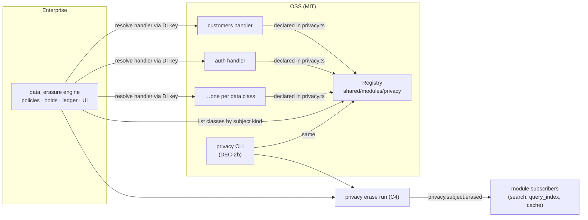

# GDPR-ready deployments — program spec

> **Tracker:** open-mercato/open-mercato#8593
> **Evidence:** [`GDPR/analysis/2026-11-15-gdpr-readiness-audit-verification.md`](analysis/2026-11-15-gdpr-readiness-audit-verification.md) — the baseline was read against `main` @ `08dada9624`; tracker and unmerged-branch states are dated observations, not current implementation evidence.
> **Kind:** program spec. It orders work, fixes cross-cutting rules and names the spec that carries each design. It orders carrier work rather than defining an independently buildable feature; no package may be implemented from this file alone. A9’s section records acceptance requirements that its issue carrier must carry.
> **Status:** our own plan. Its decisions are settled under Decisions. Upstream implementation follows the dependency order under Phasing and the pull-request process gates that repository policy requires; this plan grants none of those approvals.

Extends: .ai/specs/2026-08-18-tenant-legal-documents-and-consent-versioning.md
Extends: .ai/specs/2026-10-22-crm-contact-permissions-and-consent-history.md
Extends: .ai/specs/2026-10-09-eu-transactional-email-providers.md
Extends: .ai/specs/2026-10-29-production-content-security-policy.md
Extends: .ai/specs/2026-11-06-setup-encryption-preflight.md
Extends: .ai/specs/enterprise/2026-11-13-sign-in-activity.md

## 📝 TLDR

Operators who run Open Mercato on EU personal data cannot today answer a data-subject request, bound how long data is kept, or name their sub-processors from the product alone. Issue #8593 proposes a seven-phase umbrella to fix that. **Proposed (future):** deliver it as seven dependency-ordered tracks of 52 independently shippable work packages. Each package is bound to a carrier: an existing spec, an open PR, a tracked issue, or one of the 39 written child specs listed here. Designs that so far existed only on the unmerged PR #5557 branch are re-specified in our own child specs; that branch is reference only. The issue's audit was re-verified first; about a third of its claims were stale, wrong or narrower than stated, and this plan uses the corrected baseline.

**Out of scope:** legal work that stays with the controller (lawful-basis assessment, DPAs, DPIA content, review of the Art. 30 register, age verification and parental consent, an in-product breach register). The platform supplies mechanisms and generated drafts, not legal conclusions.

## 📝 Overview

"GDPR-ready by default" means: a deployment that follows the documented path has a product mechanism or a documented procedure for each data-subject right, privacy-preserving production defaults, a documented list of data flows, and a command that reports what is still missing. A right met by a procedure alone is named under [Known limits](#known-limits), and #8593 closes with that list stated.

> **Market reference.**
> - **WordPress core** (4.9.6+) and **Frappe/ERPNext** both solve cross-module erasure with a *registry*: each plugin or app declares the personal data it holds and supplies its own exporter and eraser; the core only orchestrates. Adopted — this is the data-class contract (Track C). Rejected: a generic SQL deletion engine, which bypasses module rules and side effects.
> - **Discourse** and **GitLab** *anonymize* accounts linked to records that must survive (posts, commits) instead of refusing deletion. Adopted for people linked to deals and sales documents.
> - **Matomo** ships scheduled retention with instance defaults an operator can tighten. Adopted for operational tables (Track D).
> - Not adopted: a built-in cookie-consent manager. The core app sets only first-party functional cookies, so the program ships a consent *gate* for apps that add trackers.

## 📝 Problem Statement

**What is true today**

- **No data-subject tooling outside `forms`.** There is no export for a CRM person, portal user or staff user. Deleting a person is refused when deals are linked, and nothing anonymizes. Undo snapshots keep the full deleted record indefinitely; the staff-user snapshot includes `passwordHash`. Attachments, messages, AI chats and notifications are untouched by any subject delete.
- **Retention is mostly absent.** Five pruners exist and nothing schedules them. Action logs, staff sessions, webhook deliveries, messages, AI chats and soft-deleted rows are never pruned. An admin cannot wire the pruners by hand, because the scheduler UI only targets `schedulerSafe` workers and none of them is.
- **Encryption has holes.** With no Vault and no fallback key, mapped writes land as plaintext and the only signal is a log line. Nine column groups the issue names are unmapped, and a second tier it does not name (documents, staff HR data, workflow context, integration logs) has no coverage either.
- **Transparency is vendor-specific.** `/privacy` and `/terms` name the vendor as controller. There is no consent history for CRM contacts or visitors, no suppression list and no unsubscribe. The staff consent ledger in `auth` is outside E5 (see Track E).
- **No accountability surface.** Auth events are ephemeral and carry no IP, there is no deployment or sub-processor documentation, and no `mercato` doctor or privacy command. The starter has a separate environment audit, `yarn om doctor`.

**Corrections to the issue's audit**

| Issue says | Verified |
|---|---|
| Published fallback key in production Compose | Fixed (#7231). The refusal lives only in the Compose preflight; the runtime accepts any key |
| `sendEmail` is Resend-only | Stale. SES and SMTP transports ship; Brevo and Mailjet do not exist |
| No access-log retention | Wrong. Rotation runs inline at 7 days / 8 hours |
| 27 modules ship encryption maps | 25 definition files: 24 packaged module sources plus the create-app example template |
| Defaulting `SEARCH_EXCLUDE_ENCRYPTED_FIELDS` to on closes the search leak | It covers Meilisearch only, not the token index, vector text or `search_text` |
| Moderation is hard-coded to `api.openai.com` | It is a fallback URL; moderation is off by default |
| #5557 has no CI on head | CI runs and fails |

**Gaps the issue does not list**

- Attachment OCR is hard-wired to OpenAI.
- AI tools return decrypted CRM data to the LLM with no masking.
- About fifteen person-data modules are missing from the erasure list.
- Production Compose defaults Meilisearch to a development key.
- The `auth.user.deleted` event carries `id`, but two cascade subscribers read `userId`. The channel cascade returns early; the SSO cleanup has no guard and supplies an undefined id to its statements. This is verified by reading; its SQL and runtime result are not reproduced in this record.
- The issue plans no mechanism for restriction of processing or for objection outside marketing (see the coverage map).

## 📝 Prior spec drift

- `.ai/specs/enterprise/2026-07-08-gdpr-data-erasure.md` → Data Model, API Contracts: specifies an `erasure_request` ledger and `POST /api/data_erasure/requests`. No code exists on `main`. The implementation on `upstream/feat/security-readiness` uses `privacy_operations` and `/api/data_erasure/subjects` and brings anonymization in scope; the PR itself annotates the older file as design history. The older spec is now annotated as superseded by `privacy-subject-erasure` for the operation and `privacy-dsr-engine` for governance. Its earlier design is history, not an implementation order.
- `.ai/specs/2026-09-30-unified-crm-email-history-and-context.md`: specifies refusing person and company DELETE while email history exists. That refusal is not in code; today the delete removes those interactions. When it is implemented it must exempt the erasure path (recorded in C4's spec).
- `.ai/specs/2026-10-22-crm-contact-permissions-and-consent-history.md`: the issue cites it for unsubscribe links and `List-Unsubscribe`. The spec covers consent history and suppression only; it names public preference centres as a non-goal and never mentions the header. Its tracker #7700 covers CRM field-model Phase 1 only (#8779 confirms), so the consent work has no tracking issue.
- `.ai/specs/2026-10-09-eu-transactional-email-providers.md`: keeps Resend as the runtime default. The issue's "EU-first default providers" would contradict it (DEC-6).
- `.ai/specs/2026-08-18-tenant-legal-documents-and-consent-versioning.md`: designs tenant legal documents in the OSS directory while its tracker #5423 is labelled `enterprise`; DEC-2 keeps it in OSS, as the spec places it. This cross-edition program only references enterprise designs by carrier.
- `.ai/specs/enterprise/2026-11-13-sign-in-activity.md`: rejects persisting sign-in events in OSS because its tracker #8106 is labelled `enterprise`. The issue cites #7972 for the audit trail, but #7972 is a separate Job Inspector access-log defect.
- `upstream/feat/security-readiness:.ai/specs/2026-08-21-access-log-durability-retention.md`: proposes blocking access-log writes with a 90-day default. `main` rotates inline at 7 days / 8 hours, and PR #8472 bounds writes differently. **Recorded status, 2026-11-15:** QA-approved with automerge; implementation checks that it has landed before using it. This is the single status record referenced by D4.
- Backups: #4030 (open) says backups belong at the infra layer. PR #9333, which builds an enterprise `backups` module, is in the merge queue with automerge.

## 📝 Resolved assumptions (autonomous defaults)

### Decisions

These are the program's decisions (issue assignee, 2026-11-15 and 2026-11-16). Each row states the decision and its rationale. Where repository policy requires a named approval at pull-request time, the row names that process gate; the design itself is settled. Rejected options are under Alternatives considered. Decision ids use the `DEC-` prefix; `D1`–`D6` elsewhere in this file are Track D packages.

| # | Decision | Rationale and process gate |
|---|---|---|
| DEC-1 | This file is a program spec. Missing designs are child specs, one independently deployable capability each, written as follow-ups. | None |
| DEC-2 | **Edition split.** OSS: security defaults, defect fixes, the MIT privacy contract types, module-owned handlers in the modules that own the data, and the rights invokers of DEC-2b. Enterprise: tenant policies, legal holds, the operation ledger, the privacy admin UI, restore replay and alerting. The Ed. column under Work packages gives each package's edition; E1 stays OSS as the 08-18 spec places it. Every carrier's own edition assumption keeps its written placement under this split. | Handlers must live in the module that owns the data, and those modules are OSS; an enterprise-only build would have to query core tables directly, which breaks module isolation. Governance at scale is the commercial line; the right itself is not. The issue carries `enterprise`, and the maintainer comment on #8593 (2026-11-12) refuses community PRs implementing it in OSS; this work is carried by the core-member assignee (Enterprise ownership, below). Process gate: each upstream PR goes through ordinary maintainer review. |
| DEC-2b | **OSS invokers.** A minimal OSS CLI runs registered handlers for one subject, with no ledger, holds or UI: C1 export and C4 erase (including C6). C7 portal download and deletion, and `portal-email-change` (email-change assumption 7), are OSS with them. | Data-subject rights are not paid-only: every deployment can answer access, erasure and rectification requests from the product. Email change is Art. 16 rectification of the portal account, which lives in OSS `customer_accounts`; its verification, old-address notice and session end protect every deployment. Enterprise adds the ledger, holds, policies and admin page on top (C3). |
| DEC-3 | **We write our own specs; PR #5557 is reference only.** The seven designs that exist only on its branch are re-specified in our own child specs (table below). Where its design is sound we keep the same contract and event names so the two can converge, and credit it. | None to proceed. If #5557 or a slice of it lands on `main` first, the matching child spec is rebased onto it or withdrawn. |
| DEC-4 | **Backups.** Erasure replay also works for a restore performed outside the product (infra-level point-in-time recovery). C9 uses an external manifest independent of the backup module. | Infra-level recovery is the usual restore path; replay tied to a product backup module would leave it unprotected. Recorded 2026-11-15: #9333 was in the merge queue with automerge, while #4030 opposed an app module. The decision holds under either outcome, because the manifest does not depend on the backup module. |
| DEC-5 | **Breaking defaults** follow `BACKWARD_COMPATIBILITY.md` as set out under Migration: the exception only where the accepted input is itself the vulnerability, the ordinary protocol everywhere else. | Process gate: each exception PR carries the named maintainer approval that `BACKWARD_COMPATIBILITY.md` requires. |
| DEC-6 | **MFA and default providers.** Staff TOTP moves to OSS (E7); enforcement policy and SSO assurance stay Enterprise. The runtime email default stays as the 10-09 spec has it. The create-app template's `.env.example` leaves the email and AI provider for the operator to choose (F4); docs list EU options first; `doctor` warns on a non-EU choice. | A second factor on staff accounts that reach personal data is a baseline Art. 32 control and should not be paid-only; requiring it by policy is governance and stays Enterprise. Changing the runtime default would break existing installations with no security gain; the template choice and the doctor warning steer new ones. |
| DEC-7 | The audit file cited by the issue was never committed. The verification record linked above stands in for it. | None |
| DEC-8 | **Restriction and objection: C10 option A.** Art. 18 restriction and an Art. 21 objection other than to direct marketing are met by a documented procedure with existing controls, and the product claims no technical restriction. The statement is carried under Known limits; G5 publishes the procedure. | A record freeze (option B) blocks edits while reads, the assistant, reports, automation and disclosures continue, so it does not implement Art. 18 and invites being read as if it did. Technical restriction (option C) needs every read, write and sender path inventoried and enforced across modules. An honest procedure is what the product can stand behind. C10 keeps the freeze requirements for any later spec. |
| DEC-9 | **Tenant reader ownership: module-owned readers.** C8 and G6 share the DEC-G export/scan reader API (C8 assumption 1). Each owning module reads its own tables with the shared helper and registers its reader through DI. No generic cross-module reader is built. | It keeps the no-cross-module-table-access rule with no exception. The cost is one registration per module, which the C5 census already enumerates. The registrations land before C8 and G6. |
| DEC-10 | **Module id.** G4 creates the module id `privacy`, shared by C1 and later packages. | `privacy` is a mass noun with no plural, like the existing `security`, `content`, `progress` and `availability` ids. A module id is frozen once shipped, so it is settled before the G4 scaffold. |
| DEC-11 | **Model input, F1 Q1: option B.** No field-level model-input control. G5 ships **What the assistant sends to a model** in `impact-assessment-notes.mdx` before #8593 closes. | A narrow withholding filter would cover typed tool output only, while page context, search text, attachments and user input still reach the model, and it would be read as masking. Provider policy (F1) is the control the product can enforce; the disclosure tells the controller exactly what is sent. Provider permission alone never implies field minimisation. |
| DEC-12 | **Later published lookup-secret refusal.** A2 opens the separately tracked release task **Refuse unsafe lookup secrets after B1 Phase D**. It ships under its own Emergency Security Exception once the B1/B4 repair gates pass. Weak/missing lookup findings always receive their own warning minor, and explicit deprecated `warn` remains supported. | A published lookup secret is itself the vulnerability, as with A1's published key: anyone can compute the lookup hashes. Process gate: that PR carries its own named security-maintainer approval; neither A1 nor #7231 grants it. |
| DEC-13 | **C7 existing-write compatibility.** Narrowed existing profile/password-change/reset-confirm behavior (registry and cross-site checks, credential fences and the shared re-authentication 429) ships under its own Emergency Security Exception, separate from A1 and C2. No registry-bypass toggle ships. | The accepted cross-site or unthrottled request is itself the vulnerability; a one-minor bridge would keep it exploitable. Process gate: the affected PR carries the qualifying argument, a dated `BACKWARD_COMPATIBILITY.md` entry, client/operator `UPGRADE_NOTES.md` notes, the `security` label and the named security-maintainer approval. |

**Enterprise ownership.** Enterprise packages (C3, C9, C10, D5, D6, E4, E6, G1, G2) can only be shipped upstream by a contributor on the allowlist. **Resolved 2026-11-16:** the issue assignee is a core member authorized to change enterprise modules and owns them. DEC-2 fixes which edition each capability belongs to.

**Packages re-specified in our own child specs instead of taken from #5557**

| Package | Our child spec | Reference on the branch |
|---|---|---|
| A3 | `kms-fail-closed` | `2026-08-20-production-encryption-fail-closed.md` |
| C1 | `privacy-data-class-contract` | `enterprise/2026-08-21-privacy-retention-dsr-engine.md`, `packages/shared/src/lib/privacy/contracts.ts` |
| C2 | `audit-snapshot-redaction` | `2026-08-20-command-audit-sensitive-data-redaction.md` |
| C3, D5 | `privacy-dsr-engine` (enterprise) | `enterprise/2026-08-21-privacy-retention-dsr-engine.md` |
| C8 | `tenant-exit-export` | `2026-08-24-tenant-exit-export.md` |
| C9 | `erasure-restore-replay` (enterprise) | the same DSR engine spec |
| D4 | `access-log-retention` | `2026-08-21-access-log-durability-retention.md` |

## ⚠️ Council-review cross-spec decisions

Fixing the two four-model council reviews of this spec set required decisions that span several child specs. Child specs cite them by id: `DEC-A`–`DEC-J`, `R3-1`–`R3-14`, `R4-1`–`R4-14` and `R5-1`–`R5-11`. This section is the index of record. The owner named in each decision carries the normative design in its own spec, and the other specs cite it.
- **Not the same as DEC-1 to DEC-8.** Those are the program's own working assumptions, listed under Decisions above.
- **Precedence.** When a later decision refines an earlier one, the later one wins. The R5 rules on portal recovery and development processes refine R4-2 and R3-11.
- **Reports.** The council reports are `.ai/analysis/2026-11-16-gdpr-specs-council-review.md` and `…-round2.md`.

### Round one (after the first council)

#### DEC-A — Subjects known only by an identifier (`privacy:identifier`) — issues g2-03, g3-03, g4-04
- **Deterministic id.** The subject id is derived as a keyed digest of the tenant id, the identifier type (`email` | `phone`) and the normalized identifier, under a key separated by purpose: the label `privacy-subject-id`, derived from the installation's lookup secret material. It is stable across processes and runs while that secret is unchanged. It is never equal to a stored lookup hash, so it matches no column. Format: `idv1_<base32 digest>`. The contract spec (owner: privacy-subject-erasure and privacy-data-class-contract) defines the normalization and the derivation; the others only rely on these properties.
- **Erase by identifier.** `mercato privacy erase` accepts `--email <address>` and `--phone <number>`. The dry run reports the derived id. `--apply --confirm <token>` must be given the same identifier flags again: the run recomputes the id and the aliases, and refuses on any mismatch. The CLI dispatcher redacts these values in its banner and logs.
- **The event.** `privacy.subject.erased` carries the derived id with kind `privacy:identifier`, and never the alias hashes.
- **Holds** (owner: action-log-retention, privacy-record-retention, privacy-dsr-engine, portal-privacy-self-service, erasure-restore-replay, DSR engine).
  - A hold may be placed on a `privacy:identifier` subject: the administrator types the identifier and the engine stores the derived id.
  - A hold on a person or portal user also stores the derived identifier ids of that subject's current email addresses and phone numbers. They are computed when the hold is created and again on every extend, and stored in clear with the hold (they are keyed digests that match no column).
  - The erasure guard refuses an identifier subject whose id equals any id held by an active hold.
  - Stated gap: a contact point added to a person after the hold was created or last extended.
- **Replay** (owner: action-log-retention, privacy-record-retention, privacy-dsr-engine, portal-privacy-self-service, erasure-restore-replay) stays manual, as already specified. `--acknowledge <runId>` additionally verifies that a completed erasure entry for the same derived id exists after the restore. Without one it refuses.

#### DEC-B — The audit-history strip routine — issues g2-06, g5-09, g5-10
- **OSS ownership.** OSS owns `actionLogService.applyRetention` together with the `action_logs.stripped_at` column, its partial index and migration, the list-response fields `strippedAt` and `changedFields`, and redo returning 410 for a stripped entry.
  - The OSS erasure spec (owner: privacy-subject-erasure and privacy-data-class-contract) specifies them normatively, in its Data Models, API Contracts, Phase 2, file manifest and unit tests (which assert context reduction).
  - `subjectHistoryService` becomes a thin by-subject wrapper over `applyRetention`.
  - The enterprise action-log retention spec (owner: action-log-retention, privacy-record-retention, privacy-dsr-engine, portal-privacy-self-service, erasure-restore-replay) consumes them as provided by the OSS erasure spec, removes its own normative definition of them, and keeps policies, scheduling, settings and the enterprise sets.
- **The signature.** Both specs cite it exactly:
```ts
applyRetention(input: {
  tenantId: string | null
  organizationId?: string
  olderThan?: Date
  mode: 'strip' | 'delete'
  limit: number
  after?: string
  includeResourceKinds?: string[]
  excludeResourceKindPrefixes?: string[]
  includeRecords?: Array<{ resourceKind: string; resourceId: string }>
  excludeRecords?: Array<{ resourceKind: string; resourceId: string }>
  includeSubjects?: PrivacySubjectReference[]
  excludeSubjects?: PrivacySubjectReference[]
  dryRun: boolean
}): Promise<{ matched: number; changed: number; skipped: number; next?: string; done: boolean }>
```
- **The matching rule.** An entry matches a record when the record equals the entry's (`resource_kind`, `resource_id`), (`parent_resource_kind`, `parent_resource_id`) or (`related_resource_kind`, `related_resource_id`).
  - A subject matches through its root record and through the `historyRecords` its classes return.
  - `organizationId` limits the run to that organization plus entries with no organization.
- **Holds** (owner: action-log-retention, privacy-record-retention, privacy-dsr-engine, portal-privacy-self-service, erasure-restore-replay). `excludeSubjects` and `excludeRecords` use the same three-column rule. Age-based stripping fails closed: a change-history set is skipped for a tenant that has an active subject hold whose subject could appear in that set's entries only inside snapshots. The skip is recorded as a skipped pass with reason `hold_not_honourable`. The only opt-out is a per-policy flag in the DSR engine spec, `allowUnmatchedHolds`, default `false`.

#### DEC-C — Retention sets and holds — issues g5-08, g4-05, g3-04, g3-11
- **The declaration.** A retention set declaration (record-retention spec, owner action-log-retention, privacy-record-retention, privacy-dsr-engine, portal-privacy-self-service, erasure-restore-replay) gains `excludableSubjectKinds: string[]`: the subject kinds whose records its handler can leave out when given `excludeSubjects`.
- **The command.** `mercato privacy retention` gains a repeatable `--exclude-subject <kind:id>`.
- **The guard.** The command consults an optional DI key `privacyRetentionGuard`, method `excludedSubjects({ scope, setId })`, which returns `{ subjects: PrivacySubjectReference[] }` or throws. The enterprise DSR engine registers it from active holds.
  - A guard that is registered and fails makes the run refuse.
  - A held subject whose kind is not in the set's `excludableSubjectKinds` makes the set skip, with reason `hold_not_honourable`. This fails closed.
- **The engine.** The DSR engine's record-mode retention applies the same rule (owner: action-log-retention, privacy-record-retention, privacy-dsr-engine, portal-privacy-self-service, erasure-restore-replay).
- **Coverage sets.** Coverage specs that add retention sets (`sales`, `checkout`, `staff`; owners privacy-coverage-commerce, -communication, -people-ops and C2) declare `excludableSubjectKinds`, and run their sets through the record-retention command or the engine.

#### DEC-E — The dev-runtime mark — issues g1-03, g7-07
- **Bound to the runner.** The exemption from the production refusal is bound to the live dev runner, not to a bare variable. The runner generates a per-run nonce and passes it to its children, as `scripts/dev-runtime-supervisor.mjs` already does with `OM_DEV_RUNTIME_TOKEN`. A process honours the dev mark only when that binding is valid.
- **Without a valid binding** a process that sees the mark treats itself as production, so the refusal applies, and it logs once at error level. The key-guard spec (owner: encryption and search specs) specifies the mechanism and its tests.
- **The doctor cannot see other processes' modes, and says so** (owner: privacy-doctor-cli and privacy-verification-suite).
- **The program** (owner: program) replaces "the doctor reports services running outside production" with a reference to the key guard's runtime check.

#### DEC-F — The B1 hand-offs — issues g0-03, g1-04
The encryption-map spec (owner: encryption and search specs) gains **"Phase D — Lookup hashes and system-scope rotation"** with three items:
1. `customers` email and phone lookup-hash columns. The module writes them whatever the encryption state, and a fill command populates existing rows.
2. `mercato entities rehash-lookups --tenant <id> [--apply]`. It is scoped and resumable, handles the old and current secret, and covers every mapped `*_hash` lookup column.
3. Rotation of system-scoped records, extending the existing `mercato entities backfill-system-encryption`.

The key guard's flip gates and refusal exits (owner: encryption and search specs) point at Phase D. The program's B1 row and constraints (owner: program) point at "B1 Phase D".

#### DEC-G — The tenant-export reader and its declarations — issues g3-12, g7-12
- **Where declarations live** (owner: privacy-coverage-content-ai, privacy-coverage-enterprise, tenant-exit-export, privacy-table-coverage). Export declarations move out of the per-table `tables` coverage map into a separate member of the `privacy.ts` default export, `tableExports`, keyed by table name and independent of where coverage places the table. The table-coverage spec (owner: privacy-coverage-content-ai, privacy-coverage-enterprise, tenant-exit-export, privacy-table-coverage) is amended in the same change, so an export-only entry does not count as a coverage declaration.
- **A scan mode for the reader.** The reader gains `mode: 'export' | 'scan'`. `scan` ignores `exclude` and `redact`, decrypts in memory, never writes values, and reports every table it cannot read as not scanned. C2 adds it to the tenant-exit spec; the verification-suite spec (owner: privacy-doctor-cli and privacy-verification-suite) uses it.

#### DEC-H — The counting-period bridge — issue g5-06
History deletion in the operational pruners and in forms retention ships **opt-in for one minor**: off by default, with a warning at start and in `doctor` that names the next minor's default. It is on by default from the next minor. Deleting expired rows (not history) is unaffected. Owner D, in both the pruners spec and the forms-retention spec. The program is not changed for this.

#### DEC-I — The doctor's extension point — issue g7-02
The `privacy.ts` default export gains an optional member, `doctorChecks`, validated by the shared collector. No generator change is needed. Owner F2. This is consistent with the contract spec's "later specs add optional members".

#### DEC-J — Modules with no coverage owner — issue g0-04
| Module | Assigned to | Owner |
|---|---|---|
| `workflows` | content-ai coverage spec | C2 |
| `shipping_carriers`, `promotions`, `customer_groups` | commerce coverage spec | C1 |
| `packages/carrier-*` | commerce coverage spec | C1 |
| `packages/channel-*` | communication coverage spec | C1 |

- **In each domain spec** a subsection is added, "Modules assigned after the council review". For each module it records the person data found in the module's entities (by reading code), and then gives either a class design (find, export, erase) or an explicit, reasoned exemption, or a backlog entry naming what is missing.
- **In the program** (owner: program) the roll-out table records the assignment.

### Round three (fixing round-two findings)

#### R3-1 — The audit-history rule for every erasure (owner: privacy-subject-erasure, erasure spec)
Issues: r3e-01, r3e-02, r6-01, r5-06.

1. **Every edited record is a history record.** Every class's `eraseSubject` returns, as `historyRecords`, every record it changes, deletes, anonymizes or blanks. That includes records owned by OTHER people that it edits, for example an interaction whose participant list loses the subject. Coverage specs MUST list their history records per class.
2. **The history strip runs twice.**
   - **Before the first change.** It runs right after the owner locks the account and before the first dependant writes. Existing entries lose their undo and redo payloads before anything changes, so undo and redo are blocked from the run's first write.
   - **After the owner.** It runs again after the owner, to catch entries written during the run.
   - **Idempotent.** Both passes use `applyRetention` with `includeSubjects` and `includeRecords`.
3. **Undo and redo refuse a stripped entry.** An undo or redo that already loaded an entry before the strip is refused at execution, because the command re-checks `stripped_at` under the row lock (redo already returns 410; undo gains the same check).
4. **Internal blanking functions write no snapshot.** They also log no audit entry carrying the cleared values.

#### R3-2 — The registry carries the whole `privacy.ts` default export (owner: privacy-data-class-contract / privacy-table-coverage, contract spec)
Issue: r4-02.
- **The registry member.** The generated module registry exposes the validated default export object of `privacy.ts` as `privacy` on the module's entry.
- **Collectors.** `getPrivacyDataClasses`, `getPrivacyDoctorChecks`, `getTableExports`, `getRetentionSets` and `getPrivacyTables` read members from that object. One validation step runs per member.
- **Additive members.** Later specs add optional members without touching the generators.
- **The old field.** `privacyDataClasses` on the registry entry is kept, derived from `privacy.dataClasses`, so nothing that already reads it breaks.

#### R3-3 — Tenant privacy settings live in `module_configs` (owner: privacy-data-class-contract / privacy-table-coverage, contract spec)
Issues: r5-04, r5-05 and every other "age that cannot be set".
- **Where they are stored.** Tenant privacy settings are rows in the existing tenant-scoped `module_configs` table (unique per module, name and tenant), with `module_id = 'privacy'` and names under `retention.<area>.<setting>`. Examples: `retention.sales.orderAgeYears`, `retention.checkout.paymentAgeYears`, `retention.staff.employmentRecordAgeYears`, `retention.eudr.recordAgeYears`. No new table.
- **Reading and setting.** The `privacy` module reads them through `privacySettingsService.get(scope, name)`. They are set with `mercato privacy settings set --tenant <id> <name> <value>` and listed with `mercato privacy settings list --tenant <id>`. The enterprise privacy page edits them too.
- **Declaration.** A coverage spec that needs a setting declares its name, type, unit, minimum and default (usually none: unset means the set refuses).

#### R3-4 — An opt-in database tier for the doctor (owner: privacy-doctor-cli / privacy-verification-suite / tenant-exit-export, doctor spec)
Issues: r2iqa-02, r5-04.
- **The default run** stays configuration-only.
- **The database tier.** `mercato privacy doctor --database` also runs checks declared with `needs: 'database'`. Such a check receives a read-only `EntityManager` and the tenant list, and may run counting queries only. It never returns personal data.
- **Consumers.** Search-index token counts, unset retention settings and similar checks declare `needs: 'database'`.

#### R3-5 — Holds, honestly (owners: program, program; operational-retention-pruners / forms-retention-scheduling / inactive-subject-retention, forms retention)
Issues: r0-02, r8-03.
- **The program's Known limits** say that legal holds exist only with the enterprise engine. OSS has `--exclude-subject` for the record-retention command and nothing else. Operational pruners delete rows that are not about a subject (expired tokens, logs by age), and holds do not apply to them.
- **Forms retention** consults the optional `privacyRetentionGuard` (DEC-C) before anonymizing. With a guard present, held subjects are left out, or the run is skipped with `hold_not_honourable`. With none, it runs as specified.

#### R3-6 — The form-to-deals reason set (owner: privacy-coverage-communication / privacy-coverage-content-ai / form-to-deals, form-to-deals and content-ai specs)
Issues: r0-01, r6-07.
The form-to-deals erasure subscriber acts on `reason` in {`request`, `erasure`}: both are subject-driven. It acknowledges `retention`, or a missing reason, with no writes. The `forms.submission.anonymized` payload's `reason` enum is exactly `request | erasure | retention`.

#### R3-7 — Chat file release honours other conversations (owner: privacy-coverage-enterprise / privacy-record-retention / action-log-retention, record-retention spec)
Issue: r6-02.
The ids come from the client. So before releasing an id, the assistant handler reads `attachment_ids` on the tenant's other conversations' messages and pending actions, which are its own tables. An id that another conversation not being deleted in the same batch still lists is dropped from the deleted rows only, and reported. It is never released.

#### R3-8 — Retention drains its own pending file deletions (owner: privacy-coverage-enterprise / privacy-record-retention / action-log-retention, record-retention spec)
Issue: r6-05.
`privacyRetentionService.run` calls `drainPendingDeletions(scope, { origin })` for the set's origin after every committed batch, whoever called it: the command or the enterprise engine. The DSR engine (privacy-dsr-engine / erasure-restore-replay) cites this and adds no drain of its own.

#### R3-9 — Organization-scope guard on every DSR route (owner: privacy-dsr-engine / erasure-restore-replay, DSR engine)
Issue: r7-02, which is round one's g4-01, marked incomplete.
- **No factory hook.** Do not rely on a `makeCrudRoute` hook.
- **A wrapper on every export.** Each route file wraps every exported method (`GET`, `POST`, `PUT`, `DELETE`, including those `makeCrudRoute` returns) in a module helper, `withTenantWideScope(handler)`. It resolves the auth scope, returns 403 when `isUnrestrictedOrganizationScope` is false, and only then calls the handler.
- **Coverage.** Policy delete and the holds command path are covered by construction.
- **Tests.** A unit test enumerates the module's route files and fails on any exported method that is not wrapped.

#### R3-10 — One definition of a stale hold (owner: privacy-dsr-engine / erasure-restore-replay, DSR engine)
Issue: r7-01, which is round one's g4-04, marked incomplete.
- **The rule.** A hold is stale when it carries any derived id, whether a `privacy:identifier` subject id or a non-empty `identifier_subject_ids`, and its `identifier_key_check` is missing or differs from the current one.
- **Person and portal-user holds** also store `identifier_ids_computed_at`.
- **Without a lookup secret**, identifier holds cannot be created (refused with a reason), and person holds store no identifier ids. Erasure by identifier is already refused then (contract spec), so nothing is unprotected.

#### R3-11 — The dev-runner binding is delivered over IPC (owner: encryption-map-coverage-and-backfill / runtime-encryption-key-guard / kms-fail-closed, key-guard spec)
Issue: r1kk-04, which is round one's g1-03, marked incomplete.
- **Delivery.** `mercato server dev` spawns its children with an IPC channel and sends them the nonce as an IPC message at start. The nonce is NOT passed in the environment.
- **Honouring the mark.** A child honours the dev mark only when all three hold: it received that message from its parent; the parent is alive; and `.mercato/dev-runtime-mark.json`, at a fixed path in the project and never taken from the environment, holds the same nonce and the parent's PID.
- **Without the binding** the process treats itself as production and logs once at error level.
- **Threat model.** The spec states the threat model: this stops accidental or copy-pasted bypasses. Someone with shell access who deliberately forges a parent process is out of scope, and the docs say so.

#### R3-12 — Fill commands for module-written hashes (owner: encryption-map-coverage-and-backfill / runtime-encryption-key-guard / kms-fail-closed, encryption-map spec)
Issue: r1kk-02, which is round one's g1-04, marked incomplete.
- **What Phase D specifies.** Phase D names and specifies a fill command for each module-written hash:
  - `mercato customers fill-lookup-hashes`, which does NOT exist in the code today: it is a new command that Phase D item 1 specifies, together with the `customer_entities.primary_email_hash` and `primary_phone_hash` columns;
  - one for the SSO hashes and one for the inbound-sender hashes that Phase C adds, named after their real modules, read from Phase C.
- **The key guard** (also encryption-map-coverage-and-backfill / runtime-encryption-key-guard / kms-fail-closed) lists exactly these commands.

#### R3-13 — No `related_subjects: include` anywhere (owner: privacy-dsr-engine / erasure-restore-replay, DSR engine)
Issues: r7-04, r8-04 (round one's g5-05, marked incomplete).
DSR policies offer `skip` (the default) and `exclude` only. An included related subject would be erased without being on a reviewed list. The inactive-subject spec (operational-retention-pruners / forms-retention-scheduling / inactive-subject-retention) states that the engine follows the same rule.

#### R3-14 — The `eraseSubjects` entry point (owner: privacy-subject-erasure, erasure spec)
Issue: r3e-03.
The erasure spec defines the input and result exactly as below. The portal (portal-privacy-self-service), inactive-subject (operational-retention-pruners / forms-retention-scheduling / inactive-subject-retention), DSR (privacy-dsr-engine / erasure-restore-replay) and replay (privacy-dsr-engine / erasure-restore-replay) specs cite these names.
```ts
type PrivacyErasureOrigin = 'cli' | 'portal' | 'retention' | 'engine:request' | 'engine:retention' | 'engine:replay'
eraseSubjects(input: {
  scope: PrivacyScope
  subjects: PrivacySubjectReference[]
  excludedRelated: PrivacySubjectReference[]
  prefer: PrivacyErasurePreference
  actor: PrivacyActor
  reference: string
  origin: PrivacyErasureOrigin
  mode: 'dry-run' | 'apply'
}): Promise<PrivacyErasureRunResult>
type PrivacyErasureRunResult = {
  runId: string | null
  complete: boolean
  reportDigest: string
  subjects: Array<{
    subject: PrivacySubjectReference
    status: 'complete' | 'incomplete' | 'refused' | 'not_found'
    refusalCode?: string
    sections: PrivacyErasureSectionResult[]
    relatedSubjects: PrivacySubjectReference[]
    filesPending: number
  }>
}
```
- **Status for a subject with no record.** `not_found` is reported, not refused, when a subject with a record no longer exists.
- **Replay** (privacy-dsr-engine / erasure-restore-replay) treats `not_found` as satisfied for a subject with a record, and inserts the applied row (issue r7-03).
- **The event** carries no free-text `reference` (r3e-04): the reference stays in the audit entry only.

### Round four (closing gaps left by the fixes)

#### R4-1 — Per-user credential deletion has one owner (owners: privacy-coverage-commerce / privacy-coverage-people-ops people-ops, privacy-coverage-communication / privacy-coverage-content-ai / form-to-deals communication)
- `integrations.user_credentials` (people-ops spec) is the only class that deletes per-user credential rows for a subject.
- The communication class disconnects the subject's channels and clears their credential pointers in the records group. In a DSR run it makes no credential call: `integrations.user_credentials` deletes the user's credentials in the credentials group. A9's channel cascade calls `deleteUserCredential`. Communication declares no credential class of its own.
- The A9 cascade calls the same integrations method.

#### R4-2 — Authority for a portal-initiated erasure (owner: privacy-subject-erasure erasure; portal-privacy-self-service portal cites)
- **Who may run.** The erasure run accepts origin `portal` only from the portal deletion worker, with actor `{ kind: 'system', worker: 'portal-self-service' }`.
- **What it may touch.** The run is limited to exactly one subject, the requesting `customer_accounts:user`, with every related subject excluded. Its scope is the account's tenant.
- **The authority boundary.** This system worker needs no staff authorization, because the data subject's own verified request is the authority. The erasure spec states this boundary normatively. Self-service assumption 11 is then satisfied, and the design is complete.

#### R4-3 — Expiry of tenant-export evidence with no tenant (owner: privacy-doctor-cli / privacy-verification-suite / tenant-exit-export tenant-exit; privacy-coverage-enterprise / privacy-record-retention / action-log-retention action-log cites)
- Evidence rows of `privacy.tenant_export` with no tenant are bounded by an installation setting, `OM_PRIVACY_INSTALLATION_EVIDENCE_AGE_DAYS`: default 365, floor 30.
- The same expiry set applies it to rows with `tenant_id` null. It is listed in both `.env.example` files.
- **The invocation.** Record retention owns it: `privacyRetentionService.runInstallation` / `mercato privacy retention --installation`, for sets declaring `installationScope: true`, reading only rows with `tenant_id IS NULL`. `PrivacyScope` stays tenant-required. A hold in any tenant skips the run; an Enterprise set or class hold refuses it. The same age bounds the installation run's own null-tenant summaries through `privacy.retention_evidence`.

#### R4-4 — Erasure-evidence expiry waits on owner signals (owner: privacy-subject-erasure erasure; privacy-dsr-engine / erasure-restore-replay DSR engine and replay implement)
- **The seam.** The erasure spec defines an optional DI seam, `privacyErasureEvidenceHold`, with one method: `isPending({ scope, runId }): Promise<boolean>`.
- **How expiry uses it.** Expiry of erasure evidence skips a run when any registered provider returns true. It counts the run as `held_by_owner` and retries on the next pass. A provider that throws counts as pending. Without providers, nothing is held.
- **Implementations.**
  - The DSR engine returns true while the run has an unresolved operation or reconciliation, and for every run in a tenant while an accepted erasure there has no saved run id.
  - Restore replay returns true while the run has a `privacy_erasure_pending` row, or an applied row without its file.
  - Each provider is answered from its own rows only.
- **This replaces every "proof contract" handoff.**

#### R4-5 — Attachment pending-deletion rows (owner: privacy-subject-erasure erasure; privacy-data-class-contract / privacy-table-coverage table coverage; privacy-doctor-cli / privacy-verification-suite / tenant-exit-export doctor cites)
- **Classification.** `attachment_pending_deletions` is classified `runtime_state` under the table-coverage rules. A successful drain deletes the row.
- **Doctor check.** A row older than 7 days surfaces through a database-tier doctor check, `attachments.pending_deletions_stale`, declared in the attachments module's `privacy.ts` `doctorChecks` with `needs: 'database'`.
- **No history identities.** Pending-deletion rows are not audited records and write no action-log entries, so they need no planned history identities. The erasure spec says so.

#### R4-6 — Incomplete export-evidence expiry (owner: privacy-data-class-contract / privacy-table-coverage contract)
The export-evidence expiry adapter maps entries skipped because a replay is live, or a lock is unresolved, to `incompleteReason: 'history_replay_pending'`. It retries them on the next run. Add that value to the reason enum in the contract.

#### R4-7 — Doctor database tier and settings (owner: privacy-doctor-cli / privacy-verification-suite / tenant-exit-export doctor)
Database-tier doctor checks may read tenant privacy settings through C1's `createReadOnlyPrivacySettingsService`, in addition to counting queries. `privacy.retention_settings_unset` uses it, and reports counts only.

#### R4-8 — The workflow privacy read result (owner: privacy-coverage-communication / privacy-coverage-content-ai / form-to-deals content-ai; privacy-coverage-enterprise / privacy-record-retention / action-log-retention enterprise coverage maps)
- **The method.** `workflowPrivacyRetentionService.readInstanceGraphForPrivacy({ scope, instanceId })` returns a flat array, `Array<{ table: string; rowId: string; columns: string[]; reason: PrivacyRetainReason | 'deleted' }>`.
- **Enterprise mapping.** Enterprise coverage maps each `table` to its agent section with a fixed table-to-section map. It declares retained entries for `workflow_instances`, `step_instances`, `workflow_branch_instances`, `workflow_events` and `user_tasks` (enterprise coverage assumption 11) of process-linked graphs whose metadata does not name the customer.

#### R4-9 — Suppression state in a tenant export (owners: privacy-data-class-contract / privacy-table-coverage table coverage, privacy-coverage-communication / privacy-coverage-content-ai / form-to-deals content-ai, ai-data-protection / consent-gate-hook / email-unsubscribe-headers unsubscribe, privacy-doctor-cli / privacy-verification-suite / tenant-exit-export tenant-exit)
- **What the export writes.** The tenant export writes `forms_invitation_suppressions` with `recipient_hash` and `key_id` redacted, plus a row count.
- **No suppression handover in this version.** A receiving system cannot rebuild the opt-outs, and the specs state that as a known limit.
- **Remove the exception.** Table coverage removes the `recipient_hash` / `key_id` reviewed-checksum exception (SUPPRESSION-EXPORT). Content-ai and unsubscribe cite this decision.

#### R4-10 — Binding vector maintenance to a rotation (owner: search-index-pii-protection / queue-payload-minimization search-index; encryption-map-coverage-and-backfill / runtime-encryption-key-guard / kms-fail-closed key rotation cites)
- **A new optional pin.** `searchVectorDisplayMaintenance.run` gains `pin?: { providerId: string; dekVersion: string }`.
- **Behaviour.** When a pin is given, the run refuses with `pin_mismatch` if the active provider or DEK version differs, so enterprise rotation can bind the run to its frozen target.
- **Additive.**

#### R4-11 — `reference_only` uses the declared members (owner: privacy-coverage-communication / privacy-coverage-content-ai / form-to-deals content-ai)
Content-ai declares `reference_only` with `note` and `reviewedColumns`, exactly as the table-coverage spec's API defines them. It uses no `columns` member.

#### R4-12 — `linkedSubjects` in the activity input (owner: operational-retention-pruners / forms-retention-scheduling / inactive-subject-retention inactive-subject)
The activity-source input adds `linkedSubjects?: readonly PrivacyLinkedSubject[]`, imported from C1, to each subject. Forms activity matches by the supplied linked portal-user ids. This is the consumer adopting a member C1 already defines.

#### R4-13 — Operational retention bounds (owners: privacy-data-class-contract / privacy-table-coverage table coverage, operational-retention-pruners / forms-retention-scheduling / inactive-subject-retention operational pruners)
- **A new bound kind.** Table coverage extends the `retention_bounded.boundedBy` union with `{ kind: 'operational_pruner', prunerId: string }`. Such a bound resolves against the operational-pruners registry; fixture evaluation is done by the pruner owner's `evaluateFixtureRow`.
- **Pruner declarations.** The operational-pruners spec declares one such bound per pruned table or subset. It drops its separate `operationalRetentionBounds` shape where that duplicates this.

#### R4-14 — Staff records and an anonymize request (owner: privacy-coverage-commerce / privacy-coverage-people-ops people-ops; aligns to C4 assumption 18)
- **The flag.** `staff.team_members` declares `anonymizeOwnerWhenRetained: false`.
- **Explicit `--prefer anonymize`.** When legal retention keeps an identified employment record, pre-flight refuses with `STAFF_EMPLOYMENT_RETENTION_REQUIRES_REVIEW`. That code tells the operator to run with `--prefer delete`, which deletes everything not under legal retention and keeps the identified employment root, reported as retained `legal_retention` with its `retainedUntil`.
- **Assumption 2.** People-ops assumption 2 is restated to match.

### Round five (closing verifier findings)

#### R5-1 — Recovering a portal erasure that ran out of retries (owner: privacy-subject-erasure erasure; portal-privacy-self-service portal cites)
- **The handoff state.** After the portal worker's seventh failed attempt, the open portal-origin journal enters `failed_handoff`. The worker clears the request marks as before.
- **Resuming it.** An operator may then resume that journal with `mercato privacy erase --resume-run <runId>`, or through the enterprise page with `data_erasure.subjects.erase`. The resumed run keeps origin `portal` and the original single subject and exclusions. It records the operator as `resumedBy` in the audit entries.
- **Scope of the exception.** This is the only exception to R4-2's worker-only rule, and it applies only to a journal in `failed_handoff`.

#### R5-2 — Development processes are never forced onto production rules (owner: encryption-map-coverage-and-backfill / runtime-encryption-key-guard / kms-fail-closed key guard)
- **Development processes.** A process whose `NODE_ENV` is not `production` is a development process. It never needs the dev mark and is never forced onto production rules, whatever mark file exists.
- **Where the binding check applies.** The R3-11 binding check runs only in a process with `NODE_ENV=production` that carries the dev mark. Without a valid binding, that process treats itself as production and logs once at error level.

#### R5-3 — The source of the rotation pin (owner: search-index-pii-protection / queue-payload-minimization search-index; encryption-map-coverage-and-backfill / runtime-encryption-key-guard / kms-fail-closed key rotation cites)
- **The fields.** R4-10's pin is `{ providerIdentity: string; wrappedDekFingerprint: string }`.
  - `providerIdentity` is the existing `VectorDisplayMaintenanceKeyPin.providerIdentity`.
  - `wrappedDekFingerprint` is the SHA-256 of the tenant's provider key check, defined in B4's **Rotation pin source** and read fresh through `readTenantKeyPin`; the caller never receives key bytes, and the value changes on every rotation.
- **They replace the earlier fields.** These replace `providerId` and `dekVersion`, since the DEK has no version.
- **Behaviour.** On a mismatch the run refuses with `pin_mismatch`.

#### R5-4 — SCIM email filters without a lookup secret (owner: encryption-map-coverage-and-backfill / runtime-encryption-key-guard / kms-fail-closed encryption map)
- **The response.** With no lookup secret configured, a SCIM `userName` or email filter answers from a bounded decrypting scan of at most 100 identities. Above that it returns 400 with `scimFilter.lookupSecretRequired`, not 503.
- **The doctor check.** A configuration-tier doctor error check, `sso.scim_lookup_secret_missing`, fires while the `sso` module, which carries SCIM, is enabled and no lookup secret is set.
- **The fill command.** It refuses without a secret, as today. The docs tell operators to set the secret before enabling SCIM at scale.

#### R5-5 — Enqueuing while sealing is off (owner: search-index-pii-protection / queue-payload-minimization queue)
- **Sealing off.** Enqueue never waits for, or refuses on, the sealed-queue registry.
- **Sealing on.** An enqueue before the registry is ready fails closed with a named error.
- **Disclosure.** The compatibility section states the sealing-on behaviour change.

#### R5-6 — What the form-to-deals erasure cascade may touch (owner: privacy-coverage-communication / privacy-coverage-content-ai / form-to-deals form-to-deals and content-ai)
- **Deal-side projections only.** On `request` or `erasure`, the subscriber removes only the projections it created on the deal: the CV attachment, the mapped `cf.*` answers on the deal, and the deal label it wrote.
- **Never the CRM person.** It never clears or changes fields of a CRM person. A linked person is a related subject that the erase run's related-subject rule and hold guard handle.

#### R5-7 — Commerce hashes after a lookup-secret rotation (owners: encryption-map-coverage-and-backfill / runtime-encryption-key-guard / kms-fail-closed encryption map; privacy-coverage-commerce / privacy-coverage-people-ops commerce)
- **The runbook.** B1 Phase D's rotation runbook lists the commerce module's hash fill command among the module fills to re-run after a lookup-secret change.
- **The fill command.** The commerce spec states that the command recognises the old and current forms and refreshes stale non-null hashes. It does not only fill empty ones.

#### R5-8 — Checking `exclude: global` (owners: privacy-data-class-contract / privacy-table-coverage table coverage; privacy-doctor-cli / privacy-verification-suite / tenant-exit-export tenant exit cites)
A table declared `exclude` with reason `global` is accepted by the static coverage test only when both hold:
- its migration snapshot has no `tenant_id` and no `organization_id` column;
- it is on the test's reviewed list, with a one-line reason.

Otherwise the test fails, naming the table.

#### R5-9 — Deleting failed agent processes (owners: privacy-coverage-communication / privacy-coverage-content-ai / form-to-deals content-ai, which owns the workflow seam; privacy-coverage-enterprise / privacy-record-retention / action-log-retention enterprise coverage)
- `workflowPrivacyRetentionService.deleteInstanceGraph` accepts graphs in any terminal state: `COMPLETED`, `CANCELLED` or `FAILED`.
- A `FAILED` graph is deleted only once it is older than the window. A running or retrying graph is never deleted.

#### R5-10 — Excluding a staff user from `ai_assistant.pending_actions` (owner: privacy-coverage-enterprise / privacy-record-retention / action-log-retention record retention)
The set leaves out a held or excluded staff user's pending actions by every column that names a user: creator, approver and target user. Not by creator only, which restores the r6-24 fix.

#### R5-11 — A person hold placed before any lookup secret existed (owner: privacy-dsr-engine / erasure-restore-replay DSR engine)
- **What it stores.** A person or portal-user hold created with no lookup secret stores `identifier_key_check = 'none'`.
- **When a secret appears.** Once a secret is configured, such a hold is not stale. The engine's next daily pass, or the next extension, computes its identifier ids and key check.
- **In between.** Until then, the guard refuses every identifier-subject erasure in that tenant. This fails closed, and the reason names the pending computation.

## 📝 Coverage map

What the program covers for each right and principle, and where it does not.

| GDPR | Mechanism | Packages | Status |
|---|---|---|---|
| Art. 15 access, Art. 20 portability | Subject export in machine-readable form | C1 export CLI and roots; C4 domain coverage export handlers; C3 admin export; C7 portal download | Planned |
| Art. 16 rectification | Existing edit screens. A portal user can change only their display name today | C7 | Planned for portal; staff side exists |
| Art. 17 erasure | Erase or anonymize through data-class handlers | C4, C3 | Planned |
| Art. 18 restriction, Art. 21 objection | Not in the issue. A documented procedure with existing controls: enterprise legal holds block erasure and protect hold-aware retention only; OSS uses manual exclusions; neither restricts reads or use; contact permissions and suppression cover marketing only | C10 (option A, DEC-8), E2 | **Procedure only (C10 option A)**; stated under Known limits |
| Art. 19 notifying recipients | Erasure events available to integrations and webhooks | C4 | Constraint on the carrier |
| Art. 22 automated decisions | Agents are propose-only; `enterprise/agent-orchestrator/next/2026-06-19-agent-decision-transparency-and-ai-act.md` | — | Outside this program; referenced |
| Art. 5(1)(e) storage limitation | Scheduled pruners, tenant policy | Track D | Planned |
| Art. 6–7 lawful basis, consent | Legal documents, consent history, unsubscribe, consent gate | Track E | Planned |
| Art. 25 by design | Coverage test; guardrails for new modules | C5, G7 | Planned |
| Art. 28, Chapter V processors and transfers | Provider choice, sub-processor matrix with region | Track F, G5 | Planned |
| Art. 30(1) controller draft | Generated draft for one organization of one tenant | G3 | Planned; no Art. 30(2) processor record |
| Art. 32 security | Defaults, encryption, auth hardening | Tracks A, B | Planned |
| Art. 33–34 breach | Sign-in log, alerting, runbook | G1, G2, G5 | Detection and runbook only; no breach register |
| Art. 8 children | — | — | Out of scope |

**Coverage limits.** Integration provider packages (`packages/gateway-*`, `packages/channel-*`, `packages/carrier-*`) are in scope for C4. None ships entities or migrations of its own today; what they store lands in their host modules' tables. Each family has a domain spec in the [roll-out plan](#coverage-roll-out-plan): gateways through `payment_gateways` and carriers in the commerce spec, channels in the communication spec. `external/official-modules` is a separate repository and needs its own follow-up once the contract ships.

### Known limits

What the product does not do, in the words the deployment docs (G5) and the closing comment on #8593 repeat. A child spec that leaves a right or a principle to a procedure adds its statement here.

- *The product has no technical restriction of processing for an individual record.* Art. 18 restriction and an Art. 21 objection other than to direct marketing use C10 option A. Reads, the assistant, reports and automation keep running for that person; contact permissions and suppression cover marketing only once E2 ships (DEC-8).
- **R3-5 — Holds, honestly.** Legal holds exist only with the enterprise engine. They stop the subject erase run and protect retention sets through the optional `privacyRetentionGuard` (DEC-C, record-retention spec, "Legal holds"). Forms retention consults that guard before anonymizing: it excludes held subjects or skips the run as `hold_not_honourable`; without the guard it runs as specified (forms-retention spec, R3-5). OSS has only the record-retention command's repeatable `--exclude-subject <kind:id>`; it has no legal-hold mechanism. An OSS operator must pass the exclusion on every applicable run, clear the form's retention period when it could anonymize the subject, and not run erasure. Operational pruners apply expiry or age to tokens and logs, rather than resolving subjects; legal holds do not apply to them or to access-log rotation. A controller needing to preserve those records must separately disable the relevant prune or preserve an authorized copy under its own procedure.
- A hold that a retention set cannot attribute skips the whole tenant's set with `hold_not_honourable`. The enterprise record policy's `allowUnmatchedHolds`, default `false`, permits deletion of unmatched records when explicitly enabled; it never overrides stale holds, a failed guard or an explicit set hold. Leave it off for preservation. Staff must stop ordinary editing as well as reads, reporting, automation and disclosure by procedure; specifically authorized rectification is recorded as an exception (C10, "Option A — the procedure").
- The product has no complete per-subject disclosure history. G3 lists active recipients, not actual disclosures of this person's data. The controller reconstructs those from available integration execution records, webhook delivery logs, provider records and correspondence; subject linkage and expired logs can leave gaps (C10).
- Erasure does not immediately remove copies in `retention_bounded` operational tables. Their declared windows govern them: webhook deliveries/ingestions, push deliveries, integration logs and indexer errors default to 30 days; sync runs, progress jobs and channel dead letters default to 90 days; moderation-flag deletion is disabled by default. These are the pruner carrier's defaults, not current behavior. A disabled prune, the opt-in minor's report mode or a worker that is not running leaves copies longer; history deletion is opt-in for one minor (DEC-H, pruner spec, "Defaults" and "Phase 3 — History group").
- Queue copies also outlive an erase (B6 assumption 8). The program discloses them and designs no subject purge. Waiting, delayed, active, failed and parked payloads are temporarily retained until their actual lifecycle or eligible cleanup removes them; erasure supplies no subject purge. B6 seals only jobs written while sealing is enabled; a later toggle does not seal the backlog. `QUEUE_FAILED_JOB_RETENTION_HOURS` unset means `0` in minor N and `168` in N+1; explicit `0` keeps count-only retention. Age cleanup needs a pass and preserves unacknowledged abandonment reports. Delayed/backlog copies have no failed-age or unconditional wall-clock bound; no cleanup means no age guarantee (`queue-payload-minimization`, "Known limits and retained copies").
- Privacy evidence has different owners and lifetimes; each lifetime is enforced only by a configured runner. C1's **Export-evidence expiry** defines `privacy.export_evidence` / `retention.privacy.exportEvidenceAgeDays`, default 365 days, floor 30. R4-6 maps live-replay or unresolved-lock skips to `incompleteReason: 'history_replay_pending'` and retries them on the next run. Its **Settings-command evidence expiry** separately defines `privacy.settings_evidence` / `retention.privacy.settingsEvidenceAgeDays` at 365/floor 30 after successful terminal completion, selecting exactly `configs.module_config` / `privacy.settings.set`; it preserves failed/conflicting or unresolved groups and held evidence, and generic age-based history must leave these groups to that dedicated expiry. D3's record-retention **Retention-run evidence** defines `privacy.retention_evidence` / `retention.privacy.retentionEvidenceAgeDays`, also 365/floor 30, preserving unresolved runs and pending file/cache work. Export-audit's **Export-evidence expiry** separately defines `audit_logs.export_evidence` / `retention.audit_logs.exportEvidenceAgeDays` at 365/floor 30. Whole entries/groups expire through their owner services; summaries keep aggregate counts/dates/set id only. Holds/exclusions defer expiry, and an absent runner means the configured age is unenforced.
- C4's **Erasure-evidence expiry**, assumption 20, defines `privacy.erasure_evidence` / `retention.privacy.erasureEvidenceAgeDays`, default 365 days, floor 30, after the terminal group's latest completed `verifiedAt`. `actionLogService.expireErasureEvidence` deletes the whole completed journal/coordinator group, including started context and retained-row evidence. Open/incomplete runs, held evidence, invalid context, unreconciled coordinators and pending file/cache/required-side-effect work preserve the group, potentially indefinitely. Under R4-4, expiry asks every registered `privacyErasureEvidenceHold.isPending({ scope, runId })` provider; any true result or exception skips the run as `held_by_owner` and retries on the next pass. With no provider, replay or ledger state does not hold evidence through this seam; no downstream proof handoff is required. This finite journal window is separate from C4's unbounded scrubbed consent evidence, person/profile/account tombstones and linked work product, which use `retainedUntil: null` without an invented retention set (**Root retained declarations and fixture proof**).
- C8's **CLI, audit and output — Tenant-export evidence expiry** defines `privacy.tenant_export_evidence` / `retention.privacy.tenantExportEvidenceAgeDays`, default 365 days, floor 30, for whole settled lifecycle groups. Active holds/exclusions and unknown/failed publication or unresolved reconciliation defer expiry; configured ages need scheduled enforcement. Under R4-3, the same set applies `OM_PRIVACY_INSTALLATION_EVIDENCE_AGE_DAYS` (default 365 days, floor 30) to historical `privacy.tenant_export` rows with `tenant_id IS NULL`; the setting is listed in both `apps/mercato/.env.example` and `packages/create-app/template/.env.example`. It runs through record retention's installation run (`--installation`), never a tenant age or nullable `PrivacyScope`; enforcement needs a scheduled `--installation` run. C3's **Metadata retention and coverage**, assumption 17, separately defines `data_erasure.audit_evidence` / `retention.data_erasure.auditEvidenceAgeDays` at 365/floor 30 after terminal state, preserving active configuration/holds, invalid proof and unresolved operations/replay/files. Its metadata clocks remain distinct: completed operations, terminal holds and deleted policies 365 days, unused previews fifteen minutes and retry failures thirty days or earlier completion/policy deletion. C9 keeps settled file/applied-row pairs for 90 days by default, above the longest restorable backup; pending/invalid files never auto-prune. Other null-tenant evidence still needs its actual owner's installation rule or explicit gap. All pseudonymous evidence remains personal data; none of these ages closes the C9 capture/implementation/durability gate.
- Agent process-less Playground, evaluation-replay and trace-inspector re-run trees, traces and stored objects have no end date here. `AGENT-PROCESSLESS-RETENTION`, owned by `agent_orchestrator`, must supply their terminal-run set; the finished-process policy does not cover them (enterprise coverage, "Known limits").
- **No field-level model-input control.** Under F1 Q1=B (DEC-11), decrypted tool output, page-context records, search titles/snippets, attachments, module-built prompts and user text may reach a model, including through OpenCode over MCP. Provider permission is not field minimisation. G5 must ship [What the assistant sends to a model](../../../apps/docs/docs/deployment/gdpr/impact-assessment-notes.mdx#what-the-assistant-sends-to-a-model) before #8593 closes; that page is a delivery artifact, not an existing control.
- E5 records a browser choice, not server-side proof of consent. It does not gate built-in browser telemetry by default; withdrawing a category removes only declared script-readable first-party storage, cannot erase prior vendor processing and needs the vendor's process for third-party/HttpOnly cookies (`consent-gate-hook`, "Known limits").
- Under R4-9, E3/C8 tenant exit writes `forms_invitation_suppressions` with both `recipient_hash` and `key_id` redacted as `key_material`, plus a manifest row count. A receiving system cannot rebuild the opt-outs, even with the original key. No suppression-state handover exists in this version; the export does not preserve objections on a receiving installation (`email-unsubscribe-headers`, assumption 11).
- After a lookup-secret change, a legally retained order or completed payment whose email was cleared can no longer be found by email: its stale hash is cleared, not refreshed. It stays retained until its retention set ends it (commerce coverage, **Source-less retained hashes**).
- G3 supplies an Art. 30(1) controller draft only. A hosting operator still needs its own Art. 30(2) processor record (`privacy-ropa-generator`, TLDR).
- G6 verifies only stores its readers inspect. Redis outside controlled queue fixtures, the response cache, sealed or async/BullMQ queues, application logs, backups, binary files and unreferenced stored objects can remain unscanned; each gap needs a named checked waiver or fails acceptance. Controlled queue probes/status/prune evidence and exact warmed-cache request replay are narrower tests, not generic Redis/cache/bucket content scans. File-deletion receipts are separate and are not a content scan. `scan-values` exits 2 on findings/gaps. G4's default doctor is configuration-only; `--database` opts into read-only aggregate checks, including sanctioned tenant-setting reads, and never proves content absent.
- Art. 33–34: the product detects and alerts and the docs carry a runbook; there is no breach register.

## 📝 Proposed Solution

**Rules that hold across every package**

1. **One package, one PR-sized change, one carrier.** A carrier is an existing spec, an open PR, a tracked issue, or a new child spec. Small fixes with no contract change ship on an issue alone. An `Issue` carrier without a linked tracker is pending, not ready for implementation; Phase 0 must file it and include this program’s requirements and test scope first.
2. **Module-owned privacy handlers.** No engine queries another module's tables. Subject mutations always use owning services through DI. DEC-9 gives C8 module-owned readers through DI, reusing its shared reader helper within the owning module. G6 uses the same API in `scan` mode (DEC-G). No generic reader is built, and no cross-module table access is part of the design.
3. **One module-owned deletion routine per table.** Subject erasure uses data-class handlers. Age-based record retention uses the separate retention-set registry and its owning module's handler, sharing that module's deletion routine where the effects coincide. Operational expiry and log-age pruners stay separate.
4. **Anonymize where a record must survive, delete where it need not.** The coverage child spec states the default per class.
5. **Secure by default, disclosed when breaking.** Every changed default ships with an `UPGRADE_NOTES.md` entry and a `doctor` check. The `doctor` skeleton therefore ships in Phase 1.
6. **A package is done** when its integration tests ship in the same PR, its data flows are in the sub-processor matrix, and its `doctor` check exists if it adds a default.

**Alternatives considered**

| Alternative | Why rejected |
|---|---|
| One monolithic spec for all capabilities | Cannot be reviewed, phased or handed to an implementer. |
| Land #5557 as one PR | Recorded 2026-11-15: 351 files, conflicting, QA no-go, CI red; reviewers asked for slices. Refresh before an implementation dependency decision. |
| Generic SQL erasure by column map | Bypasses command side effects, events, blobs and legal-retention rules. |
| Derive data classes automatically from encryption maps | A map lists columns, not subjects, actions or retention. |
| Adopt #5557's specs as the design of record | Considered first. The branch was conflicting and QA no-go at the 2026-11-15 observation and is owned by another author, so depending on it puts our schedule in someone else's hands. It stays a reference. |
| Enterprise-only Tracks C–G | Rejected (DEC-2): enterprise handlers would have to query OSS core tables directly, which breaks module isolation, and data-subject rights would become paid-only. |
| A generic cross-module tenant reader for C8/G6 | Rejected (DEC-9): it needs an architecture exception to the no-cross-module-table-access rule; module-owned readers need none. |
| A record freeze or technical restriction (C10 options B/C) | Rejected for this program (DEC-8): a freeze leaves reads, automation and disclosures running; full restriction needs a cross-module inventory of every path. |
| An ordinary one-minor bridge for the A1, later lookup-secret and C7 narrowings | Rejected (DEC-5, DEC-12, DEC-13): the published or cross-site input is itself the vulnerability, and a bridge keeps it exploitable for a minor. |
| C9 limited to product-assisted restores | Rejected (DEC-4): infra-level restores, the usual path, would bring erased subjects back undetected. |

## 📝 Architecture

### 1. Privacy contract and fan-out (planned — carried by C1 and C4)



Nothing in this diagram is on `main`. C1 owns the read contract and registry; C4 owns the erase run in the OSS `privacy` module. G4 creates the module shell in its **Phase 2 — Command, step 1**, during program rollout Phase 1; C1 extends it in its Phase 2. The registry carries the whole validated `privacy.ts` default export as `privacy` (R3-2, contract spec, "Architecture"); later optional members are collected without another generator change. Each subject action resolves module-owned handlers through DI.

The #5557 branch's `runRetention`/`anonymizeSubject` handler shape and the three `audit_logs` events (`privacy.subject.erased`, `.anonymized`, `.purged`) are reference history only. They are not the contracts to implement. C4 declares only `privacy.subject.erased` in `packages/core/src/modules/privacy/events.ts`. The `eraseSubjects` entry point and its result belong to C4 (R3-14); the audit-history rule belongs to C4 (DEC-B and R3-1). Tenant privacy settings belong to C1 (R3-3, contract spec, "API Contracts"), and identifier-only subjects to C1 (DEC-A, "A subject that is only an identifier").

**Shared decisions carried elsewhere.** These names identify the owning sections; this program does not redefine their contracts. R3-5 — "Holds, honestly" is normative under this program’s Known limits, with its forms half owned by `forms-retention-scheduling`.

| Decision | Owner and sections |
|---|---|
| R3-1 — The audit-history rule for every erasure | `privacy-subject-erasure`: "The audit-history rule for every erasure (R3-1)", "The run", "Audit history — audit_logs", "API Contracts"; also DEC-B — The audit-history strip routine |
| R3-2 — The registry carries the whole `privacy.ts` default export | `privacy-data-class-contract`: "Architecture", "Implementation Plan"; DEC-I — The doctor's extension point is consumed by the doctor |
| R3-3 — Tenant privacy settings live in `module_configs` | `privacy-data-class-contract`: "Data Models", "API Contracts" |
| R3-4 — An opt-in database tier for the doctor | `privacy-doctor-cli`: "Architecture", "API Contracts" |
| R3-6 — The form-to-deals reason set | `privacy-coverage-content-ai`: "The forms erasure mode"; `2026-06-17-form-to-deals`: anonymization subscriber design |
| R3-7 — Chat file release honours other conversations | `privacy-record-retention`: "Architecture", "Edge Cases & Failure Scenarios" |
| R3-8 — Retention drains its own pending file deletions | `privacy-record-retention`: "Architecture", "API Contracts" |
| R3-9 — Organization-scope guard on every DSR route | `privacy-dsr-engine`: "API Contracts", "Implementation Plan" |
| R3-10 — One definition of a stale hold | `privacy-dsr-engine`: "How a hold matches"; identifier derivation remains DEC-A — Subjects known only by an identifier (`privacy:identifier`), in C1’s "A subject that is only an identifier" |
| R3-11 — The dev-runner binding is delivered over IPC | `runtime-encryption-key-guard`: "Architecture", "Implementation Plan"; refines DEC-E — The dev-runtime mark |
| R3-12 — Fill commands for module-written hashes | `encryption-map-coverage-and-backfill`: "Phase D — Lookup hashes and system-scope rotation"; extends DEC-F — The B1 hand-offs |
| R3-13 — No `related_subjects: include` anywhere | `privacy-dsr-engine`: "A retention pass"; inactive-subject retention cites it |
| R3-14 — The `eraseSubjects` entry point | `privacy-subject-erasure`: "API Contracts"; portal, DSR, inactive-subject and replay callers cite it |
| DEC-C — Retention sets and holds | `privacy-record-retention`: "The declaration", "Legal holds"; C3 consumes the guard and its own explicit per-policy opt-out |
| DEC-G — The tenant-export reader and its declarations | `tenant-exit-export`: "API Contracts"; `privacy-table-coverage`: separate `tableExports`, never a coverage claim |
| DEC-H — The counting-period bridge | `operational-retention-pruners`: "Defaults"; `forms-retention-scheduling`: independent `OM_FORMS_RETENTION_MODE` and per-form notice period |
| DEC-J — Modules with no coverage owner | Commerce, communication and content-ai coverage specs' "Modules assigned after the council review" and this program's Coverage roll-out plan |

**Constraints this program hands to carriers** (not designed here)

| Constraint | Why | Carrier |
|---|---|---|
| Decide how `privacy.ts` is loaded | It is not a generator convention on the branch | C1 — settled: declarative convention file |
| Allow a tenant-level scope before the type is first released | `PrivacyScope.organizationId` is a required string on the branch; staff users are not organization-scoped. Widening a released type is a breaking change | C1 — settled: organization is optional |
| Give `customers` an email and phone lookup hash, written whatever the encryption state, with a command that fills existing rows | Without one, a CRM person can only be found by a decrypting scan | B1 Phase D — "Lookup hashes and system-scope rotation" in [`2026-11-16-encryption-map-coverage-and-backfill.md`](2026-11-16-encryption-map-coverage-and-backfill.md) |
| Ship a tool that rehashes lookup columns (`mercato entities rehash-lookups`), and rotation for system-scoped records (extending `mercato entities backfill-system-encryption`) | Until then an unsafe lookup secret can only be warned about, and the key guard's default cannot flip | B1 Phase D, as above |
| Handle a service running outside production mode or under the development runner's mark | Both escape the production refusal, and `doctor` cannot see another process's mode, so the check runs in the process itself | A1, A2 — the key guard's runtime check in [`2026-11-16-runtime-encryption-key-guard.md`](2026-11-16-runtime-encryption-key-guard.md): R5-2 keeps every process with `NODE_ENV` other than `production` in development, without requiring a dev mark and regardless of any mark file. Only a `NODE_ENV=production` process carrying the dev mark checks the R3-11 IPC binding; without a valid binding it uses production rules and logs once at error level. Outside production each finding remains a warning at start. G4's `doctor` says it cannot see other processes' modes |
| Let a module declare an exemption with a reason | The coverage test must pass for tables holding no subject data | C5 |
| Report stored-file deletion alongside row changes | Attachments have rows and blobs | C4 |
| Carry what a class is for and which categories of data it holds | Feeds the draft register. Legal basis and processing location are deliberately not carried: the first is the controller's decision, the second a fact about a vendor the product cannot verify | G3 |

### 2. Retention scheduling (existing mechanism, new registrations)

Recurring work uses the existing scheduler: a module calls the idempotent `schedulerService.register(...)` from `setup.ts` `seedDefaults`, guarded by `hasRegistration('schedulerService')`. Schedules are `system`, `tenant` or `organization` scoped.

- **Operational tables** use expiry or log-age workers with instance-level defaults. Some contain personal data and have `retention_bounded` coverage declarations; not being a data class does not make them free of personal data.
- **Age-pruned records** use module-owned retention sets, separate from data classes. Notifications and conversations need C1; change history additionally needs C4’s `applyRetention` and C3’s policy/hold engine (DEC-B, DEC-C).
- **Tenant policy** (enterprise) runs those retention sets per tenant. Subject-mode policy uses C4’s erase run, with related subjects `skip` or `exclude` only (R3-13, DSR engine).
- With no scheduler module, nothing registers and nothing is pruned; `doctor` reports it.

### 3. Production guard (existing pattern, extended)

The JWT secret is already refused at boot when weak (`packages/shared/src/lib/auth/jwt.ts:145-153`, `apps/mercato/src/instrumentation.ts:11-13`). The tenant encryption key gets a guard at the same place, moving the inline `encryption-preflight` policy from `docker-compose.fullapp.yml`, `starters/docker/compose.fullapp.yml` and `packages/create-app/template/docker-compose.fullapp.yml` into shared code. The policy has five published-key SHA-256 digests, a 32-byte minimum and at least eight distinct characters; a parity test covers all three Compose copies. `packages/starter/src/encryption-preflight.mjs` is a ciphertext compatibility probe and is not the denylist source. `doctor` runs the same checks without booting the app.

### 4. Coupling

- Handlers live in the module that owns the data. Enterprise modules register their own.
- The enterprise engine is an optional peer. OSS code never imports it.
- Cross-module effects of an erasure travel as events.
- The scheduler and the search module are optional peers of every pruner and handler.

## 📝 Data Models

This spec adds no entity. Entity design belongs to the carriers.

| Family | Carrier | Edition |
|---|---|---|
| Retention policies, legal holds, operation ledger, erasure manifest | `privacy-dsr-engine`, `erasure-restore-replay` | Enterprise |
| Legal documents and versioned consent events | 08-18 spec | OSS (DEC-2) |
| Contact permissions and consent history | 10-22 spec | OSS |
| Sign-in log | 11-13 spec | Enterprise |
| New encryption-map entries and backfill migrations; `customers` email and phone lookup-hash columns | Child spec for B1; the hash columns in its Phase D | Both |

Two rules bind every carrier. New person-data columns ship with an encryption-map entry **and** a `buildEncryptionMapBackfillSql` migration; the core guide already requires this and only two modules comply. Once C1 has landed, every new person-data table registers a data class or an exemption in the same PR; before that, the carrier lists the table and C4 picks it up.

## 📝 API Contracts

Public surfaces the program touches, with their `BACKWARD_COMPATIBILITY.md` class. Shapes are owned by the carriers.

| Surface | Change | Class | Package |
|---|---|---|---|
| `@open-mercato/shared/modules/privacy`; `@open-mercato/shared/lib/privacy/identifier` | New contract and identifier-helper import paths | §4 — stable once shipped | C1 |
| `@open-mercato/shared/lib/privacy/placeholders`; `@open-mercato/shared/lib/privacy/testing` | New erasure placeholder file and explicit test-helper directory export | §4 — stable once shipped | C4; C5 respectively |
| Module `privacy.ts` | New convention file | §1 — additive, then frozen | C1 |
| `privacy.subject.erased`, declared by OSS `privacy/events.ts` | One new event id | §5 — frozen once shipped; no `.anonymized` or `.purged` added | C4 |
| `forms.submission.anonymized` and its webhook payload | Additive `reason: request \| erasure \| retention`; no field removed | §5 — frozen payload, additive extension | C4 content-ai coverage and form-to-deals, R3-6 |
| Action-log list fields, `action_logs.stripped_at`, undo/redo | Additive `strippedAt`, `changedFields` and column; stripped entries refuse replay with 410 | §7 / §8 additive fields and schema; §3 replay behavior needs its carrier’s compatibility treatment | C4 in core `audit_logs` (DEC-B, R3-1); shared command replay |
| Privacy DI keys | New `privacyErasureGuard`, `privacyRetentionGuard`, `subjectHistoryService`, `privacySettingsService`, optional `privacyErasureCompletionCapture`, optional `privacyErasureEvidenceHold` and module-owned handler registrations | §9 — stable once shipped | C1 / C4 core/shared; C3 guards; D3 retention; C9 capture provider with required C4 awaited-call handoff; C3/C9 own-row expiry-hold providers under R4-4 |
| `/api/data_erasure/*` | New routes | §7 — additive | C3 |
| Privacy and `doctor` CLI commands | New commands | §13 — stable once shipped | C1 export/settings, C4 erase (C6), C8 export, D3 retention, G3, G4 |
| `SendEmailOptions` in `@open-mercato/shared` | New optional headers field | §2 — additive interface member | E3 |
| Portal account routes | Additive privacy request/cancel and email-change routes; existing colleague-removal self-target refusal stays unchanged. Profile/password-change/reset-confirm hardening and shared re-authentication 429 ship under DEC-13's exception | §7 — additive routes plus separately gated existing-write narrowing | C7 |
| `auth.user.deleted` subscribers | Defect fix; the event's payload does not change. Two clean-up commands. The channel cascade also deletes the user's stored mailbox credentials | §13 — additive; the credential delete is a behaviour change on user deletion, stated under A9's compatibility | A9 |
| `mercato entities rehash-lookups`; `mercato entities backfill-system-encryption` | New command; the existing one extended to rotate system-scoped records | §13 — additive | B1 Phase D |
| Persistent event payloads; two address-job unions; module-declared content queues | Persistent event payloads unchanged; `SendMessageEmailToExternalJob` and `GmailHistorySyncJobPayload` use N/N+1 unions, id producers in N+1, earliest legacy removal N+2 after drain; module-declared queues seal at rest additively | §5 unchanged; published unions preserve readers; sealing follows B6's storage-time opt-in and backlog gate | B6 |
| Tenant key validation | Published encryption refusal ships under its Emergency Security Exception; weak/unconfigured/insecure-Vault service findings use the ordinary bridge; later lookup refusal is its own release task under its own exception | Separate exceptions, each PR with its named approval / ordinary; explicit deprecated `warn` retained | A1, A2 (DEC-12) |
| KMS fallback | `TENANT_DATA_ENCRYPTION_UNAVAILABLE_WRITES=fail` refuses mapped writes; `plaintext` remains the shipping default until the tracked flip | Ordinary protocol; no exception is requested | A3 |
| `searchVectorDisplayMaintenance.run` | New search-owned report/apply service for vector encrypt/reseal/target-key verification; R4-10 / R5-3 add optional `pin: { providerIdentity: string; wrappedDekFingerprint: string }` with `pin_mismatch` refusal; exact signature stays in B4 | §3 / §9 — additive, then stable | B4, consumed by the rotation coordinator before A1 release |
| `SEARCH_EXCLUDE_ENCRYPTED_FIELDS` default | `false` → `true` after one minor | Dated entry + upgrade note | B4 |
| `Strict-Transport-Security`, `Permissions-Policy` | New response headers | §7 — additive; HSTS is sticky for clients | A5 |

## 📋 Work packages

Edition: **O** = OSS, **E** = enterprise. Child spec names refer to written designs under `.ai/specs/` (or `.ai/specs/enterprise/` for E). Notes are constraints on the carrier, not design.

### Track A — Stop active risk

| ID | Package | Ed. | Carrier | Notes |
|---|---|---|---|---|
| A1 | Production refuses a *published* tenant encryption secret, in every process and at every service start | O | [`2026-11-16-runtime-encryption-key-guard.md`](2026-11-16-runtime-encryption-key-guard.md) — written | Emergency Security Exception (DEC-5): the A1 PR argues the qualifying case and carries its own named maintainer approval, separate from #7231's. Release requires verified combined ORM rotation plus search-owned old-key vector reseal with search enabled. Fix the container's swallow-all bootstrap `catch` first. |
| A2 | Production *services* refuse a weak secret, unconfigured encryption or an insecure Vault address after one release of warnings | O | Same spec, separate PR | `TENANT_DATA_ENCRYPTION_KEY_POLICY=warn` bridges to `enforce`, retaining explicit deprecated `warn` after the flip. PR A2 tracks the flip and separate **Refuse unsafe lookup secrets after B1 Phase D** task (DEC-12). Both wait for B1 Phase D's exact three R3-12 fills plus required deployed coverage-owned fills, scoped mapped rehash/system rotation, forced every-tenant/entity and tenantless token rebuilds, zero-legacy/zero-old-key `query_index` purge/reports and verified search-owned vector reseal. Ordinary writers stay stopped until verification. Published lookup refusal ships under its own Emergency Security Exception, with a fresh named approval on its PR; weak/missing lookup findings get their own warning minor. |
| A3 | When no key is available at write time: count and report, use a key in memory, and let an operator choose that the write fails (#2241) | O | [`2026-11-16-kms-fail-closed.md`](2026-11-16-kms-fail-closed.md) — written | Its own setting, separate from the key guard's. The command bus checks before it runs a command, because the audit row is written after commit. Does not close #2241 alone: the derived-key takeover is A4. |
| A4 | Rows sealed under the fallback key after a Vault outage | O | Issue | Separate from A3 so nothing rides along with it. |
| A5 | HSTS and Permissions-Policy when serving HTTPS in production | O | Issue; mechanism from the CSP spec | No `preload` by default. App and template in one PR. |
| A6 | Production Compose defaults: Meilisearch development key, `postgres` password, `DEMO_MODE` | O | Issue | The production Compose files (root, starter and template) default `DEMO_MODE` to `false`; the dev Compose files and `.env.example` keep `true`. Demo mode enables the demo feedback route that collects email addresses and keeps the demo superadmin during the init flow, which a production deployment should not do unasked. Ordinary protocol: upgrade note and a doctor finding when production runs with demo mode on. |
| A7 | Next.js telemetry off outside Docker | O | Issue | Template sync applies. |
| A8 | Auth defects #7216, #7530, #7549; backports #9348, #8479 | O/E | Existing | #7239 is closed. |
| A9 | `auth.user.deleted` cascade subscribers | O/E | Issue; the requirement is [below this table](#a9--required-fix) | **Must be fixed.** Code reading confirms both subscribers expect `userId` rather than the emitted `id`. The channel returns early; the SSO statements receive an undefined id. Their SQL and matching result have no recorded reproduction. The intended channel cleanup only clears the pointer and never deletes the credential. Guard: `ignoreUndefinedInQuery` must stay off. |

#### A9 — required fix

**This defect must be fixed.** It is live on `main`, it depends on no other package, and it ships in Phase 1. No later package replaces it: the erase run of Track C cleans up after an erasure, but an ordinary user deletion relies on these two subscribers and nothing else.

**What is wrong.** `auth.user.deleted` carries `{ id, organizationId, tenantId }` (`auth/commands/users.ts:214-223`). Both subscribers read `payload.userId`, which is never set.

| Subscriber | Today | Left behind after a user is deleted |
|---|---|---|
| `communication_channels/subscribers/user-deleted-cascade.ts` | Returns early | The user's channels stay connected and active, with the pointer to their stored credential. The credential row in `integration_credentials` — for a personal mailbox, its OAuth refresh token — would stay even if the cascade ran: its intended effect only clears the pointer (`:91`), and its comment's claim that the integrations module's retention sweeps the row is false, since `integrations/workers/` holds only `health-probe.ts` and `log-pruner.ts` |
| `enterprise/…/sso/subscribers/user-deleted-cleanup.ts` | Passes undefined `payload.userId` into one update and two deletes; runtime match not reproduced | The identity (subject, email, name, groups), role grants and deactivations. Sign-in repairs only the identity, and only when that subject signs in again |

**What the fix must do.**

1. Both subscribers take the user id from `id`. They also accept `userId` only when `id` is absent. A present invalid `id` refuses; when both valid fields differ, `id` wins. Validate the selected id with zod before any lookup, and log no raw payload. The event's payload does not change.
2. With no id, a subscriber issues no statement and logs once. The SSO subscriber may no longer send a statement whose user-id condition is `IS NULL`.
3. Both subscribers use `tenantId` and `organizationId` from the trusted subscriber context, never as authority from the payload. A payload tenant or organization, when present, is an assertion and must agree with that context; a mismatch or missing trusted tenant refuses with no mutation. SSO matches the validated user id and the exact trusted tenant, with organization narrowed from trusted context when supplied. Nullable-tenant SSO rows are not swept or queried implicitly: the report states that legacy null-tenant rows need separately scoped repair; it returns neither contents nor cross-tenant counts. The SSO clean-up deletes the user's identities outright, soft-deleted ones included, with their grants and deactivations. A soft-deleted identity would keep its subject, email, name, groups, external id and sign-in times after the user row itself is gone: user deletion is a hard delete (`auth/commands/users.ts:1163-1167`), no code reads a soft-deleted identity, and no table references one. Sign-in's own repair, which soft-deletes an identity whose user is gone (`sso/services/accountLinkingService.ts:80-84`), is unchanged; the clean-up command below removes what it leaves.
4. Before either subscriber writes, it asks the auth-owned service through DI whether that user id still exists in the trusted tenant, including a soft-deleted row. Its issue carrier must add a minimal tenant-scoped id-existence member to the existing DI `authService`; today `AuthService` has email lookup methods but no id-existence member. The carrier owns its exact signature. No consumer imports or queries auth entities. If the user exists (including delete → undo before delivery), it does nothing; if the check fails, it refuses and retries through persistent delivery. The channel cascade then matches all of the user’s channels by trusted tenant and user id, across organizations; the user’s home organization is not a filter. It disconnects live channels, including channels connected under another organization or by a user with no home organization. It also deletes the user's stored credentials through the integrations credential service, so that no secret of a deleted user is kept:
   - each referenced channel credential, through DI `integrationCredentialsService.deleteUserCredential({ scope: PrivacyScope, userId, credentialId })`, owned by integrations under R4-1 in [`2026-11-16-privacy-coverage-people-ops.md`](2026-11-16-privacy-coverage-people-ops.md), **Per-user rows, scope and credentials**, using the exact **API Contracts — Credential method** signature in communication coverage. A9 owns delivery if first; ordinary cleanup deletes the checked credential and clears its pointer in one transaction, with failure rolling both back;
   - then every residual credential row of that user, through integrations' `listByUser({ scope, userId })` and `hardDeleteByUser({ scope, userId })` in people-ops' **Per-user rows, scope and credentials**. This reaches credentials an earlier disconnect left without a pointer and lets a partial retry finish. The channel cascade owns disconnection and reference discovery; integrations owns credential deletion. R4-1 settles DSR ownership: `integrations.user_credentials` is the sole deleting class; communication disconnects channels and clears their credential pointers in the records group, with no credential class of its own, and A9's channel cascade calls the same integrations-owned `deleteUserCredential`. C4's records-before-credentials barrier remains binding: in a DSR run the call is placed in the credentials group, where `integrations.user_credentials` deletes (communication coverage, **DSR call placement (R4-1)**). A9's ordinary-delete cleanup is separate.

   Every credential method takes full `PrivacyScope`: tenant required; an organization, when supplied, means that organization plus organization-less rows. A9 passes tenant-wide `{ tenantId: trustedTenantId }` for cleanup across organizations after the auth absence check; it never strips a caller's narrower authority. Include soft-deleted rows, match `user_id` exactly, return only safe metadata and never delete `user_id IS NULL` or another tenant's rows. Whichever of A9 and the coverage specs lands first adds them. Today only the channel connect flows write a per-user credential (`communication_channels/api/get/oauth/[provider]/callback/route.ts`, `commands/connect-credential-channel.ts`). Correct the false retention-sweep comments in `user-deleted-cascade.ts:20-23` and `commands/disconnect-channel.ts:56-57`.
5. Rows left by earlier deletions are cleaned up by one idempotent command per module (`mercato communication_channels cleanup-deleted-users`, `mercato sso cleanup-deleted-users`): it takes validated tenant scope and the user ids on its own rows, checks them in batches through the same auth service without reading auth tables or joining across modules, and applies the same clean-up to those whose user is gone. The channel command takes user ids from every channel row, disconnected and soft-deleted ones included, because channel rows are only ever soft-deleted; it therefore reaches the credentials of a user who disconnected before being deleted. It reports by default and changes rows only with `--apply`. Neither module has a `cli.ts` today, so each command adds one.

**Tests, in the same change.**

- Each subscriber's unit test builds its payload with `userCrudEvents.buildPayload`. Replace the channel test's hand-written `{ userId }` payload. Assert the scoped by-reference call, safe residual listing and by-user deletion, including a retry after partial failure.
- The integrations methods get unit tests: full tenant/optional-organization scope, soft-deleted rows, safe metadata, unchanged tenant-wide and other-user rows, and no matches in another tenant.
- `user-deleted-cascade.test.ts` and `user-deleted-cleanup.test.ts`: no `id` or `userId` means no ORM, auth-service or credential-service call and exactly one diagnostic log. SSO builds neither an unscoped statement nor an `IS NULL` user condition. Cover `id` precedence, legacy `userId`, invalid present `id`, missing trusted tenant, spoofed payload tenant/organization, and two tenants sharing the test user id in the subscriber mocks.
- Both subscriber tests model delete → undo → delivery: auth reports the user exists and every destructive service/ORM call stays untouched. An auth-service failure also makes no destructive call and propagates for retry. The new auth member gets scoped, soft-deleted and absent-user tests.
- The channel unit test has channels in two organizations and a separate user with no home organization; cleanup matches tenant and user only. SSO tests leave the other tenant and legacy null-tenant rows unchanged; the report states the unresolved legacy coverage without querying or counting cross-tenant rows. The enterprise coverage characterization becomes the SSO regression test.
- Each clean-up command gets a unit test: it reports and changes nothing without `--apply`, and with `--apply` cleans the rows of a user who is gone and leaves a live user's rows.
- One integration test per module deletes a user through the API, waits for the persistent subscriber, and asserts: no identity row, soft-deleted or not, and no grant or deactivation remains; a second user's rows are unchanged. In the channel test the user first connects an email and a chat channel with `seedConnectedChannel` and disconnects the chat one with `disconnectSeededChannel` (`packages/core/src/helpers/integration/communicationChannelsFixtures.ts`). Both go through the real connect command, so each writes a per-user credential. After the deletion the email channel is disconnected with no credential pointer, and a direct query finds no `integration_credentials` row with that user's id, including the chat channel's credential that had no pointer. The fixtures include two tenants, a channel connected under a second organization, a user with no home organization, and a separate delete → undo case whose subscriber is delayed until after undo. Assert other-tenant records and restored-user credentials/identities remain. Each test creates its own users, organizations, channels, credentials and SSO fixtures and removes all of them in `finally`, including action-log test rows.
- A guard test fails if the ORM configuration sets `ignoreUndefinedInQuery`. With that setting on, an undefined condition is dropped and the unfixed SSO code would delete every row in all three tables.

**Compatibility.** The event id, its payload and both subscriber ids are unchanged. The issue carrier specifies the two commands, the additive auth id-existence seam and the additive scoped integrations methods before implementation; reuse of the scoped coverage contracts above remains a prerequisite. R4-1 settles credential ownership, and communication coverage places the DSR call in the credentials group, after C4’s records-before-credentials barrier. The data engine forwards trusted scope in emit options (`packages/shared/src/lib/data/engine.ts:782-788`), and the event bus passes options into subscriber context (`packages/events/src/bus.ts:440-447`). Test both inline and queued delivery; do not infer scope from payload fields. Old queued events without trusted scope are refused and handled by the scoped cleanup command. Deleting a user now deletes their stored mailbox credentials and SSO identities. A delivery after undo leaves the restored user’s rows alone. If cleanup committed before undo, undo restores the user, not those rows, so a restored user reconnects their mailbox. Their next SSO sign-in takes the same path it would after the soft delete the code intended, since a soft-deleted identity is never read.

### Track B — Close encryption gaps

| ID | Package | Ed. | Carrier | Notes |
|---|---|---|---|---|
| B1 | Map and backfill the named columns | O/E | [`2026-11-16-encryption-map-coverage-and-backfill.md`](2026-11-16-encryption-map-coverage-and-backfill.md) — written; PRs #8987, #9011 | Catch-up migrations, guards and batched row backfill precede column additions; Phase A records the guard-derived field count when measured. B1 Phase D — **Lookup hashes and system-scope rotation** (DEC-F, R3-12) introduces `customer_entities.primary_email_hash` / `primary_phone_hash` and the new `mercato customers fill-lookup-hashes`; Phase C supplies `mercato sso fill-lookup-hashes` and `mercato communication_channels fill-lookup-hashes`. None is an existing remedy. A1 first needs the verified search-enabled ORM/vector rotation exit and B4 `searchVectorDisplayMaintenance` reseal/verification service. A2's flip and separately tracked lookup refusal additionally wait for scoped mapped rehash for each tenant and `none`, exactly those three R3-12 fills, every required deployed coverage-owned fill (including `mercato forms fill-privacy-hashes`, `mercato inbox_ops fill-privacy-lookups` and the commerce-owned `mercato {sales,cart,checkout,warranty_claims} fill-privacy-hashes` commands; R5-7 requires refreshing stale non-null commerce hashes after a lookup-secret change), system rotation, forced `query_index` rebuilds for every tenant/entity and tenantless scope, and B1's **Maintenance write safety**: report-only `mercato query_index purge-legacy-tokens --tenant <id\|none>`, `--apply` only for obsolete absent-source rows, then a fresh full report with `legacyRows: 0`, zero non-current `fingerprintRows`, `done: true` and no incomplete work. Ordinary writers and traffic stay stopped throughout maintenance (DEC-12). |
| B2 | Second tier of unmapped person data | O | Same spec, Phases B and C | Per column: encrypt, minimize or retention-only. Documents content is deliberately plain for collaborative editing. Under R5-4, SCIM `userName`/email filters without a lookup secret use a bounded decrypting scan of at most 100 identities; above that they return HTTP 400 / `scimFilter.lookupSecretRequired`. Configuration-tier error `sso.scim_lookup_secret_missing` fires while the `sso` module is enabled without the secret; the fill command still refuses, and docs require the secret before SCIM at scale. |
| B3 | Encrypted-read correctness: #2115, #5447, #7048, #5845, #5870, #7691, #6002 | O | Existing issues; PR #8744 | — |
| B4 | Search-index protection | O | [`2026-11-16-search-index-pii-protection.md`](2026-11-16-search-index-pii-protection.md) — written (token/vector); [`2026-11-16-fulltext-encrypted-field-exclusion.md`](2026-11-16-fulltext-encrypted-field-exclusion.md) — written (Meilisearch); #8134, #7872, #5712, #8135; PR #8410 | Tenant-keyed token writers and legacy-row repair ship during a one-minor dual-read bridge; force every tenant/entity and tenantless rebuild, then owner-verified `query_index` purge/full zero-residual reports. Search-owned `searchVectorDisplayMaintenance` reseals old-key vector display and verifies the target key before A1. R4-10 / R5-3 bind rotation with `pin: { providerIdentity: string; wrappedDekFingerprint: string }`: the existing `VectorDisplayMaintenanceKeyPin.providerIdentity` and SHA-256 of the tenant's provider key check (B4 **Rotation pin source**) read fresh through `readTenantKeyPin`; a mismatch refuses with `pin_mismatch`. Meilisearch exclusion removes encrypted-field fulltext matching. Embedding isolation belongs to [`2026-06-15-tenant-scoped-search-settings.md`](../2026-06-15-tenant-scoped-search-settings.md): its **P1 — Cross-tenant settings overwrite** inventory, **Architecture → 2a. Runtime configuration isolation** and **Implementation Plan → Phase 2 — Tenant-scoped search settings + env-derived defaults** cover both `workers/vector-index.worker.ts` paths, `api/search/route.ts`, `api/search/global/route.ts` and removal of `api/embeddings/route.ts`'s singleton write: four runtime readers/five call sites, with operation-scoped services and interleaved-tenant tests. Those are delivery obligations, already specified there. |
| B5 | S3 server-side encryption option | O | Issue | — |
| B6 | Queue payloads: two address jobs move to ids; module-declared content queues seal at rest; eligible failed jobs age out | O | [`2026-11-16-queue-payload-minimization.md`](2026-11-16-queue-payload-minimization.md) — written | Persistent event payloads stay unchanged. Workers accept both address-job shapes in N; producers switch in N+1; legacy removal is earliest N+2 after drain. The expanded module-owned queue inventory governs sealing, including workflow, import and bulk-input queues. Storage-time sealing does not rewrite old waiting/delayed/failed/parked copies. Under R5-5, sealing-off enqueue never waits for or refuses on the sealed-queue registry; sealing-on enqueue before readiness fails closed with the owner's named error and is disclosed in compatibility. Minor-N failed/quarantine retention is opt-in, N+1 defaults to 168 hours with explicit `0` retained, and no cleanup pass means no age guarantee. |
| B7 | Logger redaction on stdout; New Relic drops `request.*` by default | O | Issue + docs | — |
| B8 | Auth hardening | O | PRs #8899, #8485, #8582, #9449; #5083, #4184 | Residual: staff lockout; `requireShared` (#9280) as the production default. |

### Track C — Privacy contract and data-subject rights

| ID | Package | Ed. | Carrier | Notes |
|---|---|---|---|---|
| C1 | Contract, `privacy.ts` discovery, extension of G4's existing `privacy` module, three read-only roots, export/settings CLI | O | [`2026-11-16-privacy-data-class-contract.md`](2026-11-16-privacy-data-class-contract.md) — written | After G4's shell; C5 ships in C1 Phase 1. R3-2 carries the whole default object. R3-3 stores tenant privacy settings in existing `module_configs`, through `privacySettingsService.get(scope, name)` and `mercato privacy settings set/list --tenant <id>`. C1 Phase 7 settings precede consumer ages; its finite export-evidence expiry additionally waits for C4 `applyRetention` and D3's runner. |
| C2 | No credential in the command audit log: no replay input for commands that cannot be replayed; password, hash and token removed from the ones that can; history cleared by migration | O | [`2026-11-16-audit-snapshot-redaction.md`](2026-11-16-audit-snapshot-redaction.md) and [`2026-11-16-command-audit-credential-check.md`](2026-11-16-command-audit-credential-check.md) — written | Narrowed from the issue: personal data stays in snapshots while an action can be undone. The enterprise password-change command stores both plaintext passwords today. PR #9578 covers MFA. |
| C3 | `data_erasure` engine: policies, holds, ledger, admin page, scheduler command | E | [`enterprise/GDPR/2026-11-16-privacy-dsr-engine.md`](../enterprise/GDPR/2026-11-16-privacy-dsr-engine.md) — written | Builds on C4's OSS erase run, which lands first. Phase 1 additionally needs C1 Phases 6–7, complete `privacySubjectService` registration and the record-retention runner/guard. **Tenant settings and policy readers** already defines the settings API/UI, daily `privacy.export_evidence` policy, `privacyRetentionPolicyService.getActiveWindow` and `privacyRegisterPolicyService.list`; deliver those exact adapters before consumers. Holds/ledger store subject kind and id in clear; failed guards refuse. R5-11 stores `identifier_key_check = 'none'` for a person or portal-user hold created without a lookup secret. Once a secret exists that hold is not stale: the next daily pass or extension computes its identifier ids/key check, and until then the guard refuses every identifier-subject erasure in the tenant with a reason naming the pending computation. **Metadata retention and coverage** supplies qualified metadata clocks and the separate `data_erasure.audit_evidence` expiry under assumption 17. Together with C4, replaces every operative July erasure section. |
| C4 | Erasure: one operation in which each data class deletes, anonymizes or retains per section; the run; three roots; audit history | O | [`2026-11-16-privacy-subject-erasure.md`](2026-11-16-privacy-subject-erasure.md) — written | OSS invoker under DEC-2b. A kind is erasable only when every class declaring it implements erase. Coverage of the other modules is the roll-out plan below, in five domain specs. R4-2 defines portal-worker authority with actor `{ kind: 'system', worker: 'portal-self-service' }`, exactly the requesting `customer_accounts:user` in its tenant and every related subject excluded, without staff authorization; R5-1 permits operator recovery only for `failed_handoff` journals after the seventh failed attempt, retaining portal origin, the original single subject and exclusions, and audit `resumedBy`. Under R4-5, `attachment_pending_deletions` is `runtime_state`, removed on successful drain, without audit/history identities; `attachments.pending_deletions_stale` is a database-tier doctor check for rows older than seven days. |
| C5 | Coverage test: every table/subset has one validated class, classification or explicit backlog owner | O | [`2026-11-16-privacy-table-coverage.md`](2026-11-16-privacy-table-coverage.md) — written | Ships with C1 Phase 1 before C8, using canonical migration snapshots and shrinking baselines/ceilings. C5 owns the final census, every shared-store remainder and empty closed baselines with template parity; export-only metadata never closes coverage. Under R5-8, `exclude: global` passes only for a reviewed table with a one-line reason and no `tenant_id` or `organization_id` in its migration snapshot; otherwise the static test names the table and fails. Unresolved person-data backlog blocks #8593. |
| C6 | Subject CLI: erase command | O | Folded into C4's spec | OSS under DEC-2b. |
| C7 | Portal self-service: download, delete with a grace period, edit own profile; separate email change | O | [`2026-11-16-portal-privacy-self-service.md`](2026-11-16-portal-privacy-self-service.md) — written; [`2026-11-16-portal-email-change.md`](2026-11-16-portal-email-change.md) — written | Profile editing is independently deliverable; narrowed existing profile/password write behaviour ships under DEC-13's exception (assumption 10). Download, deletion and email change are OSS (DEC-2b, email-change assumption 7). Email change verifies the new address, notifies the old and ends sessions on confirmation; its existing password/reset-confirm narrowing follows the same DEC-13 route. |
| C8 | Tenant exit export | O | [`2026-11-16-tenant-exit-export.md`](2026-11-16-tenant-exit-export.md) — written | Module-owned readers (DEC-9), each calling the shared helper for its own tables; no generic cross-module reader. G6 uses the same registrations in scan mode (DEC-G). Exclusions, redactions and how a table without a tenant column belongs to a tenant are declared by the owning module. |
| C9 | Erasure manifest and post-restore replay | E | [`enterprise/GDPR/2026-11-16-erasure-restore-replay.md`](../enterprise/GDPR/2026-11-16-erasure-restore-replay.md) — written | Meets DEC-4: capture a durable external file after final verification and before event/completed audit/success; settle an applied row only on completion proof. Assumption 9 adopts the OSS-owned awaited `privacyErasureCompletionCapture.capture` call plus encrypted `verifiedAt` handoff, which C4's **The run**, step 10, **Optional completion capture — C9** and assumption 21 define; only C4's delivery remains. Configured capture failure leaves the run incomplete; absent protection is explicitly unprotected. Audit/event repair alone does not close the restore-before-repair window. Shared durable directory and crash/event-loss tests remain gates. Supersedes every old backup-manifest provision; scheduling/storage/archive retention/UI stay with backups. Identifier-only files stay pending until a verified later rerun and acknowledgement. Readiness/reopening uses `mercato data_erasure restore-status --refresh`, never cached clear status. |
| C10 | Restriction of processing and objection: a documented procedure; no flag | E | [`enterprise/GDPR/2026-11-16-processing-restriction-and-objection.md`](../enterprise/GDPR/2026-11-16-processing-restriction-and-objection.md) — written, as a decision record | Proposed by this spec; not in the issue. Blocking edits alone would leave reads, exports, assistant and outbound uses running, so it would not provide a restriction mechanism. DEC-8 decides a procedure with existing controls — a legal hold, contact permissions, an export — and a plain statement that the product has no technical restriction, carried under [Known limits](#known-limits). Option A ships as a page of the deployment docs (G5). C10 keeps the record-freeze requirements for any later spec; none is planned here. |

### Coverage roll-out plan

The five domain specs are written, each from a reading of its modules' entities, encryption maps and delete paths. DEC-J — "Modules with no coverage owner" assigns the post-review additions below. The open points are those known before the carriers were written; each spec's own assumptions supersede them. A class must ship export and erase together, because a subject kind is erasable only when every class declaring it implements erase.

The council review found modules that no domain spec covered. Each is now assigned to one, and that spec's subsection "Modules assigned after the council review" records the person data in the module's entities and gives a class design (find, export, erase), a reasoned exemption, or a backlog entry naming what is missing. Until a class or a reasoned exemption covers them, the module's tables stay on the C5 baseline, so the gap stays visible and the program cannot complete.

| Domain spec | Modules | Known open points |
|---|---|---|
| [`2026-11-16-privacy-coverage-commerce.md`](2026-11-16-privacy-coverage-commerce.md) — written | `sales`, `cart`, `checkout`, `payment_gateways`, `warranty_claims`. Assigned after the council review: `shipping_carriers`, `promotions`, `customer_groups`, `packages/carrier-*` | "Fiscal" is not decidable from `placed_at` alone; invoices carry no customer columns; checkout payers are found only by scanning an encrypted email, one subject per transaction. The assigned modules ship in commerce Phase 5. Follow-up sets are `sales.retained_orders`, `checkout.retained_payments`, `checkout.finished_open_payments` and `warranty_claims.retained_open_claims`. `gateway_transactions` and `gateway_payment_operations` stay baselined for `POST /api/payment_gateways/sessions` and other callers lacking a persisted subject/order link; checkout coverage does not close those tables |
| [`2026-11-16-privacy-coverage-communication.md`](2026-11-16-privacy-coverage-communication.md) — written | `messages`, `communication_channels`, `inbox_ops`, `phone_calls`. Assigned after the council review: `packages/channel-*` | Messages have no sender-display column and a non-nullable sender; user-scoped channels hold mailbox credentials |
| [`2026-11-16-privacy-coverage-people-ops.md`](2026-11-16-privacy-coverage-people-ops.md) — written | `staff`, `onboarding`, `devices`, `notifications`, `push_notifications`, per-user rows in `integrations`, `api_keys`, `perspectives`, `dashboards` | `staff:team_member` reaches unlinked members independently; R4-14 makes `staff.team_members` set `anonymizeOwnerWhenRetained: false`; explicit `--prefer anonymize` with identified legal employment retention refuses pre-flight with `STAFF_EMPLOYMENT_RETENTION_REQUIRES_REVIEW`, directing the operator to `--prefer delete`, which deletes non-retained data and reports the identified legal root as retained `legal_retention` with `retainedUntil`. The onboarding lookup hash is globally unique |
| [`2026-11-16-privacy-coverage-content-ai.md`](2026-11-16-privacy-coverage-content-ai.md) — written | `forms`, `documents`, `eudr`, `ai_assistant`. Assigned after the council review: `workflows` | The forms service anonymizes per submission and only flagged fields, and leaves the attachment blob. Workflows hold instance context and user-task form data. R4-8 owns the flat `workflowPrivacyRetentionService.readInstanceGraphForPrivacy({ scope, instanceId })` result; R4-11 uses `reference_only` with `note` and `reviewedColumns`, with no `columns` member. R5-6 limits form-to-deals erasure propagation to its own CV attachment, mapped `cf.*` answers and label on the deal; it never changes the CRM person, which remains a related subject |
| [`enterprise/GDPR/2026-11-16-privacy-coverage-enterprise.md`](../enterprise/GDPR/2026-11-16-privacy-coverage-enterprise.md) — written | `sso`, `security`, `agent_orchestrator`, `record_locks` | MFA rows and SSO identities are orphaned by a user delete today. Finished-process retention does not cover process-less Playground/replay/re-run trees; `AGENT-PROCESSLESS-RETENTION` remains with `agent_orchestrator`. R4-8 maps workflow evidence by fixed table-to-agent-section map, including retained `workflow_instances`, `step_instances`, `workflow_branch_instances`, `workflow_events` and `user_tasks` whose process-linked metadata does not name the customer. R5-9 allows `workflowPrivacyRetentionService.deleteInstanceGraph` for terminal `COMPLETED`, `CANCELLED` or `FAILED` graphs; failed graphs must be older than the window, and running/retrying graphs are never deleted |

Reference-only columns (assignee, created-by, in about fifteen modules) are left as ids; they render as "Unknown user". Webhook delivery payloads and logs are bounded by retention, not by subject erasure.

### Track D — Storage limitation

| ID | Package | Ed. | Carrier | Notes |
|---|---|---|---|---|
| D1 | Schedule the existing integrations and portal pruners | O | [`2026-11-16-operational-retention-pruners.md`](2026-11-16-operational-retention-pruners.md) — written | Not marked `schedulerSafe`. Existing installations need upgrade actions. Forms retention is in `forms-retention-scheduling`; sudo sessions, MFA challenges and the SCIM log are in `operational-retention-enterprise` (E). |
| D2 | Prune operational tables: expired rows from the first run; history deletion opt-in for one minor, then on by default after a thirty-day counting period per installation | O | Same spec | OSS (DEC-2): operational hygiene of OSS tables. Inbound webhook receipts are deliberately kept: they are a replay defence. |
| D3 | Retention sets for notifications, assistant conversations and unsent chat drafts; separate history and inactive-subject carriers | O | [`2026-11-16-privacy-record-retention.md`](2026-11-16-privacy-record-retention.md) — written; [`enterprise/GDPR/2026-11-16-action-log-retention.md`](../enterprise/GDPR/2026-11-16-action-log-retention.md) — written (#2980); [`2026-11-16-inactive-subject-retention.md`](2026-11-16-inactive-subject-retention.md) — written | Includes `attachments.unreferenced_chat_drafts` (30-day floor, caller window, no default schedule, assistant reference lock and unsupported-hold skip); content-ai owns terminal-only `ai_assistant.pending_actions` through the same runner. R5-10 excludes held or explicitly excluded staff users by every user-naming column: creator, approver and target user, rather than creator alone. **Retention-run evidence** supplies finite `privacy.retention_evidence`; C1 **Export-evidence expiry** needs C1 Phase 7 step 1 settings, C4 Phase 2 `applyRetention` and this runner's aggregate-only summary. C4 **Erasure-evidence expiry** and C3 **Metadata retention and coverage** own their separate bounds. Action-log **Evidence outside the generic sets** names remaining owner handoffs; undelivered expiry still blocks closure. OSS owns handlers/manual commands; D5 adds policies. `AGENT-PROCESSLESS-RETENTION` remains with `agent_orchestrator`. |
| D4 | Access-log retention: scheduled and batched, same windows | O | [`2026-11-16-access-log-retention.md`](2026-11-16-access-log-retention.md) — written | After #8472 has landed; its single dated status record is under Prior spec drift. The inline delete stays as a safety net driven by the table's own state. |
| D5 | Per-tenant retention policy | E | Same spec as C3, Phase 3 | After C3 and C4. |
| D6 | Bounded backup retention | E | Backup specs; #9333 | — |

### Track E — Lawful basis and transparency

| ID | Package | Ed. | Carrier | Notes |
|---|---|---|---|---|
| E1 | Tenant-owned `/privacy` and `/terms`; acceptance stored with version and hash | O | 08-18 spec, #5423 | OSS (DEC-2), as the 08-18 spec places it: the OSS pages name the vendor as controller today. A test pins the vendor identity and must change. |
| E2 | Consent history; suppression before outbound sends | O | 10-22 spec | **Needs a tracking issue.** |
| E3 | Unsubscribe link and `List-Unsubscribe` | O | [`2026-11-16-email-unsubscribe-headers.md`](2026-11-16-email-unsubscribe-headers.md) — written | Form invitations and eligible staff notification email only. Phase 2 needs C5 identifier-only declaration support, Content-AI Phase 1 forms coverage, and C1/doctor/C4/C8 prerequisites. Under R4-9, C8 redacts both `recipient_hash` and `key_id`, lists the row count in the manifest and cannot transfer reconstructable opt-outs; no suppression-state handover exists in this version. Person-to-person mail stays with 10-22. |
| E4 | Forms reference versioned consent documents | E | #7068 | After E1. |
| E5 | Consent gate hook; honest cookie notice | O | [`2026-11-16-consent-gate-hook.md`](2026-11-16-consent-gate-hook.md) — written | Phase 2 delivers mandatory TC-CONSENT-002 with the isolated test category/probe and G5's **Adding a non-essential integration** recipe; no first production use is required. Production still declares essential categories only. Built-in browser telemetry stays ungated: it is off by default, same-origin and mounted only for signed-in staff. `om_consent` is a browser choice, not server-side consent proof; staff-only `user_consents` is separate. |
| E6 | Portal MFA | E | #7345 | — |
| E7 | Staff TOTP in OSS | O | Issue (DEC-6) | TOTP enrolment and verification move to OSS; enforcement policy and SSO assurance stay in Enterprise `security`. |

### Track F — Processors

| ID | Package | Ed. | Carrier | Notes |
|---|---|---|---|---|
| F1 | AI provider policy and separate model-file switch; model-input disclosure under Q1=B | O | [`2026-11-16-ai-data-protection.md`](2026-11-16-ai-data-protection.md) — written; [`2026-11-16-ai-model-input-minimisation.md`](2026-11-16-ai-model-input-minimisation.md) — decision record, option B (DEC-11) | One `enforceForCalls=false` bridge minor: carrier Phase 1 covers direct calls and both OpenCode integrations; Phase 2 attachments; Phase 3 typed/native calls. Only provider-policy delivery closes at Phase 3; embeddings and the later default flip remain outside it. B4/F1 hand off all worker/query/save isolation sites to [`2026-06-15-tenant-scoped-search-settings.md`](../2026-06-15-tenant-scoped-search-settings.md). Provider permission is not field minimisation; DEC-11 requires Q1=B disclosure. |
| F2 | Brevo and Mailjet provider packages | O | 10-09 spec, #5556 | SES and SMTP already give an EU path. |
| F3 | Map tiles opt-in or self-hosted for the deals map and the EUDR plot map | O | Issue | — |
| F4 | Template provider choice | O | Issue (DEC-6) | — |

### Track G — Accountability and verification

| ID | Package | Ed. | Carrier | Notes |
|---|---|---|---|---|
| G1 | Durable sign-in log with IP and user agent | E + OSS seam | 11-13 spec, #8106 | — |
| G2 | Alerts for administrators: repeated failed sign-ins, portal lockouts, large exports, privileged changes, new API keys | E | [`enterprise/GDPR/2026-11-16-security-event-alerting.md`](../enterprise/GDPR/2026-11-16-security-event-alerting.md) — written; OSS seam [`2026-11-16-export-audit-event.md`](2026-11-16-export-audit-event.md) — written | Phase 1 needs C1 Phase 1's R3-2 registry and record-retention Implementation Plan steps 1–2 for declared sets/guarded driver. Later phases need their OSS portal-lock/ACL/API-key/export seams. The new-device notice and rate-limit silence stay with 11-13. Tells people; blocks nothing. |
| G3 | Art. 30(1) controller draft generator | O | [`2026-11-16-privacy-ropa-generator.md`](2026-11-16-privacy-ropa-generator.md) — written | One organization of a tenant per run: `mercato privacy register --tenant <id> --organization <id> --out <file>`. Controller identity, purposes, time limits and transfer safeguards remain controller-completion blanks. No Art. 30(2) hosting-processor record. |
| G4 | `mercato privacy doctor`: configuration findings by default; explicit read-only aggregate `--database` tier; exit 2 on error findings | O | [`2026-11-16-privacy-doctor-cli.md`](2026-11-16-privacy-doctor-cli.md) — written | Sole creator of the OSS `privacy` shell in carrier **Phase 2 — Command, step 1**, within program Phase 1, with the module id `privacy` (DEC-10); C1 extends it. `doctorChecks` is optional on `privacy.ts` (DEC-I/R3-2), with R3-4's opt-in database tier. R4-7 permits tenant-setting reads through C1's `createReadOnlyPrivacySettingsService` as well as counting queries; `privacy.retention_settings_unset` reports counts only. Separate from starter `yarn om doctor`; G5 owns the processor table. A5/A6/A7 and DEC-6/E7/F4 predicates/count factories remain required deliveries, not existing checks. |
| G5 | Deployment docs: sub-processor matrix with region, hardening checklist, DSR and breach runbooks | O | [`2026-11-16-gdpr-deployment-docs.md`](2026-11-16-gdpr-deployment-docs.md) — written | Matrix stub in Phase 1, from the verified outbound-call list. |
| G6 | End-to-end verification suite | O/E | [`2026-11-16-privacy-verification-suite.md`](2026-11-16-privacy-verification-suite.md) — written | An independent scan that decrypts and searches every store it can reach, and an end-to-end test that fails on a planted value outside class-declared retention and module-declared `retention_bounded` windows. Every unread store is reported and explicitly waived or fails the test; no all-store guarantee is claimed. Scenarios under Integration Coverage are its acceptance criteria. |
| G7 | Guardrails for new modules: scaffold, module guide, review checklist | O | Issue | So a new module cannot skip the contract unnoticed. |
| G8 | External review | — | #546 | After G6. |

**Child specs (39; all written).**

| State | Specs |
|---|---|
| Written | `privacy-data-class-contract`, `runtime-encryption-key-guard`, `kms-fail-closed`, `audit-snapshot-redaction`, `command-audit-credential-check`, `privacy-doctor-cli`, `privacy-subject-erasure`, `operational-retention-pruners`, `forms-retention-scheduling`, `operational-retention-enterprise` (E), `gdpr-deployment-docs`, `portal-privacy-self-service`, `search-index-pii-protection`, `fulltext-encrypted-field-exclusion`, `encryption-map-coverage-and-backfill`, `privacy-dsr-engine` (E), `erasure-restore-replay` (E), `access-log-retention`, `privacy-record-retention`, `email-unsubscribe-headers`, `consent-gate-hook`, `queue-payload-minimization`, `tenant-exit-export`, `privacy-table-coverage`, `privacy-verification-suite`, `ai-data-protection`, `ai-model-input-minimisation`, `security-event-alerting` (E), `privacy-ropa-generator`, `export-audit-event`, `portal-email-change`, `processing-restriction-and-objection` (E, a decision record), `action-log-retention` (E), `inactive-subject-retention`, `privacy-coverage-commerce`, `privacy-coverage-communication`, `privacy-coverage-people-ops`, `privacy-coverage-content-ai`, `privacy-coverage-enterprise` (E) |
| To write | None |

Each carries its own Delta, data model and compliance report. Every one was read by an independent reviewer with fresh context and revised; the revisions themselves have not been re-read. Two are decision records rather than designs to build: `ai-model-input-minimisation` (option B, DEC-11) and `processing-restriction-and-objection` (option A, DEC-8). The coverage specs' reviews also changed the contract and the erasure run, which now carry addenda: aliases, a subject for a person known only by an email address or phone number, history stripped by record, a read-only check before anything changes, and credential-holding classes running last.

**#5557 slices we do not re-specify.** The issue lists them under its Phase 1; they are not on the GDPR critical path, stay with that PR and gate nothing here: `attachment-scanning-gate`, `signed-audit-evidence-export`, `non-production-sanitization-contract` and its enterprise counterpart, `security-pipeline-coverage`, `intercepted-login-session-finalization`, `sso-mfa-login-assurance`, `hardened-ai-runtime-foundation`, `provider-independent-ai-content-safety`.

## 📝 Delta

This spec changes no behaviour itself. Each carrier that changes behaviour owns a Delta section. The behaviours below exist on `main` and are modified or removed by the program, so each carrier starts with a characterization test that pins the current behaviour.

| Current behaviour | Change | Package |
|---|---|---|
| Production runtime accepts any tenant encryption key | Refuses published keys; later short or missing ones | A1, A2 |
| KMS unavailable with no fallback → plaintext write | Mapped write fails with `TENANT_DATA_ENCRYPTION_UNAVAILABLE_WRITES=fail`; shipping default stays `plaintext` until the tracked flip | A3 |
| Production Compose starts with a development Meilisearch key | Refused | A6 |
| Production Compose starts in demo mode | Demo mode off unless `DEMO_MODE=true` is set | A6 |
| `auth.user.deleted` cascades read a field the event does not carry | Fixed | A9 |
| A deleted user's stored mailbox credential is never deleted, even by the cascade's intended effect | Deleted with the user | A9 |
| Meilisearch indexes decrypted fields by default | Excluded after one minor | B4 |
| Jobs store message, event and provider content in clear | Ids for two; sealed at rest for the rest | B6 |
| Request attributes and emails reach logs and New Relic | Redacted or dropped by default | B7 |
| Staff accounts have no lockout; rate limiter is in-memory in production | Lockout; shared limiter required | B8 |
| Delete-user undo snapshot restores `passwordHash` | Snapshot carries no credential | C2 |
| Ordinary person DELETE with linked deals returns 422 | New erase run anonymizes the person in place; ordinary DELETE keeps 422 | C4 |
| A portal user cannot delete their own account | Delete request with a grace period | C7 |
| Integrations and portal cleanup jobs are unscheduled | Scheduled with bounded batches and the history bridge | D1 |
| Forms retention is unscheduled | Scheduled anonymization, with R3-5 guard handling | `forms-retention-scheduling` |
| Sudo cleanup has no caller | Scheduled; MFA challenges and SCIM history get their own enterprise workers | `operational-retention-enterprise` |
| Access logs are deleted inline, unbounded, after a write | Scheduled and batched; same windows; `0` keeps | D4 |
| `/privacy` and `/terms` name the vendor | Tenant-owned content | E1 |
| Cookie notice "Accept" and "Dismiss" are equivalent | Notice matches behaviour | E5 |
| Maps load OSM tiles by default | Opt-in | F3 |

## 📝 Scenarios every carrier must answer

These are requirements on the named carriers, not designs.

- **Partial fan-out** (C3, C4). One handler fails mid-erasure. The subject must not be reported as erased, and a re-run must be safe.
- **Wrong subject** (C3, C4). A name can match several people. No mutation may run on an unselected candidate.
- **Records under legal retention** (C4). An invoice outlives the person. State which fields remain and confirm the export still lists the document.
- **Erasure, then restore** (C9). A restore older than an erasure brings the subject back, including a restore done outside the product.
- **Optional modules absent** (all). No scheduler, no search module, no enterprise engine: each must degrade without error.
- **Fail-closed on an existing deployment** (A1–A3). State what an operator running on a weak key sees at upgrade and how they recover.
- **First prune on an old database** (D1–D3). Years of rows match at once. State the batching and what is reported before anything is deleted.
- **Free text** (C4). Names inside notes and email bodies survive field-level anonymization. State, per class, whether free text is deleted, redacted or retained and why.

## 📝 Migration & Backward Compatibility

- **Additive surfaces** (contract types, convention file, events, routes, CLI, optional email headers and A5 response headers) need no removal bridge; they are frozen or stable once released. A5 documents HSTS client persistence; it changes no existing header contract that requires a one-minor opt-out window.
- **Emergency Security Exception — separate named approvals.** Three changes take the exception, each in its own PR: A1's published encryption key, argued by its carrier; the later published-lookup refusal (DEC-12), after B1/B4 gates; and C2's vulnerable replay behavior and historical cleanup (redaction assumptions 6/7), whose `core` and `checkout` PRs each carry the named approval. C7's existing-write narrowing is a fourth, below. This plan grants no approval. Each exception PR argues the condition, retains no vulnerable toggle, adds a dated compatibility entry and an `UPGRADE_NOTES.md` entry, and carries the named human maintainer approval. C2 never retains credential-bearing replay.
- **Ordinary protocol — A2, A3, B4, B6, D1, D2, forms anonymization and F1 enforcement.** A short key, missing key or never-configured KMS follows the ordinary bridge. A2 also bridges `insecure_vault_address` by default; `TENANT_DATA_ENCRYPTION_KEY_POLICY=warn` stays supported, deprecated, after the `enforce` flip. Its separate post-Phase-D task gives weak/missing lookup findings their own warning minor. A3 keeps `plaintext` until its tracked flip and requests no exception for its outage case. B6 retains N/N+1 address-job unions, id producers in N+1 and earliest removal in N+2 after drain; sealing and failed-job expiry have their own settings. R5-5 preserves registry-independent enqueue with sealing off and discloses that sealing-on enqueue before registry readiness fails closed with the owner's named error. D1/D2 history is opt-in for one minor, with explicit `report` retained, while expired rows delete from the first run. Forms uses independent `OM_FORMS_RETENTION_MODE` and a per-form thirty-day count/notice even under explicit delete (DEC-H). F1's `enforceForCalls` is false throughout its bridge minor, including non-chat calls; embeddings remain outside F1.
- **C7 exception (DEC-13), separate from A1/C2.** Existing profile/password-change/reset-confirm behavior narrows through server registry/cross-site checks, credential fences and the shared re-authentication lock (ordinary invalid-password responses remain, then 429 while locked). The affected PR identifies the vulnerable accepted branch and argues why a bridge keeps it exploitable. It carries a dated `BACKWARD_COMPATIBILITY.md` entry, client and operator migration notes, the `security` label and the named human sign-off. No guard-bypass flag ships. Additive self-deletion request/cancel routes do not alter colleague-removal self-refusal.
- **Backports.** Patch releases carry no `UPGRADE_NOTES.md` window (`CONTRIBUTING.md:246`), and both the exception and the ordinary protocol need one. No breaking default in this program is backported to `release/v0.9.x`. Existing backports (#9348, #8479) are unaffected.
- **Schema and data migrations.** Schema additions are additive; existing data also changes. C2’s historical replay-payload cleanup is irreversible; its PR carries the named maintainer approval and the disclosure in `audit-snapshot-redaction`, "Migration & Backward Compatibility". B4’s token hashes have a one-minor dual-read bridge during forced rewrite/reindex and owner-verified purge; keyed writers and legacy-row repair ship in that same minor (`search-index-pii-protection`). C4’s by-subject history strips and D3’s age-based strips/deletes share `applyRetention` and permanently end replay (DEC-B, R3-1; erasure and action-log retention carriers). Encryption-map backfills use `buildEncryptionMapBackfillSql` with an empty `down()`; restoring old code does not undo these data changes.
- **Template sync.** A5, A7, E1, E5 and F4 touch `apps/mercato/src/app/**` or `.env.example` and mirror into the create-app template in the same PR.
- **Spec directory.** The program uses no capability-archive step: it creates no `.ai/specs/capabilities/` directory. Carriers move to `implemented/` as usual once shipped.

## 📋 Phasing

Phase numbers group delivery; they do not override a carrier's smaller-phase dependencies. Every implementation step reads its carrier's current "Resolved assumptions" and Verdict first. Program and carrier decisions are settled; what remains are dependencies and the pull-request process gates that repository policy requires.

| Phase | Content | Depends on |
|---|---|---|
| 0 | Record DEC-1–DEC-13; tracker hygiene | None |
| 1 | Track A; G4 module/doctor skeleton; G5 first documentation stage | G4 scaffolds the `privacy` module (DEC-10); A1's PR carries its named exception approval; carrier gates below. No C1 discovery dependency for the doctor skeleton |
| 2 | Privacy contract C1; table coverage C5; both C2 carriers; C8; B3 | G4 Phase 2 — Command, step 1 shell for C1; C5 ships with C1; C1 export is OSS (DEC-2b); C8: module-owned reader registrations (DEC-9) and owner-only output; C2: its PR carries the named security approval for affected replay changes and irreversible history |
| 3 | Track B | Phase 1; verified search-enabled ORM/vector rotation and B4 reseal gate A1 release; the full B1 Phase D/fill/token sequence gates A2's separate enforce-flip and lookup-refusal tasks |
| 4 | Rights C3, C4 (including C6), C7, C9, C10 and five coverage specs | Phase 2; C7's DEC-13 exception approval on its PR; C3 phases 1–2 need C4, C1 Phases 6–7 and the record-retention runner pulled forward before C3 Phase 1; C9 needs C3 and C4's awaited capture (DEC-4); C10 is a G5 documentation page (DEC-8) |
| 5 | Storage limitation | D1/D2: scheduler, in OSS (DEC-2); D4: landed #8472 and pruner helper. D3 base runner/guard: C1, delivered before C3 Phase 1; notification/conversation sets: C1; change history: C4 `applyRetention` and C3 phases 1–2. D5 (C3 phase 3): D3 sets; inactive subjects also need their activity source and C4. D6: backup carrier gates |
| 6 | Tracks E and F | E3/E5 staged gates below; F2/F3 independent; E1/E2/F1 register classes after C1. E4 needs E1; E7/F4 implement DEC-6 and need doctor predicates/count factories. F1 has a shared default-off bridge and the Q1=B disclosure under DEC-11 |
| 7 | Track G remainder | G6: Phases 2–5, the C8 scan reader with module-owned registrations (DEC-9) and the C4 attachment seam. G2 waits for its named OSS seams; G3 follows its carrier phases; G8 follows G6 |

### Carrier approval gates

This matrix names each carrier's dependencies and its pull-request process gates. Carrier assumptions are settled decisions in their carriers, taken on the program decisions above; this matrix does not reopen them.

| Packages / carriers | Dependency or process gate |
|---|---|
| C1, C4/C6, C7 download/delete, C3 | OSS rights invokers (DEC-2b); C3 builds on C4 plus C1 Phases 6–7 and the record-retention runner. Privacy evidence ages are settled at 365 days by default, floor 30, extended by holds and unresolved work: C1 EVIDENCE-AGE/SETTINGS-EVIDENCE-AGE, C4 assumption 20, C8 assumption 11, C3 assumption 17 and record-retention assumption 9. Each is enforced only by its configured runner. |
| C7 self-service; `portal-email-change` | OSS with the rights invokers (DEC-2b, email-change assumption 7). Narrowed existing profile/password-change/reset-confirm behaviour ships under DEC-13 / profile assumption 10: the PR carries the qualifying argument, dated compatibility entry, client/operator notes and named security-maintainer approval. R4-2 completes self-service assumption 11's account-only system-worker authority design; organization-scoped HTTP authority is never widened. R5-1 allows operator resume only after the seventh failed attempt puts the journal in `failed_handoff`, through `mercato privacy erase --resume-run <runId>` or the enterprise page with `data_erasure.subjects.erase`; retain portal origin, the original single subject/exclusions and audit `resumedBy`. Email-change assumptions 10/11 keep their recovery and alias/hold limits. |
| C4 / `privacy-subject-erasure` | OSS invoker (assumption 3, DEC-2b); assumption 14 defines the full OSS `applyRetention` contract (DEC-B); R3-1 and R3-14 stay in C4 |
| C5 / `privacy-table-coverage` | OSS with C1 (assumption 6, DEC-2); ship in C1 Phase 1 before C8; final census/closed baselines before G6 closure |
| C2 / `audit-snapshot-redaction`; `command-audit-credential-check` | The redaction PR carries the named security-maintainer approval for the irreversible historical migration and affected replay changes (redaction assumptions 6/7); the preventive check reports only (its assumption 1) |
| C8 / `tenant-exit-export`; G6 / `privacy-verification-suite` | Module-owned readers (DEC-9, C8 assumption 1) land in their owning modules before C8 and G6; no generic reader is built. C8 writes owner-only output (assumption 4); G6 is OSS with erasure (assumption 5) |
| C9 / `erasure-restore-replay` | C3 and C4; DEC-4's independent external manifest. Deliver and test C4's **The run**, steps 9–10, and **Optional completion capture — C9** `privacyErasureCompletionCapture.capture` / `verifiedAt` handoff under C4 assumption 21 and C9 assumption 9 before protected activation. Configured capture errors stay incomplete, absent capture stays unprotected; close crash/event-loss windows before claiming protection. |
| C10 / `processing-restriction-and-objection` | DEC-8 option A: a G5 documentation page, with no runtime gate and no record freeze |
| `privacy-coverage-commerce` | Phases 1–4 follow C4's phase 4 |
| `privacy-coverage-communication` | Phase 1 follows C4's phase 4 |
| `privacy-coverage-people-ops`; `privacy-coverage-content-ai`; enterprise coverage | People-ops phase 3 follows R4-14's employment-root handling; content-ai event blanking carries its `workflows` guide exception (assumption 10) in the same PR; enterprise phase 3 runs its option A retention set with the workflow owner's whole-graph exception (assumptions 8, 9, 10) |
| D1/D2 / `operational-retention-pruners`; forms retention | OSS (pruner assumption 8, forms assumption 6, DEC-2); existing installations register through module upgrade actions and module-local commands (pruner assumption 6); the history bridge is DEC-H |
| D3 / `privacy-record-retention`; enterprise action logs; inactive subjects | Record-retention declaration, handlers and command in OSS with scheduling and policy in Enterprise (assumption 2) and C1; action-log sets in Enterprise on C4's OSS routine (assumption 1); inactive phases 2–3: OSS listing and manual command with Enterprise schedules (assumption 9), the documented apply race (assumption 10), C1/C4, then commerce phase 1 and the `sales` activity source |
| D4 / `access-log-retention` | Landed #8472 (dated observation under Prior spec drift) and the pruner helper's first phase, landed or folded in |
| B1/B2; B4 | Verified search-enabled ORM/vector exit through `searchVectorDisplayMaintenance` before A1. A2 flip and **Refuse unsafe lookup secrets after B1 Phase D** additionally need exact R3-12 fills, required deployed coverage-owned fills, mapped/system rotation, forced tenant/entity plus tenantless token rebuilds and zero-legacy/zero-old-key `query_index` purge/full reports with ordinary writers stopped. The lookup-refusal PR carries its own named exception approval (DEC-12). |
| B6 / `queue-payload-minimization` | Phase 1 may land; sealing Phase 2 uses an explicit `QUEUE_PAYLOAD_ENCRYPTION_KEY` (assumption 2); queue copies retained after erasure are disclosed under assumption 8, with no subject purge in this program. Persistent event fields stay unchanged. Module-owned inventory, storage-time sealing, N/N+1 address unions, earliest N+2 removal after drain, failed-age unset 0/168 with explicit 0 and no-cleanup/no-wall-clock-bound evidence remain gates. |
| E3 / `email-unsubscribe-headers`; E5 / `consent-gate-hook` | E3 Phase 2: C1 Phase 1 with C5 identifier-only declaration support, doctor Phase 3 including R3-4, Content-AI Phase 1 forms coverage and C4/C8 delivery under R4-9: both `recipient_hash` and `key_id` redacted, manifest row count, opt-outs not reconstructable and no suppression-state handover in this version. E5 Phase 2: mandatory TC-CONSENT-002 isolated probe and **Adding a non-essential integration** recipe, with its product defaults settled; not a first-production-use gate; built-in browser telemetry stays ungated. |
| F1 / `ai-data-protection`; `ai-model-input-minimisation` | One default-off bridge, typed/native coverage in carrier Phase 3, embeddings excluded; the file-to-model switch is separate; model-input Q1=B (DEC-11) requires the G5 disclosure, and no field-withholding control is built |
| G2 / `security-event-alerting`; G3 / `privacy-ropa-generator` | G2 Phase 1: C1 Phase 1 and record-retention Implementation Plan steps 1–2; Phases 2–4: named OSS seams. G3 is OSS (assumption 7, DEC-2); one organization of a tenant, Art. 30(1) only. |
| D6 / backup carriers | Backup technical Phase 0 and engine prerequisites; no old manifest mechanism is implemented |

## 📋 Implementation Plan

Implement the written carriers below. Each step includes its carrier's characterization/unit tests and self-contained integration tests. Upstream work starts only when its dependencies and process gates above are satisfied.

**Phase 0 — Decisions and hygiene**
1. Record DEC-1 through DEC-13 as the program's decisions. F1 model-input Q1 is B (DEC-11): G5's model-input statement ships before #8593 closes. A2's later published-lookup refusal carries its own named exception approval on its PR (DEC-12).
2. Schedule the module-owned reader registrations (DEC-9) before C8 and G6. G4 scaffolds the module as `privacy` (DEC-10); rights work lands in OSS (DEC-2, DEC-2b).
3. Build C9 on DEC-4's independent manifest, E7/F4 on DEC-6 and A6 with the production `DEMO_MODE=false` default. C10 is option A (DEC-8). Meet each carrier's dependencies and process gates recorded above before its upstream phase.
4. Open the missing trackers: E2, A4, A5, A6, A7, A9, B5, B7, F3, G7.
5. Correct the issue body's stale rows and the #7700 and #7972 references.

**Phase 1 — Stop active risk**
1. Implement `privacy-doctor-cli`: G4 alone scaffolds and registers the OSS `privacy` module, with the checks that have something to check. The shell and its OSS checks are OSS (DEC-2); extension discovery follows C1 (DEC-I, R3-2). Document its split from `yarn om doctor`.
2. Implement A1 and the separate A2 warning bridge from `runtime-encryption-key-guard`. The test-environment phase lands first; the runner binding follows R3-11 only for a production-mode process carrying the dev mark; R5-2 keeps all non-production processes in development regardless of mark files. Gate A1's release on verified ORM rotation and search-owned old-key vector reseal with search enabled. PR A2 opens both the default-flip task and **Refuse unsafe lookup secrets after B1 Phase D**. These depend on exactly `mercato customers fill-lookup-hashes`, `mercato sso fill-lookup-hashes` and `mercato communication_channels fill-lookup-hashes`, required deployed coverage-owned fills, mapped rehash/system rotation, forced every-tenant/entity plus tenantless token rebuilds and zero-legacy/zero-old-key `query_index` purge/full reports with ordinary writers stopped; published-lookup refusal ships only in that later task, under its own named exception approval (DEC-12). Preserve explicit deprecated `warn`.
3. Implement `kms-fail-closed`: A3 behind its setting, then A4. The release keeps `plaintext` as default until the tracked flip.
4. Implement A5, A6, A7 as separate PRs with their doctor checks and migration notes. A6 exports the shared effective-Postgres-credential predicate for `database.published_password`; A7 exports the `NEXT_TELEMETRY_DISABLED` predicate for `runtime.next_telemetry_enabled`, as the doctor backlog specifies. The checks ship with those dependencies.
5. Fix A9 under Track A, including the scoped auth existence seam, queued-after-undo regression and cross-organization channels. Land A8.
6. Implement G5 Stage 1: matrix, hardening, known limits, breach response and impact-assessment notes for controls that exist.

**Phase 2 — Privacy contract and guardrails**
1. Implement C1 from `privacy-data-class-contract`, extending G4's existing module files and registration. Ship C5 from `privacy-table-coverage` in C1 Phase 1 before C8, with canonical census, per-package/app baselines and shrinking ceilings. Test that a new unclassified table fails and that `exclude: global` fails without both R5-8 snapshot scope checks and a reviewed reason. C1 Phase 7 step 1 delivers R3-3 settings before any consumer age; export-evidence expiry additionally needs C4 Phase 2 and D3's aggregate-summary runner before closure.
2. Implement both C2 carriers: `audit-snapshot-redaction` and `command-audit-credential-check`. Characterize the delete-user snapshot; the migration PR carries the named approval for the irreversible history cleanup.
3. Implement C8 from `tenant-exit-export` after the module-owned reader registrations (DEC-9) and its carrier dependencies. Include the DEC-G scan reader for G6.
4. Close B3 issues as their PRs land.

**Phase 3 — Encryption gaps**
1. Implement `encryption-map-coverage-and-backfill`: B1 per module with its backfill, then B2; deliver B1 Phase D item by item (DEC-F, R3-12). The new `mercato customers fill-lookup-hashes` ships here; Phase C supplies `mercato sso fill-lookup-hashes` and `mercato communication_channels fill-lookup-hashes`. Verify mapped rehash per tenant and `none`, the exact three R3-12 fills and required deployed coverage-owned fills, including all four commerce `fill-privacy-hashes` commands refreshing stale non-null hashes under R5-7, system rotation and search-owned vector reseal bound by the R5-3 provider identity/key-check fingerprint pin. Follow B1's **Maintenance write safety** with ordinary writers and traffic stopped: force `mercato query_index reindex --tenant <id> --entity <module:entity> --force` for every enabled tenant/entity; rebuild tenantless catalogue and tenant-capable entity scopes with the owner's no-tenant-flag forms. Run `mercato query_index purge-legacy-tokens --tenant <id|none>` as a report before `--apply`, which deletes only obsolete absent-source rows; then run a fresh report from the beginning, requiring `legacyRows: 0`, zero `fingerprintRows` for every non-current fingerprint, `done: true` and no incomplete/unknown source work before any writer or traffic returns. A1 needs its search-enabled verified rotation exit; the full sequence gates A2's two separately tracked tasks.
2. Implement both B4 carriers, `search-index-pii-protection` and `fulltext-encrypted-field-exclusion`, with their distinct migration/default-flip gates.
3. Implement B6 from `queue-payload-minimization`: the two exported address-job unions bridge N/N+1, id producers switch in N+1 and removal waits until N+2 or later plus drain. Deliver every module-declared content queue in the carrier's inventory, storage-time sealing/status gates with R5-5 sealing-off registry independence and sealing-on pre-readiness refusal, and eligible failed/quarantine cleanup. Persistent event ids/payloads stay unchanged; old waiting/delayed/failed/parked copies remain reported until drained.
4. Implement B5, B7 and the B8 residuals.

**Phase 4 — Rights**
1. Implement C4 (including C6) from `privacy-subject-erasure`, in OSS under DEC-2b. Characterize ordinary DELETE's existing deal refusal, which stays. Add the new erase path, three roots, and audit-history stripping (DEC-B, R3-1, R3-14).
2. Implement export and erase module by module from all five coverage specs: commerce, communication, people-ops, content-ai and enterprise. Respect each carrier's dependencies and process gates; C5 stays in Phase 2. Use R3-6 / R5-6 for deal-only forms propagation, R4-1 for integrations-only credential deletion, R4-14 for employment-root handling, R4-8 / R5-9 for workflow evidence and terminal graph deletion, R4-11 for `reference_only` members and DEC-J for the added coverage owners.
3. Implement C3 from `privacy-dsr-engine` phases 1–2, then C9 from `erasure-restore-replay`, after C4's awaited capture/verifiedAt handoff (C9 assumption 9) lands and closes its event-loss/durability windows. C3 Phase 1 additionally needs C1 Phases 6–7 and the record runner. C3 phase 3 is D5 below. Apply R3-9, R3-10, R3-13 and R5-11 in the DSR carrier, including the no-secret hold marker, next-pass/extension computation and interim identifier-erasure refusal. Deliver each R4-4 owner provider with its owner's phase: C3 holds by its tenant-wide unsaved-run rule and C9 by its `privacy_erasure_pending` rows; no absent provider holds evidence.
4. Implement `portal-privacy-self-service` and `portal-email-change` by their own phases. Display-name editing is independently deliverable; narrowed existing profile/password behaviour ships under DEC-13's exception. Download/delete are OSS (DEC-2b) and need their parent changes, including R4-2 authority and R5-1 failed-handoff operator recovery with preserved intent and `resumedBy`. Email change is OSS with them (DEC-2b, assumption 7) and its reset-confirm narrowing follows the same DEC-13 route.
5. Implement C10 option A as G5's "Restriction and objection" page, quoting Known limits and R3-5. No record freeze is designed (DEC-8).

**Phase 5 — Storage limitation**
1. Implement D1/D2 from `operational-retention-pruners` in OSS (DEC-2); implement the separate `forms-retention-scheduling` and `operational-retention-enterprise` carriers. Apply DEC-H's history bridge and R3-5's forms guard; R4-13 represents operational bounds through `retention_bounded` with `boundedBy: { kind: 'operational_pruner', prunerId: string }`, resolved through the pruner registry and its owner's `evaluateFixtureRow`, without a duplicate bound declaration.
2. Implement D4 from `access-log-retention` on landed #8472 and its helper prerequisite.
3. Deliver the base `privacy-record-retention` runner/guard before C3 Phase 1; complete its D3 retention sets here, including `attachments.unreferenced_chat_drafts`, then the `action-log-retention` and `inactive-subject-retention` siblings under their gates. Apply R5-10 creator/approver/target-user exclusions to pending actions and R4-12’s per-subject `linkedSubjects?: readonly PrivacyLinkedSubject[]` for forms activity, without expanding erasure targets. These are retention sets, not class `runRetention` handlers; their common file drain follows R3-8 and chat file handling follows R3-7. Complete C1 Phase 7's `privacy.export_evidence` after the runner and C4 routine land. Keep `AGENT-PROCESSLESS-RETENTION` assigned to `agent_orchestrator` as an explicit unbounded follow-up.
4. Implement D5 (C3 phase 3) over the available sets and subject erasure; implement D6 from the backup carriers.

**Phase 6 — Transparency and processors**
1. Implement E1 from the 08-18 spec; update the pinned legal-entity test.
2. Implement E2 from the 10-22 spec and E3 from `email-unsubscribe-headers` by its stages, respecting the expanded Phase 2 classification/Content-AI/C1/doctor/C4/C8 dependencies and redacted, nonportable suppression export.
3. Implement E5 from `consent-gate-hook`, including mandatory Phase 2 TC-CONSENT-002/test probe and G5 index cookie inventory/recipe; do not wait for a production integration. Then E4 and E6.
4. Implement `ai-data-protection` by its phases: one `enforceForCalls=false` bridge; Phase 1 direct callers and both OpenCode integrations, Phase 2 attachments, Phase 3 typed/native calls. Only provider-policy coverage closes there; embeddings and the default flip are excluded. B4/F1 consume search-settings' **P1** inventory, **Architecture → 2a. Runtime configuration isolation** and **Implementation Plan → Phase 2**: both vector worker paths, `api/search/route.ts`, `api/search/global/route.ts` and the embeddings-save mutation (four readers/five call sites). Deliver its operation-scoped services and interleaved-tenant tests before claiming isolation. Under Q1=B / DEC-11, ship G5's model-input statement; no field-withholding control is built.
5. Implement F2/F3; F4 and E7 implement DEC-6. Supply the doctor's `privacy.non_eu_provider` shared region predicates and concrete provider-owned `<providerModule>.non_eu_provider` database count factories, replacing placeholders with stable module ids; test EU, non-EU and unknown choices without exposing configuration values.

**Phase 7 — Accountability and verification**
1. Implement G1 from the 11-13 spec and G2 from `security-event-alerting`, with `export-audit-event` and the other OSS seams it names; G2 Phase 1 also waits for C1 Phase 1 and record-retention Implementation Plan steps 1–2.
2. Implement G3 from `privacy-ropa-generator`.
3. Complete G5's staged docs and G7's new-module guardrails; update the early breach runbook when sign-in logs and alerting ship.
4. Complete C5's final census first: empty and close every package/app baseline, pin empty ceilings, classify all shared-store remainders and verify template parity. Implement G6 from `privacy-verification-suite` after the module-owned C8 scan readers and delivery of C4's now-specified run-bound retained-row evidence extension. Require its twelve-scenario acceptance matrix, all eleven TC-PRIVACY-VERIFY-001–011 tests (including required enterprise/Redis 009/010/011 results), its explicit C9 TC-PRIVACY-REPLAY-001–005 lane, SSO ordinary-delete fixtures and standalone-action/shared-file cases, plus its UI checklist and this program's additional exit/replay/OSS preservation cases. Report every unscanned store, retained copy and actual window. Run G8; close #8593 only with Known limits repeated, C1 export/settings, C4 erasure, C8 tenant-export, D3 retention and export-audit evidence expiry configured and verified, C3's separate action-evidence/metadata and C9 settled-pair housekeeping delivered, and every remaining evidence-owner handoff resolved, including a configured `--installation` run enforcing C8’s R4-3 finite null-tenant age and delivery of the R4-4 owner providers, the DEC-11 disclosure shipped, and all dependencies and process gates met. Open recovery work/holds and B6 assumption 8 queue copies remain explicitly disclosed.

## 🧪 Integration Coverage

Per-package coverage is listed in each carrier. The scenarios below are the acceptance criteria for the `privacy-verification-suite` child spec and the gate for closing #8593. No scenario tests restriction of processing: under DEC-8 the product does not restrict, and the closing comment states the Known limits instead. Tests create their own fixtures through the API and remove them afterwards.

| Scenario | Asserts |
|---|---|
| Erase a subject everywhere | Calibrate actual stores before erasure, then require exact class/section/table/row/column and reason evidence from this run for every class-retained survivor; another row's retainable column never excuses a leak. Capture ids, sessions/junctions and synthetic network markers too; replay the exact warmed cache requests without manual invalidation. Separately validate each operational `retention_bounded` declaration, its resolved owner window and current mode; it is not a blanket table waiver. Missing evidence or a supported reader failure fails. Name every unscanned Redis/cache/queue/log/backup/file store and explicit waiver; check blob receipts/pending failures separately. Deliver C4's now-specified retained-row extension and G6's independent bounded-store reconciliation; disclose finite owner evidence ages with hold/open-work/absent-runner exceptions and B6 assumption 8's storage-time/lifecycle queue copies. Those retained copies do not close C9's capture gate. |
| Export completeness | The export lists a record from every registered class. |
| Tenant exit export (C8) | Tenant A exports direct and child-owned rows and files through the module-owned readers; secret exclusions/redactions and the manifest match declarations, including R4-9 redaction of both suppression `recipient_hash` and `key_id`, a manifest row count and no reconstructable opt-outs/handover claim; tenant B’s markers never appear. Undecryptable values or missing ownership declarations fail without leaving a success artifact. |
| Replay durability (C9) | For a successful protected completion, crash between manifest/row writes, restore to before erasure before repair, and completion-event loss must each leave durable external evidence usable for replay. A separate fault case confirms incomplete/unprotected status when external evidence cannot be made durable; it must never count as successful completion or satisfy C9’s closing gate. |
| Anonymize with dependants | A person linked to a deal and an invoice is anonymized; both records still load. |
| Legal hold (Enterprise) | Erasure refuses the held subject. A record-retention run excludes the subject and leaves its rows, or skips as `hold_not_honourable`; a forms-retention run does the same before anonymizing. A guard failure refuses. Operational pruners remain outside the hold guarantee (R3-5). Under R5-11, a person/portal-user hold made without a lookup secret is not stale once one appears: identifier erasure refuses pending computation, then daily-pass or extension computation restores matching |
| OSS preservation procedure | With no hold engine, record retention honours explicit `--exclude-subject`; no automatic hold is claimed. The form’s cleared retention period prevents scheduled anonymization, and no erasure is invoked. |
| Coverage | Adding a person-data entity without a data class or exemption fails; R5-8 rejects `exclude: global` unless the snapshot has neither tenant nor organization scope columns and the reviewed list gives a one-line reason |
| Fail closed | `TC-ENCRYPTION-OUTAGE-001` and `TC-PRIVACY-VERIFY-007` run a production-mode unavailable-KMS child with `TENANT_DATA_ENCRYPTION_UNAVAILABLE_WRITES=fail`; the mapped write fails with no row. Separately pin the shipping `plaintext` default until A3's tracked flip. |
| Boot guard | `TC-ENCRYPTION-KEY-001` and `TC-ENCRYPTION-KEY-004-PUBLISHED` cover published-key refusal before production service/worker work; `TC-ENCRYPTION-KEY-004-ENFORCE` additionally gates A2 enforce. R5-2 owner tests cover development/test processes with absent, stale and forged marks without production refusal, and production marked processes requiring the R3-11 binding |
| Pruners | `TC-AUTH-RETENTION-001`, `TC-WEBHOOKS-RETENTION-001` and `TC-PRIVACY-VERIFY-005` cover every registered handler, eligible/ineligible/non-terminal rows, report/delete bridge modes and safe second pass. |
| Doctor | Exits non-zero on a deliberately weak configuration and zero on the documented one. R4-7 owner tests exercise settings reads with counts-only output; R4-5 checks pending-deletion rows older than seven days. R5-4 requires configuration-tier `sso.scim_lookup_secret_missing` when the `sso` module is enabled without a lookup secret; owner SCIM tests cover 100-identity success and HTTP 400 / `scimFilter.lookupSecretRequired` above the bound |
| Portal self-service | A portal user downloads their data, requests deletion, and cancels within the grace period. R5-1 owner tests inject seven failed attempts, require `failed_handoff` with cleared request marks, then resume the same portal journal through CLI and the authorized enterprise page, preserving subject/exclusions and audit `resumedBy`; other states/callers/tenants refuse |
| Cross-tenant | Resolving an identifier never returns a subject from another tenant. |
| User deleted (A9) | Deleting a user through the API disconnects their channels, leaves no `integration_credentials` row with their id, including the credential of a channel they had disconnected, and removes their SSO identity, grants and deactivations; another user’s and another tenant’s rows are unchanged. Include channels connected under another organization and a user with no home organization. Delayed delivery after undo preserves the restored user’s credentials and identities.  `TC-PRIVACY-VERIFY-006` supplies the closing test, with the module subscriber regressions and enterprise SSO lane required. |

The closing checklist includes all eleven TC-PRIVACY-VERIFY-001–011 tests, including required enterprise/Redis TC-PRIVACY-VERIFY-009/010/011, and all twelve scenario rows in the verification suite's **Program acceptance matrix — all rows required**, plus this program's tenant-exit, replay-durability and OSS/form-preservation cases. Its **Required UI gate** table is mandatory too: `TC-PRIVACY-GOV-005`, portal profile/privacy tests, and `TC-PRIVACY-VERIFY-008` for anonymous static `/privacy` and `/terms` rendering/link resolution. Public legal-page delivery is E1, as the suite's TC-PRIVACY-VERIFY-008 and **Required UI gate** now state. No content-page mutation API is assumed. `scan-values` exits 2 on findings/gaps; the default doctor is configuration-only and `--database` explicitly opts into read-only aggregate checks, including sanctioned tenant-setting reads with counts-only output.

Key UI paths at program level: `/backend/security/privacy` (requests, holds and retention policies), the portal account page, `/privacy`, `/terms`. Each has self-contained allowed/denied and cross-tenant integration cases in its carrier. Required unit tests include the A9 cases above, declared retained-window validation, C5 classification and the C9 failure transitions; the carrier owns test filenames and runner. R4/R5 owner suites additionally pin the R4-4 true/throw/absence expiry behavior and `held_by_owner` retry, R4-6 replay/lock incomplete result, R4-8 flat workflow evidence/mapping, R4-11 declared `reference_only` members, R4-12 linked activity input and R4-13 registry-resolved operational bounds. They cover R4-14 identified-root pre-flight refusal and retained delete result; R5-3 matching/provider-only/key-check-fingerprint-only pin checks in both modes; R5-5 registry independence when sealing is off and named refusal before readiness when on; R5-6 unchanged CRM-person fields with deal-only clearing; R5-7 stale non-null commerce-hash refresh; R5-9 aged failed-graph deletion with running/retrying graphs preserved; and R5-10 exclusions through creator, approver and target user. No application test was run for this spec-only revision.

## 📝 Risks & Impact Review

#### The edition split differs from the maintainer statement of 2026-11-12
- **Scenario**: An OSS PR in Tracks C–G is refused at review under the 2026-11-12 statement on community PRs.
- **Severity**: Critical
- **Affected area**: Phases 2, 4, 5, 7
- **Mitigation**: DEC-2 keeps every governance capability (policies, holds, ledger, admin UI, replay, alerting) in Enterprise; the OSS packages are the mechanisms every deployment needs to answer a right and run safely. The work is carried by the core-member assignee, not a community contribution. Track A and Track B are defect and security work and are unaffected.
- **Residual risk**: Rework of the affected PRs if review moves a capability. Module-owned handlers stay in OSS in every case, because module isolation requires it.

#### An erasure removes the wrong person
- **Scenario**: An operator resolves a subject by name, picks the wrong candidate, and applies erasure.
- **Severity**: Critical
- **Affected area**: customers, sales, every class keyed by the person
- **Mitigation**: Required of C3 and C4: candidates only, explicit selection, dry-run report first. R4-2 / R5-1 limit portal recovery to the same `failed_handoff` journal after seven failures, retaining the original single subject, exclusions and portal origin with operator `resumedBy`; owner tests refuse other states, scopes and replacement intent.
- **Residual risk**: Erasure is irreversible by requirement. A wrong confirmed selection can be undone only from a backup.

#### A security default stops a production instance at upgrade
- **Scenario**: An instance on a published key upgrades and refuses to boot.
- **Severity**: High
- **Affected area**: deployments outside the documented path
- **Mitigation**: `doctor` ships first and runs before upgrade; A1 and the later published-lookup refusal each ship under their own exception PR with its named approval; C2 has its separate security gate. The upgrade note names the verified ORM/vector/hash/token recovery order.
- **Residual risk**: Operators who upgrade without reading notes get downtime. Accepted: the key is public.

#### Newly scheduled pruners delete data an operator expected to keep
- **Scenario**: A pruner that never ran deletes years of rows on first schedule.
- **Severity**: High
- **Affected area**: forms submissions, integration logs, action logs
- **Mitigation**: Required of the pruner child spec: reviewed defaults, a report before the first deletion, every window configurable, and a stated default for action logs. Owner tests enforce R5-9 terminal-only workflow deletion after the window and R5-10 all-user-column exclusions for pending actions; running/retrying graphs and held/excluded users’ actions remain protected within those sets.
- **Residual risk**: An operator who needed longer retention and did not configure it loses data past the default.

#### Our specs duplicate or collide with PR #5557
- **Scenario**: #5557 or a slice of it merges while our child specs for the same packages are in progress, leaving two designs for one contract.
- **Severity**: High
- **Affected area**: A3, C1–C3, C8, C9, D4, D5
- **Mitigation**: Our contract spec starts from the branch's type and event names so the two can converge. Each of the seven child specs checks the state of #5557 before it is written and again before its implementation PR.
- **Residual risk**: Duplicate design work if both proceed without coordination; we have chosen not to coordinate yet.

#### Cross-tenant leakage through a handler
- **Scenario**: A handler resolves an email without tenant scope.
- **Severity**: Critical
- **Affected area**: every subject-resolution implementation
- **Mitigation**: Scope is a required contract input; a cross-tenant negative test per handler is an acceptance criterion.
- **Residual risk**: Low once that test is enforced.

#### Anonymized records remain re-identifiable
- **Scenario**: Direct identifiers are removed but free text or attachments still identify the person.
- **Severity**: Medium
- **Affected area**: notes, comments, email bodies, attachments
- **Mitigation**: C4 must state the free-text rule per class.
- **Residual risk**: Text retained for a documented reason stays identifying; that is a controller decision.

#### Search loses function when encrypted fields leave the index
- **Scenario**: After the default flips, users cannot find a person by name through fulltext search.
- **Severity**: Medium
- **Affected area**: global search, CRM lists
- **Mitigation**: One minor on the old default; B4's child spec must offer an exact-match path before the flip.
- **Residual risk**: Fuzzy search on encrypted fields is gone for deployments that keep the new default.

#### "GDPR-ready" is read as covering restriction of processing
- **Scenario**: #8593 closes, and a controller takes the outcome to mean the product can restrict processing of one record under Art. 18. It cannot, so the controller relies on a control that does not exist.
- **Severity**: High
- **Affected area**: the Overview, the coverage map, the #8593 closing, the deployment docs
- **Mitigation**: The outcome says "a product mechanism or a documented procedure". Known limits carries C10's statement in the same words as the docs page, and the closing comment on #8593 repeats the list. DEC-8 records the choice.
- **Residual risk**: A controller who reads neither the docs nor the closing comment.

#### Deleting a user removes a credential that is still needed
- **Scenario**: The A9 cascade deletes a stored credential that a restored user, or another channel, still needed.
- **Severity**: Medium
- **Affected area**: `communication_channels`, `integrations` credentials
- **Mitigation**: Only rows whose `user_id` is the deleted user, in the event's tenant, are deleted. Tenant-wide credentials are never touched, and today only the channel connect flows write per-user credentials. The clean-up commands report before `--apply`; both subscribers recheck absence through auth and leave a user restored before delivery alone. Channel cleanup uses trusted tenant plus user across organizations; payload scope is only an assertion. Unprovable null-tenant SSO rows are reported for scoped repair.
- **Residual risk**: A user restored by undo must reconnect their mailbox.

#### B1 Phase D slips and the lookup secret stays a warning
- **Scenario**: B1 Phase D or B4 repair procedures do not ship. Lookup-secret findings stay warnings, A2's separately tracked refusal and enforce flip wait, and A1 cannot release without a verified rotation exit with search enabled.
- **Severity**: Medium
- **Affected area**: A2, person resolution in C1 and C4, E3
- **Mitigation**: Phase D is a phase of B1 with its own tests, and A2's refusal and flip point at it. Until it ships, the runbook path and the warning apply.
- **Residual risk**: An installation that keeps a published lookup secret until Phase D ships is warned, not refused.

#### A module with person data has no coverage owner
- **Scenario**: A module outside the domain specs keeps a subject's data after export and erasure.
- **Severity**: High
- **Affected area**: `workflows`, `shipping_carriers`, `promotions`, `customer_groups`, the provider packages; any module added later
- **Mitigation**: Each module found by the council review is assigned to a domain spec, which designs, exempts or backlogs it. The C5 baseline keeps every uncovered table visible, and the program completes only when the baselines are empty. G7 adds guardrails for new modules.
- **Residual risk**: A module added later sits on the baseline until it is assigned. `external/official-modules` needs its own follow-up.

#### Preservation is mistaken for a universal legal hold
- **Scenario**: A controller places an enterprise hold or follows the OSS procedure and expects operational logs to be preserved too.
- **Severity**: High
- **Affected area**: forms, record retention, operational pruning and access logs
- **Mitigation**: R3-5 states exact coverage; forms use the optional guard; docs name OSS exclusions and the separate operational-preservation procedure. Test held and unguarded runs.
- **Residual risk**: OSS exclusions require repetition; expired-token/log pruners do not resolve held subjects. Preserved copies remain a controller responsibility.

#### A restore overtakes manifest delivery
- **Scenario**: C9's proposed awaited capture is not delivered in C4, or protection is claimed from asynchronous repair before external evidence is durable.
- **Severity**: High
- **Affected area**: erasure durability after product or infrastructure restore
- **Mitigation**: C9 assumption 9 and the OSS completion hook are delivery gates: await `privacyErasureCompletionCapture.capture` after final verification and before event/completed audit/success; preserve `verifiedAt` for repair and later identifier acknowledgement. Test crash/restore-before-repair, zero-change completion and missing events; capture failure leaves incomplete work.
- **Residual risk**: C4 now designs the awaited hook and per-attempt `verifiedAt`; until its delivery and cross-owner durability tests pass, the program cannot claim protected completion. Unconfigured deployments are explicitly unprotected; settled files expire and manual identifier replay needs the controller's identifier.

#### Retained or unread copies outlive erasure
- **Scenario**: A subject remains in operational payloads, privacy evidence or a store the suite cannot inspect after the erase run completes.
- **Severity**: High
- **Affected area**: retention-bounded tables, evidence, Redis, queues, caches and stored files
- **Mitigation**: Registry-backed retained windows, explicit unscanned-store reports and waivers, blob-deletion receipts and Known limits repeated in docs and #8593 closing.
- **Residual risk**: Approved owner expiry needs a configured runner; held or unresolved journals/pending work can outlive finite completed-evidence windows. C3/C8 action-entry expiry is designed but must ship; R4-3 defines finite null-tenant tenant-export age, decided in record retention (`runInstallation`) and enforced once scheduled; while any tenant has a hold, the installation run skips. R4-4 holds evidence only through registered true/throwing providers; absent providers hold nothing. C3's tenant-wide unsaved-run rule can hold a whole tenant's erasure evidence after one unreconciled crash, until reconciliation. B6 assumption 8 permits disclosed delayed/backlog copies without a wall-clock bound; disabled/report-only pruners retain copies longer, and scan waivers are not deletion evidence.

## Final Compliance Report — 2026-11-15

### AGENTS.md Files Reviewed
- `AGENTS.md` (root) and `.ai/specs/AGENTS.md` — in full
- `BACKWARD_COMPATIBILITY.md` — protocol, Emergency Security Exception, §1, and the #7231 dated entry
- `packages/core/AGENTS.md` — Encryption section and section index
- `packages/queue/AGENTS.md`, `packages/create-app/AGENTS.md` — MUST rules only
- Not reviewed: `packages/ui`, `packages/search`, `packages/ai-assistant`, `packages/cli`, `.ai/qa`. They bind the child specs that touch those areas.

### Compliance Matrix

| Rule Source | Rule | Status | Notes |
|---|---|---|---|
| root AGENTS.md | No direct ORM relationships between modules | Compliant | Handlers are module-owned in the OSS modules that own the data (DEC-2); C8/G6 readers are module-owned (DEC-9). A9's channel cascade deletes credentials through the integrations service, never through its table |
| root AGENTS.md | Never expose cross-tenant data | Compliant | Scope is a required handler input; negative test required |
| root AGENTS.md | Ask before reducing scope, changing architecture or public contracts | Compliant | Every changed surface is listed with its class. Program decisions are settled under Decisions and stay within the existing architecture rules; process approvals are named where repository policy requires them |
| root AGENTS.md | Integration coverage listed | Compliant | Program-level acceptance criteria listed; per-package coverage delegated |
| `.ai/specs/AGENTS.md` | No enterprise-only scope in the OSS specs directory | Compliant | This is a cross-edition program, not an enterprise-only capability spec; enterprise mechanisms are referenced by their enterprise carriers only |
| `.ai/specs/AGENTS.md` | Required sections present | Compliant | Data Models and API Contracts are pointer tables; this spec adds no entity or route |
| `.ai/specs/AGENTS.md` | Ask before changing the spec directory taxonomy | Compliant | The program creates no capabilities directory |
| packages/core/AGENTS.md → Encryption | Maps plus a backfill migration | Compliant | Made binding on every carrier |
| packages/queue/AGENTS.md | Workers idempotent; no custom polling | Compliant | Pruners are queue workers; running twice is an acceptance scenario |
| packages/create-app/AGENTS.md | Template sync | Compliant | Packages that need it are named |
| `BACKWARD_COMPATIBILITY.md` | Deprecation protocol, or an argued exception | Compliant | A1, the later published-lookup refusal and C7 each ship under their own exception PR with its named approval; C2 has its separate security gate; ordinary bridges, hash rewrite and irreversible strips are disclosed in Migration |

### Internal Consistency Check

| Check | Status | Notes |
|---|---|---|
| Data models match API contracts | Pass | Both point to the same carriers |
| API contracts match UI/UX section | N/A | No UI is designed here |
| Risks cover all write operations | Pass | Erasure, anonymization, pruning, boot and write refusal |
| Every package has a carrier | Pending issue filing | 52 packages; 39 written child specs plus existing specs/PRs. Issue-only packages listed in Phase 0 still need concrete trackers before implementation |
| Every program decision is settled | Pass | DEC-1–DEC-13 state a decision and its rationale; rejected options are under Alternatives considered; process gates are phrased as pull-request procedure |
| Phasing matches package dependencies | Conditional | C5 is with C1; G4 creates the shell; C8/G6 share DEC-9's module-owned readers; carrier dependencies and process gates are explicit. Upstream carrier amendments listed below remain required |
| The outcome matches what ships | Pass | Rights met by a procedure alone are named under Known limits and in the #8593 closing (DEC-8) |
| Every constraint handed to a carrier is carried | Pass | B1's three items in its Phase D; the development runner's mark in the key guard's runtime check |
| Every module with person data has a coverage owner | Pass | Modules found by the council review are assigned in the roll-out table; their tables stay on the C5 baseline until a class or a reasoned exemption covers them |
| R4/R5 cross-spec alignment | Specified; delivery gated | Non-council program summaries use the owner decisions and test obligations; no new owner contract is inferred. The owners settled the last gaps: record retention's installation run, communication's credential-call placement, C3/C9 own-row pending state and B6's readiness error |

### Non-Compliant Items

This program's scheduling and limits are revised; the following carrier delivery gates and remaining inconsistencies still block the affected upstream work:

- A9 and other issue-only carriers still need the Phase 0 trackers; A9’s issue must carry its acceptance requirements, service seams, own-unit tests and self-contained API/queue cases before implementation.
- C8 uses module-owned readers under DEC-9; no generic-reader conflict remains. The actual reader registrations still gate C8/G6.
- C1 explicitly reuses G4 Phase 2 — Command, step 1 and delivers C5 in Phase 1. Its Phase 7 export/settings-evidence expiry and bootstrap-free get-only/counting adapters are specified; they still must ship with C4 Phase 2 and the record runner before closure. Settings evidence uses its exact `configs.module_config` / `privacy.settings.set` dedicated whole-group expiry and generic-age safeguard, not ordinary generic history.
- C9 now specifies file-first awaited capture and supersedes every old backup-manifest provision. C4's **The run**, steps 9–10, and **Optional completion capture — C9** now specify the optional awaited hook and per-attempt encrypted `verifiedAt`; C9 assumption 9 and C4 assumption 21 still need delivery. Completed-audit reconciliation alone is insufficient; require crash/restore-before-repair, zero-change and missing-event runtime cases before protected completion is accepted.
- G6 now specifies calibrated scans, exact warmed-cache replay, retained-window reconciliation, eleven tests and a twelve-scenario/UI matrix. It correctly assigns public legal pages to E1 and consumes C4's `dataClassId`/`retainedRecords`. Deliver handler evidence, independent operational bounds and required enterprise/Redis lanes, including C9's protected-completion/replay cases, SSO ordinary-delete fixtures and standalone-action shared-file checks; none is waived by a scan passing elsewhere.
- R4-1 settles per-user credential deletion in the sole class `integrations.user_credentials`; communication and A9 use the same integrations-owned `deleteUserCredential`, and communication declares no credential class. Communication coverage places the DSR call in the credentials group, after C4’s records-before-credentials barrier. A9’s ordinary-delete cleanup remains separate.
- People-ops and C4 now specify identified employment-root retention through the owner flag; that prior missing-design conflict is resolved. C4 now specifies paged `attachmentService.listForRecordsForPrivacy`, attachment history/survivor identities and entities-owned custom-value history/retained-row evidence; deliver the exact delegated file/custom-value contracts before affected coverage/G6 can pass. C1's **Account-owned portal links for activity** now specifies `customerAccountUserPrivacyHandler.resolveLinkedPortalSubjects` and the activity handoff; R4-12’s activity input now adopts `linkedSubjects?: readonly PrivacyLinkedSubject[]`; forms must consume it for different-address CRM-to-portal attribution, with absent/incomplete linkage still unknown. Workflow payload blanking and terminal-graph deletion carry their documented `workflows` guide exceptions, added to the module guide in the same PR.
- C3 now specifies the R3-3 settings API/UI, daily `privacy.export_evidence` policy, exact `privacyRetentionPolicyService.getActiveWindow` / `privacyRegisterPolicyService.list` adapters and separate `data_erasure.audit_evidence`. C1 supplies the sanctioned settings adapters/counter. C3 Phase 1 still needs C1 Phases 6–7, C4 delivery and the record runner; Phase 3 needs the retention sets. C8's `privacy.tenant_export_evidence` is also designed, preserving holds/unresolved publication; R4-3 supplies its finite null-tenant installation age, run by record retention's `runInstallation` and enforced once scheduled. C4 expiry uses R4-4's optional `privacyErasureEvidenceHold` providers: any true/error counts as `held_by_owner` and retries next pass; without providers replay/ledger state adds no hold. The DSR provider holds every run in a tenant while an accepted erasure there has no saved run id, and replay answers from its `privacy_erasure_pending` rows; both are owner-designed, with no new proof handoff. Each evidence owner must deliver/configure its path, rather than treating a generic history exclusion as a finite policy.
- Search-settings' **P1 — Cross-tenant settings overwrite**, **Architecture → 2a. Runtime configuration isolation** and **Implementation Plan → Phase 2** cover both worker paths, both query routes and the embeddings-save singleton write (four readers/five call sites). Deliver its operation-scoped services and interleaved-tenant tests before calling runtime isolation fixed; the design handoff is no longer missing.
- R4-2 completes C7 self-service assumption 11’s erasure-parent account-only worker authority design; delivery still gates deletion. R5-1 supplies the only worker-only exception: an operator may resume a `failed_handoff` portal journal after seven failed attempts, preserving its original subject/exclusions and portal origin with audit `resumedBy`. Deliver the owner changes and tests; DEC-13's exception PR, with its named approval, remains a separate process gate.


These distinguish current owner designs from remaining reconciliation and implementation work; none is a claim that the controls have shipped.

### Verdict
**Approved as the program plan.** Every program decision is settled under Decisions. Upstream implementation follows the dependency order under Phasing and the pull-request process gates that repository policy requires; Non-Compliant Items names the remaining carrier amendments. #8593 does not close until those gates and the scoped acceptance criteria are met.

## Changelog

### 2026-11-15
- Skeleton with open questions; audit re-verified against `main` @ `08dada9624`.
- Open questions answered by the issue assignee as working assumptions; full program written.
- Revised after independent review: decision ids renamed to `DEC-`; edition fallback made per package; Emergency Security Exception limited to the published-key case; packages split where the carrier did not cover them (A1/A2, A4, A9, C5, C6, C10, D3, E3, G2, G7); `doctor` and the matrix moved to Phase 1; `Supersedes` line withdrawn; coverage map added; feature design relabelled as constraints on carriers.

### 2026-11-16
- Enterprise ownership resolved: the assignee is a core member. Specs for enterprise packages are now written alongside the OSS ones.
- After review, `privacy-data-class-coverage` was renamed `privacy-subject-erasure` and narrowed to the operation and three roots; the module roll-out became the plan above, in five domain specs. The pruner spec lost forms retention and the enterprise tables to two further child specs. The child-spec list is now 31.
- Five more child specs written autonomously, each with its unconfirmed choices listed under "Resolved assumptions": `kms-fail-closed`, `audit-snapshot-redaction`, `privacy-doctor-cli`, `privacy-data-class-coverage`, `operational-retention-pruners`. `privacy-subject-cli` folded into the coverage spec; `command-audit-credential-check` added as a new child spec split out of audit-snapshot redaction.
- A1 and A2 specified in `2026-11-16-runtime-encryption-key-guard.md` after two review rounds. New constraints handed to B1 (lookup rehash, system-scoped rotation) and G4 (non-production service detection).
- C1 specified in `2026-11-16-privacy-data-class-contract.md`: declarative `privacy.ts`, read-only contract, export CLI. C6 narrowed to the mutation commands; a lookup hash for `customers` added as a constraint on B1.
- Made the plan self-owned at the assignee's direction: PR #5557 demoted to reference (DEC-3), its seven branch-only designs moved to our own child specs (24 in total), and outside confirmations changed from gates to obligations before upstream PRs.
- Council review (Opus, GPT-5.6 Sol, DeepSeek V4 Flash, Kimi K3.1 Pro; report in `.ai/analysis/2026-11-16-gdpr-specs-council-review.md`). The six critical issues were fixed in their child specs:
  - `tenant-exit-export`: file names are no longer used as paths.
  - `security-event-alerting`: the lockout events lose their portal broadcast.
  - `privacy-record-retention`: chat files are released by id.
  - `privacy-dsr-engine`: organization-restricted administrators are refused.
  - `erasure-restore-replay`: identifier-only entries are never marked replayed.
  - `privacy-subject-erasure`: file deletions are recorded durably in `attachment_pending_deletions`.
  The 62 high and 175 medium issues are listed in the report and not yet addressed.
- Council review (Opus, GPT-5.6 Sol, DeepSeek V4 Flash, Kimi K3.1 Pro), high fixes:
  - g0-01: the outcome now reads "a product mechanism or a documented procedure"; a Known limits list carries C10's statement; Art. 18 and the general Art. 21 objection are marked procedure only; DEC-8 records option A; #8593 closes with the list stated.
  - g0-02: A9's channel cascade deletes the user's stored credentials through the integrations service, by reference and then by user; the clean-up command reaches credentials left by a disconnect; the SSO identity is deleted outright, because the user row is hard-deleted and a soft-deleted identity kept the subject, email, name and groups; tests assert no `integration_credentials` row and no identity row remains.
  - g0-03: the customers lookup hash, `mercato entities rehash-lookups` and system-scope rotation point at B1 Phase D, in the constraints, the B1 and A2 rows, Data Models, API Contracts and Phase 3.
  - g0-04: `workflows`, `shipping_carriers`, `promotions`, `customer_groups`, `packages/carrier-*` and `packages/channel-*` are assigned to domain specs in the roll-out table; the provider packages' coverage is stated.
  - The constraint on services outside production or under the development runner's mark now points at the key guard's runtime check instead of `doctor`.

- Council round two fixes (GPT-6.1 Sol workers): r0-02 hold limits; r0-03 C5 in Phase 2; r0-04 current implementation carriers; r0-05 provider policy first; r0-06 G4 owns scaffold; r0-07 event and contract inventory; r0-08 approval gates; r0-09 C8 reader ruling; r0-10 executable edition fallback; r0-12 trusted A9 scope; r0-13 undo-before-delivery; r0-14 cross-organization channels; r0-15 missing-id tests; r0-16 Compose policy source; r0-17 B6 ids and sealing; r0-18 retention sets; r0-19 bounded operational copies; r0-21 current inventory; r0-25 accurate Delta; r0-26 export coverage owners; r0-27 starter doctor split; r0-28 dated PR status; r0-29 C2 preventive check; r0-30 compatibility list; r0-31 module-id decision; r0-32 exit and hold acceptance; g0-14 irreversible migrations; g0-16 replay durability gate; g0-17 unbounded evidence; g0-18 scanned-store limits; g0-21 A3 opt-in setting; g0-28 staff consent qualifier; g0-30 restriction rationale; g0-33 cross-edition placement; g0-34 conditional compliance; nits: inventory, record locks, throttling, folded C6 references and pending #7231 waiver.

### Review — 2026-11-15
- **Reviewer**: Agent (fresh context, spec path only), then author revision
- **Security**: Passed after revision — exception misapplication corrected
- **Performance**: N/A at program level; batching is a required scenario for pruners and handlers
- **Cache**: N/A at program level
- **Commands**: N/A at program level
- **Risks**: Edition-split risk added as Critical
- **Verdict**: Reviewer said resolve direction first. On 2026-11-16 the assignee chose to proceed on working assumptions instead
- Synced with the child specs written and reviewed on 2026-11-16. Packages whose design moved after review: B6 (sealing instead of "ids only"), B4 (split in two), C5 and G6 (split in two), D3 (narrowed to notifications and assistant conversations, with two specs added), E3 (form invitations and staff notifications only), E5 (telemetry not gated), C8 (blocked on one ruling). Four child specs were added to the list — `portal-email-change`, `action-log-retention`, `inactive-subject-retention`, `fulltext-encrypted-field-exclusion` — and `privacy-table-coverage` split from the verification suite. The `privacy.ts` convention's default export became an additive object envelope for `dataClasses` and later optional members (R3-2); this was a contract choice, not a generator limitation on named exports.
- All child specs are now written. Added since the last sync: `export-audit-event`, `portal-email-change`, `action-log-retention`, `inactive-subject-retention`, `ai-model-input-minimisation`, and the five coverage specs. C10 became a decision record that recommends a documented procedure over a flag. F1 was split after review into a provider-policy spec and an open question about withholding fields from model input. G2's throttled-sign-in rule was dropped and its export seam moved to an OSS spec. G3 no longer carries legal basis or processing location.
- Final sync for 2026-11-16. All 39 child specs are written and reviewed. The five coverage specs were revised after review: each module ships export and erase together; hashes are written and filled by the owning module; people known only by an address are one contract-level subject; a staff user's HR record is a subject of its own; agent records about a customer are retained by default, with clearing them left as a question. At that earlier review a possible live defect was noted: the SSO subscriber on `auth.user.deleted` passes an undefined user id into its delete statements.
- Historical note claimed an A9 reproduction. No method or output was retained in the verification record; the current program relies on code reading and requires the implementation regression tests rather than treating this claim as runtime evidence.
- A9 is now a stated requirement under Track A: what the fix must do, the clean-up of rows already left behind, and its tests.

- Council round two fixes, pass two (GPT-6.1 Sol workers): reconciled C1/C5 settings, imports, evidence expiry and closure census; full-scope A9 seams and credential-owner conflict; commerce follow-up/gateway gaps; chat-draft and process-less agent retention; restriction/recipient limits; verified rotation and separately gated lookup refusal; queue bridges/storage-time sealing; staged F1 and Q1=B disclosure; controller-only register and named twelve-scenario/UI verification gates.

- Council round two fixes, pass three (GPT-6.1 Sol workers): reconciled owner-specific evidence ages and remaining handoffs; G4 child phases; C7 edition/compatibility defaults; awaited C9 capture/readiness; exact query_index maintenance and search-settings sites; queue approval/lifetime limits; E3/E5/F1 gates; G2 prerequisites; eleven-test verification and resolved carrier conflicts.

- Council round two fixes, pass four alignment (GPT-6.1 Sol workers): cited current finite evidence owners and unresolved/null-tenant limits; recognized C4 capture, C1 linkage and G6 E1 designs while retaining delivery gates; corrected A9 service references and the actual credential-owner conflict; carried C7 worker-authority prerequisites and exact search maintenance/runtime references.

- Council round two fixes, pass six final fixes (GPT-6.1 Sol workers): aligned non-council summaries, contracts, rollout, gates, tests and limits with R4-1–R4-14 and R5-1–R5-11; corrected finite null-tenant evidence age, optional owner expiry holds, settled credential ownership, staff retention, suppression redaction and portal recovery; kept the installation invocation, communication call-placement, owner-provider representation and unnamed queue-readiness error gaps explicit.
