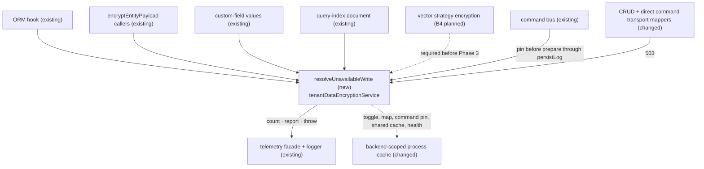

# Fail closed when the key service is unavailable

> **Program:** package A3 of [`2026-11-15-gdpr-ready-deployments-program.md`](2026-11-15-gdpr-ready-deployments-program.md) (tracker open-mercato/open-mercato#8593). Addresses open-mercato/open-mercato#2241 in part; see the acceptance table.
> **Reference only:** `.ai/specs/2026-08-20-production-encryption-fail-closed.md` on `upstream/feat/security-readiness` (PR #5557).
> **Verified at** `main` @ `08dada9624` by reading code; nothing was run.
> **Written autonomously.** No question was put to a person; the choices are listed under Resolved assumptions.

Extends: .ai/specs/GDPR/2026-11-15-gdpr-ready-deployments-program.md
Extends: .ai/specs/GDPR/2026-11-16-runtime-encryption-key-guard.md
Extends: .ai/specs/implemented/2026-05-29-integrations-credentials-encryption-fail-closed.md

## 📝 TLDR

When tenant encryption is on and the key service cannot supply a key at the moment of a write, most write paths today store the value in clear and log a throttled warning. An operator who configured encryption gets plaintext rows during every outage and has nothing to alert on. **Proposed (future):** three steps, each shippable alone. First, every such write is counted and reported. Second, a key already in memory is used while it is valid, so a short outage stops touching active tenants. Third, an operator can choose that such a write fails instead of landing in clear.

**Not in this spec:** boot-time configuration (the key-guard spec); the derived-key takeover when Vault is down and a fallback secret is set (program package A4); writes that bypass the encryption layer altogether (including today's active vector strategy until B4 lands); a readiness endpoint. B1 Phase A supplies the tenant row-backfill remedy for past outages.

## 📝 Overview

Four callers already fail closed and name the condition the same way: custom-entity documents, API-key session secrets, integration credentials and OAuth grants. This spec brings the general write paths into line with them.

> **Market reference.** HashiCorp's guidance for Transit consumers and Rails' Active Record Encryption both raise on a write when no key can be resolved; neither stores cleartext as a fallback. Adopted: raise, with a typed, stable error. Rejected: wiring the condition into a liveness or readiness probe, as the reference branch did — a key-service outage would then make an orchestrator eject every replica and turn a write outage into a full one.

## 📝 Resolved assumptions (autonomous defaults)

| # | Question | Chosen | Rationale |
|---|---|---|---|
| 1 | Which write paths change? | Four live paths: ORM hook, direct payload encryption, custom-field values and query-index document; B4 later adds the vector strategy through the same decision | The legacy `VectorIndexService` is not registered by search DI. The live vector strategy bypasses encryption today; do not claim it is covered until B4 Phase 2 ships. |
| 2 | Does this spec touch the derived-key fallback? | No | The maintainer's note on #2241 says "Do not add a derived-key fallback to hide a failure" and asks for tests with it explicitly disabled. This spec adds none and tests that way. What an *existing* fallback does during an outage is program package A4. |
| 3 | Compatibility route for failing the write | The ordinary protocol: the setting ships with default `plaintext`; flipping it to `fail` is a separate tracked release task with gates (Migration) | Decided by the program (DEC-5 and its Migration section: A3 requests no exception). The exception needs the accepted input to be the vulnerability itself; an outage is a failure condition, not an accepted input. The setting is the most reversible route, gives one minor of counter data before the flip, and lets the flip wait for A4 and B4, so `fail` has one meaning. The acceptance list's atomic rejection is delivered under `fail`. |
| 4 | One setting with the key guard, or its own | Its own: `TENANT_DATA_ENCRYPTION_UNAVAILABLE_WRITES` | An operator who opted into strict boot checks must not silently gain write failures in a later release. The two also flip on different gates. |
| 5 | Readiness or health endpoint | None | See the market reference. The reference branch's route was also flagged in review as unauthenticated and disclosing key-service state. |
| 6 | Use a key already in memory while the key service is unhealthy | Yes, through one process-wide cache scoped by backend identity, for writes and reads under either setting | Existing caches differ by layer and instance; Phase 2 explicitly unifies and namespaces them. Keys are not shared across tenants, Vault configurations, credentials or derived roots. |
| 7 | Reads with no key at all | Unchanged | Returning ciphertext to a caller is an availability and display problem, not a confidentiality one. |

## 📝 Acceptance list from #2241

The maintainer's comment of 2026-11-04, item by item.

| Item | Status here |
|---|---|
| Reject mapped writes atomically | Designed for `fail`: ORM failure rolls back its transaction; logged commands acquire a scoped key pin before execution and hold it through `persistLog`, so TTL expiry cannot cause a KMS failure after commit. This does not make arbitrary business/audit database failures atomic. Vector coverage waits for B4; the default stays `plaintext` until the tracked flip (assumption 3) |
| Cover unavailable at start, healthy then unavailable, null key, recovery | Met, by unit tests |
| Distinguish the operator's opt-out | Met: encryption switched off is untouched |
| Preserve null values, system keys, no-provision previews | Met: only a changed, non-null mapped column can fail; system-scoped maps follow the same decision; the preview path is pinned by an existing test |
| No derived fallback to hide a failure | Met: none is added, and tests run with it disabled |
| PostgreSQL and API regressions that inspect stored values, with rollback and a CRM control | Met by database-backed tests; they need a CI change to run (see Integration Coverage) |
| Sanitized, retryable errors | Specified: shared mapper at CRUD, direct command catches, module error mappers and route-local catches for previously uncaught calls; generic i18n 503. Published per-item batch response shapes remain unchanged |
| The branch for entities with no encryption policy | Declined: an entity with no map is not protected data, and nothing changes for it |
| Plaintext already written during outages | Addressed by measurement and documentation: the new counter sizes it, and `mercato entities backfill-encryption --tenant <id> --apply` (B1 Phase A), `mercato entities backfill-system-encryption` for system maps and B4's `mercato search encrypt-vector-display` for old vector displays encrypt such rows; ORM rotation is not a universal backfill |

## 📝 Problem Statement

Encryption is "unavailable" in two shapes: the key service reports unhealthy, or it is healthy but returns no key for the tenant.

| Write path | Today, when unavailable |
|---|---|
| ORM hook, every mapped column | Plaintext; a warning at most once a minute per process, or only a debug line when the key is simply missing (`packages/shared/src/lib/encryption/subscriber.ts:92-107, 289-294`; `tenantDataEncryptionService.ts:625-628`) |
| Direct payload encryption — access-log inserts, SSO config, agent artifacts, CLI commands | Plaintext, silent (`tenantDataEncryptionService.ts:611-614`) |
| Custom-field values | Plaintext; one warning per tenant, entity and field per outage (`customFieldValues.ts:127-175`) |
| Query-index document | Plaintext, silent (`indexDoc.ts:93-94`) |
| Active vector strategy → pgvector driver | Bypasses encryption entirely today (`packages/search/src/strategies/vector.strategy.ts`, `packages/search/src/vector/drivers/pgvector/index.ts`); `modules/search/di.ts:134` explicitly no longer registers `VectorIndexService`. B4 Phase 2 must add encryption through this spec's decision before fail coverage includes vectors |
| Custom-entity documents | **Throws** `KMS_UNAVAILABLE` (`customEntityDoc.ts:29-35`) |
| API-key session secret | **Not stored** (`packages/core/src/modules/api_keys/services/apiKeyService.ts:43-60`) |
| Integration credentials | **Throws**, surfaced as HTTP 503 (`packages/core/src/modules/integrations/lib/credentials-service.ts:326-334`) |

- **Health gates can hide cached keys.** `HashicorpVaultKmsService.cache` is per instance (`kms.ts:172`), and `createKmsService` constructs a new instance each call (`kms.ts:443-470`). `TenantDataEncryptionService` separately has static tenant-keyed caches (`tenantDataEncryptionService.ts:264-268`); per-EntityManager services are constructed by `resolveTenantEncryptionService` (`customFieldValues.ts:43-55`). Bootstrap injects its process-cached KMS (`bootstrap.ts:194-196`; `di/container.ts:262-285`). The ORM/custom-field/index-document gates check health before key access (`subscriber.ts:290, 429`; `customFieldValues.ts:64`; `indexDoc.ts:94`). A cache in one KMS is not proof that every service can use it during an outage; neither existing cache layout is the proposed configuration-scoped cache.
- **One tenant can open the breaker for all.** A failed call opens the circuit breaker for 30 seconds (`kms.ts:238-283`). A 403 on creating one tenant's key counts as a failure (`kms.ts:316`), so a single tenant that cannot be provisioned repeatedly sends every tenant without a cached key to plaintext.
- **The update hook sees the whole record.** `beforeUpdate` passes both the entity and `args.changeSet` (`subscriber.ts:554-556`), but the existing encryption decision inspects the whole entity rather than only changed mapped columns. Staff login updates only `lastLoginAt`, but the flush still hands the user's email and name to the hook (`packages/core/src/modules/auth/services/authService.ts:71-72, 113`).
- **The audit entry is written after the command has committed**, on its own flush, and its `command_id` is an encrypted column that is never empty (`packages/shared/src/lib/commands/command-bus.ts:381, 443, 1044-1046`; `packages/core/src/modules/audit_logs/encryption.ts:5-8`).
- **Provisioning failure is quiet.** Tenant setup logs a missing or failed key only in debug mode, whether the call throws, returns nothing or finds the service unhealthy (`packages/core/src/modules/auth/lib/setup-app.ts:394-412`).
- **Initialization can silently disable encryption.** Bootstrap catches a failure constructing the encryption service or registering the subscriber and warns (`packages/core/src/bootstrap.ts:225-238`); the container can swallow bootstrap errors (`packages/shared/src/lib/di/container.ts:278-284`). These are separate from a registered but unhealthy KMS and must follow `fail` too.
- **Nothing is alertable.** These fallback paths do not call the error-reporting facade.
- **With a fallback secret, none of this applies.** The fallback service stays healthy and serves a derived key (`kms.ts:46-75`). That is package A4.

## 📝 Proposed Solution

One function decides what to do with a mapped write when encryption is on and no key can be resolved. All four live encryption paths call it; B4 must route its new strategy-level encryption through it, making vector coverage a release dependency rather than editing an unused service.

| Situation | Setting `plaintext` (default) | Setting `fail` |
|---|---|---|
| Key available, or in memory and still valid | Encrypts | Encrypts |
| Encryption switched off | Plaintext, silent | Plaintext, silent |
| No changed, non-null mapped column in the write | Proceeds | Proceeds |
| Key unavailable, a changed non-null mapped column | Plaintext, as today, counted and reported | Throws |

The setting is `TENANT_DATA_ENCRYPTION_UNAVAILABLE_WRITES`. It takes effect only in production, using `isTenantEncryptionProductionRuntime()` from the key-guard spec: DEC-E, R3-11 and R5-2. A process whose `NODE_ENV` is not `production` remains non-production regardless of any mark file and never needs a binding. Only a production-mode process carrying the dev mark validates the binding; an invalid binding leaves it production with one error-level log. This spec consumes that predicate and adds no independent exemption; elsewhere behaviour stays as today.

### Design decisions

| Decision | Rationale |
|---|---|
| For an update, look at the changed columns only | Otherwise an update that touches nothing sensitive — a login timestamp — fails, or is falsely reported as plaintext. Unchanged columns are not written. |
| "Non-null", not "non-empty" | The encryption layer already skips only null and undefined. |
| The command bus pins the write key before it runs a logged command | A bare availability check races key expiry. A pin keeps the same verified key available across `prepare`, execution, nested encryption services and `persistLog`, then releases it in `finally`. No business transaction is extended solely to cover audit storage. |
| Reuse the existing error type | `TenantDataEncryptionError` with code `KMS_UNAVAILABLE` is already thrown by custom-entity documents (`aes.ts:13-19`). |
| HTTP 503 with a generic body | Integration credentials already answer that way, and it tells a client the request can be retried. |
| Count and report every occurrence; throttle only local log lines | `packages/telemetry/AGENTS.md` forbids source suppression of `reportError`. Stable low-cardinality codes preserve volume and grouping; backend configuration owns report limits. |
| Report codes in the facade's `module.reason` shape | `KMS_UNAVAILABLE` does not match it and would be dropped from `error.code` (`packages/shared/src/lib/telemetry/error-code.ts:12`). |
| A 4xx on key creation does not open the breaker | It is one tenant's problem, not an outage. |
| Key-provisioning failure at tenant setup is reported, not fatal | The next write tries again. |

### Alternatives considered

| Alternative | Why rejected |
|---|---|
| Fail always in production, no setting (the Emergency Security Exception route) | An outage is not an accepted vulnerable input, so the exception does not qualify (DEC-5). A hard refusal before A4 and B4 land would give `fail` two meanings and leave operators no opt-out from a write outage. Assumption 3. |
| Share the key guard's setting | Recorded as assumption 4. |
| Write the audit entry inside the command's transaction | A wider transaction change than a scoped key pin; not required to prevent the KMS-expiry failure. Non-KMS post-commit errors remain an existing risk, stated below. |
| Exempt audit and access logs, or the index and vector projections | Each would be a plaintext path for the same values. |
| Queue the write and replay it after recovery | A second durable store of the plaintext. |
| A readiness probe | Amplifies a write outage into a full outage. |

### Known limits

- **Writes that bypass the encryption layer are not covered:** `nativeUpdate`, `em.upsert` (it has no hook), query-builder and raw SQL writes. They were never encrypted and this spec does not change that.
- **Projections can go stale.** A web process holding a key commits a row; a worker without one cannot index it. The indexer records the failure and nothing retries, so list and search miss the row until a reindex.
- **After Phase 2, shared keys are process-local**, scoped by full backend identity; a restart empties them. Ordinary lifetime runs from original fetch time, at most 15 minutes by default. A pin acquired while valid extends usability only for its active logged command through audit persistence; it does not renew the cache TTL or make keys available to unrelated work.
- **Until B4 Phase 2**, vector strategy writes remain plaintext regardless of this setting; Phase 3 cannot claim complete projection coverage or flip defaults before B4 has wired and tested encryption.
- **Initialization failure under `plaintext` remains fail-open**, but is counted and reported; under production `fail`, bootstrap/container creation rejects before work instead of continuing without the service or subscriber.
- **A deployment with a fallback secret is unchanged**, whatever the setting.

## 📝 Delta

### Capability: tenant-encryption-availability

#### MODIFIED Requirement: Mapped write when no key is available
When tenant encryption is on and no key can be resolved for a write that changes a non-null encrypted column, the system SHALL count and report the condition, and in production with the setting at `fail` SHALL fail the write without storing the value.

##### Scenario: Fail
- WHEN a production process set to `fail` saves a record with a changed encrypted column while the key service is unreachable and no key is in memory
- THEN the save fails, the API answers 503, and no row is written or changed

##### Scenario: Command
- WHEN a command is submitted in the same situation
- THEN a logged command is refused before snapshot preparation or execution if no scoped key can be resolved/provisioned; neither business nor audit row is written

##### Scenario: Key expires during a command
- WHEN a valid key is pinned at preflight and its ordinary TTL expires between execution and `persistLog` while Vault is down
- THEN both business encryption and audit encryption use the same pin, the command succeeds, and the pin is released in `finally` without extending the cache TTL

##### Scenario: Plaintext
- WHEN the same save happens with the setting at `plaintext`
- THEN the value is stored as today, the counter for that entity type increases, and every occurrence reaches `reportError`; only the repeated local log line may be throttled

##### Scenario: Nothing sensitive changed
- WHEN an update changes only columns that are not encrypted, during an outage, under `fail`
- THEN it succeeds and nothing is reported

##### Scenario: Missing encryption initialization
- WHEN production `fail` cannot construct the encryption service or register its subscriber
- THEN bootstrap reports `encryption.initialization_unavailable` and container creation rejects; no request or job proceeds with a partial encryption stack

##### Scenario: Recovery
- WHEN the key service becomes reachable again
- THEN the next save encrypts, with no restart

Frozen by: `packages/shared/src/lib/encryption/__tests__/subscriber.kms-recovery.test.ts`, `packages/shared/src/lib/encryption/__tests__/customFieldValues.plaintext-fallback.test.ts`, and `packages/shared/src/lib/encryption/__tests__/unavailable-write.characterization.test.ts` (to be added for the paths no test pins today)

#### ADDED Requirement: Key in memory during an outage
The system SHALL encrypt and decrypt with a tenant's key held in memory while that key is still valid, whether or not the key service is currently reachable, and only when encryption is switched on.

##### Scenario: Short outage
- WHEN the key service is unreachable and a process fetched a tenant's key five minutes ago
- THEN that process encrypts that tenant's saves and decrypts its reads normally

#### ADDED Requirement: One tenant does not open the breaker
The system SHALL NOT treat a rejected key creation for one tenant as a key-service outage.

##### Scenario: Provisioning refused
- WHEN creating a key for one tenant is refused with a client error
- THEN other tenants' writes are unaffected

#### ADDED Requirement: Provisioning failure is visible
The system SHALL report, at error level and without debug logging, a tenant setup that ends without a key for the tenant, whatever the cause.

##### Scenario: Setup without a key
- WHEN tenant setup cannot obtain or create the tenant's key
- THEN an error is reported and setup continues

## 📝 Architecture

Takeaway: the live encryption paths share one decision and backend-scoped key context. A logged command retains its key through audit persistence; B4 must connect the active vector strategy before vector fail coverage is claimed.

### Components

- **`resolveUnavailableWrite`** in `packages/shared/src/lib/encryption/tenantDataEncryptionService.ts`. Given a reason and whether the write changes a non-null mapped column, it returns “proceed in clear” or throws. It increments the counter and calls the shared telemetry runtime's `reportError` for every occurrence with `encryption.kms_unavailable`, `encryption.dek_unavailable` or `encryption.initialization_unavailable`. No tenant id, source value, key or credential is emitted. A local structured error log may be limited to one line per reason per minute, including with no backend; the facade call and counter are never throttled.
- **Backend-scoped process cache.** Phase 2 replaces the per-instance Vault cache and the service's tenant-only static caches with one shared key context in new `packages/shared/src/lib/encryption/keyContext.ts`, held under a package-owned `globalThis` symbol so bundle copies agree. Namespace: KMS mode plus normalized Vault address/mount and a non-reversible credential fingerprint, or derived-root fingerprint; then tenant id or explicit system key id. Credentials and fingerprints never enter telemetry. Injected custom KMS objects without an explicit identity remain isolated by object identity. Key creation in-flight deduplication and invalidation use the same namespace. Fallback wrappers keep primary and derived-origin entries distinct; this cache change does not change the existing provider-selection policy owned by A4. Check `fetchedAt` and the original TTL; reading through another instance never resets expiry. Changing backend, credential, root or tenant cannot retrieve another namespace's key. No new distributed or persisted cache is added.
- **Lookup order.** All live encryption paths and reads resolve toggle, map, command-local matching pin, unexpired shared key, then backend health and get/provision. Do not gate cached or pinned keys on `service.isEnabled()` when it includes KMS health. B4's strategy-level call follows this same order after it ships.
- **Update hook.** Receives the existing change set and intersects its columns with mapped columns; unchanged sensitive fields do not trigger a refusal.
- **Command bus key pin.** Before snapshot preparation or `handler.execute` for any potentially logged command under production `fail` (conservatively including a log decision known only after execution), resolve its audit scope from trusted `options.metadata.tenantId`, then `ctx.auth.tenantId`, retaining selected organization scope. Internal commands without auth must pass trusted audit metadata before execution. For handlers whose log tenant can differ from those inputs, add an optional additive `resolveEncryptionScope(input, ctx)` handler member that resolves it read-only before execution; audit these handlers and callers in the same PR. Do not guess from arbitrary request input or wait for post-execution `buildLog`. An unresolved tenant for the tenant-scoped action-log map refuses before execution with `KMS_UNAVAILABLE` / `scope-unresolved`; a null tenant is not silently treated as a system map. Existing genuinely system-scoped maps still use their explicit system key.
- **Pin lifetime.** New `withTenantEncryptionWriteKey` in `keyContext.ts` uses `AsyncLocalStorage` and an immutable backend/scope/key snapshot. Acquire by the write path's `resolveDekForEncrypt` with `createIfMissing: true`, not the read-only `getDek`; a healthy Vault may create the first DEK. Provision failure refuses before execution and is reported. Provisioning is a KMS side effect even if a later business write fails; no business/audit row has committed at preflight refusal. Retain the pin through prepare, execute, after-snapshot capture and `persistLog`, including the audit service's forked EntityManager, then release in `finally` on success or error. Each nested encryption service uses the matching async context before consulting ordinary cache expiry or backend health. A pin acquired while valid is not evicted on TTL expiry until its command finishes; unrelated work must still honor expiry. It never falls through to a newly fetched or other-tenant key for that command. The pre-resolved scope must match the final audit metadata; static coverage of dynamic-scope handlers and caller tests enforce that contract. Unexpected scope disagreement is a programming error, not a claimed atomic cross-tenant command facility.
- **Breaker.** A 4xx key-creation response returns “no key” without opening the breaker.
- **Shared HTTP mapper.** New `getTenantDataEncryptionHttpRejection(err, translate)` in `packages/shared/src/lib/encryption/http.ts` recognizes branded `TenantDataEncryptionError` with `KMS_UNAVAILABLE`, returning `{ status: 503, body: { error: translate('entities.errors.encryptionUnavailable') } }` and no cause/details. Add a `Symbol.for` brand plus guard in `aes.ts` without changing its constructor signature. Apply the mapper wherever `getCommandInterceptorHttpRejection` is consulted: CRUD factory, direct command route catches and existing module-level mappers. Keep existing `CrudHttpError`, optimistic-lock, validation and interceptor precedence unchanged. For bus-calling routes with no catch today, add a route-local catch that maps only this typed encryption error and rethrows every unrelated error unchanged; do not edit `apps/mercato/src/app/api/[...slug]/route.ts` or invent a shared transport file. Extend `command-interceptor-http-coverage.test.ts` to require the encryption mapping on each actual catch chain and mirror coverage in non-core packages. Batch routes with published HTTP 200 + per-item failures retain that shape; sanitize the item failure through the same mapper without claiming HTTP 503 for that envelope.
- **Initialization guard.** In `packages/core/src/bootstrap.ts`, record successful service construction and subscriber registration. Under production `fail` and encryption on, a failure of either reports/counts `encryption.initialization_unavailable` and rethrows branded `TenantDataEncryptionError` with reason `service-unavailable`. `packages/shared/src/lib/di/container.ts` rethrows it instead of its optional-bootstrap catch, rejects a partial cached bootstrap and never caches an incomplete encryption stack. A registered unhealthy KMS is allowed to start: individual writes then follow the key decision; this is not a readiness gate. Under `plaintext` keep today's availability but report/count the construction/registration failure at the swallow site. Verify the configured subscriber's registration for the ORM used by the returned container before work begins.
- **Tenant setup.** Reports every throwing, empty or unhealthy key-provision branch; broad catches rethrow typed policy/initialization refusals.
- **Policy accessor.** Import `isTenantEncryptionProductionRuntime()` already exported by the key-guard spec. This spec neither adds that export nor edits the key-guard spec.
- **Unavailable-write setting accessor.** Add `getTenantEncryptionUnavailableWrites(env?: NodeJS.ProcessEnv): 'plaintext' | 'fail'` in `packages/shared/src/lib/encryption/keyPolicy.ts`. It reads the configured setting without applying runtime mode, normalizes trim/case and returns `plaintext` for unset or invalid values; it has no logging, bootstrap or database side effects. Runtime callers report an invalid setting once and apply the production predicate separately. The doctor spec's `encryption.plaintext_on_unavailable` check consumes this accessor, rather than copying the default or reading another process's mode. This addition is separate from the existing production accessor above.

### What happens under `fail` during an outage

After Phase 2, a tenant with an unexpired key in the matching backend namespace is unaffected in that process. A logged command that acquired a pin before expiry keeps it through its audit write; unrelated requests cannot use that expired key.

| Flow | Effect |
|---|---|
| Staff login | Works: only an unencrypted column changes |
| Portal login | Fails: the session row carries an encrypted IP and user agent |
| Saving a customer, order, message, user | 503 |
| Logged command without a resolvable/provisionable key or scope | Refused before prepare/execute; a command with a valid pin continues through audit persistence |
| Access-log entry for a read | Dropped; the read succeeds (`packages/shared/src/lib/crud/factory.ts:986-1006`) |
| Queue job that writes mapped data | Retried three times; the async strategy keeps the failed job within B6's configured lifecycle below, the local strategy drops it |
| Persistent event subscriber | Follows the queue row above |
| Inline event subscriber | Logged and skipped (`packages/events/src/bus.ts:449-456`) |
| Query-index projection; vector after B4 Phase 2 only | A missing key is recorded as an indexer error; restored by reindexing. Today's vector strategy is not covered |

## 📝 Data Models

None. No entity, table, column or migration. The data-model graph is skipped for that reason.

## 📝 API Contracts

- **Error.** `TenantDataEncryptionError` with `code: 'KMS_UNAVAILABLE'` gains an optional `reason: 'kms-unhealthy' | 'dek-unavailable' | 'service-unavailable' | 'scope-unresolved'`; constructor signature unchanged, with additive brand/type guard.
- **HTTP.** `getTenantDataEncryptionHttpRejection(err, translate)` maps only typed `KMS_UNAVAILABLE` to a generic i18n 503. CRUD, direct command catches, module mappers and new route-local catches for previously uncaught bus calls all use it. Published per-item batch status/shape stays unchanged; their item error is sanitized. Existing non-encryption errors keep their historical mapping.
- **Commands.** Optional `resolveEncryptionScope(input, ctx): Promise<{ tenantId: string; organizationId: string | null }> | { tenantId: string; organizationId: string | null }` is additive on `CommandHandler`; when absent the preflight uses trusted execution metadata/auth. The resolver must agree with the handler's final audit scope; it never authorizes an arbitrary client tenant. `withTenantEncryptionWriteKey` is new internal infrastructure, not a DEK-exposing route or client API.
- **Setting.** `TENANT_DATA_ENCRYPTION_UNAVAILABLE_WRITES` — `plaintext` (default) or `fail`. An unrecognised value falls back to the default and is reported once. Added to both `.env.example` files.
- **Setting export.** `getTenantEncryptionUnavailableWrites(env?: NodeJS.ProcessEnv): 'plaintext' | 'fail'` from `@open-mercato/shared/lib/encryption/keyPolicy` is new and additive. The [doctor spec](2026-11-16-privacy-doctor-cli.md), Backlog: checks that wait for another spec, owns `encryption.plaintext_on_unavailable` and calls this side-effect-free accessor after this spec's Phase 3 step 1. It is a configuration check, not this spec's write counter.
- **Telemetry.** Counter `encryption.unavailable_writes`, labelled by entity type, reason and outcome (`plaintext` or `refused`). Reported error codes `encryption.kms_unavailable`, `encryption.dek_unavailable` and `encryption.initialization_unavailable`. The `reason` label is a fixed enum, including initialization/scope refusal, and the initialization entity label is the fixed value `bootstrap`. Neither carries a tenant id, a value or key material.

## 📝 Edge Cases & Failure Scenarios

| Case | Behaviour |
|---|---|
| Vault down, fallback secret set | Unchanged: the derived key takes over (A4) |
| Vault healthy, key missing, creation refused | "No key" for that tenant, reason `dek-unavailable`; the breaker stays closed |
| Outage shorter than a key's remaining lifetime | Invisible to services in the same process and backend namespace, including services for different EntityManagers |
| Key expires between execute and audit persistence | Active command pin remains usable through `persistLog`; unrelated requests follow normal TTL; pin released in `finally` |
| First command for a new tenant, healthy Vault | Preflight provisions through `createIfMissing: true`, then pins; no bootstrap deadlock waiting for a write to create the key |
| Command has no authenticated tenant | Requires trusted pre-execution audit metadata or the read-only handler scope resolver; otherwise refused before mutation |
| Missing service/subscriber under `fail` | Initialization reports/counts and container rejects; no partial bootstrap cached |
| Process restarted during an outage | Its cache is empty; its writes follow the setting |
| Development CLI or Next.js dev grandchild beside a live mark file without a binding | R5-2 keeps it non-production; this production-only setting does not apply and existing behavior continues |
| Update that changes no encrypted column | Proceeds |
| Create with all encrypted columns null | Proceeds |
| System-scoped map (no tenant) | Same decision, with the system key |
| One-off CLI command with nothing configured | Follows the setting; the key-guard spec only warns at start for a command |
| Local queue strategy under `fail` | A job that exhausts its attempts during an outage is dropped. The operator page says to use the async strategy with `fail` |
| Bulk import mid-outage | Rows already committed stay; the failing row aborts its own transaction |
| Recovery | The breaker goes half-open after its cooldown (30 seconds by default); the next write succeeds |

## 📝 Migration & Backward Compatibility

| Change | Route |
|---|---|
| Mapped write fails when no key is available | Ordinary protocol: opt-in through the setting; the default stays `plaintext` in the release that ships it |
| Key in memory used during an outage, for writes and reads | Behaviour improvement; dated entry |
| A 4xx key creation no longer opens the breaker | Behaviour correction; dated entry |
| `reason` and brand on the error; counter; setting; HTTP mapper; optional command scope resolver | Additive; existing signatures unchanged; reuse the key-guard accessor |
| Bootstrap refuses missing encryption service/subscriber under `fail` | Same ordinary opt-in bridge as write refusal; `plaintext` retains fallback with reporting |
| Process cache namespaces and command-local pin | Internal key-lifetime change; existing cache TTL stays fixed for unrelated work, disclosed in upgrade note |

- **`encryptEntityPayload`** is a stable function whose behaviour changes under `fail`. The dated `BACKWARD_COMPATIBILITY.md` entry follows the wording of "Encrypt Path Rejects Wrong-Key Ciphertext (2026-09-11)": a deliberate trade of availability for integrity.
- **Flipping the default to `fail`** is a tracked release task, separate from the key guard's. Its gates: one minor has shipped the counter and the report; the fallback takeover (A4) has shipped, so `fail` means the same thing with and without a fallback secret; the projection staleness has an operator procedure; B4 Phase 2 routes active vector encryption through this decision and passes the outage tests. `plaintext` remains an explicit supported opt-out after the default flips.
- **`UPGRADE_NOTES.md`:** what the setting does; the flows that fail during an outage; that the local queue strategy drops jobs; that a reindex may be needed after an outage; how to find and encrypt rows written in clear during past outages using B1's `backfill-encryption --apply`, system backfill and B4's vector command, rather than rotation; how pins survive TTL only within one active command; that initialization under `fail` refuses instead of silently omitting encryption; that module code calling the encryption service directly must let the error propagate.
- **Backports.** None.

## 📋 Phasing

| Phase | Outcome | Behaviour change |
|---|---|---|
| 1 | Characterization tests; one decision function; counting and reporting; breaker correction | Signals where there were none |
| 2 | Backend-scoped process key cache and memory-first reads/writes across EntityManagers | Encrypts and decrypts through short outages |
| 3 | `fail`; command pin; initialization refusal; shared transport 503 | Opt-in; complete vector coverage waits for B4 Phase 2 |

Each phase is its own PR.

## 📋 Implementation Plan

### Phase 1 — One decision point, observable
1. **Characterize.** Add `unavailable-write.characterization.test.ts` pinning today's result for the paths with no test: the ORM hook with a healthy service and no key; an update that changes only an unencrypted column; direct payload encryption; the query-index document. Separately characterize that the active vector strategy bypasses encryption; do not route the unused `VectorIndexService` through the decision. Commit it alone, green.
2. Add `resolveUnavailableWrite` returning "proceed in clear" in every case, and route all four live paths through it. No result changes.
3. Make the update hook decide on changed mapped columns. Unit test: a login-style update is neither counted nor reported.
4. Add the counter and unthrottled `reportError` calls with stable `module.reason` codes; throttle only the explicit local log line. Raise the missing-key log from debug. Unit tests assert N failures produce N counter increments and N facade calls inside one minute, one local line, correct absent-backend behavior and no identifying fields. Report construction/subscriber failures at bootstrap swallow sites even before `fail` ships.
5. Stop a 4xx key creation from opening the breaker. Report tenant setup that ends without a key on all three branches. Unit tests for each.

### Phase 2 — Memory first
1. Add `keyContext.ts` and replace both Vault-instance and tenant-only service caches with the backend-scoped process context above; share in-flight creation and invalidation too. Move live-path health gates behind that cache and apply the same order to reads. Unit tests in `keyContext.test.ts`: two separately constructed KMS/services for different EntityManagers use a cached key during an outage; TTL remains original; tenant, Vault address/mount, credentials and root changes isolate keys; custom injected KMS objects isolate by identity; expired keys are not used; encryption off stays plaintext.
2. Update `subscriber.kms-recovery.test.ts` for the cached case.

### Phase 3 — Fail

Dependency: B4 Phase 2 must wire encryption on the active vector strategy through `resolveUnavailableWrite` before this phase claims vector fail coverage. B1 Phase A must deliver the tenant backfill remedy before the operator note promises it. The key-guard spec already supplies the production predicate.
1. Add the setting, its side-effect-free `getTenantEncryptionUnavailableWrites` accessor in `keyPolicy.ts`, and import the existing production accessor. Unit tests pin unset/invalid/case-padded values and the doctor's ability to inspect configuration without bootstrap, runtime exemption or database reads. Unit cases also consume R5-2's production predicate for a development CLI and a Next.js dev grandchild beside a live mark file with no binding: both remain non-production and keep existing write behavior. Under `fail`, throw when the write changes a non-null mapped column. Update the characterization tests and the two existing fallback tests to the new scenarios. Unit tests for every cell of the table per call site, including null values, the preview path, system-scoped maps and encryption switched off.
2. Add pre-execution scoped write-key acquisition/provisioning and the async-context pin through `persistLog`. Audit internal no-auth and dynamic-log-scope callers, adding trusted metadata or the optional read-only resolver. Unit tests in `command-bus.encryption.test.ts`: no key/refused creation means no prepare/execute/log; healthy first-use creates a DEK; two EntityManagers share a pin; expire the key and drop Vault between execute and persistLog and still succeed; nested tenant scopes isolate pins; release in `finally` on every failure; post-commit work still runs after successful audit.
3. Add the shared HTTP mapper at every interceptor-mapping transport and previously uncaught bus routes; extend the static catch-chain guard and module-mapper tests. Add bootstrap/container refusal for missing construction or subscriber registration under `fail`, reporting at each swallow site. Tests cover cold bootstrap, cached partial replay, plaintext reporting and no work before rejection.
4. Database-backed tests and TC-ENCRYPTION-OUTAGE-001 to 003.
5. `UPGRADE_NOTES.md`, the dated `BACKWARD_COMPATIBILITY.md` entries, the encryption pages in `apps/docs`, both `.env.example` files.
6. Open the tracking issue for the default flip with its gates.
7. Archive this Delta into `.ai/specs/capabilities/tenant-encryption-availability.md` if that directory has been adopted by then; it does not exist today.

### File manifest

| File | Action |
|---|---|
| `packages/shared/src/lib/encryption/tenantDataEncryptionService.ts` | Modify — decision function, lookup order |
| `packages/shared/src/lib/encryption/{subscriber,customFieldValues,indexDoc,aes,kms}.ts` | Modify |
| `packages/shared/src/lib/encryption/keyPolicy.ts` and its setting-accessor unit tests | Modify — add `getTenantEncryptionUnavailableWrites` for runtime and the doctor; reuse the existing production predicate |
| `packages/shared/src/lib/encryption/keyContext.ts`, `packages/shared/src/lib/encryption/__tests__/keyContext.test.ts`, `packages/shared/src/lib/encryption/http.ts` and mapper tests | Create — backend cache, command pin and generic 503 |
| `packages/search/src/strategies/vector.strategy.ts` | B4 owner must route its new encryption through this decision; no legacy service edit |
| `packages/shared/src/lib/commands/{command-bus,types}.ts`, `__tests__/command-bus.encryption.test.ts`; audited internal/dynamic-scope callers | Modify / create — optional scope resolver, pin before prepare through audit persistence |
| `packages/shared/src/lib/crud/factory.ts`, route-local catches for previously uncaught bus calls, direct bus-calling route catches and existing module-level mappers | Modify — shared generic encryption 503 without changing other error precedence |
| `packages/core/src/__tests__/command-interceptor-http-coverage.test.ts`, equivalent non-core module-mapper tests | Extend — encryption mapping on every real catch chain; retain batch shape exemptions |
| `packages/core/src/bootstrap.ts`, `packages/shared/src/lib/di/container.ts`, initialization refusal tests | Modify / create — count/report missing encryption stack; reject under `fail`, never cache partial bootstrap |
| `packages/core/src/modules/auth/lib/setup-app.ts` | Modify — report |
| `packages/shared/src/lib/encryption/__tests__/unavailable-write.characterization.test.ts`, a database-backed test file, updates to existing tests | Create / modify |
| `packages/core/src/modules/entities/__integration__/TC-ENCRYPTION-OUTAGE-00{1..3}.spec.ts` | Create |
| `packages/core/src/modules/entities/__integration__/TC-ENCRYPTION-HTTP-00{1..2}.spec.ts`, `TC-ENCRYPTION-UI-001.spec.ts`, test-server KMS fixture | Create — real CRUD/direct route and browser error/retry with owning fixtures; no production control endpoint |
| `.github/workflows/ci.yml`, `packages/core/package.json` (test pattern) | Modify — run the database-backed tests |
| `UPGRADE_NOTES.md`, `BACKWARD_COMPATIBILITY.md`, `apps/docs/docs/user-guide/encryption.mdx`, `apps/docs/docs/architecture/data-encryption.mdx`, both `.env.example` files | Modify |
| `packages/core/src/modules/entities/i18n/{en,de,es,ko,pl}.json` | Add translated generic encryption-unavailable message; route mapper never exposes an internal exception message |

Changing the CI test pattern is a pipeline change. Process gate: the Phase 3 PR that changes it carries a maintainer's agreement, as the repository's Ask First rule requires.

## 🧪 Integration Coverage

Every write route's behaviour changes under `fail`, but only during an outage, which the running app in the suite cannot be put into. Coverage combines real database/route tests, CLI child processes, a browser error/retry case and unit tests; the running shared integration app needs no outage-control endpoint.

**Database-backed tests** (real PostgreSQL, a key service that can be switched healthy, unhealthy and keyless, the derived fallback disabled). These are the stored-value regressions the maintainer asked for:

| Case | Asserts on the stored row |
|---|---|
| CRM person created while healthy | Ciphertext (the control) |
| Same create under `fail`, unhealthy | No row; the transaction rolled back |
| Same create under `plaintext`, unhealthy | Cleartext, and the counter moved |
| Update of an unencrypted column, unhealthy, `fail` | Applied |
| Key in memory, unhealthy | Ciphertext |
| Recovery | Ciphertext again, no restart |
| Command under `fail`, unhealthy with no cache | Neither the business row nor an audit row; prepare/execute not called |
| Command pins key, then TTL expires and Vault becomes unhealthy after business write | Business row and encrypted audit row both persist using the pin; release leaves unrelated work unable to reuse an expired key |
| Two services with different EntityManagers, same backend namespace | Both encrypt/decrypt with the shared unexpired key during an outage |
| Separate tenant/backend/credential/root control | Cannot use the first scope's cache or pin; fails with no matching key |
| Encryption service construction or subscriber registration throws | Under `fail`, container rejects and no business row; under `plaintext`, counter and facade record the fallback |

Every database-backed case owns a dedicated schema or tenant/organization, identity, roles and business fixtures and drops/removes them in `finally`. Use real flush, service construction and command/audit persistence; only the KMS transport and clock are controlled. The repository runs such tests only for a fixed set of paths today, so the Phase 3 PR extends the pattern and carries the maintainer agreement that pipeline changes require.

**HTTP-level route tests** use real route exports and database fixtures with the same injectable failing KMS, avoiding a live server outage hook. `TC-ENCRYPTION-HTTP-001` calls the real CRUD `POST /api/customers/people`; `TC-ENCRYPTION-HTTP-002` invokes `POST /api/resources/resources/tags/assign`, a direct `commandBus.execute` route whose current catch returns 400. Under `fail` with no cache both answer sanitized 503 and leave business/audit rows untouched; after recovery the same fixtures succeed. Test a previously uncaught bus route through its new route-local catch and non-core module mappers with the same error, retain validation/409/interceptor precedence, and assert batch status/shape unchanged. Each case creates its own user, feature grants, tenant/organization, resource and tag fixtures and removes them in `finally`; no shared integration-tenant rewrite. Key UI paths are the existing customer create/edit form and resource-tag action: route-level tests verify the response contract; `TC-ENCRYPTION-UI-001` with the injected isolated test-server KMS verifies the generic translated error remains visible and retry succeeds without a duplicate. No public outage-control API or production route is added.

**CLI tests against the ephemeral database.** The outage is produced in a child process: production mode, encryption on, a Vault address that refuses connections, a token, and both secret variables set to an empty string. Exit codes are read through `spawnSync`; stored values through a direct query. Each test owns a fresh tenant/organization and unique actor, builds a complete child environment (empty secret variables plus safe dedicated lookup pepper), and removes users/roles/audit fixtures and tenant in `finally`; query only its own ids. Key cache and pins are empty because each child is fresh.

| Test | Covers |
|---|---|
| TC-ENCRYPTION-OUTAGE-001 | Setting `fail`: `mercato auth add-user` exits non-zero and no user row exists |
| TC-ENCRYPTION-OUTAGE-002 | Setting `plaintext`: the command succeeds, the row's encrypted columns hold cleartext, and the output carries the reported condition |
| TC-ENCRYPTION-OUTAGE-003 | Setting `fail`, encryption switched off: the command succeeds and stores cleartext, with no report |

**Unit tests** supplement the real HTTP/database layers for: the per-call-site table, local-log throttling with unthrottled reports, projections, breaker and generic mapper.

## 📝 Risks & Impact Review

#### A key-service outage becomes a write outage
- **Scenario**: Under `fail`, Vault is unreachable for an hour; processes without a key in memory cannot save, and portal users cannot log in.
- **Severity**: High
- **Affected area**: every write of mapped data
- **Mitigation**: Opt-in; keys in memory cover short outages; the failing flows are listed for operators; clients get a retryable 503.
- **Residual risk**: By design. The alternative is cleartext in the database.

#### A command loses its audit row after commit
- **Scenario**: Business work commits, then an unrelated database failure or a handler violating its pre-resolved audit-scope contract breaks audit persistence.
- **Severity**: Medium
- **Affected area**: commands under `fail`
- **Mitigation**: The scoped pin removes TTL/KMS expiry from this window and survives across the audit EntityManager; no-auth/dynamic-scope handlers declare scope before execution and are covered by static/caller tests.
- **Residual risk**: This spec does not make business work and audit storage one transaction. Existing database errors and a third-party handler violating the scope contract can still cause post-commit failure; they are reported, not presented as a preflight guarantee.

#### Bootstrap omits the encryption service or subscriber
- **Scenario**: Construction, registration or replay of a partial cached bootstrap fails before a mapped write reaches the decision function.
- **Severity**: Critical
- **Affected area**: all mapped ORM writes in that process
- **Mitigation**: Count/report at the swallow site; production `fail` rethrows a branded error, never caches the partial stack and rejects the container before work. Tests inject both construction and registration failures.
- **Residual risk**: Explicit `plaintext` retains today's fallback availability with reporting; third-party raw writers that bypass the container remain outside this guard.

#### A long command retains a key beyond its ordinary TTL
- **Scenario**: A logged command runs longer than the cache TTL during an outage.
- **Severity**: Medium
- **Affected area**: process-memory key lifetime
- **Mitigation**: The key is pinned only in that invocation's async scope through audit persistence, released in `finally`, and never returned to unrelated expired-cache readers; process exit drops the pin.
- **Residual risk**: A hung command retains its key until it ends or the process exits; TTL is not a key-revocation facility for an active command.

#### Background work is lost during an outage
- **Scenario**: Jobs that write mapped data exhaust three attempts in a few seconds and, on the local queue strategy, are dropped.
- **Severity**: High
- **Affected area**: queue workers, event side effects
- **Mitigation**: The operator page pairs `fail` with the async strategy and cites the [queue-payload-minimization spec](2026-11-16-queue-payload-minimization.md), assumption 6 and Part 1 — Bounds and compatible id jobs. `QUEUE_FAILED_JOB_RETENTION_HOURS` defaults to 0 (count-only) in its bridge minor, then 168 in the next; explicit 0 remains count-only. Replay before age/count cleanup removes the job, or raise the window. Workers run timed cleanup; with no workers the independent `mercato queue prune-failed --all --apply` command must run at least hourly for the age target to hold. Unacknowledged abandon reports may keep jobs past the age within the count cap.
- **Residual risk**: Neither 168 hours nor any other age is an unconditional recovery guarantee. The count cap may evict earlier, stopped cleanup may retain longer, and inline event-subscriber side effects are skipped and not replayed, as for any subscriber error today.

#### Search and lists go stale after an outage
- **Scenario**: Rows committed by a process with a key are not indexed by a worker without one.
- **Severity**: Medium
- **Affected area**: `query_index`, vector search
- **Mitigation**: Indexer errors are recorded; the upgrade note and operator page give the reindex step.
- **Residual risk**: Stale results until someone runs it.

#### Deployments with a fallback secret believe they are covered
- **Scenario**: An operator sets `fail`, has Vault and a fallback secret, and a Vault outage still produces rows under a second key.
- **Severity**: High
- **Affected area**: Vault deployments with a fallback
- **Mitigation**: Stated in the TLDR, the known limits and the upgrade note; A4 is a gate on the default flip.
- **Residual risk**: Until A4 lands, `fail` does not protect those deployments from mixed keys.

#### A write path outside the layer stays in clear
- **Scenario**: Code writes a mapped column through `nativeUpdate` or raw SQL.
- **Severity**: Medium
- **Affected area**: completeness
- **Mitigation**: Listed as a known limit; a unit test asserts every live encrypted path calls the decision function; B4 must add the strategy-level vector coverage before Phase 3 claims it.
- **Residual risk**: Those writes were never encrypted. Finding them is the encryption-coverage spec's concern (program package B1).

## Final Compliance Report — 2026-11-16

### AGENTS.md Files Reviewed
- `AGENTS.md` (root), `.ai/specs/AGENTS.md` — in full
- `BACKWARD_COMPATIBILITY.md` — protocol, Emergency Security Exception, the 2026-09-11 dated entry
- `packages/core/AGENTS.md` — Encryption section
- `packages/shared/AGENTS.md`, `packages/search/AGENTS.md` — relevant encryption/search rules; `packages/telemetry/AGENTS.md` — reporting and no-suppression rules reviewed for this revision.

### Compliance Matrix

| Rule Source | Rule | Status | Notes |
|---|---|---|---|
| root AGENTS.md | Never bypass encryption helpers | Compliant | The change is inside them |
| Key-guard predicate and R5-2 | Non-production processes never need a dev binding | Aligned | Reuse `isTenantEncryptionProductionRuntime()`; live-file development CLI and Next.js grandchild cases stay outside this production-only setting |
| root AGENTS.md | A catch that records an error must also report it | Compliant | Reporting is Phase 1 |
| root AGENTS.md | Ask before changing public contracts | Compliant | Decided by the program: ordinary protocol (assumption 3). Signatures change only additively; the opt-in behaviour change gets a dated entry |
| root AGENTS.md | Ask before changing pipeline automation | Process gate | The Phase 3 PR that changes the CI test pattern carries a maintainer's agreement |
| root AGENTS.md | Integration coverage for affected paths | Specified, not run | Real CRUD and direct-command HTTP route exports with isolated database/KMS fixtures, route catches/mappers, CLI and key UI error/retry; no public outage hook |
| packages/telemetry/AGENTS.md | Never suppress `reportError` | Compliant by design | Every occurrence reaches facade and counter; only local log lines are throttled |
| root AGENTS.md | Never continue without encryption under `fail` | Compliant by design | Construction/subscriber failures reject bootstrap/container; partial cached bootstrap not replayed |
| packages/core/AGENTS.md → Encryption | Never hand-roll AES or KMS | Compliant | No cryptographic code changes |
| `BACKWARD_COMPATIBILITY.md` | Protocol for a stable function's behaviour | Compliant | Ordinary route, decided; the exception route is rejected under Alternatives considered |

### Internal Consistency Check

| Check | Status | Notes |
|---|---|---|
| Problem table matches the component list | Pass | Four live fallback paths, initialization guard, bus pin, breaker/setup; vector bypass is an explicit B4 dependency |
| Delta scenarios map to tests | Pass | Unit, database-backed or TC for each |
| MODIFIED requirement has characterization tests | Pass | Two existing, one to add |
| Every step leaves the app working | Pass | Phases 1 and 2 never refuse a write |

### Non-Compliant Items
- **Rule**: no unverified coverage claims. **Dependency**: B4 must wire the live vector strategy and run its outage case; this spec cannot claim that today's unused service covers it. The CI change carries a maintainer's agreement on its PR (process gate).

### Verdict
**Approved for implementation of Phases 1, 2 and 3.** Phase 3 claims vector fail coverage only after B4 Phase 2, and its operator note promises the backfill only after B1 Phase A. The default flip is a separate tracked task with the gates under Migration.

## Changelog

### 2026-11-16
- Council round two fixes, pass six final fixes (GPT-6.1 Sol workers): consume R5-2's corrected production predicate so non-production CLI/Next.js processes ignore live mark files without a binding; align the edge case, unit coverage and compliance without adding an exemption or setting.
- Council round two fixes, pass three (GPT-6.1 Sol workers): confirmed that Components, API Contracts, Phase 3 step 1 and the manifest already specify the pure `getTenantEncryptionUnavailableWrites` parser shared by runtime policy and `encryption.plaintext_on_unavailable`; the doctor's stale missing-export dependency is reported to its owner. No second parser or production accessor is added.
- Written autonomously with resolved assumptions.
- Revised after independent review: the update hook decides on changed columns, so login no longer trips it; the command bus checks before it runs a command, because the audit row is written after commit; the setting is separated from the key guard's; report codes follow the telemetry facade's shape and every occurrence is counted; memory-first lookup extended to reads and ordered after the toggle; a 4xx key creation no longer opens the breaker; 503 mapping; the #2241 acceptance list is answered item by item; known limits stated.

- Council round two fixes (GPT-6.1 Sol workers): r1kk-05 live-vector dependency; r1kk-06 backend-scoped shared cache; r1kk-09 mapper on command transports; r1kk-12 command pin through audit; r1kk-21 initialization refusal; r1kk-25 B1 backfill remedy; g1-15 first-write provisioning; g1-33 unthrottled reports; F-45 reuse accessor; F-57 change-set evidence; F-58 raw-write ownership B1.
- Council round two fixes, pass two (GPT-6.1 Sol workers): cited the key guard's exact DEC-E/R3-11 production-binding contract; supplied the side-effect-free unavailable-write setting accessor required by the doctor, without adding a second production accessor; corrected the B6 failed-job recovery claim to its opt-in minor, next-minor 168-hour default, explicit zero opt-out, count cap and independent cleanup requirement. B4's active-vector encryption and outage tests remain explicit unmet dependencies rather than claims about today's plaintext-only vector path.

### Review — 2026-11-16 (historical; superseded by this revision)
- **Reviewer**: Agent (fresh context, spec path only), then author revision
- **Security**: Two blast-radius claims were wrong and are corrected
- **Performance**: Counter is unthrottled; report throttled
- **Cache**: Key cache behaviour specified; no application cache involved
- **Commands**: Check added before execution
- **Risks**: Post-commit failure, stale projections added
- **Verdict**: Revised; the revision has not been independently re-read
