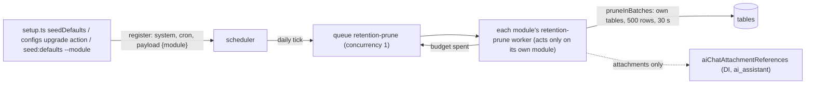

# Operational data retention

> **Tracker:** open-mercato/open-mercato#8593
> **Program:** [program](2026-11-15-gdpr-ready-deployments-program.md)
> **Edition:** OSS
> **GDPR basis:** Art. 5(1)(e) storage limitation, Art. 5(1)(c) data minimisation, Art. 25(2) data protection by default, Art. 32(1) security of processing

## TLDR

**Key points:**
- Many OSS tables keep personal data with no end date: expired credentials, delivery and sync logs, read notifications, deleted AI chats, chat uploads that were never sent, unfinished signups, provider payloads, raw inbound email and failed queue jobs. Four cleanup workers exist, and nothing schedules them.
- Every such table gets a scheduled, batched, age-based pruner in the module that owns it, with a documented default window. The defaults apply from the first release. Each window can be changed with an environment variable, and `0` turns that rule off.

**Scope:**
- Schedule the existing pruners: customer_accounts session and token cleanup, the integrations log pruner and forms retention.
- New pruners for OSS operational tables, one worker per owning module.
- Forms retention removes every answer, not only the answers flagged as sensitive.
- Failed queue jobs get an age bound.

**Not in scope:** business records (CRM, sales, form content beyond each form's own period, messages, attachments), which stay for a period the controller chooses; Enterprise tables and the action-log age bound (#2980); access logs, which are already rotated when they are written (`audit_logs/services/accessLogService.ts:45-46, 414-432`, 7 days core / 8 hours non-core).

## Overview

Storage limitation means operational copies of personal data must not outlive their purpose. These tables serve a short purpose: proving a delivery, retrying a sync, showing a notification. The platform can bound them without asking the controller, as it already does for AI token usage (90 days), AI agent runs (30 days) and access logs. Business records are different: how long they are kept is the controller's decision. This spec only points to where that is handled.

## Problem Statement

Paths are under `packages/core/src/modules/` unless stated.

- **Existing workers are never scheduled.** `customer_accounts/workers/cleanupExpiredSessions.ts` and `cleanupExpiredTokens.ts` each run one unbatched `nativeDelete`, and the token worker removes invitations the moment they are accepted (`:40-46`). `integrations/workers/log-pruner.ts` needs a tenant-scoped payload, and `lib/log-service.ts:191` deletes in a single statement. `forms/workers/retention-purge.ts` throws without a scope (`:63-65`), skips soft-deleted forms (`:77`) and soft-deleted submissions (`:114`), and stops at the first submission that fails (`:139`).
- **Forms "anonymize" is partial.** `forms/services/anonymize-service.ts:158-170` tombstones only fields flagged `x-om-sensitive`. A name typed into an unflagged field survives retention.
- **Credentials are never removed.** `auth` and `messages` have no workers, so expired `sessions`, used or expired `password_resets` and `message_access_tokens` accumulate. Unfinished `onboarding_requests` keep an encrypted password hash, which is cleared only when the signup completes (`packages/onboarding/src/modules/onboarding/lib/service.ts:151`).
- **Logs grow without bound, with payloads in them.** `webhook_deliveries` (payload and response body), `webhook_ingestions`, `push_notification_deliveries` (payload), `integration_logs` (payload), `indexer_error_logs` (payload and stack), `progress_jobs` (`meta`, error stack), `sync_runs`, `channel_ingest_dead_letters` (raw body), `ai_moderation_flags`, `forms_form_access_audit` (IP and user agent).
- **People-facing records are never removed.** `notifications/lib/notificationService.ts:959` `cleanupExpired()` has no caller. The AI conversation DELETE route says the transcript stays "until a future retention worker hard-deletes it" (`packages/ai-assistant/src/modules/ai_assistant/api/ai/conversations/[conversationId]/route.ts:87-89`), and no such worker exists. Chat uploads are stored under entity `ai-chat-draft` (`packages/ui/src/ai/upload-adapter.ts:16`) and are never released. Resolved `ai_pending_actions` are kept forever: `ai-pending-action-cleanup` only moves `pending` to `expired`.
- **Secondary copies of content are kept forever.** `inbox_emails` keeps raw, HTML and thread text. `message_channel_links.channel_payload` is a plaintext copy of each email: addresses, HTML and text (`communication_channels/encryption.ts:15-24`). `gateway_transactions.gateway_metadata` stores provider session and webhook data. The `payment_gateways` module cannot tell which transactions have no order: the table has no order column, and the sessions route creates a random `paymentId` (`payment_gateways/api/sessions/route.ts:73`).
- **Failed queue jobs.** The async strategy keeps the last 1000 failed jobs, payloads included, with no age limit (`packages/queue/src/strategies/async.ts:405`). The local strategy keeps no store of failed jobs (`local.ts:147-149`), but a quarantined `queue.corrupted.*.json` file keeps its payloads forever (`local.ts:427`).

## Proposed Solution

### Retention table

The windows are installation-wide. `*` marks an existing worker that this spec schedules or extends. **clear** means the listed columns are set to null and the row stays; every other rule deletes the row.

| Table | Owner module | Eligible rows (age anchor) | Default | Env var |
|---|---|---|---|---|
| `sessions` | auth | expired or revoked (`expires_at`, `deleted_at`) | 1 d | `OM_AUTH_SESSIONS_RETENTION_DAYS` |
| `password_resets` | auth | used, expired or deleted (`used_at`, else `expires_at`) | 1 d | `OM_AUTH_PASSWORD_RESETS_RETENTION_DAYS` |
| `message_access_tokens` | messages | expired (`expires_at`) | 1 d | `OM_MESSAGES_MESSAGE_ACCESS_TOKENS_RETENTION_DAYS` |
| `customer_user_sessions` | customer_accounts* | expired or revoked | 1 d | `OM_CUSTOMER_ACCOUNTS_CUSTOMER_USER_SESSIONS_RETENTION_DAYS` |
| `customer_user_email_verifications` | customer_accounts* | used or expired | 1 d | `OM_CUSTOMER_ACCOUNTS_CUSTOMER_USER_EMAIL_VERIFICATIONS_RETENTION_DAYS` |
| `customer_user_password_resets` | customer_accounts* | used or expired | 1 d | `OM_CUSTOMER_ACCOUNTS_CUSTOMER_USER_PASSWORD_RESETS_RETENTION_DAYS` |
| `customer_user_invitations` | customer_accounts* | accepted, cancelled or expired (that timestamp) | 1 d | `OM_CUSTOMER_ACCOUNTS_CUSTOMER_USER_INVITATIONS_RETENTION_DAYS` |
| `onboarding_requests` | onboarding | `pending` or `expired` (`expires_at`) | 7 d | `OM_ONBOARDING_ONBOARDING_REQUESTS_RETENTION_DAYS` |
| `webhook_deliveries` | webhooks | `delivered`, `failed`, `expired` (`updated_at`) | 30 d | `OM_WEBHOOKS_WEBHOOK_DELIVERIES_RETENTION_DAYS` |
| `webhook_ingestions` | webhooks | `processed`, `failed`, `duplicate` (`updated_at`) | 30 d | `OM_WEBHOOKS_WEBHOOK_INGESTIONS_RETENTION_DAYS` |
| `push_notification_deliveries` | push_notifications | `sent`, `failed`, `skipped`, `expired` (`updated_at`) | 30 d | `OM_PUSH_NOTIFICATIONS_PUSH_NOTIFICATION_DELIVERIES_RETENTION_DAYS` |
| `integration_logs` | integrations* | all (`created_at`) | 30 d | `OM_INTEGRATIONS_INTEGRATION_LOGS_RETENTION_DAYS` |
| `indexer_error_logs` | query_index | all (`occurred_at`) | 30 d | `OM_QUERY_INDEX_INDEXER_ERROR_LOGS_RETENTION_DAYS` |
| `progress_jobs` | progress | `completed`, `failed`, `cancelled` (`finished_at`); a parent only once no child rows remain | 90 d | `OM_PROGRESS_PROGRESS_JOBS_RETENTION_DAYS` |
| `sync_runs` | data_sync | `completed`, `failed`, `cancelled`, soft-deleted included (`updated_at`) | 90 d | `OM_DATA_SYNC_SYNC_RUNS_RETENTION_DAYS` |
| `channel_ingest_dead_letters` | communication_channels | all (`created_at`) | 90 d | `OM_COMMUNICATION_CHANNELS_CHANNEL_INGEST_DEAD_LETTERS_RETENTION_DAYS` |
| `sync_excel_uploads` (`sample_rows` hold imported people data) with its stored file | sync_excel | all (`created_at`); the file is deleted through the attachments service | 30 d | `OM_SYNC_EXCEL_SYNC_EXCEL_UPLOADS_RETENTION_DAYS` |
| `rule_execution_logs` (`input_context`/`output_context` copy record data) | business_rules | all (`executed_at`) | 90 d | `OM_BUSINESS_RULES_RULE_EXECUTION_LOGS_RETENTION_DAYS` |
| `message_channel_links` | communication_channels | **clear** `channel_payload` on inbound links, and on outbound links not `pending` or `queued` (`created_at`) | 90 d | `OM_COMMUNICATION_CHANNELS_MESSAGE_CHANNEL_LINKS_RETENTION_DAYS` |
| `gateway_transactions` | payment_gateways | **clear** `gateway_metadata`, `client_secret`, `redirect_url` on `failed`, `cancelled`, `expired` (`updated_at`) | 90 d | `OM_PAYMENT_GATEWAYS_GATEWAY_TRANSACTIONS_RETENTION_DAYS` |
| `inbox_emails` | inbox_ops | **clear** `raw_text`, `raw_html`, `cleaned_text`, `thread_messages` on `processed` or `failed` emails with no `pending` or `partial` proposal (`updated_at`) | 90 d | `OM_INBOX_OPS_INBOX_EMAILS_RETENTION_DAYS` |
| `notifications` | notifications | `read`, `actioned`, `dismissed` (`created_at`); any status once `expires_at` is past the window | 90 d | `OM_NOTIFICATIONS_NOTIFICATIONS_RETENTION_DAYS` |
| `ai_chat_conversations` with its participants and messages | ai_assistant | soft-deleted (`deleted_at`) | 30 d | `OM_AI_ASSISTANT_AI_CHAT_CONVERSATIONS_RETENTION_DAYS` |
| `ai_chat_messages` | ai_assistant | soft-deleted on their own (`deleted_at`) | 30 d | `OM_AI_ASSISTANT_AI_CHAT_MESSAGES_RETENTION_DAYS` |
| `ai_pending_actions` | ai_assistant | `confirmed`, `cancelled`, `expired`, `failed` (`resolved_at`, else `created_at`) | 90 d | `OM_AI_ASSISTANT_AI_PENDING_ACTIONS_RETENTION_DAYS` |
| `ai_moderation_flags` | ai_assistant | all (`created_at`) | 365 d | `OM_AI_ASSISTANT_AI_MODERATION_FLAGS_RETENTION_DAYS` |
| `attachments` with entity `ai-chat-draft` | attachments | not listed by any assistant message or pending action (`created_at`) | 30 d | `OM_ATTACHMENTS_AI_CHAT_DRAFTS_RETENTION_DAYS` |
| `forms_form_access_audit` | forms* | all (`accessed_at`) | 365 d | `OM_FORMS_FORMS_FORM_ACCESS_AUDIT_RETENTION_DAYS` |
| `forms_form_submission` with its revisions, uploads and invitations | forms* | past the form's own `retention_days` | per form | `OM_FORMS_SUBMISSION_RETENTION_ENABLED` (default `true`) |

**Variables.** Each name is built mechanically: `OM_<MODULE>_<TABLE>_RETENTION_DAYS`. A rule that covers only part of a table uses a name for that part (`AI_CHAT_DRAFTS`). If a variable is unset or empty, its default applies. `0` turns the rule off. A positive integer sets the window in days. Any other value falls back to the default, and each process logs the variable's name once, without its value. The existing `AI_TOKEN_USAGE_EVENTS_RETENTION_DAYS`, `AI_AGENT_RUNS_RETENTION_DAYS` and `AUDIT_LOGS_*` variables do not change. Setting the log window below 30 days shortens the integrations analytics view, which covers 30 days (`integrations/lib/log-service.ts:204`).

**Already bounded, listed in the docs only:** `ai_token_usage_events` (90 d), `ai_agent_runs` with their steps and tool calls (30 d), `gateway_session_initializations` (expired claims), carts with their `cart_idempotency_keys` (90 d after resolution, `cart/lib/sweepers.ts:246`), `access_logs`.

**Left alone on purpose:**
- `webhook_inbound_receipts` stays. It is the only replay defence for a sender that sends no timestamp header, because the inbound route treats such a request as fresh (`packages/webhooks/src/modules/webhooks/api/inbound/[endpointId]/route.ts:311-319`). The rows hold only ids.
- `gateway_webhook_events`, `carrier_webhook_events` and `carrier_shipment_idempotency_keys` hold provider idempotency keys and no personal data.

### How a pruner runs (house pattern)

The pattern follows `packages/ai-assistant/src/modules/ai_assistant/setup.ts:71-148` and `workers/ai-token-usage-prune.ts:49-73`. A system-scoped schedule is registered from `seedDefaults` under a stable `sha256` UUID. A batched `delete … where id in (select id … where <rule> limit n)` repeats until a batch comes back short. An environment window falls back to its default when the value is invalid. This spec adds four things to that pattern:

- **One shared queue.** Each owning module ships `workers/retention-prune.ts` with `metadata = { queue: 'retention-prune', id: '<module>:retention-prune', concurrency: 1 }`. Every handler registered on a queue runs in turn for each job (`packages/cli/src/lib/worker-job-handler.ts:29-46`). Each handler returns at once unless `job.payload.module` is its own module id. Sharing one queue adds one connection floor to `worker --all` instead of fourteen (`packages/queue/AGENTS.md` → Connection Budget). Each handler forks its entity manager, then catches and logs its own errors, as `ai-token-usage-prune.ts:155-166` does, so one module cannot block or retry the others.
- **Time budget.** `pruneInBatches` in `packages/shared/src/lib/retention/prune.ts` deletes or clears 500 rows per statement, one statement per transaction, for at most 30 seconds per handler run. The delete statement repeats the full rule, so a row that changed state after it was selected is left alone. Clear rules also require `<column> is not null`, so a repeat run changes nothing. When the budget runs out, the handler enqueues one continuation `{ module }`, coalesced per module through the queue's `coalesceBy`, as `payment_gateways/workers/session-initialization-prune.ts:60-62` does.
- **Installation-wide rules.** No tenant walk, as in the AI prune. Several tables have no tenant column (`sessions`, `password_resets`, `message_access_tokens`, the portal session and token tables, `forms_form_access_audit`).
- **Report.** One info log per handler run: table, window, cutoff, rows deleted or cleared, and whether a continuation was queued. No row ids, no payloads. Nothing goes to the action log and no CRUD events are emitted. Scheduled hygiene has no actor, and per-row events would flood the event bus.

### Scheduling and existing installations

`registerRetentionSchedule(container, { moduleId, queue = 'retention-prune', key })` in `packages/shared/src/lib/retention/schedule.ts` works as follows:
- It resolves `schedulerService` only when `container.hasRegistration('schedulerService')`. Without the scheduler, nothing registers and nothing is pruned.
- It registers the id `stableScheduleUuid(key)` with `scopeType: 'system'`, cron `0 3 * * *` in UTC, `targetPayload: { module }` (`{}` for the existing queues), `sourceType: 'module'` and `sourceModule: moduleId`, and it omits `isEnabled`.

It differs from the ai_assistant registrations in two ways:
- **Cron instead of a `24h` interval.** `register` recomputes `nextRunAt` on every call (`packages/scheduler/src/modules/scheduler/services/schedulerService.ts:50, 93`), and `seedDefaults` runs for every new tenant. An interval would keep moving forward on a busy installation.
- **`isEnabled` omitted.** An administrator who disabled a pruner keeps it disabled (`:92`).

Several modules own `retention-prune`. A module's schedule is dispatched because that module has a worker on the queue (`scheduler/lib/safeQueueTargets.ts:321-323`).

- **New installations:** each owning module calls its registration from `setup.ts` `seedDefaults`. `onboarding` gets a `setup.ts` for this.
- **Existing installations, core modules:** one configs upgrade action, `configs.register-retention-schedules`, in `configs/lib/upgrade-actions.ts`, follows `cart.register-sweeper-schedules` (`:215-226`). It calls each core module's `lib/retention.ts` registration and skips modules missing from `getEnabledModuleIds()`.
- **Existing installations, other packages:** `webhooks`, `ai_assistant` and `onboarding` are registered with `mercato seed:defaults --module <id>` (`packages/cli/src/mercato.ts:1629-1680`). The upgrade note names both paths.

### Existing pruners

- **customer_accounts.** Both workers move to `pruneInBatches` and the env windows above. A settled invitation gets one day of grace. The queues stay `customer-accounts-cleanup-sessions` and `customer-accounts-cleanup-tokens`. Each queue gets a system schedule.
- **integrations.** A `{}` payload now means a system tick: a batched installation-wide delete using the env window. The existing `{ retentionDays, scope }` payload keeps its meaning. Both payloads are validated with zod, and a partial scope is rejected. The queue stays `integration-log-pruner`.
- **forms.** Described in the next section. The queue stays `forms-retention-purge`.

### Forms submission retention

1. **System tick.** A `{}` payload selects the distinct `(tenant_id, organization_id)` pairs from `forms_form` where `retention_days > 0`, soft-deleted forms included. It then runs the existing scoped routine for each pair. The `{ scope }` payload still works.
2. **Scoped routine.** It includes soft-deleted forms and soft-deleted submissions and works in batches of 100. Each submission is wrapped in its own try/catch. A failure is logged with the submission id and the `AnonymizeServiceError` code, skipped, and retried on the next day's run. The routine uses the same time budget and continuation as other pruners.
3. **Every answer goes.** Retention calls `AnonymizeService.anonymize(id, scope, { mode: 'erasure' })`, the full-erasure mode defined in [privacy-coverage](2026-11-16-privacy-coverage.md) (Forms full-erasure mode). That mode tombstones every answer and the `change_summary` in every revision, and clears uploads, the stored PDF and the invitation recipient. A submission stays eligible until it has been fully erased, including one that was anonymized earlier in the sensitive-only mode. The worker still emits `forms.submission.anonymized`. Downstream reactions to it are defined in privacy-coverage.
4. **Access audit.** The same system tick prunes `forms_form_access_audit`.
5. **Switch.** `OM_FORMS_SUBMISSION_RETENTION_ENABLED=false` (parsed with `parseBooleanWithDefault`) stops scheduled submission retention. A form with no `retention_days` keeps its submissions, as today (`forms/lib/retention.ts:60`).

### Unsent chat uploads

The attachments module owns the rule but cannot read assistant tables. ai_assistant registers a DI service, `aiChatAttachmentReferences.filterUnreferenced(ids)`. It returns the ids that are not listed in `ai_chat_messages.attachment_ids` or `ai_pending_actions.attachment_ids`, and it counts soft-deleted rows that have not been pruned yet.

The attachments handler selects candidates in pages of 100: `entity_id = 'ai-chat-draft'`, created before the cutoff. It filters them through that service; if the service is not registered, the rule is skipped and logged once. It then calls `attachmentService.releaseScoped` with the upload's own primary assignment `{ type: 'ai-chat-draft', id: record_id }`. The release goes ahead only when that assignment is the upload's only reference. It deletes the stored object and the search records (`attachments/lib/attachment-service.ts:175-187, 214-229`). An upload that was assigned to another record through the attachment library therefore stays.

### Failed queue jobs

- **Setting.** `QUEUE_FAILED_JOB_RETENTION_HOURS`. Unset means 168. `0` keeps today's count-only retention. An invalid value falls back to the default and is logged once.
- **Async strategy.** The job options at `async.ts:405` become `removeOnFail: { age: hours * 3600, count: 1000 }` (`1000` when the setting is `0`). BullMQ evicts old entries only when a later job fails, and jobs added before the upgrade keep their old option. So when an async worker starts, and every hour after that, it also removes failed jobs on its queue whose `finishedOn` is older than the age. It skips abandoned jobs whose report has not been acknowledged yet (`abandonReportedAt`, `async.ts:98-110`).
- **Local strategy.** When a queue starts, and every hour, it deletes `queue.corrupted.*.json` files whose modification time is older than the age.
- **One-off command.** `mercato queue prune-failed [--queue <name> | --all] [--dry-run]` applies the same rule without starting any handlers, so it also reaches quiet or retired queues. It is added to the built-in queue commands (`packages/cli/src/mercato.ts:223`).

### Business records

CRM people and companies, sales documents, form content within a form's period, messages, attachments and staff records are kept for a period the controller chooses. Every OSS module already supports deletion through its UI and API. Erasure on request and tenant-set retention of business records are handled by the Enterprise `privacy` module ([DSR engine](../enterprise/GDPR/2026-11-16-privacy-dsr-engine.md)) through the `pruneExpired` handler in the [contract](2026-11-16-privacy-data-class-contract.md). The action-log age bound is also Enterprise (#2980). The age limits on Enterprise tables (sudo sessions, MFA challenges, SCIM log, agent-orchestrator traces) are in [privacy-coverage-enterprise](../enterprise/GDPR/2026-11-16-privacy-coverage-enterprise.md). The [deployment docs](2026-11-16-gdpr-deployment-docs.md) publish the full window table, including the already-bounded tables, and the procedure for reviewing inactive subjects.

### Alternatives considered

| Alternative | Why rejected |
|---|---|
| One dedicated queue per pruner | Every queue keeps a connection floor of 1 under `worker --all`, so fourteen new queues would mean fourteen new floors. |
| A walk over tenants | Several tables have no tenant column, and the walk would need a tenant list from another module. The AI prune does not walk tenants. |
| Count only, and delete in a later minor | Expired credentials and terminal logs have no reader. A deferred default leaves the storage-limitation gap open for another release. Env windows and `0` give operators the opt-out. |
| Inline rotation on write, as access logs do | It never runs on an idle installation, and it adds a delete to hot paths. |
| Deleting orderless gateway rows | `payment_gateways` cannot identify them without reading other modules. Clearing provider payloads on unpaid terminal rows covers the abandoned sessions it can identify. |

## Architecture

Each module touches only its own tables. The one cross-module call is the chat-upload reference check, made through DI and soft (`hasRegistration`). Pruners read only ids and write only deletes or nulls, so they never decrypt anything. Setting an encrypted column to null stores no plaintext.

**New files.** For each module in the retention table without `*`:
- `workers/retention-prune.ts`
- `lib/retention.ts`, which holds the module's rules, its registration function and its unit tests
- a `setup.ts` `seedDefaults` call

Shared: `packages/shared/src/lib/retention/{prune,schedule,windows}.ts`, with `readRetentionDays(name, defaultDays): number | null` in `windows.ts`.

**Changed files.**
- The four existing workers.
- The AI conversation DELETE route's description, which will name the window.
- `configs/lib/upgrade-actions.ts`, plus the `configs.upgrades.retentionSchedules.*` i18n keys.
- `packages/queue/src/strategies/{async,local}.ts`.
- `packages/cli/src/mercato.ts`.

## Data Models

No new entities or columns. Each table in the retention table that lacks one gets an index leading with its age column. The index is partial on the rule's predicate where the table also holds live rows; for example, `attachments(created_at) where entity_id = 'ai-chat-draft'`. `indexer_error_logs(occurred_at)` and `notifications(expires_at)` already exist. The migrations are written by hand: they are non-transactional and use `CREATE INDEX CONCURRENTLY`, dropping any invalid stub first, as `attachments/migrations/Migration20261009120000_attachments.ts:9-21` does. Each one updates its module snapshot.

## API Contracts

- **Environment:** the variables in the retention table, `OM_FORMS_SUBMISSION_RETENTION_ENABLED` and `QUEUE_FAILED_JOB_RETENTION_HOURS`. They are added to `apps/mercato/.env.example` and the create-app template in the same change (`yarn template:sync:fix`).
- **Queue and workers:** queue `retention-prune`, with payload `{ module: string }` validated by zod, and worker ids `<module>:retention-prune`. The existing queues add a `{}` system payload beside their current payloads.
- **Schedules:** ids `stableScheduleUuid('<module>:retention-prune')` for the shared queue. The existing queues use `customer_accounts:cleanup-sessions`, `customer_accounts:cleanup-tokens`, `integrations:log-pruner` and `forms:retention-purge`.
- **Upgrade action:** `configs.register-retention-schedules`.
- **CLI:** `mercato queue prune-failed [--queue <name> | --all] [--dry-run]`.
- **DI:** `aiChatAttachmentReferences` (ai_assistant), with `filterUnreferenced(ids: string[]): Promise<string[]>`.
- **Shared exports:** `@open-mercato/shared/lib/retention/{prune,schedule,windows}`.
- **No new HTTP routes and no new events.**

## Migration & Compatibility

- **`UPGRADE_NOTES.md`:** one entry. It lists every window in the retention table and the variable that changes each one, says that `0` turns a rule off, and names the forms switch and `QUEUE_FAILED_JOB_RETENTION_HOURS`. It tells operators to run `configs.register-retention-schedules`, or `mercato seed:defaults --module <id>` for `webhooks`, `ai_assistant` and `onboarding`. It also lists the consequences:
  - pruned webhook deliveries can no longer be redelivered by hand;
  - retrying a pruned sync run returns 404;
  - a failed outbound channel message older than 90 days cannot be sent again, because its payload is cleared;
  - forms that already have a `retention_days` value are fully erased past their period on the first run;
  - BullMQ failed jobs older than 7 days disappear.
- **`BACKWARD_COMPATIBILITY.md`:** one behaviour-change note. Retention defaults apply from this release. Variables, queue, worker ids, schedule ids, payload variants, CLI command and DI key are additive. Existing variables and payloads do not change.
- **Phases.** Each phase is its own PR, and all of them target the same minor. Each PR adds its rows to the one upgrade entry.

## Risks & Impact Review

#### An operator still needed deleted history
- **Scenario**: A webhook delivery or sync run older than its window was needed for a dispute.
- **Severity**: High
- **Affected area**: webhooks, data_sync, integrations, communication_channels
- **Mitigation**: Only terminal rows are eligible. Every window is a variable, and `0` turns a rule off. The upgrade note and the docs table list every default.
- **Residual risk**: An operator who reads neither loses rows older than the window. Storage limitation requires a default.

#### Forms erase retroactively on upgrade
- **Scenario**: A form has had `retention_days` set for months. The first run fully erases every older submission, including answers that the sensitive-only mode would have kept.
- **Severity**: High
- **Affected area**: forms, form_to_deals reactions
- **Mitigation**: Only forms whose owner set a period are affected. The upgrade note names this, and `OM_FORMS_SUBMISSION_RETENTION_ENABLED=false` stops it.
- **Residual risk**: Erasure is irreversible, which is the purpose of the owner's setting.

#### A first run locks a large table
- **Scenario**: Years of `webhook_deliveries` or `integration_logs` are pruned in one go.
- **Severity**: Medium
- **Affected area**: hot write tables
- **Mitigation**: 500-row statements, one per transaction, a 30-second budget with continuations, and indexes built concurrently.
- **Residual risk**: The backlog drains over several runs. A concurrent index build that fails leaves an invalid stub, which the migration drops and rebuilds.

#### Existing installations are never scheduled
- **Scenario**: Nobody runs the upgrade action or `seed:defaults`.
- **Severity**: Medium
- **Affected area**: every upgraded installation
- **Mitigation**: The upgrade action is offered in the admin UI, the upgrade note names both paths, and the docs show how to check the schedule list.
- **Residual risk**: Tables stay unbounded until an operator acts. New installations are unaffected.

#### A chat upload is released while still in use
- **Scenario**: A message lists a draft just as the pruner checks it.
- **Severity**: Low
- **Affected area**: ai_assistant chats
- **Mitigation**: Only uploads at least 30 days old are candidates. Soft-deleted rows count as references. `releaseScoped` rechecks under lock that the draft's own assignment is its only reference.
- **Residual risk**: A message that first cites a 30-day-old draft in the same second loses its file.

#### An abandoned-job report is lost
- **Scenario**: The report hook keeps failing for 7 days and `removeOnFail.age` evicts the job.
- **Severity**: Low
- **Affected area**: queue abandonment reporting
- **Mitigation**: The hourly sweep and `prune-failed` skip unacknowledged jobs. The abandon sweep retries every 5 minutes. Each failure is reported.
- **Residual risk**: Lazy BullMQ eviction does not check the acknowledgement marker.

## Implementation Plan

### Phase 1: Shared helpers and existing pruners
1. Add `packages/shared/src/lib/retention/{windows,prune,schedule}.ts` with unit tests covering windows (unset, `0`, garbage), batch and budget loops, continuation coalescing and the registration arguments.
2. customer_accounts: batch both workers, read env windows, add the one-day grace, register from `setup.ts`. Ships with TC-CUSTOMER-ACCOUNTS-RET-001.
3. integrations: add the system payload, batching and registration. Ships with TC-INTEGRATIONS-RET-001.
4. Add the `configs.register-retention-schedules` upgrade action and its i18n keys, with a unit test that registration skips disabled modules and keeps a disabled schedule disabled.

### Phase 2: Credential and signup pruners
1. auth and messages: worker, rules, registration and indexes. Ships with TC-AUTH-RET-001.
2. onboarding: new `setup.ts`, worker and index. Ships with TC-ONBOARDING-RET-001.

### Phase 3: Operational history
1. webhooks, push_notifications, query_index, progress, data_sync, sync_excel, business_rules: one step per module. Each step brings worker, rules, registration, index and its TC.
2. communication_channels: dead letters and the `channel_payload` clear. Ships with TC-COMMUNICATION-CHANNELS-RET-001.
3. payment_gateways and inbox_ops clear rules. Each ships with its TC.

### Phase 4: People-facing records
1. notifications: the worker invalidates the notification cache for affected scopes, as `cleanupExpired()` does. Ships with TC-NOTIFICATIONS-RET-001.
2. ai_assistant: conversations, messages, pending actions, moderation flags, the `aiChatAttachmentReferences` service and the DELETE route description. Ships with TC-AI-ASSISTANT-RET-001.
3. attachments: the chat-draft rule. Ships with TC-ATTACHMENTS-RET-001.

### Phase 5: Forms
Depends on the forms full-erasure mode in [privacy-coverage](2026-11-16-privacy-coverage.md).
1. System tick, per-row try/catch, batches, soft-deleted forms and submissions included, full-erasure call, access-audit pruning, switch. Unit tests cover the failing-row skip and partial-scope rejection. Ships with TC-FORMS-RET-001.

### Phase 6: Failed queue jobs
1. Async `removeOnFail` age, the start-up and hourly sweep, local quarantine-file cleanup, `mercato queue prune-failed`.
2. Unit tests for the local strategy. A real-Redis test runs under `QUEUE_TEST_REDIS_URL` (`yarn workspace @open-mercato/queue test:redis`): an old failed job is removed, a young one kept, an unacknowledged abandoned job kept, `0` keeps count-only, and the command runs without a worker.
3. The env examples in both apps and the completed upgrade entry.

## Integration Coverage

Every test is real-database and in-process. It boots the app root and resolves the container as `entities/__integration__/TC-ENTITIES-009-encryption-map-concurrency.spec.ts` does, creates its own fixtures in two tenants, calls the worker handler with the module's payload, and removes its own rows in `finally`. Each test backdates rows to just past and just inside the window. It asserts four things:
- old eligible rows are gone, or their columns cleared, in both tenants, because pruning is installation-wide by age;
- young rows and rows in an ineligible state stay in both tenants;
- a second run changes nothing;
- `0` turns the rule off.

| Test (module `__integration__/`) | Additional assertions |
|---|---|
| TC-AUTH-RET-001 | Expired session and used reset deleted; a live session still authenticates; expired message token deleted, unexpired kept |
| TC-CUSTOMER-ACCOUNTS-RET-001 | Invitation settled 2 days ago deleted; invitation settled today kept |
| TC-ONBOARDING-RET-001 | Expired `pending` request deleted; `completed` request kept |
| TC-WEBHOOKS-RET-001 | `pending` and `sending` deliveries and `received` and `processing` ingestions kept; `webhook_inbound_receipts` untouched |
| TC-PUSH-NOTIFICATIONS-RET-001 | Every terminal status deleted; `pending` and `sending` kept |
| TC-INTEGRATIONS-RET-001 | System tick prunes both tenants; scoped legacy payload prunes only its scope and leaves the other tenant untouched |
| TC-QUERY-INDEX-RET-001 | Rows with and without a tenant pruned by `occurred_at` |
| TC-PROGRESS-RET-001 | Parent kept while a child is running, removed after its children |
| TC-DATA-SYNC-RET-001 | `running` and `paused` kept; soft-deleted terminal run deleted; retry of a pruned id returns 404 |
| TC-COMMUNICATION-CHANNELS-RET-001 | Dead letters deleted; `channel_payload` null on an old inbound link, kept on a `pending` outbound link; `channel_metadata` unchanged |
| TC-PAYMENT-GATEWAYS-RET-001 | `failed` row cleared and its ids and status kept; `captured` and `pending` rows untouched |
| TC-INBOX-OPS-RET-001 | Raw content cleared on a processed email; email with a `pending` proposal kept; `content_hash` kept |
| TC-NOTIFICATIONS-RET-001 | Old `read` deleted; old `unread` not yet expired kept; expired unread deleted |
| TC-AI-ASSISTANT-RET-001 | Soft-deleted conversation removed with its participants and messages; live conversation kept; resolved pending action deleted, `pending` kept |
| TC-ATTACHMENTS-RET-001 | Unlisted old draft released and its file gone; draft listed by a message or pending action kept; draft assigned to another record through the library kept |
| TC-FORMS-RET-001 | System tick erases every answer, flagged or not, including on a soft-deleted form; a previously sensitive-only anonymized submission is fully erased; a failing row is skipped and the next one processed; a tenant-B form with a longer period keeps its submissions; switch off changes nothing |

## Final Compliance Report — 2026-11-20

### AGENTS.md Files Reviewed
- `AGENTS.md` (root), `.ai/specs/AGENTS.md`
- `packages/core/AGENTS.md` (Module Setup, Upgrade Actions, Module Config)
- `packages/queue/AGENTS.md`

### Compliance Matrix

| Rule Source | Rule | Status | Notes |
|---|---|---|---|
| root AGENTS.md | Background jobs via the worker contract | Compliant | Scheduler and queue workers only |
| root AGENTS.md | Tenant scoping | Deviation, stated | Pruning uses installation-wide age rules, as the AI token-usage prune does. No data is read across tenants or exposed. The scoped legacy payloads keep their scope |
| root AGENTS.md | No cross-module table access | Compliant | Each worker uses its own tables. Chat-upload references go through a DI service |
| root AGENTS.md | Migration workflow | Deviation, stated | Concurrent index migrations are written by hand, following the attachments precedent |
| root AGENTS.md | Mirror env vars into the template | Compliant | Both `.env.example` files |
| root AGENTS.md | Integration tests ship with the feature | Compliant | One test per pruner group, in the same phase |
| packages/queue/AGENTS.md | Idempotent workers; connection budget | Compliant | Deletes and nulls are idempotent; one new queue at concurrency 1 |
| BACKWARD_COMPATIBILITY.md | Behaviour change documented | Compliant | One upgrade entry and one compatibility note; all surfaces additive |

### Verdict
Ready for implementation. Phase 5 waits for the forms full-erasure mode in privacy-coverage.

## Changelog

### 2026-11-20
- Rewritten to minimal GDPR scope.
