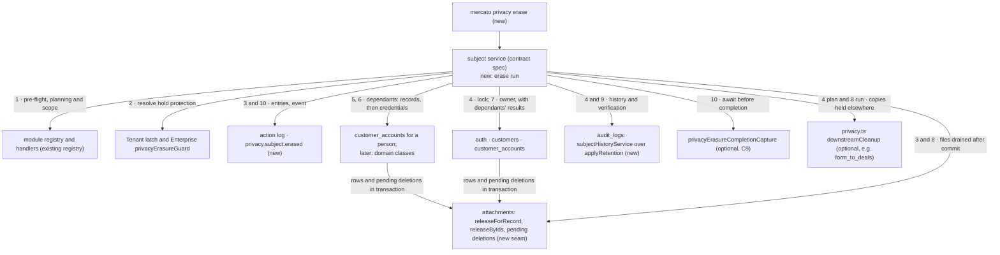

# Privacy subject erasure

> **Program:** packages C4 (first part) and C6 of [`2026-11-15-gdpr-ready-deployments-program.md`](2026-11-15-gdpr-ready-deployments-program.md) (tracker open-mercato/open-mercato#8593). The module-by-module roll-out that was drafted here now lives in the program spec as an unverified plan.
> **Builds on:** [`2026-11-16-privacy-data-class-contract.md`](2026-11-16-privacy-data-class-contract.md).
> **Verified at** `main` @ `08dada9624` by reading code, twice (author and independent reviewer); nothing was run.
> **Written autonomously.** No question was put to a person; the choices are listed under Resolved assumptions.
> **Status:** design settled; no implementation. Program DEC-2b proposes an OSS invoker (assumption 3). Named upstream approval for C4/C6 is required before implementation or an OSS delivery claim. Each phase then receives ordinary maintainer review.

Extends: .ai/specs/GDPR/2026-11-15-gdpr-ready-deployments-program.md
Extends: .ai/specs/GDPR/2026-11-16-privacy-data-class-contract.md

## 📝 TLDR

The contract spec lets an operator export what three modules hold about a person. Nothing can remove it. Deleting a CRM person is refused when a deal is linked; deleting a staff user leaves their consents and MFA rows behind; a portal user is only soft-deleted, with email and name left in place; and the audit log keeps a full copy of every deleted record. **Proposed (future):** the contract gains one mutating operation, erase, in which each data class reports per section whether it deleted, anonymized or retained its rows and why. The three root subjects implement it, the audit history of every record the erasure edits is stripped before erasure writes and again after the owner, and an operator runs it through a command that is a dry run by default — by subject, or by email address or phone number for a person who has no record of their own. Work runs in bounded, resumable pages, and every report states what lies outside it, such as search indexes, queue copies and data kept without an end date.

**Not in this spec:** data classes for the other person-data modules (domain specs listed in the program); legal holds, retention policy and the admin UI (the enterprise engine); the coverage test and end-to-end suite; portal self-service; restriction of processing.

## 📝 Overview

> **Market reference.** WordPress core pairs each registered *exporter* with an *eraser* that returns items removed, items retained, and messages saying why something was kept. Discourse and GitLab anonymize an account whose content must survive instead of refusing to delete it. Adopted: one eraser per module that reports removed and retained with a reason; anonymize-in-place where links must survive. Rejected: GitLab's shared "ghost user" — it needs a reserved account in every tenant, and this codebase already renders a missing author as "Unknown user".

## 📝 Resolved assumptions (autonomous defaults)

| # | Question | Chosen | Rationale |
|---|---|---|---|
| 1 | One spec for the operation and the 25-module roll-out | Split. This spec is the operation, the run, the command, three roots and audit history | The reviewer's verdict. The roll-out rows were built from a column-name scan and several failed against the code. |
| 2 | Erase and anonymize as two operations, or one | One, `eraseSubject`, with a preference; the handler reports an outcome per section | Whether a row can be deleted depends on rules only its module knows, and one class often mixes outcomes. |
| 3 | Who calls it in OSS | `mercato privacy erase` | Decided by program DEC-2b: C4 erase, including C6, is proposed for OSS beside C1 export, subject to named upstream approval before implementation or an OSS delivery claim. Data-subject rights are not paid-only, and the handlers live in the OSS modules that own the data. Enterprise adds the ledger, holds, policies and admin page on top (C3). |
| 4 | When is a subject kind erasable | A record kind has one registered owner with an existence check, and every registered declaring class implements erase; an identifier kind has at least one declaring class | Empty registries and missing owners must never report successful erasure. |
| 5 | Order | The order under "The run": checks, subject serialization, started entry, account lock, first history strip, records, credentials, owner, files and downstream copies, second history strip and verification, optional completion capture, event | R3-1: revoke existing replay before erasure writes and catch entries written during the run. Early refusals change nothing; late refusals leave an incomplete, locked run. |
| 6 | A person linked to deals, or whose dependants retained something | Anonymized in place | The issue asks for it; a deleted root would orphan what was retained. |
| 7 | Related subjects | Never erased implicitly. Apply is refused while a related subject is neither named nor excluded | A portal account and the CRM person behind it are one human to the operator, but two decisions. |
| 8 | Audit history of the subject | Entries stay, marked stripped, with the names of the changed fields. Command payload, snapshots, change set and undo token are removed, and the context is reduced to the two existing actor keys, `actorSubject` and `systemActor` | That something happened is evidence; the content is the personal data. A system-performed entry stores its actor only under `systemActor` (`audit_logs/services/actionLogService.ts:300-321`), so keeping `actorSubject` alone would lose it. |
| 9 | Confirmation | A one-hour token binds the exact reviewed write plan, request and approval revision. Apply verifies it against the plan under the subject lease and journals that plan before any erasure write. | A changed plan requires fresh confirmation. Retrying a recorded approval can finish only its immutable write set. |
| 10 | Marker on anonymized rows | Nullable `anonymized_at` on CRM entities and portal users | Idempotence, and lets the UI and export say so. Staff users are always deleted, so they get none. |
| 11 | A person known only by an address or number | `--email` and `--phone` on the command, for the contract's `privacy:identifier` subject, whose id the contract derives from the tenant and the identifier | Guest payers and correspondents have no record to name. An id generated per run could never match its own confirmation, be repeated or be replayed. |
| 12 | When the event is emitted | Only after verification succeeds, by a run that changed something or continues an open started entry. The event goes out before the completed entry is written | Otherwise a crash or a failed emit after the owner commits loses the event for good. Subscribers already recognise a repeat by `runId`. |
| 13 | `email` on `customer_accounts.user.deleted` | Kept for good; empty when the deletion comes from an erasure | `BACKWARD_COMPATIBILITY.md` §5 forbids removing a payload field. An empty value already keeps the address out of queues and webhooks. |
| 14 | Who specifies the audit-history strip | This spec owns the OSS `applyRetention` contract and strip state; enterprise consumes it | DEC-B fixes ownership and the exact selector signature. The full routine ships in OSS; enterprise owns age policies and scheduling. |
| 15 | Apply without audit wiring | Refuse apply before any mutation; dry run remains available with a warning | A durable journal and both history passes are mandatory. Without the journal a crashed run has no fixed run id, no planned history identities and nothing to resume; without the strip, erased values stay replayable in snapshots. `audit_logs` is enabled by default in the app and the starter template. |
| 16 | Organization scope | Erasure is tenant-wide; `eraseSubjects` rejects a scope containing `organizationId`. R4-2 authorizes the portal deletion worker for the requesting account, in its tenant, with all related subjects excluded; R5-1 permits operator recovery only of its `failed_handoff` journal | The subject's own verified request is the worker's authority; the service reloads that request through the account owner before acting, so the authority does not rest on the caller's word. The worker needs no staff authorization and uses actor `{ kind: 'system', worker: 'portal-self-service' }`. Recovery preserves that intent and records the operator as `resumedBy`; the enterprise page requires `data_erasure.subjects.erase`. The design satisfies portal self-service assumption 11. Never discard an HTTP caller's organization restriction to pass this check. |
| 17 | Consent evidence after erasure | Keep ids, consent type, grant state and dates; clear IP and source, recompute integrity over the scrubbed record | Grant state and dates show that consent was given or withdrawn; the IP address and source identify the person and are not needed for that. The existing integrity helper recomputes the hash, and the report records that the proof was replaced. The original IP-bearing evidence is not kept. |
| 18 | Identified employment root and preference | Consume people-ops assumption 2 and R4-14: `anonymizeOwnerWhenRetained: false`, retained identified block under `delete` with the owner’s `legal_retention` or `open_case` reason, explicit `anonymize` refused before writes; keep `anonymizedAt` null | R4-14 settles the owner's policy. A legally retained employment record stays identified, so reporting it as anonymized would be false. Pre-flight refuses explicit `anonymize` with `STAFF_EMPLOYMENT_RETENTION_REQUIRES_REVIEW`, whose message points to `--prefer delete`: that deletes everything not under legal retention and reports the root as retained `legal_retention` with its `retainedUntil`. Final clearing alone sets the anonymized mark. |
| 19 | Queue copies after erasure | Disclose temporarily retained queued, delayed, failed and quarantined copies under queue-payload-minimization assumption 8 | Program decision: queue copies left after an erasure are disclosed, not purged. Completion covers the registered erasure work, and every completion report states the queue lifecycle. Sealing and failed-age cleanup alone prove no subject purge. |
| 20 | Lifetime of erasure evidence | Completed journal/coordinator evidence expires after a tenant age, default 365 days and floor 30; open recovery journals stay until reconciled. R4-4's optional `privacyErasureEvidenceHold` providers defer expiry while owner work is pending | Program decision: every privacy evidence age is 365 days by default, floor 30, extended by holds and by unresolved work. "Erasure-evidence expiry" below implements it; active Enterprise holds and owner pending signals extend the window, and owner signals replace the former proof handoff. The evidence is never called anonymous, and recovery state is never deleted silently. |
| 21 | Protected completion when restore replay is configured | Await C9's optional `privacyErasureCompletionCapture.capture` after final verification and before completion | Adopt restore-replay assumption 9's durable capture boundary, which serves DEC-4's external manifest. A database restore can destroy every repair source before an asynchronous subscriber runs, so the capture is awaited before completion. A registered provider that fails leaves the run incomplete and is never bypassed; with no provider, OSS completion is ordinary and disclosed as unprotected. |
| 22 | Size of one erasure step | Bounded pages: each mutation transaction changes at most 500 rows of one section, the class returns a cursor, and the run journals a checkpoint per committed page. Planned and returned history identities are journaled in chunks of at most 1000; a call names at most 20 subjects | A heavy subject (synced interactions, messages) otherwise produces one unbounded transaction, journal row and `IN` list with no resumable unit. Atomicity per page is safe because the account is locked first and every page is idempotent. |
| 23 | Dependants of a root that is already gone | `mercato privacy erase --absent-root` erases the declaring classes' rows for that subject id inside the tenant; without the flag an absent root stays `not_found` | Ordinary deletes before rollout, and after it, leave consents, MFA, SSO, team-member and other rows behind (Problem Statement). An explicit flag keeps a mistyped id from silently running dependants, and every query stays in the named tenant. |
| 24 | Search indexes after erasure | Disclosed, not verified: every completion report carries `indexLifecycle`, and the operator docs name the repair commands | Token, vector and fulltext refresh runs through the ordinary asynchronous index events after commit. The run cannot read the search module's stores, and no search-owned subject verification exists; a failed index job can leave indexed values after a complete run. |
| 25 | Old binaries during the release that adds replay leases | Strip refuses until an operator confirms the rollout with `mercato audit_logs confirm-replay-rollout` | A process without leases can replay an entry it loaded before the strip. Nothing in the database can tell which binaries still run, so the operator attests once per installation. |

## 📝 Problem Statement

**What deletion does today**

| Subject | Today | Left behind |
|---|---|---|
| Staff user | Hard delete of the user, roles, ACL, sessions, resets, sidebar rows (`packages/core/src/modules/auth/commands/users.ts:1088-1168`) | `user_consents` (no foreign key); MFA methods and recovery codes; SSO identity soft-deleted with email and name kept; team-member profile; conversations; devices |
| CRM person | Refused with 422 when a deal is linked (`customers/commands/people.ts:1327-1329`). Otherwise a hard delete of profile, addresses, comments, activities, interactions, tags, shares, custom fields | Attachments; the person's name and email inside other people's interaction `participants`; order snapshots; the full pre-delete snapshot in the audit log |
| Portal user | Soft delete; sessions revoked (`customer_accounts/services/customerUserService.ts:156-167`) | Email, lookup hash and display name; invitations; the deletion event, whose payload carries the email |

**Facts that shape the design**

- **Commands cannot simply be reused.** Delete commands open their own transaction, the person delete has the 422 built in, and portal users have no command at all — the route calls a service.
- **The protected-role floor does not apply to a system actor.** `auth/commands/users.ts:1936` returns early when `ctx.systemActor === true`, which is what a CLI context is.
- **Deleting a person triggers sales.** `sales/subscribers/reconcileOnCustomerDelete.ts:25-36` nulls `customerEntityId` on orders, after which their snapshots can no longer be found from the person.
- **The attachment seam is per attachment.** `attachmentService.releaseScoped` takes one attachment id, requires an organization, refuses a shared attachment, and inside a transaction returns a blob cleanup to run after commit (`attachments/lib/attachment-service.ts:426-499`). Nothing lists a record's attachments.
- **Audit rows are findable.** `resource_kind`, `resource_id`, the parent pair and the related pair are stored in clear, each pair behind an index that leads with tenant (`audit_logs/data/entities.ts:10-11, 16`). The list query already matches a record on any of the three pairs (`audit_logs/services/actionLogService.ts:517-533`).
- **Nothing marks a stripped audit entry.** The list response carries neither the names of changed fields nor any mark (`audit_logs/api/audit-logs/actions/route.ts:246-268`). Redo answers 400 when the payload is gone (`api/audit-logs/actions/redo/route.ts:165-167`). The projection backfill, when forced, recomputes the names from the stored records and empties them if those are gone (`services/actionLogService.ts:839-950`).
- **The audit context is encrypted.** `context_json` and the stored records are in the module's encryption map (`audit_logs/encryption.ts:5-14`), and a native update skips the encryption subscriber.
- **There is no event outbox.** An emit is a separate call after the commit, and persistent subscribers must already be idempotent because delivery is retried (`packages/events/AGENTS.md`).
- **The lookup secret is resolved the same way in every process.** `LOOKUP_HASH_PEPPER`, then the two encryption-key variables (`packages/shared/src/lib/encryption/aes.ts:191-203`). It keys the lookup hashes, so every process of an installation already shares it.
- **The dispatcher redacts per command.** It echoes the arguments, and redacts a flag only where a per-command map names it (`packages/cli/src/mercato.ts:250-254`).
- **Unique indexes.** `customer_users (tenant_id, email_hash)` is unique among live rows and the hash is not nullable. `customer_entities.primary_email` is nullable.
- **Linking is automatic.** A new portal signup can be linked to a CRM person with the same email in its organization, among the first 500 candidates scanned (`customer_accounts/subscribers/autoLinkCrm.ts:94-117`).
- **An existing defect sits in the path.** `auth.user.deleted` carries `id`, but the SSO and channel cleanup subscribers read `payload.userId`. That is program package A9, and the staff-user erasure here must not depend on those subscribers.

## 📝 Proposed Solution

### The operation

A handler gains one optional method. Given a subject, a preference and the outcomes of the classes that ran before it, it changes only its own module's rows and reports per section.

| Outcome | Meaning |
|---|---|
| `deleted` | The rows are gone |
| `anonymized` | The rows remain; nothing in them identifies the person |
| `retained` | The declared surviving block remains for a reason from a closed list; separately cleared content has its own outcome |
| `refused` | The module will not act, with a code — for example the last administrator |
| `not_found` | Nothing held for this subject |

The preference is `delete` or `anonymize`. A handler honours `anonymize` on rows it may clear; a declared `legal_retention` / `open_case` rule may retain its explicitly listed identifying block under either preference. It reports that block as `retained`, with its identifying columns, reason and end/set, never `anonymized`. An owner policy may instead require deletion (`auth.users`); deleted-only child rows may still delete. The staff owner uses the stricter safe policy in [people-ops](2026-11-16-privacy-coverage-people-ops.md) assumption 2 and this spec's assumption 18: `staff.team_members` sets `anonymizeOwnerWhenRetained: false`, retains its identified block only under `delete`, and refuses an explicit `anonymize` with `STAFF_EMPLOYMENT_RETENTION_REQUIRES_REVIEW` before any write while that block must remain. Keep its `anonymizedAt` null until final clearing; no staff exception silently weakens the requested preference. Asked to `delete`, a handler may anonymize or retain when its rules require. The owner's preference is set by the run (step 7).

### Rules every handler follows

1. **Its own tables only, in bounded transactions.** Use the module's own service or a narrow internal erasure function with `withAtomicFlush(..., { transaction: true })` and decryption helpers. One transaction changes at most 500 rows of one section (a fixed constant, `PRIVACY_ERASURE_PAGE_ROWS`, not a setting). A class with more returns an opaque `next` cursor and `done: false`; the run journals a checkpoint and calls it again with that cursor (assumption 22). Each page is idempotent: the class recomputes its candidates from current data, so already erased rows no longer match, and the cursor is only a resume hint. An owner root and its small child sets commit in one transaction. A page boundary leaves the class partly erased and the subject incomplete until the class reports `done`; the account lock covers that state. It writes no snapshot or audit entry carrying cleared values (R3-1). It preserves tenant checks, mutation safety and domain invariants; the erasure-specific decision replaces only the ordinary delete refusal. After commit it runs the module's normal CRUD/index events and side effects, and calls `invalidateCrudCache` from `@open-mercato/shared/lib/crud/cache` for every changed record, its organization and tenant collection tags and normal resource aliases. Index events alone do not invalidate the CRUD response cache. Auth also invalidates RBAC user caches and sessions; customers recomputes next-interaction projections and removes custom fields at entity/profile keys; portal accounts invalidate their RBAC user cache and revoke sessions. Attachment release keeps quota/reference accounting behind its service. A failed required side effect leaves the section incomplete and is retried even when the database is already scrubbed. Only ids, counts and closed reason codes may be audited.
2. **Anonymize means: keep the row and its links; remove everything else.** Nullable identifying fields become null. A field that cannot be null gets the shared placeholder. Free text, addresses and contact points are deleted.
3. **Retain only with a reason from a closed list:** `legal_retention`, `evidence`, `other_party`, `shared_record` — something several people made or use together, such as a document or a conversation — and `open_case` — a record still being worked on, handled when it closes.
4. **A class called for a kind it does not own never mutates another kind's root.** It reports that root as a related subject.
5. **Files.** Rows change in the transaction, and the stored files are removed after commit through a new attachments seam.
   - **The problem today.** An attachment row is removed inside the caller's transaction, and the stored object's deletion is only a closure returned to the caller (`attachments/lib/attachment-service.ts:496-497`). After a storage error or a crash, nothing points at the object any more, and a re-run would list no attachments.
   - **A durable record.** The seam therefore writes one `attachment_pending_deletions` row per stored object that must go, in the same transaction as the row changes.
   - **Draining.** After commit the run deletes each recorded object and its row. A delete that fails keeps its row: the section reports it in `filesPending`, and the subject stays incomplete (exit 2).
   - **Retries.** A re-run of the same subject drains that subject's rows first. `mercato attachments drain-pending-deletions --tenant <id>` drains every row, so a file is never left behind because nobody re-ran.
6. **Idempotent, and dry-runnable.** A second run reports the standing outcome with zero rows affected.
7. **Export and erase ship together for classes added after this spec.** The three root classes are the exception: export ships in the contract spec, erase in this spec's Phase 3. Before then their kinds are not erasable. Every later class ships both methods in the same change.
8. **Every edited record is a history record (R3-1).** Every `eraseSubject` returns in `historyRecords` every record it changes, deletes, anonymizes or blanks, including records owned by other people. R4-5 excludes `attachment_pending_deletions`: these unaudited `runtime_state` rows write no action-log entries and need no planned history identities. Dry-run returns the same planned identities before mutation. Wherever this spec or a coverage spec says a call returns the complete planned identities, that means the union of its pages until `done`. Coverage specs list these identities per class. For example, customers returns every interaction whose participant or linked-entity list it rewrites as `customers.interaction`, even when its owner is another person. Both history passes call `applyRetention` through `subjectHistoryService` with `includeSubjects` and `includeRecords`. Stripping removes the entire edited record's old values and replay, including unrelated participants' historical values; the report discloses this history cost. The first pass strips every planned record before any erasure write, so an apply that is later abandoned has still removed that history irreversibly, including for records it never changed. The dry-run report states the planned count under `historyStripPlanned`, and the operator docs say so.
9. **A group.** A class declares `erasureGroup`: `records`, the default, or `credentials`, for credentials and sign-in material such as MFA methods, single-sign-on identities and API keys.
10. **Checks before writes and at mutation.** Each record kind requires its owner's `checkErasable`; other classes may implement it. Pre-flight reads only. The auth owner additionally serializes and rechecks the protected-role floor in its account-lock and erase transactions, using the same deterministic authorization-state locks as delete, without the system-actor bypass. The guard and owner check run again immediately before the owner. A late refusal leaves a locked, incomplete run; it cannot promise rollback of earlier classes.

### The audit-history rule for every erasure (R3-1)

Every class's `eraseSubject` returns, in required `historyRecords`, every record it changes, deletes, anonymizes or blanks. This includes another person's record, such as an interaction whose participant list loses the subject. Coverage specs enumerate these record identities per class. Use existing logged resource kinds; an unlogged record uses its module entity id with `:` replaced by `.` so it still has an explicit identity. R4-5's `attachment_pending_deletions` runtime state is not an audited record, writes no action-log entry and is excluded from planned/returned history identities; the actual attachment records remain covered.

The run strips history twice. The first pass runs immediately after the account lock commits and before the first dependant or owner erasure write. The second pass follows the owner writes. `subjectHistoryService.stripSubject` uses standalone audit transactions of at most 500 rows, keeping the C4 subject lease across the run and reacquiring the tenant hold fence in each audit transaction. The first pass uses every planned record, and the second uses the planned, journaled and returned union. Step 8 uses the same wrapper before an approved cleanup writes newly discovered copy identities. Lease, guard, proof or write failure rolls back the affected audit batch. It leaves previously committed strips in place and blocks dependent writes or completion until a retry settles the pass. A later owner rollback does not undo an earlier committed strip.

Undo and redo recheck `stripped_at` under the source row lock before execution, including an entry loaded before stripping. Neither may restore cleared values or create a trace snapshot. API Contracts defines the replay lease and stale-claim rule. Internal blanking functions write no snapshot or audit entry carrying cleared values.

### The run

For each subject, in this order. A dry run performs pre-flight, guard and handler planning with `dryRun: true`; it writes no entry, takes no account lock and emits nothing. Planning must enumerate every would-be `historyRecords` identity and fail rather than truncate silently; it pages each class until `done`. On apply the planned identities stream into chunked journal entries (step 3), so neither memory, one journal row nor one strip call holds them all.

1. **Pre-flight, no mutation.** Validate the R3-14 input with zod, including its closed origin enum, R4-2 portal actor/boundary and R5-1 recovery exception below, at most 20 subjects, and reference length at most 120. Reject `organizationId` with `TENANT_WIDE_SCOPE_REQUIRED` in dry-run and apply. Origin `portal` requires the portal worker actor, exactly the requesting `customer_accounts:user` in the account's tenant, every related subject excluded, and an accepted request that the account owner confirms (“Authority for a portal-initiated erasure”); the only other path is R5-1's recovery of a `failed_handoff` journal through `resumeErasureRun`. Any other actor, subject set or unconfirmed request refuses before mutation. A record kind requires exactly one registered owner class that declares it, implements erase and performs a tenant-scoped existence check. Every declaring class must list `erase` and implement `eraseSubject`; an identifier requires at least one declaring class. Missing owner/classes give `KIND_NOT_ERASABLE`, never vacuous success. Resolve aliases in memory for a new run. On retry recover the original standing-verification inputs as described below; do not use a redacted root as a substitute. Run every `checkErasable`, plan every section and build the related-subject closure. An absent record root gives status `not_found` with `SUBJECT_NOT_FOUND`, not `refused`, and calls no dependant unless a tenant-matching earlier erasure journal proves a retry, or the CLI's `--absent-root` flag (“A root that is already gone”) asks for its orphaned dependants. Never query another tenant to distinguish those cases. An open journal allows recovery after root deletion. A completed journal permits a new zero-change standing result only when current standing verification can establish it without removed evidence. A terminal receipt for an exact previously accepted operation may settle its caller without claiming a new verification. Apply resolves the signed external installation posture and, when activated, awaits the owner provider’s `assertCaptureReady()` as specified in **Optional completion capture — C9**. Unknown posture and missing or unavailable protected wiring refuse before any subject mutation. A dry run reports the same readiness refusal without writing. Apply also requires working `actionLogService` and `subjectHistoryService`, and `attachmentService` for any class whose handler releases files (the three roots here), before any mutation. Dry run reports missing wiring and remains read-only.
2. **Guard.** Call `privacyHoldProtectionService.requirePrivacyHoldProtection({ tenantId })` using the erasure guard contract in [record retention](2026-11-16-privacy-record-retention.md). Its positively clear, expected ordinary OSS result permits proceeding without `privacyErasureGuard`. An unresolved required guard returns `guard_unavailable`, including protected, legacy-unknown or unreadable state without a valid guard. Refusals and exceptions stop the subject. Recheck after the subject lease and under the same D3 tenant hold fence as each bounded destructive batch. This includes the account lock, both history strips, records, credentials, owner writes, file draining and downstream cleanup. A matching hold before journal start refuses with `subject_held`; a hold or unavailable fence after start stops before the next affected write and leaves the run incomplete.
3. **Serialize and journal.** Before creating or resuming a started entry, acquire an exclusive PostgreSQL advisory lock keyed by tenant, subject kind and id on a dedicated connection through steps 3–10. Use try-lock. Contention returns `incomplete` / `RUN_IN_PROGRESS` (CLI exit 2) without a started entry or mutation. Release in `finally`. Process death closes the connection and releases the lock. Handler commits keep the subject lock. Recheck pre-flight and the guard under the subject lease. An ordinary portal attempt rechecks the live accepted request. An authenticated R5-1 recovery instead verifies the exact `failed_handoff` journal and the authorized recovery actor. The deliberately cleared request marks are irrelevant to that recovery. An open journal must match scope, subjects, exclusions, preference, reference and origin or return `RESUME_REQUEST_MISMATCH`. R5-1 changes the recovery caller and preserves the request identity. For CLI or queued reviewed apply, enforce “Binding apply to the reviewed report” here. The started entry carries the request identity. Durable planned identity chunks, sealed standing-verification evidence when required, and a plan-complete checkpoint precede any write to the subject. Reuse the started entry id as `runId`, keep identifiers and checkpoints free of aliases or cleared values, and record operators as `resumedBy`. Previously pending file deletions may drain only after this check and only from the accepted plan on reviewed apply.
4. **Lock and first history strip (R3-1).** The owner locks its account when applicable. Auth rechecks the role floor under the same authorization locks before soft deletion. When E3 Phase 3 is enabled, its auth-owned notification-recipient fence `authNotificationRecipientService.lockLiveRecipient({ scope, userId }, { em })` is shared by privacy staff-account lock and root deletion and by ordinary auth delete; take the lock before notification preference row locks/cleanup and retain it through the transaction retiring the recipient. Preference writers use the same order before changing any recipient preferences. For reviewed apply the owner's read-only `lockSubject` preview lists the exact lock and session writes. The owner checks their locked identities against the approval before its first write and commits the original `locked` checkpoint, account mutation and session revocation together through the audit owner's transaction-aware seam. Use the complete planned `historyRecords` union in the journal, including downstream `plan` results, plus `auditResourceKinds`, to call `subjectHistoryService.stripSubject` before any dependant or owner erasure write. From here on, stripped history stays gone if the run is abandoned. A skip or failure leaves the run incomplete. A live replay blocks dependent writes. Already stripped rows are idempotent. Internal account locking writes no snapshot. On an unbound retry, recompute the plan and persist additional allowed identities before stripping. A reviewed CLI or queued retry is limited to its durable approved plan.
5. **Dependants holding records.** Run declaring non-owner `records` classes in class-id order, each page by page until `done`. A failure stops the subject; credentials have not been touched. Each mutation transaction verifies that it will touch only the pre-stripped record identities. If discovery finds a new identity, stop with `REPLAN_REQUIRED` before that change. Unbound retries plan and strip it first. A reviewed plan cannot be expanded by retry or reconciliation. After each committed page, persist its returned history ids (as `plan_chunk` entries with source `returned`), counts and cursor in a `checkpoint` entry before the next page; the pre-write plan is the crash-safe superset if the process dies after a commit. A retry restarts an unfinished class from its last checkpointed cursor, and the class's own idempotence covers a page that committed without its checkpoint.
6. **Dependants holding credentials.** Run the `credentials` group in the same way. Auth's lock does not delete SSO identities or API keys; their classes own them. Failure leaves the account locked for recovery.
7. **Owner.** Under the tenant hold fence, re-ask the guard and owner’s `checkErasable` immediately before mutation and hold the fence through commit. A new hold or refusal leaves the run incomplete. The owner also rechecks mutable invariants under its own transaction's locks. If any dependant retained or anonymized a section, pass `prefer: 'anonymize'`, unless `anonymizeOwnerWhenRetained` is false. Auth users always delete and set that flag false; retained rows may keep a non-resolving id. The staff team-member owner sets the flag false so a retained dependant does not coerce the reviewed `delete` preference into anonymize. It returns its declared identified legal/open-case block as `retained`, with `anonymized_at` null until final clearing under the people-ops contract. Explicit `anonymize` was refused in pre-flight whenever that block must remain; recheck the same condition before owner mutation (assumption 18). An identifier subject has no account/owner step. `customer_accounts:invitation` has an owner existence check and deletes only the named invitation.
8. **Files, then downstream copies.** Drain the subject's origin through `drainPendingDeletions(scope, { origin })`. Remaining objects count as `filesPending`, so the subject stays incomplete. Before awaiting each matching downstream cleanup's `run`, await its `plan` again for the same source ids, in calls of at most 500. The source classes have erased those records by now, so a copier that refuses erased sources returns its final copy set. An unreviewed service run persists an identity outside the planned union as a `planned` chunk. A reviewed run stops with `REPLAN_REQUIRED` before touching it. Strip the approved identities through the step-4 wrapper (`subjectHistoryService.stripSubject`) before `run`; a skip or failure leaves the subject incomplete with checkpoint `downstream_cleanup_pending` and `run` is not called. Then await every matching downstream cleanup’s `run` with the source ids, scoped attachment origin, approved write intents and exact-write callback defined in **Downstream copies of erased records**. A throw, or a non-zero `pending` or `failed`, leaves the subject `incomplete` with checkpoint `downstream_cleanup_pending`; a rerun of the same run retries.
9. **Second history strip and verification (R3-1).** Call the same wrapper with `includeSubjects` and the union of planned, journaled and returned `historyRecords`, to catch entries written during the run. Re-enumerate every class read-only against the original standing-verification inputs, including soft-deleted/anonymized roots and resumed hard-deleted roots. Missing required inputs are incomplete, never verified absence. Existing `eraseSubject({ dryRun: true })` returns standing zero-affected outcomes for already scrubbed data; any newly erasable row, a related subject that is neither named nor in the accepted exclusions, a missed history identity, a skipped history entry or a failed side effect means `incomplete`. Use the audit owner's same selectors and evidence exclusions for the final unstripped-entry scan as for both history passes. A related subject that left the closure because this run cleared its link (for example the account tombstone's person link) is not a change. Re-ask the guard at this boundary; a newly created hold prevents completion. Re-scan matching unstripped audit entries and active replay leases; do not declare completion while either remains. Record both passes’ counts and this attempt’s exact UTC `verifiedAt` in the report and encrypted journal before capture. For activated capture first obtain fresh `attestVerificationTime()` and persist its verified UTC sample, upper bound and source identity in the same checkpoint. An unavailable attestation leaves the run incomplete without capture or completion. Every resumed verification obtains a fresh timestamp; earlier completed entries and an existing external manifest remain immutable.
10. **Capture, event, then completed entry.** Only after step 9 succeeds with no files pending, await optional `privacyErasureCompletionCapture.capture` with the exact input below. Call it for each subject's own `runId`, including zero-change/no-event completion, never only for the multi-subject coordinator. A registered provider that fails to resolve or throws leaves the started run `incomplete`, with no completion event, completed audit or success; checkpoint `evidence_capture_failed` and retry the same run after fresh verification. Only the independently verified never-activated ordinary posture permits local-unprotected completion. An absent provider under activated or unknown posture refuses. Repeat the signed posture and readiness check before publishing protected completion. A completion audit repeats the verified time and source bounds recorded in step 9. When a provider captured, record `completionCaptured: true` in a `captured` checkpoint and in the completed entry, so evidence expiry can tell that the run relies on the capture owner. After capture resolves, emit `privacy.subject.erased` with the scoped persistent options under “Event” if this run changed anything or resumed an open started entry. It carries no free-text reference. Then write the completed entry using that same `verifiedAt`. A failed emit or completion write yields `incomplete` and CLI exit 2; retry uses the same `runId` and may redeliver, which subscribers deduplicate. A verified, zero-change rerun of a completed erasure emits nothing, but still passes through capture.

**When a subject is complete.** Database changes, cache invalidations and required synchronous side effects succeeded; no file, selected history entry or replay is pending; every matching downstream cleanup returned zero pending and zero failed; final verification found no remaining erasable data at its recorded time, and any registered completion-capture provider succeeded. This is not a fence on arbitrary application writers. A record or hold committed after final verification is a residual race and requires a new run; the operator documentation states that the run does not prove that future writes are impossible. Token, vector and fulltext index refresh is asynchronous and not verified by the run; “Search indexes after completion” below discloses it in every completion report (assumption 24). The queue-copy limit below is part of every completion report. The verification suite drains only its owned fixture work before scanning; this is no evidence that production backlog or delayed jobs were purged.

**Tenant hold fence.** The OSS privacy owner supplies D3’s `privacyHoldProtectionService.withPrivacyHoldFence({ tenantId }, callback, { em }?)`. C4 first takes the subject lease and never reacquires it or nests the tenant fence from an owner callback. Every guarded database batch takes the transaction form of the fence on the exact owner transaction manager before taking owner, authorization or audit row locks. Use READ COMMITTED or an equivalent fresh read after lock acquisition so an earlier snapshot cannot hide a hold committed by the previous lock owner. Independent bounded batches reacquire the fence rather than reuse a previous guard result. Re-resolve the durable latch and fresh hold decision while fenced and hold the fence through commit. Supply the active manager to the guard through internal DI options. Any guard-owned alias refresh uses that same transaction or matches the in-memory union without writing. It cannot acquire a second lease. A stale, unavailable or newly held result stops before writing. Use the same tenant key for C3 hold and latch publications. For bounded irreversible external deletes, use the fence’s dedicated-connection form and the storage owner’s durable dispatch marker before calling the provider, as in D3. An uncertain dispatched outcome continues to block successful hold publication even if the fence connection drops. Affected file and downstream work stays pending until the marker is reconciled. Guard before a final standing proof and capture under the same fence. The read-only dry run checks the guard without an apply lease and never represents acceptance of a future write.

**Recovery of a locked account.** Resume the matching run by default. Before any dependant or strip changed data, a late floor refusal may restore only the prior lock flag recorded in the `locked` checkpoint's `priorAccountLock` in an auth-local transaction under the same authorization locks, recording the recovery. After any destructive phase, never auto-unlock. An operator reviews the journal and explicitly abandons the run; an auth-local `authPrivacyService.unlockAbandonedSubject({ scope, subject, runId, actor })` validates the open journal through the audit service, reacquires the subject lock and auth role locks, and refuses if deletion/anonymization or a credentials phase committed. It may restore the prior `deleted_at` only when the remaining credential set is intact and no active hold blocks recovery. Sessions stay revoked; the user must sign in again. Otherwise finish erasure or provision a replacement account through normal auth flows. This internal recovery operation requires existing user-update authorization and stores no credential or snapshot.

The owner of a kind is the module named before the colon; a class may declare kinds it does not own. Record subjects need one owner, while `privacy:identifier` is owned by the privacy run itself under DEC-A, whose normalization and derivation remain the contract spec's responsibility.

### Downstream copies of erased records

A module that copies another class's records outside that class, such as [form-to-deals](../2026-06-17-form-to-deals.md) copying submission answers and CV files onto CRM deals, declares `downstreamCleanup` in its `privacy.ts` (type under API Contracts). The R3-2 registry carries the member; the run reads it from the runtime module registry at operation time and validates that entry ids are unique and that each `sourceEntity` is a discovered entity id. No module registers an entry unless it holds copies; absence changes nothing.

- **Which records.** An entry matches when a class reports `changedRecords` for its `sourceEntity`. A class that changes records of an entity named by a registered `sourceEntity` reports them there in dry-run and apply, and its owner tests assert it. The first user is `form_to_deals.deal_projections` with `sourceEntity: 'forms:form_submission'`, fed by the `forms.submissions` class.
- **Plan (step 4).** Before the first strip the run awaits `plan` with the planned source ids, in calls of at most 500 ids, and adds the returned `historyRecords` to the planned identities, so both strips cover the copies. Record its stable `plannedWrites` in the applicable canonical approval and in the scoped plan journal. The source ids are journaled in `downstream_chunk` progress entries. `plan` is read-only; a dry run calls it too, and `historyStripPlanned` counts its identities.
- **Run (step 8).** After the files drain, take the union of planned and returned source ids from the journal, in calls of at most 500 ids. Re-read the downstream plan and compare its exact write identities and dispositions to the previously accepted plan. An unbound run can replan and strip new copies before writing. A reviewed CLI or queued run refuses an out-of-plan write with `REPLAN_REQUIRED` even when counts are unchanged. Pass the exact accepted batch plan, including scope and attachment origin, to `run`. The owner locks its bindings and affected copies, derives the actual bounded write set and invokes `assertApprovedWrites` before any owner write, history change, or new file release. Use its own owner transaction under the tenant hold fence. Source ids alone never authorize a write. A previously approved release may drain only the pending deletion locators created by that approved release. Unknown bindings, unmatched writes and unresolved files stay pending, keeping the erasure incomplete. A retry uses the immutable accepted plan for a reviewed run.
- **Report.** The completion report and the completed entry list each matched cleanup in `downstreamCleanups` as `{ id, records, pending, failed }`, counts only; the dry-run report lists matched ids with planned record counts. These report counts are outside R3-14 and the event. The canonical digest binds the planned downstream cleanup, source and copy identities as specified below.

### A root that is already gone

An ordinary delete leaves rows behind (Problem Statement): a staff user deleted before this release, or by the unchanged ordinary delete after it, keeps `user_consents` with IP and source, and the MFA, SSO, team-member, conversation and device rows of their classes. Without help an erasure of that user answers `not_found` and never reaches them.

- **The flag.** `mercato privacy erase --tenant <id> --subject <kind:id> --absent-root …` applies only to a record subject whose owner's existence check answers `SUBJECT_NOT_FOUND` and that has no erasure journal. It is a CLI-only internal option of the run (“The `eraseSubjects` entry point (R3-14)”), never a member of the R3-14 input; in-process callers keep `not_found`. An identifier subject has no root, so the flag is refused there.
- **What runs.** Every class declaring the kind is called with `rootAbsent: true` and `aliases: {}`, inside the named tenant only. The owner class skips `lockSubject` and the root mutation and clears its own orphaned child rows that carry the subject id (for auth: consents, scrubbed and rehashed as on the ordinary path; leftover resets, sessions, sidebar preferences and sidebar variants). Dependants match by subject id; data reachable only through aliases (email or phone hashes) is reached through the identifier path (“Erasing by email or phone”). The protected-role floor does not apply: a deleted user holds no role. The order, journal, both history passes, verification, capture and event are those of “The run”.
- **The result.** If no class holds anything, the subject stays `not_found` and nothing is journaled. Otherwise the subject reports `complete` or `incomplete` as usual, and the report marks it `absentRoot: true`. Without the flag, the dry run of an absent root names the flag in its message and calls no dependant.
- **Confirmation.** The flag is part of the confirmation token's fields and the report digest, so apply must repeat it.
- **Tenant isolation.** A subject id from another tenant finds no rows in the named tenant, so it stays `not_found`; no query leaves the tenant.

**Explicit restore record-absence verification.** For the [restore replay](../enterprise/GDPR/2026-11-16-erasure-restore-replay.md) record-subject acknowledgement only, the privacy owner exposes an additive internal DI method `verifyAbsentRecordDependants({ scope, subject, actor, prefer, excludedRelated })`. Inputs use the original manifest scope, subject, preference and exclusions. Require an authorized replay caller, a matching tenant-wide record subject, the subject lock, and the same protection latch and guard as the erasure, using implicit `origin: 'engine:replay'` and read-only guard evaluation. The service rereads the root and runs every declaring owner's and dependant's read-only checks and orphan dry run using `rootAbsent: true` and `aliases: {}`. Every relevant class and downstream owner must establish coverage for this absent root, including any store that can be reached only through aliases. An owner may establish coverage through an authoritative immutable relation or by proving its class has no alias-only path. Disabled or unclassified storage that could hold matching dependants requires affirmative clearance from its owning coverage evidence. Missing proof, any remaining orphaned subject row, pending file/history/replay or downstream work, and unavailable checks leave verification pending. No aliases are reconstructed, no handler applies a change, and no other tenant is queried. A present root is refused and goes through normal replay. The result is `{ status: 'verified_clear'; checkedAt: string } | { status: 'pending' | 'refused'; code: PrivacyAbsentRecordProofCode }`, with closed codes `ROOT_PRESENT`, `DEPENDANTS_REMAIN`, `DEPENDANT_COVERAGE_UNVERIFIED`, `CLEANUP_PENDING`, `COVERAGE_UNAVAILABLE`, `ERASURE_GUARD_REFUSED` and `RUN_IN_PROGRESS`. Only C9's explicit audited acknowledgement may consume the verification alongside its own audit and settlement checks.

### Authority for a portal-initiated erasure (R4-2)

`eraseSubjects` SHALL accept `origin: 'portal'` only from the portal deletion worker, with actor `{ kind: 'system', worker: 'portal-self-service' }`, in both modes, except for R5-1's authorized recovery through `resumeErasureRun` of a journal in `failed_handoff`. The worker acts on the data subject's own verified request and needs no staff authorization. Before calling, it independently validates the accepted account request and its tenant/organization through the account owner; it supplies `scope: { tenantId }` for that account's tenant, exactly one subject — the requesting `customer_accounts:user` — and `excludedRelated` containing every related subject. No related subject may be included in `subjects`, even if it belongs to the same human. Pre-flight and the locked recheck enforce this boundary; a newly related subject outside the accepted exclusions prevents apply, including recovery.

**The service checks the request itself.** `eraseSubjects` does not take the worker's word. For origin `portal`, in pre-flight and again under the subject lock, it calls the account owner's `customerAccountUserPrivacyHandler.verifyPortalErasureRequest({ scope: { tenantId }, userId, mode, excludedRelated })`, which reads only `customer_users` in that tenant and answers `{ accepted: true } | { accepted: false; code }`:

| `mode` | Accepted when | Refusal codes |
|---|---|---|
| `dry-run` | A deletion request is pending (`deletion_requested_at` set), due (`deletion_effective_at` at or before now) and not failed | `NO_ACCEPTED_REQUEST`, `NOT_DUE`, `REQUEST_FAILED` |
| `apply` | As `dry-run`, plus `deletion_claimed_at` is set and the stored `deletion_excluded_related` equals the sorted `excludedRelated` | as above, `NOT_CLAIMED`, `EXCLUSIONS_MISMATCH` |
| `handoff` | A request is still pending and not yet failed (used by `recordFailedHandoff` below) | `NO_ACCEPTED_REQUEST`, `REQUEST_FAILED` |

An initial authority refusal stops the subject with `refused` and the returned code before any journal, account lock or write. A refusal after a started run leaves it incomplete. Until the portal phase adds those columns, the method answers `NO_ACCEPTED_REQUEST`, so portal origin is unusable, as the portal spec's `deletionAvailable: false` already states. The check makes the authority verifiable: an in-process caller that passes it is acting on the subject's own pending, due and claimed request, whatever code it runs in.

Portal authority covers rows whose owners prove the exact requesting account's immutable scoped relationship. Pass `ownership: { kind: 'portal_account', accountId }` to each handler's check and erasure inputs for worker apply, preview and R5-1 recovery. Each declaring dependant class publishes `portalAccountErasure: 'exact_owner' | 'controller_review'`. For each matched candidate, require an owner-verified typed `customer_accounts:user` relationship to the exact requesting account before planning or changing it. A shared address, phone, hash match, apparent uniqueness or excluded root does not prove that relationship. Alias-only access is for detecting ambiguity in memory. A class without the capability, or a matching candidate that needs controller review, refuses with `PORTAL_ATTRIBUTION_AMBIGUOUS` before any first write. Once a run has started, newly ambiguous candidates stop it as incomplete before further affected writes. The owner repeats the exact scoped account predicate in its own mutation transaction. This applies to attribution of every planned record, history identity, attachment and downstream copy. Dependent activity may span organizations only when the exact relationship and tenant are proven. Operator adoption preserves these constraints, and broader linked data requires a separate, explicitly authorized and reviewed controller run. HTTP authorization remains organization-scoped and no route forwards a caller-supplied origin or actor. This is the erasure-side contract for [portal self-service](2026-11-16-portal-privacy-self-service.md) assumption 11.

### Origin-preserving portal recovery

After the portal deletion worker's seventh failed attempt, any open portal-origin journal SHALL enter `failed_handoff` before the worker clears the account request marks and stored exclusions under the portal owner's existing terminal-failure rules. This is still an open erasure journal, not completion, abandonment or a new request. Its accepted intent and recovery evidence remain authoritative after those account fields are cleared. A failed operator attempt keeps `failed_handoff` until verified completion, so further authorized recovery remains possible; evidence expiry skips this open state.

**Recording the handoff.** The privacy service owns the transition; the worker never writes a journal entry itself. `privacySubjectService.recordFailedHandoff({ scope, subject, actor }): Promise<PrivacyFailedHandoffResult>` accepts only tenant-wide scope, a `customer_accounts:user` subject and the exact portal worker actor; any other input is a zod validation error, thrown before any read. It first calls `verifyPortalErasureRequest` in `handoff` mode, then takes the subject run lock with try-lock, finds the subject's open portal-origin journal through `actionLogService.list`, validates its typed intent and appends a `privacy.subject_erasure` entry with `status: 'failed_handoff'` and a `failed_handoff` checkpoint.

```ts
type PrivacyFailedHandoffResult =
  | { recorded: true; runId: string | null }
  | { recorded: false; code: 'RUN_IN_PROGRESS' | 'NO_ACCEPTED_REQUEST' | 'REQUEST_FAILED' }
```

Every expected outcome is a returned value; the method throws only for invalid input and for infrastructure failures (lock connection, audit list or write, malformed journal context), after which nothing was appended.

| Result | Meaning | Portal worker |
|---|---|---|
| `{ recorded: true, runId }` | The open portal-origin journal is in `failed_handoff`: newly recorded, or already in that state (same `runId`, nothing appended) | Clears the account's request marks and stored exclusions and records the failure, naming `runId` to staff |
| `{ recorded: true, runId: null }` | No open portal-origin journal exists; nothing is recorded | Same terminal transition, with no run to name |
| `{ recorded: false, code: 'RUN_IN_PROGRESS' }` | Another process holds the subject run lock; nothing is recorded | Keeps marks, claim and exclusions, records no failure and retries only the handoff on the next daily attempt, as for a throw |
| `{ recorded: false, code: 'NO_ACCEPTED_REQUEST' \| 'REQUEST_FAILED' }` | The `handoff`-mode check refused before the lock: the request is no longer pending, or its failure is already recorded (a concurrent or redelivered transition already committed) | Makes no account change, sends no notice and does not retry; the account's current state stands |

The portal worker calls it at the seventh failure before clearing the account's request marks.

`privacySubjectService.resumeErasureRun({ scope, runId, actor, mode }, options?): Promise<PrivacyErasureRunResult>` is the additive owner-service method for a single-subject portal journal, not a change to R3-14. `mode` is `dry-run | apply`; scope must be tenant-wide. R4-2 permits the portal deletion worker with its exact system actor, subject to `verifyPortalErasureRequest` as for `eraseSubjects`. R5-1 additionally permits an operator through `mercato privacy erase --resume-run <runId>`, or through the enterprise page's `POST /api/data_erasure/subjects/resume-erasure` route with `data_erasure.subjects.erase` (owned by the [DSR engine](../enterprise/GDPR/2026-11-16-privacy-dsr-engine.md)), only when the journal is in `failed_handoff`. This is the only exception to the worker-only rule. The service enforces what it can verify itself: the journal's `failed_handoff` state, its typed intent and tenant, and, for the worker actor, the account request. Caller authority stays with the caller, as for every other origin. The CLI's authority is shell access to the installation, like every `mercato` command, and it passes actor `system:privacy-cli`, which becomes `resumedBy`. The enterprise page authorizes `data_erasure.subjects.erase` in its route and passes the authenticated user id, which becomes `resumedBy`. Neither an actor object, a status supplied by a caller nor a CLI confirmation token grants recovery of a journal that is not in `failed_handoff`.

The optional trailing `PrivacyReviewedApplyOptions` follows the same guarded reviewed-apply rule as `eraseSubjects`. The service resolves the journal through `actionLogService.list`, validates its typed intent and tenant, and requires `origin: 'portal'`, one requesting `customer_accounts:user` subject, all related subjects excluded, and matching started/checkpoint evidence. It reconstructs the immutable accepted scope, subject set, exclusions, preference and reference. Internal execution preserves the journal's portal worker actor and `origin: 'portal'`; operator recovery records the validated operator attribution as `resumedBy` in its audit entries. No caller reads audit tables or supplies replacement intent. Unknown, expired, malformed or ambiguous journals refuse; a conflicting open run never becomes a new CLI-origin run. Under the subject lock, apply rechecks the authority and handoff state and must resume this exact `runId`; missing open evidence refuses instead of creating another started entry. An already completed journal supports only a verified standing result under the existing authorized worker path, not another operator recovery exception.

`mercato privacy erase --tenant <id> --resume-run <runId> [--out <file>] [--apply --confirm <token>]` uses the factory's private CLI channel to the same recovery engine. The dry run reconstructs the journal's original intent. Apply verifies the token and its journal binding under the subject lease. Reject replacement subject, identifier, exclusion, preference or reference flags. The enterprise page uses the same recovery method under its existing erasure permission. Recovery recreates no account request and does not automatically reselect a failed account. Staff retain the account owner's failed-state handling and independently held case channel; a verified result may support failure dismissal, never restoration of cleared data. [Portal self-service](2026-11-16-portal-privacy-self-service.md), “Daily worker and recovery”, consumes R5-1's handoff while preserving those rules. This spec's tests use a worker test double: `recordFailedHandoff` idempotence (`recorded: true` with the same `runId`, nothing appended), `runId: null` without an open journal, a validation error for another actor, `recorded: false` with `NO_ACCEPTED_REQUEST` and `REQUEST_FAILED` before the lock and with `RUN_IN_PROGRESS` under a held lock, the double's per-result handling from the table above, CLI recovery only in `failed_handoff`, post-owner failure, immutable exclusions/origin/run id, `resumedBy`, failed recovery retry and tenant negatives. The real worker's seventh-failure handoff before field cleanup belongs to the portal spec's TC-PORTAL-PRIVACY-004; the page's permission cases belong to the [DSR engine](../enterprise/GDPR/2026-11-16-privacy-dsr-engine.md)'s Enterprise tests.

### Erasing by email or phone

- **The subject.** `--email` or `--phone` gives the contract's `privacy:identifier` subject. Its id is derived by the contract from the tenant, the identifier type and the normalized identifier (contract spec, "A subject that is only an identifier"). The dry run prints the derived id, never the value.
- **Aliases.** They are computed from the typed value in memory and passed to the classes that declare `privacy:identifier`. They are never stored, printed, or put in an entry or the event.
- **The channel.** The CLI calls the subject-service factory's internal `runErasure(input, { identifier: { type: 'email' | 'phone'; value } })`, where `input` is the ordinary R3-14 input naming the derived `privacy:identifier` subject. `runErasure` is returned by the factory in `privacy/lib/subjectService.ts` to the CLI only and is not a member of the `privacySubjectService` DI key. It normalizes the value through the contract's derivation, refuses unless the derived id equals the named subject id, and computes aliases in memory. The value and aliases never enter the journal, report, digest, event, error messages or logs.
- **Apply.** It must be given the same identifier flag again. It recomputes the id and the aliases. The token covers the id, so a different or mistyped value is refused (exit 1).
- **Records with the same identifier.** A record subject that resolves exactly by the same identifier — a CRM person with that email — is reported as a related subject, and must be named or excluded (assumption 7).
- **Naming.** A `privacy:identifier` subject cannot be named with `--subject`: without the typed value there are no aliases. In-process callers name record subjects only.
- **Confidentiality.** The dispatcher redacts both flags in its banner (contract spec), and neither the run nor the command logs the value.
- **No lookup secret.** There is then no key to derive the id from. The command refuses an identifier (exit 1) and names the setting.

### The confirmation token

- **Key.** Call `deriveLookupPurposeKey('privacy-erasure-confirmation')` from `@open-mercato/shared/lib/encryption/aes`, the exact `deriveLookupPurposeKey(purpose: string): Buffer | null` seam owned by C1 in “A subject that is only an identifier” (DEC-A). No such export exists in today's code; if C4 lands first it adds that same export for C1 to reuse. Every process derives the same key, the lookup secret stays private, and nothing is written to a file. The [inactive-subject command](2026-11-16-inactive-subject-retention.md), “Signed preview document”, reuses this key with its own `privacy-retention-preview-v1` message domain; unlike this command's record-only fallback, its preview and apply both refuse without a lookup secret. [Restore replay](../enterprise/GDPR/2026-11-16-erasure-restore-replay.md), Proposed Solution item 5, owns its separate `privacy-restore-replay-confirmation` purpose label.
- **Fields.** An HMAC-SHA-256 over canonical JSON of the exact scope, sorted subjects (an identifier subject by its derived id), sorted exclusions, preference, original origin, private case reference, `absentRoot`, canonical `reportDigest`, and the nullable open journal id and current accepted approval id observed by the preview. Include the expiry, one hour after the dry run. The token remains `ev1.<expiry>.<mac>`. The private binding fields are not newly returned through R3-14, the event or the public report.
- **Apply.** The CLI validates syntax and gives the private factory entry point a constant-time token verifier over the exact approval binding. Under the subject lease, the coordinator reconstructs the current request and remaining plan, or the recorded binding for an accepted retry, then invokes the verifier before any new started entry, approval checkpoint, account lock, strip or cleanup. Validate expiry at that point. An invalid, expired or mismatched confirmation returns `ERASURE_PREVIEW_CHANGED`, exits 1 and makes no new changes. An incomplete run that discovers an out-of-plan write exits 2 with `REPLAN_REQUIRED`. See “Binding apply to the reviewed report” for retry and fresh approval.
- **What it proves.** That the operator ran a dry run of this exact request, with this exact report, within the hour. It is not a boundary against someone who can run the command, who can run the dry run as well.
- **No lookup secret.** The key is then the purpose label alone, which makes the token a plain digest of the same fields. The dry run says so.

### Canonical report projection

C4 owns the projection behind R3-14's `reportDigest`. `privacy/lib/erasureReport.ts` implements it once for the subject service and CLI; the [DSR engine](../enterprise/GDPR/2026-11-16-privacy-dsr-engine.md), “A subject request from the page”, consumes the returned digest, never reconstructs a second projection. Hash the UTF-8 canonical JSON with SHA-256 and return lower-case hex. The version-1 projection contains `scope`, the reviewed `subjects`, `excludedRelated`, `prefer`, `origin`, `absentRoot`, the sorted `notices` codes, the sorted, deduplicated `uncoveredModules` ids, aggregate `complete`, and a `results` array with each subject's `subject`, `status`, optional `refusalCode`, `sections`, `relatedSubjects`, `filesPending` and `historyStripPlanned`. It also binds the normalized queue lifecycle policy in `retainedCopies` below, without job identities or guessed counts. That projection contains only the effective failed-retention hours, whether automatic/explicit cleanup is configured and whether current sealing is enabled; it always declares subject attribution and the sealing of uninspected stored copies unknown. Live inventory timestamps/counts are outside the digest, since the run cannot attribute them to a subject.

Recursively sort object keys. Sort/deduplicate subject and exclusion references by kind then id, sort `results` by its subject kind then id, class/section results by `dataClassId` then `section`, and related references by kind then id; inconsistent duplicate section identities fail validation. In every section retain all decision fields, counts and exact retained-row evidence. Sort retained records by table, row id and reason, and sort/deduplicate their columns. Omit undefined fields, report/run ids, `reportDigest` itself, confirmation material and generation/completion/verification timestamps. Keep `retainedUntil`: an eligibility date is material, not a volatile timestamp. Actor, reference, labels, identifier values and aliases never enter this projection. Input order and wall-clock timestamps alone cannot change the digest; changed scope, exclusions, preference, origin, counts, status, outcomes, retained-row evidence or related closure must change it.

The projection also hashes the sorted identities of the write plan per subject, class and section, including `historyRecords`, `changedRecords`, downstream cleanup ids and their source/copy identities, and any separately planned file or intentionally unaudited mutation identity. Use opaque existing row or copy identifiers with no storage paths, aliases or record values. For every CLI or queued approval, every participating owner must supply stable identities and planned dispositions for its whole write set. A handler identifies its own projected account lock/session revocation, deletes, anonymizations, strips and file or copy releases. The audit owner enumerates exact preexisting entry ids selected by both history predicates, and the attachment owner identifies planned releases and retries, without returning raw paths. An unavailable or incomplete owner plan refuses the guarded preview or apply. The second history pass may still strip snapshots created by the approved writes themselves. Match those to approved target identities and run provenance. Any newly matching independent entry or cleanup target outside the plan stays pending for review. This input is held in memory and in scoped encrypted audit plan chunks. Reports and R3-14 return only the digest for this added projection. A substitution of same-count write or copy targets changes the digest.

### Binding apply to the reviewed report

An Enterprise page preview, including R5-1 adoption, passes the optional internal trailing `{ requireReviewedPlan: true }` to `eraseSubjects` or `resumeErasureRun`. Its worker passes `{ expectedReportDigest }` from the accepted preview. CLI preview always requires the same exact owner plan. CLI apply and CLI portal-handoff recovery use the factory-only `runErasure(input, options)` and `resumeErasureRunWithConfirmation(input, options)` to reach the same coordinator. Their private options carry the confirmation verifier described above, never a digest the operator can substitute. The CLI origin is accepted only through this channel, except for independently verified C9 replay of original CLI authority. Other in-process origins retain their own authority and do not use CLI tokens.

**First acceptance.** Under the subject lease, recheck authority, the current hold decision, exact identities and dispositions, then verify the canonical digest. For a CLI request naming several subjects, acquire every subject lease in sorted kind/id order on one dedicated connection and hold those leases through the call. Refuse the whole request before a new journal or subject write if any lease is unavailable. Build and verify one plan for the complete request. Keep bounded planner pages and a private authenticated spool of only opaque write identities if the plan does not fit one page. Bind the spool chunks to scope and batch order, use the shared authenticated encryption helper with an ephemeral in-memory key, and discard the spool on success or refusal. A crash cannot reuse it. Journal the exact verified identities from that sealed plan without rerunning discovery to reconstruct it. Persist the subject chunks and a complete approval checkpoint linked to the coordinator before any child changes data. No preview writes approval evidence. Missing owner-plan coverage or a mismatch refuses before mutation. R5-1 binds the existing journal id and remaining plan and preserves the portal intent and worker authority.

**Approval and retry.** Each accepted approval has a distinct opaque `approvalId` and its original binding, including the previously accepted approval id if this is a new approval for a remaining plan. Tag encrypted write-plan chunks with that id, up to 1,000 identities per chunk, and validate the expected chunk count and canonical checksum at the complete `planned` checkpoint. The checkpoint is immutable. Never use an incomplete or mixed chunk set. A crash before the checkpoint repeats the original locked verification. A retry with a still-valid original token and an exact recorded binding continues the accepted write set using its checkpoints. It does not recompare a post-mutation report with the original preview. If a later batch discovers a target or disposition outside that plan, pause before that write with `REPLAN_REQUIRED`. Run a new CLI dry run with the same intent to review only remaining work, binding its token to the same journal and its current approval id. Accept a new immutable approval only after the under-lock comparison. An expired prior token requires this same fresh review. Preserve committed work and the old approvals. A stale token cannot resume after another approval supersedes it. A completed child of a resumed coordinator is never rerun merely to rebuild counts or accept an approval for another child.

**Owner checks.** Before a batch writes, use the internal `assertApprovedWrites` callback against exact locked identities and dispositions, including the initial account lock and session revocation, each planned audit strip and any file or copy release. Prove the origin and source identity of any pending locator created by an approved release. The second history pass may strip new snapshots only when they are attributable to the approved writes as specified in “Canonical report projection”. Run every current guard and owner invariant again. A first-party owner without a complete plan or an enforceable membership check must refuse reviewed preview and apply. The R3-14 result, event, portal worker and other unreviewed service call shapes stay unchanged.

### Durable standing verification

For a record root, before writing the plan-complete checkpoint, persist a bounded encrypted verification checkpoint whenever a declaring class uses alias-based matching. The same normalized original alias set is reused for plan, resume and standing verification, with the original subject, tenant, run id and class IDs as binding. Use the audit owner's transaction-aware log writer and existing required tenant encryption service; the stored member is a separately sealed context envelope with associated scope/run binding, never a raw alias field. The audit-owned read method permits only the internal erasure coordinator to decrypt and validate that exact checkpoint. Generic action-log detail, lists, replay, tenant export, UI, and the report, digest, event and manifest never return that field or its contents. Use the existing scoped key custody and required encryption path; if protection cannot be proved, refuse before mutation. Enforce fixed ceilings of 100 normalized aliases and 16 KiB plaintext per subject. A missing, oversized, unresolvable or invalid checkpoint after mutation returns `incomplete` / `STANDING_EVIDENCE_UNAVAILABLE`, preserving the open journal; no fallback to rederived or empty aliases. Preserve the checkpoint while needed for incomplete work and clear the sealed value through the audit owner after verified terminal completion or authorized abandonment, with crash reconciliation and no remaining value in the bounded terminal journal. The journal's applicable class and exact owner-attribution rules continue to govern every operation; this evidence never expands authority. Identifier-only CLI operations continue to require the original stdin identifier, matching its derived subject id, on every retry; they do not persist its value. Explicit restored-root absence without surviving evidence remains manual and pending.

Crash acceptance: remove or anonymize the root, stop before standing verification, commit a previously unseen alias-only dependant, and restart. The original standing inputs must find it. An unbound run replans and verifies it subject to all current guards; a reviewed run refuses expansion with `REPLAN_REQUIRED`. Loss of the checkpoint must never produce a completion event or capture.

### Retention-origin resume

Add an internal `privacySubjectService.resumeRetentionErasure({ scope, subject, reference, origin, actor }, { mode: 'apply' }): Promise<PrivacyErasureRunResult | null>` for the authorized inactive-subject coordinator. Only `retention` and `engine:retention` are accepted here. Validate tenant-wide scope, the exact single subject, the coordinator's stable unique child reference, origin and actor. Under the ordinary subject lock look up that exact accepted intent, reconstruct the original exclusions and preference from its journal, and resume its original run id without consulting current candidate eligibility. Recheck all current protection, holds and owner verification, even after a hard delete. An exact completed journal returns the verified terminal result needed by the parent cursor. Return null only when neither a matching started journal nor a matching verified terminal receipt exists, and there is no conflicting unresolved subject run; a conflict or unreadable evidence refuses. A coordinator retries saved outstanding work before its live selector and advances only after the agreed terminal outcome. No API or CLI signature changes.

### Restore replay authority and journal adoption

C9 calls the separate internal `privacySubjectService.replayCapturedErasure({ replayOperationId, evidence, actor })`, where `evidence` is an opaque provider handle. Before loading a journal or changing data, C4 resolves C9's `privacyErasureReplayAuthority.verify({ replayOperationId, evidence, actor }): Promise<PrivacyVerifiedReplayIntent>` and accepts only its validated, current-target, selected signed manifest result. A missing verifier, unknown manifest version, missing origin or invalid scope refuses. The result carries source run id, tenant-wide scope, one subject, original origin, preference, exclusions, original class IDs and authority `{ kind: 'portal_account', accountId }` or `{ kind: 'controller' }`; the portal-bound form requires the same portal subject id and the original exclusions, and runs every exact owner-attribution check in R4-2 for all records, files, history and copies. Authentic prior completion capture is the authority to restore that exact prior request; a missing or rolled-back portal approval row does not expand or invalidate that independently verified authority. This exception is available only through the C9 method. A currently applicable additional class or incompatible owner boundary refuses automatic replay pending controller review. An ordinary `eraseSubjects` call with origin `engine:replay` is refused; its existing result/input enum remains available.

Under the subject lock, if the original journal is present and open, adopt it only after exact tenant, source run id, subject, original origin, preference and exclusions match. Read its original reference and approval evidence from the authenticated audit owner and preserve both; the replay operation correlation is a separate audit-only linkage. If there is another open or conflicting journal, leave replay pending. Without an original journal, a new replay uses the stable C9 operation correlation and the signed authority; an interrupted replay resumes the same journal and respects the accepted plan. A restored completed journal is settled by C9's separate completed-audit reconciliation, never inferred by the presence of a started entry. Preserve authoritative standing inputs when adopting a partially applied journal. If restored state lacks the original root and any required standing inputs, report `absent_root_unverified` for owner-scoped review. For portal evidence that review may only verify exact-account ownership; controller absence or manual erasure does not acknowledge it. C4 suppresses external recapture for every authenticated replay, including adoption with an original origin, and supplies the C9 operation correlation to audit reconciliation. Repeat all C4 hold and completion checks. No public input supplies the authority, and manifest verification never grants another tenant or a broader selector.

### Queue copies after completion

Consume [`2026-11-16-queue-payload-minimization.md`](2026-11-16-queue-payload-minimization.md), assumption 8, without defining a purge or new queue setting. The full CLI/audit report has `retainedCopies` describing possible queued, active/backlogged, delayed, failed, local parked and quarantined copies and their lifecycle, plus whether each inspected copy was sealed when stored and `unknown` otherwise; current configuration is labelled separately. It is not an extra R3-14 result member or a class claiming exact retained rows. Subject attribution/counts may be unknown, which is stated. These operational copies do not change a verified erasure result to refused, but `complete` never claims their absence.

Backlog survives until consumed and delayed work for its full delay; no failed-job age limits that time. After failure, `QUEUE_FAILED_JOB_RETENTION_HOURS` controls age eligibility: unset is 0 in bridge minor N, 168 in N+1, explicit 0 keeps count-only retention. Cleanup must actually run; retired/scaled-to-zero queues need `mercato queue prune-failed --all --apply`, and unacknowledged abandon reports may be kept beyond the age. Quarantines follow that owner's cleanup/recovery rules and can be unreadable. Without a running cleanup, retained copies can persist indefinitely.

Describe protection as stored: plaintext or sealed when enqueued, or unknown when inspection cannot establish it. Current `QUEUE_SEAL_PAYLOADS`/key configuration does not prove an older copy was sealed, and sealing is not erasure. There is no subject-aware cancellation/purge in B6; an operator's complete, paused-writer `mercato queue payload-status --all` scan establishes sealing inventory only. Neither that scan nor draining verification fixtures proves that production copies of this subject are gone. Assumption 19 records the decision.

The full private report's additive `retainedCopies` member uses this C4-owned reporting shape. It is separate from R3-14 and `PrivacyRetainReason`, and is never a fake retained class section:

```ts
type PrivacyQueueCopyReason = 'delay_or_backlog' | 'failed_age_cleanup_pending' | 'failed_age_disabled' | 'cleanup_not_running' | 'abandon_unacknowledged' | 'quarantine_recovery' | 'unreadable_copy'
type PrivacyRetainedQueueCopies = {
  failedJobRetentionHours: number
  automaticCleanupConfigured: boolean
  explicitCleanupConfigured: boolean
  currentSealingEnabled: boolean
  subjectAttribution: 'unknown'
  uninspectedStoredSealing: 'unknown'
  limits: PrivacyQueueCopyReason[]
  observations: Array<{
    queueName: string
    state: 'waiting' | 'active' | 'delayed' | 'failed' | 'parked' | 'quarantined'
    storedSealing: 'plaintext' | 'sealed' | 'unknown'
    reason: PrivacyQueueCopyReason
    retainedUntil: string | null
    delayUntil?: string
    backlogAgeSeconds?: number
  }>
}
```

Report actual observed delays/backlog and cleanup state through queue-owned metadata only; `retainedUntil` is a proven lifecycle/eligibility date, never a promise that cleanup ran. Null states no finite deadline. An unavailable inspection leaves observations empty with the applicable limits, unknown subject attribution and unknown stored sealing; it does not mean no jobs. No generic subject/job lookup is introduced. The canonical digest projects only the first six policy fields above, with both unknown fields fixed as declared; it omits `limits` and `observations`, whose live inventory must not invalidate an otherwise identical confirmation. B6 still owns age defaults, local quarantine timing and count/acknowledgement exceptions. A retained queue copy never excuses a fixture table/file leak.

### Search indexes after completion

Assumption 24 records the decision: completion covers the database, files, caches and audit history, not derived search stores. After each committed page and owner transaction the owning module emits its ordinary CRUD/index events (rule 1); the query index, `search_tokens`, vector and fulltext (Meilisearch) stores update from those events asynchronously, through persistent subscribers and their queues. The run reads none of those stores, and no search-owned subject verification exists; adding one would be a search-module design, not part of this spec.

Every full CLI/audit report therefore carries `indexLifecycle`, beside `retainedCopies`, and the operator docs repeat it:

```ts
type PrivacyIndexLifecycle = {
  refresh: 'async_unverified'
  indexEventsEmitted: number
  repair: Array<'mercato query_index purge' | 'mercato search reindex' | 'POST /api/search/reindex'>
}
```

`indexEventsEmitted` counts the index events this attempt emitted after its commits. The report text says that a failed or dead-lettered index job can leave indexed values of erased records searchable, including plaintext of fields that are not excluded from the fulltext index, until the job succeeds or the index is rebuilt. Repair: `mercato query_index purge --tenant <id> --entity <module:entity>` followed by `mercato search reindex --tenant <id> --entity <module:entity> --purgeFirst` rebuilds the query index, tokens and vectors for that entity; `POST /api/search/reindex` (feature `search.reindex`) with a running fulltext worker rebuilds Meilisearch. `indexLifecycle` is outside R3-14 and the digest, since it describes asynchronous work. The program's Known limits carry the same statement.

### Other report disclosures

The full report adds three further members outside R3-14. They describe the reviewed decision, so the digest binds each of them: `notices` and `uncoveredModules` are projected as sorted, deduplicated lists, and `unboundedRetained` is a derived view of section evidence the projection already carries (`retainedUntil`, reason, counts and retained-row evidence), so it is not projected a second time. A module enabled or disabled, or a retained survivor changed, between dry run and apply therefore invalidates the confirmation token:

- **`notices`.** A sorted, deduplicated list of C1's stable codes for disclosed limits, never values, in the dry-run and completion reports alike. `FORMER_IDENTIFIERS_NOT_COVERED` appears whenever any alias was used, that is a record subject whose owner's `resolveAliases` returned a non-empty list, or an identifier subject: records filed under a subject's former email or phone are outside the run, and the operator runs an identifier erase (`--email`/`--phone`) for each known former value. `PHONE_FORMAT_SENSITIVE` appears whenever a phone identifier is used, that is a `--phone` subject or a non-empty `phone_hashes` alias: national and international forms of one number are different identifiers, and the operator repeats the erase for each written form they know. Notices do not change `complete` or any subject status; the CLI prints them translated. They match C1, “Only current identifiers are followed” and “Phone matching is format-sensitive”.

- **`uncoveredModules`.** The ids of modules enabled at run time that registered no class for the subject's kind and whose `privacy.ts` is absent or declares any table classified other than `none` or `tenant_configuration`. It is computed from the runtime registry's R3-2 declarations, never from the test-time C5 baseline. For a staff user in an Enterprise deployment it names the module holding MFA rows, and SSO identities until their class ships, so `complete` never reads as "nothing else holds data".
- **`unboundedRetained`.** One entry per retained section whose `retainedUntil` is `null`: class, section, reason, row count, the named owner module, and `freeTextColumns`, the retained columns that hold free text the operator must review (for `linked_deals`: `title`, `description`, `loss_notes`). For the roots these are consent evidence, the person/profile tombstones, linked deals and the account tombstone (“Root retained declarations and fixture proof”).

### Shared decision ownership

R5-1 is normative here in “Origin-preserving portal recovery”; portal self-service and the enterprise page consume that owner-service boundary.

R3-1 — “The audit-history rule for every erasure”, R3-14 — “The `eraseSubjects` entry point”, DEC-B — “The audit-history strip routine”, R4-2 — “Authority for a portal-initiated erasure”, R4-4 — “Erasure-evidence expiry waits on owner signals” and R4-5 — “Attachment pending-deletion rows” are normative here. C1 owns R3-2 — “The registry carries the whole `privacy.ts` default export”, R3-3 — “Tenant privacy settings live in `module_configs`” and DEC-A — “Subjects known only by an identifier (`privacy:identifier`)”. The [record-retention owner](2026-11-16-privacy-record-retention.md) supplies DEC-C — “Retention sets and holds”; the program supplies R3-5 — “Holds, honestly”. R3-8 — “Retention drains its own pending file deletions” remains owned by that record-retention service; this run never moves its post-commit drain into the enterprise caller. [B1](2026-11-16-encryption-map-coverage-and-backfill.md), “Phase D — Lookup hashes and system-scope rotation”, owns R3-12 — “Fill commands for module-written hashes” and DEC-F — “The B1 hand-offs”: `mercato customers fill-lookup-hashes` and `customer_entities.primary_email_hash` / `primary_phone_hash` are new B1 Phase D work, not present-day code. This spec cites those owners and adds no competing registry, normalization, settings or hash design.

### Design decisions

| Decision | Rationale |
|---|---|
| Results are per section, not per class | A sales class would report retained invoices beside anonymized quotes. Fixing the shape after release would be a breaking change. |
| The owner sees its dependants' outcomes | The customers module cannot read sales tables to learn whether a document was kept. |
| A read-only check on every class before anything changes | Dependants would otherwise have deleted a user's MFA methods, single-sign-on identity and API keys before the owner, which runs last, could say no — leaving a live administrator with no second factor. |
| The account is locked first, and credentials go last | A failure among the record holders then leaves the account locked with its credentials intact for a re-run. |
| A started entry before the first change, and its id is the run id | A run that dies midway otherwise leaves destructive changes with no record, and the event it owes could not be recognised when a re-run sends it. |
| The event before the completed entry | An emit that fails after the entry is written is lost. One that succeeds before a failed write is repeated with the same `runId`, which subscribers recognise. |
| Audit history is two run passes, not a data class | R3-1 applies before the first erasure write and after the owner, to every edited record. |
| Staff-user erasure enforces the floor under existing locks | Pre-flight explains refusal; the account lock and owner transaction enforce it without the system-actor bypass, so concurrent erasures cannot remove all holders. |
| An identifier subject's id is derived, not generated | The token, a re-run, a hold and a replay acknowledgement all need the same id for the same identifier. |
| Events carry ids and outcomes only, and the erasure event is excluded from triggers | They reach persistent queues. Webhook recipients could not map internal or derived ids, and a tenant-wide event would reach every organization's endpoints. |
| Pages of at most 500 rows, with checkpoints | A subject with thousands of interactions or messages must not need one unbounded transaction; the lock and idempotent pages make a partial class safe to resume (assumption 22). |
| The service verifies a portal request through the account owner | An actor object is only a claim; a pending, due and claimed request is evidence the service can check itself. |

### Alternatives considered

| Alternative | Why rejected |
|---|---|
| Erase the root first and let delete events cascade | Subscribers swallow errors; one of the existing cascades reads the wrong field. |
| One transaction across modules | Modules do not share transactions, and files are removed outside one. |
| Keep the 422 and ask the operator to unlink | An erasure request has a deadline, and unlinking leaves the person in the deal's history. |
| Erase related subjects automatically | Turns one confirmed decision into several unconfirmed ones. |
| A confirmation typed from the subject id | Derivable without having read the dry run. |
| A confirmation key written into the dry-run file | Apply never receives the file, and anyone who could edit it could mint a token. |
| An event outbox in the completed entry's transaction | The codebase has none. A fixed run id and an emit before the entry give at-least-once delivery with what exists. |
| Remove `email` from `customer_accounts.user.deleted` after a deprecation | §5 forbids removing a payload field; it would need a new event id and a dual emit, for no privacy gain over an empty value. |
| A self-contained strip in this spec, beside the enterprise retention routine | Two strips of the same columns in one module would drift, and "already stripped" could not be told. |
| Keep mutation in Enterprise, with the OSS handlers only as a seam | Program DEC-2b makes erasure an OSS right; an OSS deployment could otherwise not answer an erasure request (assumption 3). |
| A separate journal owned by `privacy`, so apply can run without `audit_logs` | It duplicates the audit module's encrypted storage and still leaves the history strip undone (assumption 15). |
| Keep the original IP-bearing consent evidence for a finite period | No such retention policy exists, and the IP address and source are not needed to show the consent decision (assumption 17). |
| Refuse every staff-member apply for manual review while an identified employment block must remain | It would block deletion of everything that has no legal reason to stay; R4-14 deletes the rest and reports the root as retained (assumption 18). |
| Keep every class in one transaction | Correct only for small subjects; a heavy subject would hold one transaction, journal row and `IN` list of unbounded size (assumption 22). |
| Treat an absent root as proof that nothing is held | Every user deleted the ordinary way keeps consents and other rows that only a run by subject id can reach (assumption 23). |
| Block completion until search indexes are verified clean | No search-owned subject verification exists and the run must not read search stores; the report and Known limits disclose the asynchronous refresh instead (assumption 24). |
| Block completion until a subject-aware queue purge exists | B6 designs no subject-aware cancellation or purge, and this spec adds no subject/job lookup; the report discloses the copies instead (assumption 19). |
| Let a module holding copies clean them from its own asynchronous subscriber | The run could report a subject complete while the copies were pending or had failed; it awaits `downstreamCleanup` instead |
| Capture the restore manifest asynchronously, from the completion event | A database restore can remove every repair source before a subscriber runs (assumption 21). |

## 📝 Delta

### Capability: privacy-subject-erasure

#### ADDED Requirement: Subject erasure
The system SHALL remove, anonymize or retain-with-reason each registered data class's records about a named subject, and SHALL report the outcome per section.

##### Scenario: Person with no dependants
- WHEN an operator erases a CRM person who has no deals
- THEN the person, their profile, addresses, comments, activities, interactions and attachments are gone, and the report lists each section as deleted

##### Scenario: Dry run by default
- WHEN the command runs without the apply flag
- THEN it prints the outcome each section would report, the related subjects, and a confirmation token, and changes nothing

##### Scenario: Apply in another process
- WHEN apply runs in a new process with the token printed by the dry run, within the hour, for the same request
- THEN the token is accepted and the subject is erased

##### Scenario: Stale confirmation
- WHEN apply is given a token from a dry run of a different subject set, exclusions or preference, an expired token, or a token whose report no longer matches the data
- THEN nothing is changed and the command exits 1

##### Scenario: Kind not erasable
- WHEN a registered class declares the subject's kind and does not implement erase
- THEN the run stops before any change and names the class

##### Scenario: A class refuses before anything changes
- WHEN any class's read-only check refuses the subject, the owner's included
- THEN no class changes anything for that subject, the account is not locked, and the command exits 2

##### Scenario: A dependant fails
- WHEN a dependant that holds records fails during a run
- THEN the subject's account is locked but not removed, no credential-holding class has run, the owner has not run, a started entry exists, and running again finishes the job

##### Scenario: Related subject
- WHEN a portal user linked to a CRM person is erased and the person is neither named nor excluded
- THEN apply is refused and the person is listed

##### Scenario: A heavy subject
- WHEN a class holds more than 500 rows of one section for the subject
- THEN it erases them in pages of at most 500 rows, the journal records a checkpoint per committed page, and a crash between pages resumes from the last checkpoint without repeating or skipping a row

##### Scenario: Root already deleted the ordinary way
- WHEN an operator erases a staff user that an ordinary delete removed, whose consent rows remain, with `--absent-root`
- THEN the consents are scrubbed and rehashed, the report marks the subject `absentRoot`, and the run completes as usual
- WHEN the flag is absent, or no class holds anything for that id in the tenant
- THEN the result is `not_found` and nothing changes

#### ADDED Requirement: Erasure by identifier
The system SHALL erase a person known only by an email address or phone number under one subject id that is the same in every process and every run for the same tenant and normalized identifier.

##### Scenario: Dry run and apply by email
- WHEN an operator runs a dry run with `--email`, then apply in another process with the same email and the printed token
- THEN both print the same `privacy:identifier` id, apply erases what the classes declaring that kind hold, and the completion event carries that id and no hash

##### Scenario: A different value on apply
- WHEN apply is given another email than the dry run
- THEN nothing is changed and the command exits 1

##### Scenario: Banner
- WHEN an operator runs `erase --email <value>`
- THEN the printed command line shows the flag with its value redacted

#### MODIFIED Requirement: Deleting a person linked to a deal
The system SHALL anonymize a CRM person in place when they are erased while linked to a deal, instead of refusing.

##### Scenario: Linked deal
- WHEN an operator erases a person linked to a deal
- THEN the deal and the link still load, the person shows as anonymized, and their contact details, addresses, free text and attachments are gone

##### Scenario: Ordinary delete is unchanged
- WHEN a user deletes such a person from the CRM screen
- THEN the request is still refused with the existing message

Frozen by: `packages/core/src/modules/customers/commands/__tests__/people.delete-dependents.characterization.test.ts`

#### MODIFIED Requirement: Removing a portal user
The system SHALL leave no email, display name or usable lookup hash on an erased portal user, and SHALL keep the shape of the deletion event.

##### Scenario: Erased portal user
- WHEN an operator erases a portal user
- THEN signing in with that email fails, the old row holds no contact detail, and `customer_accounts.user.deleted` carries the user's id and an empty `email`

##### Scenario: Ordinary admin delete is unchanged
- WHEN an administrator deletes a portal user through the admin route
- THEN `customer_accounts.user.deleted` still carries the user's email

Frozen by: `packages/core/src/modules/customer_accounts/__tests__/customerUserService.softDelete.characterization.test.ts`

#### ADDED Requirement: Audit history of an erased subject
The system SHALL remove the stored content of audit entries about an erased subject while keeping the entries.

##### Scenario: History after erasure
- WHEN a person is erased
- THEN their entries and every edited interaction's entries still list actor, time and field names, are marked stripped, hold no snapshots, changes or payload and no context beyond the actor keys `actorSubject` and `systemActor`, and neither replay direction is available

##### Scenario: A system-performed entry
- WHEN an entry written by a system actor, such as a CLI or worker, is stripped
- THEN its `systemActor` survives, so the entry still names who performed it

##### Scenario: A staff user shares the erased person's email
- WHEN an interaction lists a staff participant with a `userId` and the erased person's email, and a participant with the same email and no `userId`
- THEN only the entry without `userId` is removed, and the dry run counts email-only matches separately

##### Scenario: Another person owns the interaction
- WHEN an interaction owned by person B lists erased person A by a differently cased and padded email or linked-entity id
- THEN only A's matching entries are removed from the live interaction; every historical entry for that interaction is stripped, with no A name/email or replay token
- WHEN matching interactions span more than one batch
- THEN all batches are visited; a skipped candidate prevents completion

#### MODIFIED Requirement: Undo and redo availability
The system SHALL refuse execution of either replay direction after an entry is stripped, including an entry loaded before the strip. It SHALL recheck under the replay lease and row lock before using content.

##### Scenario: Stripped entry
- WHEN an authorized user redoes a stripped entry, or a previously loaded undo reaches its locked recheck after stripping
- THEN replay is refused with 410 `audit_logs.history_stripped`, without restoring data or writing a trace snapshot

##### Scenario: Strip between load and claim
- WHEN undo or redo has loaded an entry and the first history pass strips it before the claim
- THEN the claim fails the `stripped_at` recheck, no handler runs, and no trace row copies old snapshots

##### Scenario: Replay already executing
- WHEN a live replay holds the entry lease
- THEN the first strip reports skipped, no dependant erasure runs and the subject stays incomplete
- WHEN the executor dies and its lease closes
- THEN retry strips the stale claim without executing it or resetting its token

##### Scenario: Replay rollout not confirmed
- WHEN the installation has not run `mercato audit_logs confirm-replay-rollout`
- THEN a non-dry-run strip refuses with `REPLAY_ROLLOUT_UNCONFIRMED`, erasure apply refuses before any lock or write, and the dry run warns with that code from `actionLogService.isReplayRolloutConfirmed()`

Frozen by: `packages/core/src/modules/audit_logs/__tests__/action-log-undo-availability.characterization.test.ts`

#### ADDED Requirement: Run identity, scope and completion
The system SHALL serialize applies for the same tenant and subject, journal resumable request identity, and verify the standing data before completion.

##### Scenario: Competing runs
- WHEN CLI and a portal or retention worker apply to the same tenant/subject concurrently
- THEN one subject run proceeds and the other reports `RUN_IN_PROGRESS` without a new started entry
- WHEN a retry changes exclusions, preference, scope, subjects or origin
- THEN it cannot resume the open run

##### Scenario: New data or hold during the run
- WHEN a fixture writer adds an erasable record after its class ran, or the guard discovers a new hold before the owner/final verification
- THEN no completed event is emitted and the result is incomplete; retry plans and strips the new history identities first

##### Scenario: An index job fails after completion
- WHEN a run completes and a search index job for one of its records fails
- THEN the completion report's `indexLifecycle` states that index refresh is asynchronous and unverified and names the repair commands; running them removes the indexed values

##### Scenario: Scope and wiring
- WHEN an organization-limited scope is supplied, or apply lacks required audit/file-service wiring
- THEN apply refuses before any lock or dependant mutation, and unrelated tenant/organization rows remain unchanged
- WHEN a record kind has no owner, or an identifier kind no declaring class
- THEN it returns `KIND_NOT_ERASABLE`, never successful empty erasure

##### Scenario: Verified portal request
- WHEN the portal deletion worker acts on a verified own-account request with `origin: 'portal'`, actor `{ kind: 'system', worker: 'portal-self-service' }`, the account's tenant-only scope, exactly that `customer_accounts:user` subject and all related subjects excluded
- THEN the service confirms through `verifyPortalErasureRequest` that the request is pending and due (and, for apply, claimed with the same exclusions); no staff authorization is required, only the requesting account and its dependent data may be erased, and every related subject remains excluded

##### Scenario: Portal caller exceeds its authority
- WHEN a portal-origin call uses another actor, names another or additional subject, uses another tenant, includes a related subject, or the account has no pending, due request (or, for apply, no claim or different exclusions), outside R5-1's `failed_handoff` recovery
- THEN dry-run and apply refuse before a journal, account lock or mutation; supplying the worker actor object alone grants no authority

##### Scenario: Portal worker exhausts retries
- WHEN the portal deletion worker's seventh failed attempt leaves an open portal-origin journal
- THEN it calls `recordFailedHandoff`, which records `failed_handoff` under the subject lock before the worker clears account request marks and exclusions; the journal stays open and retains the original intent
- WHEN that call throws or returns `{ recorded: false, code: 'RUN_IN_PROGRESS' }`
- THEN the worker keeps the marks and retries the handoff on its next attempt
- WHEN it returns `{ recorded: false }` with `NO_ACCEPTED_REQUEST` or `REQUEST_FAILED`
- THEN nothing is recorded and the worker makes no account change, sends no notice and does not retry
- WHEN an authorized operator resumes that journal through `mercato privacy erase --resume-run <runId>` or the enterprise page with `data_erasure.subjects.erase`
- THEN both modes use the same single subject, exclusions, preference, scope and portal origin; apply reuses `runId`, records `resumedBy` (`system:privacy-cli` from the CLI, the authenticated user id from the page) in its audit entries and performs the normal guards, verification and completion
- WHEN the journal is not in `failed_handoff`, authority is missing or replacement intent is supplied
- THEN operator recovery refuses before mutation; an incomplete operator retry keeps the handoff open

##### Scenario: Invitation-only subject
- WHEN a tenant's invitation id is erased
- THEN only that invitation is deleted; its history, logged as `customer_accounts:customer_user_invitation`, is stripped and no portal-user root is changed
- WHEN the invitation is absent
- THEN the result reports `not_found` / `SUBJECT_NOT_FOUND`, not a refusal or an empty success

##### Scenario: Concurrent protected-role holders
- WHEN two erasures target the last two holders, or a role writer races an erasure
- THEN authorization-state locks serialize each floor check and its lock/deletion; at least the configured minimum active holders remain

#### ADDED Requirement: Erasure notification
The system SHALL emit the erasure event at least once for every run that changed something, identified by a run id fixed before the first change, and carrying identifiers and outcomes and no personal data.

##### Scenario: Second run
- WHEN the same erasure is run again after it completed
- THEN nothing changes and no event is emitted

##### Scenario: Crash after the owner
- WHEN a run stops after the owner committed and before the event was emitted, and the operator runs it again
- THEN exactly one event is emitted by the re-run, with the run id of the first attempt's started entry

##### Scenario: The emit fails
- WHEN the event bus rejects the emit
- THEN no completed entry is written, the command exits 2, and a re-run emits the event with the same run id

##### Scenario: The producer restarts after the emit
- WHEN the persistent emit has been enqueued and the process stops before the completed entry, under the async queue strategy
- THEN the worker delivers the queued event, the re-run emits it again with the same run id, and a persistent subscriber handles that run id once

## 📝 Architecture



Takeaway: the run serializes one subject, strips every planned edited record before erasure writes, checks again before completion, and records recovery under one run id.

### Components

- **Contract** (`packages/shared/src/modules/privacy.ts`): `subjectActions` gains `erase`. The handler gains the optional `checkErasable`, `lockSubject` and `eraseSubject`. The definition gains `auditResourceKinds`, `erasureGroup`, `anonymizeOwnerWhenRetained` and `portalAccountErasure`. Required `historyRecords` and optional `changedRecords` on erase results and typed R3-14 run results. The `privacy.ts` default export gains the optional `downstreamCleanup` member (“Downstream copies of erased records”). Additive to a contract not yet released. Aliases and the identifier subject come from the contract spec.
- **`privacy` module**: the run in `lib/subjectService.ts`, in the order stated under "The run"; the `erase` command with a zod argument schema; `events.ts`; the two audit entries; the confirmation token in `lib/confirmation.ts`. Extend C1's single `privacySubjectService` registration in `privacy/di.ts` with `eraseSubjects`, `resumeErasureRun`, `recordFailedHandoff` and `verifyAbsentRecordDependants`, preserving `exportSubjects`, `resolveAliases` and `deriveIdentifierSubjectId`; never register a second replacement service. Resolve the current module registry at operation time, as C1 specifies. The CLASSIC DI resolution test must prove these members without portal bootstrap before DSR loads. The run is callable with the exact R3-14 input and result under API Contracts, including a validated origin. The token belongs to the command, the only caller with a person at a terminal; an in-process caller must name or exclude every related subject the dry run reports, exactly as the command must. An in-process caller names record subjects only. The factory also returns the CLI-only internal `runErasure(input, { identifier?, absentRoot? })`, which is not registered on the DI key (“Erasing by email or phone”, “A root that is already gone”).
- **Completion capture**: optional DI `privacyErasureCompletionCapture`, resolved softly only when unregistered. The typed method below is owned by [restore replay](../enterprise/GDPR/2026-11-16-erasure-restore-replay.md), Proposed Solution item 1 and assumption 9. C4 owns the awaited call, checkpoint and retry; Enterprise owns durable publication and immutable-file comparison. The authenticated C9 replay path already has its durable manifest and therefore never captures a duplicate, including when it preserves the original journal origin. Missing configuration is explicitly unprotected; registered-provider errors never degrade to absence.
- **Guard seam**: optional DI key `privacyErasureGuard`, with one method: `check({ scope, subject, dataClassIds, actor, origin, readOnly? }, { em? })` returning `{ allowed: true }` or `{ allowed: false, code, message }`. Resolve it through `privacyHoldProtectionService.requirePrivacyHoldProtection({ tenantId })` after pre-flight, under the subject lock, and before every destructive batch and final verification. Set `readOnly: true` for dry runs and explicit C9 absent-root verification. Such checks can resolve current hold aliases in memory but cannot persist refreshing them. An early refusal changes nothing; a late refusal leaves an incomplete, locked run (exit 2). A guard that throws is treated as a refusal: when a guard is registered and cannot answer, the run does not proceed. The type lives beside the contract types.
- **Evidence-expiry seam (R4-4)**: `privacyErasureEvidenceRequirements` reads and records the independent durable owner requirement. `privacyErasureEvidenceHold.isPending({ scope, runId })` answers current pending state. The audit owner preserves evidence on unknown requirement, unavailable required owner or unresolved work, as “Erasure-evidence expiry” specifies.
- **Attachments**: new members on the attachments service. Handlers call them and do not read the attachments table.
  - `releaseForRecord(entityId, recordId, scope, { origin })` lists a record's attachments and releases them.
  - `releaseByIds(attachmentIds, scope, { expectedEntityId, expectedRecordId?, origin })` releases attachments by id, for owners whose files are not attached to the record itself. With `expectedRecordId`, an id whose attachment belongs to another record of the same entity type is skipped and reported too. Assistant-chat uploads are stored under `ai-chat-draft` with a record id minted in the browser (`packages/ui/src/ai/upload-adapter.ts:16, 346-347`); only the ids are kept on messages and pending actions. An id outside the supplied tenant/organization boundary, or whose owner entity is not the expected one, is skipped and reported. A tenant-wide scope may include the tenant's organizations; each row is still validated against its actual scope. When `expectedEntityId` is `ai-chat-draft`, the owner rechecks each row under its row lock and treats any `storageMetadata.assignments` entry other than the upload's own primary pair `{ type: 'ai-chat-draft', id: <record id> }` as a live reference to another record: the attachment library's `PATCH /api/attachments/library/:id` writes these, and `lib/access-registry.ts` and `lib/target-access-service.ts` treat them as links. It then skips the id and releases neither row nor bytes, reporting it in `retained` with `shared_record` and its surviving columns in `recordIdentities`, mirroring `releaseScoped`'s existing 409 when other assignments remain (`attachments/lib/attachment-service.ts`).
  - `drainPendingDeletions(scope, { origin? })` returns `{ deleted, pending }`. Under the tenant hold fence, recheck scope, reference locks and current admission before each bounded external delete. Select only `queued` rows for dispatch. Before calling the provider, commit the scoped row’s `dispatched` state, fresh opaque `dispatch_id` and dispatch time while retaining the session fence. The marker binds the exact immutable storage coordinates and origin. Block local reassignment or reuse of those coordinates until the owner settles that attempt. A crash or lease loss after marker commit leaves `dispatched` unresolved; an ambiguous result becomes `unknown`. A definitely completed delete removes the row. A definitive terminal failure proving no effect returns it to `queued` for a new, separately guarded attempt. An ambiguous failure, timeout, missing receipt or worker death never returns a row to `queued` by itself.
  - `hasUnsettledPrivacyDispatches({ scope }, { em? }): Promise<boolean>` is an owner-only, exact tenant-scoped indexed existence read across `dispatched` and `unknown` states, including organization rows for an authorized tenant-wide caller. Apply the standard organization scope when one is supplied. Return only a boolean. Use the supplied active manager for a fresh read after the hold fence when the caller provides it. A query error is unavailable evidence, never `false`. The method neither dispatches nor enumerates storage and never returns paths or contents.
  - `reconcilePrivacyDispatches(scope, { origin?, limit? })` is a bounded attachments-owner read/reconciliation path. It may run while a hold request is pending, but never issues a delete. Compare terminal provider evidence for the exact attempt and coordinates. Confirmed removal settles and deletes the runtime-state row. A definitive provider proof that the attempt is terminal and had no effect returns the row to `queued` without dispatching it. If the provider cannot establish the terminal outcome, keep the row unresolved. The authorized deployment operator uses `mercato attachments drain-pending-deletions --tenant <id> --reconcile-dispatch <uuid> --outcome <removed|not_applied> --reference <case>` after independently verifying terminal provider operations evidence for that exact attempt. The attachments owner must resolve the bounded case reference through an independently controlled evidence verifier and require an authenticated terminal response matching the tenant, dispatch id and requested outcome. A free-text assertion or case reference alone is insufficient. If no verifier is configured or the response cannot be proved, retain the unresolved row. Record a scoped `attachments.privacy_dispatch_reconciliation` operator audit with the attempt id, outcome, actor and bounded case reference. No coordinates or subject values enter the audit. Refuse if the audit cannot be recorded atomically with owner settlement. Do not accept object presence, elapsed time, an expired lease or an unverified declaration as proof. Settlement is owner-scoped and uses the same hold fence. A new dispatch then requires an ordinary guarded pass, so a pending or active hold prevents a queued retry. No runtime-state row receives an action log.
  - Optional `listForRecordsForPrivacy({ scope, entityId, recordIds }, { em?, after?, limit? })` (second argument optional, default limit 100) returns `{ records: Array<{ attachmentId: string; ownerRecordId: string }>, next?: string, done: boolean }`. It lists only attachments owned by those exact records of that entity, with at most 100 record ids and a 1–100 page limit, stable id keysets and an opaque scope-bound cursor. Scope, owner, partition visibility and attachment-access checks run inside attachments; tenant-wide reads enumerate actual valid organizations, never global/partial-null rows. Return no name, path, content, URL or provider metadata. EUDR consumes this method for its own committed-reference checks, as [content-ai](2026-11-16-privacy-coverage-content-ai.md), “Producers named on EUDR records”, specifies; it does not grant release authority. EUDR checks method availability in pre-flight and refuses affected apply when absent; a late failure, failed page or unexhausted cursor leaves that file section incomplete, never an empty success or a peer-table fallback. With `em`, the read uses the caller's current transaction so its owner lock and release share one view. Existing release methods still validate exact scope/ownership, run in the caller transaction and preserve origin/R3-1 behavior; draining alone runs after commit.

  Both release methods accept a trailing `{ em, dryRun?: boolean }` transaction-options argument and run inside the caller's transaction with that exact `EntityManager`, and preserve exact scope/owner/assignment checks. `dryRun: true` plans the identical footprint without writes, pending rows, object deletion or a nested commit. For tenant-wide erasure, the service enumerates actual attachment organizations within the tenant and validates each stored scope pair; it never substitutes a guessed organization. They reuse storage-reference locking, not `releaseScoped`'s unconditional refusal of multiple assignments. Three cases are explicit: an owned unshared row is removed and its object journaled; a row also assigned to other records loses only the subject's assignment, keeps its row/name/blob and is reported `retained` / `shared_record`; a row whose object is referenced by other attachment rows is removed but its object is kept with no pending deletion. If owner metadata itself names the erased record and other assignments remain, the attachments service selects a remaining valid assignment as owner in the same transaction. Refuse detachment if ownership cannot safely be represented. Invalid scope or assignment is skipped and reported, never interpreted as no files. They return `{ released, pendingDeletions, retained: [{ attachmentId, reason: 'shared_record' }], skipped: [{ attachmentId, code }], historyRecords: PrivacyHistoryRecord[], recordIdentities: Array<{ table: string; rowId: string; columns: string[] }> }`. Every skipped candidate prevents completion unless reported as retained with an explicit reason. `origin` is an opaque string, `privacy:erase:<kind>:<id>` for this run, so a re-run can drain its own rows.

  `historyRecords` contains every planned/actual attachment row changed, deleted, detached or reparented, including another owner's edited row. R4-5 excludes `attachment_pending_deletions` runtime-state rows from planned/returned history identities: they are not audited records and write no action-log entries. Today's assignments are embedded in `attachments.storage_metadata`, not a separate assignment table: report that containing row as `attachments.attachment`. Any later separate assignment entity must return its own discovered/logged identity too; consumers never infer one. `recordIdentities` enumerates exact surviving personal columns on actual scoped rows, including `id`, `entity_id`, `record_id`, `tenant_id`, `organization_id`, `file_name`, `storage_path`, `storage_metadata`, `url` and `content` when they survive. It contains column names, never those values. The caller maps only its declared surviving subset to a distinct retained-file section with reason `shared_record`; declarations/identity inventories alone grant no permission. For a kept blob shared across attachment rows, report any surviving same-scope subject-bearing row the service can prove, and disclose an uninspectable or foreign-scope copy as a limit rather than exposing another tenant's identity. Pending bytes remain incomplete, never excused by a retained-file section. The complete planned history union must be available before the first strip; actual apply identities may not exceed it. Missing/truncated identities, changed ownership or newly discovered rows require replan before a write. No snapshots are logged. Root and EUDR handlers union these owner-returned histories and retained rows into their own reports; neither reads attachment tables.
- **`audit_logs`**: `actionLogService.applyRetention`, the `stripped_at` column and its partial index, the list response's `strippedAt` and `changedFields`, execution-time refusal of stripped undo and redo, a projection backfill that skips stripped entries, and `subjectHistoryService`, a thin by-subject wrapper over `applyRetention` registered under its own DI key. All are specified under API Contracts. [`enterprise/GDPR/2026-11-16-action-log-retention.md`](../enterprise/GDPR/2026-11-16-action-log-retention.md) calls the same routine by age and adds nothing to it.
- **History readers**:
  - **Changed.** The audit list row, `audit_logs/components/ActionLogDetailsDialog.tsx` and `AuditLogsActions.tsx`, the version-history panel (`packages/ui/src/backend/version-history/*`, whose detail builds rows at `VersionHistoryDetail.tsx:23-26`) and the CRM change log (`customers/components/detail/ChangelogTab.tsx:122-126`) build rows from the change set and the record before. For an entry with `strippedAt` they render a line from `changedFields` with the actor and the time, and say that the values are no longer kept. The audit details dialog does not render an empty change; both replay controls are absent on a stripped entry. Use shared UI primitives, existing guarded data calls, semantic tokens and locale keys; no new form or editable entity is introduced.
  - **Sales document history, unchanged.** It derives a status change from the records before and after (`sales/lib/historyHelpers.ts:122-165`). A stripped entry has neither, so it shows as a plain action line under its action label, and a filter for status changes no longer finds it.
  - **Warranty replacement-order check, unchanged.** When a claim's undo finds that its replacement order changed, it reads at most three of the order's entries after the saved version and compares their records (`warranty_claims/lib/replacementOrderUndo.ts:14-67`, called at `commands/claims.ts:3351`). For a stripped entry it answers no, so that undo is refused with 409 `replacementOrderChangedUndoAborted`. It fails closed and is bounded by its own page size.
- **Custom values**: new entities-owned `entitiesPrivacyService`, specified below, supplies scoped decrypted listing and transactional clearing to roots, staff and commerce. No consumer reads `custom_field_values` directly.
- **Root handlers**: see below.
- **Placeholders** (`packages/shared/src/lib/privacy/placeholders.ts`): an email of the form `anonymized-<row id>@anonymized.invalid` and a lookup hash derived from the row id, used only where a column cannot be null.

### The three roots

| Class | Check | Lock | On erase | Notes |
|---|---|---|---|---|
| `auth.users` | Tenant existence and protected-role floor; recheck under the delete command's authorization locks during lock and owner transactions | Sets `deleted_at` and deletes sessions inside auth only; existing password, API-key creator and session-integrity checks reject the user | Deletes user, role/ACL links, resets, sidebar preferences, sidebar variants (`sidebar_variants`, deleted by user as today's delete does at `auth/commands/users.ts:1162`, `em.nativeDelete(SidebarVariant, { user: id })`) and custom fields through auth-local services; consents are scrubbed and retained as `evidence`. `anonymizeOwnerWhenRetained: false`. With `rootAbsent`, clears only the orphaned consents, resets, sessions, sidebar preferences and sidebar variants that carry the user id | No reliance on deletion subscribers; SSO/API-key classes run in credentials group. Until an Enterprise MFA class and the SSO class ship, those rows remain and the report names their modules in `uncoveredModules`. History includes `auth.user` and every changed consent/child record, using their logged record keys when present; each deleted sidebar variant, which no command logs, returns as `auth.sidebar_variant` under R3-1 |
| `customers.people` | Tenant existence; sales-document reference check fails closed | None; person does not sign in | Deletes or anonymizes in place for a linked deal, a referencing sales document, an unknown sales reference state or `prefer: anonymize` | Reuse C1 Data Models “Interaction mentions”: tenant-scoped linked ids and `lower(trim(participant.email))` equal to the normalized email, with null/non-array participants treated as empty. Its parameterized `EXISTS` predicate may narrow candidates on today's plaintext JSON; exhaust keyset pages including soft-deleted rows, using decrypted values if encryption is added; linked-entity ids match exactly. Remove matching entries only, and match by email only an entry without `userId`: an entry with a `userId` is that user's participation (`customers/data/entities.ts:686-687` types entries as `{ userId?, name?, email?, status? }`), so it stays even when its email equals the person's. The dry run reports email-only matches as their own count. Every rewritten interaction returns `customers.interaction` in `historyRecords`, plus person, addresses, comments, activities and changed children. No arbitrary row cap; a skipped candidate makes the section incomplete |
| `customer_accounts.users` for `customer_accounts:user` | Tenant existence including inactive, soft-deleted and already anonymized roots; `not_found` only when absent | Sets `is_active=false`, revokes sessions | Set email and `email_hash` to row-specific placeholders, `password_hash=null`, `display_name='Anonymized'` as an internal fixed value; clear `email_verified_at`, `locked_until`, `last_login_at`, reset `failed_login_attempts=0`; clear `reauth_locked_until` and reset `reauth_failed_attempts=0` when those portal-owned columns exist; keep session-revocation timestamp, null `person_entity_id` and `customer_entity_id`, set `deleted_at` and `anonymized_at`; delete sessions, tokens, role/ACL links, own `customer_user_email_changes` rows and invitations with proven subject attribution. Portal origin and adoption require an exact immutable account relationship for an invitation. A matching invitation address can route to controller review only; preserve deletion fencing/retry fields until complete-result finalization | Placeholder hash satisfies NOT NULL; a deleted row is outside the partial unique index. The handler also implements `verifyPortalErasureRequest` for R4-2. The person/company links are nulled because nothing needs them once the account is erased, and they would tell anyone reading the tombstone which excluded CRM person held the account. User-facing label uses i18n, never the stored placeholder. History includes every changed user, invitation, token/session, email-change and link record |
| `customer_accounts.users` for `customer_accounts:invitation` | Confirms the invitation id is in the tenant, including already soft-deleted rows | None | Deletes only that invitation and returns `{ resourceKind: 'customer_accounts:customer_user_invitation', resourceId }` in `historyRecords`; no portal-user root is changed | Invitations are logged as `customer_accounts:customer_user_invitation` (`customer_accounts/commands/invitations.ts:57`, `api/admin/users-invite.ts:286`), not under the colon-to-dot root identity, so the class also lists that kind in `auditResourceKinds`. A missing row is `not_found`, without dependant writes; matches R3-14 |
| `customer_accounts.users` for `customers:person` | Tenant-scoped linked-user lookup | None | Reports linked users as related subjects; no portal root change unless separately named | Never turns an invitation or a linked person into an implicit account erasure |

**Auth floor.** Extract an auth-local helper from `discoverProtectedRoleIds` / `enforceProtectedRoleFloor` in `auth/commands/users.ts`; existing public command behavior is unchanged. Erasure uses the same sorted `lockUserRoleWriterAuthorizationState` protocol from `auth/lib/authorizationStateLocks.ts`, including protected roles' `PESSIMISTIC_WRITE` locks, but never passes the system-actor exemption. At account lock, refresh roles and holder counts while locked before setting `deleted_at`; another erasure or role writer then sees the reduced active-holder set. At owner deletion, re-lock and require the remaining live holders to meet each floor, accounting for this already-locked user as inactive. Retry on lock-footprint drift. A late refusal stays locked and incomplete; recovery follows The run.

**Consent evidence.** Keep consent ids, tenant/organization and user id, type, grant flag and grant/withdrawal timestamps. Clear `ip_address` and `source`. `computeConsentIntegrityHash` in `auth/lib/consentIntegrity.ts` covers both, so recompute it over the scrubbed record through that helper in the same transaction; never leave the old hash beside changed inputs. Pre-flight refuses if required integrity secret material is unavailable. The report/audit records `consent_evidence_redacted`; the new hash proves only the scrubbed record, not the original IP-bearing evidence. Assumption 17 makes that evidence tradeoff explicit. No original IP or source is retained in snapshots or logs.

An anonymized person is excluded from duplicate detection and shown with a translated "Anonymized" label wherever a person is listed or picked.

**Portal recovery fields.** Consume [self-service](2026-11-16-portal-privacy-self-service.md), “Daily worker and recovery” / “Account class field lists”, and [email-change](2026-11-16-portal-email-change.md) Data Models, not a second local state machine. The owner locks and erases soft-deleted roots too. Preserve `deletion_requested_at`, `deletion_effective_at`, `deletion_claimed_at`, `deletion_last_attempt_at`, `deletion_attempts`, `deletion_excluded_related` and `deletion_failed_at` through incomplete files/history/capture/event work; clearing follows only the portal owner's cancellation, complete-result finalization or terminal-failure rules and their request/day fencing. Keep the exact sorted/deduplicated, zod-validated `PrivacySubjectReference[]` in `deletion_excluded_related` through failed finalization and claimed retries. A terminal failure keeps only that spec's recovery metadata until dismissal/re-request. Do not use `anonymized_at` alone as completion. Clear re-authentication state in the owner transaction and never recreate email-change rows or token snapshots. Delete every account-owned `customer_user_email_changes` row, including pending, used, cancelled and expired rows, with both capabilities; return each id as `customer_accounts.customer_user_email_change` unless its owning command logs another explicit resource kind. Each finalizer-edited user is also a history record under R3-1; the finalizer writes no snapshot carrying cleared values. Portal-only fields are handled when their additive columns/tables exist, without making root erasure depend on the portal UI phases.

### Root retained declarations and fixture proof

Consume [verification](2026-11-16-privacy-verification-suite.md), “Definition and run evidence”. Each row below expands to a `retained: [{ section, table, columns, reason }]` declaration on the named class. Dry-run and apply return exact `retainedRecords` only for the rows/columns actually surviving in that branch; the runner stamps the class. Structural ids and tombstones remain pseudonymous data, so an `anonymized` content section cannot waive them. Deleted child sections have no retained-row permission. These declarations do not claim whole-table C5 coverage.

| Class / section | Table | Allowed surviving columns | Reason / lifetime |
|---|---|---|---|
| `auth.users` / `consent_evidence` | `user_consents` | `id`, `tenant_id`, `organization_id`, `user_id`, `consent_type`, `is_granted`, `granted_at`, `withdrawn_at`, `integrity_hash`, `created_at`, `updated_at`, `deleted_at` | `evidence`; only scrubbed/rehashed proof, no `ip_address` or `source`; no age is defined for these consent rows by this spec, stated separately from the finite erasure-journal window |
| `customers.people` / `person_tombstone` | `customer_entities` | `id`, `tenant_id`, `organization_id`, `kind`, `display_name`, `is_active`, `created_at`, `updated_at`, `deleted_at`, `anonymized_at` | `evidence`; only a preserved root with fixed placeholder `display_name` and inactive state; no age, while links require the tombstone |
| `customers.people` / `profile_tombstone` | `customer_people` | `id`, `tenant_id`, `organization_id`, `entity_id`, `company_entity_id`, `created_at`, `updated_at` | `evidence`; only a preserved scrubbed profile/link, with every personal profile string cleared; no age |
| `customers.people` / `linked_deals` | `customer_deals` | `id`, `tenant_id`, `organization_id`, `title`, `description`, `status`, `pipeline_stage`, `pipeline_id`, `pipeline_stage_id`, `value_amount`, `value_currency`, `probability`, `expected_close_at`, `owner_user_id`, `source`, `closure_outcome`, `loss_reason_id`, `loss_notes`, `created_at`, `updated_at`, `deleted_at` | `shared_record`; linked deal/work product remains readable, including explicitly disclosed free text; no age, not a claim that deal content is anonymous |
| `customers.people` / `linked_deals` | `customer_deal_people` | `id`, `deal_id`, `person_entity_id`, `is_primary`, `created_at` | `shared_record`; exact link to the preserved person; clear the free-text `role`, returning that link in `historyRecords`; no age |
| `customer_accounts.users` / `account_tombstone` | `customer_users` | `id`, `tenant_id`, `organization_id`, `email`, `email_hash`, `display_name`, `is_active`, `sessions_revoked_at`, `created_at`, `updated_at`, `deleted_at`, `anonymized_at` | `evidence`; placeholders only for email/hash/name and the revocation time; person and company links are nulled; no age |
| `customer_accounts.users` / `portal_request_recovery` | `customer_users` | `id`, `deletion_requested_at`, `deletion_effective_at`, `deletion_claimed_at`, `deletion_last_attempt_at`, `deletion_attempts`, `deletion_excluded_related`, `deletion_failed_at` | `open_case`; only extant portal schema/state, until complete-result finalization or the portal's terminal-failure/dismissal rules; no permission for credentials or old contact values |

Consent evidence, tombstones and linked work product use `retainedUntil: null` and no invented retention-set id. Assumptions 6, 10 and 17 explain their preservation; they are named unbounded subject-data limits, not anonymous leftovers or erasure audit evidence. Each has a named owner who decides its end: auth for consent evidence, customers for the person/profile tombstones and linked deals, customer_accounts for the account tombstone. A person/profile tombstone can end once no deal or sales document links to it: a later erasure of the same subject with `prefer: 'delete'` then deletes it under the customers rule. The account tombstone and consent evidence have no such end. No retention set ends these rows in this spec; an owner that later adds one declares it in its `privacy.ts`. Every completion report lists them under `unboundedRetained`, including the free-text columns of linked deals the operator must review, and the program's Known limits carry them. Retained attachment/custom-value rows use their owner-returned exact identities and the caller's matching declaration; there is no catch-all root exemption. On root deletion, return no tombstone evidence. On anonymization, null all other root/profile personal columns, including later B1 lookup hashes, next-interaction copies and the activity timestamp when present. Fixed zero login/re-auth counters grant no surviving credential permission. Keep independently owned linked-deal work product distinct from removed person-owned addresses, comments and activities. If another class clears a previously retained row in the same reviewed multi-subject run, final verification refreshes the retained inventory so the journal never claims a nonexistent survivor.

Customers, auth and customer_accounts each supply test-only fixture builders/probes inside their owning modules. Capture primary keys and ownership before erasure, then probe every captured row directly by primary key inside that owner, without a join to a deleted root: include soft-deleted roots, no-text and orphaned session/reset/verification/role/ACL rows, addressed invitations, email-change tokens, custom-value rows and customer junctions. Deleted rows must be absent; survivors need this exact run's matching class/section/table/row/column/reason. No new unscoped production API is added. `rootRetainedEvidence.test.ts` covers missing class id, wrong subject/row/reason, extra columns, ambiguous duplicate sections and evidence on a non-retained section. `customersFixtures` supplies the root/deal graph and exact evidence to TC-PRIVACY-VERIFY-004 alongside commerce's `salesFixtures`: the same person, linked deal and protected order/invoice must remain readable after the reviewed erasure, with only declared survivors. The fixture also plants text in the link's role to prove it clears and its history is stripped.

### Custom values — `entitiesPrivacyService`

This is a new entities-owned seam, not a claim that an entities privacy DI service exists today. Register it in `entities/di.ts`; types remain data-first and inputs/outputs are zod-validated. Existing custom-field services/signatures remain unchanged.

- `listCustomValuesForPrivacy({ scope, entityId, recordIds, after?, limit }, { em? })` returns `{ records: Array<{ recordId: string; organizationId: string | null; values: Record<string, unknown>; recordIdentities: Array<{ table: 'custom_field_values'; rowId: string; columns: string[] }> }>, next?: string, done: boolean }`. Bound record ids and page size to 100; keyset by record/organization identity and exhaust pages. Read only the named entity/records with exact tenant and, when present, organization plus tenant-level values. Never infer tenant ownership from record id alone or match another non-null tenant. Ambiguous tenant-less legacy values are reported unreadable, not silently omitted. Include soft-deleted values and values whose definition was removed; use the owning helpers and `decryptCustomFieldValue` with scoped definitions, reporting decryption failure as incomplete. With `em`, use the caller's current transaction and the same scoped value locks as clearing. Values go only into the authorized subject export, never diagnostics or audit context. Identity metadata independently enumerates every actual value row and surviving `id`, `tenant_id`, `organization_id`, `entity_id`, `record_id`, `field_key`, used `value_*` columns and dates; it contains no value snapshot and grants no retention permission. Staff clears every custom value on an exclusively employment-owned record in the initial erasure, even when the structured employment record remains. Report each independently shared surviving value with exact columns and the people-ops declared reason and follow-up owner. Structured employment final clearing is separate.
- `clearCustomValuesForPrivacy({ scope, entityId, recordIds, dryRun }, { em })` returns `{ affected: number, historyRecords: PrivacyHistoryRecord[], recordIdentities: Array<{ table: 'custom_field_values'; rowId: string; columns: string[] }> }`. It plans/deletes exactly the scoped rows, including value tombstones, in the caller's transaction without a nested commit or snapshot-bearing command. Dry-run returns the complete planned identities and projected survivors and writes nothing; apply returns every actual changed identity and actual survivor (normally `[]` after hard deletion). Include each changed custom-value row as `entities.custom_field_value` and let the calling owner add its own actual logged record identity, so R3-1 strips both any value history and owner snapshots. No entity definitions or another record's values are cleared. Changed identities must be preplanned before mutation; a new value requires replan.

Each `recordIdentities[].rowId` uses [tenant exit](2026-11-16-tenant-exit-export.md), “Shared owner-reader contract”, stable primary-key encoding; composite keys use a deterministic JSON tuple. The inventory identifies physical rows independently of the grouped owner `recordId` and decoded values.

The calling class proves record ownership from its own tables and chooses entity/profile keys: customers has both entity and person-profile values; staff and commerce use their declared custom-field surfaces. The class unions the seam's history records into its own result and schedules normal field/index/cache side effects after commit, with required-failure retry. A missing service, malformed page or failed decryption refuses affected apply in pre-flight or leaves export incomplete; it never permits a peer-table fallback. This shared transaction is a service call, not cross-module ORM access. Phase 2 delivers it for people-ops “Custom fields” and [commerce](2026-11-16-privacy-coverage-commerce.md), “Free text policy”.

### Shared-store seam declarations

C5's “Declarations and row subsets” requires owner metadata as well as callable methods. Add these exact `privacy.ts.seams` entries, using R3-2 collection. Each `entityIds` array is the initial enumerated served set, validated against discovery; no wildcard or subject-kind substitution is allowed. Later domain phases append only their actual tested entity ids to the relevant owner declaration before claiming coverage.

| Owning `privacy.ts` | `id` | `handlerService` | Initial `entityIds` |
|---|---|---|---|
| `attachments/privacy.ts` | `attachments.records` | `attachmentService` | `auth:user`, `customers:customer_entity`, `customers:customer_person_profile`, `customer_accounts:customer_user`, `staff:staff_team_member`, `eudr:eudr_plot`, `eudr:eudr_evidence_submission` |
| `entities/privacy.ts` | `entities.custom_values` | `entitiesPrivacyService` | `auth:user`, `customers:customer_entity`, `customers:customer_person_profile`, `customer_accounts:customer_user`, `staff:staff_team_member`, `staff:staff_time_entry`, `staff:staff_time_project`, `staff:staff_time_task`, `staff:staff_time_report`, `staff:staff_time_tag`, `eudr:eudr_plot`, `eudr:eudr_evidence_submission` |
| `audit_logs/privacy.ts` | `audit_logs.subject_history` | `subjectHistoryService` | `auth:user`, `customers:customer_entity`, `customers:customer_person_profile`, `customer_accounts:customer_user`, `staff:staff_team_member`, `staff:staff_time_entry`, `staff:staff_time_project`, `staff:staff_time_task`, `staff:staff_time_report`, `staff:staff_time_tag`, `eudr:eudr_plot`, `eudr:eudr_evidence_submission` |

These are `{ id, handlerService, entityIds }` objects, not new class definitions or a claim that a subject kind owns a shared table. Consuming classes declare the exact same served entity subset and C5 `covered_via_seam` references name the resolved `seam`, `entityIds` and `classIds`. `eudr.records` serves `eudr:eudr_plot` and `eudr:eudr_evidence_submission`; it uses the entities listing/clearing methods for those exact records and returns their history/survivor identities. Staff uses the six `staff/ce.ts` system ids plus `staff:staff_team_member_activity`, which people-ops coverage Phase 3 appends to the `entities.custom_values` and `audit_logs.subject_history` declarations under the append rule above, choosing retained versus cleared record ids itself. The initial erasure clears values on exclusively employment-owned records. Independently shared project/task/tag values require exact survivor evidence and their own follow-up owner. Ownership, scope and transaction checks remain in each owner service. Snapshot-only audit mentions, unsupported resource kinds, ambiguous or orphaned shared rows and every unserved entity subset stay on the owner's baseline. This metadata never grants a whole-table waiver. Owner tests load each real DI registrar and assert the listed methods; C5 validates resolution/capabilities without instantiating services.

### Coupling

The sales seam lives in sales, registers in its `di.ts`, counts only its own order/quote rows with tenant and optional organization filters, and validates the input/output with zod. Customers distinguishes a disabled module through the runtime module registry from failed DI resolution. It never reads sales rows. A disabled module is not proof of zero: its tables and old documents remain, and `reconcileOnCustomerDelete` does not run while sales is disabled. When sales is disabled, customers asks the PostgreSQL catalogue only whether `sales_orders` or `sales_quotes` exists (`to_regclass`). No table means sales was never installed and counts as zero; an existing table means unknown and forces anonymization. The counts include historical/soft-deleted referencing documents; a failure is reported as `sales_reference_check_unavailable` with anonymization, not as a no-document result.

| Touchpoint | Mechanism | Absent |
|---|---|---|
| `privacy` → handlers | DI key from the definition | Pre-flight stops the run |
| Handler → custom values | `entitiesPrivacyService` by DI; only when the class has matched custom-field surfaces | Missing required service refuses apply; export reports incomplete; never a table fallback |
| Handler → attachments | `attachmentService` by DI, required for these file-releasing root handlers, checked before apply | A class that releases files cannot apply without wiring; dry run warns; no table fallback |
| `privacy` → audit history/journal | `subjectHistoryService` and `actionLogService` by DI | Apply refuses before lock or journal writes; dry run warns |
| Customers → sales references | New optional `salesPrivacyReferenceService.countCustomerDocuments({ scope, customerEntityId }): Promise<{ orders: number; quotes: number }>` | Sales never installed (no `sales_orders` or `sales_quotes` table in the catalogue) means zero. Disabled with tables present, or enabled with a missing service, malformed result or error, means unknown and forces anonymization, never zero |
| `privacy` → enterprise engine | Resolve `privacyErasureGuard` through `privacyHoldProtectionService.requirePrivacyHoldProtection({ tenantId })` | Proceed only after a positively clear ordinary OSS result. A required unavailable guard refuses |
| `privacy` → modules holding copies | `downstreamCleanup` entries read from the R3-2 registry at run time; `plan` and `run` awaited | No entries: nothing to clean, the step is skipped |
| Audit erasure-evidence expiry → owner pending state | `privacyErasureEvidenceRequirements` and `privacyErasureEvidenceHold.isPending({ scope, runId })` | A missing provider is neutral only with positively verified ordinary posture and a clear tenant requirement. Required/unavailable provider, unknown requirement or unresolved work holds the group as `held_by_owner` |
| `privacy` → portal request | `customerAccountUserPrivacyHandler.verifyPortalErasureRequest` | Portal origin refuses |
| Enterprise change-history retention → audit history | `actionLogService.applyRetention` by DI key | — |
| Integrations → erasure | Subscribe to `privacy.subject.erased`, recognising a repeat by `runId` | — |

## 📝 Data Models

| Entity | Change |
|---|---|
| `customer_entities`, `customer_users` | Add nullable `anonymized_at` (`timestamptz`) |
| `attachment_pending_deletions` (new, `attachments` module) | `id` uuid, `tenant_id` (required), `organization_id` (nullable), `partition_code`, `storage_path`, `origin` (text), `dispatch_state` (`queued`, `dispatched` or `unknown`, default `queued`), `dispatch_id` (nullable UUID, unique when set), `dispatched_at` (nullable), `attempts` (int, default 0), `last_error` (text, nullable), `created_at`, `updated_at`. Index on (`tenant_id`, `origin`) and partial index on (`tenant_id`, `organization_id`) for unsettled dispatch states |
| `action_logs` (`audit_logs` module) | Add nullable `stripped_at` (`timestamptz`), and a partial index on (`tenant_id`, `created_at`) where `stripped_at` is null |

Additive columns and one additive table, with migrations and snapshots. Both entities' API responses gain `anonymizedAt`; action-log list responses gain `strippedAt` and `changedFields`.
- **Pending-deletion rows** are internal. No route or user form edits them, so they need no optimistic lock. Every read and write takes the tenant. A queued row has no active attempt id or dispatch time. Both unsettled states require them. Transition under an owner row lock and compare the exact attempt id before changing or removing the row. Only terminal no-effect reconciliation clears the id and timestamp on a previously dispatched row that still needs a delete.
- **A row lives only until its object is deleted.** A storage path can include a sanitized file name, so these rows hold personal data until successful drain; storage failure can extend that period.
- **Coverage and encryption (R4-5).** Classify `attachments/privacy.ts.tables.attachment_pending_deletions` as `runtime_state` under [table coverage](2026-11-16-privacy-table-coverage.md). Successful drain deletes the row; no `retention_bounded` claim or separate `retentionBounds` proof is required for this classification. These are not audited records, write no action-log entries and need no planned history identities. `storage_path` can contain a sanitized filename. A failed drain can keep it indefinitely until operator action; the report never claims a fixed TTL. Declare `storage_path` in `attachments/encryption.ts`, read it with decryption helpers and add the encryption backfill if deployed rows predate the map. Store only a closed error code in `last_error`, never a provider message containing a URL/path or credential. Origin remains ids only.
- **Stale runtime state (R4-5).** Declare `attachments.pending_deletions_stale` in the attachments module's `privacy.ts.doctorChecks`, with `needs: 'database'`, using the [doctor](2026-11-16-privacy-doctor-cli.md) database-tier counting contract. It surfaces rows older than 7 days by `created_at`, returns counts only and never paths, origins or row identities. The default configuration-only doctor does not run this check; seven days is a stale-state threshold, not permission to delete coordinates without deleting the object.
- **`stripped_at`** is written by `applyRetention` and the credential-cleanup migration helper specified in `2026-11-16-audit-snapshot-redaction.md`; both mean content and replay were removed. The security helper may clear the whole context without keys. Audit entries are not user-editable, so no optimistic lock applies.
- **The partial index** is created concurrently, in a migration that is not transactional, as `attachments/migrations/Migration20261009120000_attachments.ts` does. Without it an age-based pass would walk every entry it had already stripped.
- **The `privacy` module** still has no entity. The data-model graph is omitted here: three additive nullable columns and one internal service-owned table; no cross-module relationship is added.

**Pending-deletion retention set.** Declare `attachments.pending_deletions` in `attachments/privacy.ts.retentionSets`, `handlerService: 'attachmentPendingDeletionRetentionHandler'`, `targets: ['records']`, `minimumDays: 1`, `excludableSubjectKinds: []`, with locale-key title/age basis. The age column is `created_at`; eligible records are older than the service's fixed cutoff. This set retries object cleanup for the exact scoped candidate rows across their existing origins, without relabelling origin or forgetting another run's coordinates. `pruneRecords` follows the record-retention handler contract and is called through `privacyRetentionService.run`/DEC-C. Non-empty exclusions or active subject holds conservatively skip the set; registered guard failure refuses. Its dry run returns bounded counts/cursor without object deletion. Apply commits its candidate batch, then invokes attachments-owned deletion/reference checks; only confirmed object deletion or confirmed object absence permits row removal. A failed delete keeps encrypted coordinates, increments attempts with a closed code and reports `filesPending`/incomplete. A definitive no-effect failure is retryable under the current guard. An uncertain dispatch must be reconciled first and is never eligible for blind retry. The ordinary run/drain command still retries immediately; the one-day minimum applies only to this optional age-set invocation, not a guaranteed wait or expiry. No metadata-only age deletion is permitted. With no successful storage delete or running retry, this is explicitly pending/unbounded; pending bytes still prevent erasure completion. No schedule is introduced by the declaration, and Phase 2 may ship the drain before record retention. R4-5 classifies the pending rows themselves as `runtime_state`, independently of this retry set; neither retries nor successful drain write per-row action-log entries.

## 📝 API Contracts

### Contract additions — `@open-mercato/shared/modules/privacy`

```ts
export type PrivacyErasurePreference = 'delete' | 'anonymize'
export type PrivacyErasureOutcome = 'deleted' | 'anonymized' | 'retained' | 'refused' | 'not_found'
export type PrivacyRetainReason = 'legal_retention' | 'evidence' | 'other_party' | 'shared_record' | 'open_case'
export type PrivacyErasureGroup = 'records' | 'credentials'
export type PrivacyHistoryRecord = { resourceKind: string; resourceId: string }
export type PrivacyRetainedRecord = {
  table: string
  rowId: string
  columns: string[]
  reason: PrivacyRetainReason
}

export type PrivacyErasureSectionResult = {
  section: string
  dataClassId?: string
  retainedRecords?: PrivacyRetainedRecord[]
  outcome: PrivacyErasureOutcome
  affected: number
  retainReason?: PrivacyRetainReason
  retainedUntil?: string | null
  retentionSetId?: string
  refusalCode?: string
}

export type PrivacyErasureCheckResult =
  | { erasable: true }
  | { erasable: false; code: string; message?: string }

type PrivacyPlannedErasureWrite = {
  section: string
  resourceKind: string
  resourceId: string
  disposition: 'delete' | 'anonymize' | 'strip' | 'release' | 'update'
}

export type PrivacyDataClassHandler = {
  // …read methods and resolveAliases from the contract spec…
  checkErasable?: (input: {
    scope: PrivacyScope
    subject: PrivacySubjectReference
    aliases: PrivacySubjectAliases
    prefer: PrivacyErasurePreference
    rootAbsent?: boolean
    ownership?: { kind: 'portal_account'; accountId: string }
  }) => Promise<PrivacyErasureCheckResult>
  lockSubject?: (input: {
    scope: PrivacyScope
    subject: PrivacySubjectReference
    dryRun: boolean
    reference: string
    assertApprovedWrites?: (writes: ReadonlyArray<PrivacyPlannedErasureWrite>) => Promise<void>
    recordPriorLock?: (
      prior: { deletedAt: string | null; isActive: boolean | null },
      transactionalEm: EntityManager,
    ) => Promise<void>
  }) => Promise<{ locked: boolean; affected: number; prior: { deletedAt: string | null; isActive: boolean | null } | null; plannedWrites?: PrivacyPlannedErasureWrite[] }>
  eraseSubject?: (input: {
    scope: PrivacyScope
    subject: PrivacySubjectReference
    aliases: PrivacySubjectAliases
    prefer: PrivacyErasurePreference
    dryRun: boolean
    reference: string
    attachmentOrigin: string
    dependantResults: ReadonlyArray<{ dataClassId: string; sections: PrivacyErasureSectionResult[] }>
    cursor?: string
    assertApprovedWrites?: (writes: ReadonlyArray<PrivacyPlannedErasureWrite>) => Promise<void>
    rootAbsent?: boolean
    ownership?: { kind: 'portal_account'; accountId: string }
  }) => Promise<{
    sections: PrivacyErasureSectionResult[]
    filesPending: number
    relatedSubjects?: PrivacySubjectReference[]
    historyRecords: PrivacyHistoryRecord[]
    plannedWrites?: PrivacyPlannedErasureWrite[]
    changedRecords?: Array<{ entityId: string; recordId: string }>
    next?: string
    done?: boolean
  }>
}

export type PrivacyDownstreamCleanup = {
  id: string
  sourceEntity: string
  plan(input: { scope: PrivacyScope; recordIds: string[] }): Promise<{
    historyRecords: PrivacyHistoryRecord[]
    plannedWrites: PrivacyPlannedErasureWrite[]
  }>
  run(input: {
    scope: PrivacyScope
    recordIds: string[]
    origin: PrivacyErasureOrigin
    attachmentOrigin: string
    plannedWrites: ReadonlyArray<PrivacyPlannedErasureWrite>
    assertApprovedWrites: (writes: ReadonlyArray<PrivacyPlannedErasureWrite>) => Promise<void>
  }): Promise<{ pending: number; failed: number }>
}

// added to the default export of privacy.ts (C1 PrivacyModuleDeclaration, carried by R3-2)
downstreamCleanup?: PrivacyDownstreamCleanup[]
```

`dataClassId` and `retainedRecords` are optional type additions for compatibility. For every new run the runner stamps the registered invoking class id on each section, including every flattened R3-14 `subjects[].sections` item; a handler cannot spoof another class. Preserve exact row evidence in dry-run, apply, the private CLI report and encrypted completed audit. On a retained section, each evidence row names the exact table, row id, surviving personal columns and the same `PrivacyRetainReason` as `retainReason`, matching the [verification spec's](2026-11-16-privacy-verification-suite.md) `PrivacyRetainedDeclaration`. Evidence on `deleted`, `anonymized`, `refused` or `not_found` never permits leftovers; split a lawful retained subset into its own retained section. Missing/ambiguous evidence fails verification, never inferred from `affected` or another subject's section. The completion-event projection excludes `retainedRecords`, so no row evidence enters queues. The verification suite owns declaration/scan matching; C4 owns this result extension.

Shared zod schemas `privacyRetainedRecordSchema` and `privacyErasureSectionResultSchema` validate these exact fields, the existing closed reason enum, non-empty table/row/column names and unique columns. Retained evidence requires outcome `retained` and the same `retainReason`; reject evidence on other outcomes and conflicting duplicate row/section identities. After validation the runner stamps its invoking class id at every internal/flattened boundary. A new verified retained section requires exact, unambiguous row evidence; an older optional-field result can still deserialize but cannot pass that gate. Tests assert missing evidence, spoofed/missing class ids, cross-subject borrowing, contradictory reasons and extra columns fail rather than create an exemption. Full declaration/column matching remains the verification owner's responsibility.

`retainedUntil` is the date from which a retained section may be blanked, or `null` when it has no end date. `retentionSetId` names the retention set that will blank it. Both are optional, are set only with outcome `retained`, and appear in the report, so an operator can see when kept data ends and what ends it.

- **`checkErasable`** is called on every class that declares the kind; a class without it passes. The owner must implement the tenant-scoped existence check, including invitation subjects, and answers `SUBJECT_NOT_FOUND` for an absent record. The run maps it to `not_found` as R3-14 and step 1 specify.
- **`lockSubject`** runs only on the root owner and is idempotent. A class without it has no account to lock. For apply on a lockable owner, require the additive `recordPriorLock` callback. Under the owner's row and applicable authorization locks, read the original `deletedAt` or `isActive`, pass those values and the owner's exact transaction manager to the callback, then commit them atomically with the owner mutation and session revocation. C4 writes the scoped `locked` checkpoint through `actionLogService.log(input, transactionalEm)` and treats a null result or error as a failure that rolls back the owner transaction. The committed checkpoint is authoritative on retry. C4 reuses it without recapturing the already-locked values. Dry run writes no checkpoint. Missing callback support on a lockable owner refuses apply before writing. The dependency runs through the audit owner's service, with no cross-module entity import.
- **`cursor`, `next` and `done`** implement rule 1's pages. A call changes at most 500 rows of one section, or plans at most that many in dry-run. `done` absent means `true`. The run merges a class's pages per section by summing `affected` and uniting `historyRecords`, retained-row evidence and related subjects; every page of one section must report the same outcome and reason, otherwise validation fails. A cursor is opaque, bound to the scope, subject and class, and never contains values.
- **`rootAbsent`** is true on the CLI's `--absent-root` path and in C9's explicit read-only record verification. The owner then skips root mutation and clears only its orphaned child rows; dependants match by subject id, with `aliases: {}`.
- **`aliases`** is what the owner's `resolveAliases` returned, or `{}`; for a `privacy:identifier` subject, the hashes of the typed identifier.
- **`attachmentOrigin`** is `privacy:erase:<kind>:<id>`, to pass to the attachments seam.
- **`dependantResults`** is empty for a dependant and holds every dependant's results for the owner.
- **`filesPending`** is the number of stored objects this call recorded for deletion; the report shows what remains after the run drains them.
- **`changedRecords`** lists, by entity id and record id, the records this call changes (dry-run: would change) of every entity that a registered `downstreamCleanup` entry names as its `sourceEntity`. Other classes may omit it. It is never journaled with values and never enters the event (“Downstream copies of erased records”).
- **`downstreamCleanup`** entries take at most 500 `recordIds` per call; `scope` is the run's tenant-wide scope and `origin` the run's R3-14 origin. `plan` is read-only and returns every record the cleanup would change, as R3-1 requires of `historyRecords`, plus the exact copy-write identities and dispositions as `plannedWrites`. `run` verifies the locked write set before mutation and returns idempotent counts only.
- **`historyRecords`** is required in dry-run and apply. It includes every changed record, even one owned by another person, except R4-5's unaudited `attachment_pending_deletions` runtime state; return `[]` only when no record requiring history is or would be changed. The pre-write plan is persisted without values. A handler must refuse a newly discovered unplanned identity before editing it (R3-1).

The definition schema gains:

```ts
subjectActions: z.array(z.enum(['discover', 'export', 'erase'])).min(1),
auditResourceKinds: z.array(z.string()).optional(),
erasureGroup: z.enum(['records', 'credentials']).optional(),
anonymizeOwnerWhenRetained: z.boolean().optional(),
```

- `auditResourceKinds` names the resource kinds under which the module logs records that carry the subject's own id, beyond the subject's root record.
- `portalAccountErasure?: 'exact_owner' | 'controller_review'` is class metadata for portal-attribution coverage. Declaring it never replaces the scoped owner check on each candidate.
- `erasureGroup` defaults to `records`. It is read for dependants only.
- `anonymizeOwnerWhenRetained` defaults to `true`. It is read for the owner's class only and asks the owner to preserve its root. Staff sets it false under assumption 18, allowing its reviewed `delete` plan to retain an identified block without a forced anonymize preference. The flag never changes a retained outcome into `anonymized` or bypasses the owner's explicit-anonymize refusal.

### Audit history — `audit_logs`

```ts
applyRetention(input: {
  tenantId: string | null
  organizationId?: string
  olderThan?: Date
  mode: 'strip' | 'delete'
  limit: number
  after?: string
  includeResourceKinds?: string[]
  excludeResourceKindPrefixes?: string[]
  includeRecords?: Array<{ resourceKind: string; resourceId: string }>
  excludeRecords?: Array<{ resourceKind: string; resourceId: string }>
  includeSubjects?: PrivacySubjectReference[]
  excludeSubjects?: PrivacySubjectReference[]
  dryRun: boolean
}, options?: { em: EntityManager }): Promise<{ matched: number; changed: number; skipped: number; next?: string; done: boolean }>
```

A method of `actionLogService`. Without `options.em` the audit owner opens and commits one bounded transaction per call. C4’s by-subject wrapper uses this standalone path in both passes and when stripping downstream source history. The C4 account lock commits before the first pass. Each standalone C4 audit transaction takes the tenant hold fence, rechecks the guard and locks its exact audit entries before mutating them. It rolls back only its own page on error. Earlier committed pages remain stripped across a crash, abandonment or later owner rollback. No owner or coordinator transaction spans the erasure passes.

The bound `options.em` form is for exact-record owner retention. It requires the caller’s active tenant-scoped write transaction, a non-null tenant and the owner’s locked record footprint. The owner can invoke it before and after its own bounded mutation. Join that manager on each call and never fork or commit it. A skipped or failed strip, lost condition or owner failure aborts that owner batch, rolling back both bound strips and the owner writes. In either form, acquire canonical replay try-locks in deterministic audit-id order before locking history rows and keep them until the corresponding commit or rollback. A retention owner takes its own row locks first and never waits for a replay lease. Standalone erasure takes no owner row locks in the history batch. **Selection:**
- **Tenant.** Entries of `tenantId`; `null` selects entries with no tenant.
- **Organization.** `organizationId` limits the run to that organization plus entries with no organization.
- **Age.** `olderThan` selects entries created before it.
- **Kinds.** `includeResourceKinds` keeps only entries of those kinds. `excludeResourceKindPrefixes` leaves out entries whose kind starts with one of them; an entry with no kind is never left out by a prefix.
- **Matching a record.** An entry matches a record when the record equals the entry's (`resource_kind`, `resource_id`), (`parent_resource_kind`, `parent_resource_id`) or (`related_resource_kind`, `related_resource_id`). These are the three pairs the list query already matches (`services/actionLogService.ts:517-533`), each behind an index.
- **Matching a subject.** A subject stands for its root record: its kind with the colon replaced by a dot, and its id. `customers:person` becomes `customers.person`, as the two roots that log today write it (`customers/commands/people.ts:789`, `auth/commands/users.ts:440`). A root logged under another kind is reached through its class's `auditResourceKinds` and `historyRecords`: an invitation is logged as `customer_accounts:customer_user_invitation`, not `customer_accounts.invitation`. Child records use their actual logged kind (`customers.address`, `customers.comment`, `customers.activity`, `customers.interaction`) or the explicit unlogged entity identity under R3-1. It then matches as a record does.
- **Include and exclude.** With `includeRecords` or `includeSubjects`, an entry is selected when it matches any of them. `excludeRecords` and `excludeSubjects` remove the entries they match.
- **A selector is required.** A call with none of `olderThan`, `includeRecords` and `includeSubjects` is refused, so no call can strip a whole tenant by omission.
- **Batches.** `limit` caps the entries examined in one call, at most 1000. Entries are taken in (`created_at`, `id`) order; `after` and `next` are an opaque position, and `done` is true when nothing remains.
- **Strip mode** selects only entries with no `stripped_at`.
- **Rollout gate.** A non-dry-run call in `strip` mode refuses with `REPLAY_ROLLOUT_UNCONFIRMED` until the installation-wide (`tenant_id` null) `audit_logs` module config value `replayLeaseRolloutConfirmedAt`, read through `moduleConfigService`, is set. `mercato audit_logs confirm-replay-rollout` sets it, after printing the rule: every web and worker process must run the release with replay leases, because an older process can replay an entry it loaded before the strip. Delete mode needs no gate: an old process's claim of a deleted row changes nothing. Dry runs are ungated and return the unchanged DEC-B result, which has no warning member. The audit owner therefore exposes the same marker read as `actionLogService.isReplayRolloutConfirmed(): Promise<boolean>`. Every caller that previews or plans a strip calls it and reports `REPLAY_ROLLOUT_UNCONFIRMED` as a warning when it returns false: the erasure dry run prints it translated in its report, outside the digest, so a confirmation between dry run and apply does not invalidate the token; erasure pre-flight uses the same read to refuse apply before any lock or write.

**Settings-evidence safeguard.** Consume C1's [“Settings-command evidence expiry”](2026-11-16-privacy-data-class-contract.md): general age-based stripping/deletion leaves the exact operation groups with `resource_kind = 'configs.module_config'` and the clear-text related pair `related_resource_kind = 'privacy.settings_command'` / `related_resource_id = 'privacy.settings.set'` to `actionLogService.expirePrivacySettingsEvidence`; the related pair, not `command_id`, selects them, because `command_id` is encrypted (`audit_logs/encryption.ts`). This does not exempt unrelated configuration history or explicit subject-history stripping, and changes none of DEC-B's selectors. C1 defines `expirePrivacySettingsEvidence({ scope, olderThan, limit, after?, dryRun })`, returning `{ matched, changed, skipped, next?, done }`: bounded pages of at most 100 operation groups, whole-group transactional recheck/deletion after successful terminal completion ages out, and preservation of failed/conflicting, malformed or unresolved outcomes. The audit implementation lands with C1 Phase 7's handler; neither a `privacy.` prefix nor generic stripping substitutes for it.

**Strip and replay exclusion (R3-1).** Introduce an audit-service replay lease keyed by action-log id, held on a dedicated database connection from replay authorization/claim through handler completion, trace creation and source finalization, for atomic and non-atomic handlers. Stripping/deleting takes the same advisory lock, non-blocking, then row-locks and refreshes the entry in the active transaction (owner-bound when supplied, standalone otherwise). If a live replay holds the lease, count the entry as skipped; the first history pass cannot proceed to dependants. A process death releases the lease. An `undoing` entry with no lease is a stale claim: the strip takes the lock and removes its content/replay directly, without executing or rebuilding a trace. Never reclaim solely by age or while an executor remains alive.

**The lease's PostgreSQL form.** The lease is a session-level advisory lock on the single bigint key `hashtextextended('audit_replay_lease:' || <action_log_id>::text, 0)`, the derivation the shared `withAdvisoryXactLock` helper uses for its `<namespace>:<parts>` keys (`packages/shared/src/lib/db/advisoryLock.ts`). `audit_logs` exports the prefix as `AUDIT_REPLAY_LEASE_LOCK_PREFIX = 'audit_replay_lease:'`, so raw SQL computes the key without DI. A replay takes it with `pg_advisory_lock` on its dedicated connection and releases it with `pg_advisory_unlock`, or by closing the connection. A strip or delete takes `pg_try_advisory_xact_lock` on the same key inside its active transaction; a bulk SQL statement, such as the historical credential cleanup's batch, try-locks each action-log id the same way. Session-level and transaction-level advisory locks share one key space, so the transaction-level try-lock fails while a replay holds the lease, and a replay waits while a strip transaction holds the key.

Under the lock, strip only an unstripped entry, in a conditional update. It:
1. derives changed field names with `deriveActionLogChangedFields` before clearing values if no projection is stored;
2. clears `command_payload`, `snapshot_before`, `snapshot_after`, `changes_json` and `undo_token`;
3. reduces `context_json` to `{ actorSubject?, systemActor? }`, keeping only those two existing actor keys (`audit_logs/lib/actorSubject.ts`, `SYSTEM_ACTOR_CONTEXT_KEY` in `services/actionLogService.ts:62`) when present, encrypted using `tenantEncryptionService.encryptEntityPayload('audit_logs:action_log', …)` before a native update;
4. sets `stripped_at`. A stale `undoing` row is terminal for replay once marked; do not restore its token or payload when releasing claims.

**Execution-time checks.** Undo and redo row-lock and refresh the source while holding the replay lease, recheck `stripped_at` and authorization, and only then use its replay content. Existing initial lookups may load authorization metadata or old content, but that content is discarded for execution. The undo claim condition includes `stripped_at IS NULL`, non-null matching `undo_token`, `execution_state='done'` and not deleted. Redo includes `stripped_at IS NULL`, `execution_state='undone'` and not deleted. A preloaded entry is never trusted by the bus or route after the claim; handlers and undo trace builders receive the refreshed entry. `releaseUndoClaim`, `releaseRedoClaim`, `markUndone` and `markRedone` cannot restore content or create a snapshot trace for a stripped entry. A strip between initial load and claim therefore refuses replay without a write or trace. Hold the lease until finalization, even when a handler opens its own transactions.

**Delete** removes the row under the same replay lease and row lock. A live replay is skipped. A stale claim with no lease may be deleted safely. Both modes use a conditional mutation against the refreshed state under these locks: a lost condition changes no row and is reported skipped, never counted changed. An `undoing` state alone is not evidence of a live executor; the lease decides whether a claim is live or stale in either mode. These are the owner tests `auditRetention.test.ts` and `auditReplayRetentionRace.test.ts`, consumed by the enterprise retention release gate.

**Results.** `matched` counts selected entries; `changed` counts actual or dry-run changes; `skipped` counts entries with a live replay or unresolved lock failure. Dry-run writes nothing. Callers retry skipped entries and C4 remains incomplete while any are unresolved. Its two passes are idempotent and share the standalone DEC-B batch implementation.

**Around the routine:**
- **Backfill.** `backfillProjections` skips entries with `stripped_at`, forced or not.
- **List.** The action-log list response gains `strippedAt` and `changedFields` (`api/audit-logs/actions/route.ts:78-100, 246-268`), with its OpenAPI schema.
- **Undo and redo.** An authorized request whose entry is reloaded as stripped returns 410 `audit_logs.history_stripped`, with i18n and OpenAPI coverage, after existing tenant/organization/actor checks. Undo using a token already removed from storage keeps the ordinary unavailable response, because it cannot resolve an entry; a previously loaded undo is refused again at execution under the row lock. Latest-undo/redo queries and UI eligibility exclude stripped entries. No initially loaded replay content is used after the locked recheck; only the fresh authorized row can reach a handler.
- **`subjectHistoryService.stripSubject({ scope, subject, records, dryRun }, { assertApprovedWrites }?)`**, under DI key `subjectHistoryService`. Use the audit owner’s standalone batch implementation shared with `applyRetention`, with the internal reviewed-write callback when required. Select the scope's tenant and organization and exclude `privacy.`, `data_erasure.` and `audit_logs.export` entries. Select the subject and then chunks of at most 500 `includeRecords`, reading `records` as an async iterable if necessary. For preview, stream the exact stable audit-entry identities and strip dispositions from those predicates into the approval plan, deduplicated across the subject and record selectors. For apply, take the tenant hold fence and locked rechecks in the audit transaction and call the approved-write check against the actual entries before each strip. Iterate batches of 500, recording completed passes durably; a stopped pass resumes idempotently from its recorded cursor, or restarts with already stripped entries ignored. Return summed `matched`, `changed` and `skipped`. Use the same selection and exclusions to check for outstanding unstripped entries and leases. No change to the DEC-B signature.
- **What the run passes.** As `records`, the run passes the `historyRecords` every handler returned, plus each `auditResourceKinds` entry of the kind's classes paired with the subject's id.

### The `eraseSubjects` entry point (R3-14)

The `privacySubjectService` DI contract uses these exact names and shapes. Shared erasure output validators enforce the optional section evidence shape, stamped class identity and retained-only reason consistency without widening this run result. `PrivacyActor` retains a validated attribution string for other origins: an authenticated actor id or a registered system actor such as `system:privacy-cli`. R4-2 adds exactly `{ kind: 'system', worker: 'portal-self-service' }` for portal-worker attribution; origin `portal` accepts that worker and object, with R5-1's sole caller exception through `resumeErasureRun`, under “Authority for a portal-initiated erasure (R4-2)”. That method accepts the validated operator attribution as `actor`, preserves the journal's worker actor internally and records `resumedBy`; it adds no member to the R3-14 input or result. Actor input alone grants no authority: the service confirms the portal worker's own verified request through `verifyPortalErasureRequest`, while operator recovery and other callers enforce their existing authorization. `subjects` holds at most 20 references (assumption 22). Identifier values and the `--absent-root` option stay in the CLI's private `runErasure` channel (“Erasing by email or phone”, “A root that is already gone”); in-process callers accept record subjects only.

```ts
type PrivacyActor = string | { kind: 'system'; worker: 'portal-self-service' }
type PrivacyErasureOrigin = 'cli' | 'portal' | 'retention' | 'engine:request' | 'engine:retention' | 'engine:replay'
type PrivacyReviewedApplyOptions =
  | { requireReviewedPlan: true }
  | { expectedReportDigest: string }
eraseSubjects(input: {
  scope: PrivacyScope
  subjects: PrivacySubjectReference[]
  excludedRelated: PrivacySubjectReference[]
  prefer: PrivacyErasurePreference
  actor: PrivacyActor
  reference: string
  origin: PrivacyErasureOrigin
  mode: 'dry-run' | 'apply'
}, options?: PrivacyReviewedApplyOptions): Promise<PrivacyErasureRunResult>
type PrivacyErasureRunResult = {
  runId: string | null
  complete: boolean
  reportDigest: string
  subjects: Array<{
    subject: PrivacySubjectReference
    status: 'complete' | 'incomplete' | 'refused' | 'not_found'
    refusalCode?: string
    sections: PrivacyErasureSectionResult[]
    relatedSubjects: PrivacySubjectReference[]
    filesPending: number
  }>
}
```

Dry-run returns this shape with `runId: null`, planned sections/related-subject closure and the digest from “Canonical report projection”, excluding volatile timestamps and aliases. This remains the exact R3-14 input/result; the optional section evidence is the additive verification extension, not a second run result. `complete` then means the plan can satisfy completion, not that any deletion occurred. Apply returns standing outcomes and `complete=true` only when every subject is verified complete; `not_found` is a distinct outcome, never silently mapped to refused or complete. Per-subject early invariant/hold refusals use `refused` with a closed `refusalCode`; failures after a started entry, active runs, changed verification or pending work use `incomplete`. Missing record roots use `not_found` / `SUBJECT_NOT_FOUND`; missing owners use `refused` / `KIND_NOT_ERASABLE`. A completed prior journal can support a verified standing `complete` result for a previously erased subject. Restore replay keeps a record-subject `not_found` unresolved. Its explicit audited acknowledgement may use a completed `--absent-root` run with matching proof or the read-only `verifyAbsentRecordDependants` result under “A root that is already gone”.

For a single-subject call, `runId` is that subject's started-entry id. A multi-subject request has one coordinator started entry whose id is the returned `runId`; each subject still has its own started-entry/event `runId`, linked to the coordinator in the audit report. CLI reviewed apply uses the sorted lease set and coordinator checkpoint above. Other in-process calls serialize each subject independently. A coordinator entry has its own evidence resource kind `privacy.erasure_call` and no subject values; it is not a subject-completion event and is excluded from the strip by the existing evidence prefix. The full CLI/audit report keyed by `reportDigest` carries per-subject run ids, history counts for both passes, verification times and event-emission outcomes; these are not extra fields invented in the R3-14 result. An incompatible partially open multi-subject request is refused rather than recombined. Consumers use `subjects[]` outcomes, not the aggregate run id, to decide completion.

Portal, inactive-subject retention, DSR and restore-replay specs consume R3-14 by name, with R4-2's portal actor addition; they must pass one of the declared origins. No free-form origin is accepted. CLI flags and the in-process input are zod-validated. The ordinary CLI form's confirmation binds origin `cli` through its report. R5-1's `--resume-run` path calls `resumeErasureRun` only for an authorized operator and a `failed_handoff` journal, preserving `portal` origin and original intent. It does not grant general portal execution authority to CLI/staff callers. In-process jobs do not receive CLI tokens.

### Optional completion capture — C9

Use the exact separate DI seam owned by restore-replay Proposed Solution item 1. The numbered run invokes its readiness before writes and its attestation before capture. R3-14 input/result and the event do not change. Before the first destructive step, C4 independently resolves the independently mounted signed installation activation posture described by C9 **Bootstrap verification contract**, without relying on the optional provider or a database marker. Only a positively attested never-activated posture in an explicitly ordinary composition permits local-unprotected erasure. Missing, invalid, unreachable or inconsistent external state refuses protected or unknown compositions. Activated posture requires the resolvable C9 provider and its additive `assertCaptureReady(): Promise<void>`; pre-activation database rewind and provider loss cannot downgrade it.

```ts
capture(input: {
  scope: PrivacyScope
  subject: PrivacySubjectReference
  runId: string
  origin: PrivacyErasureOrigin
  prefer: PrivacyErasurePreference
  excludedRelated: PrivacySubjectReference[]
  results: Array<{ dataClassId: string; sections: PrivacyErasureSectionResult[] }>
  verifiedAt: string
  verifiedUpperBoundAt?: string
  verificationSourceIdentity?: string
}): Promise<void>
```

For activated capture, after final standing checks call C9's additive `attestVerificationTime(): Promise<{ verifiedAt: string; verifiedUpperBoundAt: string; verificationSourceIdentity: string }>` and persist the returned bounds and source identity in the same typed verification checkpoint before external capture. After successful capture repeat those exact bounds and source identity in the completed audit. Protected completion requires both and the C9-attested ordering. Missing or unverifiable attestation leaves the run incomplete. Retry samples again, but an immutable existing manifest keeps its original pair. Ordinary never-activated runs omit the optional upper bound. Direct authenticated replay uses surviving original evidence, records renewed standing verification and does not capture a duplicate file.

Pass this attempt's validated final verification timestamp and class-grouped standing results, without reference, aliases, labels or cleared values. Exact retained-row evidence is private in-memory verification data; the C9 provider persists only its own declared manifest projection, never section rows or columns. The provider owns file-first durability, immutable manifest timestamps and the authenticated replay exception. C4 awaits it under the subject lease before any successful completion, including event-free calls. A missing provider is allowed only with a verified never-activated deployment posture; registered-but-unresolvable is a failed capture, not absence. A capture-only crash leaves the journal open and the file conservatively pending, as C9 specifies. Final verification runs again on retry and persists its new `verifiedAt` before another capture; it never rewrites the existing manifest's `executedAt`.

### CLI

`mercato privacy erase --tenant <id> [--subject <kind:id> …] [--email <address> | --phone <number>] [--exclude-related <kind:id> …] --reference <text> [--prefer anonymize] [--absent-root] [--out <file>] [--apply --confirm <token>]`

- In the ordinary form at least one and at most 20 subjects are given. `--reference` is a non-personal case or ticket id of at most 120 characters, never a name or address; the dispatcher redacts it in its banner, because the reference is otherwise kept only in encrypted audit context. The `privacy:erase` entry of `SENSITIVE_MODULE_CLI_OPTIONS_BY_COMMAND` in `packages/cli/src/mercato.ts` lists `--reference` beside the contract spec's `--email` and `--phone`; the contract and tenant-exit specs add `--reference` for `privacy:export` and `privacy:export-tenant`. `--absent-root` follows “A root that is already gone”; it takes record subjects only. C1's stdin convention applies: `--email -` and `--phone -` read exactly one UTF-8 value from stdin without echo; repeat stdin input on apply, never persist it for a rerun. Reject empty, multiple-value or conflicting inline/stdin inputs before handlers run. Inline flags remain supported and redacted in the dispatcher, but can expose values in process arguments/shell history, so stdin is the documented path. `--name` is not accepted. Record subjects are named with `--subject`. A person known only by an address or number is given with `--email` or `--phone` (see "Erasing by email or phone"). Resolution by name is not accepted.
- Without `--apply` it is a dry run: it prints the report, the related subjects and the token. `--out` writes the same report and token with mode `0600`, exclusive creation and no overwrite, using the export command's atomic-write discipline. With `--out`, neither report contents nor token are printed; only counts and destination are printed. Errors leave no partially written report. Without it, console output contains ids, counts and token only, never identifier values.
- `--apply` requires the token from a dry run of the same request and its current approval binding (see “The confirmation token”), and the same identifier flag.
- The `--resume-run` form is exactly the one under “Origin-preserving portal recovery” (R5-1): tenant and run id select the existing `failed_handoff` portal journal in both modes; no replacement intent flags are accepted. The command uses the factory’s private confirmation channel to `resumeErasureRun`, reconstructs the original portal intent for its report/token, and keeps `runId` on apply. Its authority is shell access to the installation, independent of confirmation; it passes actor `system:privacy-cli`, which its audit entries record as `resumedBy`. The service still refuses every journal that is not in `failed_handoff`.

| Exit code | Meaning |
|---|---|
| 0 | Dry run completed, or every subject finished |
| 1 | Missing audit/file-service wiring for apply, unconfirmed replay rollout (`REPLAY_ROLLOUT_UNCONFIRMED`) for apply, organization scope, more than 20 subjects, unknown record root (`SUBJECT_NOT_FOUND`) without a prior journal and without `--absent-root`, or with it when no class holds anything; `--absent-root` on an identifier subject; missing owner/no declaring classes; usage error; a missing, expired or mismatched token; a kind that is not erasable; an unnamed related subject; an identifier with no lookup secret configured; `--subject` naming a `privacy:identifier` subject |
| 2 | Incomplete: a class refused or failed, a subject was held, files are pending, a downstream cleanup threw or reported pending or failed copies, history entries were skipped, registered completion capture failed, or the event could not be emitted |

### Event

`privacy.subject.erased` — `{ runId, tenantId, organizationId?, subject: { kind, id }, origin, prefer, excludedRelated: [{ kind, id }], results: [{ dataClassId, sections }] }`. No identifier value, no label. Declared in `privacy/events.ts` through `createModuleEvents`, with `category: 'system'` and `excludeFromTriggers: true`.

- **In-product only.** `excludeFromTriggers: true` keeps the event out of outbound webhooks and workflow triggers. The webhooks dispatcher skips any declared event with that flag (`webhooks/subscribers/outbound-dispatch.ts`, `shouldSkipOutboundDispatch`), and the webhook and workflow event pickers hide it (`webhooks/api/events/route.ts`, `workflows/api/definitions/generate/route.ts`). Without the flag the dispatcher would deliver it: the payload has no organization, so the dispatcher selects every active webhook of the tenant whatever its organization, and an organization-scoped endpoint would receive internal subject ids from other organizations. A recipient could not map those ids, nor an identifier subject's derived `idv1_` id, to its own records. The flag does not affect in-process persistent subscribers (integrations, the DSR engine, restore replay), which receive it from the event bus as usual. The event is not Art. 19 notification of recipients; that stays the program's manual G5/C10 procedure.

- **Emit.** `eventBus.emit('privacy.subject.erased', payload, { persistent: true, tenantId, organizationId: null })`. The options carry the trusted tenant scope that subscribers read from their context, not from the payload (`packages/events/src/types.ts`, `EmitOptions`); erasure is tenant-wide, so the organization is null and the payload omits `organizationId`. Inline delivery stays at its default. A rejected enqueue is a failed emit (step 10). Under single delivery, persistent subscribers run once per successful emit, in the worker or inline; a retried job or a re-run's emit with the same `runId` may deliver again, so subscribers deduplicate by `runId` (`packages/events/AGENTS.md`).

- **`runId`** is the id of the run's started audit entry, fixed before anything changes. A run that continues an open started entry reuses it, so the event an interrupted run owes is emitted later under the same id. Delivery is at least once; a subscriber uses `runId` to recognise an event it has already handled.
- **An identifier subject** appears as `{ kind: 'privacy:identifier', id: <derived id> }`. The event never carries its aliases or any hash.
- **`results`** are this attempt's class ids and event-safe section projection: `section`, `outcome`, `affected`, optional `retainReason`, `retainedUntil`, `retentionSetId` and `refusalCode`. Never copy `retainedRecords`, custom values or private journal fields. After an interrupted attempt counts can be zero. Exact retained-row evidence stays in the private report and encrypted audit.
- **`origin`** is exactly `PrivacyErasureOrigin` from R3-14, validated by zod. No free text.
- **`reference` is absent.** Keep the operator's reference only in encrypted audit context, not events, persistent queues or webhook deliveries.
- **`prefer` and `excludedRelated`** are what the caller asked for, so the run can be repeated exactly.
- **Without working audit wiring**, apply is refused before any mutation; no attempt-only random run id or event is generated.

### Audit entries

Through the action log, as in the contract spec: `resourceKind` `privacy.subject_erasure`, `resourceId` `<kind>:<id>`, which for an identifier subject is `privacy:identifier:<derived id>`.
- **The started entry** is written under the subject lock before any account/erasure change. Its id is the subject's `runId`. Its encrypted context follows the typed contract below and carries the canonical request identity; the original account-lock state is committed in a `locked` checkpoint within the owner lock transaction. Persist `runId` in that context before the start transaction commits.
- **Progress entries** use `resourceKind` `privacy.subject_erasure_progress` with the same `resourceId` and carry `PrivacyErasureProgressContext` below: `plan_chunk` entries with at most 1000 planned or returned history identities each, `downstream_chunk` entries with at most 1000 source record ids of one downstream cleanup, and `checkpoint` entries for each phase, committed page and downstream cleanup call. A reviewed CLI or queued run or adoption persists `acceptedReportDigest` at its complete `planned` checkpoint with its chunk count and checksum, using encrypted `write_plan_chunk` entries for the immutable write plan. Planned ids, returned ids, checkpoints and the prior lock state never accumulate in one row. They belong to the run's evidence group and expire with it.
- **The completed entry** repeats the immutable typed intent, names the same `runId`, sets `status: complete` only after verification, and carries stamped per-section outcomes/retained-row evidence, history counts, `reportDigest`, `completionCaptured`, and the report disclosures `notices`, `retainedCopies`, `indexLifecycle`, `downstreamCleanups`, `uncoveredModules` and `unboundedRetained`. An incomplete checkpoint has `status: incomplete`, except that R5-1's open handoff and incomplete operator retries keep `status: failed_handoff`; neither proves completion. Operator recovery checkpoints and completion entries carry `resumedBy`. A verified zero-change apply still appends a completed audit outcome, even if it emits nothing. This lets event-free reconciliation and a later identifier acknowledgement prove the preference and exclusions that were actually applied.
- **Neither** carries an undo token, an identifier value or a lookup hash. `reportDigest` is only the canonical decision-report digest.
- **An open run** is found by listing the subject's entries of this kind and its progress kind, which the resource index covers (`audit_logs/data/entities.ts:10`), and pairing them by `runId`.
- **The history strip** leaves these entries out by their `privacy.` prefix.

```ts
type PrivacyErasureAuditContext = {
  scope: PrivacyScope
  subject: PrivacySubjectReference
  subjects: PrivacySubjectReference[]
  runId: string
  origin: PrivacyErasureOrigin
  prefer: PrivacyErasurePreference
  excludedRelated: PrivacySubjectReference[]
  actor: PrivacyActor
  resumedBy?: string
  reference: string
  status: 'started' | 'incomplete' | 'failed_handoff' | 'complete'
  coordinatorRunId?: string
  reportDigest?: string
  verifiedAt?: string
  verifiedUpperBoundAt?: string
  verificationSourceIdentity?: string
  replayOperationId?: string
  replaySourceRunId?: string
  absentRoot?: boolean
  completionCaptured?: boolean
}
type PrivacyErasureCallAuditContext = Omit<PrivacyErasureAuditContext, 'subject' | 'coordinatorRunId'> & {
  subjectRuns: Array<{ subject: PrivacySubjectReference; runId: string | null; status: 'complete' | 'incomplete' | 'refused' | 'not_found'; verifiedAt?: string }>
}
type PrivacyErasurePhase =
  | 'planned' | 'locked' | 'first_strip' | 'records' | 'credentials' | 'owner' | 'files'
  | 'downstream_cleanup' | 'downstream_cleanup_pending'
  | 'second_strip' | 'verified' | 'evidence_capture_failed' | 'captured' | 'event_emitted' | 'failed_handoff'
type PrivacyErasureProgressContext =
  | {
      entry: 'plan_chunk'
      runId: string
      source: 'planned' | 'returned'
      chunk: number
      records: PrivacyHistoryRecord[]
    }
  | {
      entry: 'downstream_chunk'
      runId: string
      cleanupId: string
      source: 'planned' | 'returned'
      chunk: number
      recordIds: string[]
    }
  | {
      entry: 'write_plan_chunk'
      runId: string
      approvalId: string
      approvalDigest: string
      dataClassId: string
      chunk: number
      writes: PrivacyPlannedErasureWrite[]
    }
  | {
      entry: 'standing_verifier'
      runId: string
      classIds: string[]
      sealedEnvelope: string
    }
  | {
      entry: 'checkpoint'
      runId: string
      phase: PrivacyErasurePhase
      at: string
      dataClassId?: string
      cleanupId?: string
      cursor?: string
      done?: boolean
      counts?: { affected?: number; historyMatched?: number; historyChanged?: number; historySkipped?: number; filesPending?: number; downstreamPending?: number; downstreamFailed?: number }
      approvalId?: string
      priorApprovalId?: string | null
      previewJournalRunId?: string | null
      acceptedReportDigest?: string
      approvedPlanChunkCount?: number
      approvedPlanChecksum?: string
      priorAccountLock?: { deletedAt: string | null; isActive: boolean | null } | null
      completionCaptured?: boolean
      verifiedAt?: string
      verifiedUpperBoundAt?: string
      verificationSourceIdentity?: string
      resumedBy?: string
    }
```

The audit owner validates both with shared zod schemas (`privacyErasureAuditContextSchema`, `privacyErasureProgressContextSchema`) on write and on read: `records` holds 1 to 1000 unique identities, a `downstream_chunk`'s `recordIds` 1 to 1000 unique ids, `chunk` is a non-negative integer unique per `runId` and `source` (and `cleanupId` for downstream chunks), and `priorAccountLock` appears only on the `locked` checkpoint. Validate approval id, prior approval id, preview journal binding, approved-plan digest, chunk count and checksum together on a complete approval checkpoint. Validate each chunk’s approval id, digest and ownership on read. A missing or superseded checkpoint never authorizes a write. Validate the optional protected verification timestamp pair and source identity together; they are mandatory for newly protected evidence and may appear only on verified checkpoints and subsequent complete subject evidence. The two replay linkage fields are present together only on authenticated replay writes. Accept at most one active `standing_verifier` per run and enforce all scope, seal and class constraints. Terminal proof retains no alias material after the audit owner has cleared the sealed checkpoint. Validate each approval chunk's unique id and owner and reject missing or cross-scope chunks. Recovery reconstructs the planned union from every `planned` chunk, the journaled union from `returned` chunks, each downstream cleanup's source ids from its `downstream_chunk` entries, each class's resume cursor from its latest checkpoint, and the prior lock from the `locked` checkpoint. A missing chunk number, a malformed entry or a chunk for another run refuses resume as malformed evidence.

This is the immutable intent plus explicit lifecycle state, validated when written/read by the audit owner. Subject journals use the current subject and the full reviewed subject set; coordinator entries use the same request intent and per-subject run links, without pretending to be a subject completion. Both entries use the exact accepted tenant-wide scope. `status: complete` proves that subject's verified result, not merely that the owner committed. R5-1's `failed_handoff` is valid only for an open single-subject portal journal after the worker's seventh failure; it stays open until verified completion and maps to `incomplete` in the unchanged R3-14 result. `resumedBy` is the validated operator attribution, required on that operator recovery's audit entries and never accepted as caller-supplied audit metadata. It does not rewrite earlier entries or enter the event or report digest. `verifiedAt` is absent before verification, then a validated UTC timestamp for that attempt, mandatory for every new complete subject entry and identical to the value sent to capture. A coordinator records each subject's timestamp with its run link and never substitutes its own aggregate time as subject proof. Resume performs final verification again and appends its fresh complete evidence without changing an older completion or external file. Checkpoints, planned and returned identities and the prior lock state live in the typed progress entries; recovery never trusts an untyped free-form dictionary. `actorSubject` still supplies the action-log's canonical principal. Only the actor may change on an explicitly attributed recovery of other origins; portal recovery preserves R4-2's exact worker actor and attributes R5-1's operator separately through `resumedBy`. Scope, subjects, preference, origin, reference and exclusions must still match the accepted intent. Minimal typed values remain in encrypted `context_json` under its existing encryption map; no raw alias, identifier, label, credential or cleared custom value is retained in ordinary audit fields. Only the temporary opaque standing-verifier checkpoint above contains separately sealed inputs, with owner-only reads and terminal cleanup.

Consumers resolve `actionLogService.list` through DI with tenant/resource/run correlation and let the audit service decrypt its own context. The engine finds `privacy-operation:<operationId>` in the audit-only reference; replay repair/acknowledgement reads scope, subject, `runId`, origin, preference, exclusions, complete status, `verifiedAt`, protected upper bound and verified source identity. The dedicated replay operation/source linkage settles an adopted run without rewriting its original reference. Acknowledgement requires `context.verifiedAt` strictly after the immutable manifest `executedAt`; the original verification never qualifies merely because its completed audit was written later. Missing verification time refuses acknowledgement. Completion `createdAt` is only the replay owner's explicitly labelled legacy/unprotected repair fallback, never rerun proof or event time. Missing/invalid context leaves repair incomplete. No consumer reads audit tables or restores `reference` to `privacy.subject.erased`.

### Erasure-evidence expiry

Assumption 20 owns this bound, separately from C1's “Export-evidence expiry”, implementing [action-log retention](../enterprise/GDPR/2026-11-16-action-log-retention.md) assumption 9's erasure-evidence handoff. Declare `retention.privacy.erasureEvidenceAgeDays`: integer, days, minimum 30, default 365, in `privacy.ts.settings`; resolve through R3-3's `privacySettingsService.get(scope, name)` and read its validated `.value`. Declare the `privacy.erasure_evidence` set with `handlerService: 'privacyErasureEvidenceRetentionHandler'`, `targets: ['records']`, `minimumDays: 30`, `excludableSubjectKinds: []`, `unmatchedHoldsOptOut: 'forbidden'` and `runEvidence: 'aggregate'`, run only through `privacyRetentionService.run` under DEC-C. The set bounds the `erasure_evidence` subset of `audit_logs.action_logs` that [table coverage](2026-11-16-privacy-table-coverage.md) fixes: exactly the kinds `privacy.subject_erasure`, `privacy.subject_erasure_progress` and `privacy.erasure_call`, all written only by this spec under “Audit entries”. A caller window shorter than the effective setting refuses. Any explicit subject exclusion or active Enterprise subject hold skips the whole set with `hold_not_honourable`, since coordinator evidence can mention several subjects; a failed registered guard refuses. The set can never honour the Enterprise unmatched-hold opt-out, so its `'forbidden'` declaration makes the engine's policy validation refuse `allowUnmatchedHolds` for it and `run` refuse such an engine policy with `unmatched_holds_forbidden`. Holds extend the window rather than reset its age. OSS has explicit exclusions only (R3-5).

The audit owner supplies `actionLogService.expireErasureEvidence({ scope, olderThan, limit, after?, dryRun })`, returning `{ matched, changed, skipped, held_by_owner, next?, done }` with bounded keyset pages and no personal values. R4-4 adds the non-negative run count `held_by_owner`; each held run also contributes to `skipped`. It inspects/decrypts its own `privacy.subject_erasure` / `privacy.subject_erasure_progress` / `privacy.erasure_call` journals under the same subject-run lock, rechecks the supplied cutoff, and deletes only terminal run groups whose latest completed `verifiedAt` is older than it. Missing/invalid verification time is a skip, never an audit-write-time substitute. It uses the same documented advisory-lock key as the run coordinator, without importing privacy entities or reading peer tables; inability to acquire it is a reported skip. A scope containing `organizationId` refuses, since these journals are tenant-wide. Delete the whole completed evidence group, including started context, progress entries, retained-row evidence, ids and reference. An open/incomplete run, an invalid context or an unreconciled coordinator is skipped and reported; pending file/cache/required-side-effect work preserves the whole group too. No deletion may destroy resume or repair state. This dedicated method does not change DEC-B's selector signature or the general history pass's evidence exclusion. On apply take the D3 batch fence on the active audit-manager transaction before audit row locks. If the subject-run lease is acquired inside that fence, try it without waiting, so a C4 run already holding its subject lease cannot deadlock. If either lock is unavailable, preserve the group. Its retention summary holds set id, dates and aggregate counts only, no subjects, run ids, actor or reference.

**Owner pending signals (R4-4).** Define the optional DI seam `privacyErasureEvidenceHold` with exactly one method:

```ts
isPending(input: { scope: PrivacyScope; runId: string }): Promise<boolean>
```

**Durable owner requirement.** The OSS privacy owner exposes an internal `privacyErasureEvidenceRequirements` DI service for one tenant, with `requireDataErasureOwner({ tenantId }, { em }): Promise<void>` and `readDataErasureOwnerRequirement({ tenantId }, { em }): Promise<'required' | 'clear' | 'unknown'>`. Store the tenant-only internal `privacy.erasureEvidenceOwnerRequired` state in `module_configs`, outside the operator-editable settings schema and with no instance fallback. The setter is monotonic: write `required` under the existing D3 tenant hold fence on the supplied active transaction before C3 accepts its first erasure or attaches a retention child, and commit the change with that owner acceptance. Refuse acceptance if the write or fence fails. The marker survives provider registration loss and module disablement. The privacy owner initializes `clear` for new tenants and backfills it only where the upgrade can establish that C3 has never accepted work. Where C3 can have existing operations, pause expiry until C3 latches those tenants from its own accepted/ever-accepted operation evidence and certifies reconciliation. A missing, malformed, unreadable or unverified marker is `unknown`. No default, CLI flag, generic settings mutation or removal silently clears it.

**Expiry decision.** The `privacyErasureEvidenceHold` key remains optional for positively identified ordinary OSS. `data_erasure` registers one composite with its engine and replay checks. In preview and apply, read the exact tenant requirement, C4's signed external activation posture and the completed run's persisted `completionCaptured` fact while deciding that group. On apply repeat the reads through the fenced transaction and run lease before deletion. `required`, activated posture or recorded capture requires a resolvable composite. A missing, stale or unreadable posture or requirement holds the evidence even if no provider is registered. For a captured run, loss of the capture owner or its required replay check also holds the evidence. Ask the available composite even when the tenant requirement is clear. A true result, timeout, exception or unavailable required provider preserves the whole group as `held_by_owner`, counted once, and retries next pass. Absent provider is neutral only after positive clear/never-activated checks with no captured evidence. A coordinator cannot expire while a child is held. Resolve owner state under the same tenant fence as the corresponding acceptance and retirement writes. Owner checks are read-only and never acquire the tenant fence again. A failed proof never authorizes destructive maintenance.

The [DSR engine](../enterprise/GDPR/2026-11-16-privacy-dsr-engine.md) contributes its own unresolved-operation check, including unsaved run correlations. [Restore replay](../enterprise/GDPR/2026-11-16-erasure-restore-replay.md) contributes its unsettled-pair and authenticated live inventory check. Each check uses its owner's state and interfaces, with no peer-table reads. C9 verifies the candidate run's trusted manifest membership during the expiry check itself. Waiting for a periodic comparison can lose the proof required to repair a newly missing or corrupt file.

Use the record-retention owner's [“Aggregate evidence for expiry runs”](2026-11-16-privacy-record-retention.md) and exact `PrivacyRetentionAggregateSummary` through its shared driver. The strict writer owns the fixed/null audit metadata and set-id/count/date-only projection; the handler, CLI and engine add no second identifying run entry. Preview writes no summary; missing logging refuses before pruning, and a later summary-write failure preserves committed counts and reports the owner's incomplete result.

The bound is enforced only when the operator schedules the OSS command or the enterprise engine's policy runs; until then the report states that evidence is retained beyond the configured age. Open recovery evidence can remain indefinitely until explicitly reconciled. Replay repair scans only evidence still within this window; its external manifest/applied pairs keep their own owner-defined lifetime. Expiry never claims to close the replay spec's event-loss/restore-before-repair durability gap. Enable this set after contract Phase 7 and the record-retention service exist; no circular prerequisite delays C4 Phase 2's base strip routine.

### Changed event payload

`customer_accounts.user.deleted` carries `id`, `email`, `tenantId`, `organizationId` and `deletedBy` today (`customer_accounts/api/admin/users/[id].ts:318-324`). The shape does not change. `email` is an empty string when the deletion comes from an erasure, and the ordinary admin delete keeps sending the address. The field is not removed, now or later: `BACKWARD_COMPATIBILITY.md` §5 forbids removing a payload field, and the empty value already keeps the address out of queues and webhooks.

## 📝 Addendum: what the coverage specs need from the run

The addendum's rules were folded into the normative sections on 2026-11-16, in the council review. Each is stated once, where this table points. The coverage specs refer to them under this heading.

| Former addendum rule | Now stated in |
|---|---|
| History by record (R3-1) | Rule 8; the run, steps 4 and 9; `historyRecords` in the handler type; `subjectHistoryService` |
| Export and erase together | Rule 7 |
| A check before anything changes | Rule 10; the run, step 1; `checkErasable` |
| Order: lock, records, credentials, owner | The run, steps 4 to 7; `lockSubject`; `erasureGroup` |
| Auth users are always deleted; identified staff roots may retain | The run, step 7; `anonymizeOwnerWhenRetained`; assumption 18 and people-ops assumption 2 |
| The reasons `shared_record` and `open_case` | Rule 3; `PrivacyRetainReason` |
| How a module blanks its own records | Rule 1 |
| When an erasure is complete | The run, "When a subject is complete" |

## 📝 Edge Cases & Failure Scenarios

| Case | Behaviour |
|---|---|
| Subject already erased | A tenant-matching journal allows retry after `SUBJECT_NOT_FOUND`; verify standing outcomes, finish pending work and emit only if an open run owes completion. An absent root without that journal is `not_found`, no dependants, CLI exit 1, unless `--absent-root` is given (next row) |
| Root removed by an ordinary delete, rows left behind | `--absent-root` runs every declaring class by subject id in the tenant; the owner clears its orphaned child rows. Nothing held stays `not_found` with exit 1 |
| Crash after the owner succeeded, before the event | The started entry has no completed entry. A re-run continues it, changes nothing, emits the event with the started entry's `runId`, and writes the completed entry |
| The event bus rejects the emit | No completed entry; exit 2. A re-run continues the started entry and emits with the same `runId` |
| The completed entry cannot be written after the emit | Exit 2. A re-run emits again with the same `runId`, which subscribers recognise, and writes the entry |
| A handler throws midway | Its current page's transaction rolls back; earlier pages stay committed and checkpointed; later groups and the owner are not called; the account stays locked; exit 2. A retry resumes the class from its last checkpoint |
| A process dies after a page commits, before its checkpoint | The retry restarts from the previous checkpoint; that page's rows no longer match, so nothing is repeated, and the plan already covered its history |
| A run is abandoned after the first strip | History of every planned record is already stripped, including records never changed. The dry-run report's `historyStripPlanned` and the operator docs state this before apply |
| A class's check refuses | Nothing changes for that subject; no lock; no started entry; exit 2 |
| A file fails to delete after commit | Rows are already changed; its `attachment_pending_deletions` row stays with `attempts` and `last_error`; the section reports it in `filesPending` and the run exits 2; a re-run or drain command rechecks the hold and retries only a definitive no-effect failure. An uncertain dispatched outcome remains pending until scoped owner reconciliation, with no blind retry |
| A crash between commit and the file deletions | The pending-deletion rows were committed with the row changes; a re-run of the subject drains them before reporting |
| Pending-deletion row older than 7 days | `attachments.pending_deletions_stale`, declared by attachments with `needs: 'database'`, reports a count through `doctor --database`; the encrypted runtime-state row remains until successful drain and has no action-log entry or history identity |
| Shared attachment | Multiple assignments: detach this assignment, keep row/name/blob, report retained `shared_record`. Shared object across rows: remove this row, keep bytes, no pending row. Unshared: remove row and journal bytes. An `ai-chat-draft` upload the library assigned to another record: unchanged, reported retained `shared_record` |
| An audit entry is mid-replay | Live replay lease: first strip skips, no dependant runs, exit 2. A dead executor's lease is gone; retry strips its stale claim without restoring snapshots. Never steal a live claim by timeout |
| Erasing the last administrator | Pre-flight refusal normally precedes writes. A concurrent role change is caught under the account-lock/owner transaction's authorization locks; late refusal stays locked and incomplete, with explicit recovery rules |
| Apply after the data changed | The rebuilt report differs from the dry run's, so the token does not match; exit 1; run the dry run again |
| A token older than one hour, or with its expiry edited | Exit 1 |
| No lookup secret configured | The token is a plain digest and the dry run says so. Erasure by `--email` or `--phone` is refused with exit 1 |
| The lookup secret changes between dry run and apply | The token and any identifier id no longer match; exit 1 |
| Erasure by email when a CRM person has that email | The person is a related subject; apply is refused until it is named or excluded |
| Erasure by email when no class declares `privacy:identifier` | `KIND_NOT_ERASABLE`, nothing changes, exit 1 |
| No audit module or broken history DI | Apply refuses with `AUDIT_REQUIRED` before any mutation; dry run remains available and warns |
| File-releasing class cannot resolve attachments | Apply refuses before the account lock; never read another module's tables as a fallback |
| Two runs for the same tenant/subject | The second returns incomplete `RUN_IN_PROGRESS`; one started subject run/event id only. Resume requires matching scope, exclusions, preference, subjects and origin |
| A record or hold appears during erasure | Recheck before owner and final verification; new erasable data or hold prevents completion/event, with retry required. A post-verification write is a stated residual race |
| Organization-scoped in-process caller | Both modes return `TENANT_WIDE_SCOPE_REQUIRED`; another organization's rows and audit history are untouched |
| Portal-origin caller is not the accepted account's deletion worker, or the account has no pending, due request (or no claim with the same exclusions for apply) | `verifyPortalErasureRequest` refuses both modes before writes unless R5-1 authorizes recovery through `resumeErasureRun` of a `failed_handoff` journal; the original single requesting account, tenant, worker actor and related exclusions remain fixed; supplied attribution alone grants no authority |
| Portal worker exhausts seven attempts with an open run | `recordFailedHandoff` records `failed_handoff` and returns `recorded: true` before the worker clears request marks/exclusions; a thrown call or `RUN_IN_PROGRESS` keeps the marks for retry; a `NO_ACCEPTED_REQUEST` or `REQUEST_FAILED` refusal leaves the account unchanged without retry; keep the open journal and all recovery evidence. This state is not a completed erasure |
| Operator resumes a portal run | Only a `failed_handoff` journal permits R5-1 CLI or enterprise-page recovery, with `data_erasure.subjects.erase` on the page. Preserve intent, `portal` origin and `runId`, record `resumedBy` and re-run guards/verification; all other operator portal execution refuses |
| Operator recovery is incomplete | Keep `failed_handoff` and its evidence for another authorized attempt; never recreate request marks, claim completion or restore erased data |
| Owner is required but unavailable, requirement is unknown, or owner work is unresolved | Preserve the whole group as `held_by_owner` and retry. Absence permits normal expiry only for a positively clear ordinary tenant with verified never-activated posture and no captured completion. |
| New portal signup with an erased email | Succeeds. If a CRM person with that email still exists, the existing organization-scoped auto-link scan may link it, as today |
| Person is the contact on an order | Sales has no data class yet, so nothing about the order changes and the delete would null the order's link. Until the commerce spec lands, the customers handler treats any order or quote that references the person as a reason to anonymize; it uses `salesPrivacyReferenceService.countCustomerDocuments`; sales never installed (no sales document tables) means zero, while disabled with tables present, or enabled but missing/failing wiring, forces anonymization |
| Free text in another person's record that mentions the subject | Not found. Stated in the operator documentation |
| Backups | Hold the data until they expire; restore replay is the enterprise engine's concern |
| A downstream cleanup stalls or fails (for example form-to-deals' deal copies) | The subject stays `incomplete` with `downstream_cleanup_pending`, exit 2, and the report lists the cleanup's counts; a rerun of the same run retries `run` with the journaled source ids |
| A search index job fails or is dead-lettered after the run | The run is still complete; `indexLifecycle` discloses unverified asynchronous refresh and names `mercato query_index purge`, `mercato search reindex --purgeFirst` and `POST /api/search/reindex` |
| A staff participant shares the erased person's email | Only the participant entry without `userId` is removed; the staff entry stays |
| Strip before the replay rollout is confirmed | `REPLAY_ROLLOUT_UNCONFIRMED`; apply refuses before any lock or write; dry run warns |
| Enterprise MFA or SSO rows of an erased staff user, without their classes | Remain; `uncoveredModules` names their modules, and `complete` does not claim their absence |

## 📝 Migration & Backward Compatibility

| Change | Class |
|---|---|
| `eraseSubject`, `checkErasable`, `lockSubject`, new types and reasons, `erase` action, `auditResourceKinds`, `erasureGroup`, `anonymizeOwnerWhenRetained`; page members `cursor`/`next`/`done`, `rootAbsent`, `lockSubject`'s `prior` | Additive to a contract not yet released |
| `privacy.subject.erased`, with `runId` as the started entry's id, declared `excludeFromTriggers: true` | New event id; frozen once released. Never delivered to webhooks or workflow triggers |
| `anonymized_at` columns and `anonymizedAt` response fields | Additive schema and API |
| `action_logs.stripped_at`, its partial index; `strippedAt` and `changedFields` on the action-log list | Additive schema and API |
| `actionLogService.applyRetention`, `actionLogService.expireErasureEvidence`; C1's `actionLogService.expirePrivacySettingsEvidence` | New service methods; stable once released; consume C1's exact settings-evidence contract; DEC-B signature unchanged |
| `@open-mercato/shared/lib/privacy/placeholders` | New file subpath through existing wildcard exports; §4 stable once documented/released; no `package.json` export rewrite |
| `PrivacyErasureSectionResult.dataClassId`, `retainedRecords`, `PrivacyRetainedRecord` | Optional type additions; runner stamps class identity and private exact row evidence; event sections omit evidence |
| `entitiesPrivacyService` listing/clearing; optional attachments `listForRecordsForPrivacy`; release planning/history/survivor results | New scoped DI members and additive result fields; §3/§9 stable once released; no foreign-table fallback |
| `privacy.ts.seams` entries `attachments.records`, `entities.custom_values`, `audit_logs.subject_history` | Optional R3-2/C5 metadata with exact served entity subsets, additive to the unreleased contract |
| `privacySubjectService.resumeErasureRun`, `privacySubjectService.recordFailedHandoff` with `PrivacyFailedHandoffResult`; `customerAccountUserPrivacyHandler.verifyPortalErasureRequest`; `privacyErasureCompletionCapture.capture`; audit `verifiedAt` | Additive §3/§9 DI members and encrypted proof metadata; portal resume obeys R4-2 with R5-1's sole operator exception for a `failed_handoff` journal through CLI `--resume-run` or the enterprise page with `data_erasure.subjects.erase` |
| `privacy.subject_erasure_progress` resource kind and `PrivacyErasureProgressContext`; `absentRoot`, `completionCaptured` on the audit context | New encrypted audit evidence written and read only by C4 and the audit owner; no database column, event member or R3-14 change |
| `PrivacyErasureAuditContext.status: 'failed_handoff'`, `resumedBy?: string` | R5-1 adds an open journal state and encrypted operator attribution; no database column, event member or R3-14 input/result change. Incomplete operator recovery preserves handoff eligibility and evidence; other portal states remain worker-only |
| `retention.privacy.erasureEvidenceAgeDays`, `privacy.erasure_evidence` | R3-3 setting and DEC-C records set; default 365 days, floor 30 (assumption 20); declares `unmatchedHoldsOptOut: 'forbidden'` |
| Execution-time undo/redo refusal of stripped entries | New strip state; 410 after existing authorization on a resolved stripped entry. Removed tokens keep ordinary unavailable response; additive claim predicates and refreshed payload prevent stale replay. Characterize both routes |
| `releaseForRecord`, `releaseByIds`, `drainPendingDeletions`, `subjectHistoryService`, `privacyErasureGuard`, `salesPrivacyReferenceService`, `authPrivacyService.unlockAbandonedSubject` | New narrow service members/DI keys; stable once released. Existing `releaseScoped` behavior/signature is unchanged |
| `eraseSubjects` input/result, `PrivacyErasureOrigin`, `PrivacyActor` | R3-14 defines the new DI contract; R4-2 adds the exact portal system-worker actor while other origins keep string attribution. Portal authority is limited to the verified requesting account and tenant, with related subjects excluded; no free-form origin or event reference |
| `privacyErasureEvidenceRequirements`, `privacyErasureEvidenceHold.isPending`, `held_by_owner` | R4-4 optional DI seam and additive expiry run count; any pending/error provider defers the run, absence holds nothing except for a `completionCaptured` run while the capture seam is unregistered; DEC-B and R3-14 result shapes unchanged |
| `attachment_pending_deletions` table; `mercato attachments drain-pending-deletions`; `attachments.pending_deletions` and `attachmentPendingDeletionRetentionHandler`; `attachments.pending_deletions_stale` | Additive schema, guarded reconciliation mode, two attachments-owner methods, guarded retry set/DI key and database doctor check; R4-5 classifies unaudited rows as `runtime_state`, deleted on successful drain, never merely by age |
| `mercato privacy erase`, its identifier and `--absent-root` flags, and redaction of `--email`, `--phone` and `--reference` | New command; additive dispatcher map entry (§13) |
| `mercato audit_logs confirm-replay-rollout`; installation-wide `audit_logs` config `replayLeaseRolloutConfirmedAt`; `REPLAY_ROLLOUT_UNCONFIRMED` from `applyRetention` strip mode; `actionLogService.isReplayRolloutConfirmed()` | New command, refusal before the first strip and an additive marker read for previews; DEC-B signature unchanged. `UPGRADE_NOTES.md` states the rollout rule |
| `AUDIT_REPLAY_LEASE_LOCK_PREFIX` and the replay-lease key `hashtextextended('audit_replay_lease:' \|\| id::text, 0)` | New export; the key derivation is stable once released, because raw-SQL batches such as the historical credential cleanup try-lock it |
| Report members `historyStripPlanned`, `notices`, `indexLifecycle`, `downstreamCleanups`, `uncoveredModules`, `unboundedRetained` | Private CLI/audit report only; outside R3-14 and the event. `notices` reuses C1's codes. The version-1 digest projects `historyStripPlanned`, `notices` and `uncoveredModules`, and binds `unboundedRetained` through the section evidence it derives from |
| `privacy.ts` member `downstreamCleanup`, `PrivacyDownstreamCleanup`; `changedRecords` on erase results; `downstream_chunk` progress entries and the `downstream_cleanup` / `downstream_cleanup_pending` phases | Additive to the unreleased contract; C1 carries the member under R3-2 with no generator change; encrypted journal evidence only |
| `eraseSubjects` accepts at most 20 subjects | New contract, not yet released |
| Confirmation token format `ev1` | Printed and read by the command only; not a contract |
| `reportDigest` canonical projection | C4 owns version-1 decision projection for R3-14, CLI confirmation and DSR previews; no consumer-specific digest |
| Person linked to a deal is anonymized on erasure | A new path; the existing delete and its 422 are unchanged |
| `customer_accounts.user.deleted` payload | Shape unchanged and no field removed (§5). `email` is empty on the erasure path only. An `UPGRADE_NOTES.md` entry says so |
| Erased portal user's `person_entity_id`/`customer_entity_id` nulled | Erasure path only; ordinary delete unchanged |

**Prior specs.** `.ai/specs/2026-09-30-unified-crm-email-history-and-context.md`, “Retention and deletion model” / “Erasure (GDPR)”, plans an ordinary-delete email-history guard with an explicit administrator override, and leaves complete source erasure to a future workflow. That guard is not this erasure path; implementers preserve this spec's separately authorized blanking/history rules and do not claim that ordinary CRM deletion removes source mail.

## 📋 Phasing

| Phase | Outcome | Shippable alone |
|---|---|---|
| 1 | Contract additions, the run, the command and its token, entries, event, guard seam | Yes — no kind is erasable until a class implements erase |
| 2 | Attachments seam; audit routine, replay leases/locked checks, rollout gate, column, list fields, both replay paths and readers | Yes; prerequisite for historical credential cleanup |
| 3 | The three roots, `--absent-root`, the in-process `origin: 'portal'` contract with `verifyPortalErasureRequest` and `recordFailedHandoff` | Yes — the first real erasure. Tested with a portal worker test double; the real worker ships in portal Phase 3, which depends on this phase and not the reverse |
| 4 | Erasure by email or phone; dedicated terminal-evidence expiry when its settings/service dependencies land | Yes — identifier path needs C1 Phase 6; evidence expiry needs C1 Phase 7 and the record-retention service |

## 📋 Implementation Plan

### Phase 1 — The operation
1. Extend C1's existing runtime `privacySubjectService` registration in `privacy/di.ts` with both erasure methods; add `packages/core/src/__tests__/di-seams-classic-resolution.test.ts` cases proving the export/alias/identifier/erase/recovery members coexist without portal bootstrap before DSR loads. Extend contract types and zod definitions as API Contracts states. `subjectService.contract.test.ts` covers exact R3-14 origin/input/result validation with R4-2's portal actor addition, status mapping for dry-run, complete, incomplete, early refusal and absent roots, owner registration, empty registries and required `historyRecords`. Test accepted portal worker execution without staff authorization, with a fake account handler confirming the request, and both-mode refusal for a string/wrong worker actor, the exact worker object with no pending request, a request not yet due or failed, apply without a claim or with exclusions different from the stored set, wrong tenant/account/kind, multiple subjects and missing related exclusions outside R5-1's authorized recovery path; assert no journal, lock or writes on refusal. Validate at most 20 subjects. Validate `failed_handoff` only for an open single-subject portal journal, require `resumedBy` on operator recovery audit entries and keep the R3-14 result status `incomplete` until verified completion.
2. Implement The run once in the subject service, including the encrypted standing-verification checkpoint, protected time-attestation handoff, bounded in-process replay/journal adoption and retention-origin resume contracts. Exercise crash, late-copy, missing proof and rollback cases named in those sections. `subjectService.erasure.test.ts` uses fake classes/guard to assert account lock → first strip → records → credentials → owner → files → downstream copies → second strip → verification → capture → event. Cover early and late checks, anonymize-owner preference, auth deletion override, staff `delete` retention with flag false/null `anonymizedAt` until final clearing, explicit-anonymize pre-flight refusal with `STAFF_EMPLOYMENT_RETENTION_REQUIRES_REVIEW` while identification must remain, crash recovery from planned/journaled history ids read back from chunked progress entries, multi-page classes with a crash between pages and between a page commit and its checkpoint, per-section merge across pages and conflicting page outcomes, `historyStripPlanned` and the abandoned-run case (strip succeeds, a dependant fails, the run is abandoned, the history stays stripped), `indexLifecycle`, `uncoveredModules` and `unboundedRetained` in the report, `notices` carrying `FORMER_IDENTIFIERS_NOT_COVERED` exactly when aliases were used and `PHONE_FORMAT_SENSITIVE` exactly for a `--phone` subject or phone aliases, with no value and no change to completion, a downstream cleanup whose `plan` identities enter both strips and whose step-8 re-plan, when a copy appears between the step-4 plan and step 8, journals that copy's identities as `planned` chunks and strips them before `run`, whose stalled `run` (non-zero `pending`, then a throw) keeps the run incomplete with `downstream_cleanup_pending` until a later rerun of the same run completes, no registered cleanup changing nothing, source ids journaled in `downstream_chunk` entries surviving a crash after a page commit, side-effect retry, files pending, skip in either history pass, an unplanned edited identity, a mid-run inserted record/hold, a newly related subject outside the accepted exclusions, and a related link the run itself removed, which is not a change. Missing audit or required attachment wiring refuses apply before any write; dry run warns. Organization scope rejects both modes; absent roots from another tenant never reach dependants.
3. Add `lib/subjectRunLock.ts` and `subjectRunLock.test.ts` for a dedicated-connection advisory lease across handler commits. Database-level unit tests run two contenders and prove one started subject entry/event id; lock release on exception/dead connection; canonical matching resume only; incompatible exclusions/preference/origin refused. Audit report tests cover single and multi-subject result run ids, history counts, stamped class ids and exact retained-row evidence surviving flattening, zod/schema reason consistency and missing/ambiguous evidence failures, no row evidence/reference in events and no false production-queue purge claim. Verify queue policy reporting for N/N+1 defaults, explicit off/0, delayed/backlog lifetime, retired queues, unacknowledged abandonment and stored plaintext/sealed/unknown copies.
4. Add `lib/erasureReport.ts` for “Canonical report projection”; unit tests assert reordered inputs/volatile timestamps leave the digest unchanged and any decision field/retained evidence changes it, including an added `notices` code, a changed `uncoveredModules` list and a changed unbounded retained section. Audit context tests validate every typed intent field, coordinator correlation, immutable matching resume, recovery attribution for other origins, the fixed R4-2 portal worker actor and R5-1's separate `resumedBy`, event-free zero-change completion and encrypted preference-checked acknowledgement evidence using exact per-attempt `verifiedAt`, never audit-write time. Add `completionCapture.test.ts` for optional absence/unprotected disclosure, registered-provider resolution/write failure with no completed audit/event/success, capture-before-event order, zero-change/no-event calls, each subject's own run id in a multi-subject call, fresh verification on retry and immutable existing manifest time. Add `portalErasureRecovery.test.ts` with a portal worker test double: `recordFailedHandoff` for the exact worker actor only, `handoff`-mode request confirmation, idempotent repeat, `runId: null` without an open journal, and each `PrivacyFailedHandoffResult` refusal (`NO_ACCEPTED_REQUEST` and `REQUEST_FAILED` before the lock, `RUN_IN_PROGRESS` under a held subject lock) returned rather than thrown; worker owner-service recovery with request confirmation and R5-1 operator recovery only in `failed_handoff`, immutable portal intent, exact run-id reuse, post-owner failure and tenant negatives. Cover CLI dry-run/apply in separate processes after account field cleanup with `resumedBy: system:privacy-cli`, rejection of replacement flags or non-handoff operator execution even with a token, `resumedBy` on checkpoints/completion only, preservation of handoff after failed recovery, and normal guard/capture/event ordering. The enterprise page's permission cases belong to the DSR engine's tests. Add `erasureEvent.test.ts`: the exact `{ persistent: true, tenantId, organizationId: null }` emit options, the declaration's `excludeFromTriggers: true` with the webhooks outbound dispatcher creating no delivery for the event, and under the async queue strategy a producer stopped after the enqueue and before the completed entry, then a re-run, give one handled delivery per `runId` in a deduplicating persistent subscriber. Add `erasureJournal.test.ts` for the progress schemas: chunk size limits, unique chunk numbers, a missing chunk or a chunk from another run refusing resume, the `locked` checkpoint's prior state, and `completionCaptured`. Add CLI zod schema, dry-run report, related closure and confirmation, adding C1's exact `deriveLookupPurposeKey` seam if it has not landed yet rather than delaying record confirmation to C1 Phase 6. `confirmation.test.ts` covers two process instances, changed request/report, a changed `absentRoot` flag, expiry and tenant mismatch, no-secret digest warning and identifier refusal. `eraseCli.test.ts` covers every exit/status mapping, the banner redacting `--reference`, `--email` and `--phone` for `privacy:erase`, required audit wiring, the unconfirmed replay rollout, output `0600`, exclusive create, existing destination refusal, no partial file after failure, and no report/token on stdout with `--out`.
5. Add placeholders, the §4 compatibility row and shared-decision owner citations with uniqueness/stability tests. Validate no placeholder can authenticate or match an original lookup identifier. Ship the C4 `privacyErasureEvidenceRequirements` service, state handling and fenced acceptance writer in PR-078 before C3 can accept a governed erasure. Characterize positively ordinary OSS, unknown tenant history and rejected/unavailable scoped writes. This shared seam does not activate expiry or require the Enterprise provider to be present.

### Phase 2 — Seams
1. Attachments: entity/migration/snapshot, encryption map, R4-5 `runtime_state` coverage declaration, transactional release methods and drain command. `attachment-service.privacy.test.ts` covers owned/unshared removal and pending row; an `ai-chat-draft` upload that the library also assigned to another record, released by id and left with its row and bytes and reported `shared_record`, beside an unassigned draft upload that is released; multi-assignment detachment retaining row/name/blob with `shared_record`; shared bytes across rows retaining bytes with no pending row; another organization/tenant, invalid owner/assignment and unrepresentable reparenting; each skipped id reported; rollback; missing service fails closed. `pending-deletions.test.ts` covers failure with a closed error code only, successful retry deleting the row, tenant/origin filtering and idempotence; pending rows write no action-log entries and appear in no planned/returned `historyRecords`, while actual attachment identities remain present. Test release dry-run/apply return every attachment/embedded-assignment history identity and exact shared-file survivor columns, other-owner edits, changed ownership/replan, and no snapshots. Declare `attachments.pending_deletions_stale` in attachments `privacy.ts.doctorChecks` with `needs: 'database'`; test fresh rows and the exact seven-day boundary do not match, older rows do, scoped counts disclose no paths/origins/ids, and configuration-only doctor never queries them. When record retention is available, ship `attachments.pending_deletions` with its real registered `attachmentPendingDeletionRetentionHandler`; test fixed-cutoff paging, preview without I/O, holds/exclusions/failed guard, successful object deletion before journal removal and failure preserving coordinates/`filesPending`. The runtime-state classification needs no separate retention bound. Add TC-PRIVACY-ERASE-010.
2. Audit history:
   - Characterize old token undo, redo, list fields and existing trace behavior in `audit_logs/__tests__/action-log-undo-availability.characterization.test.ts` before changing replay.
   - Add `stripped_at`, partial index, non-transactional migration and snapshot; keep the exact DEC-B signature.
   - `applyRetention.test.ts`: context reduced to `actorSubject`/`systemActor` and encrypted, including a system-actor entry whose `systemActor` survives, projections computed before values clear, strip refused with `REPLAY_ROLLOUT_UNCONFIRMED` until `mercato audit_logs confirm-replay-rollout` sets the installation marker (delete mode and dry run ungated), `isReplayRolloutConfirmed()` false before and true after the command, idempotence, all three record-pair selectors, prefix/kind filters, tenant/organization scope, installation rows, dry-run keyset batching and selector requirement. Live replay skips; an orphaned `undoing` claim without a lease strips safely.
   - With C1 Phase 7, consume its `audit_logs/services/__tests__/settingsEvidenceRetention.test.ts` coverage for `expirePrivacySettingsEvidence`: successful terminal age, exact resource-kind and related-pair matching, whole-group deletion and error/unresolved/malformed preservation. Verify general age-based strip/delete preserves those exact settings groups while unrelated configuration history and explicit subject-history stripping retain their existing rules.
   - `auditRetention.test.ts`: conditional strip and delete state updates, a raw-SQL `pg_try_advisory_xact_lock(hashtextextended('audit_replay_lease:' || id::text, 0))` from a second connection failing while a lease is held and succeeding after release, dry-run, a live leased `undoing` row unchanged/skipped by both modes, a dead executor's stale claim stripped/deleted only after lease acquisition, and lost-condition counts. `auditReplayRetentionRace.test.ts` supplies controlled preloaded undo/redo barriers and execution-time locked refresh. These exact owner filenames satisfy the enterprise release gate; its older “same undoing guard” wording means this lease-aware rule, never permanent immunity for an abandoned claim.
   - `command-bus.history-stripped.test.ts` and audit route tests: both atomic and non-atomic replay; strip between initial load and claim for undo and redo; refreshed locked payload; no handler/no snapshot trace after strip; source finalizers cannot revive stripped rows; undo after the owner step refuses. A live executor's lease is never stolen by age. Both route OpenAPI and i18n cover the resolved-entry 410 after scope/actor checks.
   - `subjectHistoryService.test.ts`: both passes use `includeSubjects` and all planned/actual `includeRecords` in chunks of at most 500, streamed from an async iterable, including another person's interaction, addresses/comments/activities; evidence kinds remain; retries retain pre-commit identities from the journal. Forced projection backfill skips stripped entries. Inject a crash between standalone pages, then an owner rollback after a successful first pass. The committed strips remain irreversible, the failing page rolls back, and no unstripped planned record is mutated. A separate bound-retention test proves both strips roll back with a failing owner batch. Include evidence-prefix exclusion in the final standing scan.
   - Reader tests for audit list row/actions/details dialog, version history and CRM change log render `changedFields`, actor/time and translated stripped text; no replay controls. Sales history stays a plain action line; warranty replacement-order undo fails closed. Use locale keys in every locale, existing UI primitives and `apiCall`, with page size at most 100.
3. Add `entitiesPrivacyService` registration and its two methods. `customValuesPrivacy.test.ts` covers scoped encrypted/plaintext/multivalue and soft-deleted values, removed definitions, customer entity/profile keys, staff/commerce/EUDR surfaces, exact value-row survivor columns, initial clearing of exclusively employment-owned values, exact evidence and assigned follow-up for independently shared survivors, and separate structured-employment final clearing, tenant/organization negatives, malformed/unreadable pages, dry-run history identities, unplanned values refusing mutation, transaction rollback and post-commit invalidation. Metadata tests cover attachments `listForRecordsForPrivacy` bounded complete paging, exact owner/entity/scope, no paths/values, caller transaction and missing optional method as incomplete. No domain class imports entities/attachment tables. Add the exact C5 seam declarations and real-registrar capability tests for the enumerated entity subsets; leave all unmatched shared-store remainders explicit.
4. Add OSS-only TC-AUD-STRIPPED-OSS-001 with eligible replay fixtures and reader assertions below; enterprise policies cannot enable before it passes.
5. Add `mercato audit_logs confirm-replay-rollout` to `audit_logs/cli.ts` and the `UPGRADE_NOTES.md` rollout rule: finish the rolling deployment of every web and worker process before confirming, and confirm before the first erasure apply or enterprise strip policy.
6. `yarn generate` for new discovered files, then scoped unit/build validation; apply no migration to a developer database without separate approval. Phase 2 is the prerequisite for the redaction spec's security-cleanup migration.

### Phase 3 — Roots
1. Characterize ordinary person-delete 422, portal soft-delete fields and deletion event shape. Preserve these ordinary routes.
2. Add `anonymized_at` migrations and additive API/OpenAPI fields, preserving existing `updatedAt` optimistic-lock behavior on user-editable roots; no version column is removed or bypassed by ordinary edit/delete UI.
3. Auth-local privacy service: extract/reuse floor and deterministic authorization locks without system exemption; `lockSubject` commits its immutable prior-state checkpoint with the owner mutation and session revocation; `rootAbsent` clears only orphaned consents, resets, sessions, sidebar preferences and sidebar variants for a hard-deleted user; add `--absent-root` to the CLI through `runErasure`, bound into the token and digest, with `absentRoot.test.ts` covering the missing flag, nothing held, an identifier subject refused and another tenant's id; lock is only auth `deleted_at` plus session deletion. Own credential classes handle SSO/API keys later. `auth/lib/privacy/erasure.test.ts` covers tenant negatives, deletion of the subject's `sidebar_variants` rows with each returned as `auth.sidebar_variant` while another user's variants survive, two last-holder erasures, role-change race, owner refusal after lock, and safe/unsafe abandoned-run recovery. Consent tests assert IP/source removal, recomputed scrubbed-record integrity, missing secret refusal and no original values in history.
4. `customer_accounts.users`: all three declared kinds, including inactive, soft-deleted and already anonymized roots. `portalUserErasure.softDeletedRoot.test.ts` distinguishes existing soft-deleted rows from R3-14 absent roots; `portalPrivacyFields.test.ts` covers re-auth clearing in owner, deletion-field preservation on partial failure and complete-result finalization per the portal owner. Include every email-change state/token in owner clearing/history when that table ships; test the exact sorted/validated `deletion_excluded_related` set survives partial work, failed finalization and claimed retry, with clearing only under the portal owner's cancellation, complete-result finalization or terminal-failure rules. Implement `verifyPortalErasureRequest` in the account handler; `portalErasureRequest.test.ts` covers each mode's acceptance and refusal codes, tenant isolation, and `NO_ACCEPTED_REQUEST` while the portal columns are absent. Deliver `recordFailedHandoff` with the worker test double above; test recovery after a simulated field cleanup and a crash between the handoff and field cleanup, including incomplete operator retry and eventual verified completion with original exclusions. The real worker's seventh-failure handoff is the portal spec's Phase 3 work and TC-PORTAL-PRIVACY-004. Export metadata stays governed by C1 and the portal allowlist. `customer_accounts/lib/privacy/erasure.test.ts` covers user column treatment including nulled person/company links and a resumed run that treats the removed link as no closure change, addressed-only invitations, invitation-root deletion/not_found with history identity `customer_accounts:customer_user_invitation`, linked-person related subjects and no cross-tenant mutation. Test login refusal and empty erasure-event `email`, with ordinary admin delete unchanged.
5. Customers: `customers/lib/privacy/erasure.test.ts` covers deletion/anonymization, exhaustive decrypted interaction scan beyond a page with mutation pages of at most 500 rows, padded/cased emails, exact linked ids, every changed record returned for history, no other participant deletion, a staff participant with `userId` sharing the email surviving, the separate email-only dry-run count, failure/overflow as incomplete and no-snapshot writes. `sales/lib/privacyReferences.test.ts` covers scoped counts; customer tests distinguish sales never installed (no tables, zero) from sales disabled with historical orders (anonymize) and an enabled missing/throwing/malformed seam (anonymize). Reproduce normal projection/custom-field/index/cache side effects. Prime CRUD list/detail caches with `ENABLE_CRUD_API_CACHE=true`; `privacy-cache-invalidation.test.ts` asserts person, interaction, portal and auth tags/aliases invalidate after commit, with retry on required side-effect failure.
6. Exclude anonymized people from duplicate checks. Add translated labels in person/portal-user lists, pickers and details, without hard-coded status colors or custom primitives. Unit tests cover each reader.
7. Add `rootRetainedEvidence.test.ts` and test-only owner fixture/probe modules `auth/lib/privacy/testing/authFixtures.ts`, `customers/lib/privacy/testing/customersFixtures.ts`, `customer_accounts/lib/privacy/testing/accountFixtures.ts`; capture primary keys for every root/child/junction before erasure, including orphan/no-text rows, and verify only the exact declared survivors. Reuse `customersFixtures` with commerce's `salesFixtures` in TC-PRIVACY-VERIFY-004. Add self-contained TC-PRIVACY-ERASE-001 to 006, 008, 009, 011 and 012 below; every fixture and cleanup belongs to its test, including second tenants, audit entries, sessions and file objects.
8. Update operator docs, `UPGRADE_NOTES.md` and dated compatibility entry with replay revocation, other people's history cost and its loss on an abandoned run, required audit wiring, locked-run recovery, `--absent-root` for users deleted the ordinary way, consent proof tradeoff, final-verification race, asynchronous search-index refresh and its repair commands, `uncoveredModules` (MFA and SSO rows remain until their classes ship), unbounded retained rows and their owners, and `--reference` as a non-personal case id.
9. Archive this Delta only if the capabilities directory has been adopted; no implementation is claimed by this document.

### Phase 4 — Erasure by email or phone and evidence lifecycle
1. Add flags with DEC-A's contract-owned derivation and dispatcher redaction. Identifier subjects have no account owner; require declaring classes and named/excluded related record subjects. Consume the whole `privacy.ts` registry object under R3-2, never a parallel registry design.
2. `eraseCli.identifier.test.ts`: C1-compatible `--email -` / `--phone -` single-value stdin on both runs, no argv/banner/log leak, `runErasure`'s identifier context absent from the DI key, a derived-id mismatch refused, a fixture `privacy:identifier` class matching a fixture record through `--email`, the value and aliases absent from journal, report, digest, event and errors, malformed/conflicting input refused; process-stable derivation, mismatched input refusal, idempotent rerun, closed origin, no identifier/alias/reference in event, no-class refusal and missing-secret refusal. Do not redesign normalization or secret rotation; the contract and B1 Phase D own them.
3. Add TC-PRIVACY-ERASE-007.
4. Once C1 Phase 7 and record retention land, PR-149 delivers the dedicated evidence set/setting and `expireErasureEvidence` consuming the already-shipped R4-4 requirement service and optional `privacyErasureEvidenceHold` seam and scoped unit/database tests for whole terminal-group expiry, open-run/coordinator preservation, cutoff/verifiedAt recheck, holds/exclusion skip, guard failure, owner pending signals, preservation of pending files/cache work and counts-only summary. `erasureEvidenceRetention.test.ts` covers no providers, all false, any true, a composite with several true checks counted once, throwing/unresolvable registered providers, a captured run held after the capture provider is removed, an uncaptured C3-required run held after the composite disappears, and an independently verified clear ordinary OSS run allowed to expire, progress entries deleted with their group, preview without deletion, `held_by_owner` counts, a held subject preserving its coordinator group and next-pass expiry after the owner clears pending work. Assert `failed_handoff` is open recovery state and cannot expire before verified completion, including after an incomplete operator attempt. Test that DSR unresolved operation/reconciliation and replay unsettled manifest/applied-pair providers preserve evidence across the independent evidence windows; their owners test own-row scoping without peer reads. Keep default/override, no runner disclaimer, released holds and concurrent resume coverage; assert the declaration carries `unmatchedHoldsOptOut: 'forbidden'`, so an engine policy with `allowUnmatchedHolds: true` refuses with `unmatched_holds_forbidden` before anything is counted, and selects the shared `runEvidence: 'aggregate'` branch without actor/reference/run/subject ids or new summary fields. Cover the fenced owner-requirement write racing expiry and module disablement, malformed or missing tenant state, a newly missing/corrupt or retiring expected manifest before scheduled comparison, and a verified repair permitting the next pass. Coordinate evidence windows without promising repair after the source evidence expired. PR-149 may ship without Enterprise. Before enabling that runner on an Enterprise composition, verify the required C3 owner and, where activated, the C9 inventory check are installed.

### File manifest

| File | Action |
|---|---|
| `packages/shared/src/modules/privacy.ts`, `packages/shared/src/lib/privacy/placeholders.ts` | Modify / create |
| `packages/shared/src/lib/encryption/aes.ts` and purpose-key tests | Reuse C1's `deriveLookupPurposeKey`; add its exact seam only if C4 lands first |
| `packages/core/src/modules/privacy/{cli.ts,di.ts,events.ts,data/validators.ts,lib/subjectService.ts,lib/subjectRunLock.ts,lib/confirmation.ts,lib/erasureReport.ts,lib/erasureEvidenceRequirements.ts}` and named unit tests including `completionCapture.test.ts`, `portalErasureRecovery.test.ts`, `erasureEvent.test.ts`, `erasureJournal.test.ts` | Modify / create — one C1 DI registration, exact R3-14 contract, internal `runErasure`, pages and checkpoints, run serialization/capture/recovery/handoff and reports |
| `packages/core/src/__tests__/di-seams-classic-resolution.test.ts` | Modify — one composed subject service, no portal prerequisite |
| `packages/core/src/modules/attachments/lib/attachment-service.ts`, its public service types | Modify — transactional release methods, drain and optional paged `listForRecordsForPrivacy` |
| `packages/core/src/modules/entities/{privacy.ts,di.ts,lib/privacy/customValues.ts,lib/privacy/__tests__/customValuesPrivacy.test.ts}` | Create — owning `entitiesPrivacyService`, C5 metadata, decrypted listing, exact row identities and transactional clearing |
| `packages/core/src/modules/privacy/{privacy.ts,di.ts,lib/erasureEvidenceRetention.ts}` and `erasureEvidenceRetention.test.ts` | Modify / create — R3-3 declaration, dedicated terminal-evidence set and optional R4-4 owner-pending seam after C1 Phase 7 |
| `packages/core/src/modules/attachments/{data/entities.ts,migrations/*,cli.ts,di.ts,privacy.ts,encryption.ts,lib/privacy/pendingDeletionRetention.ts}` and named unit tests | Modify — pending deletions, drain, guarded retry set/DI, R4-5 runtime-state coverage, stale database doctor check, seams and storage-path encryption |
| `packages/core/src/modules/audit_logs/{data/entities.ts,migrations/*,services/actionLogService.ts,api/audit-logs/actions/route.ts,api/audit-logs/actions/redo/route.ts,api/audit-logs/actions/undo/route.ts}` | Modify — strip state, replay lease/claims, list fields, both replay routes/OpenAPI/i18n |
| `packages/core/src/modules/audit_logs/{services/subjectHistoryService.ts,services/erasureEvidenceExpiry.ts,di.ts,privacy.ts,cli.ts}`, `audit_logs/__tests__/action-log-undo-availability.characterization.test.ts` | Create / modify — chunked history wrapper, typed journal and progress validation, dedicated expiry, `confirm-replay-rollout` |
| `packages/core/src/modules/audit_logs/services/{actionLogService.ts,__tests__/settingsEvidenceRetention.test.ts}` | Modify / create with C1 Phase 7 — consume its exact `expirePrivacySettingsEvidence` contract and generic-age safeguard |
| `packages/core/src/modules/audit_logs/__tests__/{auditRetention,auditReplayRetentionRace}.test.ts` | Create — conditional strip/delete states and locked preloaded replay races |
| `packages/core/src/modules/audit_logs/__integration__/TC-AUD-STRIPPED-OSS-001.spec.ts` | Create — OSS Phase 2 gate, no enterprise dependency |
| `packages/shared/src/lib/commands/{command-bus.ts,types.ts}` and `command-bus.history-stripped.test.ts` | Modify — additive optional strip state on replay log type; locked refreshed replay and no stale trace |
| `packages/core/src/modules/audit_logs/components/{ActionLogDetailsDialog.tsx,AuditLogsActions.tsx}` and audit-list row/type consumers, `i18n/*.json`, named tests | Modify — stripped row/details, translated text and no replay controls |
| `packages/ui/src/backend/version-history/*`, `packages/core/src/modules/customers/components/detail/ChangelogTab.tsx`, their `i18n/*.json` | Modify — the stripped line |
| `packages/core/src/modules/sales/lib/__tests__/*`, `packages/core/src/modules/warranty_claims/lib/__tests__/*` | Create — a stripped entry in the sales history and the replacement-order check |
| `packages/core/src/modules/{auth,customers,customer_accounts}/{privacy.ts,lib/privacy/*,di.ts}` | Modify — account re-auth/deletion/email-change lists consume portal-owned additive schema; `verifyPortalErasureRequest` and `portalErasureRequest.test.ts` in customer_accounts; `rootAbsent` handling in auth |
| `packages/core/src/modules/{customers,customer_accounts}/{data/entities.ts,migrations/*}` and their API routes and OpenAPI | Modify |
| `packages/core/src/modules/sales/{lib/privacyReferences.ts,di.ts}` and `lib/__tests__/privacyReferences.test.ts` | Create / modify — `salesPrivacyReferenceService.countCustomerDocuments` |
| `packages/core/src/modules/auth/{lib/privacy/*,lib/authorizationStateLocks.ts,commands/users.ts,di.ts}` | Modify — shared auth-local floor helper and abandoned-run recovery; ordinary commands keep behavior |
| `packages/core/src/modules/{auth,customers,customer_accounts}/lib/privacy/testing/*` and `rootRetainedEvidence.test.ts` | Create — owner-only fixture/primary-key probes and exact retained proof, including the shared TC-PRIVACY-VERIFY-004 graph |
| Person and portal-user list, picker and detail components; `i18n/*.json` in both modules | Modify |
| `packages/core/src/modules/privacy/__integration__/TC-PRIVACY-ERASE-*.spec.ts` | Create |
| `packages/cli/src/mercato.ts` and its redaction test | Modify — `--reference` in the `privacy:erase` redaction entry |
| `UPGRADE_NOTES.md`, `BACKWARD_COMPATIBILITY.md`, `apps/docs/docs/framework/privacy/*` | Modify |

## 🧪 Integration Coverage

The surface is the CLI and existing fixture/read APIs, audit replay endpoints and affected list/picker/detail/history UI. Each test owns its tenant(s), actor(s), records, audit entries, sessions and uploads; create fixtures through APIs where possible and clean every artifact in `finally`, including failures. Use no seeded/demo data. Built-CLI dry run and apply are separate processes with the app's encryption/lookup settings. API reads use page size at most 100; exhaustive internal scans use keyset batches. Direct fixture queries are tenant-scoped and never read or clear another test's rows.

| Test | Covers |
|---|---|
| TC-PRIVACY-ERASE-001 | Dry run and stale confirmation: person remains through `GET /api/customers/people`; wrong-subject token or a new comment makes apply exit 1. `--out` is exclusively created with mode 0600; report and token are absent from stdout; an existing output file is untouched | A barrier adds a same-count replacement record, copy or attachment before the CLI obtains the lease. Assert exit 1 and no journal, strip, account lock or cleanup. A second barrier adds a target after plan acceptance, then asserts exit 2 before the extra write. Retry the same immutable approval, then review remaining work with a new token and reject a superseded token. Exercise contention on the second subject of a multi-subject confirmation with zero writes to either.
| TC-PRIVACY-ERASE-002 | Person without dependants, address/comment/upload removed; download is 404, local file gone, no pending origin rows. Another fixture person's interaction mentions the subject with padded upper-case email; cleanup removes that participant only, returned history is stripped with no original name/email. Undo is not offered; a saved token refuses; redo of an earlier undone interaction returns 410. Inspect audit list/details and CRM/version history stripped text |
| TC-PRIVACY-ERASE-003 | Linked deal still loads; person response has `anonymizedAt` and no contact details; ordinary delete of another linked person remains 422. Person list, picker and detail show translated anonymized label. Email/phone duplicate-check APIs omit the anonymized person. Other-owner interaction remains usable with its other participants, history stripped and neither replay control offered |
| TC-PRIVACY-ERASE-004 | Portal user erased through the built CLI with origin `cli`: linked-person exclusion required. Also erase an existing inactive/soft-deleted root; clear own email-change rows/history, re-auth lock/counter. Assert persisted email/hash placeholders, null password, fixed display name, cleared verification/lockout/last-login values, nulled person/company links, revocation timestamp, deleted/anonymized marks and no original contact details. Old login fails and new account with old email succeeds. Portal-user list/picker/detail show translated label; no snapshot or event carries old email. In-process `origin: 'portal'` runs through a test-only worker double registered in the fixture app, as TC-006 registers its subscriber, against fixture accounts whose request columns the test sets: a pending, due request is accepted without staff authorization with R4-2's exact actor, tenant-only scope and one requesting account, leaving every related subject excluded; no pending request, a request not due, apply without a claim or with different exclusions, another tenant/account, multiple subjects or missing exclusions refuse in both modes before writes. Preserve request/day fencing through an injected incomplete result. The double then calls `recordFailedHandoff`: assert `failed_handoff` is durable before the double clears the account fields and is not completion. Recover through the built CLI's separate dry-run/apply `--resume-run` processes; preserve original single subject/exclusions/preference/reference/scope, `origin: 'portal'`, worker actor and `runId`, record `resumedBy: system:privacy-cli` only in audit, and emit completion only after normal verification/capture. Refuse non-handoff operator execution, foreign-tenant/missing/ambiguous journals and replacement flags; an incomplete operator retry keeps handoff eligibility. The real worker's seven distinct-day failures are TC-PORTAL-PRIVACY-004's; the enterprise page's permission cases are the DSR engine's |
| TC-PRIVACY-ERASE-005 | Staff root gone; consent row keeps only declared evidence, no IP/source, recomputed scrubbed-record integrity verifies. Audit list shows strip mark/field names and no original content/token; details show translated stripped line. Last administrator refuses before lock and still logs in. Use an actor outside the target account for assertions. A staff user created with consents, then removed through the ordinary delete route, is `not_found` without `--absent-root`; with it, dry run and apply in separate processes scrub and rehash the orphaned consents, mark the report `absentRoot`, and a second apply reports zero. The report's `uncoveredModules` names every enabled module without a class for `auth:user` |
| TC-PRIVACY-ERASE-006 | Apply twice; second reports zero and emits nothing. In the dedicated fixture app, register a persistent test subscriber through the normal generated subscriber registry; drain its event queue and count captured deliveries by subject/runId. One successful run has one distinct event id, no reference/alias/identifier value; retry tests allow repeated delivery only for that same id. Remove subscriber capture fixtures in cleanup; completed-entry pairing alone is not event evidence |
| TC-PRIVACY-ERASE-007 | Identifier dry runs with normalized variants received through `--email -` / `--phone -` print the same DEC-A id and no raw value/banner leak. Apply with changed value refuses; related person must be named/excluded. Completed subject entry has derived id; direct `--subject privacy:identifier` refuses. Own any guest record fixture the active identifier class needs |
| TC-PRIVACY-ERASE-008 | Two real fixture tenants A/B and two organizations in A. Dry-run and apply in A naming B's person, staff user, portal user or invitation return `not_found` / `SUBJECT_NOT_FOUND` and CLI exit 1; B's rows, histories/files/login remain unchanged. Apply is given a dummy confirmation: pre-flight checks existence before comparing confirmation, so it reports `SUBJECT_NOT_FOUND` without minting any token for B. An in-process call with organizationId refuses in both modes and changes neither A organization |
| TC-PRIVACY-ERASE-009 | Create invitation-only subject through the accounts invite API. Erase deletes only that invitation, not another invitation/account, strips the invitation's history logged as `customer_accounts:customer_user_invitation` (audit list shows it stripped) and emits its own completion. Repeating gives verified standing outcome; an unrelated absent invitation is `not_found` |

Add cases to TC-PRIVACY-ERASE-001, -004, -005 and -008. Pause queued application after acceptance, introduce a new candidate or swap same-count record and copy ids, and verify locked digest refusal before account locks, file drain or stripping. Crash before the approved-plan checkpoint and rerun the preview check. Crash after a committed page and verify recovery uses only the approved plan, stopping on an unreviewed target. Where the requesting portal account and a separate CRM person in another organization share an address or phone, exact account-owned rows may be targeted and address-only candidates require controller review. Portal adoption preserves the same account-only boundary. Fault the audit write and kill the worker on both sides of the owner lock commit for staff and portal accounts. Assert pre-commit rollback and post-commit recovery of the same original nullable flags and run id, including preexisting locks. Exercise absent-root verification with a clean scoped root absence, remaining orphan and alias-only rows, pending cleanups and unavailable checks, cross-tenant ids and a missing guard while latched. Prove no verification path mutates data or lets ordinary `not_found` settle a replay.

Pause after admission and before a destructive batch. When a matching hold publishes first, the next locked batch must refuse before changes. When a batch obtains the fence first, successful hold publication follows its commit and no later batch may write. Include a database connection loss during guarded write and an uncertain dispatched file deletion. Pause downstream apply after plan and swap a same-count deal, title disposition or planned file. Its owner must refuse before writes, release or independent history strip. Assert a valid R5-1 recovery can complete after clearing the original request marks.
| TC-PRIVACY-ERASE-010 | Test storage driver fails deletion once for the fixture origin; erase exits 2 with a runtime-state pending row and closed error code, no per-row action log or planned history identity. Require the driver’s first failure to prove no effect. Separately kill the worker and its fence connection after committing the dispatch marker and entering the provider call, withhold the outcome, and race a hold request. C3 returns `hold_publication_pending`, another drain makes no provider delete call, and another tenant proceeds. An unverified operator declaration and mere sight of the object cannot change the marker. Supply independent terminal no-effect proof, requeue without dispatch, retry the same hold to successful publication and prove the queued object is preserved. In the removal variant, verified terminal deletion clears the marker exactly once. Age only the definitive failure fixture row beyond seven days and run database-tier doctor restricted to `attachments.pending_deletions_stale`: it reports a count without paths/origins/ids; configuration-only doctor makes no pending-row query. Restore driver and run `mercato attachments drain-pending-deletions --tenant <fixture>` in another process: object/row disappear and the stale count clears, second drain is zero. Another fixture tenant's pending object is untouched. No provider-wide failure or shared environment setting is changed |
| TC-AUD-STRIPPED-OSS-001 | OSS Phase 2 gate. Confirm the replay rollout through `mercato audit_logs confirm-replay-rollout` in the fixture installation after asserting that a strip before it refuses with `REPLAY_ROLLOUT_UNCONFIRMED`. Own actor and CRM customer/edit actions plus a separate redo target; undo that target through `POST /api/audit_logs/audit-logs/actions/undo` so it is the actor's latest undone eligible entry. Strip through confirmed erasure or an in-process test seam, preserving the actor. Audit list returns `strippedAt`, exact `changedFields`, no values/token; a tenant-scoped service fixture read proves the context holds only `actorSubject`, and for a system-actor fixture entry written through the built CLI only `systemActor`. Redo of that target through the real route returns 410. Version-history and CRM change-log UI show translated stripped lines without old values or replay controls. Pause initially resolved undo/redo after source lookup but before the replay lease/claim, strip, then release the route barrier: each resolved request returns 410 without writes/trace. A fresh undo with the removed token keeps its ordinary unavailable response. Both strip/delete skip live leased claims; a dead executor's unleased claim is safely eligible in both modes. Audit list/details, CRM and version readers show plain stripped lines without replay controls; sales stays a plain action line and warranty replacement-order undo fails closed. Cleanup all own fixtures in `finally`; no enterprise module |
| TC-PRIVACY-ERASE-011 | A fixture-enabled app uses the real audit/cache services: prime person list/detail and interaction reads with CRUD cache enabled, erase, then repeat reads and verify no old values. `ActionLogDetailsDialog`, list row, version history and CRM change log show field-name stripped lines, without replay buttons |
| TC-PRIVACY-ERASE-012 | Heavy subject and report disclosures. Own a person with more than 500 interactions mentioning them, two of them also listing a staff participant (with `userId`) sharing the email. Apply through the built CLI with a test hook that stops the process after the first committed page; the journal shows a checkpoint and planned-chunk entries; a re-run completes without repeating rows, and only the staff participants remain on the edited interactions. Disable a fixture search worker so one index job fails: the run completes, `indexLifecycle` says refresh is unverified and names the repairs, and running them removes the indexed values. With sales disabled while a fixture order references another person, that person is anonymized, not deleted. The report lists `unboundedRetained` for a linked deal with its free-text columns. Clean every fixture, including index rows |

Named unit/database tests cover controlled races that the app cannot deterministically trigger: replay load-versus-strip, dead/live claim leases, two subject-run contenders, role-change-versus-erasure, missing DI, side-effect failure and mid-run record/hold insertion. Test doubles control barriers; tests still assert committed state and no snapshot trace. TC-006's subscriber is a test-only module file and registry configuration in the fixture app, never a production API or observer table.

## 📝 Risks & Impact Review

#### Portal authority reaches another subject
- **Scenario**: A caller submits portal origin with another account, multiple subjects or related subjects included, or attempts operator recovery without a `failed_handoff` journal and established authority.
- **Severity**: High
- **Affected area**: portal erasure authorization and tenant isolation
- **Mitigation**: R4-2 authorizes the portal deletion worker and exact system actor for one verified requesting account in its tenant, with every related subject excluded, and the service confirms that account's pending, due (and, for apply, claimed) request with the same exclusions through `verifyPortalErasureRequest` before acting. R5-1's only exception permits operator recovery through `resumeErasureRun` when the journal is `failed_handoff`, through CLI `--resume-run` or the enterprise page with `data_erasure.subjects.erase`. Validate authority, journal state and immutable intent in both modes and under the run lock; retain portal origin/worker actor and record `resumedBy`. Test refusal before writes for other callers, states and scopes.
- **Residual risk**: Operator recovery depends on the caller's own authorization (shell access for the CLI, the page's feature check) and a valid `failed_handoff` journal. A spoofed actor or confirmation token alone never passes, since the service checks the account request or the journal state itself; unresolved journals preserve personal recovery evidence until completion.

#### Portal retries end before erasure completes
- **Scenario**: The portal worker exhausts seven attempts after partial erasure, then clears account request metadata that automatic retries used.
- **Severity**: High
- **Affected area**: portal erasure completion and recovery
- **Mitigation**: The worker calls `recordFailedHandoff`, which records `failed_handoff` durably under the subject lock before account-field cleanup, and keeps the marks when the call throws or returns `RUN_IN_PROGRESS`; the open journal is preserved against expiry. R5-1 lets an authorized operator finish that exact run with the original intent, including after owner anonymization; an incomplete recovery retains handoff eligibility. Unit and integration coverage here uses a worker double for the cleanup boundary, CLI recovery, failed recovery retry and eventual verified completion; the real worker is covered by TC-PORTAL-PRIVACY-004 and the page's permission checks by the DSR engine's tests.
- **Residual risk**: An operator must act and repair the underlying failure. Until then erasure is incomplete and its recovery evidence can remain indefinitely; handoff does not restore data or itself prove completion.

#### Erasure evidence expires while an owner still needs it
- **Scenario**: A terminal audit group reaches its age while DSR reconciliation or a restore-replay pair remains unsettled.
- **Severity**: High
- **Affected area**: recovery and replay evidence
- **Mitigation**: R4-4 checks the durable tenant requirement, capture evidence and independent activation posture before resolving owner state. Missing required providers, an unknown requirement or any unresolved owner result holds the group. C9 checks authenticated live inventory before expiry. The tests cover a provider removed between passes, live file loss before comparison, coordinator preservation and expiry after verified reconciliation.
- **Residual risk**: An absent provider holds nothing for runs that never captured, so an owner that needs protection must register it. A run that captured is held while the capture seam is unregistered; if restore replay is removed for good, that evidence stays until the seam returns, which is reported as `held_by_owner`. A provider that keeps throwing may extend retention indefinitely; no proof-contract fallback is introduced.

#### The wrong person is erased
- **Scenario**: An operator passes the wrong id, or a mistyped email.
- **Severity**: Critical
- **Affected area**: all data of one person
- **Mitigation**: Named subjects or an identifier only; dry run by default; a token bound to the request and the report the operator saw, valid for one hour; apply with any other identifier is refused; a record subject with the same identifier must be named or excluded; the export exists to check identity first. `--absent-root` runs dependants of a missing root only when asked explicitly, within the named tenant, and its dry run lists what they hold before the token is issued.
- **Residual risk**: Irreversible. Recovery is from a backup.

#### Erasure is believed complete when modules are missing
- **Scenario**: Only the roots have classes; the operator tells the data subject everything is gone.
- **Severity**: High
- **Affected area**: every module without a data class
- **Mitigation**: The report lists the classes consulted and, in `uncoveredModules`, the enabled modules that registered no class for the kind, such as the Enterprise module holding staff MFA rows; `mercato privacy classes` shows coverage; the operator page lists what is not covered; the program's coverage test fails for an uncovered module once it exists. The operator docs state that MFA and SSO rows remain until their classes ship.
- **Residual risk**: Until the domain specs land, sales, messaging, forms and the rest are untouched by an erasure.

#### A partial run leaves the subject half-erased
- **Scenario**: A dependant succeeds, the next fails.
- **Severity**: High
- **Affected area**: cross-module consistency
- **Mitigation**: Every class's read-only check runs first; the account is locked before any dependant; credentials go after records; the owner is last; handlers are idempotent and page in transactions of at most 500 rows; the started entry, chunked plan and per-page checkpoints record the attempt; exit code 2.
- **Residual risk**: Until the re-run, some data is gone and some is not, with the account locked; a class can also stop between pages.

#### An abandoned run has already removed history
- **Scenario**: Apply strips every planned record's history, a dependant then fails, and the operator abandons the run.
- **Severity**: Medium
- **Affected area**: audit history of the subject's and other people's records
- **Mitigation**: The first strip is the intended replay revocation (R3-1) and must precede every write. The dry run states `historyStripPlanned`, and the operator docs say that apply removes that history irreversibly even if the run is abandoned. A unit test covers the abandoned case.
- **Residual risk**: History of records that were never changed stays lost.

#### Search indexes keep erased values
- **Scenario**: An index job for an erased record fails or is dead-lettered after the run completes.
- **Severity**: High
- **Affected area**: query index, search tokens, vectors and fulltext
- **Mitigation**: The ordinary index events run after every commit; every completion report's `indexLifecycle` states that refresh is asynchronous and unverified and names `mercato query_index purge`, `mercato search reindex --purgeFirst` and `POST /api/search/reindex`; the program's Known limits say so; TC-PRIVACY-ERASE-012 covers a failed job and its repair.
- **Residual risk**: Until the job succeeds or an operator repairs the index, indexed values, including plaintext of fields not excluded from fulltext, can remain searchable. No search-owned subject verification exists.

#### Retained root data has no end date
- **Scenario**: Consent evidence, tombstones and linked deals stay after erasure with `retainedUntil: null`.
- **Severity**: Medium
- **Affected area**: auth consents, CRM person/profile and deals, portal account tombstone
- **Mitigation**: Only declared columns survive; the account tombstone's person/company links are nulled; each survivor has a named owner; every report lists them under `unboundedRetained`, with linked deals' free-text columns for review; the program's Known limits carry them.
- **Residual risk**: They remain personal data until their owner deletes them; linked-deal free text can still mention the person.

#### A live administrator loses their second factor
- **Scenario**: Dependants delete MFA methods, single-sign-on identities and API keys, and the owner then refuses.
- **Severity**: High
- **Affected area**: tenant access
- **Mitigation**: Pre-flight checks explain refusals; account locking and owner deletion recheck floors under the existing deterministic role locks. Credentials run after records. A late refusal remains locked and incomplete; no automatic unlock after credential deletion.
- **Residual risk**: A failure inside the credentials group itself; the account stays locked until a re-run.

#### The erasure event is lost
- **Scenario**: The process stops after the owner commits, or the event bus rejects the emit.
- **Severity**: High
- **Affected area**: the DSR ledger, the restore manifest, integrations
- **Mitigation**: The run id is fixed in the started entry; registered C9 capture is awaited before either completion signal; the event goes out before the completed entry; a run that continues an open started entry emits whether or not it changed anything; subscribers recognise a repeat by `runId`. Unit tests cover the crash and the rejected emit.
- **Residual risk**: Delivery is at least once, so a subscriber sees repeats. Apply is refused without durable audit/history wiring; failed capture/event work remains an open run until retry. Configured C9 capture protects its external evidence before success; absent protection remains explicitly disclosed.

#### A stored file outlives its erased record
- **Scenario**: The storage delete fails, or the process stops after the commit but before the file deletions run.
- **Severity**: Critical
- **Affected area**: attachment storage; the subject's files
- **Mitigation**: Each object to delete is recorded in encrypted `attachment_pending_deletions` runtime state in the same transaction as the row change. The run, a re-run and the drain command remove the row only after successful object cleanup, and the subject is incomplete while any remain. R4-5's database check `attachments.pending_deletions_stale` surfaces rows older than seven days by count; pending rows create no audit/history copies. Unit tests and TC-PRIVACY-ERASE-010 cover failed/retried deletion, stale counting, no per-row logs and rollback; TC-PRIVACY-ERASE-002 checks the stored file.
- **Residual risk**: An object that storage keeps refusing to delete stays listed as pending, with its last closed error code, until an operator acts. It is never silently forgotten; the stale check requires an operator to run the database tier.

#### An order loses its link to an anonymized-or-deleted person
- **Scenario**: The person is deleted and the sales subscriber nulls the order's customer.
- **Severity**: High
- **Affected area**: orders and quotes
- **Mitigation**: The scoped sales count seam forces anonymization for a reference or an unknown/failed result; a disabled module whose tables exist is unknown, and only a never-installed sales module (no document tables in the catalogue) means zero. No direct table access from customers.
- **Residual risk**: A document created after the reference check can race it; final verification marks observed drift incomplete. There is no global writer fence. Sales snapshots remain outside root coverage until commerce lands.

#### Stripping history breaks a reader
- **Scenario**: A view treats a missing snapshot as "record created", or shows a stripped entry as an empty change.
- **Severity**: Medium
- **Affected area**: version history, the CRM change log, sales document history
- **Mitigation**: Every edited record's entries change, including other people's interactions. Strip marks and field names drive the audit list/details, version panel and CRM change log. The sales document history shows a stripped entry as a plain action line, and the warranty replacement-order check refuses the undo it cannot verify; both are stated and unit-tested.
- **Residual risk**: A reader found later, or a third-party screen that reads the cleared columns; unit tests cover the audit list, version history and the two readers above.

#### Other people's history is removed
- **Scenario**: An interaction lists the erased person and several other participants.
- **Severity**: Medium
- **Affected area**: customer interaction history and replay
- **Mitigation**: Disclose that the whole edited interaction's snapshots and replay are stripped; retain actor/time/field names, and change only matched participants in live data. Both passes include its identity under R3-1.
- **Residual risk**: Unrelated historical values in that interaction are irreversibly lost; value-level snapshot rewriting is outside this minimal design.

#### A concurrent replay restores erased values
- **Scenario**: Undo loads old snapshots before stripping, or a non-atomic replay crashes with `undoing` set.
- **Severity**: Critical
- **Affected area**: live records and audit trace rows
- **Mitigation**: Pre-write and final strips; per-entry replay leases through trace finalization; locked refresh/claim predicates; stale claims stripped only without a live lease. Unit barriers cover both atomic and non-atomic paths.
- **Residual risk**: A process without leases could replay an entry it loaded before the strip, so strip refuses until `mercato audit_logs confirm-replay-rollout` records that the rolling deployment finished; a false confirmation reopens that window. An executor holding a lease indefinitely blocks completion until stopped, never silently skipped as complete.

#### A writer or hold arrives during erasure
- **Scenario**: New records or holds commit after a class ran.
- **Severity**: High
- **Affected area**: cross-module completeness and hold enforcement
- **Mitigation**: Guard/owner recheck and final read-only verification; unplanned identities refuse mutation and require replan. Subject leases serialize erasure callers only.
- **Residual risk**: A write after final verification can survive. Completion is time-bound evidence, not a global write fence; operator documentation and report show verification time.

#### Consent proof changes when identifying evidence is cleared
- **Scenario**: An operator later needs the original IP-bearing consent proof.
- **Severity**: Medium
- **Affected area**: auth consent evidence
- **Mitigation**: Assumption 17 discloses IP/source removal and recomputation with the existing integrity helper; audit records the redaction without original values.
- **Residual risk**: The original proof is unavailable; only the scrubbed evidence verifies. No option to keep the original evidence ships (assumption 17).

#### The administrator floor is bypassed
- **Scenario**: Two erasures or a role change race the last protected-role holders, including system actors.
- **Severity**: High
- **Affected area**: tenant access
- **Mitigation**: Reuse sorted authorization-state/role locks in both account lock and owner transactions, refresh holder counts and enforce floors without system exemption. Tests include two contenders and role-change races.
- **Residual risk**: Unsupported direct database writers can bypass the auth protocol; late refusal may require completing a locked partial run.

#### An identifier id is mistaken for a pseudonym that hides the address
- **Scenario**: Someone holding the installation's lookup secret computes the id for a guessed address and finds it in an event or an entry.
- **Severity**: Medium
- **Affected area**: events and their persistent queues, audit entries
- **Mitigation**: The id is keyed with a key derived for this purpose from the lookup secret, never offered without one, and carried without any hash.
- **Residual risk**: Anyone with the secret can test an address, as they can against the lookup hashes. The erasure event never reaches webhook deliveries (`excludeFromTriggers`).

## Final Compliance Report — 2026-11-16

### AGENTS.md Files Reviewed
- `AGENTS.md` (root), `.ai/specs/AGENTS.md` — in full
- `BACKWARD_COMPATIBILITY.md` — §2, §5, §8, §9, §13
- `packages/core/AGENTS.md` — Encryption section
- `packages/events/AGENTS.md` — persistent subscribers
- Reviewed relevant sections of `packages/shared/AGENTS.md`, `packages/ui/AGENTS.md`, auth, customers, customer_accounts, sales and attachments guides, and `.ai/qa/AGENTS.md`; source helper checks are recorded inline. No implementation tests were run for these spec-only revisions.

### Compliance Matrix

| Rule Source | Rule | Status | Notes |
|---|---|---|---|
| root AGENTS.md | No direct ORM relationships between modules | Compliant | Handlers touch their own tables; attachments, audit history and sales are reached through DI seams |
| root AGENTS.md | Never expose cross-tenant data | Compliant | Tenant-wide erasure rejects organization scopes; tenant existence checked before dependants; two-tenant negatives for all record roots; shared retention routine still supports organization filters |
| R4-2 | Portal execution has only own-request authority | Specified | Portal deletion worker with actor `{ kind: 'system', worker: 'portal-self-service' }`, one requesting `customer_accounts:user`, its tenant and all related subjects excluded; the service confirms the pending, due and (for apply) claimed request through `verifyPortalErasureRequest`; no staff authorization required for the worker; only R5-1's `failed_handoff` recovery permits an operator; tests cover both modes and provenance |
| R5-1 | Bounded portal failure preserves an authorized recovery path | Specified | Seventh failure calls `recordFailedHandoff`, which records open `failed_handoff` under the subject lock before account-field cleanup; CLI `--resume-run` and enterprise page with `data_erasure.subjects.erase` use the same owner-service method and immutable intent/run id, with audit-only `resumedBy`; guards, confirmation/verification, retry and expiry coverage specified |
| R4-4 | Evidence expiry defers to owner pending signals | Specified | Monotonic tenant requirement protects C3 work across provider loss. C9 protected posture and captured runs require the composite. Unknown state or unsettled owner proof returns `held_by_owner` and retries. |
| R4-5 | Pending file deletion is unaudited runtime state | Specified | Successful drain deletes the row; `attachments.pending_deletions_stale` in attachments `privacy.ts.doctorChecks`, `needs: 'database'`, counts rows older than seven days; no action-log entry or planned history identity |
| root AGENTS.md | Never bypass mutation guards or command side effects | Partly | Separate irreversible path replaces ordinary delete refusal; floor uses auth locks without system exemption. Module events, projections, session/RBAC/CRUD cache invalidation and side-effect retries are specified |
| root AGENTS.md | Never bypass encryption helpers | Compliant | The reduced audit context is encrypted with `tenantEncryptionService` before the native update; the identifier id and the token key come from the shared derivation, and the secret stays private |
| root AGENTS.md | Validate inputs with zod | Compliant | The command's argument schema, the definition fields |
| root AGENTS.md | Optimistic locking on new editable entities | N/A | No new user-editable entity; `anonymized_at` and `stripped_at` are not user-editable |
| root AGENTS.md | Never hard-code user-facing strings | Compliant | Locale keys for all affected labels, stripped readers and replay messages; fixed internal row placeholder is never UI copy |
| root AGENTS.md | Ask before touching multiple modules | Process gate | This spec is the covering design for `auth`, `customers`, `customer_accounts`, `entities`, `attachments`, `audit_logs`, `sales`, `privacy`, `packages/shared`, `packages/ui`, `packages/cli`; tests only in `warranty_claims`. Each phase PR goes through ordinary maintainer review (program DEC-2) |
| `BACKWARD_COMPATIBILITY.md` | Event payloads frozen | Compliant | `customer_accounts.user.deleted` keeps every field; `email` is empty on the erasure path only |
| `BACKWARD_COMPATIBILITY.md` | API routes and response shapes | Compliant | Additive list/DI fields; both replay execution paths honour new strip state; characterization and scoped authorization tests cover responses |
| `packages/events/AGENTS.md` | Persistent subscribers are idempotent | Compliant | Emitted with `{ persistent: true, tenantId, organizationId: null }`; `runId` lets them recognise the repeats at-least-once delivery brings |
| Review criteria | Bounded batches, idempotent and resumable jobs | Specified | Pages of at most 500 rows per transaction with checkpoints; history identities in chunks of 1000 and strip calls of 500; at most 20 subjects per call |
| GDPR Art. 17 | Erasure claims match what is removed | Specified | Search-index refresh, queue copies, uncovered modules and unbounded retained rows are disclosed in every report; orphaned rows of ordinarily deleted roots are reachable through `--absent-root` |
| `.ai/qa/AGENTS.md` | Integration tests self-contained | Compliant | Fixtures created and removed per test |

### Internal Consistency Check

| Check | Status | Notes |
|---|---|---|
| Data models match API contracts | Pass | `anonymized_at` and `anonymizedAt`; `stripped_at` and `strippedAt` |
| Run steps, types and plan agree | Pass | The run is stated once; the types carry every step's member; the plan and assumption 5 refer to it |
| Delta scenarios map to tests | Specified | TC-001 to 011 and named race/contract/cache/reader tests; not yet executed |
| MODIFIED requirements have characterization tests | Pass | Phase 2 step 2 and Phase 3 step 1 |
| Every step leaves the app working | Pass | Nothing is erasable until Phase 3 |
| Report disclosures | Specified | `historyStripPlanned`, `notices`, `retainedCopies`, `indexLifecycle`, `downstreamCleanups`, `uncoveredModules` and `unboundedRetained` are stated once under Proposed Solution and repeated by the completed entry, edge cases, risks and tests |
| Portal-origin operator recovery | Specified | R5-1 is the sole R4-2 caller exception: only an open `failed_handoff` journal permits authorized CLI/page recovery; original intent/origin/run id and worker actor remain, operator is `resumedBy`, incomplete recovery keeps its handoff and evidence |

### Non-Compliant Items
- **Rule**: preserve ordinary command guards and side effects. **Decision**: a separate irreversible erasure path replaces only the ordinary linked-deal refusal (assumption 6). It enforces the protected-role floor under the existing locks and retains module/index/cache side effects. No blanket bypass of mutation safety is authorized; the Phase 3 PR's ordinary maintainer review checks that the exception stays this narrow.

### Verdict
**Design ready for upstream review.** Program DEC-2b keeps this proposed OSS invoker pending named upstream carrier approval before implementation or an OSS delivery claim. Phases follow the order under Phasing, one upstream PR each through ordinary maintainer review; Phase 4's evidence expiry waits for C1 Phase 7 and the record-retention service. DEC-B fixes assumption 14's full OSS signature. R4-2 completes the portal worker authority design, R4-4 replaces the evidence proof handoff with owner pending signals, and R4-5 resolves pending-row classification and history treatment. R5-1 closes operator-initiated portal recovery with the sole worker-only exception for an authorized operator resuming a `failed_handoff` journal; original intent/origin/run id remain and audit records `resumedBy`. Portal authority is checked by the service through the account owner, the handoff has its own owner method, and C4 Phase 3 is tested with a worker double, so it does not wait on portal Phase 3.

## Changelog

### 2026-11-18

- Bind queued applies and portal handoff adoption to the reviewed plan, require exact account attribution for portal erasure, commit lock checkpoints atomically, and specify guarded absent-root verification for restore acknowledgement. Align initial employment custom-value clearing and durable hold protection with their owner contracts.

### 2026-11-16
- Written autonomously as "privacy data-class coverage", including a 25-module roll-out.
- Revised after independent review, which returned "resolve direction first" and "split". Renamed and narrowed to the operation, the run, the command, three roots and audit history; the roll-out moved to the program spec as an unverified plan. Run semantics fixed: a kind is erasable only when every class declaring it implements erase; the owner receives its dependants' outcomes; results are per section; related subjects must be named or excluded; a started entry precedes any change; audit history was then a last step, not a data class; R3-1 below supersedes that sequence with two passes. New seams: listing and releasing a record's attachments; the staff-user handler's own administrator-floor check. The confirmation is now a token bound to the dry run.

### Review — 2026-11-16
- **Reviewer**: Agent (fresh context, spec path only), then author revision
- **Security**: Administrator-floor bypass and weak confirmation corrected
- **Performance**: Participant cleanup is now exhaustive in bounded keyset batches; a skipped candidate prevents completion (round-two revision)
- **Cache**: Required CRUD/RBAC invalidation and projection side effects are specified and unit/integration coverage is named (round-two revision)
- **Commands**: The rule on reusing commands rewritten against what the code allows
- **Risks**: Order-link loss and floor bypass added
- **Verdict**: Revised; the revision has not been independently re-read

### 2026-11-16 — amendment
- Added the in-process entry point `eraseSubjects`, needed by the portal self-service spec's daily job. The confirmation token stays a property of the command.
- Defined the guard's method, its result and its fail-closed rule, and added `runId`, `origin`, `prefer` and `excludedRelated` to the completion event. The enterprise governance and restore-replay specs need all of them, and the event shape freezes on release.
- Amended: the audit-history strip is done by the audit module's `applyRetention` routine, shared with [`enterprise/GDPR/2026-11-16-action-log-retention.md`](../enterprise/GDPR/2026-11-16-action-log-retention.md). It computes the names of changed fields before clearing values, reduces the context to the actor, and marks the entry with `stripped_at`.
- Added the addendum: history by record, export and erase shipping together, a "not erasable" answer, internal blanking functions, and what completion means. All were found missing by the reviews of the coverage specs.
- Extended the addendum after the review of the last three coverage specs: a read-only check on every class before anything changes, replacing the "not erasable" answer; the owner locks the account first and credential-holding classes run last; staff users are exempt from the rule that an owner is anonymized when a dependant keeps something; two reasons added to the closed list.
- Council review (Opus, GPT-5.6 Sol, DeepSeek V4 Flash, Kimi K3.1 Pro), critical fix: rule 5 promised that a file failing to delete after commit is removed by re-running. But the attachment row is removed in the transaction and the deletion was only an in-memory closure, so after a storage error or crash nothing pointed at the file again. The attachments seam now records each object in a new `attachment_pending_deletions` table inside the same transaction. The run, a re-run of the subject and `mercato attachments drain-pending-deletions` delete from it, and the subject stays incomplete while rows remain. The seam also gains `releaseByIds` for owners whose files are not attached to the record, as assistant-chat uploads are not. Updated the components, diagram, data model, edge cases, compatibility table, plan, file list, TC-PRIVACY-ERASE-002 and risks.
- Council review (Opus, GPT-5.6 Sol, DeepSeek V4 Flash, Kimi K3.1 Pro), high fixes:
  - **g2-02** — the token is an HMAC under a key every process derives from the lookup secret, over scope, subjects, exclusions, preference, report digest and a one-hour expiry; apply rebuilds the report and compares in constant time.
  - **g2-03** — erase accepts `--email` and `--phone` for a `privacy:identifier` subject with a derived id; apply repeats the flag, the banner is redacted, and the event and entries carry the derived id only (Phase 4, TC-PRIVACY-ERASE-007).
  - **g2-04** — `runId` is the started entry's id; the event goes out before the completed entry, and a run continuing an open started entry emits, so a crash or failed emit no longer loses it.
  - **g2-05** — the addendum is folded into the rules, the run (stated once, new order, files drained after commit), the type blocks, assumption 5 and the plan; an owner flag replaces the hard-coded staff-user exemption.
  - **g2-06** — this spec owns `applyRetention` (shared signature, three-column rule), `stripped_at` and its index, `strippedAt`/`changedFields`, redo's 410 with its characterization, the backfill skip and the readers; `subjectHistoryService` wraps it; R3 now fixes the full DEC-B signature in assumption 14.
  - **g2-07** — `customer_accounts.user.deleted` keeps `email` for good, empty for an erasure, instead of a removal §5 forbids; compatibility and compliance rows corrected.
- Fix verification follow-up: `releaseByIds` gains an optional `expectedRecordId`. With it, an id whose attachment belongs to another record of the same entity type is skipped and reported, so a caller such as EUDR evidence cannot release a file attached to a different record.

- Council round two fixes (GPT-6.1 Sol workers): r3e-01 — all edited records in both history passes; r3e-02 — pre-write strip, replay leases and locked rechecks; r3e-03 — exact R3-14 entry point and result; r3e-07 — serialized administrator floor; r3e-08 — subject run lock and matching resume; r3e-10 — exhaustive normalized interaction cleanup; r3e-11 — three shared-file cases; r3e-13 — cache and command side effects; r3e-17 — tenant-wide scope guard; r3e-18 — attachments wiring fails closed; r3e-19 — audit-required apply default; r3e-23 — portal column treatment; r3e-24 — typed sales seam; r3e-25 — auth-only lock and recovery; r3e-26 — two-tenant negatives; r3e-27 — labels, duplicates, event observer and drain integration; r3e-32 — initial-root export exception; r3e-35 — privacy declaration confirmed, program correction handed off; r3e-36 — audit list/details readers; r3e-37 — consent evidence default; r3e-38 — pending-table coverage; r3e-39 — audit-only reference; g2-19 — late guard/data verification; g2-23 — invitation erasure; g2-27 — required owner/classes; g2-40 — private exclusive report file.

- Council round two fixes, pass two (GPT-6.1 Sol workers): reconciled C1 stdin, participant matching, purpose-key seam and stable placeholder path; documented the identified staff-owner retention default, entities-owned custom-value service and optional scoped attachment metadata; completed the OSS stripped-history gate; specified canonical report digest, typed encrypted audit intent and terminal-evidence expiry; aligned soft-deleted portal roots and two-stage field clearing; disclosed queue-copy lifecycles; added stamped class/exact retained-row evidence with an event-safe projection. R3-1 and R3-14 remain the normative owner contracts.

- Council round two fixes, pass three (GPT-6.1 Sol workers): closed remaining root retained-row/fixture and zod gaps; added attachments planning/history/survivor identities, entities custom-value survivor evidence and exact C5 seam declarations; named the guarded pending-deletion retry set; preserved portal exclusion fencing and supplied origin-preserving journal recovery; awaited C9 completion capture with per-attempt verifiedAt, composed the C1 DI registration, completed the OSS replay gate and reconciled dedicated erasure-evidence expiry with pending downstream work; aligned staff with the current people-ops flag-false/explicit-anonymize-refusal default. R3-14 and completion-event shapes remain unchanged.

- Council round two fixes, pass four alignment (GPT-6.1 Sol workers): consumed C1's exact settings-evidence expiry/safeguard and the record-retention owner's aggregate evidence writer; reused tenant-exit row identity encoding and the portal owner's exclusion-preservation/clearing rules. Corrected the pending-deletion coverage claim and kept the unapproved portal worker authority gated; the missing owner designs are settled by R4-2, R4-4 and R5-1.

- Council round two fixes, pass five gap closing (GPT-6.1 Sol workers): implemented R4-2's verified own-account portal worker authority and exact actor, R4-4's optional owner pending-signal seam with `held_by_owner` retries, and R4-5's unaudited pending-deletion runtime state and seven-day database doctor check; aligned tests, risks and compliance. The former staff/CLI portal recovery conflicts with worker-only authority and is reported as `OPEN_DESIGN`, without introducing a dispatch mechanism.

- Council round two fixes, pass six final fixes (GPT-6.1 Sol workers): implemented R5-1's seventh-failure `failed_handoff`, authorized CLI/page recovery of the original portal journal and audit-only `resumedBy`; aligned authority checks, lifecycle types, confirmation, retry/expiry preservation, tests, risks and compliance, closing the terminal-failure recovery finding.

### 2026-11-17
- Erasure steps are bounded: pages of at most 500 rows per transaction with per-page checkpoints, planned and returned history identities journaled in typed chunks of at most 1000, chunked strip calls and at most 20 subjects per call. The journal's prior lock state, checkpoints and capture marker are typed progress entries.
- `--absent-root` reaches rows left by ordinary deletes; the service verifies portal requests through `verifyPortalErasureRequest`; `recordFailedHandoff` owns the seventh-failure transition; Phase 3 is tested with a worker double, with the real worker and page cases moved to their owners.
- Every report now discloses `historyStripPlanned`, `indexLifecycle`, `uncoveredModules` and `unboundedRetained`; the account tombstone's person/company links are nulled.
- Participant cleanup keeps entries with a `userId`; a disabled sales module with tables is treated as unknown; stripped context keeps `systemActor`; the event names its scoped persistent emit options; `--reference` is a redacted, non-personal case id; strip waits for `confirm-replay-rollout`; captured runs stay held while the capture seam is absent; invitation history uses its logged kind.
- The run awaits optional `downstreamCleanup` entries for copies held by another module (first user: form-to-deals), planning their history before the first strip, planning again after the source classes erase and stripping any new identity before `run`, and keeping the subject incomplete with `downstream_cleanup_pending` until they report zero pending and failed; classes report `changedRecords` for named source entities. Reports carry C1's `notices` and the `downstreamCleanups` counts.
- `privacy.subject.erased` declares `excludeFromTriggers: true` and is not Art. 19 notification; the replay lease is a session-level advisory lock on `hashtextextended('audit_replay_lease:' || id::text, 0)`, try-lockable from raw SQL; `privacyErasureEvidenceHold` is one key with one composite value per module; auth erasure deletes sidebar variants; `releaseByIds` leaves library-assigned `ai-chat-draft` uploads in place; staff custom values include `staff:staff_team_member_activity`.
- `recordFailedHandoff` returns the typed `PrivacyFailedHandoffResult`: `RUN_IN_PROGRESS` and the `handoff`-mode refusals are returned values with defined worker handling, and only invalid input or infrastructure failure throws. The digest also projects `uncoveredModules`; `privacy.erasure_evidence` declares `unmatchedHoldsOptOut: 'forbidden'` and names its three evidence kinds; previews read `actionLogService.isReplayRolloutConfirmed()` for the rollout warning; the settings-evidence safeguard selects C1's clear-text related pair; the enterprise recovery route is named.

- 2026-11-18 review fixes: preserve signed restore authority and journal adoption, introduce external activation posture and durable standing verification, and specify retention-origin resume and the audit-owner bound transaction.
- 2026-11-18 review remediation: serialize hold publication and destructive batches, bind downstream owners to reviewed write intents, and enforce restore posture and time evidence in the normative run order.

- 2026-11-19 — Bind CLI writes to the locked, reviewed approval and distinguish bounded erasure strips from bound owner retention. Require positive owner evidence before expiring a protected audit group.
