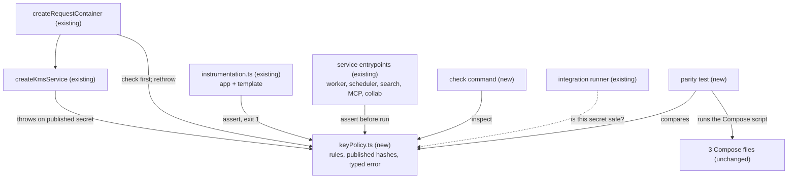

# Runtime encryption-key guard

> **Program:** packages A1 and A2 of [`2026-11-15-gdpr-ready-deployments-program.md`](2026-11-15-gdpr-ready-deployments-program.md) (tracker open-mercato/open-mercato#8593).
> **Verified at** `main` @ `08dada9624`; code references are inline.

Extends: .ai/specs/GDPR/2026-11-15-gdpr-ready-deployments-program.md
Extends: .ai/specs/2026-11-01-7231-compose-encryption-key.md

## 📝 TLDR

An operator who deploys with Docker Compose is stopped before the app starts if the tenant encryption secret is one published in this repository, too weak, or absent. An operator who deploys any other way (Kubernetes, a bare `mercato server start`, a managed platform) gets no check: the runtime uses whatever is in the environment, and with nothing there it writes plaintext. **Proposed (future):** put the policy in shared code. A published encryption secret is refused by every production process. A weak secret, or encryption left unconfigured, stops a production *service* from starting — after one release in which it only warns. Development stacks keep working with a warning.

**Not in this spec:** what happens when a configured KMS becomes unreachable (program package A3); immediate lookup-secret refusal before the rehash tools of Phase D of [`2026-11-16-encryption-map-coverage-and-backfill.md`](2026-11-16-encryption-map-coverage-and-backfill.md) (program package B1); any change to the Compose files; key rotation itself; implementation of the later default flip or post-Phase-D lookup refusal (both have tracked release tasks here); `FORMS_ENCRYPTION_MASTER_KEY`, owned by the forms module and its separate organization-key adapter (`packages/core/src/modules/forms/services/encryption-service.ts:128-170`). The CI workflow commits a forms key (`.github/workflows/ci.yml:1045`) and the integration runner commits another as its ephemeral default (`packages/cli/src/lib/testing/integration.ts:2213-2214`); this guard does not inspect it and makes no claim to protect deployments that reuse it. PR A1 opens the tracked forms-owned task **Refuse published forms master keys** (Phase 3 step 4), so the check has an owner.

## 📝 Overview

This closes the gap #7231 left on purpose. That work removed the published key from the Compose files and added a preflight service, and stated "No changes to runtime cryptography, KMS interfaces…". The same rules now move into the runtime, as far as the existing migration tooling allows.

> **Market reference.** Rails refuses to boot in production without `secret_key_base`; Django's `check --deploy` flags a short or default `SECRET_KEY` but only warns. Adopted from Rails: a hard stop for material that is publicly known. Adopted from Django: a staged warning for weak-but-private configuration, and a check that runs without starting the server. Rejected: Django's choice to never refuse — a key anyone can read in this repository is not a configuration smell.

## 📝 Problem Statement

- **The runtime does not validate the secret.** `resolveDerivedKeySecret` takes `TENANT_DATA_ENCRYPTION_FALLBACK_KEY`, then `TENANT_DATA_ENCRYPTION_KEY`, and uses the first non-empty value (`packages/shared/src/lib/encryption/kms.ts:119-135`).
- **Nothing configured means plaintext.** With encryption on, no healthy Vault and no secret, `createKmsService` logs a warning and returns a no-op service (`kms.ts:455-461`). Encryption is on unless explicitly disabled (`packages/shared/src/lib/encryption/toggles.ts:3-9`).
- **The same secret keys lookup hashes.** `resolveLookupPepper` uses `LOOKUP_HASH_PEPPER`, then the two encryption variables; with none set, hashes are unkeyed (`packages/shared/src/lib/encryption/aes.ts:190-221`).
- **The policy exists in Compose only.** An inline script, copied into three Compose files, refuses a secret under 32 bytes, with fewer than 8 distinct characters, or whose SHA-256 is one of five published values. It also refuses "no secret and no Vault", an insecure Vault address, and a missing or unsafe lookup secret (`docker-compose.fullapp.yml:18-45`).
- **The five values in today's Compose denylist are repository test and development material:** the development Compose key, `om-ephemeral-integration-fallback-key`, `tc-customers-seed-001-derived-key`, `installation-pepper-secret-value` and `checkout-encryption-fallback-secret` (`scripts/__tests__/fullapp-compose-encryption.test.mjs:18-21`).
- **A sixth published value is missing from the Compose denylist:** `ci-standalone-test-fallback-key`, committed in `.github/workflows/{snapshot,npm-snapshot-preview}.yml` and `scripts/test-create-app-integration.ts`. It is 31 bytes, so Compose refuses it as weak; the runtime published set must include its SHA-256 and refuse it as published. Removing a literal from CI never makes it private again.
- **An error during bootstrap is swallowed.** `createRequestContainer` wraps bootstrap in `try { … } catch { /* optional */ }` (`packages/shared/src/lib/di/container.ts:278-284`). If `createKmsService` threw at `packages/core/src/bootstrap.ts:194`, the KMS service, the encryption service and its subscriber would silently go unregistered and the process would write plaintext. Tenant setup has the same shape: it catches and logs only in debug mode (`packages/core/src/modules/auth/lib/setup-app.ts:394-412`).
- **The KMS service is built in many places:** callers across `bootstrap.ts`, `api_keys`, `auth` (CLI and tenant setup), `entities` CLI, `integrations` (credentials and OAuth grants), `query_index`, and the `TenantDataEncryptionService` constructor default.
- **Migration tooling is incomplete.** The runbook says there is "no universal pepper-rotation/backfill CLI", that lookup candidates cover the current keyed hash and the legacy unkeyed hash but "not an old keyed pepper", and that rotation skips system-scoped maps (`starters/docker/encryption-migration.md:147-153`).
- **The repository's own test environments would be refused.** The ephemeral integration app runs with `NODE_ENV=production` and defaults to a published secret (`packages/cli/src/lib/testing/integration.ts:2196, 2282, 3693`). The standalone-app CI uses a 31-byte secret (`.github/workflows/snapshot.yml:232, 376`).
- **The development runner looks like production to its children.** `mercato server dev` starts Next.js in development mode but spawns workers and the scheduler through `buildServerProcessEnvironment`, which forces `NODE_ENV=production` (`packages/cli/src/mercato.ts:402-404, 2312, 2391`). The development Compose files default to a published key (`starters/docker/compose.fullapp.dev.yml:143`).
- **A per-run handshake already exists.** The `yarn dev` supervisor creates a random token per run (`scripts/dev-runtime-diagnostics.mjs:22-24`) and passes it to its child as `OM_DEV_RUNTIME_TOKEN` (`scripts/dev-runtime-supervisor.mjs:190`). Dev diagnostics key off that handshake, not `NODE_ENV`, and stay closed when the flag is set by hand (`packages/shared/src/lib/dev-runtime/server.ts:46-68`). `mercato server dev` passes nothing comparable to the workers and scheduler it spawns.
- **Services are more than the web server.** Long-running processes: the Next.js server, `queue worker`, `scheduler start`, `search worker`, `ai_assistant mcp:serve` and `mcp:serve-http`, `workflows start-worker`, `channel_discord start-gateway`, `server start`, and the documents collaboration server, which is a plain Node script outside the CLI dispatcher (`packages/documents/package.json:9-10`). A single-queue worker builds no container at start and fails per job instead (`packages/cli/src/lib/worker-job-handler.ts:33-34`); the local queue drops a job once its attempts are used up.
- **Three preflight scripts call `createKmsService` and replace any error with "restore the original keys"** (`packages/starter/src/encryption-preflight.mjs:38-44, 208`, with copies in `scripts/` and the create-app template). One runs in production through `docker/scripts/init-or-migrate.sh`.
- **A runtime precedent exists.** The JWT signing secret is checked on every read and eagerly at server start, where a violation exits the process (`packages/shared/src/lib/auth/jwt.ts:140-165`, `apps/mercato/src/instrumentation.ts:5-24`).

## 📝 Prior spec drift

- `.ai/specs/2026-11-01-7231-compose-encryption-key.md`: in sync with the code. Its status line reads "named maintainer security-waiver approval pending". A1 cites it as precedent only: A1's PR argues its own exception and carries its own named approval (program DEC-5), so A1 does not wait on #7231's sign-off.

## 📝 Decisions

Answered by the issue assignee on 2026-11-16. R1–R3 were raised by the independent review and change two earlier answers.

| # | Decision |
|---|---|
| Q1 | This spec owns everything decidable at boot from configuration. The fail-closed spec owns a configured KMS that becomes unreachable. |
| Q2 → R1 | Boot refusal covers the *encryption* secret and "nothing configured". **Lookup-secret findings warn in the first release.** A tracked post-Phase-D task below delivers refusal after all hash fills and token reindex procedures ship; it does not leave warnings permanent. |
| Q3 | A shared policy module. The Compose files are not edited; a test keeps them in step. |
| Q4 → R2 | A published encryption secret is refused wherever the KMS is built and at every service start. **Weak and unconfigured are refused only when a service starts.** Services are listed under Components. |
| Q5 | A `warn` / `enforce` setting bridges weak and unconfigured, and the insecure Vault address (assumption 1 below). `warn` stays a supported, deprecated opt-out after the default flips. |
| R3 | One spec, two PRs. The spec ends at the bridge; the later default flip is a tracked release task with stated gates. |

## 📝 Proposed Solution

One module decides whether the tenant-encryption configuration is safe and returns findings.

| Finding | Meaning | In production |
|---|---|---|
| `published_secret` | Encryption is on and the effective encryption secret hashes to a published value | Refused wherever the KMS is built, and at service start |
| `weak_secret` | Encryption is on and the effective encryption secret is under 32 UTF-8 bytes, or has fewer than 8 distinct characters | Bridged, at service start |
| `not_configured` | Encryption is on, no secret is set, and Vault address and token are not both set | Bridged, at service start |
| `published_lookup_secret`, `weak_lookup_secret`, `missing_lookup_secret` | The effective lookup secret is published, weak or absent, whether or not encryption is on: `hashForLookup` falls back to an unkeyed digest when no secret resolves, independent of the toggle (`aes.ts:191-221`) | Warning in the initial release; tracked post-Phase-D refusal below |
| `insecure_vault_address` | Not HTTPS, except loopback; or carries credentials | Bridged at service start, same as weak/unconfigured |

**Bridged** means governed by `TENANT_DATA_ENCRYPTION_KEY_POLICY`. In the release that ships this (target 0.11.0) the default is `warn`: the service starts and logs one loud warning. Set to `enforce`, the service refuses to start. One-off commands, builds and migrations never refuse on a bridged finding; they warn.

**Production** here means `NODE_ENV` is `production` and the process holds no valid binding to a live development runner. Under R5-2, a process whose `NODE_ENV` is not `production` is a development process: it ignores the mark file and attempted dev marks, never needs a binding, and is never forced onto production rules. Only a process with `NODE_ENV=production` that carries the dev mark runs the R3-11 binding check. Without a valid binding it remains production and logs once at error level. `mercato server dev` binds the production-mode workers and scheduler it spawns to itself with a per-run nonce (see Development runner under Components). Outside production every finding is a single warning and nothing is refused. Under `NODE_ENV=test` the ordinary runtime logger is silent regardless of any mark; the explicit check command still simulates production and prints findings.

### Resolved assumptions (autonomous defaults)

| # | Question | Chosen | Rationale |
|---|---|---|---|
| 1 | Remote HTTP Vault or embedded URL credentials | `insecure_vault_address` joins the ordinary `warn` / `enforce` service-start bridge, default `warn` for one minor (0.11.0). Under `enforce`, a remote HTTP address or one carrying URL credentials is refused at service start; loopback HTTP without credentials is allowed. Explicit deprecated `warn` stays supported after the flip | A Vault token sent over remote HTTP, or written into a URL, can be read in transit and in logs, so the finding must reach refusal. The address is private configuration, not published material, so the exception does not cover it and the ordinary protocol applies (DEC-5); the program's Migration & Backward Compatibility section bridges it the same way. A TLS-terminating sidecar can listen on loopback, which stays allowed. A deployment that cannot, such as a mesh that upgrades plain HTTP, keeps explicit `warn` and accepts that its weak and unconfigured findings then warn too. |
| 2 | Later published lookup-secret refusal | PR A2 opens the separately tracked release task **Refuse unsafe lookup secrets after B1 Phase D** (program DEC-12). `published_lookup_secret` refusal ships in that task under its own Emergency Security Exception once the B1 Phase D and B4 gates pass; that PR carries its own named maintainer approval, which neither A1 nor #7231 grants. `weak_lookup_secret` and `missing_lookup_secret` always take the ordinary bridge, with their own warning minor | Anyone can compute lookup hashes keyed with a published value, so, as with A1's published key, the accepted input is itself the vulnerability and a one-minor bridge would keep it exploitable. A weak or absent lookup secret is private configuration, so it takes the ordinary protocol. Refusal waits for the repair tooling, because without it an operator could not move off the value. |

### Design decisions

| Decision | Rationale |
|---|---|
| A typed error that swallow sites rethrow | Without it the refusal turns into silent plaintext (see Problem Statement). |
| Inspect the *effective* secrets only | The runtime uses the first non-empty variable; Compose makes the same choice. |
| Lookup-secret findings warn until the tracked Phase D gates pass | Before the repair commands exist, refusal would strand maintenance. The release task adds published lookup refusal under its own exception (DEC-12) and weak/missing lookup refusal by the ordinary bridge; all required commands use a safe current secret and old material only from maintenance variables. |
| Bridged findings stop services, not commands | Build stages and migrations run in production mode without secrets. Writes made by a one-off command on an unconfigured installation are the fail-closed spec's concern. |
| With encryption off, the secret is judged as a lookup secret | Switched off, the value encrypts nothing and only keys lookup hashes. Refusing it while a published `LOOKUP_HASH_PEPPER` merely warns would treat the same exposure two ways. |
| The check is the first statement of `createRequestContainer` | Bootstrap registers the event bus and subscribers before it reaches the KMS (`packages/core/src/bootstrap.ts:151-194`). Checking first means a refused process registers nothing. |
| The service-start check ships with the refusal, not with the bridge | A single-queue worker never builds a container at start. Without the start check it would stay up, reject every job and let the local queue discard them. |
| The development runner binds its children to itself | They run in production mode for logging and performance reasons, on development secrets; without an exemption every development stack on the default key would lose its workers. A bare variable would be an operator-settable switch round the refusal, which the compatibility exception forbids. R3-11 therefore requires a parent IPC nonce and the matching fixed-path file, not an environment nonce. The diagnostics token is an existing precedent for per-run generation, not proof of the new binding. |
| No override for a published encryption secret | The compatibility exception forbids a retained toggle. |
| Environment parsing is memoized; dev liveness is not | Per-request callers need cheap inspection, but an orphan must lose its exemption. IPC disconnect clears the binding immediately and policy calls recheck parent PID/liveness and the fixed-path mark. |
| A small command prints the findings | Operators need a check they can run before upgrading; `doctor` (program package G4) later aggregates the same findings as `encryption.key_policy.<code>`, from `inspectTenantEncryptionConfig`. |
| The repository's own test environments are fixed first | Otherwise the change breaks the integration suite it ships with. |

### Alternatives considered

| Alternative | Why rejected |
|---|---|
| Replace the Compose inline scripts with a call into the shared module | Reopens an artifact that shipped days ago under a waiver still pending. |
| Enforce only at server start | Workers and the scheduler never run the startup hook, and a published secret must not be usable by any production process. |
| Return a refusing KMS service instead of throwing | Until the fail-closed spec lands, an unhealthy KMS means plaintext writes. |
| Refuse a weak secret immediately | A short private secret "merely makes an insecure usage possible"; the exception does not cover it. |
| Refuse an unsafe lookup secret before Phase D | Strands operators; the tracked gated release task supplies the later refusal. |
| A fixed replacement secret for the test runner | Any constant in the repository is published material. |
| Two specs, one per compatibility route | Both stand on the same module and tests. Separate PRs keep the approvals apart. |
| Change the development Compose default instead of marking the runner's children | Invalidates the data of every existing development stack and edits three more Compose files. |
| Tell operators to run maintenance commands outside production mode | A non-production CLI writes a `.env` from the example file and fills unset variables with placeholders (`packages/cli/src/mercato.ts:358-366`); the Compose file records that it broke init and migrations in the production image. |
| Bridge the published encryption secret like weak and unconfigured | The published value is itself the vulnerability; a one-minor bridge keeps it exploitable (DEC-5). A1 takes the exception and has no bridged fallback. |
| Bridge the published lookup secret like weak and missing | Same reason: anyone can compute the hashes keyed with it (DEC-12). |
| Keep `insecure_vault_address` warning-only, for local TLS termination | A warning that never refuses leaves Vault tokens on the wire. Loopback HTTP is allowed, and explicit `warn` remains for the rest. |

## 📝 Delta

### Capability: tenant-encryption-configuration

#### MODIFIED Requirement: Tenant encryption secret acceptance
In production, the system SHALL refuse to build its encryption service when the effective tenant encryption secret is a value published in this repository, and SHALL NOT continue without an encryption service as a result.

##### Scenario: Published secret in production
- WHEN any production process builds its encryption service with a published encryption secret
- THEN the process fails with a message naming the variable and the rotation procedure, the secret is not printed, and no request or job is handled without encryption

##### Scenario: Published secret outside production
- WHEN a development process starts with a published secret
- THEN it runs and logs one warning

##### Scenario: Development processes beside a live mark file
- WHEN a development-mode CLI or a Next.js development-server grandchild starts with a published secret beside a live runner mark file and has no parent IPC binding
- THEN it ignores the file, remains non-production and runs with one warning under R5-2

##### Scenario: Development runner
- WHEN `mercato server dev` spawns a worker while a published secret is set
- THEN the worker runs and logs one warning

##### Scenario: Development mark without the runner
- WHEN a production process starts with a published secret and environment-only dev variables or a forged run file set, but no valid parent IPC binding
- THEN it is refused as if the mark were absent, and logs once at error level that the mark was ignored

##### Scenario: Rotating away
- WHEN a production process runs with a new strong secret as current and the published value in the old-key variable
- THEN it is not refused

Frozen by: `packages/shared/src/lib/encryption/__tests__/kms.key-acceptance.characterization.test.ts`

#### MODIFIED Requirement: Unconfigured or weak tenant encryption
In production, the system SHALL warn when the effective encryption secret is weak, when encryption is on and neither a secret nor Vault is configured, or when the configured Vault address is insecure, and SHALL refuse to start a service on those bridged findings when the key policy is `enforce`.

##### Scenario: Weak secret, default policy
- WHEN a production web server starts with a 20-byte secret and no policy set
- THEN it starts and logs one warning naming the release in which this will be refused

##### Scenario: Weak secret, enforce
- WHEN a production queue worker starts with the same secret and the policy set to `enforce`
- THEN it exits non-zero with a message naming the variable

##### Scenario: Insecure Vault
- WHEN a production service uses remote HTTP Vault or URL credentials under `enforce`
- THEN it refuses at service start; loopback HTTP without URL credentials is allowed

##### Scenario: One-off command
- WHEN a one-off command runs in production with a weak secret and the policy set to `enforce`
- THEN it runs and logs one warning

Frozen by: `packages/shared/src/lib/encryption/__tests__/kms.key-acceptance.characterization.test.ts`

#### ADDED Requirement: Development binding lifetime
For a process with `NODE_ENV=production`, the system SHALL honour a dev exemption only while R3-11's parent IPC binding remains valid. Under R5-2, non-production processes need no exemption or binding.

##### Scenario: Runner exits
- WHEN the runner exits after its production-mode child successfully bound
- THEN IPC disconnect invalidates the exemption and exits the child; a cached earlier inspection cannot preserve it

#### ADDED Requirement: Gated lookup refusal delivery
PR A2 SHALL open the separately tracked post-Phase-D refusal task with the acceptance criteria and gates under Migration & Backward Compatibility.

##### Scenario: Required tooling ships
- WHEN B1 Phase D and B4 repair procedures pass the task gates
- THEN the task ships published lookup refusal only under its own Emergency Security Exception, with the named approval on its PR, and weak/missing lookup findings begin their own ordinary warning period before enforcement

#### ADDED Requirement: Startup exit
The system SHALL exit the web server process with a non-zero code when the configuration is refused at startup.

##### Scenario: Server start
- WHEN the production server starts with a refused configuration
- THEN the process exits 1 after writing the reason to standard error, and serves no request

#### ADDED Requirement: Configuration check command
The system SHALL report the findings for the current environment without connecting to the database, and SHALL exit non-zero when a production service would be refused.

##### Scenario: Check before upgrade
- WHEN an operator runs the check from any shell mode with a published encryption secret and a remote HTTP Vault address
- THEN production-service findings are listed with their variable names and both conditional data-state exits, no secret value is shown, and the command exits 1

## 📝 Architecture



Takeaway: one module holds the rules. A published secret stops every production process; weak and unconfigured stop services; nothing is swallowed.

### Components

- **`packages/shared/src/lib/encryption/keyPolicy.ts`** (new)
  - `inspectTenantEncryptionConfig(env)` returns findings: a code, a subject, the variable name and a disposition. It never returns a secret, a length or a hash. Only the environment parsing is memoized for `process.env`; runtime classification and the parent binding are checked separately.
  - `enforceTenantEncryptionSecretPolicy()` throws `TenantEncryptionPolicyError` for a published encryption secret in production, and logs each other finding once.
  - `assertTenantEncryptionServicePolicy()` does the same and also throws for bridged findings when the policy is `enforce`. It is the service-start form.
  - `isTenantEncryptionPolicyError(err)` recognises the error by a `Symbol.for` brand, because `instanceof` fails across bundle copies.
  - The initial published hash set contains all six values identified above, including the removed 31-byte CI literal. A historical committed deployment-key literal stays in the set after its source is deleted; the code stores only SHA-256 digests and tests supply the public probes.
  - `isUnsafeTenantEncryptionSecret(value)` is for tooling that launches the app, such as the integration runner. After the same normalization it returns true when the value is empty, published (its SHA-256 is in the published set) or weak (under 32 UTF-8 bytes or fewer than 8 distinct characters): the union of the `published_secret` and `weak_secret` rules, independent of `NODE_ENV`, the toggle and the policy setting. The integration runner relies on exactly that union, and the parity test compares it with Compose's verdicts.
  - Normalization matches `kms.ts` (trim, strip surrounding quotes).
- **`createRequestContainer`** calls the enforce function as its first statement, before any registrar or bootstrap runs, and its bootstrap `catch` rethrows the typed error.
- **`createKmsService`** calls the enforce function before it builds anything, for callers that never create a container.
- **Other swallow sites** rethrow the typed error: the DEK-provisioning `catch` in tenant setup and other in-process callers. The three preflight scripts need the cross-process protocol below; a `Symbol.for` brand does not cross IPC. Every other call site is audited in the same change; any `catch` that would hide the error rethrows it.
- **Preflight IPC protocol.** In `--encryption-probe`, catch `TenantEncryptionPolicyError` and send `{ type: 'tenant-encryption-policy-refused', code, envName }`, then exit with reserved code 78. Only the declared finding codes and known configuration variable names are allowed; no arbitrary error message or secret crosses IPC. `runIsolatedProbe` validates the message and exit-code pair and reconstructs a locally branded policy error with the sanitized policy message. `assertEncryptionCompatible` rethrows it rather than wrapping it as `EncryptionCompatibilityError`. All other failure/timeout/malformed-message cases keep today's generic compatibility failure. The parent thus never tells an operator to restore a published key when the probe refused it. Apply identically in the starter, script and template copies and test the actual fork boundary for each.
- **Web server.** `instrumentation.ts`, in the app and in the create-app template, calls the service-start assertion beside the JWT assertion, inside the same Node-only, not-during-build guard and the same exit-on-throw block.
  - Only successful Node instrumentation records process-local startup evidence with the policy contract revision and effective mode. Bind the evidence to the current process and loaded revision across bundle copies. The parent CLI process, environment variables, a stale deployment record and a configuration-only doctor run cannot set or satisfy it. Builds and the validated development binding keep their existing behavior.
  - Reuse app and template `GET /api/healthz`. Before cached infrastructure results can answer, production readiness requires valid same-process startup evidence and the policy disposition for the requested deployment profile. On success add `x-om-tenant-encryption-startup: v1-enforce` or `v1-warn`; only the enforced marker certifies A2. Missing, invalid or stale proof returns 503 in the updated route and logs `tenant_encryption_startup_unverified` once with no values or identifiers. The marker concerns startup checks only and says nothing about persisted data, a live Vault or a worker on another process. Keep existing readiness response shape and infrastructure checks.
  - A production rollout must check the expected marker from the exact candidate build on each web replica before admitting traffic, and keep it as a continuing readiness condition. Verify live replica identity and the expected image/build revision through the deployment controller. Require a successful status and the expected marker even when an older health route returns 200. Query the candidate directly through its deployment health channel with cache disabled. Proxies and sidecars must not synthesize or cache the marker. Missing probes, a stopped process and unknown or mixed revisions fail rollout readiness. An upgraded standalone app either syncs its instrumentation and health route and proves direct `next start`, or migrates to `mercato server start` and still updates both web files to prove the actual child. Outside this managed readiness procedure a raw process may listen, and an older unchanged standalone build cannot certify A1 or A2. For non-web roles the real dispatcher/entrypoint must pass its startup assertion before ready or consuming; the web header provides no evidence for them.
- **Other services.** The CLI dispatcher in `packages/cli/src/mercato.ts` holds one list of service commands and calls the service-start assertion before it runs any of them: `queue worker`, `scheduler start`, `search worker`, `ai_assistant mcp:serve`, `ai_assistant mcp:serve-http`, `workflows start-worker` and `channel_discord start-gateway`. The built-in `server start` branch calls the assertion before it spawns `next start`, covering apps scaffolded before instrumentation gained the assertion. A static unit test flags first-party CLI worker launchers missing from this service list. Third-party long-running commands must call the exported assertion at entry; automatic detection of arbitrary third-party services is not claimed. A throw takes the dispatcher's existing failure path and exits 1, before the command consumes anything. Workers spawned by `server start` are separate `mercato` processes and pass through the same check. The documents collaboration server is not a CLI command, so its entry script calls the assertion itself before it listens.
- **R3-11 — The dev-runner binding is delivered over IPC.** This is the normative implementation of DEC-E and R3-11, limited by R5-2 to processes with `NODE_ENV=production` that carry the dev mark. Non-production processes ignore the mark file; `initializeTenantEncryptionDevBinding(projectDir)` returns immediately without file or IPC checks, and no encryption-policy binding is needed.
  - `mercato server dev` generates 24 random bytes per run and writes `.mercato/dev-runtime-mark.json`, mode `0600`, under the resolved project directory, holding the nonce and its own PID. The path is fixed, never read from the environment. Eager and lazy production-mode dev children, including workers and the scheduler, use a spawn IPC channel; non-production Next.js processes need no binding. The binding nonce is never passed through environment variables, argv or logs; `OM_DEV_RUNTIME` and `OM_DEV_RUNTIME_MARK_FILE` never grant an exemption. The diagnostics-only `OM_DEV_RUNTIME_TOKEN` remains separate and grants no encryption exemption.
  - Before any policy assertion or KMS construction, a production-mode dev child installs its IPC receiver with `initializeTenantEncryptionDevBinding(projectDir)` and signals readiness. The runner sends `{ type: 'tenant-encryption.dev-binding', nonce, parentPid }` through that channel. The receiver validates the shape and accepts only its original parent channel. Initialization is asynchronous and bounded to five seconds when an IPC channel exists; timeout, missing IPC or malformed messages establish no binding. Direct synchronous policy calls before initialization fail closed as production.
  - A production-mode child honours the mark only if it received that parent message, the parent PID equals `process.ppid` and is alive, and the fixed-path file carries that same PID and nonce (constant-time comparison). Require current-user ownership, regular file/no symlink and mode `0600`. A foreign environment path is ignored. These checks prevent a copied environment, PID 1 substituted for a different parent, or an arbitrary live PID from granting the exemption.
  - **Who is a dev-child candidate.** `initializeTenantEncryptionDevBinding` decides once per process. A process is a candidate only when `NODE_ENV=production`, it has an IPC channel (`process.send` and `process.connected`) and the fixed-path mark file exists at initialization. Learning that the mark is absent costs a process with an IPC channel one existence check of the fixed path; a process without one checks nothing. Every other production process records “no binding” at once, without waiting, and never reads the mark file, checks its parent or waits on IPC again; this includes production processes under supervisors that open their own IPC channel but write no mark. Only a candidate waits up to five seconds for the parent message.
  - Cache the parsed environment only. For a bound process, revalidate the parent identity/liveness and file on each runtime-policy call; an unbound process never does. An IPC `disconnect` invalidates the binding immediately and exits the bound production-mode dev child before another request or job; the runner cleans up the mark on normal shutdown. A production-mode child that carries a file or attempted mark without a valid binding remains production and logs once at error level, with a sanitized reason and no nonce. A non-production child ignores both, even beside a live mark file or when its parent is a Next.js child rather than the runner. A restart within the same run gets a new parent message; it cannot reuse a cached exemption from a prior channel.
  - `server start` neither writes the mark nor sends a binding message. It discards inherited dev variables before spawning services. `.mercato/` is already ignored by git.
  - **Threat model:** this prevents accidental or copy-pasted production bypasses. A person with shell access deliberately forging a parent process and its IPC exchange is out of scope. This residual and unsupported development-mode serving are disclosed in the exception request and operator docs; the spec does not claim cryptographic attestation of the runner executable.
- **Check command.** `mercato entities check-encryption-config` always evaluates production-service rules under the configured policy, even from a development/test shell or bound dev child. It neither changes the caller's `NODE_ENV` nor applies a dev exemption. It reads the environment only, never infers database contents, and is in the dispatcher's no-`.env` list in every mode.
- **Integration runner.** See Phase 2.

### What a refusal says

The environment-only inspector cannot know whether a database holds data. Every refusal names the variable, states the reason and prints both conditional exits; it never selects a branch based on guessed installation state. Remediation text is static per release and names a maintenance command only in a release that contains it; until then that line links the matching section of `starters/docker/encryption-migration.md` instead. This binds the Phase 1 check command and the Phase 4 bridge messages. A1's refusal (Phase 3) names every command in its exit, because Phase 3's release gate requires each of them to exist and verify:

| Finding | Exits named |
|---|---|
| Published or weak encryption secret | If the database already holds data, keep traffic stopped and use `starters/docker/encryption-migration.md` with the old secret in `TENANT_DATA_ENCRYPTION_OLD_KEY`; do not replace a key over existing ciphertext. Generate a new secret directly only for a confirmed empty database. The complete data-maintenance steps below are printed or linked in both cases. |
| Nothing configured | Set a safe secret; for existing plaintext run `mercato entities backfill-encryption --tenant <id> --apply`, the search-owned `mercato search encrypt-vector-display` step, and `mercato entities backfill-system-encryption`; generate directly only for a confirmed empty database. An operator may explicitly disable tenant encryption with `TENANT_DATA_ENCRYPTION=false`, accepting plaintext storage; it then also sets a dedicated `LOOKUP_HASH_PEPPER` (at least 32 bytes and 8 distinct characters, not a published value), or lookup hashes stay unkeyed and `missing_lookup_secret` remains, which the gated lookup task later refuses at service start under `enforce`. |
| Lookup-secret finding after its gated release | Set a safe current lookup secret, retain the old secret only in maintenance variables and run the exact hash fills and B4 token procedure below before traffic returns; generate directly only for a confirmed empty database. |
| Insecure Vault address under `enforce` | Use HTTPS without embedded credentials; HTTP is allowed only for loopback. Review a local TLS-termination deployment before relying on the explicit deprecated `warn` opt-out. |

It never includes a secret, its length, hash or database-state claim. The required data-maintenance list is `mercato entities rotate-encryption-key` per tenant, which delegates `vector:vector_search` with `complete: false` (B1 Proposed Solution, Phase A item 7); `mercato entities rehash-lookups` per tenant and for `none` (B1 Phase D item 2); and `mercato entities backfill-system-encryption` with the old root in `TENANT_DATA_ENCRYPTION_OLD_KEY` for system records (B1 Phase D item 3), citing DEC-F — The B1 hand-offs. These are A1 release gates. Module-written hashes are refreshed by the fill command of each enabled module that provides one: the three R3-12 commands `mercato customers fill-lookup-hashes`, `mercato sso fill-lookup-hashes` and `mercato communication_channels fill-lookup-hashes`, and the coverage-owned fills listed by B1, including `mercato forms fill-privacy-hashes` and `mercato inbox_ops fill-privacy-lookups`, which also recompute stale non-null hashes. Each fill ships in the same change as the hash columns it refreshes (B1 Phases C and D, coverage owners), so the message lists them as “for each enabled module that provides one”: a build without a module's fill has no such columns to refresh. The legacy `mercato auth rotate-encryption-key`, which rotates only `User` from an `--old-key` flag (`packages/core/src/modules/auth/cli.ts:221-260`), is named as unsupported for this procedure. B4's API Contracts → Search-owned vector maintenance adapter specifies DI `searchVectorDisplayMaintenance: SearchVectorDisplayMaintenance`, exported from `@open-mercato/search/modules/search/lib/vector-display-maintenance`, with `enumerateScopes`, `prepare`, bounded `readBaselinePage`, `resealPage` and independent target-only `readTargetPage` using session-pinned concrete DEKs. Its Vector CLI / service contract defines the `searchVectorDisplayMaintenance.run` facade returning `VectorDisplayMaintenanceReport`, shared with `mercato search encrypt-vector-display --tenant <id> --apply`. Under R4-10 as corrected by R5-3, the facade gains optional `pin?: { providerIdentity: string; wrappedDekFingerprint: string }`. `providerIdentity` is `VectorDisplayMaintenanceKeyPin.providerIdentity`; `wrappedDekFingerprint` is the SHA-256 of the tenant's provider key check (B4, **Rotation pin source**), read fresh through `readTenantKeyPin` and changed on every rotation. Enterprise supplies its frozen target and the run refuses with `pin_mismatch` if the active provider identity or key-check fingerprint differs. Calls without a pin retain the existing behavior. It encrypts plaintext displays and reseals old-key envelopes, accepting `TENANT_DATA_ENCRYPTION_OLD_KEY` only from the maintenance environment. For every affected tenant require a fresh report from the beginning with `verification: 'full'`, `done: true`, `complete: true` and zero per-column `plaintext`, `oldKey`, `unreadable` and `blocked` counts, verifying every non-null mapped value under the target key. Enterprise's protected rotation additionally compares its encrypted pre-rotation logical baseline through independent pinned-target reads; the B4 report alone does not prove equality. The adapter is now specified; its implementation, capability preflight and independent full both-store verification must pass before the search-enabled A1 exit is advertised as available. B4's **Rotation pin source** defines the provider key check behind the fingerprint for both built-in providers, derived-key tenants included.

If the effective lookup secret changed, including when it fell back to the rotated encryption key, keep traffic and all ordinary writers stopped after the B1 Phase D hash passes. Only the named maintenance passes and their dedicated reindex workers may write; coverage-owned fills are required for deployed hash columns in enabled modules, as B1 specifies. If the deployed release includes B4’s keyed token writers, follow the [search-index spec](2026-11-16-search-index-pii-protection.md), Proposed Solution → 1. Keyed token hashes → Reindex / Purge and report / Secret change: run `mercato query_index reindex --tenant <id> --entity <module:entity> --force` for every enabled tenant/entity. Rebuild tenantless catalogue scopes with `mercato query_index reindex --entity <catalogue:entity> --force` without a tenant flag; use `mercato query_index reindex --entity <module:entity> --force` without a tenant flag for tenantless rows of tenant-capable entities. After those rebuilds, run `mercato search reindex-tokens --tenant <id|none>` for the same scopes. Then run `mercato query_index purge-legacy-tokens --tenant <id|none>` as a report for every scope, use `--apply` only for obsolete absent-source rows and repeat the report from the beginning. Require `done: true`, `legacyRows: 0` and zero `fingerprintRows` under every non-current fingerprint, with `blockedRows: 0` and no unresolved source or writer work. The two live writers reconcile exact scoped contributions as B4 specifies. Purge applies only to proven absent sources. Traffic and ordinary writers resume only after those gates and all store/hash checks pass. Retain the old key until ORM, system, vector and required token gates all verify. Before B4’s keyed writers ship, the existing unkeyed token digests remain valid and the token rebuild and purge do not apply.

### Rotation and maintenance

- Rotation runs with the new secret as current and the old one in `TENANT_DATA_ENCRYPTION_OLD_KEY`. Only the current secret is inspected, so a production process rotating *away* from a published secret passes.
- Lookup hashes are refreshed by the exact B1 Phase D / R3-12 list and enabled coverage-owned fills above before traffic returns. All fill commands preview by default and require `--apply`; the existing system command keeps its `--dry-run` convention. After every effective lookup-secret change in a release with B4’s keyed token writers, B4 supplies the forced query-index token rebuild for all tenant/entity and tenantless scopes and `mercato search reindex-tokens` for the same scopes, then query_index-owned purge/report with zero legacy, old-key and blocked residuals. All writers remain stopped throughout. Before those writers ship, only the applicable store and hash steps are required. These procedures, including vector rotation with search enabled, are release gates. Initial lookup findings warn; their separately tracked release task adds refusal after those gates pass.
- A command that needs the published secret as its *current* one, such as decrypting the database in place, is refused. The supported order is rotate first, then decrypt. The runbook gains that sentence.
- The guard has two conditions that are not production: a non-production `NODE_ENV`, and a development mark bound to the live runner. Neither is a retained toggle. A non-production `NODE_ENV` takes the whole runtime out of production mode — the CLI then writes a `.env` from the example file and fills unset variables with placeholders (`packages/cli/src/mercato.ts:358-366`) — and is not a supported way to serve. The mark has no effect on its own: it requires the R3-11 parent IPC binding while `mercato server dev` remains alive, and otherwise the process treats itself as production and logs at error level. `doctor` cannot see another process's mode; each process checks itself at start.

## 📝 Data Models

None. No entity, table, column or migration. The data-model graph is skipped for that reason.

## 📝 API Contracts

### Exports — `@open-mercato/shared/lib/encryption/keyPolicy`

```ts
export type TenantEncryptionConfigFindingCode =
  | 'published_secret' | 'weak_secret' | 'not_configured'
  | 'published_lookup_secret' | 'weak_lookup_secret' | 'missing_lookup_secret'
  | 'insecure_vault_address'

export type TenantEncryptionConfigFinding = {
  code: TenantEncryptionConfigFindingCode
  subject: 'encryption_secret' | 'lookup_secret' | 'kms' | 'vault_address'
  envName: string | null
  disposition: 'refuse' | 'bridge' | 'warn'
}

export function inspectTenantEncryptionConfig(env?: NodeJS.ProcessEnv): TenantEncryptionConfigFinding[]
export function enforceTenantEncryptionSecretPolicy(): void
export function assertTenantEncryptionServicePolicy(): void
export function isTenantEncryptionPolicyError(err: unknown): boolean
export function isUnsafeTenantEncryptionSecret(value: string | null | undefined): boolean // empty, published or weak, after normalization
export function isTenantEncryptionProductionRuntime(): boolean
export function initializeTenantEncryptionDevBinding(projectDir: string): Promise<void>
```

### Configuration

| Variable | Values | Default | Notes |
|---|---|---|---|
| `TENANT_DATA_ENCRYPTION_KEY_POLICY` | `warn`, `enforce` | `warn` | Normalized like the other encryption variables and compared case-insensitively. An unrecognised value falls back to the default and is reported once. No effect on a published secret, and none outside production |

Added to `apps/mercato/.env.example` and the create-app template's copy in the same change. `OM_DEV_RUNTIME` and `OM_DEV_RUNTIME_MARK_FILE` are ignored as exemption inputs and are not added to `.env.example`; the fixed-path mark and parent IPC carry the binding. `initializeTenantEncryptionDevBinding` is called by CLI and Node instrumentation before policy assertions and returns at once for any process that is not a dev-child candidate (Components, R3-11): without an IPC channel it touches no file, and with one it makes a single existence check of the fixed mark path, never reads the file and never checks its parent; the exported runtime predicate first checks `NODE_ENV` and returns false without consulting the file or binding for a non-production process (R5-2); only production-mode marked processes use the validated binding, never a bare variable.

### CLI

`mercato entities check-encryption-config` — no flags. Always simulates a production service even under non-production `NODE_ENV`. Prints one line per finding: code, variable, disposition, plus conditional remediation with no database-state guess. Exit 0 when a production service would start under the current policy, 1 otherwise.

### Behaviour change of existing functions

- `createKmsService()` keeps its signature. In production it can now throw `TenantEncryptionPolicyError`.
- `createRequestContainer()` rejects with that error instead of returning a container without encryption.

## 📝 Edge Cases & Failure Scenarios

| Case | Behaviour |
|---|---|
| Published value in `TENANT_DATA_ENCRYPTION_KEY` while `TENANT_DATA_ENCRYPTION_FALLBACK_KEY` holds a strong secret | No finding; the legacy variable is not effective |
| Strong encryption secret, published `LOOKUP_HASH_PEPPER` | Initial release warns; the gated lookup-refusal task changes this after repair tooling ships |
| Vault configured, no secret, no pepper | Initial `missing_lookup_secret` warning; after its ordinary bridge ships, service start under `enforce` refuses; module-written hashes remain null without a secret |
| Vault configured but unreachable at boot | Not this spec |
| Encryption switched off, published secret still set | Initially `published_lookup_secret` warning; covered by the later lookup-refusal task because the value still keys lookup hashes |
| Encryption switched off, nothing set | Initial `missing_lookup_secret` warning; covered by the later lookup task's ordinary bridge, because lookup hashes are then unkeyed and dictionary-reversible. Compose refuses this case; the runtime only warns, and the parity test does not compare it |
| `next build`, `generate`, migrations with no secret | Not refused; `not_configured` is a bridged finding and these are not services |
| `next build` with a published secret in the build environment | Refused if the build constructs a container |
| Refused configuration during a request in an app with no eager check | Container creation rejects; the request fails with the reason logged. Nothing is written |
| Worker spawned by `mercato server dev` on a published development key | Runs with one warning |
| Development-mode CLI or Next.js dev grandchild beside a live mark file, with no binding | Ignores the file and stays non-production under R5-2; the published key only warns |
| `NODE_ENV=test` with any mark or file | Stays non-production; the ordinary logger remains silent |
| `OM_DEV_RUNTIME` set in a production deployment, or copied into a `.env` | No valid binding: treated as production, refused on a published secret, one error-level log naming the variable |
| Runner crashes after a successful check | IPC disconnect immediately invalidates the binding and exits the child; a surviving synchronous caller rechecks parent identity/liveness before another operation |
| Worker restarted by the runner within one run | Same run file, but a fresh authenticated-by-channel parent message is required; no inherited environment nonce |
| PID-1, foreign-path or unrelated-live-PID forgery | Environment cannot supply the binding; fixed-path, parent equality and IPC receipt checks refuse it |
| Single-queue worker in production on a published secret | Refused by the dispatcher before it consumes a job |
| Compose deployment | Unchanged. Its preflight is stricter than the runtime on the lookup secret and on encryption-off; the runtime does not loosen it |
| Standalone app created before this change | `mercato server start` checks before spawn. Upgrade both web files to prove the actual child. Direct `next start` requires the same instrumentation and health-route upgrade. The deployment refuses admission without the expected marker, even if an unmodified older route returns HTTP 200. |
| Unknown policy value | Default applies; one warning names the accepted values |
| Multi-replica rollout with one replica misconfigured | That replica cannot attest the expected mode and is refused admission. The rollout inventory remains incomplete until every expected replica supplies current proof. |

## 📝 Migration & Backward Compatibility

| Change | Route | Why |
|---|---|---|
| Published encryption secret refused in production | Emergency Security Exception | The accepted input is itself the vulnerability: the value is readable by anyone. Same class as the dated entry "Compose encryption (2026-11-01, #7231)" |
| Weak secret, nothing configured, insecure Vault address | Ordinary protocol, behind `TENANT_DATA_ENCRYPTION_KEY_POLICY` | Default warning for one minor; explicit `warn` remains after the flip |
| Later lookup-secret refusal | Separate tracked release task after Phase D and B4: Emergency Security Exception for the published finding, ordinary protocol for weak/missing | Published lookup material is itself the vulnerability (DEC-12), and that PR carries its own named approval; weak/missing lookup secrets take the ordinary bridge |
| `createKmsService()` and `createRequestContainer()` can throw a new typed error | Part of the change above; disclosed in the upgrade note | Third-party code that calls either must not swallow it |
| New variable, exports, CLI command | Additive | — |

**What the exception requires of the PR that ships the refusal**

- Argue the condition in the PR text: name the surface, the vulnerability, why a bridge would leave it exploitable, and why neither a non-production `NODE_ENV` nor the bound development mark is a retained toggle (see Rotation and maintenance).
- Keep no toggle for the published case, and let nothing else ride along. The bridge ships in a separate PR.
- Add a dated entry at the end of `BACKWARD_COMPATIBILITY.md`.
- Add the `UPGRADE_NOTES.md` entry below.
- Carry the `security` label and a named human maintainer approval that acknowledges the waiver, separate from #7231's.

The published case has no bridged fallback; see Alternatives considered.

**Ordinary-protocol schedule for the bridge**

| Release | Target | Default | `warn` |
|---|---|---|---|
| Ships the bridge | 0.11.0 | `warn` | Accepted |
| Flips the default | 0.12.0 at the earliest, after gates | `enforce` | Accepted, logged as deprecated but supported; no removal scheduled |

The default flip is a release task tracked with PR A2. `warn` remains an explicit deprecated opt-out, matching the program's ordinary protocol; there is no removal task. The flip is gated on all of:

- at least one minor release has shipped the warning;
- all of B1 Phase D has shipped: mapped `rehash-lookups`, all three exact R3-12 module fill commands, enabled coverage-owned hash fills and system-scope rotation; B4 supplies forced query-index token rebuilds and `mercato search reindex-tokens` across every tenant/entity and tenantless scope, query_index purge/report showing zero legacy and non-current-key rows, and verified old-key vector reseal;
- the conditional refusal exits and every named command have been verified on populated weak-secret and plaintext installations, with search enabled;
- Verify each supported launcher with real child process evidence per TC-ENCRYPTION-KEY-008-STARTUP. An upgraded app, direct `next start`, and the wrapper child use the same readiness condition. Reject missing, stale and warning-only evidence for an A2-enforced deployment, including one older 200-only replica in a mixed rollout. A2 activation also requires B1’s persisted upgrade verification for applicable required maps.

### Tracked post-Phase-D lookup-secret refusal

Open this release task with PR A2, separately from the default flip, and name it “Refuse unsafe lookup secrets after B1 Phase D”. Its acceptance criteria change `published_lookup_secret` from warning to refusal at container/KMS construction and service start in production, including with encryption off. It ships under a fresh dated Emergency Security Exception (DEC-12), and that PR carries its own named human approval. `weak_lookup_secret` and `missing_lookup_secret` become service-start bridged findings, warn for at least one minor from their own introduction, then follow the gated `enforce` default with explicit `warn` still supported. The original encryption-bridge counting period does not substitute for their warning period.

Task gates: the three exact R3-12 fills, enabled coverage-owned fills, mapped rehash and system rotation ship; old/current/legacy/unreadable/collision cases pass in B1; B4's forced tenant/entity and tenantless token rebuilds (query-index and `mercato search reindex-tokens`), zero-legacy/zero-old-key query_index purge/report, and old-key vector reseal procedure verify on a populated search-enabled installation with all writers stopped; every refusal message carries both empty/populated branches; safe-current/old-environment maintenance passes without a bypass. Tests: `keyPolicy.lookup-refusal.test.ts` covers published pepper in a service, a one-off command and encryption-off mode; weak/missing lookup under warn/enforce, including missing lookup with encryption off and nothing set; and safe current material with old material in maintenance variables. TC-ENCRYPTION-LOOKUP-001 owns isolated tenant/entity and tenantless fixtures with keyed login, SSO, sender, forms and inbox hashes for enabled modules, runs the documented maintenance order in a child environment, verifies lookups/token search, refuses traffic until the zero-residual report, and refuses the unsafe service before work. Include a fallback-key rotation with no dedicated pepper and an incomplete token rebuild that must keep the gate closed; `finally` removes all fixtures and processes. This test ships with the refusal task, not the initial warning PR.

The versions are targets, to be corrected at merge if the release train differs.

**`UPGRADE_NOTES.md` content**

- *Operators:* a production process now refuses a published tenant-encryption secret. What stops working: any deployment still using one of the repository's sample or test values. What to do: rotate following `starters/docker/encryption-migration.md`, then refresh lookup hashes, or logins and other hash lookups stop matching; do not generate a new secret over existing data. Run `mercato entities rotate-encryption-key` per tenant, `mercato entities rehash-lookups` per tenant and for `none`, `mercato entities backfill-system-encryption` with the old root in `TENANT_DATA_ENCRYPTION_OLD_KEY`, and the fill command of each enabled module that provides one (the R3-12 commands `mercato customers fill-lookup-hashes`, `mercato sso fill-lookup-hashes` and `mercato communication_channels fill-lookup-hashes`, and the coverage-owned fills), in the B1 Maintenance write safety order. Do not use `mercato auth rotate-encryption-key`: it rotates only users and takes the key as a flag. Complete B4's search-owned vector step; after any effective lookup-secret change, including an encryption-fallback rotation, and only when the deployed release contains B4’s keyed token writers, force the B4 query-index token rebuild for every tenant/entity and tenantless scope, run `mercato search reindex-tokens --tenant <id|none>` for the same scopes, then run `mercato query_index purge-legacy-tokens` apply/report until legacy and old-key row counts are zero. Keep traffic and all writers stopped until every pass verifies. With the earlier unkeyed writers, the lookup-secret change leaves token digests valid. A1 ships only after every applicable command named here exists and verifies with search enabled; it never advises a command that is missing or presently broken. Data sealed with a published secret remains suspect after rotation.
- *Operators:* weak/absent encryption configuration and an insecure Vault address now warn at service start and will be refused in a later minor; run `mercato entities check-encryption-config`, and set `TENANT_DATA_ENCRYPTION_KEY_POLICY=enforce` to adopt it early. Disabling tenant encryption with `TENANT_DATA_ENCRYPTION=false` clears the encryption findings but not the lookup one: also set a dedicated `LOOKUP_HASH_PEPPER` of at least 32 bytes and 8 distinct characters that is not a published value, or `missing_lookup_secret` remains and is later refused at service start under `enforce`.
- *Standalone app authors:* `mercato server start` now checks before spawning Next.js even for older apps. Sync `src/instrumentation.ts` and `src/app/api/healthz/route.ts` for either launcher, configure the direct per-replica readiness gate, and require `v1-enforce` before claiming enforced production. An older 200-only response is insufficient. For a failed upgrade, keep the candidate out of traffic until rollout verification succeeds; also refresh the preflight script for its typed IPC refusal. The dev nonce comes over IPC only; copied env files cannot exempt a production process. Deliberate forged-parent execution and serving in development mode are outside the guard's threat model.
- *Operators:* lookup-secret findings warn initially. PR A2 opens the separately gated refusal task above; its later release note must name the exception for the published finding, the new warning period for weak/missing findings and the same maintenance commands. A deprecated explicit `warn` remains supported after an ordinary default flip.
- *Module authors:* `createKmsService()` and `createRequestContainer()` can throw `TenantEncryptionPolicyError` in production. Do not catch it; if a broad `catch` surrounds either call, rethrow when `isTenantEncryptionPolicyError(err)` is true.

**Backports.** DEC-16 requires a written per-control disposition for the requested patch line. The mainline carriers still require their named approvals. Any approved patch-line carrier needs compatibility disposition and release-specific real-start/upgrade proof. Keep the backport item open until that proof ships or the maintainer records the revised scope.

**Template sync.** `instrumentation.ts`, `src/app/api/healthz/route.ts` and `.env.example` are mirrored into the create-app template in the same change; `packages/create-app/src/lib/template-instrumentation-runtime.test.ts` already asserts the two instrumentation files match. Add equivalent health-handler and marker parity coverage.

## 📋 Phasing

| Phase | Outcome | PR | Behaviour change |
|---|---|---|---|
| 1 | Policy module, wired R3-11 runtime classification, check command and tests, parity test, committed-literal guard, characterization test | Any | None in services |
| 2 | Repository test environments use safe secrets | Any | None in production |
| 3 | Typed error rethrown; published secret refused everywhere, including at service start (A1) | Its own PR | Yes — exception route |
| 4 | Bridge for weak/unconfigured and insecure Vault at service start (A2), default `warn` | Its own PR | Warnings only |

Phases 3 and 4 may land in the same release but never in the same PR. Phase 3 release is also gated on every command its exit prints, verified with search enabled (Phase 3 gate below); Phase 4 opens the two later release tasks rather than leaving lookup warnings permanent.

## 📋 Implementation Plan

### Phase 1 — Policy, no behaviour change
1. **Characterize.** Add `kms.key-acceptance.characterization.test.ts` asserting today's behaviour under `NODE_ENV=production`: a published secret yields a working derived-key service; a 20-byte secret does too; nothing configured yields the no-op service. Commit it alone, green.
2. Add `keyPolicy.ts` with inspection, the typed error and helper exports. Keep enforcement uncalled. Unit tests: each finding code, including `missing_lookup_secret` with encryption off and no variable set, effective-variable precedence, normalization, the distinct-character rule with multi-byte characters, policy-value parsing, memoization and its test reset, and that no secret, length or digest appears in any finding or message.
3. Add `mercato entities check-encryption-config`. Unit tests for output, both conditional remediation branches and exit codes under development, test and production `NODE_ENV`, and for encryption off with nothing set (a `missing_lookup_secret` warning, exit 0); the `not_configured` exit names the dedicated `LOOKUP_HASH_PEPPER` beside the encryption-off option; the check always evaluates production-service policy and creates no `.env`.
4. Add the parity test. It reads each Compose file, slices the `encryption-preflight` command's block scalar out by indentation (no YAML dependency is added to `packages/shared`), runs that script with `node -e` under probe environments with a strong lookup pepper set so that only the encryption secret decides, and compares each verdict with `isUnsafeTenantEncryptionSecret`. Probes: all six published values (including the removed CI literal), 31 and 32 bytes, 7 and 8 distinct characters, multi-byte characters, quoted and padded values. It needs no Docker. The test lists what it compares and what it deliberately does not (the toggle-off case, Vault address, lookup secret).
5. Integration tests TC-ENCRYPTION-KEY-002 and TC-ENCRYPTION-KEY-003 ship in this PR with the check command they exercise; neither depends on a runtime refusal.
6. Add the committed-literal guard `keyPolicy.committed-literals.test.ts`. It scans the files from which a committed value can reach a running deployment or a shared test environment: `.github/workflows/**`, `docker-compose*.yml`, `docker/**`, `starters/**`, `packages/create-app/template/**`, `apps/mercato/.env.example`, `apps/docs/**`, `scripts/**` except its unit tests (`scripts/__tests__/**`, `*.test.*`), the integration runner and its helpers (`packages/cli/src/lib/testing/**` and `packages/core/src/helpers/integration/**`, without their `__tests__`), every `__integration__` spec and helper, and first-party non-test source under `packages/*/src/**` and `apps/mercato/src/**`. In those files it looks for a string literal assigned to `TENANT_DATA_ENCRYPTION_KEY`, `TENANT_DATA_ENCRYPTION_FALLBACK_KEY`, `TENANT_DATA_ENCRYPTION_OLD_KEY`, `LOOKUP_HASH_PEPPER` or `LOOKUP_HASH_OLD_PEPPER`: YAML `NAME: value`, env-file `NAME=value`, `NAME: '…'` and `?? '…'` defaults in TypeScript, and `process.env.NAME = '…'`. A non-literal expression, such as `randomBytes(…)` or a template string, counts as generated at run time. It fails unless the value is empty, an expansion resolved at run time (`${{ … }}`, `${NAME}`, `$(…)`), an angle-bracket documentation placeholder such as `<32+ char secret>`, a value whose SHA-256 is in the published set (a refusal probe that production refuses), or an entry in the reviewed allow-list `packages/shared/src/lib/encryption/__tests__/keyPolicy.committed-literals.allowlist.json`. The default of a shell expansion (`${NAME:-default}`, `${NAME-default}`), as in `docker-compose.fullapp.dev.yml:147`, is itself a committed literal and is checked the same way. A unit fixture simulates an unlisted `LOOKUP_HASH_OLD_PEPPER` literal in a scanned runtime file and requires a failure naming only the file and variable. Matching runtime injection and an explicit documentation placeholder pass. Scan the old recovery variable even though it is outside effective-secret selection.
   - **Not scanned: in-process unit tests** (`__tests__/**` and `*.test.*` outside `__integration__`). They set `process.env.NAME` for one Jest or `node:test` case, or write fixture env text into a temporary directory or a throwaway child process, and configure no deployment or shared environment. About twenty such literals exist today, for example `lookupHash.test.ts:19`, `kms.test.ts:55`, `cli-rotate-encryption.test.ts:336`, `search-tokens-ciphertext-guard.test.ts:323`, `checkout/lib/__tests__/utils.test.ts:225`, `pin-tenant-dek.test.ts:101`, the starter `encryption-preflight` tests and `scripts/__tests__/dev-env-file.test.mjs`. They are not rewritten. A literal copied from one of them into a scanned file is reported there.
   - **Allow-list.** Each entry names the file, the variable, the SHA-256 of the value and the reason, and matches only that triple, so a changed value fails. An entry that matches no literal fails the guard, so the list cannot go stale. It holds values that are never used as a secret; it is not a refused set and adds nothing to the published set, which stays the six values above. Its initial size is one: the `--dry-run` display placeholder `generated-at-deploy` for `TENANT_DATA_ENCRYPTION_FALLBACK_KEY` in `packages/cli/src/lib/deploy/railway/index.ts:1095-1101`, which is printed and never uploaded (a real run uses `generateProtectedSecrets`).
   - **Day one.** On the current tree every other scanned literal is one of the six published values: the CI literal in `snapshot.yml`, `npm-snapshot-preview.yml` and `scripts/test-create-app-integration.ts`, the development Compose default in the development Compose files and their template copy, the integration runner's `?? 'om-ephemeral-integration-fallback-key'` defaults (`integration.ts:2282, 3693`) and `TC-CUSTOMERS-SEED-001.spec.ts:57`. The guard therefore passes when it lands, and Phase 2 then replaces those test-environment literals with generated values.
   - A new committed secret in a scanned file therefore either joins the refused set, is generated per run, or is reviewed into the allow-list as a non-secret placeholder. The guard lists the paths it scans, the paths it excludes and the forms it recognises. Unit cases cover each form, an expansion, a documentation placeholder, an unlisted literal, a listed probe, an allow-listed value, a changed allow-listed value, a stale allow-list entry, and the same unlisted literal ignored in a unit test but reported in an `__integration__` spec.

**Runtime-classification prerequisite for A3.** In this Phase 1 PR, wire R3-11 initialization into the CLI and Node startup paths and the IPC handshake into eager and lazy `server dev` children, ahead of KMS access. This neutral PR classifies runtime without refusing any key or changing write policy. Unit tests with `NODE_ENV=production`: env-only nonce/path, PID-1 substituted for a different parent, unrelated live PID, absent/mismatched file, missing IPC, stale file, wrong owner/mode/symlink and expired parent all classify as production with one error log and no nonce. Assert that a production process without an IPC channel performs no file-system access and no parent check, on initialization or on any later policy call; that one with an IPC channel and no mark file performs exactly one existence check of the fixed mark path at initialization and none afterwards, never reads the file and never checks its parent; and that neither waits. Under R5-2, separately test a development-mode CLI and a Next.js dev grandchild beside a live mark file without a binding: both stay non-production, accept the published dev key with one warning and perform no binding/file validation. Also test development/test modes with invalid marks; test mode remains silent. Test a real spawned parent-child IPC exchange, eager/lazy spawn options, fixed-path `0600` file, readiness/timeout, parent exit after successful validation, restart with a fresh channel, cleanup and no binding on `server start`. An authenticated production-mode dev child must classify as development before the key-refusal PR ships. A3 consumes this already initialized predicate. The A1 refusal PR waits for B4's verified reseal and the B1 maintenance exits below.

### Phase 2 — Test environments
1. Integration runner. Add an optional `tenantEncryptionKey` to `EphemeralEnvironmentState` and to `writeEphemeralEnvironmentState`. Add `resolveEphemeralTenantEncryptionKey`, called after the runner has decided whether it is reusing an environment. When reusing or attaching, the stored value wins, because the running app and its database already use it. When creating, a safe inherited value is used, otherwise a new random one. The result is assigned to the runner's own environment before either child environment is built, so the Playwright process and the app server (the two sites that default to the published value) read the same one. An existing environment whose state has no stored key was started on the published default and is treated as stale. The state file sits under `.ai/qa/`, which `.gitignore` already excludes; it now holds a throwaway secret for a throwaway database, and agents that read that file should know it. Unit tests cover reuse, attach, create with a safe inherited value, create with an unsafe one, and stale state.
2. Replace the 31-byte standalone CI secret, at every occurrence in `snapshot.yml`, `npm-snapshot-preview.yml` and `scripts/test-create-app-integration.ts`, with a value generated per run.
3. Search for all six published literals in tests that start the app or CLI in production mode (known: `TC-CUSTOMERS-SEED-001`) and switch them to a generated value. Leave the literals where they are inputs to refusal tests.
4. Run the full integration suite.

### Phase 3 — Refuse a published secret (PR A1)

Gate before release: every command the published-secret exit prints exists and verifies on a populated installation with search enabled, with all writers stopped: B1 Phase A's Core store-owned rotation classifier (Proposed Solution item 7) and `backfill-encryption`; B1 Phase D item 2, `rehash-lookups` per tenant and for `none`, which repairs mapped hashes such as tenantless users' `email_hash` that ORM rotation does not reseal; B1 Phase D item 3, system-scope rotation in `backfill-system-encryption`, without which system-scoped records such as onboarding requests become unreadable under the new root; and B4's `mercato search encrypt-vector-display` old-key reseal with a fresh full report. The Enterprise protected coordinator adds verification but is not a gate. Module fills are printed per enabled module that provides one. B4's forced token rebuilds (query-index and `mercato search reindex-tokens`) and `purge-legacy-tokens` report are printed only in a release that contains B4's keyed token writers, which ship with that procedure; until then token digests are unkeyed (search-index spec, Problem Statement) and a lookup-secret change leaves them valid. The refusal message must name a working data-preserving exit. Assert that the structured refusal, runbook and upgrade notes produce the same applicable sequence before and after the keyed writers ship, including an encryption-fallback rotation.
1. Make the in-process swallow sites rethrow the typed error and implement the preflight child/parent refusal protocol in all three copies. Reuse the Phase 1 runtime classification and dev binding.
2. Call the enforce function first in `createRequestContainer` and in `createKmsService`. Update the characterization test's published-secret case to the new scenarios; adjust `kms.test.ts` cases that run in production mode. Now add the container-rejection test asserting nothing is registered before the refusal.
3. Add the service-start assertion to every service entrypoint: `instrumentation.ts` in the app and the template, the dispatcher's service-command list, and the documents collaboration server. Extend `template-instrumentation-runtime.test.ts`, the instrumentation tests in both locations, and add a dispatcher test that each listed command is checked before it runs. At this point the assertion can only refuse a published secret. Wire the same-process readiness evidence and app/template health parity. Do not derive it from the dispatcher parent. If the existing app/template route change requires a repository-boundary exception, record the maintainer approval in this implementation PR.
4. `UPGRADE_NOTES.md`, the dated `BACKWARD_COMPATIBILITY.md` entry, the runbook's rotate-then-decrypt sentence, its statement that `mercato auth rotate-encryption-key` is not a supported rotation path, its note for deployments outside Compose, and the encryption pages in `apps/docs`. Open the tracked forms-owned task **Refuse published forms master keys**, assigned to the forms module owner, with acceptance criteria: production refuses a `FORMS_ENCRYPTION_MASTER_KEY` whose SHA-256 is in a forms-owned published set seeded with the CI and integration-runner values; a `published_forms_master_key` finding is surfaced by `mercato entities check-encryption-config` and by the doctor; the CI and ephemeral literals are replaced by values generated per run; a rotation path for form data sealed under a published key is documented before refusal ships; and the refusal takes its own compatibility route and approval. The task is separate from A1 and does not ride on its exception.
5. Integration tests TC-ENCRYPTION-KEY-001 and TC-ENCRYPTION-KEY-004-PUBLISHED ship in this same PR, proving container and dispatcher refusal before any worker/scheduler work. Run TC-ENCRYPTION-KEY-008-STARTUP for the published refusal and the supported real web launch paths before A1 release.

### Phase 4 — Bridge (PR A2)
1. Add the policy setting. Make the service-start assertion, already in place at every service entrypoint, refuse bridged findings under `enforce`. Update the characterization test's weak and unconfigured cases. Unit tests for each policy value at each kind of entrypoint.
2. Add the variable to both `.env.example` files and the docs.
3. Integration tests TC-ENCRYPTION-KEY-004-ENFORCE and 005, including insecure Vault, workflow worker, Discord gateway and `server start`. Run TC-ENCRYPTION-KEY-008-STARTUP in explicit warn and enforce and again on the production unset default before its flip.
4. Open separate tracked release tasks for the default flip and the post-Phase-D lookup refusal, with every gate and test above. Keep `warn` supported after the flip.
5. Archive this Delta into `.ai/specs/capabilities/tenant-encryption-configuration.md` if that directory has been adopted by then; it does not exist today and adding it is a taxonomy change.

### File manifest

| File | Action |
|---|---|
| `packages/shared/src/lib/encryption/keyPolicy.ts` | Create |
| `packages/shared/src/lib/encryption/kms.ts` | Modify — one call in `createKmsService` |
| `packages/shared/src/lib/di/container.ts` | Modify — check first; rethrow |
| `packages/core/src/modules/auth/lib/setup-app.ts` | Modify — rethrow |
| Other `createKmsService` callers (`api_keys`, `integrations`, `query_index`, `entities` and `auth` CLI, `tenantDataEncryptionService.ts`) | Audit; modify only where a `catch` would hide the error |
| `packages/shared/src/lib/encryption/__tests__/{keyPolicy,keyPolicy.compose-parity,keyPolicy.committed-literals,kms.key-acceptance.characterization}.test.ts`, `keyPolicy.committed-literals.allowlist.json` (one entry), a container rejection test | Create |
| `packages/shared/src/lib/encryption/__tests__/kms.test.ts` | Modify |
| Runtime classification and dev-binding child-process tests | Phase 1 neutral prerequisite |
| CLI service-list/`server start` enforcement tests and preflight refusal protocol tests for all three copies | Create / modify in PR A1 |
| `packages/shared/src/lib/encryption/__tests__/keyPolicy.lookup-refusal.test.ts`, `packages/core/src/modules/entities/__integration__/TC-ENCRYPTION-LOOKUP-001.spec.ts` | Create in the tracked post-Phase-D release task |
| `packages/core/src/modules/entities/cli.ts`, `packages/core/src/modules/entities/i18n/{en,de,es,ko,pl}.json` | Modify — check command and translated policy/remediation text |
| `packages/cli/src/mercato.ts` | Modify — service-command list and assertion; the development-runner binding for `server dev` children (fixed-path mark and parent IPC nonce, all eager/lazy dev children; assertion in `server start`); check command in the no-`.env` list |
| `packages/documents/server/documents-collab-server.ts` | Modify — assertion before listen |
| `packages/starter/src/encryption-preflight.mjs`, `scripts/dev-encryption-preflight.mjs`, `packages/create-app/template/scripts/dev-encryption-preflight.mjs` | Modify — validated policy-refusal IPC message and reserved exit 78, local error reconstruction/rethrow (kept identical by template sync) |
| `packages/core/src/modules/entities/__integration__/TC-ENCRYPTION-KEY-*.spec.ts` | Create |
| `apps/mercato/src/instrumentation.ts`, `packages/create-app/template/src/instrumentation.ts` and their tests | Modify |
| Existing app/template `src/app/api/healthz/route.ts` and tests | Modify under the same approval |
| `packages/cli/src/lib/testing/integration.ts` | Modify — state field, resolver, two sites |
| `.github/workflows/snapshot.yml`, `.github/workflows/npm-snapshot-preview.yml`, `scripts/test-create-app-integration.ts` | Modify |
| `packages/core/src/modules/customers/__integration__/TC-CUSTOMERS-SEED-001.spec.ts` | Modify |
| `apps/mercato/.env.example`, `packages/create-app/template/.env.example` | Modify |
| `UPGRADE_NOTES.md`, `BACKWARD_COMPATIBILITY.md`, `starters/docker/encryption-migration.md`, `apps/docs/docs/user-guide/encryption.mdx`, `apps/docs/docs/architecture/data-encryption.mdx` | Modify |

Editing the CI workflows is a pipeline change under the repository's Ask First rules; the Phase 2 PR carries the maintainer's agreement for it.

## 🧪 Integration Coverage

No API or UI path changes. The observable surface is process start. Specs live in `packages/core/src/modules/entities/__integration__/`, run the built CLI as `packages/core/src/modules/auth/__integration__/TC-AUTH-033.spec.ts` does, and read exit codes through `spawnSync` with a timeout. Each test builds its child environment explicitly: `NODE_ENV=production`, and the three secret variables, the Vault variables and the policy variable each set to the value the case needs. A variable that must be absent is set to an empty string, never deleted, because the CLI refills unset variables from the app's `.env` (`packages/cli/src/lib/load-env.ts:17-20`). All tests run in production mode, so no `.env` is created. They create no records.

| Test | Command | Covers |
|---|---|---|
| TC-ENCRYPTION-KEY-001 (PR A1) | `mercato auth list-users` | Each of the six published values as the encryption secret: non-zero exit before any data is read, the variable is named, the value is absent from output. This exercises the real path: container creation, bootstrap, the rethrow. Once more with `OM_DEV_RUNTIME=1` and no runner: still refused, and an error line names the ignored mark |
| TC-ENCRYPTION-KEY-002 (Phase 1) | `mercato entities check-encryption-config` | Production mode with a new strong secret current and a published value in the old-key variable: exit 0, no refusal finding. Production mode with encryption off and a published secret: exit 0, a lookup warning |
| TC-ENCRYPTION-KEY-003 (Phase 1) | `mercato entities check-encryption-config` | Production mode, strong encryption secret, published `LOOKUP_HASH_PEPPER`: exit 0 with the lookup finding as a warning. Production mode with encryption off and every secret variable empty: exit 0 with `missing_lookup_secret` as a warning |
| TC-ENCRYPTION-KEY-004-PUBLISHED (PR A1) | `mercato scheduler start`, `mercato queue worker <queue>`, `mercato workflows start-worker`, `mercato channel_discord start-gateway`, `mercato server start` | Published secret: each exits non-zero before consuming, listening or spawning Next.js; no fixtures/jobs are needed |
| TC-ENCRYPTION-KEY-004-ENFORCE (PR A2) | Same five service commands | Weak and missing encryption configuration and a remote HTTP/credential-bearing Vault URL with strong secrets: refuse under `enforce`; each child owns its process/timeout cleanup |
| TC-ENCRYPTION-KEY-008-STARTUP | Isolated built app and representative upgraded scaffold using direct `next start` and the actual child of `mercato server start` | On published secrets and enforced weak/missing/insecure fixtures, assert non-zero exit before protected readiness. On a valid candidate assert the expected process-local marker. Reject a legacy 200 without marker, stale/wrong mode and one mixed-version replica. Restart with stale external evidence and show it cannot certify the new process. Exercise the A2 warning bridge and unset enforced default separately. Allocate ports and clean up each child and owned fixture directories in teardown. |
| TC-ENCRYPTION-KEY-005 (PR A2) | `mercato entities check-encryption-config` | Production mode, 20-byte secret: exit 0 under the default policy with a bridged finding; exit 1 under `enforce` |

Covered by unit tests instead, with the reason:

- **The web server’s exit** uses a bounded single-server production fixture lane with the real launcher and readiness probe in TC-ENCRYPTION-KEY-008-STARTUP. The instrumentation tests cover guard and marker semantics separately.
- **Development-mode and development-runner behaviour** — a development-mode CLI run would write a `.env` into the app directory in CI, and a live `server dev` cannot run inside the suite; the policy's production test and each case of the runner's binding are unit-tested. R5-2 cases cover a development-mode CLI and a Next.js dev grandchild beside a live mark file without a binding, plus invalid marks in development/test; none becomes production. The unbound mark is also covered by TC-ENCRYPTION-KEY-001.
- **"Starts and warns" for a long-running service** — a process that keeps running cannot be asserted by exit code; the dispatcher hook is unit-tested for each policy value.
- **"A one-off command still runs" with a weak secret** — the ephemeral database is sealed with the runner's key, so a data-reading command under a different secret would not behave representatively.
- **Container rejection never yields a container without the subscriber.**
- **Vault URL bridge** — `keyPolicy.test.ts` covers loopback HTTP (IPv4/IPv6), remote HTTP, HTTPS, embedded credentials even on HTTPS, and warn/enforce plus one-off commands.
- **Preflight cross-process refusal** — each copy spawns a probe that refuses a published secret; parent output names the policy reason, never says restore that key, and rejects malformed IPC/exit pairs with the generic compatibility failure.

The existing Docker-based `scripts/__tests__/fullapp-compose-encryption.test.mjs` continues to cover Compose.

## 📝 Risks & Impact Review

#### The refusal degrades into silent plaintext
- **Scenario**: A `catch` between the throw and the process boundary hides the error; the process continues with no encryption service.
- **Severity**: Critical
- **Affected area**: every production process
- **Mitigation**: A typed error with a brand; the check runs before the container registers anything; the known swallow sites rethrow; every call site is audited; every service entrypoint exits before doing work; a test asserts container creation rejects.
- **Residual risk**: A third-party module that wraps container creation in a broad `catch`. The upgrade note tells authors what to do; nothing can enforce it.

#### An operator on a published secret cannot fully migrate
- **Scenario**: Rotation re-encrypts tenant data, but system-scoped records and keyed lookup hashes are outside the tool.
- **Severity**: High
- **Affected area**: installations with data sealed under a published secret
- **Mitigation**: A1 waits for the OSS rotation path — Core store-owned classification (B1 Phase A item 7), `rehash-lookups` and system-scope rotation (B1 Phase D items 2 and 3) and B4's search-owned vector reseal — verified with search enabled. Enterprise protected rotation adds R4-10's frozen-target `pin` with R5-3's provider identity and provider key-check fingerprint and `pin_mismatch` refusal; Enterprise V13 covers matching pins and each mismatched member. The default flip and lookup refusal wait for all Phase D commands and B4 token repair. Both conditional message branches link the complete order. Maintenance uses safe current material and the old material only in its dedicated variables.
- **Residual risk**: Key migration still needs maintenance downtime and operator verification; it cannot repair any prior disclosure of public-key-encrypted data.

#### A production instance stops at upgrade
- **Scenario**: A deployment on a repository sample value upgrades and refuses to start.
- **Severity**: High
- **Affected area**: non-Compose production deployments using published material
- **Mitigation**: The check command, the message and the upgrade note; the initial refusal set contains six known public values, and the committed-literal guard fails on any new literal assigned to an encryption or lookup secret variable in a deployment-reachable file (workflows, Compose, starters, the create-app template, scripts, the integration runner, integration specs, docs and first-party source) unless it is generated at run time, its digest is in the refused set or it is a reviewed non-secret placeholder on the allow-list.
- **Residual risk**: Downtime for an operator who upgrades without reading notes.

#### The change breaks the repository's own integration suite
- **Scenario**: The ephemeral app, which runs in production mode on a published default, is refused.
- **Severity**: High
- **Affected area**: CI
- **Mitigation**: Phase 2 lands before Phase 3 and ends with a full suite run.
- **Residual risk**: A test that builds its own environment outside the searched literals; it fails loudly.

#### An operator replaces the secret instead of rotating
- **Scenario**: Faced with a refusal, an operator sets a new secret over existing data; ciphertext becomes unreadable and keyed lookups, including login, stop matching.
- **Severity**: High
- **Affected area**: any installation with encrypted data
- **Mitigation**: The message and the upgrade note both say not to, and why.
- **Residual risk**: Recoverable only by restoring the old secret.

#### The Compose copy and the module drift apart
- **Scenario**: A sixth published value is added to one and not the other.
- **Severity**: Medium
- **Affected area**: the two enforcement points disagree
- **Mitigation**: The parity test runs the Compose script itself and compares verdicts.
- **Residual risk**: Rules the test deliberately does not compare, which it lists.

#### The A1 PR waits for its exception approval
- **Scenario**: The A1 PR is ready but does not yet carry the named maintainer approval the exception requires.
- **Severity**: Medium
- **Affected area**: the published-secret case outside Compose
- **Mitigation**: Phases 1 and 2 ship on their own and give operators the check command; Compose keeps refusing published values; A1 has no bridged fallback, so nothing weaker ships in its place.
- **Residual risk**: A published secret stays usable outside Compose until A1 merges.

#### Non-production mode is used to dodge the guard
- **Scenario**: An operator serves with `NODE_ENV=development`, or sets the development runner's mark, to keep a published secret.
- **Severity**: Medium
- **Affected area**: misconfigured deployments
- **Mitigation**: In a production-mode process, the mark counts only with a valid binding to a live `mercato server dev` run; set by hand it changes nothing, and that process logs at error level that it ignored it. Under R5-2, a non-production process ignores the mark and never needs the binding. A non-production `NODE_ENV` takes the whole runtime out of production mode and is not a supported way to serve. Neither is documented as an operator option. Each process checks itself at start, because `doctor` cannot see other processes' modes.
- **Residual risk**: A shell user deliberately forges the actual parent process and IPC exchange, or serves in development mode. R3-11 explicitly excludes those deliberate execution choices; environment-only and arbitrary-live-PID forgeries no longer qualify.

#### Development workers are refused
- **Scenario**: The binding fails for a production-mode development worker, for example because the run file cannot be written, or an unrelated development CLI/Next.js grandchild encounters the runner's file without a binding.
- **Severity**: Medium
- **Affected area**: local development stacks on the default key
- **Mitigation**: R5-2 keeps non-production CLI and Next.js processes outside the binding check regardless of the file; explicit unit cases cover both beside a live file. Production-mode workers still require R3-11's binding; their error line names the reason, and unit tests cover the runner's write and cleanup.
- **Residual risk**: A development stack loses its workers until the cause is fixed; it does not fall back to an unbound exemption.

#### A Vault URL or lookup-policy transition blocks an installation
- **Scenario**: Remote HTTP Vault or an unsafe lookup secret becomes refused after its warning period.
- **Severity**: High
- **Affected area**: service startup and deployments outside Compose
- **Mitigation**: The Vault bridge warns for one minor, allows loopback HTTP and retains explicit `warn`. The separate lookup task waits for all fills and token repair, ships the published finding under its own exception and gives weak/missing findings their own warning minor.
- **Residual risk**: A deployment that reaches Vault over remote HTTP, such as a mesh that upgrades plain HTTP, must keep explicit `warn`, which also leaves its weak and unconfigured findings as warnings. An unsupervised older standalone still needs the instrumentation and health-route upgrade. Its readiness proof is absent and managed deployments do not admit it until upgraded.

## Final Compliance Report — 2026-11-16

### AGENTS.md Files Reviewed
- `AGENTS.md` (root), `.ai/specs/AGENTS.md` — in full
- `BACKWARD_COMPATIBILITY.md` — protocol, Emergency Security Exception, the #7231 dated entry
- `packages/core/AGENTS.md` — Encryption section
- `packages/create-app/AGENTS.md` — template-sync rules
- `.ai/qa/AGENTS.md` — test placement
- `packages/shared/AGENTS.md` and `packages/cli/AGENTS.md` — relevant encryption, infrastructure-boundary and CLI contract rules reviewed for this revision.

### Compliance Matrix

| Rule Source | Rule | Status | Notes |
|---|---|---|---|
| root AGENTS.md | Ask before changing public contracts | Compliant | Behaviour changes classified; exception conditions listed |
| root AGENTS.md | Ask before changing pipeline automation | Process gate | Two workflow files and one script change; the Phase 2 PR carries the maintainer's agreement |
| root AGENTS.md | No code under `apps/mercato/src/` except registries | Blocked prerequisite | Proposed instrumentation/health edits require a separately authorized, merged root-rule exception naming these paths before implementation; spec approval or implementation-PR sign-off alone cannot waive Never |
| root AGENTS.md | Mirror `.env.example` and app files into the template | Compliant | Named in Phases 3 and 4 |
| root AGENTS.md | Never commit credentials | Compliant | The module holds hashes of already-published values |
| root AGENTS.md | A catch that records an error must also report it | Compliant | Rethrow sites do not record; warnings go through the structured logger |
| packages/core/AGENTS.md → Encryption | Never hand-roll AES or KMS | Compliant | No encryption code changes; SHA-256 is used only to compare against published values |
| `BACKWARD_COMPATIBILITY.md` | Protocol or argued exception | Compliant | Both routes specified, with target versions and gates |
| `BACKWARD_COMPATIBILITY.md` → Emergency Security Exception | No flag or opt-in retains the vulnerable branch | Compliant; named approval is a PR process gate | Parent IPC plus fixed-path parent-PID mark closes env-only bypasses; deliberate shell-controlled parent forgery is out of scope and explicitly disclosed to the approving maintainer |
| `.ai/qa/AGENTS.md` | Integration tests self-contained | Specified, not run | Initial startup tests create no records; the later lookup-refusal task owns an isolated tenant and cleanup |
| R5-2 | Development processes never inherit production rules from a mark | Specified | Only marked production-mode processes validate R3-11; development CLI and Next.js dev-grandchild unit cases ignore a live file, and test mode remains silent |
| B4 API Contracts, R4-10 and R5-3 | Bind vector maintenance to the rotation target | Required dependency | Enterprise supplies `pin?: { providerIdentity: string; wrappedDekFingerprint: string }`; `pin_mismatch` blocks completion, V13 covers provider/fingerprint drift, and independent logical verification remains required; B4's **Rotation pin source** defines the key check for both built-in providers |

### Internal Consistency Check

| Check | Status | Notes |
|---|---|---|
| Data models match API contracts | N/A | No data model |
| Findings table matches Delta scenarios | Pass | Each disposition has a scenario |
| Delta scenarios map to tests | Pass | Each has a TC or a named unit test, with the reason where unit-only |
| Every MODIFIED requirement has a characterization test | Pass | Phase 1 step 1 |
| Every step leaves the app working | Pass | The rethrow lands before anything throws; test environments are fixed before the refusal |

### Non-Compliant Items
- **Rule**: no code under `apps/mercato/src/` except generated registries. **Gap**: `instrumentation.ts` gains one call. **Decision**: no exception is granted by this spec. Before touching these app paths, land an explicitly authorized root `AGENTS.md` exception naming `apps/mercato/src/instrumentation.ts` and the existing health-route path, with template-sync and bounded-bootstrap requirements. Until that governance change is merged, this implementation slice is blocked; package/CLI-only work may proceed only within its approved scope and cannot claim direct `next start` coverage. The file already exists and holds the JWT assertion this call sits beside, and no package-only path reaches a direct `next start`. The template copy is mirrored; the CLI assertion also checks `mercato server start` before spawn. The existing app and template health routes consume the same-process proof, with the same named approval required for the app exception.

Process gates at merge time: the A1 PR carries the named maintainer approval for its Emergency Security Exception; the Phase 2 PR carries the maintainer's agreement for the CI workflow edits; the app bootstrap/health slice starts only after the separately authorized root-rule exception is merged; a sign-off on the implementation PR alone is insufficient. The later published-lookup refusal PR carries its own named approval (DEC-12). The Vault bridge default is settled (assumption 1); the root-rule exception remains a prerequisite, not an accepted deviation.

### Verdict
**Conditionally specified; app-boundary slice blocked pending the root-rule prerequisite.** Each PR carries the process gates listed above. This spec does not edit or override repository governance. Under program DEC-2, work proposed for OSS requires written upstream maintainer approval naming the carrier before implementation. An independent security fix may proceed on its own named, explicitly approved carrier. The design verdict and ordinary PR review do not grant that approval.

## Changelog

### 2026-11-19

- Require real launcher and per-replica readiness evidence for boot-policy activation, including previously scaffolded apps and direct Next.js start. Record patch-line disposition under DEC-16.

### 2026-11-18 — Review corrections

- Move the neutral runtime-classification and development binding into Phase 1 ahead of A3 and keep published-key refusal behind the search-enabled maintenance gate.

### 2026-11-18 — Spec review

- Align the token rotation runbook with the deployed keyed-writer gate and cover committed literals for the old lookup pepper.

### 2026-11-16
- Council round two fixes, pass six final fixes (GPT-6.1 Sol workers): apply R5-2 only to production-mode dev marks, keep development CLI and Next.js grandchildren non-production beside a live file, specify unit coverage and align binding risks/compliance; cite R5-3's provider identity and stored wrapped-DEK fingerprint in the rotation hand-off and record the missing derived-provider source.
- Council round two fixes, pass five gap closing (GPT-6.1 Sol workers): cite R4-10's optional vector-maintenance target `pin` and `pin_mismatch`, retaining the independent Enterprise verification gate and linking its provider/DEK-version coverage in the migration risk and compliance row.
- Council round two fixes, pass four alignment (GPT-6.1 Sol workers): replaced the remaining baseline/read design dependency with B4's specified `SearchVectorDisplayMaintenance` adapter and pinned-key baseline/reseal/target-read contract; preserved implementation gates, environment-only old keys and the complete hash/token/writer-stop recovery order.
- Council round two fixes, pass three (GPT-6.1 Sol workers): replaced the stale plaintext-only B4 description with `searchVectorDisplayMaintenance.run`, `VectorDisplayMaintenanceReport`, environment-only old-key reseal and full target-key gates; aligned tenantless rebuild examples and report/apply order with B4; aligned the separate lookup-waiver assumption with the program's DEC-12 while preserving its human approval and bridge fallback.
- Skeleton with open questions; questions answered by the issue assignee; full specification written.
- Independent review returned "resolve direction first": the refusal would have been swallowed by container bootstrap, and lookup-secret refusals would have stranded operators.
- Added `isTenantEncryptionProductionRuntime()` to the exports; `2026-11-16-kms-fail-closed.md` reads it. The two specs keep separate settings.
- Second independent review returned "revise": the first five problems were closed in part, and it found that development stacks would lose their workers, that worker enforcement landed one PR too late, and that the service list was incomplete.
- Revised again: check moved to the first statement of container creation; service-start assertion extended to search worker, MCP servers and the collaboration server and moved into the refusal PR; development runner marks its children; preflight scripts pass the error through; encryption-off classified as a lookup finding; pin-the-pepper and run-outside-production advice removed in favour of the runbook; runner precedence and test environments corrected.
- First revision: typed error with rethrow at the swallow sites; lookup-secret findings downgraded to warnings (R1); weak and unconfigured enforced at service start only (R2); spec ends at the bridge, with the default flip as a gated release task (R3); check command added; runner change specified against the state file; parity test runs the Compose script; target versions named; integration tests name their commands.
- Council review (Opus, GPT-5.6 Sol, DeepSeek V4 Flash, Kimi K3.1 Pro), high fixes: g1-03 — `OM_DEV_RUNTIME=1` no longer exempts a process by itself. `mercato server dev` writes a run file with a per-run nonce and its PID and passes the nonce and the file path to its children; the mark counts only when the nonce matches and the PID is live, and otherwise the process treats itself as production and logs once at error level. The `doctor` reliance is replaced by this runtime check. Updated the production definition, a design decision, a Delta scenario, Components, the retained-toggle argument, edge cases, the Phase 3 unit tests, TC-ENCRYPTION-KEY-001, two risks and a compliance row. g1-04 — the lookup-secret refusal, the default flip's gate, the refusal exits, the upgrade note and the incomplete-migration risk now point at Phase D of the encryption-map spec (`mercato entities rehash-lookups`, system-scope rotation in `backfill-system-encryption`).

- Council round two fixes (GPT-6.1 Sol workers): r1kk-03 tracked lookup refusal; r1kk-04 and R3-11 parent IPC binding; r1kk-15 full first-party service list; r1kk-18 Vault URL bridge default; r1kk-19 `server start` assertion; r1kk-22 conditional data-state exits; r1kk-23 retained `warn`; r1kk-24 same-PR worker refusal proof; r1kk-26 disconnect invalidation; g1-17 token reindex/purge; g1-24 sixth published literal; g1-25 typed preflight IPC; g1-31 forms-key exclusion/owner; g1-32 explicit app-file sign-off; F-46 production-rule check command; F-47 container test after wiring.
- Council round two fixes, pass two (GPT-6.1 Sol workers): aligned DEC-F/R3-12 gates with the new customers command and enabled coverage-owned fills; corrected purge ownership to query_index; required B4 forced token rebuilds for every tenant/entity and tenantless scope plus a fresh zero-legacy/zero-old-key report before traffic or writers resume, including encryption-fallback rotations; carried the same gates into default-flip, lookup-refusal, tests and upgrade notes; retained R3-11's IPC binding and the separate lookup-waiver default/ordinary-bridge fallback; identified B4's reseal service as still undelivered.

### 2026-11-17
- A1's release gate now requires every command its exit prints: B1 Phase A's Core store-owned rotation classifier and `backfill-encryption`, B1 Phase D's `rehash-lookups` and system-scope rotation, and B4's vector reseal, verified with search enabled on the OSS path; the Enterprise coordinator is not a gate. Remediation text names a command only in a release that contains it, module fills are listed per enabled module that provides one, and `mercato auth rotate-encryption-key` is named as unsupported.
- `missing_lookup_secret` is emitted with encryption off too; `isUnsafeTenantEncryptionSecret` is defined as the published-or-weak union; dev-child candidacy is decided once, so unmarked production processes never read the mark file or wait; one with an IPC channel checks once that the fixed path does not exist.
- Added the committed-literal guard, moved TC-ENCRYPTION-KEY-002/003 into Phase 1, and gave the forms master-key check a tracked owner task opened by PR A1.
- Correction to the pass-six entry above: B4's **Rotation pin source** covers both built-in providers, so no derived-provider pin source is missing; `wrappedDekFingerprint` keeps its R5-3 name and holds the provider key-check fingerprint.
- The lookup-secret-change remediation, gates and upgrade note add `mercato search reindex-tokens --tenant <id|none>` after the forced query-index token rebuilds, so the search token strategy's own rows are keyed before the purge report.
- The committed-literal guard scans deployment-reachable files only (workflows, Compose, starters, the create-app template, scripts, the integration runner, integration specs, docs and first-party source), skips in-process unit tests, accepts documentation placeholders and has a reviewed, digest-pinned allow-list of one non-secret dry-run placeholder; the published set stays at six values and the guard passes on the current tree.
- A production process with an IPC channel and no mark makes exactly one existence check of the fixed mark path at initialization; one without IPC touches no file.
- The `not_configured` exit and the operator upgrade note say that disabling encryption also needs a dedicated `LOOKUP_HASH_PEPPER`, or `missing_lookup_secret` remains.

### Review — 2026-11-16 (historical; superseded by this revision)
- **Reviewer**: Agent (fresh context, spec path only), then author revision
- **Security**: Failed on first pass (fail-open refusal); corrected in the revision
- **Performance**: Inspection memoized per process
- **Cache**: N/A
- **Commands**: N/A — no domain mutation
- **Risks**: Fail-open, incomplete migration and non-production bypass added
- **Verdict**: Two review rounds, both followed by revision. The second revision has not been independently re-read
- Fix verification follow-up: the refusal exits, the rotation note and the upgrade note now name the module fill commands next to `rehash-lookups`. `rehash-lookups` covers only mapped hash fields, so module-written hashes such as the CRM, SSO and inbound-sender ones would otherwise stay stale after a key rotation.

### Spec review corrections — 2026-11-19

- Replace the self-granted app-boundary deviation with an explicit authorized root-rule prerequisite; do not claim that ordinary PR sign-off overrides Never (F21).
