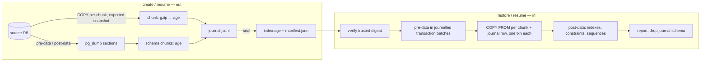

# Resumable Encrypted PostgreSQL Backup and Restore CLI (Enterprise)

## TLDR

**Proposal, not implementation. Enterprise Edition only.** Give instance operators one CLI lifecycle in the enterprise `backups` module (bootstrap-free `mercato-backup …`, with `mercato backups …` wrappers in an app checkout) to create a whole-database PostgreSQL backup, verify it offline, restore it into an empty isolated database, and exercise recovery. Three properties define this revision:

1. **Encrypted by default.** The whole backup — schema, every row, the chunk index — is encrypted as an archive, independently of the per-entity field-encryption maps. An unencrypted backup is an explicit, confirmed opt-in that deployment policy can forbid.
2. **Resumable both ways.** Backup and restore work in per-entity chunks recorded in a checkpoint journal. An interrupted run (crash, `SIGINT`, lost connection, full disk fixed by the operator) continues from the last durable chunk instead of starting over.
3. **Per-entity progress, out and in.** Backup shows one progress bar per entity being read out of the source; restore shows one per entity being written into the target, plus an overall bar, rate and ETA. Machine-readable progress is available for automation.

The scheduled pipeline, object storage, retention, status UI and erasure manifest stay in [enterprise automated backups](2026-07-08-automated-database-backups.md); that pipeline reuses this engine. No OSS code, no OSS command, no HTTP restore route.

Status: design ready for review; security gates (Q2, Q3) block implementation approval. This PR changes specifications only.

## Resolved assumptions (autonomous defaults)

| Question | Chosen default | Rationale / override condition |
|---|---|---|
| Q1: Edition and location? | Enterprise only: engine in `packages/enterprise/src/modules/backups/lib/engine/`, commands in that module's `cli.ts`, available only when `OM_ENABLE_ENTERPRISE_MODULES` and `OM_ENABLE_ENTERPRISE_MODULES_BACKUPS` are on. Nothing ships in `packages/cli` or OSS. | Product decision by the PR author (2026-11-06). The OSS manual `pg_dump` docs remain the community path. |
| Q2: Archive encryption container? | Encrypted by default. Each chunk and the chunk index is an independent [age v1](https://age-encryption.org/v1) file encrypted to X25519 recipients, produced in-process by the `age-encryption` TypeScript implementation (CLI `age` as fallback). Plaintext only via `--no-encryption` plus confirmation. | Per-chunk files are what make encrypted resume possible — no cipher state spans a crash. Public-key recipients mean the backup host cannot decrypt what it wrote. **⚠ NEEDS HUMAN CONFIRMATION:** security maintainer approves the library (a new production dependency of `@open-mercato/enterprise`), version range, recipient custody and convergence with the automated spec's AES-GCM env key. No home-grown cipher framing. |
| Q3: Key custody? | Archive identities, application DEKs/key versions and external secrets are three separate custody domains. The CLI never exports DEKs. | Root secret is not a tenant DEK. **⚠ NEEDS HUMAN CONFIRMATION:** security owner approves the escrow inventory and recovery drill. |
| Q4: Scope / privileges? | Whole database, all tenants, host operator only. No tenant API, no tenant-selective backup or restore. | A whole-database backup is inherently cross-tenant. |
| Q5: Resume granularity and consistency? | Chunked per entity (table). Within one live session every chunk reads one exported snapshot. After process death, resume continues finished entities as-is and **restarts the interrupted entity**; the artifact records `consistency: 'single-snapshot' \| 'quiesced' \| 'multi-snapshot'`. | A PostgreSQL snapshot dies with its session; claiming cross-crash snapshot consistency would be false. `quiesced` is proven by an unchanged transaction-id horizon, not by operator assertion. |
| Q6: Restore target and resume? | Explicit separately provisioned empty target. Resume is allowed only into the same target, bound to the same backup and the same restore run through a journal stored in that target. No `--force`, `--clean`, live-target or overwrite. | Resume without a binding journal could merge two backups into one database. |
| Q7: Progress unit? | One bar per entity: a table labelled `module · Entity (table_name)` from ORM metadata captured at backup time; unmapped tables show the table name. | Matches how operators think about the data; the restore target does not need app metadata. |

## Overview

Audience: trusted deployment operators with OS access and database credentials, not tenant administrators. A backup here is a **logical, single-database backup**, not a physical cluster backup or PITR. It contains all tenant rows and large objects in that database; it does not contain attachments on disk, object-store contents, Vault state, Redis or cluster-global roles.

Related: [enterprise automated backups](2026-07-08-automated-database-backups.md) owns the `backups` module scaffold, scheduling, S3, retention, status UI, `backup_run` records, notifications and the erasure manifest. This spec owns the engine and artifact format both specs use, and the operator CLI. Neither has shipped (no `backups` module exists at the inspected `origin/main`), so convergence needs no deprecation bridge. Operator docs ([PR #7652](https://github.com/open-mercato/open-mercato/pull/7652)) stay untouched.

## Problem Statement

Installation docs describe manual `pg_dump`; the enterprise proposal describes a single-stream `pg_dump | AES-GCM | S3` pipeline. Both fail the same way on large instances: a multi-hour dump or restore interrupted at 90% restarts from zero, the operator sees no per-entity progress while it runs, and a plaintext dump file is easy to leave on disk. A file existing on disk is not evidence it is complete or recoverable, and a restore against the wrong database has an instance-wide blast radius.

## Proposed Solution

An enterprise engine with five lifecycle functions — `preflight`, `create`, `verify`, `restore`, `exercise` — and resume built into `create` and `restore`. Data is moved in **chunks**: each chunk is a bounded slice of one entity, compressed, encrypted and hashed on its own, and recorded in a journal only after it is durable. Schema moves through native `pg_dump`/`pg_restore` sections; row data moves through `COPY` streams.



Takeaway: every arrow that moves data ends in a durable journal entry, so a crash loses at most the chunks in flight.

### Research and alternatives

- PostgreSQL `pg_dump` sections (`pre-data`, `data`, `post-data`) and snapshot synchronization (`pg_export_snapshot()`, `--snapshot`) let schema and data be produced separately against one snapshot; `pg_dump` itself has no resume. [pg_dump](https://www.postgresql.org/docs/18/app-pgdump.html), [snapshot synchronization](https://www.postgresql.org/docs/18/functions-admin.html#FUNCTIONS-SNAPSHOT-SYNCHRONIZATION).
- [pgcopydb](https://pgcopydb.readthedocs.io/) shows the proven shape for resumable logical copy: export a snapshot, copy table data with `COPY` in parallel, build indexes and constraints afterwards, track progress per table, and resume by skipping finished tables. Adopted: section split, per-table tracking, post-data last. Rejected: its CDC/logical-replication catch-up — too much infrastructure for a backup tool; the honest `multi-snapshot` label replaces it.
- [pgBackRest](https://pgbackrest.org/user-guide.html) remains the right tool for WAL/PITR and physical backups; this spec adopts its rehearsal discipline only.
- [age](https://age-encryption.org/v1) is a streaming, authenticated file format with X25519 recipients; one file per chunk keeps every chunk independently decryptable and checks it fully before use.
- Rejected: native `pg_dump` custom/directory archive as the data carrier (not resumable); a custom AES-GCM envelope; whole-archive single-stream encryption (cannot resume); ORM/data-engine exports (miss tables, slow); tenant-selective restore; live-database overwrite; an OSS variant.

## Architecture

### Locations (enterprise, later implementation)

| Path | Responsibility |
|---|---|
| `packages/enterprise/bin/mercato-backup.mjs` + `…/backups/lib/engine/cli/main.ts` | Bootstrap-free primary entry point (see *Command entry points*). |
| `packages/enterprise/src/modules/backups/cli.ts` | `ModuleCli[]`: thin handlers for the commands below, prompts, JSON projection, exit mapping. Shared with the automated spec's `run`/`list`. |
| `packages/enterprise/src/modules/backups/lib/engine/schemas.ts` | Zod inputs, manifest v1, index v1, journal v1, restore report v1, progress event v1, checks file v1. |
| `…/lib/engine/{preflight,create,verify,restore,exercise}.ts` | Lifecycle functions and resume logic. |
| `…/lib/engine/{chunks,journal,snapshot,crypto,progress}.ts` | Chunk planner (keyset/ctid), checkpoint journal, snapshot holder, age adapter, progress model and renderers. |
| `…/lib/engine/{processes,resources,artifacts,lock}.ts` | Shell-free spawn, bounded pipes, quotas, atomic publication, run lock with heartbeat. |
| `…/lib/engine/index.ts` | Facade for the automated pipeline's workers: `preflightBackup`, `createBackup`, `verifyBackup`, `restoreBackup`, `exerciseBackup`, with `AbortSignal`, progress sink and injectable process/fs/connection/chunk-store adapters. |
| `packages/enterprise/src/modules/backups/__tests__/engine-*.test.ts` | Contract, chunking, journal, crypto, progress, failure-injection unit tests. |
| `packages/enterprise/src/modules/backups/__integration__/` | Self-contained CLI ↔ PostgreSQL scenarios (matrix below); placement in the enterprise integration harness needs QA confirmation. |

No new entities or migrations from this spec (the automated spec owns `backup_run`). The restore journal is a temporary schema in the **target** database, not an application entity. No events, routes or DI keys beyond those the automated spec defines. Encrypted application reads during an exercise use the existing encryption helpers (`findWithDecryption`), never ad-hoc decryption.

### Command entry points and bootstrap

Two entry points share one set of handlers:

- **`mercato-backup` (primary, bootstrap-free)** — a bin shipped by `@open-mercato/enterprise` (`packages/enterprise/bin/mercato-backup.mjs` → `…/backups/lib/engine/cli/main.ts`). It loads no app modules, generated registries, DI container or `.env` scaffolding, so a recovery host needs only Node, the enterprise package, PostgreSQL client tools and the operator's service/identity files. It owns stdout completely, which is what makes the `--json` contract (one object) and the exit-code table hold. It refuses to run unless `OM_ENABLE_ENTERPRISE_MODULES` and `OM_ENABLE_ENTERPRISE_MODULES_BACKUPS` are true, mirroring the module gate; this is a consistency switch, not a security control — the enterprise boundary is the commercially licensed `@open-mercato/enterprise` package itself. Human output is localized by reading the module's locale JSON files directly (no i18n bootstrap), falling back to English.
- **`mercato backups <command>` (convenience)** — `ModuleCli` entries in the module's `cli.ts`, present only when the module is enabled. They run through the standard dispatcher, which runs the full app bootstrap (`backups` is not in `BOOTSTRAP_FREE_COMMANDS`, `packages/cli/src/lib/cli-bootstrap-mode.ts`) and prints its banner, `🚀 Running …` and `⏱️ Done …` lines to stdout (`packages/cli/src/mercato.ts`). They therefore support human/progress output only: `--json` is rejected with a pointer to `mercato-backup`, and thrown errors surface as the dispatcher's exit 1. No dispatcher or OSS CLI change is proposed.

Neither entry point calls `createRequestContainer()` for `verify`, `restore`, `exercise` or `status`: recovery cannot depend on the lost live database. `create` reads entity labels from the generated ORM metadata when invoked through `mercato backups` (table → module · entity class, no ORM connection); `mercato-backup create` accepts `--labels-file` exported by `mercato backups labels` and otherwise falls back to table names. Restore takes every label from the backup's index.

### Backup engine (out)

1. **Plan.** Open a read-only `REPEATABLE READ` control session, `pg_export_snapshot()`, record the full `pg_current_snapshot()` descriptor (`xmin`, `xmax`, `xip_list`, using full-width transaction IDs) and a cluster-incarnation identity as the epoch evidence. Enumerate user tables (skipping the engine's own journal schema), estimate rows (`reltuples`) and bytes (`pg_relation_size`), and choose a chunk strategy per entity:
   - **keyset** — tables with a primary key or a non-null unique key: `COPY (SELECT * FROM t WHERE (key) > $last ORDER BY key LIMIT n) TO STDOUT (FORMAT binary)`. Chunk boundaries are key values, so they survive a resume.
   - **ctid-range** — tables without a usable key: page ranges, valid only within one snapshot epoch.
   - **large objects** — OID-ordered; small objects batched per chunk, an object larger than the chunk target split by byte offset (`lo_get(oid, offset, length)`). OIDs come from pre-data, which creates empty large objects; because schema SQL is rendered with `--no-owner`, those objects are owned by the restore role, which is what `lo_put` needs from a non-superuser. Restore writes content with `lo_open`/`lo_put` into the existing OID, never `lo_from_bytea`.
   Default chunk target: 64 MiB uncompressed or 1,000,000 rows, whichever first (`--chunk-size-bytes`, bounded 8 MiB–1 GiB). `LIMIT n` is adaptive: `n` starts from `chunk target ÷ average row width` (`pg_stats`/relation size) and is re-tuned from the measured bytes of each finished chunk, so chunks stay within 0.5–2× the target without parsing COPY tuples. `COPY` uses an explicit column list that excludes generated columns (restore regenerates them); binary format is safe because source and target majors must match.
2. **Schema.** `pg_dump --section=pre-data` and `--section=post-data` with `--snapshot=<id> --format=custom` stream into two schema chunks. The index also captures, under the same snapshot, every foreign-key definition (`pg_get_constraintdef`) so restore can create them `NOT VALID` (see restore step 6).
3. **Data.** `--jobs` workers (1–8, default 2) each open a session, `SET TRANSACTION SNAPSHOT <id>`, and process chunks: `COPY … TO STDOUT` → gzip → age encrypt → SHA-256 tee → `<partial>/data/<entityKey>/<seq>.chunk.partial` → fsync → rename to `.chunk` → append a journal record → fsync journal. Only journalled chunks exist for resume.
4. **Sequences.** Read `last_value`/`is_called` of every sequence at seal time in the final epoch. For `quiesced` or `multi-snapshot` backups also record, for each sequence owned by a column (`pg_depend`), the column maximum among restored rows; restore sets the sequence to the greater of the two so `nextval` can never collide with a restored key.
5. **Seal.** When every planned chunk is journalled: write `index.age` (encrypted entity list, labels, chunk list with key boundaries, row/byte totals, sequence values, FK definitions, consistency evidence), then `manifest.json` (non-secret: ids, digests, encryption recipients fingerprint, consistency mode, versions), fsync, atomic no-replace rename of the partial directory to the final directory, fsync parent, delete the run key (below).

**Journal confidentiality.** The backup host holds only public recipients, so it cannot read back anything encrypted to them — yet resume must read entity identities and keyset boundaries, and a keyset boundary can be real data (a unique email, an order number). Therefore each run generates an **ephemeral X25519 run key**: its public half encrypts every journal record's sensitive body (`{schema, table, keyFrom, keyTo, catalog fingerprint}`) as an age payload; only non-sensitive fields stay plaintext in the journal line (`entityKey`, `seq`, sizes, `sha256`, `epoch`, chain hash). The run key's private half is stored 0600 in `--workspace` (local, operator-owned — not on the output volume, which may be shared or synced) and, wrapped to the backup recipients, as `run-key.age` in the partial directory, so an operator holding a backup identity can resume on another host (`--identity-file`). Both copies are deleted when the backup seals. With `--no-encryption` the journal is plaintext like the rest of the backup.

### Resume semantics (backup)

`create --resume <backupId>` (or the partial directory path) reopens a partial artifact:

- Acquire the run lock (below), validate the journal (each referenced chunk exists and rehashes), discard any `.partial` file and any chunk without a journal line.
- **Same epoch** (the snapshot holder is still alive — transient worker or connection failure inside one process): the engine retries failed chunks in-process up to 3 times with backoff before failing; consistency stays `single-snapshot`.
- **New epoch** (process died, snapshot gone): open a new snapshot. Compare the full snapshot evidence with the previous epoch's. The boundary is proven quiescent only when cluster-incarnation identity matches, the full-width `xmax` is unchanged, and **both snapshots have empty `xip_list`**. Equal `xmax` alone is insufficient: a transaction already in progress below that horizon can commit between snapshots without advancing it. Any active transaction, advanced horizon, changed incarnation or unavailable evidence makes the boundary `multi-snapshot`; `--quiesced` refuses before changing existing partial state. The incarnation evidence must distinguish cluster replacement, recovery and timeline changes; inability to establish that identity is not proof. Classification is cumulative across all epochs: once `multi-snapshot`, it never upgrades to `quiesced`. The check is cluster-wide and deliberately conservative (the engine's own sessions are read-only and assign no transaction ids); unrelated activity may force the weaker label. Finished entities are kept; the interrupted keyset entity continues from its last journalled key **only** when consistency is `quiesced`, otherwise it restarts from its first chunk (old chunks for that entity are tombstoned in the journal) so every entity is internally consistent at one snapshot. ctid-range entities always restart.
- Schema chunks are retaken in the newest epoch if a DDL change is detected (catalog fingerprint of relations, columns, constraints differs) — and then **all** data entities restart, because chunk layouts may no longer match. A changed catalog is printed as the reason.
- `--quiesced` asks the engine to fail rather than produce `multi-snapshot`: if the conservative boundary proof above fails, resume refuses (exit 3) and tells the operator to stop writers or drop the flag. In practice `quiesced` needs a real maintenance window: any writer on the cluster — pg_cron jobs, monitoring agents writing stats tables, another application database — advances the horizon. The runbook lists these.
- Resume needs the run key: from `--workspace` on the same host, or from `run-key.age` with `--identity-file` elsewhere. Without either, resume refuses (exit 3) and the operator starts a new backup.
- A resume uses the encryption recipients and compression recorded in the partial journal header; passing different ones refuses.

### Restore engine (in) and resume

`pg_restore` is used only as a **SQL renderer**, never as a database client: the engine runs `pg_restore --list` on a schema chunk, then `pg_restore --use-list=<one entry or group> --file=- --no-owner --no-acl --no-tablespaces` to obtain the SQL text, and executes that SQL on its own connection. This is what lets schema statements share the engine's transactions and journal.

1. **Verify first.** Check `--trusted-manifest-sha256`, decrypt and parse `index.age`, rehash every chunk against the index before touching the target (`--verify-mode full`, default) or verify each chunk just before loading it (`--verify-mode streaming`, for disk-constrained hosts; a bad chunk then stops the restore with the target quarantined). Verified chunk digests are recorded in the journal (`restore_steps`), so a resume re-verifies only chunks not yet loaded.
2. **Init — one transaction.** Create schema `om_backup_restore` with `restore_run(restore_run_id, backup_id, manifest_sha256, target_challenge_digest, phase, heartbeat_at, started_at)`, `restore_chunks(entity_key, seq, sha256, rows, restored_at)` and `restore_steps(step_key, kind, status, detail, finished_at)`, and insert the `restore_run` row. Commit. A crash before commit leaves the target empty; after commit it holds only a bound journal, which the resume baseline accepts. There is no window in which the target is neither empty nor resumable.
3. **Pre-data — batched.** Execute the rendered pre-data SQL (tables, types, functions, sequences and empty large objects; no indexes, primary/unique keys, FKs or triggers) in dependency-ordered batches of at most 500 TOC entries, each batch in one transaction with its `restore_steps` row. Batching keeps each transaction's lock count well below `max_locks_per_transaction × max_connections` (a single transaction over thousands of tables fails with "out of shared memory", the same limit as `pg_restore --single-transaction`); preflight still reports the lock capacity.
4. **Data.** `--jobs` workers (1–8, default 2) each load one chunk per transaction: read the chunk while hashing it → decrypt → gunzip → `COPY t (columns) FROM STDIN (FORMAT binary)` (large-object chunks: `lo_open`/`lo_put`) → compare the computed SHA-256 with the index **before** inserting the `restore_chunks` row → `COMMIT`; a mismatch rolls the chunk back (exit 4). Hashing during the load closes the window in which a chunk could be swapped on disk after the verify pass. Chunk and journal row commit atomically, so a chunk is loaded exactly once.
5. **Sequences.** Set every sequence from the index (greater of recorded value and restored column max, per backup step 4); one journalled step.
6. **Post-data.** Each post-data TOC entry except foreign keys (primary/unique keys, indexes, check constraints, triggers, rules) is rendered and executed in its own transaction together with its `restore_steps` row. Foreign keys are skipped in the rendered list and created from the captured `pg_get_constraintdef` definitions with `NOT VALID`, then each is `VALIDATE`d as its own step; a violation (possible for `multi-snapshot` backups) is recorded per entity in `restore_steps` and the report (exit 6, target quarantined) instead of aborting the remaining steps.
7. **Finish.** `ANALYZE`; write and atomically finalize the report from the journal; then drop `om_backup_restore` in its own transaction. Finish is idempotent: a crash after the report but before the drop is completed by resume (report already final → drop only).

`restore --resume <restoreRunId> …` requires the same artifact, the same trusted manifest digest and a fresh target confirmation challenge. The target's baseline check accepts exactly the restore journal for that run plus objects consistent with its recorded phase; anything else refuses (exit 3). Done chunks and steps are skipped. A chunk or step whose transaction did not commit left nothing behind, so it is simply re-run.

### Run lock

Partial backup directories and restore journals carry a lock record `{runId, host, pid, startedAt, heartbeatAt}`. Backup: an `O_EXCL` lock file whose `heartbeatAt` is refreshed every 10 s. Restore: a session-level advisory lock on the target plus `heartbeatAt` in `restore_run`. A lock is stale when the heartbeat is older than 60 s **and** (same host) the PID is not alive; stale locks are taken over with a printed note. A live lock from another host refuses unless `--take-over-lock <runId>` names it explicitly.

### Native execution, connections and safety (retained)

- Explicit binaries from an operator-controlled directory; record real paths and versions; Linux, PostgreSQL 16/17/18, matching client/source/target major. Missing extensions, encoding/collation mismatch or unknown migration set fail preflight.
- Connections use libpq named services and a private `PGSERVICEFILE`/`PGPASSFILE` — never URLs or passwords in argv; no fallback to `DATABASE_URL`; allowlisted child environment only.
- Connection budget: backup reserves `jobs + 2` (workers, snapshot holder, control); restore reserves `jobs + 1`. Refuse when the available-connection estimate minus a 5-connection reserve is insufficient.
- Lock timeout 30 s, connect timeout 10 s, total deadline 6 h (max 24 h). Deadline expiry leaves a resumable partial, not a failure without recovery.
- Restore never replays owners, ACLs or tablespaces (`--no-owner --no-acl --no-tablespaces` on schema sections); no `--clean`, `--create`, `--disable-triggers`, no arbitrary native flags.

### Resource bounds and cancellation

All streams use backpressure; high-water mark ≤ 1 MiB; no chunk-sized buffers in JS (a chunk streams through gzip and age). Diagnostic tails ≤ 64 KiB per subprocess, lines ≤ 4 KiB, sanitized; errors go through `createLogger` and `reportError` with codes, never raw child output. `--workspace` (absolute, operator-owned) holds restore staging; `--max-staging-bytes` caps it; in streaming verify mode staging never exceeds `jobs × chunk size` plus 1 GiB reserve. Backup output is bounded by `--max-output-bytes` and free-space reserve checks before each chunk; ENOSPC/EDQUOT stops the run **resumably** after the operator frees space.

`SIGINT`/`SIGTERM`: stop dispatching chunks, let in-flight chunks finish or abort them (second signal aborts immediately), kill recorded child process groups after 10 s, release snapshot and connections, keep the journal, print the exact resume command, exit 130/143. `SIGKILL`/power loss: the journal's last fsynced line is the resume point; `.partial` chunk files are discarded on resume.

## Encryption

### Whole-backup encryption, independent of field-encryption maps

Archive encryption and field-level encryption are separate layers:

- **Archive encryption (this spec)** covers everything in the backup: schema, every column of every row, large objects, sequence values, and the chunk index (entity names and row counts are metadata worth hiding). Only `manifest.json` is plaintext, and it carries no table names, row data, tenant labels or key material.
- **Field encryption maps** (the per-module `encryption.ts` maps and tenant DEKs) are left alone: encrypted columns are copied as the ciphertext stored in the database, never decrypted or re-encrypted during backup or restore. A restored database therefore still needs the same tenant DEKs / key versions to be readable — archive identities do not replace them (Q3).

Mechanics: each chunk is gzip-compressed then age-encrypted to the recipient set from `--recipients-file` (default `OM_BACKUP_RECIPIENTS_FILE`), 1–10 X25519 recipients, so a second recipient can be an offline escrow key. The backup host needs only public recipients; decryption needs `--identity-file` with a private identity, required mode 0600. The manifest records `encryption: {mode: 'age-v1', recipientSetFingerprint}`; restore checks the identity matches a recipient before decrypting any chunk.

### Unencrypted backups (explicit opt-in)

`--no-encryption` produces plaintext chunks (still gzip-compressed and SHA-256 hashed) and `encryption: {mode: 'none'}` in the manifest.

- Interactive runs ask the operator to type `UNENCRYPTED` after a warning that the files contain every tenant's data in readable form; unattended runs must pass `--confirm-unencrypted` as well. There is no other bypass.
- `OM_BACKUP_REQUIRE_ENCRYPTION=true` makes the engine refuse `--no-encryption` (exit 3) — enterprises can lock the policy per deployment.
- Plaintext chunk files and directories are created 0600/0700; every summary, progress header and report shows `UNENCRYPTED`.
- Integrity still holds through the trusted manifest digest and chunk hashes; confidentiality does not. Resume cannot switch encryption mode.
- The automated pipeline (scheduled runs to object storage) never offers plaintext.

### Escrow and offline rotation runbook (retained)

Three custody domains — archive identities, application DEKs and historical key versions, external secrets — none substitutes for another. `packages/shared/src/lib/encryption/kms.ts` derives keys from a root secret or uses Vault; a root secret is not a raw tenant DEK. Escrow lives outside the backup with dual control and tested retrieval; key bytes never appear in manifests, reports, flags or archives. The runbook delivered with implementation: inventory keys and recipients; stop writers, workers, schedulers; create and verify a pre-rotation backup (`--quiesced` makes its consistency provable); exercise it on an isolated target with encrypted canaries from every key scope; run the separately specified rotation; exercise post-rotation recovery before accepting writes; keep historical keys and pre-rotation backups for their full retention.

## Progress display (out and in)

Both directions use the same progress model: a list of entities, each with `rowsDone/rowsTotal`, `bytesDone/bytesTotal`, `chunksDone/chunksTotal`, state (`queued | running | done | resumed | restarted | failed | skipped`), rate and ETA, plus an overall aggregate.

- **Backup (out):** totals are estimates (`reltuples`, relation size) and shown with `~`; they become exact when an entity finishes. Bytes count uncompressed data read.
- **Restore (in):** totals are exact from the index, so bars and ETA are accurate from the first second. Post-data appears as its own group (indexes, constraints, FK validation) with per-step state.
- **Resume:** entities finished before the interruption render as `done (resumed)` and start at their journalled position; the overall bar starts at the resumed percentage.

TTY rendering (stderr, redrawn at most 10×/s, terminal width aware):

```text
Backup 3f2c9a1e → /srv/backups   encrypted (age, 2 recipients)   single-snapshot   04:12 elapsed
 ✔ customers · CustomerEntity     customer_entities    182,331 rows   1.2 GiB              done
 ▶ sales · SalesOrder             sales_orders   ███████░░░  68%   1.20M / ~1.77M   41 MiB/s   ETA 2:10
 ▶ catalog · CatalogProduct       catalog_products ██░░░░░░░  22%  88,104 / ~400K   12 MiB/s   ETA 6:02
 · audit_logs · ActionLog         action_logs                       queued
Overall  █████░░░░░  57%   412 / 731 entities   18.3 / ~32.1 GiB   ETA 12:40
```

Rules: show running entities, the 3 most recent completions, failures, then a `… 318 queued` summary line, so the display fits the terminal; `--progress verbose` lists every entity. Non-TTY or `--progress plain` prints one line per entity state change plus an overall line every 10 s. `--progress json` writes NDJSON progress events v1 to stderr (`{schemaVersion:1, type:'run.started'|'entity.progress'|'entity.done'|'entity.failed'|'phase.changed'|'run.finished', runId, entity?, rowsDone, rowsTotal, rowsTotalExact, bytesDone, chunksDone, chunksTotal, at}`), throttled to 2 events/s per entity. `--progress none` disables it. Progress never writes to stdout, so `mercato-backup --json` results stay a single object. When the facade runs inside the automated pipeline's worker, the same events update the `backup_run` row's progress fields, and — only for manual runs triggered by a user, which have that user's tenant (`ProgressJob.tenantId` is non-null) — the `ProgressJob` the automated spec creates; scheduled, tenant-less runs have no `ProgressJob`. The per-entity view is CLI-only in v1. Labels and states are localized through the module's i18n; entity labels are not translated.

## Data Models

### Artifact v1

```text
<output>/<backupId>/
  manifest.json        plaintext, ≤ 1 MiB, written last
  index.age            encrypted (or index.json with --no-encryption)
  schema/pre-data.chunk
  schema/post-data.chunk
  data/<entityKey>/<seq>.chunk
```

`entityKey` is a generated short id (`e0001…`), not the table name, so file names do not leak schema. During creation the directory is `<output>/.<backupId>.partial/` (0700) and also holds `journal.jsonl`, `lock` and `run-key.age`; all are removed at sealing — the index replaces the journal. The run key's private half lives in `--workspace`, never in the output directory.

**Manifest:** `schemaVersion: 1`, `state: 'complete'`, `backupId`, `startedAt/completedAt` (UTC), `scope: 'whole-database'`, `kind: 'postgresql-logical-chunked'`, `encryption: {mode: 'age-v1'|'none', recipientSetFingerprint?}`, `compression: 'gzip'`, `consistency: {mode: 'single-snapshot'|'quiesced'|'multi-snapshot', epochs}`, tool versions, source PostgreSQL version, non-secret instance/database identity digest, encoding/collation, application release and migration-set digest, `index: {path, sizeBytes, sha256}`, `chunkCount`, `totalCipherBytes`, `exclusions: ['external-files','object-stores','vault','redis','cluster-globals','wal']`.

**Index (encrypted):** entities `{entityKey, schema, table, label?, strategy, rows, plainBytes, chunks: [{seq, keyFrom?, keyTo?, rows, plainBytes, cipherBytes, sha256, epoch}]}`, sequences `{name, value}`, schema chunk digests, catalog fingerprint, consistency evidence `{epoch, clusterIncarnation, snapshot: {xmin, xmax, xipList}, boundaryClassification}` (full-width transaction IDs encoded as decimal strings). Bounded to 1,000,000 chunks and 64 MiB plaintext.

**Journal v1 (creation only):** append-only JSON lines — a header `{backupId, recipientSetFingerprint|none, compression, chunkTarget, plan digest}`, then epoch, chunk, tombstone and schema records. Each line carries a running SHA-256 chain so truncation or edits are detected; an invalid tail line is dropped, an invalid middle line refuses resume.

**Trust:** the manifest digest is emitted on completion and must reach `verify`/`restore`/`exercise` through an independent channel (`--trusted-manifest-sha256`). Manifest → index digest → chunk digests forms the chain, and that chain is the **only** integrity and provenance guarantee. age with X25519 recipients provides confidentiality and detects corruption, but it is not sender-authenticated: anyone holding the public recipients can produce a valid ciphertext, so a successful decrypt proves nothing about who wrote a chunk. Every chunk is therefore checked against its index hash, both in `verify` and again while it is loaded.

### Restore report v1

External to the artifact: restore run id, backup id, trusted manifest digest, target identity digest, consistency mode, resumes count with timestamps, per-entity rows loaded vs expected, per-phase durations, FK validation results per entity, `keyRecovery: 'not-tested'|'passed'|'failed'`, `externalAssets: 'not-tested'|'operator-attested'`, `promotionReady: false`. Exclusive owner-only file, finalized atomically.

## API Contracts (CLI)

Commands of `mercato-backup` (the same commands exist as `mercato backups <command>` for human output; `--json` only on `mercato-backup`). All flags validated by Zod before I/O; unknown or conflicting flags refuse. No generic `--yes`.

| Command | Inputs and behavior |
|---|---|
| `preflight --operation create\|restore\|exercise` | Read-only checks: tools, versions, connection budget, disk/workspace, encryption policy, target emptiness and identity challenge. `--source-service` / `--target-service`, `--artifact`. |
| `create --source-service <name> --output <abs-dir> [--recipients-file <path> \| --no-encryption --confirm-unencrypted] [--jobs 1-8] [--chunk-size-bytes n] [--quiesced] [--deadline-seconds n] [--max-output-bytes n] --workspace <abs-dir>` | Chunked encrypted backup; prints `backupId`, path, manifest digest. Interrupted runs print `mercato-backup create --resume <backupId> --output <dir> --workspace <dir>`. |
| `create --resume <backupId\|partial-dir> --source-service <name> --output <abs-dir> --workspace <abs-dir> [--identity-file <path>] [--jobs] [--quiesced] [--take-over-lock <runId>]` | Continues a partial backup per *Resume semantics*. Encryption/compression come from the journal. |
| `labels --output <path>` (`mercato backups` only) | Writes table → module · entity labels from generated ORM metadata for `mercato-backup create --labels-file`. No database connection. |
| `status <artifact-or-partial-dir> [--identity-file <path>]` | Read-only: complete vs partial, entities done/total, consistency mode so far, last heartbeat, resume command. Entity names need the identity for encrypted artifacts; counts do not. |
| `verify --artifact <dir> --trusted-manifest-sha256 <hex64> [--identity-file <path>] [--workspace <dir> --max-staging-bytes n]` | Offline: manifest, index, every chunk hash and age authentication, schema chunk TOC parse. No database connection. Per-entity progress. |
| `restore --artifact <dir> --trusted-manifest-sha256 <hex64> [--identity-file <path>] --target-service <name> --confirm-target <challenge> --workspace <dir> --max-staging-bytes n [--jobs 1-8] [--verify-mode full\|streaming]` | Verify, recheck target, journalled restore per *Restore engine*. Prints `restoreRunId` and the resume command on interruption. |
| `restore --resume <restoreRunId> <same inputs>` | Continues into the same target; fresh `--confirm-target` challenge required. |
| `exercise <restore inputs> --checks-file <path> --report <exclusive-path>` | Restore (resumable the same way) plus declarative checks (≤100, allowlisted types, no SQL/shell), migration fingerprint, optional encrypted-canary drill. Target stays quarantined. |

Shared flags: `--json`, `--report`, `--progress tty|plain|json|verbose|none` (default `tty` when stderr is a TTY, else `plain`). Stdout under `--json` is exactly one object: `{schemaVersion:1, command, runId, status:'completed'|'refused'|'failed'|'interrupted'|'resumable', backupId?, restoreRunId?, artifactPath?, manifestSha256?, consistency?, encryption?, resumeCommand?, reportPath?, error?:{code,messageKey}, warnings:[…]}`. Bytes are decimal strings.

Exit codes, JSON status and resumability (single source of truth; machine-contract snapshots pin it):

| Exit | `status` | Meaning | Resumable? |
|---|---|---|---|
| 0 | `completed` | Command stage finished (never implies promotion). | — |
| 2 | `refused` | Invalid input, unsupported version or option. | No state written. |
| 3 | `refused` | Safety refusal: identity, emptiness/baseline, trust, encryption policy, `--quiesced` violated, journal binding mismatch, run key unavailable, live lock. | Existing partial/journal untouched. |
| 4 | `failed` | Integrity/authentication failure (bad chunk, wrong identity, digest mismatch). | Backup: no. Restore: yes after the artifact is repaired from another copy. |
| 5 | `resumable` | Native tool, connection, I/O, quota or deadline failure after state was written. | Yes — `resumeCommand` given. |
| 6 | `failed` | Recovery checks, canary or FK validation failed; restore data is loaded and quarantined. | No — investigate. |
| 1 | `failed`, or `resumable` when a journal exists | Unexpected internal error (bug). | Yes when a journal exists; `resumeCommand` given. |
| 130 / 143 | `interrupted` | SIGINT / SIGTERM. | Yes — `resumeCommand` given. |

Precedence: interruption, then safety (3), then integrity (4), then runtime (5), then checks (6). `mercato backups` wrappers return the same codes except that errors escaping the handler become the dispatcher's 1.

### Target confirmation and isolation (retained)

Target provisioned from `template0`, empty except a reviewed baseline (or, on resume, the matching restore journal). Preflight compares source, live and target identities and refuses same-source, same-live or unverifiable targets. The challenge binds endpoint, server identity, database OID, manifest digest, baseline fingerprint (or restore journal state) and a 10-minute expiry; it is retyped interactively or passed with `--confirm-target`, and rechecked immediately before the first write. Restore runs sandboxed: no production Redis, queues, object stores, SMTP, webhooks or Vault write credentials; workers and schedulers stopped; outbound callbacks denied at the network layer. The restore role is not a superuser by default. No events or callbacks are emitted; the automated spec's erasure-manifest diff runs after restore, outside this engine.

## Edge Cases & Failure Scenarios

| Trigger | Required result and recovery |
|---|---|
| Process killed mid-backup | Journal's last fsynced chunk is the resume point; `.partial` chunk discarded; resume opens a new epoch and labels consistency honestly. |
| Writes continued between crash and resume | Horizon advanced → `multi-snapshot`; interrupted entity restarts; `--quiesced` refuses instead. Restore reports any FK violations per entity (exit 6) with the target quarantined. |
| DDL ran between crash and resume | Catalog fingerprint differs → schema retaken and all entities restart; reason printed. |
| Resume with different recipients, compression or `--no-encryption` | Refuse (exit 3); encryption mode is fixed per backup. |
| Two operators resume the same partial | Lock heartbeat refuses the second; stale lock takeover only when heartbeat is old and PID dead, or explicit `--take-over-lock`. |
| Journal truncated or edited | Chain hash detects it: torn tail line dropped; middle damage refuses resume; start a new backup. |
| Restore killed mid-chunk | Chunk transaction rolled back, no partial rows; resume reloads that chunk only. |
| Restore resume pointed at another target or backup | Journal binding (backup id, manifest digest, run id) mismatch refuses before any write. |
| Corrupted/tampered chunk, wrong identity, swapped manifest | `verify` and `restore --verify-mode full` refuse before SQL (exit 4); streaming mode stops at the bad chunk, target quarantined, resumable after the artifact is repaired from another copy. |
| Disk full during backup or restore staging | Stops with `resumable`; operator frees space and resumes. |
| `--no-encryption` while `OM_BACKUP_REQUIRE_ENCRYPTION=true` | Refuse (exit 3) before connecting. |
| Huge entity count (10k tables) | Progress collapses to running + summary; index bounded; chunk planner enforces the 1,000,000-chunk cap. |
| Missing historical DEK, stale escrow | Archive restore can pass while canary exercise fails (exit 6); no key generation or provider writes. |
| Malicious source SQL in schema chunks | Integrity can pass; sandbox, restricted role and trusted source remain required. |

## Risks & Impact Review

| Risk | Severity / area | Mitigation | Residual risk |
|---|---|---|---|
| Cross-tenant disclosure via artifact, logs, progress or scratch | Critical / all tenants | Encryption default, encrypted index hides entity names, plaintext only with confirmation and policy lock, sanitized logs, owner-only files | Operators choosing `--no-encryption`; host root and identity custodians see all tenants. |
| Resumed backup silently inconsistent | High / recovery | Conservative full-snapshot boundary proof, cumulative consistency label in manifest/report/progress, `--quiesced` mode, restart of interrupted entity, NOT VALID + VALIDATE FKs | `multi-snapshot` backups may need manual reconciliation; documented as weaker than single-snapshot. |
| Restore resume merges wrong data | High / target DB | Journal bound to backup, manifest digest and run id; chunk + journal row in one transaction | Operator bypassing the CLI with raw SQL. |
| Wrong destination | Critical / DB | Identity challenge, emptiness check, no overwrite flags, sandbox | Privileged operators remain trusted. |
| Key loss makes backups unreadable | High / recovery | Multiple recipients incl. offline escrow, identity check before decrypt, rotation runbook | Lost identities are unrecoverable by design. |
| New dependency (`age-encryption`) | Medium / supply chain | Q2 security approval, pinned range, CLI fallback | Library defects; reviewed upstream implementation. |
| Load on live source | High / availability | Default 2 jobs, connection budget, deadlines, snapshot age visible in progress | Long snapshots delay vacuum; large instances should prefer infra DR. |
| Contracts fossilize early | Medium / integrators | Versioned manifest/index/journal/progress schemas, contract tests | Deprecation protocol once shipped. |

## Integration Coverage and Performance Acceptance

No tests ship with this spec-only PR; this is the implementation acceptance matrix. No HTTP/UI paths are added by this spec (the automated spec covers its own). Harness: disposable PostgreSQL per scenario, `template0` targets, unique names, never the developer `DATABASE_URL`; fixtures include two tenants, field-encrypted canaries, custom fields, JSON/unicode/nulls, soft deletes, FKs, sequences, a table without a primary key, a large object and attachment references. Generated test identities, fake custody record, callback/queue sinks with counters. Every scenario cleans up processes, connections, snapshots, databases and temp dirs in `finally`.

| ID | Command path | Condition | Assertions |
|---|---|---|---|
| B01 | preflight/create | Supported majors, full fixture, default encryption | age-encrypted chunks and index; manifest has no table names; source unchanged. |
| B02 | create/restore/exercise | Full roundtrip | Row counts, content digests, constraints, sequences, large objects, encrypted canaries readable with correct DEKs. |
| B03 | create | `--no-encryption` with/without confirmation; `OM_BACKUP_REQUIRE_ENCRYPTION=true` | Refused without confirmation and under policy; plaintext marked everywhere; roundtrip still passes. |
| B04 | create resume | SIGKILL at random chunk boundaries (fault-injected at every fsync/rename point), quiet source | Resume completes, `quiesced`/`single-snapshot` as expected, no duplicate or missing rows. |
| B05 | create resume | Writes and DDL between crash and resume; an older in-flight writer commits below unchanged `xmax`; prepared transaction; cluster-incarnation change; quiet resume after a multi-snapshot epoch | Changed visibility is never labelled `quiesced`; non-empty boundary `xip_list` or missing/mismatched identity conservatively yields `multi-snapshot`; interrupted entity restarts; DDL triggers full restart; `--quiesced` refuses without changing partial state; weakest classification persists across later quiet epochs. |
| B06 | create | In-process worker connection drop | Chunk retried in the same epoch, consistency stays `single-snapshot`. |
| B07 | restore resume | SIGKILL mid-chunk, mid post-data, mid FK validation | Resume skips committed chunks, reloads the rolled-back one, final data equals B02. |
| B08 | restore resume | Wrong target, wrong backup, edited journal, live lock elsewhere | Refusals before writes; takeover only with stale heartbeat or explicit flag. |
| B09 | verify/restore | Tampered chunk, swapped index/manifest, wrong identity, missing chunk | Exit 4 before SQL (full mode); streaming mode stops and stays resumable. |
| B10 | progress | TTY, non-TTY, `--progress json`, resume, 10k tables | Per-entity bars both directions, estimated vs exact totals, NDJSON schema, stdout untouched, throttling. |
| B11 | all | ENOSPC/EDQUOT, deadline, SIGINT/SIGTERM | `resumable` status and resume command; resume completes after space freed. |
| B12 | preflight | Unsupported version, missing binary, insufficient connections, non-empty target, alias of source | Stable refusal codes before mutation. |
| B13 | secrets | Passwords/URIs/row text in native errors; hostile escape sequences in table names | Nothing sensitive in argv, stderr, progress, reports or telemetry. |
| B14 | exercise isolation | Restored integrations, callbacks, queues | Zero external side effects. |
| B15 | enterprise gating | Enterprise flags off | `mercato backups` absent, `mercato-backup` refuses; no OSS command exists. |
| B17 | status / entry points | `status` on partial and complete artifacts with and without identity; `mercato-backup` on a host without app checkout; `mercato backups --json` | Status shows counts without identity, names only with it; standalone bin runs with no bootstrap or `.env` writes; wrapper rejects `--json`. |
| B18 | journal confidentiality | Inspect partial directory of an encrypted run mid-backup | No table names or key values in plaintext; resume works from workspace key and, on another host, from `run-key.age` + identity. |
| B16 | facade | Automated worker path with mock chunk store | Same engine, ProgressJob updated, abort signal honored. |

Performance gate (pinned 4 vCPU / 8 GiB runner, 1 GiB and 20 GiB datasets): Node coordinator RSS ≤ 256 MiB at jobs 1–8; backup and restore elapsed ≤ 1.3× a matched `pg_dump`/`pg_restore` + age baseline plus 30 s; resume overhead (journal validation and re-planning; restore resume re-verifies only chunks not yet loaded) ≤ 30 s at 20 GiB; progress rendering ≤ 2% CPU; cancellation releases children and connections within 15 s. Proposed targets, not measured results.

## Migration & Backward Compatibility

This PR changes specifications only. Later implementation adds enterprise CLI commands, a facade and versioned formats (manifest, index, journal, report, progress events) — new contract surfaces under `BACKWARD_COMPATIBILITY.md` (CLI commands, types/signatures). No OSS surface changes. The automated spec's planned `run/list/restore/verify` and this spec's commands share one `cli.ts`; because neither has shipped, its AES-GCM env-key framing, `--force`/live-target restore and single-stream pipeline are reconciled to this engine before implementation rather than deprecated. Readers reject unsupported major schema versions; v1 readers stay when v2 arrives. Rollback of a future release keeps artifacts readable with a standalone build of the engine.

## Final Compliance Report — 2026-11-06 (rev 2)

| Rule / checklist area | Status / evidence |
|---|---|
| Spec placement | Enterprise-only scope moved to `.ai/specs/enterprise/` per `.ai/specs/AGENTS.md`. |
| Module placement | Enterprise `backups` module, module CLI registry; no `apps/mercato/src` code, no OSS command, no cross-module ORM relations. |
| Tenancy / permissions | Host-operator, all-tenant boundary; no tenant API; restore never over HTTP. |
| Encryption | Whole-archive encryption by default, plaintext opt-in with confirmation and policy lock; field encryption maps untouched; DEK custody separate. |
| Atomicity / resume | Chunk-level durability, journal chain hashes, chunk + journal row in one restore transaction, honest consistency labels. |
| Scale | Bounded streams, chunk caps, connection budgets, jobs 1–8, progress throttling. |
| Contracts | Versioned schemas; additive enterprise surface; convergence with the automated spec recorded. |
| Integration coverage | B01–B18 self-contained matrix; QA to confirm harness placement. |
| i18n | Progress labels, prompts and errors localized; stable codes for scripts. |

Verdict: **design review only; not approved for implementation** until Q2/Q3 security decisions and harness placement are confirmed.

## Changelog

- 2026-11-10 (rev 2.2): Re-review corrected false quiescence detection from `xmax` alone: require matching cluster-incarnation evidence, an unchanged full-width horizon and empty in-progress sets at both epoch boundaries; preserve the weakest consistency across resumes and add the in-flight-commit race, prepared transactions and identity-change acceptance cases. Aligned the architecture diagram with batched pre-data restore.

- 2026-11-06 (rev 2): Per PR author direction — moved to enterprise (`backups` module CLI, `.ai/specs/enterprise/`); whole-backup encryption by default with per-chunk age files and an explicit, policy-lockable unencrypted option; replaced the no-resume design with chunked, journalled, resumable backup and restore with epoch-based consistency labels; added per-entity progress bars for backup and restore (TTY, plain, NDJSON); replaced the B01–B20 matrix with B01–B18 and refreshed phasing.
- 2026-11-06 (rev 2.1): Addressed specification review — encrypted journal via an ephemeral run key; `pg_restore` used only as a SQL renderer so schema steps share engine transactions; FKs from captured definitions with `NOT VALID`; atomic restore init and `restore_steps` journal; report finalized before journal drop; sequences reconciled with column max for non-single-snapshot backups; large objects written with `lo_put` and split by offset; bootstrap-free `mercato-backup` bin owning stdout; exit-code/status/resumability table; adaptive chunk sizing; ProgressJob scope; registration and template sync in Phase 0. Re-review: batched pre-data (lock limits), integrity based solely on the hash chain (age is not sender-authenticated) with hash-on-load, licence as the real enterprise boundary, i18n without bootstrap.
- 2026-11-06: Initial OSS manual backup/restore CLI design (non-resumable, `packages/cli`).

## Implementation Plan

### Phase 0 — Gates

1. Q2/Q3 security decisions (age library, recipients, escrow), harness placement with QA, and reconciliation notes applied to the automated spec. Spike: snapshot export + keyset `COPY` + per-chunk age on a 20 GiB fixture to confirm the performance targets.
2. Scaffold the `backups` module if the automated spec has not: register in `enterprisePackage.modules` (`packages/enterprise/src/index.ts`) and in `apps/mercato/src/modules.ts` behind `OM_ENABLE_ENTERPRISE_MODULES` + `OM_ENABLE_ENTERPRISE_MODULES_BACKUPS` (mirrored into the create-app template via `yarn template:sync:fix`), stub `cli.ts` discovered by `yarn generate`, and the `mercato-backup` bin entry in the enterprise `package.json`.

### Phase 1 — Chunked encrypted backup

3. Schemas, process/resource adapters, preflight, encryption policy (B01, B03, B12, B13, B15).
4. Snapshot holder, chunk planner, chunk pipeline, journal, sealing; progress model and TTY/plain/JSON renderers for backup (B01, B10).
5. Backup resume: run key and encrypted journal, epochs, conservative full-snapshot boundary proof, `--quiesced`, DDL detection, sequence max reconciliation, locks (B04, B05, B06, B11, B18).

### Phase 2 — Verify and resumable restore

6. Offline `verify` and `status`; `mercato-backup` standalone entry point (B09, B17).
7. Restore with target challenge, journal schema, chunk loading, post-data, FK validation; restore progress (B02, B07, B08, B10).
8. `exercise` checks and canary drill; sandbox guidance (B14).

### Phase 3 — Automated pipeline convergence and release

9. Facade used by the automated spec's `backup-run` worker with a chunk-store adapter for object storage and `ProgressJob` updates (B16) — delivered under that spec.
10. Full matrix, performance evidence, docs (`apps/docs`: enterprise backup runbook incl. encryption, resume and rotation), configured validation gate.
