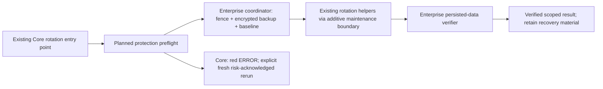

# Fast data correctness verification for Enterprise key rotation

## TLDR

Proposed Enterprise-only verification compares every in-scope logical value before and after key rotation, then gates verified completion on an independent read of persisted data. It reuses the resumable encrypted backup design in [PR #8910](https://github.com/open-mercato/open-mercato/pull/8910), streams bounded batches, and keeps previous keys and recovery artifacts on failure. This PR ships a design only; Core rotation stays available under #8910's explicit unprotected-risk acknowledgment.

## Resolved assumptions (autonomous defaults)

| Question | Chosen answer | Reason |
|---|---|---|
| Q1: Full coverage or sampling? | Compare every selected row, field and custom-document value; no sampling in a passing result. | Sampling cannot certify preservation. |
| Q2: Online writes? | Enforced offline maintenance from baseline through final verification; defer online rotation. | A fixed dataset makes equivalence meaningful without a new change-capture system. |
| Q3: New licensing system? | Reuse the supported commercial entitlement/capability decision; do not invent a license service. | Enablement flags alone do not establish license rights or available protection. |
| Q4: Separate audit tool/dashboard? | One verification capability consumed by rotation and recovery; no independent UI or generic checksum product. | Keep this spec cohesive. |
| Q5: New database tables? | Versioned encrypted run artifacts beside the backup, no application ORM entities. | Reuse the backup journal and minimize schema changes. |

These defaults may be overridden before merge. The existing backup spec's security/dependency and escrow approvals still gate implementation; this document does not resolve them. If there is no supported runtime entitlement validator, use the existing commercial package boundary plus a documented operator license check and explicit capability resolution; never claim that `OM_ENABLE_ENTERPRISE_MODULES` validates a license. Product/security owners must select the supported entitlement mechanism during Phase 0 before implementation proceeds. Subscription expiration must not be equated with loss of licensed rights when the commercial agreement permits continued use of the installed version.

## Overview and current evidence

The Core command `mercato entities rotate-encryption-key` is implemented in [`packages/core/src/modules/entities/cli.ts`](../../../packages/core/src/modules/entities/cli.ts). It walks encryption maps and invokes [`rotate-custom-entity-documents.ts`](../../../packages/core/src/modules/entities/lib/rotate-custom-entity-documents.ts) for dynamic documents. Already rotated ciphertext may be retained, while unreadable ciphertext causes failure. The current command does not establish complete before/after logical equality. Mapped-row rotation currently materializes an entire scope and selects the first primary-key column; custom rotation batches documents but materializes definitions and retains scope caches. `TenantDek` in `packages/shared/src/lib/encryption/kms.ts` has no key-version id, the v1 ciphertext envelope has no key id, and `createKmsService()` can fall back between providers. Bounded rotation and pinned target-key proof therefore require explicit additive maintenance adapters; they are not existing helper guarantees. System-scoped records and independently encrypted inner credentials require their own owners; a tenant-key rotation is not a root-key or all-secret migration.

The Enterprise `backups` engine described in #8910 is planned, not a shipped verifier. Its archive hashes establish artifact integrity; field-encrypted columns are copied as ciphertext. That alone does not prove preservation after those fields are re-encrypted. Current Enterprise bootstrap warning/enablement is also not runtime license validation. Searches covering Core rotation, custom documents, shared encryption helpers and Enterprise module registration found no existing complete logical-equivalence service to reuse.

## Problem Statement

An incorrect field mapping, dropped row, changed JSON type, stale key, skipped custom document, wrong scope or persistence-side transformation can leave rotation reporting success with damaged data. Comparing ciphertext checksums fails because valid re-encryption intentionally changes ciphertext; checking only that the new key decrypts also accepts valid encryption of the wrong value. Operators need complete logical equality for the declared rotation scope before ending maintenance or considering key retirement.

## Proposed Solution

An Enterprise coordinator requires a verified, quiesced encrypted recovery backup and an encrypted baseline for an explicitly enumerated scope. It calls existing rotation mechanisms through an additive boundary, then invokes the Enterprise verifier to read committed rows with fresh connections/key caches, decrypt using only the intended target key bindings, and compare canonical logical digests and exact coverage. A failure or incomplete scan is non-zero and never “verified”. The Core risk acknowledgment cannot bypass a failed protected run in place; an operator deliberately choosing unprotected Core execution starts a fresh invocation under #8910's warning contract, with no Enterprise verification claim.

### Safety invariants

1. No rotation mutation starts before a complete authenticated baseline, verified recovery artifact and retained source-key custody are durable.
2. A write fence spans backup, baseline, rotation and verification. Stop all application/worker/scheduler writers, drain existing and prepared transactions, deny new writes/DDL from other database roles, and restrict access to the coordinator's dedicated maintenance role. Verify the role/connection policy and recheck it at phase boundaries; an acknowledgment or process-local lock alone is insufficient. Refuse protected execution when this cannot be established. Host/database superusers remain a trusted operator boundary; hostile administrators are outside the proof.
3. Establish complete database visibility before enumerating coverage: the maintenance read role must provably bypass relevant RLS policies (including FORCE ROW LEVEL SECURITY) or the protected operation refuses. Set `row_security=off` as a fail-on-filter safety check, not as an assumed bypass; bind verified role attributes and RLS policy definitions to the schema/fence record. Application-role scans or equally filtered baseline/final counts are insufficient. Even with a privileged maintenance reader, every query explicitly constrains the intended tenant/organization scope. The coverage registry exhaustively enumerates tenant/organization scopes, mapped encryption fields including fallback scopes, custom definitions/documents, soft-deleted rows and null/missing values. Do not silently inherit `deletedAt: null` map filtering as proof of historical coverage. Resolve effective maps for historical encrypted data, or refuse with explicit unsupported coverage. Unsupported codecs, missing ownership or unbounded/unstable row identity block before mutation.
4. All selected logical rows, including unmodified columns, have a pre-rotation expectation. Only specifically declared rotation-maintenance metadata and derived lookup/search columns may differ; validate their expected transitions rather than excluding entire columns indiscriminately. During baseline preparation compute expected target lookup hashes with canonical lookup helpers and the pinned target lookup configuration from baseline plaintext; verify them independently after rotation. Bind that configuration/custody to the run. Canonical frames use the declared expected target representation for derived columns. For timestamps such as custom-document `updated_at`, durably store the exact per-write intended timestamp in a write-ahead intent record, pass that value through the maintenance adapter instead of an uncontrolled `now()`, and validate it on read; unchanged rows retain their baseline timestamp. The canonical digest projection normalizes only declared maintenance timestamp slots to a typed sentinel in both baseline and final scans, keeping the frozen roots comparable. Separately authenticate baseline timestamp values and exact intended timestamps with run-keyed intent MACs bound to run/scope/row/batch, and validate actual timestamps before allowing that normalization; untouched rows must match their baseline timestamp. Persist trusted journal-tail anchors in the owner-controlled run record at each intent checkpoint. A missing/replayed intent or arbitrary timestamp change fails. These transition records cannot replace logical-content expectations. Nested opaque ciphertext not owned by this rotation must remain byte-identical and is not certified as decryptable after root-key retirement.
5. Expected data comes from the pre-rotation source, never from the new values returned by the rotation write. Post-read checks must bypass ORM identity maps and caches and must fail on authentication errors, plaintext in fields expected to be encrypted, unknown envelopes or fallback to old keys.
6. Exact identity sets, counts, type-preserving logical digests and target-key readability must all pass. A timeout, conflict, skipped row, unknown entity, unexamined tail or lost fence cannot produce a pass.
7. No automatic key destruction, automatic live restore, or automatic release of maintenance. Passing verifies only the declared dataset; other consumers, historic backups and inner envelopes still require a separate key-retirement inventory.

## Architecture

Commercial logic lives in proposed `packages/enterprise/src/modules/backups/lib/rotation-verification/`, composed with the backup engine via DI. Core retains its rotation command and existing crypto; an additive optional maintenance hook/port provides batch read/commit lifecycle and scope enumeration. Shared/Core may contain the narrow port and fail-closed preflight, never the commercial digest scanner, baseline journal or verification implementation. No Core import of Enterprise is allowed. Review the existing module/CLI override mechanism before adding a port; prefer an existing equivalent when it covers all entry points. Refactor the mapped-row executor into a neutral bounded maintenance primitive with complete composite-key keyset pagination and conditional scope-aware updates; page definitions and bound/evict per-scope caches in custom-document maintenance. Preserve existing command defaults and crypto semantics under the compatibility policy; the Enterprise coordinator uses this primitive rather than wrapping the current unbounded `run()`. All mutating entry points must route through the selected guard and protected coordinator; direct library callers are included in the integration audit.

The coordinator owns quiescence, backup binding and run state. The existing helpers own encryption/decryption and target-key selection; no new encryption primitive or ciphertext format. The verifier owns independent persisted reads, canonical comparison and coverage. A successful helper return is not a verifier result. No cross-module ORM relations, application events, callbacks, indexing work or business hooks run during maintenance.

The verifier is a mandatory completion gate for protected rotation, while unprotected Core execution remains a deliberate, visibly different operator choice.

### Baseline and comparison algorithm

A key binding is a declared provider/tenant scope plus an opaque operator custody handle and a domain-separated HMAC fingerprint of the actual DEK bytes under the fresh run key, stored only in the encrypted header. Do not use `tenantId`, a cache timestamp or envelope shape as a key-version identifier. Pin explicit source and target provider adapters and actual DEKs for the run; use the existing decryption primitive with only the pinned target DEK in the independent verifier. Provider fallback, missing provenance, a changed fingerprint or inability to recover the exact original binding refuses/stops the protected path. The existing fallback-capable factory cannot be used as evidence of target-key identity. Re-resolve through the explicitly pinned provider before final verification/resume, compare the concrete fingerprint, and clear stale service caches. Retain original keys in approved external custody; no raw keys enter artifacts or logs. For a new rotation the concrete source/target DEK fingerprints must differ; compute both with the same `dek-material-v1` domain and framing over key bytes, without source/target role, provider or custody handle in the fingerprint input. Bind provider/scope/handle separately in the encrypted header, so changing a provider/handle while retaining identical key bytes cannot qualify as rotation. If fingerprints match, the unchanged key configuration refuses as a no-op rather than claiming a new rotation. A resumed run may contain already-target-encrypted rows, but its original distinct source/target bindings remain fixed. No ciphertext-format change is required.

- Freeze the coverage plan and effective maps/schema/codec versions under the write fence. Bind them to `runId`, database cluster/incarnation identity, database identity, tenant and organization scopes, source/target provider identities and concrete-key bindings (never raw keys), backup manifest digest and backup consistency `quiesced`. A database alias or matching database name alone is insufficient.
- During the backup scan, where its engine can expose the exact scoped logical rows under the same quiescence, stream the baseline projection without another SQL round trip per field. Decrypt only the declared fields using existing helpers and source key bindings; any pre-existing unreadable value refuses rotation. If backup row extraction cannot safely share that scan, use one separate bounded baseline scan and include its cost in the release benchmark. Do not claim scan fusion until the implementation spike demonstrates it.
- Use a versioned typed, length-prefixed canonical encoding: ordered column identifiers and database type tags; distinguish missing, SQL NULL, JSON null, strings, numbers, binary and arrays; sort JSON object keys deterministically while retaining array order. Preserve database numeric precision, byte contents and timestamp semantics without JavaScript number/date coercion. Bind entity/table, composite primary key, field identity, tenant/organization and expected logical values into each frame. Unsupported types refuse; no `JSON.stringify` as a universal codec. Pin golden vectors and codec versions.
- Calculate HMAC-SHA-256 of the domain-separated canonical row frames using a fresh random run key obtained from the standard runtime cryptographic library. Build ordered per-chunk digests from the framed row digests plus first/last identity and exact counts. Bind ordered chunks into a scope/run root. Use collision-resistant ordered framing, never XOR/sums of row hashes. HMAC supplies a checksum without publishing guessable unkeyed hashes of low-entropy PII; it is not a new encryption mechanism.
- Store expected row/chunk digests and identity bounds only inside age-encrypted baseline chunks/index using #8910's reviewed envelope mechanism. Wrap the random run key for the same authorized recovery recipients using that engine. Keep a trusted manifest/root digest in the owner-controlled run record outside the mutable artifact directory, as in the backup trust model; age encryption alone does not authenticate the sender. Bind the index, codec, scope and complete chunk list to that trusted digest. No plaintext scratch baseline, plaintext keys, plaintext PII digests or row values in reports/telemetry.
- After the neutral Core maintenance refactor below, rotate in bounded batches with existing key/scope guards and compare-and-swap protection. A conflict is a failure, never a skipped success. Committed batches are durably checkpointed; the baseline is never replaced with post-rotation expectations. Read back each written batch promptly for early detection, but still run the final scan below. No extra SQL query per field; at most one batch readback query per committed batch.
- After all writes, run one independent ordered keyset scan over the **entire** declared dataset, including unchanged/already rotated rows. Merge its identity stream against the encrypted expected stream; additions, omissions, duplicates, reordering across scope, changed unchanged-columns or any logical/type mismatch fail. Decode the new ciphertext only with expected target key bindings; a logically equal value still encrypted solely under an old key fails. Every chunk must match its expected digest and count and the final root must match before `passed`.
- The scan proves database-visible committed values under the fence, not protection against future hardware corruption. On process restart, repeat the full final scan; committed batch checkpoints can resume rotation but cannot certify stale verification results. Metadata/schema/identity/fence changes invalidate reuse and keep the run incomplete.

Batching: default maximum 500 rows, cap 8 MiB encoded input/output per worker. Before a driver fetches row contents, server-side size probes must establish conservative projected wire-size bounds, including TOAST expansion, selected protocol encoding, ciphertext and decoded representation overhead; choose identity batches whose summed bounds fit the cap. A cell/row above the supported 1 MiB preflight bound refuses before rotation mutation. Unsupported types or drivers without provable allocation bounds also refuse; calculating a cap after materializing rows is insufficient. No oversized-row streaming fallback is required for v1. Default one worker, maximum four with disjoint deterministic entity/scope ranges and an explicit connection budget. Maintain one chunk in memory per worker and stream baseline chunks sequentially; no full-table arrays, OFFSET pagination, global SQL sort/hash aggregation or giant transaction. Use existing primary/composite-key indexes; preflight rejects missing suitable identity/order access paths rather than adding indexes automatically.

## Data Model

No application tables or ORM entities are added. Extend the planned encrypted backup run-artifact schema with a versioned `rotationVerification` namespace; no plaintext addition to the public backup manifest. Readers reject unsupported major versions.

| Artifact / record | Required content |
|---|---|
| Encrypted run header | `schemaVersion`, `runId`, source database identity, scope/coverage/map/schema digests, provider identity, opaque key handles and run-keyed concrete-key fingerprints, `backupId`, trusted backup digest, codec version, fence evidence, state and timestamps. |
| Encrypted baseline chunks/index | Expected identity stream and row digests, ordered chunk digests/counts, exact entity/field/row coverage, expected maintenance-metadata transitions, wrapped run-key reference. |
| Encrypted checkpoint journal | Durable committed rotation batch boundaries, verification attempts and sanitized failure codes, bound to the run/header and hash-chained with #8910's journal mechanism. |
| Owner-only operator report | Run/backup references, state, aggregate compared/expected counts, bytes, durations, safe error code and recovery action. No row IDs, values, keys or PII-derived digests. Detailed encrypted diagnostics accessible only to recovery custodians. |

New states are `prepared → rotating → verifying → passed`, with `failed` or `interrupted` from any phase; `failed` is never presented as completed. Journal appends and artifact sealing use the backup engine's durable temp-write/fsync/rename rules. `passed` is durable only after the final report and complete root comparison are durably written while the fence still holds. Owner-only files and recipient-controlled retention use backup policies. Baseline/key artifacts remain until recovery retention permits removal; retain material from failed runs until explicitly resolved. No automatically deleting evidence on failure.

## API Contracts

These are proposed **internal Enterprise contracts**, not new HTTP APIs or a standalone checksum CLI:

- `prepareRotationVerification(context) → preparedRun`: verifies entitlement/capabilities, fence, recovery backup/custody and complete coverage; seals expected data before the caller may mutate.
- `verifyRotationData(runId, context, abortSignal) → result`: loads a trusted prepared run, revalidates binding/fence, streams final persisted rows and returns `{schemaVersion: 1, runId, status: 'passed'|'failed'|'interrupted', expectedRows, comparedRows, expectedFields, comparedFields, coverageDigest, durationMs, errorCode?}`. Counts are decimal strings; no row values or public logical checksums. Validate artifact inputs with Zod and bound sizes before allocation.
- Rotation integration must call preparation before mutation and final verification before **protected** success on every invocation/resume. No `--skip-verification` or generic force bypass. Unknown capability or loss of the rights required for the installed feature, or unavailable entitlement decision, during a run stops further mutations, retains artifacts and permits a separately authorized read-only verification/recovery path; it cannot turn into a passed Core run.

Existing Core command names and current exit meanings remain until the compatibility decision. Map protected refusal, mismatch, runtime failure and interruption into the current dispatcher's non-zero behavior with stable localized error codes (`ROTATION_PROTECTION_UNAVAILABLE`, `ROTATION_COVERAGE_UNSUPPORTED`, `ROTATION_DATA_MISMATCH`, `ROTATION_VERIFICATION_INCOMPLETE`); finalize exact exit-code additions only through the CLI compatibility process. Do not reuse `mercato-backup verify` to claim database equality: that command still verifies backup artifacts. Adding future structured CLI output requires its own additive contract/version and tests.

## UI/UX

Host-operator CLI only; no browser routes, forms or new HTTP endpoints. Show localized phases `preparing recovery`, `rotating`, `verifying persisted data` and per-entity bounded progress using #8910's TTY/plain/NDJSON renderers. A protected success says exactly that the declared scope passed, with compared/expected totals and retained-backup reference. Failures are red ERROR on capable terminals, plain ERROR otherwise, with a safe next action; preserve stdout's existing machine contract. No secrets in rerun examples. Core's warning and per-invocation `--acknowledge-unprotected-key-rotation` remain governed by #8910; they never claim this service ran. No screenshots/mockups are required for this CLI-only design.

## Edge Cases & Failure Scenarios

| Trigger | Required behavior |
|---|---|
| Tampered baseline, swapped backup, wrong scope/tenant/database, changed maps/codecs/key ids | Refuse before mutation on prepare/resume; integrity failure during final verify fails the run. |
| Old-key missing, corrupt input envelope, unknown historical definition/type | Preparation fails; do not rewrite the readable subset and call it complete. |
| Lost maintenance fence, DDL, CAS conflict, inserted/deleted row | Stop; invalidate final verification, retain prior keys and artifacts; require fence and full rescan before any pass. |
| Plaintext, old-key-only ciphertext or valid encryption of an incorrect value after rotation | Fail target-key readability/equality even if counts and archive checksums match. |
| Already rotated values in a first run | Baseline uses the declared current/source key inventory; final values must match expected plaintext and target-key bindings. |
| Crash before/after a batch commit or final report | Journal reconciles committed work against persisted state; never regenerate expected data from mixed post-rotation state. Recheck original baseline and repeat final scan on resume. Ambiguous commit requires comparison before retry. |
| Disk full, interrupted scan, key provider outage, budget exceeded | Non-zero interrupted/failed result; no partial pass or sample fallback, retain custody. Resume after the cause is fixed. |
| Soft deletes, null organization/fallback maps, dynamic JSON fields | Enumerated and tested as coverage, not skipped. Missing coverage is an explicit refusal. |
| Legitimate post-pass write before operators read the report | Fence remains until operator-controlled release; report records the protected verification epoch, never certifies later changes. |
| Requested rollback | Keep writers stopped. Restore the encrypted backup to a quarantined target using #8910, verify identity/content/canaries, then perform a separately approved cutover with retained keys. Never overwrite live data or reverse rotation automatically. |

## Risks & Impact Review

| Risk | Severity / area | Mitigation and residual limit |
|---|---|---|
| False pass from incomplete scope or shared codec bugs | Critical / data | Exact registry/identity coverage, typed golden vectors, independent persisted read and fault injection. Proves declared scope only; privileged hostile modifications are outside the model. |
| Baseline reveals PII or becomes an offline oracle | High / security | Encrypt index/chunks, per-run HMAC key wrapped by backup engine, minimal reports; custodians/root remain trusted. |
| Maintenance downtime or large-row memory exhaustion | High / availability | Indexed bounded streams, batch caps, explicit performance gate and cancellation; full coverage is O(bytes) and cannot be constant-time. |
| Key retirement breaks historical/other-system consumers | Critical / custody | No automatic retirement; retain old keys until a separate all-consumer inventory and recovery drill authorize it. |
| Optional Enterprise capability accidentally bypassed | High / licensing/safety | Fail-closed protected coordinator, no Core→Enterprise import, test absence/disabled/unentitled paths. Commercial licensing and technical enablement remain distinct. |
| New persistent journal format fossilizes | Medium / compatibility | Versioned namespace and readers, no application schema change; unsupported versions refuse before writes. |

## Research and alternatives

[PostgreSQL data checksums](https://www.postgresql.org/docs/16/checksums.html) address storage-page corruption, and [amcheck](https://www.postgresql.org/docs/16/amcheck.html) examines structural consistency; neither substitutes for application-level before/after plaintext equality. Optional infrastructure checks remain separate. [Vault operator rekey verification](https://developer.hashicorp.com/vault/docs/commands/operator/rekey) uses an explicit verification stage for new shares; this design adopts the completion-gate principle, without treating Vault share verification as evidence about Open Mercato records.

Rejected: ciphertext equality (expected to change), row counts/canaries alone (miss altered values), sampling (cannot certify all rows), SQL-wide unkeyed hashes (PII leakage and expensive aggregation), per-field round trips (latency), and online change capture (unnecessary new machinery for the first safe release). No new production dependency is selected here; use the backup engine's reviewed dependency decisions.

## Integration Coverage and Performance Acceptance

Tests ship with the later implementation, not this design PR. Disposable PostgreSQL databases, generated keys/identities, two tenants and multiple organizations, null/global fallback scopes, custom documents, soft deletes and every supported codec are created in setup and removed in `finally`. Never use developer/production databases or demo data. No HTTP or browser paths are introduced; audit actual CLI/library rotation entry points at implementation and add any newly discovered caller to this matrix.

| ID | Entry point / scenario | Required assertion |
|---|---|---|
| V01 | Core rotation without Enterprise, all real CLI/library mutation callers | #8910's red/plain refusal has zero mutations; only fresh exact risk acknowledgment permits unprotected Core behavior; no verifier loaded, no verified claim. |
| V02 | Protected Core-dispatch→Enterprise coordinator, prepare/rotate/verify | Complete scoped round trip preserves values/types/rows; target-key-only read succeeds; all three phases invoked once in correct order. |
| V03 | Missing/disabled/unentitled services; backup failure or multi-snapshot backup | Protected path fails closed before mutations; no silent downgrade or skip flag. |
| V04 | Seed wrong-but-valid ciphertext, old-key-only ciphertext, missing/extra/duplicate row, changed untouched column, trigger-side mutation | Each fault fails even if counts/ciphertext authentication or a canary passes. Include faults in the last chunk. |
| V05 | Unicode/JSON ordering, decimal precision, bytea, timestamps, lookup-hash transitions, arrays, missing/nulls, composite keys, oversized values | Golden codec vectors and logical equality pass; type changes fail; unsupported types refuse pre-mutation. |
| V06 | Maps, custom definitions/documents, soft deletes and fallback scopes across tenants | Exact field/row coverage and explicit scope constraints with privileged reads; tenant-role RLS and FORCE RLS hidden-row fixtures cannot yield a subset pass; uncovered historical ciphertext refuses. |
| V07 | Prepared/in-flight writer, new writer/DDL, fence loss, CAS conflict | Refusal/stop, no stale pass, original baseline retained and full final verification required. |
| V08 | SIGKILL at every journal/seal/batch/report boundary; ambiguous commit; repeated resume | No expected-data regeneration, skipped verification or duplicate destructive work; full final scan on restart; timestamp intent records cannot accept arbitrary `updated_at` changes or be overwritten after ambiguous commit. |
| V09 | Tamper/reorder/drop baseline chunk, swap database/artifact, stale run or changed codec/key/map | Binding/integrity refusal; no secrets in diagnostic output. |
| V10 | ENOSPC, abort, deadline, KMS outage/provider fallback or DEK change, entitlement loss | Non-zero incomplete result, pinned concrete-key checks reject fallback/stale-key success, bounded cleanup, retained keys/artifacts and authorized read-only recovery. |
| V11 | CLI progress/locales/NO_COLOR/non-TTY and protected success report | Correct phases, accurate totals, stable error codes and stdout contract; no plaintext/PII hashes, row ids or keys. |
| V12 | Quarantined restore drill | Recover original plaintext under retained keys, no production callbacks/queues; no automatic live cutover or key retirement. |

**Proposed, unmeasured release gate:** pinned 4-vCPU/8-GiB runner, fixed PostgreSQL major/storage, cold and warm cache runs, 1-GiB and 20-GiB fixtures with encrypted scalar and custom JSON values, plus one large-row stress case. Compare matched repeated runs with identical safe rotation/batch policy. Report backup+baseline preparation, rotation, early readback, final scan and total wall time separately. Target verifier overhead (baseline derivation, early readback and final comparison, excluding required backup creation) ≤30% of backup-plus-rotation elapsed plus 30 seconds; streaming final comparison ≥70% of a matched standalone scoped read/decrypt scan's throughput. Baseline scan cannot be hidden in excluded backup time: measure its incremental CPU/I/O and wall-time overhead. These are acceptance targets, not current results; revise explicitly before implementation if the spike cannot meet them.

Coordinator RSS ≤256 MiB with 1–4 workers, measured total process-tree RSS ≤512 MiB, including rotation helpers, metadata caches and native children, zero per-field queries, bounded batch queries, no whole-table memory growth, progress ≤2% CPU and cancellation releases owned connections/children within 15 seconds. Performance failure blocks release; it must never relax coverage, authentication, consistency or retention. Backup preparation and required maintenance downtime are always reported even when excluded from a comparative verifier metric.

## Migration & Backward Compatibility

The document changes no runtime contract. Later implementation must honor [`BACKWARD_COMPATIBILITY.md`](../../../BACKWARD_COMPATIBILITY.md): additive optional maintenance hooks and artifact formats; retain existing CLI names, dispatch and crypto formats. #8910's new mandatory Core risk acknowledgment is a safety tightening that requires documented upgrade instructions and the repository's bridge/deprecation or explicitly approved exception. This spec grants no waiver. Update existing rotation/custody runbooks and `UPGRADE_NOTES.md` with protected versus unprotected paths, downtime, failure/retry and restoration rules. Rollback of code must retain a compatible verifier/backup reader for outstanding run artifacts; never roll back by removing old keys or overwriting live data.

## Final Compliance Report — 2026-11-12

| Source / rule | Design disposition |
|---|---|
| Root and `.ai/specs/AGENTS.md` | Enterprise spec placement, design-only delivery and separate implementation plan; self-contained implementation coverage above. |
| `packages/enterprise/AGENTS.md` | Commercial implementation stays in Enterprise; Core is neither moved nor duplicated. |
| `packages/core/AGENTS.md`, `packages/shared/AGENTS.md` | Reuse scoped encryption/key helpers and DI. Scoped raw streaming is restricted to the existing host-operator maintenance adapter so exact persisted envelopes can be verified; ordinary app reads still use canonical decrypted helpers. No business ORM bypass is introduced. |
| `BACKWARD_COMPATIBILITY.md` | Future CLI safety tightening explicitly gated; new optional ports/artifact schema versioned; no immediate runtime or DB changes. |
| Security/decoupling | No cross-module ORM relations, new application PII entities, key/row logging, new crypto envelope or Core import of Enterprise. |
| Internal consistency | Preparation precedes writes, final persisted full scan gates pass, original baseline survives resume, failure retains custody, all write/recovery paths mapped to tests. |
| Design limits | No runtime tests or performance proof claimed; backup dependency/security/custody and entitlement-mechanism selection remain Phase-0 implementation gates. |

Fresh-context review confirmed scope cohesion. Independent architectural review identified concrete-key binding, RLS completeness and bounded executor gaps; this revision incorporates those corrections plus explicit fingerprint inequality and authenticated timestamp projection. No remaining blocker/major design findings were reported; no runtime validation was performed.

Design is reviewable; implementation approval still requires the named Phase-0 decisions and measured acceptance evidence. No new ORM entities, so no data-model graph is needed.

## Changelog

- 2026-11-12: Initial Enterprise-only rotation verification proposal, linked to #8910; full logical coverage, encrypted keyed-checksum baseline, independent persisted scan, fail-closed completion, bounded performance targets and recovery/compatibility coverage.

## Phasing

Phase 0 resolves integration/security/custody and performance feasibility. Phase 1 adds the internal verifier behind an inactive capability. Phase 2 wires protected rotation atomically with its enforcement tests. Phase 3 proves recovery/performance and releases with operator guidance. Each phase leaves existing Core commands working under the agreed compatibility policy; no phase exposes protected success without verification.

## Implementation Plan

### Phase 0 — prove safety and feasibility

1. Inventory every key-rotation caller and scope (maps, fallbacks, custom documents, historical rows, excluded system/inner keys). Verify RLS-complete reader privileges and pin concrete source/target keys with provider provenance; select the existing optional CLI/maintenance boundary and supported entitlement mechanism, confirm fence enforcement and backup recipient/key custody with security owners, and resolve #8910's outstanding approvals. Record the protected-CLI compatibility decision; no mutation changes before it.
2. Spike shared backup/baseline scanning, complete typed codecs and a final scan on fixed fixtures, including unchanged-source/target refusal, provider fallback and hidden-RLS-row negative controls. Measure the stated budgets and publish results; if targets fail, revise this spec before release rather than weaken verification.

### Phase 1 — internal verification capability

3. Add versioned encrypted baseline/header/journal adapters reusing backup encryption, trust and durability primitives; add codec golden vectors, binding/tamper tests and no-leak checks (V05, V09, V11). Keep capability inactive for production rotation.
4. Implement bounded persisted scanning, exact identity/coverage comparison, target-key-only reads, cancellation and report sealing (V04–V06, V10). Add injected valid-but-wrong-data regressions proving the verifier rejects logical corruption.

### Phase 2 — protected rotation integration

5. Add the neutral bounded Core maintenance primitive (composite-key keyset batches, scoped conditional writes, paged definitions and bounded scope caches), with regression tests preserving current commands. Then wire preparation, maintained fence, bounded rotation and mandatory final verification through all audited entry points. Keep Core's explicit warning/risk acknowledgment and zero Enterprise import, with the agreed migration path (V01–V03, V07, V11). Ship integration enforcement and tests together; no protected success can precede the verifier.
6. Add interruption/checkpoint reconciliation, full re-verification on resume and entitlement-loss recovery tests (V08, V10). Keep original expected data and old keys on every failure.

### Phase 3 — recovery, performance and operator release

7. Run V01–V12, fault injection and cold/warm resource benchmarks; complete the quarantined restore drill. Publish actual limits and phase timings, operator runbook and upgrade instructions; run the repository's configured implementation validation gate. Release only after security/custody/integration decisions and measured acceptance pass; ship no automatic key-retirement behavior.
