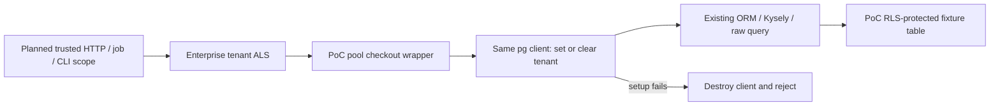

# Enterprise PostgreSQL Row-Level Security

Edition: **Enterprise only — commercial specification and implementation.**
Status: proposal with an executable, isolated connection-management PoC; production enforcement is not enabled.
Source: [issue #244](https://github.com/open-mercato/open-mercato/issues/244); previous attempt: [PR #419](https://github.com/open-mercato/open-mercato/pull/419).

## TLDR

Enterprise deployments need a database tenant boundary when a query accidentally omits its tenant filter. The recommended approach **for the installed stack** is an enterprise `AsyncLocalStorage` scope applied to the exact PostgreSQL client on every pool checkout, before the client reaches ORM, Kysely or raw queries. Keep application tenant/organization filters, RBAC, encryption, mutation guards and optimistic locking.

This PR proves that mechanism without activating RLS on application tables, adding an environment flag to production, or changing OSS behavior. It contains a small enterprise adapter, ordinary CI unit tests, and a disposable PostgreSQL proof. Full deployment remains gated on bootstrap integration, complete scope propagation, table/role inventory and operational checks below. A successful connection proof alone does not establish application-wide isolation.

## Resolved assumptions (autonomous defaults)

| Question | Chosen answer | Reason |
| --- | --- | --- |
| Q1. Global activation or proof first? | Isolated, unregistered enterprise PoC first; staged production work follows. | Validates the failed connection premise without breaking current application paths. |
| Q2. Pooling mode? | Direct PostgreSQL or session-compatible pooling only for reservation mode. | Session GUCs are not safe with a transaction-pooling proxy. Such deployments must refuse activation pending a separate transaction-local design. |
| Q3. Also implement row/organization authorization? | Tenant isolation only; retain current organization and permission enforcement. | Own/team/all record access is an independent capability; it is not part of #244. |
| Q4. Change dependencies to use newer ORM RLS APIs? | Use installed MikroORM 7.1.14 and Kysely 0.29.5; no dependency upgrade. | Keeps this proposal tied to current application state. Re-evaluate native support when the repository upgrades. |
| Q5. Ship code in a spec PR? | Include only the explicitly requested enterprise prototype and tests. | Maintainer request overrides the usual document-only spec workflow. |
| Q6. Automatically bypass RLS for superadmins or system jobs? | No tenant-role bypass; cross-tenant maintenance needs a distinct privileged execution boundary. | An application boolean/GUC must not silently turn off the database boundary. |

These are reversible defaults for this prototype. No default authorizes production activation, a public contract change or removal of existing tenant filters.

## Overview and Problem Statement

Application scoping remains essential, but a missing `tenant_id` predicate can expose another tenant's records. RLS provides a second enforcement layer only if queries execute on the same physical connection as the intended tenant setting and the database role cannot bypass policies.

PR #419 set transaction-local GUCs from selected CRUD/query paths. Its discussion identified two fundamental gaps: an autocommit `set_config(..., true)` expires before the next statement, and separate pooled statements need not use the same connection. It also missed manual endpoints, jobs and maintenance. This PoC includes a negative control reproducing the first failure with a pool of one. The historical review is evidence of those design gaps; it is not evidence that every current CI failure has the same cause.

## Current application state

Research baseline: `46c48fd6eaf0b3da3cfd94f49f79b67092c8657d` (current `origin/main` when this run began).

| Current path | Evidence and implication |
| --- | --- |
| Primary database | `packages/shared/src/lib/db/mikro.ts`: singleton MikroORM, default pool max 20, `driverOptions.onPoolCreated`, connection error handlers and `instrumentPrimaryPool`. Do not create another per-request pool. |
| Request containers | `packages/shared/src/lib/di/container.ts`: `getOrm()` precedes module DI; request EMs fork the singleton. An enterprise `di.ts` registration is too late to supply primary ORM initialization options. |
| Command writes | `packages/shared/src/lib/commands/runCrudCommandWrite.ts`: fresh forks and bounded write transactions. Context must follow connection acquisition rather than only one EM object. |
| Query engine | `packages/shared/src/lib/query/engine.ts`: `em.getKysely()`; ORM, connection execution and Kysely share the driver's pool. An active EM transaction is respected by `getKysely()`. |
| API dispatch | `apps/mercato/src/app/api/[...slug]/route.ts`: authentication/authorization can query before the final route handler. Wrapping only the handler or CRUD factory is incomplete. |
| Workers | `packages/cli/src/lib/worker-job-handler.ts`: scope must be established from trusted job metadata before container creation and handler execution. |
| Separate pools | `packages/search/src/modules/search/di.ts`, `packages/search/src/vector/drivers/pgvector/index.ts`, `packages/events/src/bridge.ts`: direct `pg.Pool` construction. Primary-pool coverage must never be described as covering these automatically. |
| Installed dependencies | MikroORM 7.1.14, Kysely 0.29.5. PostgreSQL connection forwards `onReserveConnection`; Kysely acquires a client and awaits that hook without releasing it on rejection. |

No existing dedicated RLS specification was found in `.ai/specs/` or `.ai/specs/enterprise/` during this run. Mentions in unrelated specs do not define an implementation contract.

## Proposed Solution and alternatives

Use a validated, immutable tenant UUID in enterprise-owned `AsyncLocalStorage`. At every pool reservation, capture that scope, reserve a physical client, and execute parameterized `select set_config('app.current_tenant_id', $1, false)` **on that client** before returning it. Set the value to `''` when no tenant exists. Missing context therefore sees no protected rows; it never inherits the previous checkout's scope. If initialization fails, destroy the client with `release(error)` and reject the acquisition.

This is a database protection against omitted application predicates, not SQL injection protection: arbitrary SQL under the runtime role can set custom GUCs. Parameter validation, safe SQL, authorization and ordinary scoping remain mandatory.

| Alternative | Decision for now |
| --- | --- |
| `SET LOCAL` before an unrelated autocommit query | Reject; the setting expires and/or is on another connection. Reproduced by the PoC negative control. |
| One transaction around every HTTP request | Reject as default; holds connections during non-DB work, changes commit/side-effect timing, complicates streaming and existing transactions. |
| Native `onReserveConnection` alone | Reject in the installed version for production use; a rejected initializer can leak a checked-out client. The PoC wraps the underlying pool and owns failure release. |
| Pool `connect` event / connection creation hook | Reject; creation occurs once, while tenant context changes between reservations. |
| Entity subscriber / CRUD-only interception | Reject; does not cover autocommit reads and raw SQL before execution. |
| Upgrade to MikroORM 7.2 session-context RLS APIs | Revisit after an independently verified upgrade; not available in the installed 7.1 API. |
| Explicit short transaction + `SET LOCAL` | Valid future alternative for bounded operations and transaction-pooling proxies, only when every participating ORM/raw query uses that transaction. Not mixed silently with reservation mode. |

PostgreSQL [RLS documentation](https://www.postgresql.org/docs/current/ddl-rowsecurity.html) establishes default denial, write checks and bypass behavior. MikroORM's [RLS documentation](https://mikro-orm.io/docs/row-level-security) currently targets 7.2 and retains application filters as defense in depth. The prototype deliberately uses the installed 7.1 connection primitives rather than copying newer APIs.

## Architecture



The implemented proof covers checkout through database execution; application entry-point wiring is planned.

### Prototype boundaries

- `packages/enterprise/src/lib/rls/poc/poolScope.ts` owns the prototype. It is not exported from the enterprise index, registered in module discovery, installed by DI, or imported by OSS runtime code.
- `installRlsPoolScope` supports both Promise and callback `pool.connect`; `pool.query` uses the latter. Installation is idempotent. Install after existing pool instrumentation and dispose in reverse order. The live proof uses the application's error handlers, pool instrumentation and resolved timeout defaults.
- The wrapper runs one setup query per checkout, not one transaction per HTTP request. It preserves current transaction lifecycle and pool limits. Latency overhead must be measured before production acceptance.
- `runWithRlsTenant` validates UUIDs, normalizes case, captures immutable scope and rejects nested tenant changes. Separate top-level concurrent scopes remain independent.
- Pinned clients/transaction EMs must stay within their original tenant scope. The prototype does **not** detect escaped objects reused under another top-level scope; rejecting nested ALS changes alone does not solve that. Production must bind/validate client transaction ownership, reject switches on retained clients, and audit every raw connection escape before activation.
- Session tenant state may remain on idle clients. Safety depends on mandatory replacement before **every** reuse, including no-context reuse; removal/disposal is permitted only after traffic drains and pools close. Detached async tasks retain their ALS scope and must not outlive request/job ownership; production jobs establish new explicit contexts.

### Production bootstrap and scope propagation (planned)

The current singleton factory has no enterprise pre-initialization extension to compose `onPoolCreated`. Do not reach into Kysely private fields, mutate an already initialized dialect or install from late module DI. A future implementation must first land a reviewed, edition-neutral configuration composition seam if one is required; all RLS behavior, scope resolution and policy code must remain in enterprise. This PR changes no OSS factory or public contract. If that seam cannot be supplied without violating the enterprise boundary, production rollout stops at the PoC rather than adding a hidden patch.

Before protected tables are enabled, cover:

1. HTTP tenant establishment after trusted identity resolution and before tenant-scoped authorization queries, including manual routes, portal/public token flows and selected-tenant superadmin paths. Do not trust a raw request header/query tenant value.
2. Page/server-render paths that create containers outside the API dispatcher.
3. Worker, subscriber and scheduler work, establishing a scope per trusted payload. Global polling reads use an explicitly inventoried maintenance connection; per-tenant handling then uses the restricted tenant role.
4. CLI, initialization, migrations, tenant provisioning, reindexing and encryption maintenance. These are distinct operations, never an implicit `tenantId=null` bypass.
5. Independent search/vector/event pools: classify each table/query first, then install the same enterprise context adapter or an explicit maintenance-role boundary. An unclassified pool blocks coverage claims.
6. No-context behavior: protected-table reads return no rows and writes fail; callers that require a tenant should reject missing scope before DB access to avoid presenting false empty state as normal success.

## Data Models and policy lifecycle

No production entities, columns, migrations, snapshots or table policies change in this PR. The disposable PoC creates a random schema, restricted login role and synthetic `records(id uuid, tenant_id uuid, label text)` table, then removes them in `finally`. It does not connect to the application database unless an operator explicitly supplies it; instructions require a disposable database.

Production policy template for an approved non-null tenant table:

```sql
ALTER TABLE approved_table ENABLE ROW LEVEL SECURITY;
ALTER TABLE approved_table FORCE ROW LEVEL SECURITY;
CREATE POLICY tenant_boundary ON approved_table
  USING (tenant_id = nullif(current_setting('app.current_tenant_id', true), '')::uuid)
  WITH CHECK (tenant_id = nullif(current_setting('app.current_tenant_id', true), '')::uuid);
```

A null/missing/empty scope does not match rows. `WITH CHECK` prevents inserts or tenant reassignment outside scope. Invalid UUID state errors rather than permitting rows. Additional permissive policies can widen access, so policy inventory must check effective combination, not just policy existence. Views, security-definer functions, partitions, inheritance, unique/FK error oracles and `TRUNCATE` require explicit review; they are not covered by a basic row policy.

Maintain an **enterprise-owned manifest** of reviewed tables with policy version, tenant column/nullability and justified exclusions. Do not blindly activate every table containing `tenant_id`: shared/global rows, authentication/bootstrap tables and maintenance paths have different semantics. New tenant tables must fail a manifest/exception coverage check until classified. Integrate idempotent policy reconciliation and verification with the existing `db:migrate` lifecycle; add no separate mandatory CLI. Migration-only roles own schema and policies; runtime roles are non-superuser, `NOBYPASSRLS`, non-owner, without role escalation, DDL or `TRUNCATE` privileges. `FORCE` does not constrain superusers or `BYPASSRLS` roles.

## API Contracts and UI/UX

No HTTP route, command, ACL feature, event, public export or UI changes in this PR. The source exports are prototype internals under a `poc` path, not a supported consumer API. No screenshot/mockup is applicable to this infrastructure proof.

Production activation must define operator configuration and startup validation before adding it. Validate pool mode, runtime-role privileges and every covered table/policy before serving protected work. No boolean session setting grants superadmin bypass. A superadmin choosing a tenant operates under that tenant; legitimate cross-tenant maintenance uses a separate audited role/path and is not silently carried over to ordinary requests.

## Migration & Backward Compatibility

`BACKWARD_COMPATIBILITY.md` reviewed. This PR introduces no live schema or shared contracts and changes no existing runtime behavior. Future neutral bootstrap/migration hooks require separate compatibility review and additive integration. Rollout order: establish scope/role plumbing while policies remain disabled; validate entry points and manifest; enable policies on an explicit canary set; expand only after isolation and full application gates pass. Never remove the existing filters.

Rollback is an operational sequence: stop protected work, drain and close all affected pools, then revert the canary policy migration or roll forward to a known-good policy. Disabling only the context adapter while policies remain enabled causes outages; disabling policies removes the second boundary. Document and audit this tradeoff. This proof has no app activation to undo; fixture teardown drops its own schema/role only.

## Edge Cases & Failure Scenarios

| Trigger | Required behavior / evidence |
| --- | --- |
| A then B then no scope on pool max 1 | Same backend PID; A sees A, B sees B, no scope sees no rows. |
| Parallel tenants sharing a small pool | Every checkout captures its own ALS value; no cross-tenant rows. |
| Setter/acquisition failure | No query receives a stale client; initialization failure destroys it and max-1 pool recovers. |
| Missing/wrong-tenant writes | PostgreSQL rejects insert/reassignment; other-tenant update/delete cannot affect rows. |
| Transaction rollback | Writes roll back; next reservation replaces/clears session context. |
| Nested scope switch | Reject before database work; escaped transaction reuse remains a production blocker. |
| Transaction-pooling proxy | Refuse reservation-mode activation; no claimed compatibility. |
| Superuser, BYPASSRLS, owner or widening policy | Startup verification must reject unsafe runtime configuration. |
| Unscoped scheduled maintenance | Separate explicit maintenance boundary; do not interpret absent scope as permission. |

## Risks & Impact Review

| Severity | Concrete failure and affected area | Mitigation and residual risk |
| --- | --- | --- |
| Critical | Incomplete checkout/entry-point coverage exposes stale or incorrect scope. | No production registration now; gate activation on full path inventory, escaped-client guards and canary isolation tests. |
| Critical | Privileged runtime role or extra permissive policy bypasses isolation. | Restricted non-owner runtime role and effective-policy startup audit; DBA-controlled roles remain trusted. |
| High | Session state under transaction pooling applies to a different backend. | Reject that mode; explicit transaction-local mode is separate future work. |
| High | Global policies break login, setup, jobs, global rows or maintenance. | Reviewed table manifest and staged migrations; no global auto-enable in this PR. |
| High | Failed native reservation hook consumes pool slots. | PoC uses pool wrapper with client destruction; max-1 recovery test. |
| Medium | One extra round trip per acquisition reduces throughput. | Benchmark p50/p95 and pool wait/acquire counts against current instrumentation before production; no claimed performance result yet. |
| Medium | Adapter disposal or duplicate module instances bypass scoping. | Controlled bootstrap ownership, drain-before-dispose; production must handle HMR/module-instance duplication before activation. |
| Medium | GUC-based identity is mistaken for protection against arbitrary SQL. | Retain query validation, parameterization and all application guards; document the threat model. |

## Validation and proof

Runner: **local** (neither documented compose app probe had a running app). A dedicated PostgreSQL 16 container is used for the live proof; the application database is untouched.

Harness typecheck: `yarn tsc --project packages/enterprise/poc/rls/tsconfig.json --noEmit` (the dedicated config includes the operator harness, which is outside the package source glob).

Ordinary CI tests: `yarn workspace @open-mercato/enterprise test --runInBand --testPathPatterns=poolScope.test.ts`.

Live proof: set `OM_RLS_POC_DATABASE_URL` to a disposable PostgreSQL database with role/schema creation rights, then run `yarn tsx packages/enterprise/poc/rls/run.ts`. No app migrations or application fixtures are required. The script uses a fresh restricted role and verifies its non-owner/non-bypass attributes before assertions.

Automated integration entrypoint: with the same disposable database opt-in, run `node --test packages/enterprise/poc/rls/integration.test.mjs`. It executes the proof under a bounded subprocess and requires all 13 checks, including verified removal of its schema and role. Without the URL it explicitly skips. Both concurrent batches drain before teardown; pools close before their scope wrappers are removed, and the success summary follows cleanup. Forced termination may prevent fixture teardown, so the database must remain disposable. This adds no CI pipeline or application entry-point activation.

The live proof exercises real MikroORM ORM reads and flush, raw connection queries, Kysely reads, explicit transactions, rollback, callback `pool.query`, same-client tenant replacement, absent-context denial, denied writes, setup failure recovery, concurrent tenants and the old autocommit failure. Concurrency includes 60 pooled reads and 60 mixed ORM/Kysely transactions; a bounded barrier proves three simultaneous physical backends serving both tenants. Mixed operations cover inserts, updates, cross-tenant update/delete denial, committed deletes and 20 deliberate rollbacks. A privileged exact-row comparison verifies the 30 surviving new rows and unchanged seed rows after all work drains. Ordinary unit tests use mocks and do not claim database isolation coverage. This PR adds no endpoint, so HTTP/browser tests for production entry points belong to the activation phase below.

The ordered full local gate is exactly `.ai/agentic.config.json`: `build:packages → generate → build:packages → i18n:check-sync → i18n:check-usage → typecheck → test → build:app`. The PR must also request existing `ci-full` behavior to run all GitHub CI shards. No pipeline/workflow definition changes are part of this task. Results and any external/baseline failures are recorded separately; an isolated proof cannot be reported as full-CI success.

## Phasing

### Phase 0 — this PR: establish the connection proof

1. Review current pool, fork, raw-query and entry-point paths; reproduce the previous failure.
2. Add the unregistered enterprise pool-scope prototype and unit tests.
3. Execute disposable PostgreSQL checks and the configured local gate; request full GitHub CI. Record exact results and review limits.

Phases 1–2 are a roadmap, not authorization to activate this prototype. They require a detailed activation design and compatibility/security review before implementation.

### Phase 1 — planned production integration, policies still disabled

1. Resolve and review the pre-init composition seam without moving RLS behavior into OSS. Bind immutable tenant scope to every primary and independent pool checkout; fail startup on incompatible topology.
2. Cover trusted HTTP/auth/portal/page, worker/subscriber/scheduler and CLI contexts; explicitly separate global maintenance. Reject escaped/pinned-client tenant switching and module-instance/HMR inconsistencies.
3. Add integration tests through the actual dispatcher and worker handlers: two concurrent tenants, missing/invalid scope, selected-tenant admin, public/token route, job retry, scheduler poll and CLI maintenance. Include ORM, query engine, raw Kysely, encryption, mutation guards, optimistic lock and side-effect behavior. Application remains unchanged with policies disabled.

### Phase 2 — planned controlled enterprise table canary

1. Add the manifest, privileged-role verifier, policy reconciliation and manifest-gap check to `db:migrate`; create intended migrations/snapshots for the explicit canary only. Include rollback and no-context handling. Do not apply migrations locally without approval.
2. Exercise canary list/detail/create/update/delete HTTP paths plus a key UI flow, cross-tenant ID probes and denied writes; verify auth/setup/indexing/jobs still work. These API/UI integration tests ship with the activation change, using self-contained fixtures.
3. Benchmark checkout overhead and pool pressure; run full CI with enterprise enabled. Expand only after operational review and canary evidence. Other tables remain application-scoped until explicitly enrolled.

## Final Compliance Report

Enterprise commercial scope is explicit in title, path and code placement. No production dependency, app migration, API/schema change, module activation or removal of application scoping occurs. Existing encryption, RBAC, guards and optimistic locking are untouched. Prototype integration is exercised through the real installed driver; broad runtime coverage, proxy compatibility, escaped-client safety and production performance remain activation gates. Fresh-context cohesion review passed (one capability); its roadmap-authorization clarification was applied. Independent code review found no blocker/major in the isolated proof; a dedicated harness typecheck was added for its minor finding. Verification results are appended after execution.

## Changelog

- 2026-11-13: Added repeatable opt-in database integration execution, verified fixture removal, and drained concurrent reads before pool teardown. Production phases remain gated.
- 2026-11-12: Extended the executable proof with concurrent mixed ORM/Kysely transactions, explicit backend overlap, rollback/delete outcomes and exact persisted-row verification.
- 2026-11-12: Initial enterprise-only proposal based on current MikroORM 7.1/Kysely connection management; included isolated PoC and explicit staged production gates.

### Executed prototype evidence

On 2026-11-12 the expanded disposable PostgreSQL 16 proof passed all 12 checks on Node 24, including the old failure control, max-1 connection reuse/failure recovery, 60 overlapping reads and 60 mixed transactions through max-3. The transaction barrier proved three simultaneous backend PIDs and both tenant scopes; controlled commits, rollbacks and deletes matched the exact privileged final-row oracle. The 12 unit tests and dedicated operator-harness typecheck passed. Scope cohesion review passed; independent code review found no blocker/major, and its harness-typecheck minor was addressed. Full-gate results are maintained on [PR #9353](https://github.com/open-mercato/open-mercato/pull/9353); no production-coverage claim follows from the fixture proof.

On 2026-11-13 the automated integration entrypoint passed all 13 checks on disposable PostgreSQL 16, including verified schema/role removal. Independent review reproduced the live proof, 12 unit tests and harness typecheck without actionable findings. All eight configured local gate commands passed on Node 24.22.3, including 51 successful repository test tasks and the application build; template parity also passed. Initial launcher/socket-path failures were resolved by pinning mise to Node 24 and passing a short temporary directory. [PR #9424](https://github.com/open-mercato/open-mercato/pull/9424) records the full results, screenshot evidence, and separate GitHub CI/formal-review state. This completes automated Phase 0 verification; production phases remain gated.
