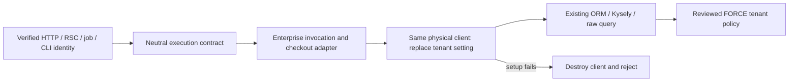

# Enterprise PostgreSQL Row-Level Security

Edition: **Enterprise only — commercial specification and implementation.**
Status: production implementation on PR #9424; final application, repository and security acceptance gates are in progress. Activation is opt-in.
Source: [issue #244](https://github.com/open-mercato/open-mercato/issues/244); previous attempt: [PR #419](https://github.com/open-mercato/open-mercato/pull/419).

## TLDR

Enterprise deployments need a database tenant boundary when a query accidentally omits its tenant filter. The recommended approach **for the installed stack** is an enterprise `AsyncLocalStorage` scope applied to the exact PostgreSQL client on every pool checkout, before the client reaches ORM, Kysely or raw queries. Keep application tenant/organization filters, RBAC, encryption, mutation guards and optimistic locking.

The original design PR established the isolated proof. On 2026-11-13 the user explicitly required implementation of the full specification, including production integration and a controlled table canary, and selected the PR-loop engine. PR #9424 now implements those remaining phases. Existing proof evidence remains historical; production completion requires the activation design, actual application integration tests, table/role verification and performance evidence below.

## Resolved assumptions (autonomous defaults)

| Question | Chosen answer | Reason |
| --- | --- | --- |
| Q1. Activation scope? | Opt-in production runtime with an explicit `customer_entities` canary. | The original isolated proof is removed; staged enrollment retains application filters. |
| Q2. Pooling mode? | Direct PostgreSQL or session-compatible pooling only for reservation mode. | Session GUCs are not safe with a transaction-pooling proxy. Such deployments must refuse activation pending a separate transaction-local design. |
| Q3. Also implement row/organization authorization? | Tenant isolation only; retain current organization and permission enforcement. | Own/team/all record access is an independent capability; it is not part of #244. |
| Q4. Change dependencies to use newer ORM RLS APIs? | Use installed MikroORM 7.1.14 and Kysely 0.29.5; no dependency upgrade. | Keeps this proposal tied to current application state. Re-evaluate native support when the repository upgrades. |
| Q5. Implementation scope? | Full implementation and integration coverage on PR #9424. | Explicit user instruction on 2026-11-13 supersedes the earlier proof-only scope. |
| Q6. Automatically bypass RLS for superadmins or system jobs? | No tenant-role bypass; cross-tenant maintenance needs a distinct privileged execution boundary. | An application boolean/GUC must not silently turn off the database boundary. |

Production deployment, migrations against a user database and removal of existing tenant filters remain outside this implementation task.

## Overview and Problem Statement

Application scoping remains essential, but a missing `tenant_id` predicate can expose another tenant's records. RLS provides a second enforcement layer only if queries execute on the same physical connection as the intended tenant setting and the database role cannot bypass policies.

PR #419 set transaction-local GUCs from selected CRUD/query paths. Its discussion identified two fundamental gaps: an autocommit `set_config(..., true)` expires before the next statement, and separate pooled statements need not use the same connection. It also missed manual endpoints, jobs and maintenance. The production regression suite retains a negative control reproducing the first failure with a pool of one. The historical review is evidence of those design gaps; it is not evidence that every current CI failure has the same cause.

## Current application state

Research baseline: `46c48fd6eaf0b3da3cfd94f49f79b67092c8657d` (current `origin/main` when this run began).

| Current path | Evidence and implication |
| --- | --- |
| Primary database | `packages/shared/src/lib/db/mikro.ts`: singleton MikroORM, default pool max 20, `driverOptions.onPoolCreated`, connection error handlers and `instrumentPrimaryPool`. Do not create another per-request pool. |
| Request containers | `packages/shared/src/lib/di/container.ts`: `getOrm()` precedes module DI; request EMs fork the singleton. An enterprise `di.ts` registration is too late to supply primary ORM initialization options. |
| Command writes | `packages/shared/src/lib/commands/runCrudCommandWrite.ts`: fresh forks and bounded write transactions. Context must follow connection acquisition rather than only one EM object. |
| Query engine | `packages/shared/src/lib/query/engine.ts`: `em.getKysely()`; ORM, connection execution and Kysely share the driver's pool. An active EM transaction is respected by `getKysely()`. |
| API dispatch | `apps/mercato/src/app/api/[...slug]/route.ts`: authentication/authorization can query before the final route handler. Wrapping only the handler or CRUD factory is incomplete. |
| Workers | `packages/cli/src/lib/worker-job-handler.ts`: scope must be established from trusted job metadata before container creation and handler execution. |
| Separate pools | `packages/search/src/modules/search/di.ts`, `packages/search/src/vector/drivers/pgvector/index.ts`, `packages/events/src/bridge.ts`: direct `pg.Pool` construction. Primary-pool coverage must never be described as covering these automatically. |
| Installed dependencies | MikroORM 7.1.14, Kysely 0.29.5. PostgreSQL connection forwards `onReserveConnection`; Kysely acquires a client and awaits that hook without releasing it on rejection. |

No existing dedicated RLS specification was found in `.ai/specs/` or `.ai/specs/enterprise/` during this run. Mentions in unrelated specs do not define an implementation contract.

## Proposed Solution and alternatives

Use a validated, immutable tenant UUID in enterprise-owned `AsyncLocalStorage`. At every pool reservation, capture that scope, reserve a physical client, and execute parameterized `select set_config('app.current_tenant_id', $1, false)` **on that client** before returning it. Set the value to `''` when no tenant exists. Missing context therefore sees no protected rows; it never inherits the previous checkout's scope. If initialization fails, destroy the client with `release(error)` and reject the acquisition.

This is a database protection against omitted application predicates, not SQL injection protection: arbitrary SQL under the runtime role can set custom GUCs. Parameter validation, safe SQL, authorization and ordinary scoping remain mandatory.

| Alternative | Decision for now |
| --- | --- |
| `SET LOCAL` before an unrelated autocommit query | Reject; the setting expires and/or is on another connection. Reproduced by the retained regression negative control. |
| One transaction around every HTTP request | Reject as default; holds connections during non-DB work, changes commit/side-effect timing, complicates streaming and existing transactions. |
| Native `onReserveConnection` alone | Reject in the installed version for production use; a rejected initializer can leak a checked-out client. The enterprise adapter wraps the underlying pool and owns failure release. |
| Pool `connect` event / connection creation hook | Reject; creation occurs once, while tenant context changes between reservations. |
| Entity subscriber / CRUD-only interception | Reject; does not cover autocommit reads and raw SQL before execution. |
| Upgrade to MikroORM 7.2 session-context RLS APIs | Revisit after an independently verified upgrade; not available in the installed 7.1 API. |
| Explicit short transaction + `SET LOCAL` | Valid future alternative for bounded operations and transaction-pooling proxies, only when every participating ORM/raw query uses that transaction. Not mixed silently with reservation mode. |

PostgreSQL [RLS documentation](https://www.postgresql.org/docs/current/ddl-rowsecurity.html) establishes default denial, write checks and bypass behavior. MikroORM's [RLS documentation](https://mikro-orm.io/docs/row-level-security) currently targets 7.2 and retains application filters as defense in depth. The prototype deliberately uses the installed 7.1 connection primitives rather than copying newer APIs.

## Architecture



The enterprise runtime owns enforcement, invocation lifetimes and policy validation. Shared infrastructure exposes neutral additive lifecycle contracts. Each domain module supplies its own `database.ts` declarations; generated discovery registers them without a central business-module map. Retained transaction and client handles remain bound to their original live invocation and lease generation.

### Production bootstrap and scope propagation

Generator bootstrap registration precedes ORM creation in application and CLI entry points. Primary runtime and privileged maintenance ORM instances are separate. Runtime pools receive the enterprise adapter before readiness; startup validates roles, manifests and exact effective policies. An absent adapter preserves disabled-mode behavior.

1. Canonical JWT/API-key identity is resolved before tenant authorization and handler queries. Selected tenant and organization values require persisted binding checks.
2. Deferred server rendering resolves a stable request invocation through neutral hooks. Audience selection and completion/cancellation are covered by actual Next integration tests.
3. Verified public tokens, portal accounts and storefront bindings create bounded tenant continuations before fresh containers. Awaited subscribers finish inside those continuations.
4. Workers resolve exact owner declarations and persisted bindings before container creation. Global scheduler discovery and global reindex use explicit maintenance, followed by fresh tenant continuations.
5. CLI migrations, initialization, storage provisioning and maintenance require an explicitly distinct maintenance login. Missing tenant scope cannot select privileged access.
6. Search/vector and event pools declare their storage or transport purpose. Active vector readiness is SELECT-only; provisioning belongs to the privileged lifecycle. Event transport accepts only exact declared notification statements.
7. No-context protected reads return no rows and writes fail. Required tenant entry points reject missing or ambiguous identity before database access.

## Data Models and policy lifecycle

The prototype-only statements in this section describe the original proof, whose source has now been removed; they are historical rather than current operator instructions. For full implementation, the Production activation design below is authoritative; it adds neutral hooks and an opt-in canary policy without changing existing route/payload/column contracts.

No production entities, columns, migrations, snapshots or table policies change in this PR. The disposable PoC creates a random schema, restricted login role and synthetic `records(id uuid, tenant_id uuid, label text)` table, then removes them in `finally`. It does not connect to the application database unless an operator explicitly supplies it; instructions require a disposable database.

Production policy template for an approved non-null tenant table:

```sql
ALTER TABLE approved_table ENABLE ROW LEVEL SECURITY;
ALTER TABLE approved_table FORCE ROW LEVEL SECURITY;
CREATE POLICY tenant_boundary ON approved_table
  USING (tenant_id = nullif(current_setting('app.current_tenant_id', true), '')::uuid)
  WITH CHECK (tenant_id = nullif(current_setting('app.current_tenant_id', true), '')::uuid);
```

A null/missing/empty scope does not match rows. `WITH CHECK` prevents inserts or tenant reassignment outside scope. Invalid UUID state errors rather than permitting rows. Additional permissive policies can widen access, so policy inventory must check effective combination, not just policy existence. Views, security-definer functions, partitions, inheritance, unique/FK error oracles and `TRUNCATE` require explicit review; they are not covered by a basic row policy.

Maintain an **enterprise-owned manifest** of reviewed tables with policy version, tenant column/nullability and justified exclusions. Do not blindly activate every table containing `tenant_id`: shared/global rows, authentication/bootstrap tables and maintenance paths have different semantics. New tenant tables must fail a manifest/exception coverage check until classified. Integrate idempotent policy reconciliation and verification with the existing `db:migrate` lifecycle; add no separate mandatory CLI. Migration-only roles own schema and policies; runtime roles are non-superuser, `NOBYPASSRLS`, non-owner, without role escalation, DDL or `TRUNCATE` privileges. `FORCE` does not constrain superusers or `BYPASSRLS` roles.

## API Contracts and UI/UX

The prototype-only statements in this section describe the original proof, whose source has now been removed; they are historical rather than current operator instructions. For full implementation, the Production activation design below is authoritative; it adds neutral hooks and an opt-in canary policy without changing existing route/payload/column contracts.

No HTTP route, command, ACL feature, event, public export or UI changes in this PR. The source exports are prototype internals under a `poc` path, not a supported consumer API. No screenshot/mockup is applicable to this infrastructure proof.

Production activation must define operator configuration and startup validation before adding it. Validate pool mode, runtime-role privileges and every covered table/policy before serving protected work. No boolean session setting grants superadmin bypass. A superadmin choosing a tenant operates under that tenant; legitimate cross-tenant maintenance uses a separate audited role/path and is not silently carried over to ordinary requests.

## Migration & Backward Compatibility

The prototype-only statements in this section describe the original proof, whose source has now been removed; they are historical rather than current operator instructions. For full implementation, the Production activation design below is authoritative; it adds neutral hooks and an opt-in canary policy without changing existing route/payload/column contracts.

`BACKWARD_COMPATIBILITY.md` reviewed. This PR introduces no live schema or shared contracts and changes no existing runtime behavior. Future neutral bootstrap/migration hooks require separate compatibility review and additive integration. Rollout order: establish scope/role plumbing while policies remain disabled; validate entry points and manifest; enable policies on an explicit canary set; expand only after isolation and full application gates pass. Never remove the existing filters.

Rollback is an operational sequence: stop protected work, drain and close all affected pools, then revert the canary policy migration or roll forward to a known-good policy. Disabling only the context adapter while policies remain enabled causes outages; disabling policies removes the second boundary. Document and audit this tradeoff. This proof has no app activation to undo; fixture teardown drops its own schema/role only.

## Edge Cases & Failure Scenarios

| Trigger | Required behavior / evidence |
| --- | --- |
| A then B then no scope on pool max 1 | Same backend PID; A sees A, B sees B, no scope sees no rows. |
| Parallel tenants sharing a small pool | Every checkout captures its own ALS value; no cross-tenant rows. |
| Setter/acquisition failure | No query receives a stale client; initialization failure destroys it and max-1 pool recovers. |
| Missing/wrong-tenant writes | PostgreSQL rejects insert/reassignment; other-tenant update/delete cannot affect rows. |
| Transaction rollback | Writes roll back; next reservation replaces/clears session context. |
| Nested scope switch | Reject before database work; escaped transaction reuse remains a production blocker. |
| Transaction-pooling proxy | Refuse reservation-mode activation; no claimed compatibility. |
| Superuser, BYPASSRLS, owner or widening policy | Startup verification must reject unsafe runtime configuration. |
| Unscoped scheduled maintenance | Separate explicit maintenance boundary; do not interpret absent scope as permission. |

## Risks & Impact Review

| Severity | Concrete failure and affected area | Mitigation and residual risk |
| --- | --- | --- |
| Critical | Incomplete checkout/entry-point coverage exposes stale or incorrect scope. | No production registration now; gate activation on full path inventory, escaped-client guards and canary isolation tests. |
| Critical | Privileged runtime role or extra permissive policy bypasses isolation. | Restricted non-owner runtime role and effective-policy startup audit; DBA-controlled roles remain trusted. |
| High | Session state under transaction pooling applies to a different backend. | Reject that mode; explicit transaction-local mode is separate future work. |
| High | Global policies break login, setup, jobs, global rows or maintenance. | Reviewed table manifest and staged migrations; no global auto-enable in this PR. |
| High | Failed native reservation hook consumes pool slots. | PoC uses pool wrapper with client destruction; max-1 recovery test. |
| Medium | One extra round trip per acquisition reduces throughput. | Benchmark p50/p95 and pool wait/acquire counts against current instrumentation before production; no claimed performance result yet. |
| Medium | Adapter disposal or duplicate module instances bypass scoping. | Controlled bootstrap ownership, drain-before-dispose; production must handle HMR/module-instance duplication before activation. |
| Medium | GUC-based identity is mistaken for protection against arbitrary SQL. | Retain query validation, parameterization and all application guards; document the threat model. |

## Validation and proof

Runner: **local** (neither documented compose app probe had a running app). A dedicated PostgreSQL 16 container is used for the live proof; the application database is untouched.

Production regression harness typecheck: `yarn tsc --project packages/enterprise/tests/rls/tsconfig.json --noEmit`.

Runtime unit tests: `yarn jest --config packages/enterprise/jest.config.cjs --runInBand --testPathPatterns=src/lib/rls/runtime`.

Live production regressions: set `OM_RLS_TEST_DATABASE_URL` privately to an explicitly disposable administrative PostgreSQL database, then run `timeout 240 node --test packages/enterprise/tests/rls/integration.test.mjs`. The runner requires 16 runtime checks and 27 catalog checks, including cleanup, with bounded subprocesses. Missing opt-in produces two skips, which are not isolation evidence. The catalog harness changes PUBLIC TEMP privileges, so discard the database afterward. See `packages/enterprise/tests/rls/README.md` for operator commands and limits. The prototype implementation, prototype unit tests and dual-mode selector have been removed.

The live proof exercises real MikroORM ORM reads and flush, raw connection queries, Kysely reads, explicit transactions, rollback, callback `pool.query`, same-client tenant replacement, absent-context denial, denied writes, setup failure recovery, concurrent tenants and the old autocommit failure. Concurrency includes 60 pooled reads and 60 mixed ORM/Kysely transactions; a bounded barrier proves three simultaneous physical backends serving both tenants. Mixed operations cover inserts, updates, cross-tenant update/delete denial, committed deletes and 20 deliberate rollbacks. A privileged exact-row comparison verifies the 30 surviving new rows and unchanged seed rows after all work drains. Ordinary unit tests use mocks and do not claim database isolation coverage. These storage regressions do not replace the HTTP, worker and browser acceptance gates below.

The ordered full local gate is exactly `.ai/agentic.config.json`: `build:packages → generate → build:packages → i18n:check-sync → i18n:check-usage → typecheck → test → build:app`. The PR must also request existing `ci-full` behavior to run all GitHub CI shards. No pipeline/workflow definition changes are part of this task. Results and any external/baseline failures are recorded separately; an isolated proof cannot be reported as full-CI success.

## Phasing

### Phase 0 — historical connection proof, source removed

1. Review current pool, fork, raw-query and entry-point paths; reproduce the previous failure.
2. Add the unregistered enterprise pool-scope prototype and unit tests.
3. Execute disposable PostgreSQL checks and the configured local gate; request full GitHub CI. Record exact results and review limits.

The original prototype treated Phases 1–2 as a gated roadmap. The user explicitly authorized the full implementation on 2026-11-13. The activation design below supplies the remaining design decisions; compatibility/security review and final integration gates still precede completion. Production deployment and applying migrations to the user database are not authorized.

### Phase 1 — production integration

1. Resolve and review the pre-init composition seam without moving RLS behavior into OSS. Bind immutable tenant scope to every primary and independent pool checkout; fail startup on incompatible topology.
2. Cover trusted HTTP/auth/portal/page, worker/subscriber/scheduler and CLI contexts; explicitly separate global maintenance. Reject escaped/pinned-client tenant switching and module-instance/HMR inconsistencies.
3. Add integration tests through the actual dispatcher and worker handlers: two concurrent tenants, missing/invalid scope, selected-tenant admin, public/token route, job retry, scheduler poll and CLI maintenance. Include ORM, query engine, raw Kysely, encryption, mutation guards, optimistic lock and side-effect behavior. Application remains unchanged with policies disabled.

### Phase 2 — controlled enterprise table canary

1. Add the manifest, privileged-role verifier, policy reconciliation and manifest-gap check to `db:migrate`; create intended migrations/snapshots for the explicit canary only. Include rollback and no-context handling. Do not apply migrations locally without approval.
2. Exercise canary list/detail/create/update/delete HTTP paths plus a key UI flow, cross-tenant ID probes and denied writes; verify auth/setup/indexing/jobs still work. These API/UI integration tests ship with the activation change, using self-contained fixtures.
3. Benchmark checkout overhead and pool pressure; run full CI with enterprise enabled. Expand only after operational review and canary evidence. Other tables remain application-scoped until explicitly enrolled.

## Production activation design (2026-11-13)

### Scope and operator configuration

The enterprise `tenant_boundaries` module owns activation, ALS, pool guards, table manifests, role/policy validation, reconciliation and operational diagnostics. Register through the existing module `generators.ts` / `GeneratorPlugin.bootstrapRegistration` mechanism, which runs in `bootstrap-common.ts` and CLI `dynamicLoader` before ORM initialization. No enterprise package is imported by OSS code, no late DI patching, private Kysely mutation, new mandatory CLI or production dependency is needed.

Activation is explicitly opt-in with `OM_TENANT_RLS=on`; absent/off preserves existing OSS and enterprise behavior. `OM_TENANT_RLS_POOL_MODE` must explicitly declare `direct` or `session`; reject missing, unknown and transaction-pooling modes when activated. Startup validates every runtime endpoint before serving protected work. Runtime roles have no bypass, ownership, role escalation, DDL or TRUNCATE privileges. Explicit `OM_TENANT_RLS_MAINTENANCE_DATABASE_URL` supplies a separate privileged connection for migrations, provisioning, global discovery/reindex/encryption/scheduler maintenance; never interpret a missing tenant as maintenance authority. Secrets are configuration inputs and never recorded in evidence.

### Additive neutral seams and compatibility

Operator migration guidance ships in UPGRADE_NOTES.md and enterprise documentation: generate with tenant_boundaries enabled, provision a standalone restricted login with reviewed grants, configure direct/session mode and a distinct privileged maintenance connection, run the existing db:migrate before startup, validate, then start runtime traffic. Rollback drains work and applies exact-version policy rollback before disabling the adapter. Credentials never appear in examples or reports.

Add `@open-mercato/shared/lib/db/runtime` for process-global registration of one database-runtime adapter and trusted execution-context resolvers. Its interfaces describe connection lifecycle, pool identity/purpose, execution source and tenant identity, plus migration preflight/completion; they contain no RLS policy or enterprise activation decisions. Existing callers get no-op behavior with no adapter. Add calls at concrete primary/independent pool construction, trusted auth/request/job/page/CLI boundaries and the existing migration lifecycle. New exports and optional hooks are additive contracts; existing HTTP/ACL/event/command payloads and database columns do not change.

Registration precedes first pool initialization; reject incompatible or late replacement. Use global symbols for registration, ALS and pool state so duplicated module instances and API/full bootstrap share the same identity. Idempotent same-version registration retains the original adapter and pool ownership; configuration changes require drain/restart. Do not dispose guards until all work drains and pools close. Initializer failure destroys the client and fails startup, rather than leaking a slot or silently returning an unguarded client.

### Concrete neutral runtime contract

Synchronous bootstrap registration installs the adapter; it performs no database I/O. The additive shared contract is:

```ts
type DatabaseExecutionContext =
  | Readonly<{ kind: 'tenant'; tenantId: string; source: DatabaseExecutionSource; operation?: string }>
  | Readonly<{ kind: 'identity'; tenantId: string | null; source: 'identity'; operation?: string }>
  | Readonly<{ kind: 'maintenance'; tenantId: null; source: 'maintenance' | 'cli' | 'scheduler'; operation: string }>
type DatabaseInvocation = Readonly<{ token: symbol; isActive(): boolean }>
type DatabaseContextResolution =
  | Readonly<{ status: 'resolved'; context: DatabaseExecutionContext; invocation: DatabaseInvocation }>
  | Readonly<{ status: 'absent' }>
  | Readonly<{ status: 'unavailable'; error: Error }>
type DatabasePoolDescriptor = Readonly<{
  id: string; purpose: 'runtime' | 'maintenance' | 'transport'; tables: readonly string[] | 'primary'
  metadata?(): readonly DatabaseTableMetadata[] | undefined
}>
type DatabasePoolLifecycle = Readonly<{ ready(): Promise<void>; dispose(): void }>
type DatabaseRuntimeAdapter = Readonly<{
  id: string; version: string; configurationKey: string
  configurePool(pool: object, descriptor: DatabasePoolDescriptor): DatabasePoolLifecycle
  run<Result>(context: DatabaseExecutionContext, callback: () => Result): Result
  connectionUrl?(purpose: 'runtime' | 'maintenance', defaultUrl: string): string
  beforeMigrate?(): Promise<void>
  afterMigrate?(): Promise<void>
  recoverMigrationReindex?: boolean
  storageMode?(descriptor: DatabaseStorageDescriptor): 'provision' | 'validate'
}>
```

`DatabaseExecutionSource` is the closed union identity/api/page/portal/public-token/worker/event/scheduler/cli/maintenance. `DatabaseStorageDescriptor` has kind, resolved schema, exact table names and readonly scalar configuration (vector dimensions, index kind and migration table included). A neutral storage registry associates each descriptor with its provisioning implementation; privileged migration completion provisions registered storage through a maintenance connection, while runtime `storageMode` selects validate-only. Shared code never reads enterprise flags or selects a tenant.

DatabaseTableMetadata carries the actual discovered schema/table and tenant column/type/nullability. The primary descriptor exposes it after ORM discovery and before ready; the canary must match active ORM metadata as well as catalog state, so a manifest for an unused schema cannot falsely claim protection.

The registry is process-global and idempotent only for the same id/version/configurationKey; a different adapter/configuration or registration after a pool initialized throws an internal configuration error. Pool identity/purpose changes are rejected. `configurePool` installs guards synchronously; `ready` is awaited before publishing the initialized singleton. Concurrent `getOrm` calls share one initialization promise, and failure resets it only after closing the failed pool and disposing guards. Client setup/validation failure rejects acquisition and destroys the lease; it never silently falls through. The adapter may not expose protected query acquisition until role/catalog validation succeeds. Initial driver metadata/version queries use a per-pool bootstrap state (never a global exemption), clear tenant state and cannot read protected rows.

`runWithDatabaseExecutionContext` delegates without changing sync/async callback return shape. The enterprise adapter creates a fresh invocation token for each top-level callback; identical nested tenant contexts reuse it, sibling/changed tenants cannot inherit it. Callback completion or rejection revokes ownership; streaming/event callbacks open explicit validated child invocations rather than borrowing a completed request. The resolver returns absent only outside a recognized request or with a verified unauthenticated identity; unavailable errors propagate and must not become an empty tenant result. Query ownership resolves the same request token as checkout, not just the same tenant UUID.

For deferred RSC queries the enterprise request resolver caches canonical identity plus the invocation token in React request cache and registers revocation through Next's public `after` response-completion hook. Route audience comes from server-overwritten proxy pathname and registered page metadata, never an arbitrary tenant header. Both staff/customer cookies may coexist; the actual route's audience chooses which identity to verify. The resolver runs canonical lookups inside an explicit identity bootstrap scope to avoid recursion. Checkout fallback is enabled only after that pool's initial ORM readiness barrier; it does not recursively initialize ORM during driver setup. No raw client capability survives release: every checkout returns a distinct lease facade whose query and release closures capture that generation, even when PostgreSQL reuses the physical client. Retained old facades reject before SQL on both same-tenant and different-tenant recheckout. Tests cover response completion, streaming/cancellation, cold concurrent requests, canonical identity failure, and bound checkout/container counts; an unavailable response-completion hook blocks RSC activation rather than enabling an unrevocable scope.

HTTP route handlers enter the edition-neutral `runWithDatabaseRequest(Request, callback)` bridge; `getDatabaseRequest()` exposes that invocation's Request without granting tenant authority. Enterprise caches HTTP resolution in a WeakMap keyed by that Request. React cache is used only during actual RSC rendering, detected through stable request memoization; outside a render and the HTTP bridge the resolver is absent. API pathname comes from the bridged Request URL, because the page proxy excludes API routes. A caller-supplied x-next-url header cannot select API audience. API and RSC bundles may supply different React cache implementations, so bootstrap registers an idempotent resolver for each renderer identity; an API cache registered first cannot suppress the RSC resolver. Completion and HTTP cancellation revoke the token. Detailed customer auth helpers distinguish unavailable persistence checks from invalid sessions while legacy helpers preserve their null result.

### Trusted context propagation and deferred rendering

1. Identity bootstrap: canonical staff JWT validation runs in a narrow verified actor-tenant context, before selected-tenant cookies are applied. API-key and public/portal token discovery have explicit bootstrap classification over unprotected identity tables; derive tenant only after live token/account checks. Raw tenant header/query/body/cookie values never establish authority. A selected-tenant superadmin finishes actor verification before a sibling effective-tenant scope begins; no bypass is granted.
2. API dispatch: scope the continuation immediately after trusted auth resolution and before authorization, feature checks, guards, interceptors, handlers, lifecycle events and side effects. Auth-null token routes resolve and validate persisted identity before tenant work. Direct login/token routes receive explicit classification too.

Protected staff API continuations use the canonical effective tenant. The Request carries only the already-resolved trusted auth envelope, so downstream helpers do not repeat actor validation inside a selected-tenant invocation. Public (`requireAuth: false`) continuations do not inherit staff-cookie tenant authority: their explicit token/portal boundary or deferred request resolver must establish the correct audience and identity. A malformed effective tenant raises the additive, process-stable `InvalidDatabaseExecutionContextError`; the dispatcher maps it to the existing translated 403 response before authorization or handler work. Disabled mode retains the no-adapter path. The error predicate uses a global symbol so duplicated server bundles recognize it reliably.
3. RSC/pages: cover layout, metadata and backend/frontend entry points. Wrapping JSX construction does not cover deferred component queries. Add a request-context resolver invoked at actual pool acquisition when no explicit execution scope exists; it obtains canonical, request-cached staff/portal identity. Identity resolution queries execute under an explicit bootstrap scope to prevent resolver recursion; initial ORM setup uses a bootstrap lifecycle until initialization completes. Real RSC/browser integration must prove deferred component queries run under the final trusted tenant. Non-request contexts cannot silently use this fallback.
4. Jobs/subscribers: establish a fresh scope before per-job container creation and keep cleanup in it. Validate known worker/envelope formats, including nested persistent-event payloads; reject ambiguous/malformed scopes. Ephemeral delivery uses trusted event metadata. Retries get a new invocation scope; detached work may not outlive it. Global scheduler polls and discovery use explicitly classified maintenance connections, then per-tenant dispatch uses the restricted role.
5. CLI: explicitly classify migration/init/provisioning/global reindex/encryption operations as maintenance; tenant commands validate the operator-selected tenant and use the runtime role. No universal null-tenant bypass. Scheduler raw `pg.Client` probes must use the explicit maintenance boundary rather than the runtime connection.

### Physical client ownership

Capture an immutable scope at acquisition invocation, before waiting for the pool. Initialize the same physical client with parameterized tenant replacement/clearing before returning it. Bind every query and transaction to that invocation's scope identity, not merely the tenant UUID; reject retained clients/EM transactions used under another top-level scope, after release, or after their owner finishes. Support Promise and callback acquisition and callback pool.query. Refuse unsupported streaming/raw escapes instead of presenting them as covered. Destroy a client after setup failure. Test queued acquisition, same-tenant separate invocations, top-level A→B escaped clients, rollback/reuse, failure recovery, absent context and duplicated registrations.

### Manifest, role and policy lifecycle

The first explicit canary is `customer_entities` (resolved application schema), whose non-null UUID tenant column and real people CRUD/commands/indexing/optimistic-lock/browser paths provide full integration evidence. Other customer profile/company/index/custom-field storage remains application-scoped and is explicitly classified as deferred; canary evidence never implies those tables are protected. Maintain an enterprise-owned inventory of known tables with exact tenant column/type/nullability, classification, policy version and rationale. Compare it with both ORM metadata and catalog tenant-bearing tables; new/unclassified tables block activation until reviewed. Mixed/global nullable-tenant tables, identity bootstrap, migration ledgers, transport and search infrastructure have explicit exclusions, not a general wildcard exemption.

Supported catalog contract: PostgreSQL 16–18, ordinary non-partitioned canary tables without inheritance. Reject unknown server major versions and unsupported topology. The dedicated runtime login has no role memberships (including NOINHERIT/SET ROLE-reachable memberships), which conservatively excludes inherited or assumable owner/bypass roles. Validate non-superuser, NOBYPASSRLS, NOCREATEROLE, NOCREATEDB and NOREPLICATION; inspect reachable role memberships, ownership, effective schema/database CREATE and table TRUNCATE/grant privileges, including PUBLIC/inherited grants. Reject unsupported inheritance/partitions, widening or unexpected policies, unsafe definer execution and ownership topology. Require ENABLE and FORCE RLS and exactly one canonical ALL-command permissive policy for PUBLIC with both USING and WITH CHECK equal to the versioned PostgreSQL-normalized canonical tenant predicate. Reject any other policy, policy role/command drift, accessible dependent owner-rights views or application SECURITY DEFINER function outside an explicit reviewed allowlist. Catalog validation occurs once per pool startup/schema version, never per request; per-checkout scope replacement remains mandatory. Privileged DBA grant/policy mutation after verified startup is outside this omitted-predicate threat model and requires drain/revalidation. Do not attempt arbitrary policy-expression equivalence.

Integrate privileged preflight and idempotent, advisory-locked policy reconciliation into the existing db:migrate lifecycle. Preflight validates configuration, distinct maintenance credentials, topology and role privileges without requiring policies/tables that migrations have not installed yet. Only after every module schema migration succeeds, run storage provisioning, full table/inventory verification, exact canary reconciliation and validation on one advisory-locked maintenance connection, then dispatch protected reindex work. Run completion even with zero pending migrations; propagate failure. When `recoverMigrationReindex` is enabled, collect reindex declarations from executed migration histories as well as newly applied migrations; deduplicate/coalesce the resulting entity types and discharge only after successful reconciliation. A partial schema/reconciliation failure dispatches no protected reindex work and retains the declarations in the existing committed migration ledgers for a later successful retry. Disabled mode preserves the existing finally-based reindex recovery path. This deliberately trades repeat idempotent historical reindex requests at successful opt-in migrations for durable recovery without a new ledger. Include an explicit reversible canary migration and snapshot handling, with activation off preserving existing schema behavior. A no-op off-mode migration does not enroll a policy: subsequent on-mode completion reconciles regardless of ledger/pending state. Down validates the exact policy version before changing it; off/on/down/re-enable are integration cases. Never apply it to the user's database. Rollback stops traffic, drains/closes pools, reverts only the canary's reviewed policy version via maintenance role, validates catalog state, and restarts under coherent configuration.

### Independent pools and restricted-role readiness

Register both DI and default/custom pgvector pools. Inventory vector_search, its migration ledger, and correlated reads of entity_indexes/custom_entities_storage. With enforcement active, move extension/table/index/ALTER provisioning to privileged migrations and make runtime readiness validate only; a restricted role must never require DDL. Keep existing disabled-mode behavior. Classify event publisher Pool and dedicated LISTEN Client as transport-only (pg_notify/LISTEN); establish tenant context for notification callbacks that perform application work. Do not claim NOTIFY payload isolation from RLS.

### Required completion evidence

- Unit tests: adapter registration/HMR, no-op disabled mode, topology/role/policy/manifest rejection, scoped lifecycle and client ownership.
- Disposable PostgreSQL: real ORM/raw/Kysely queries, effective role denial, exact canary policy migration/reconcile/rollback, unknown-table gap, widening policy rejection, escaped/pinned clients and every independent pool mode.
- Actual dispatcher: concurrent tenants; absent/invalid scope; selected-tenant superadmin; unauthorized cross-tenant IDs and denied writes; canary list/detail/create/update/delete with encryption, mutation guards, command side effects, custom fields and optimistic conflicts retained.
- Actual jobs/CLI: context before container creation, nested persistent-event dispatch, retries, scheduler discovery and distinct privileged maintenance.
- Browser: people create/read/edit/delete under restricted runtime role with canary enforcement enabled, tenant switching and conflict/error states; publish screenshots from the working app (verification-report screenshots do not substitute).
- Benchmark the same workload with adapter off/on, recording checkout count, pool wait/peak, p50/p95 and connection settings. Run all configured gates plus full integration suite and template integration for synced app changes. Independent security/code review must have no unresolved blocking findings before completion.

## Final Compliance Report

Full acceptance is tracked in the PR-loop Tasks table. Historical proof and earlier checkpoints below are retained with their original limits; current evidence must be assessed against the final committed head.


Enterprise enforcement stays in the commercial package. Neutral additive contracts integrate existing entry points; domain modules own their declarations. No production dependency was added. The explicit reversible canary lifecycle preserves existing schema columns, application filtering, encryption, RBAC, command side effects and optimistic locking. Transaction-pooling proxies are rejected. Production deployment and user-database migration are excluded. Final code/security review and repository/application gates remain required before declaring completion.

## Changelog

- 2026-11-13: Replaced obsolete prototype operator instructions with the implemented owner-local runtime, trusted invocation, pool and maintenance architecture. Actual PostgreSQL 17 worker/CLI regressions pass 16 runtime plus 27 catalog checks; restricted pgvector regression passes six checks. Final full acceptance remains tracked separately.

- 2026-11-13: User clarified full implementation scope and PR-loop execution. Added production activation design, neutral seams, trusted RSC/job/auth contexts, explicit customer_entities canary and final acceptance gates. Historical Phase 0 completion is no longer the full task completion criterion.

- 2026-11-13: Added repeatable opt-in database integration execution, verified fixture removal, and drained concurrent reads before pool teardown. Production phases remain gated.
- 2026-11-12: Extended the executable proof with concurrent mixed ORM/Kysely transactions, explicit backend overlap, rollback/delete outcomes and exact persisted-row verification.
- 2026-11-12: Initial enterprise-only proposal based on current MikroORM 7.1/Kysely connection management; included isolated PoC and explicit staged production gates.

### Executed prototype evidence

On 2026-11-12 the expanded disposable PostgreSQL 16 proof passed all 12 checks on Node 24, including the old failure control, max-1 connection reuse/failure recovery, 60 overlapping reads and 60 mixed transactions through max-3. The transaction barrier proved three simultaneous backend PIDs and both tenant scopes; controlled commits, rollbacks and deletes matched the exact privileged final-row oracle. The 12 unit tests and dedicated operator-harness typecheck passed. Scope cohesion review passed; independent code review found no blocker/major, and its harness-typecheck minor was addressed. Full-gate results are maintained on [PR #9353](https://github.com/open-mercato/open-mercato/pull/9353); no production-coverage claim follows from the fixture proof.

On 2026-11-13 the automated integration entrypoint passed all 13 checks on disposable PostgreSQL 16, including verified schema/role removal. Independent review reproduced the live proof, 12 unit tests and harness typecheck without actionable findings. All eight configured local gate commands passed on Node 24.22.3, including 51 successful repository test tasks and the application build; template parity also passed. Initial launcher/socket-path failures were resolved by pinning mise to Node 24 and passing a short temporary directory. [PR #9424](https://github.com/open-mercato/open-mercato/pull/9424) records the full results, screenshot evidence, and separate GitHub CI/formal-review state. This completes automated Phase 0 verification; production phases remain gated.


### Module boundaries and concurrency acceptance (2026-11-13)

The enforcement runtime must not import domain modules or enumerate their routes, identity stores, table classifications, or special cases. Each module owns its neutral `database.ts` declarations. Generated discovery registers those declarations without handwritten module lists. Request identity providers and independent persisted-binding validators compose through shared contracts; ambiguous providers and unavailable identity services fail closed. Module-owned table declarations determine enrollment and bootstrap classifications; unknown tenant-bearing tables still block activation. Existing module dependencies are not expanded by the RLS implementation.

Prototype code must be removed before completion. Retain relevant coverage as production regression and integration tests against the real enforcement implementation.

Run independently authenticated users at concurrency 20, 30, 50, and 100 against the restricted runtime role. Assert own-tenant reads/writes and rejection or invisibility of foreign reads/writes, check invocation cleanup and connection reuse, record error counts and latency distributions, and disclose pool configuration and limitations. Publish actual results in PR comments and an analysis document linked to this enterprise specification. A synthetic connection-only benchmark does not replace real request isolation evidence.

After implementation and gates pass, a separate subagent resolves base-branch conflicts and verifies merge readiness. The PR stays draft while production scope or acceptance evidence remains incomplete.

### Production regression migration — 2026-11-13

Removed the obsolete pool-scope prototype and its tests. Production-only regressions now live in `packages/enterprise/tests/rls`; the parent independently reran 74 runtime unit tests, harness typechecking and both live PostgreSQL 17 regressions: 16 runtime and 23 catalog assertions, zero skips. Fixture schemas and roles were removed. These results do not establish completion of application propagation or concurrent-user acceptance.

### Runtime implementation checkpoint — maintenance and asynchronous ownership

The neutral adapter now supports a fresh invocation entry point for trusted, persisted queue deliveries. Ordinary nesting still rejects tenant changes, and a fresh delivery never revives its expired parent. The event producer resolves deferred request identity before side effects, inherits its canonical tenant, rejects conflicting envelopes, and rechecks liveness before later taps, subscribers, transport publication and enqueue. Module-owned declarations remain authoritative; the runtime has no business-module map.

Primary ORM instances are cached independently by runtime or maintenance purpose. Maintenance connections require a distinct same-endpoint BYPASSRLS login verified on the physical connection, with no superuser, role/database administration, replication or membership privileges. An active explicit maintenance invocation is required on checkout and query; tenant continuations cannot borrow retained maintenance clients. Runtime pools reject maintenance invocations. PostgreSQL 17 regression coverage includes 16 runtime and 24 catalog checks. CLI, scheduler, independent pool and migration lifecycle integration remain separate unfinished acceptance gates.

### Migration lifecycle implementation

`db:migrate` enters a neutral maintenance invocation before initializing ORM state, runs privileged role/catalog preflight before module migrations, and runs completion after every module succeeds, including zero-pending invocations. Enabled completion verifies the actual distinct maintenance and restricted runtime login roles, provisions independently declared storage providers and reconciles the reviewed canary on one advisory-locked transaction. No module IDs or business tables are selected by the lifecycle coordinator. Failures propagate and suppress protected reindex dispatch; executed migration histories supply durable reindex recovery on retry.

`tenant_boundaries/Migration20261113160000` records the reversible policy lifecycle boundary. Its up method intentionally issues no schema SQL: policy activation happens only in the global completion hook after all owning modules have migrated, regardless of whether this marker was previously recorded with activation off. There are no entity columns or ORM snapshot changes. Down requires enabled maintenance configuration and validates/removes only the exact reviewed canary policy using the separate maintenance login. Stop traffic and drain runtime pools before rollback; re-running enabled migration completion re-enrolls the policy even with zero pending schema migrations. No migration is applied to a developer or production database by this implementation workflow.

### Event transport implementation verification (2026-11-13)

Event-owned PostgreSQL publication and LISTEN connections use the neutral transport adapter. The enterprise implementation verifies the physical restricted role and permits only the declared channel's exact `pg_notify` or `LISTEN` statement; application SQL is rejected. Checked-out transport handles expire at release, and disposal requires drained acquisitions, queries and leases. Publication checks the live canonical tenant. Accepted notifications create fresh bounded tenant invocations for application callbacks. No business-module names are embedded in the transport runtime.

Disposable PostgreSQL 17 passed 16 runtime and 26 catalog checks, including physical notification delivery and application-SQL rejection. Targeted event package tests pass 189 cases and enterprise runtime tests pass 99 cases. These results supplement the concurrency analysis; they do not replace remaining full application and repository gates.
